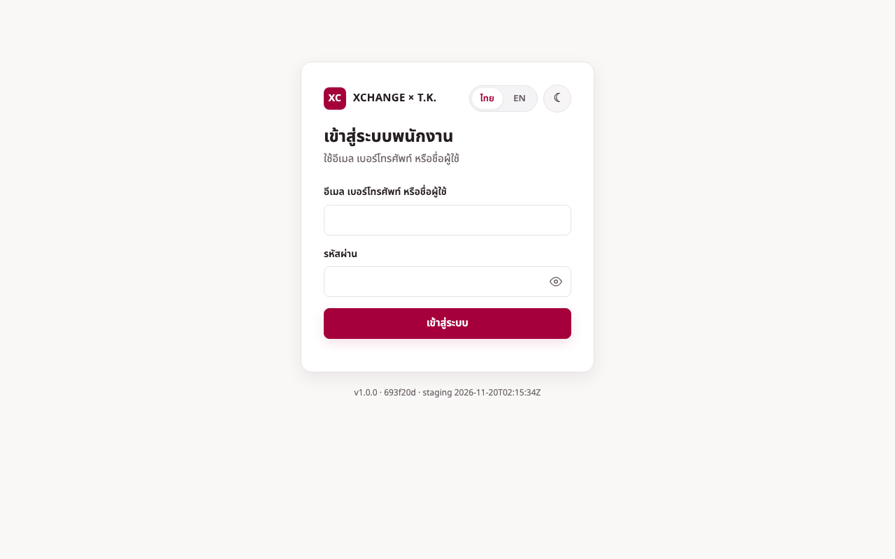
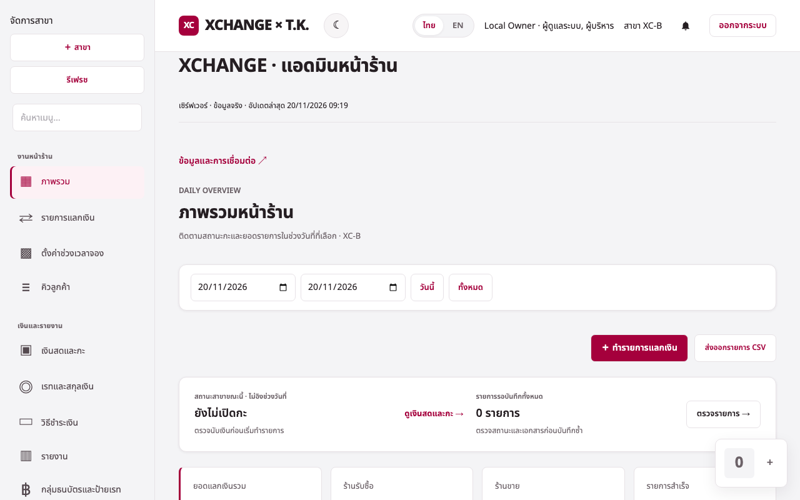
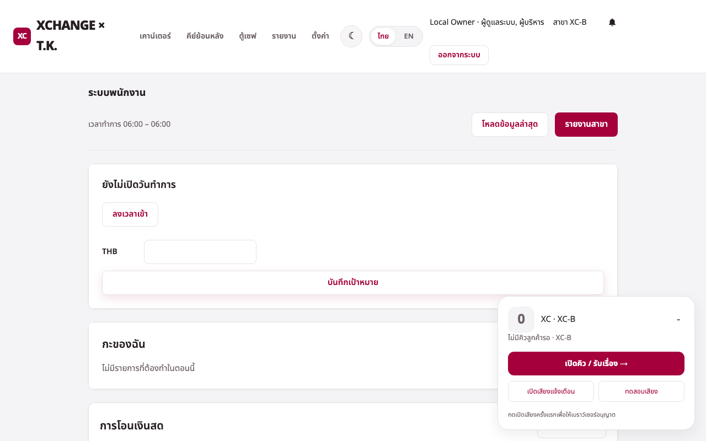
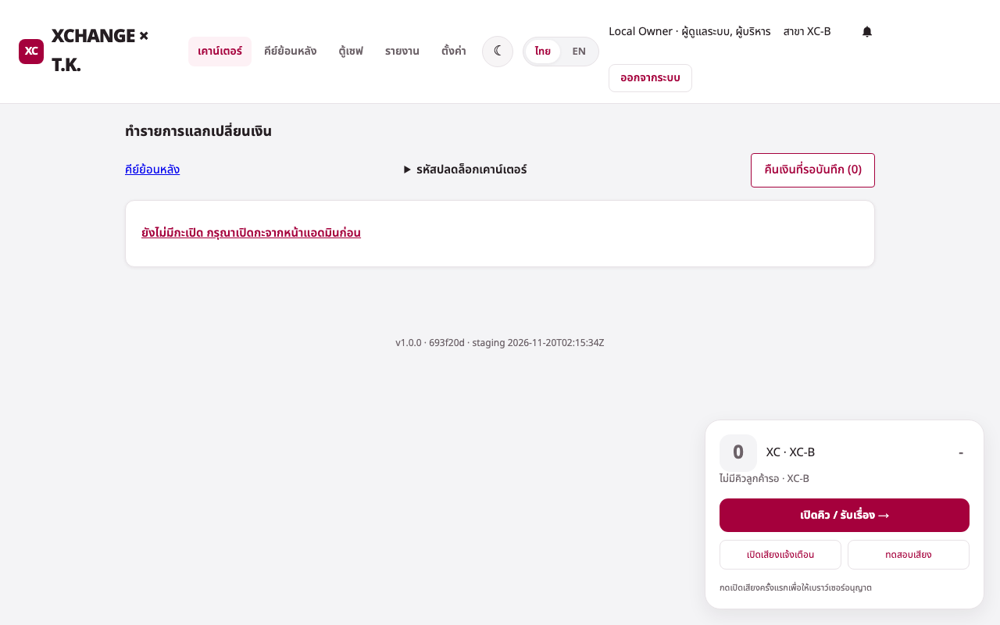
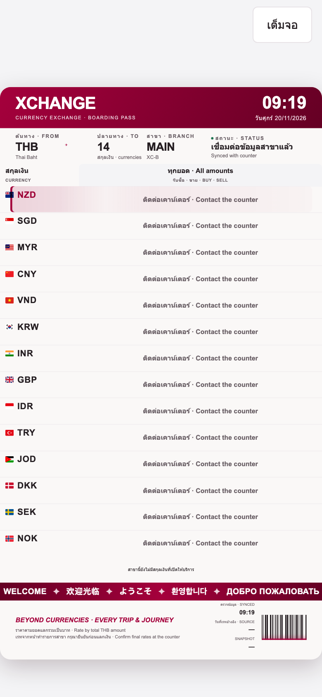
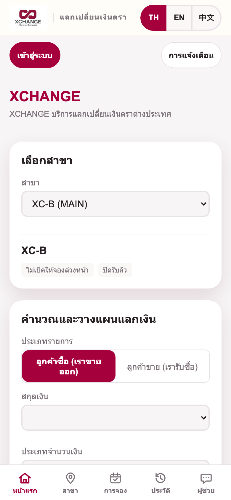

# xchange

XCHANGE money-changer counter system — Rust + PostgreSQL API, Flutter clients

## 1. What xchange is

XCHANGE runs a currency-exchange shop. Staff serve customers at a counter (the desk): they open a shift, count cash, take a queue number, quote a rate and record the exchange. Branch managers and the owner run the shop from an admin page: branches, rates and currencies, cash and shifts, reports, users and permissions, approvals, marketing. Customers use a phone app to see rates, book a time and take a queue number, and a public rate board shows the day's rates. One Rust server serves all of it, from one PostgreSQL database. People sign in through the central **Identity** service (`108-Plaza/108-platform-services`), not through xchange itself.

| Folder | What it is |
|---|---|
| `api/` | The server. Rust (toolchain pinned in `api/rust-toolchain.toml`), actix-web, sqlx, PostgreSQL. The binary is `xchange`; the domain lives in `api/crates/xc-*` (auth, cash, exchange, rate, queue, booking, customer, loyalty, marketing, verification, …). Migrations are in `api/migrations/` and run every time the server starts. |
| `web/` | Every browser page, in SolidJS + Vite: the staff desk (`/desk`, `/staff`), the admin (`/`), the customer app (`/app`), the rate board (`/rates`), the queue display, the staff guide. `npm run build` writes `web/dist/`, which the server embeds at compile time. |
| `app/` | The customer kiosk in Flutter web (see `app/README.md`). |
| `counter-app/` | XC Counter: a Mac app (Tauri) that wraps the staff desk full-screen and drives the cash drawer and scanner. Design: `docs/design/xc-counter-app.md`. |
| `tablet/` | The Android branch tablet wrapper (`tablet/android/`, checklist in `DEVICE_CHECKLIST.md`). Design: `docs/design/blueprint/kiosk-shared-phone.md`. |
| `deploy/` | Everything a server host needs: systemd unit, install/update/backup scripts, nginx examples. Start at `deploy/README.md`. |
| `qa/e2e/` | The Playwright end-to-end suite that drives a running host. Start at `qa/e2e/README.md`. |
| `docs/design/` | Design documents, one per feature. The main design is `docs/design/xchange-v3.md`. |
| `docs/design/blueprint/` | The per-area blueprints (rates, pricing formula, queue, booking, roles and branches, verification, …). |
| `docs/design/xchange-system-blueprint-v3.html` | The owner's System Blueprint v3, kept as the owner sent it. `xchange-system-blueprint-v3.md` next to it says what it covers. |
| `docs/blueprint/` | Older reference material: the v2 data model, the V9 RBAC and the V9–v3 comparison. |
| `scripts/` | Repo checks used by CI (formatting of included tests, migration slots). |

## Development principle: users set the values

Every business value (limits, thresholds, levels, amounts) is stored data that the Owner sets on a screen; none is fixed in code, config or a seed. See [docs/design/blueprint/user-set-settings.md](docs/design/blueprint/user-set-settings.md).

## 2. Got only this file?

> Ask the owner for these, and nothing else:
> 1. **Read access to two private GitHub repos:** `108-Plaza/xchange` and `108-Plaza/108-platform-services`. The second one holds the Identity service that sign-in needs, and the shared crates the API is built from, so `cargo build` fails without it too. Send the owner your GitHub username.
>
> You need **no secret from anyone** for a local run. Every key and password below is generated on your machine, and none of it reaches a real host. Deploying to a real host is a different matter: see section 7.

## 3. Install from zero

This was run from a fresh clone on macOS (Apple silicon) on 2026-11-20, at commit `693f20d`. Every step ends with a check. Do not go on until it passes.

You will run two servers in two terminals:

| Port | Server | Terminal |
|---|---|---|
| `18081` | Identity (sign-in), from `108-platform-services` | 1 |
| `18080` | xchange, from this repo | 2 |

Both listen on `127.0.0.1` only. The ports are free choices; these two were picked because `8080`/`8081` are often taken.

### Step 0 — Three variables, in every terminal you open

```bash
export XC_SRC="$HOME/xchange-src"      # where the two repos are cloned
export XC_DEV="$HOME/.xchange-dev"     # local keys, passwords and uploads; never inside a repo
export XC_DB=xchange_local             # database name; Identity gets "${XC_DB}_identity"
```

### Step 1 — Tools

| Tool | Version | Where the version comes from |
|---|---|---|
| git | any recent | — |
| rustup | any | installs the Rust toolchain each repo pins: `1.98.1` in `api/rust-toolchain.toml` and in `108-platform-services/rust-toolchain.toml` |
| nvm + Node | Node `24.21.0` | `.nvmrc` |
| PostgreSQL | run with 17.11 | a local server you can reach as your own user without a password |
| openssl, curl | any | macOS ships both |
| cargo-nextest | run with 0.9.140 | only for the API tests (section 6) |

If one is missing: rustup is at https://rustup.rs and nvm at https://github.com/nvm-sh/nvm; open a new terminal after installing either. The PostgreSQL used for this run was Homebrew's, running as the signed-in macOS user.

```bash
git --version
psql -h localhost -d postgres -Atc 'select 1'    # prints 1
openssl version
```

### Step 2 — Get the code

```bash
mkdir -p "$XC_SRC" && cd "$XC_SRC"
git clone https://github.com/108-Plaza/xchange.git
git clone https://github.com/108-Plaza/108-platform-services.git
```

Check — the toolchain pin is picked up (rustup installs it on first use):

```bash
cd "$XC_SRC/xchange/api" && rustc --version                  # rustc 1.98.1
cd "$XC_SRC/108-platform-services" && rustc --version        # rustc 1.98.1
```

### Step 3 — Node, and build the web pages

The server embeds `web/dist/` when it is compiled, so build the pages **before** the API.

```bash
cd "$XC_SRC/xchange"
nvm install            # reads .nvmrc: 24.21.0
nvm use && hash -r
node --version         # v24.21.0
npm --prefix web ci
npm --prefix web run build
```

Check: the last line is `✓ built in …`, and `ls web/dist/.vite/manifest.json` finds the file.

### Step 4 — Databases

```bash
createdb -h localhost "$XC_DB"
createdb -h localhost "${XC_DB}_identity"
psql -h localhost -d postgres -Atc "select datname from pg_database where datname like '${XC_DB}%'"
```

Check: both names are printed. Both stay empty: each server creates its own tables when it starts.

### Step 5 — Build and start Identity (terminal 1)

Identity is the service every sign-in goes through. xchange has no sign-in of its own and no stand-in for it, so a local run needs a local Identity.

```bash
cd "$XC_SRC/108-platform-services"
cargo build --locked -p identity-api        # about a minute with a warm cache; longer the first time

mkdir -p "$XC_DEV" && chmod 700 "$XC_DEV"
cat > "$XC_DEV/identity.env" <<EOF
AUTH_HTTP_ADDR=127.0.0.1:18081
DATABASE_URL=postgres://$USER@localhost:5432/${XC_DB}_identity
AUTH_ISSUER=auth-service
AUTH_AUDIENCE=xchange
AUTH_API_KEY=$(openssl rand -hex 24)
INTERNAL_SERVICE_TOKEN=$(openssl rand -hex 24)
AUTH_DEV_INSECURE=1
AUTH_REGISTER_REQUIRE_OTP=false
EOF
chmod 600 "$XC_DEV/identity.env"

set -a; . "$XC_DEV/identity.env"; set +a
./target/debug/identity-api
```

What the two last settings do:
- `AUTH_DEV_INSECURE=1` lets Identity start with a signing key made fresh at each start and no Redis. Without it Identity refuses to start. It is for a local machine only.
- `AUTH_REGISTER_REQUIRE_OTP=false` lets xchange create accounts without a text-message code. Without it, creating the owner in step 8 fails.

Check, from another terminal (it logs `identity-api listening` with `127.0.0.1:18081`):

```bash
curl -s http://127.0.0.1:18081/health/ready      # {"status":"ready",...}
```

Leave terminal 1 running.

### Step 6 — Register xchange as a client of Identity

Identity hands out a client id and secret for xchange. The secret is shown once, so it goes straight into a file.

```bash
cd "$XC_DEV"
set -a; . ./identity.env; set +a
curl -s -X POST http://127.0.0.1:18081/admin/client-applications \
  -H 'content-type: application/json' \
  -H "x-internal-token: $INTERNAL_SERVICE_TOKEN" -H "x-api-key: $AUTH_API_KEY" \
  -d '{"name":"xchange local","appType":"web","audience":"xchange","redirectUris":null}' > client.json
chmod 600 client.json
node -p 'const c=require("./client.json"); [c.audience, !!c.clientId, !!c.clientSecret].join(" ")'
```

Check: it prints `xchange true true`. Both headers are needed; with only one, Identity answers `401` and `client.json` is empty.

### Step 7 — Configure xchange

The server reads `api/configuration/base.yaml`, then `<APP_ENVIRONMENT>.yaml`, then environment variables named `APP_<SECTION>__<KEY>` (for example `APP_DATABASE__DATABASE_NAME`; see `api/src/config/mod.rs` and every setting in `deploy/server/env.example`). Identity is set with `IDENTITY_*` variables.

It also needs a **PII key**: it encrypts customer identities with it and refuses to start without one. On a host it is `/etc/xc-v3/pii.key`; locally, point `APP_PII__KEY_PATH` at a key of your own.

```bash
cd "$XC_DEV"
printf 'k1:%s\n' "$(openssl rand -base64 32)" > pii.key && chmod 600 pii.key
mkdir -p uploads verification-documents
. ./identity.env
cat > xchange.env <<EOF
APP_ENVIRONMENT=development
APP_APPLICATION__HOST=127.0.0.1
APP_APPLICATION__PORT=18080
APP_DATABASE__HOST=localhost
APP_DATABASE__USERNAME=$USER
APP_DATABASE__DATABASE_NAME=$XC_DB
APP_PII__KEY_PATH=$XC_DEV/pii.key
APP_FILES__DIR=$XC_DEV/uploads
APP_VERIFICATION__STORE_DIR=$XC_DEV/verification-documents
IDENTITY_BASE_URL=http://127.0.0.1:18081
IDENTITY_CLIENT_ID=$(node -p 'require("./client.json").clientId')
IDENTITY_CLIENT_SECRET=$(node -p 'require("./client.json").clientSecret')
IDENTITY_AUDIENCE=xchange
IDENTITY_ISSUER=auth-service
IDENTITY_API_KEY=$AUTH_API_KEY
IDENTITY_INTERNAL_TOKEN=$INTERNAL_SERVICE_TOKEN
EOF
chmod 600 xchange.env
```

Check: `grep -c = xchange.env` prints `16`, and `grep -c '=$' xchange.env` prints `0` (no empty value).

### Step 8 — Run the API (terminal 2)

```bash
cd "$XC_SRC/xchange/api"
set -a; . "$XC_DEV/xchange.env"; set +a
cargo run --locked
```

The first build takes a few minutes. The server applies every migration, then logs `listening on: 127.0.0.1:18080`.

Check, from another terminal:

```bash
curl -s http://127.0.0.1:18080/health/ready
# {"status":"ok","database":true,"version":"1.0.0","build":"<sha>","builtAt":"…","channel":"staging","ui":"built"}
```

`"database":true` means the migrations ran; `"ui":"built"` means step 3's pages are inside the binary. A `development` run reports channel `staging`; only `production` reports `release`.

Leave terminal 2 running.

### Step 9 — Create the first owner

The database starts with organisation `XC` and branch `MAIN`, and no user. There is no sign-up page for staff: the first owner is made once with the `create-owner` sub-command. It reads the password as one line from standard input, so the password never appears on a command line. It also links the host name the browser will use (`localhost:18080`) to organisation `XC`.

The password must be 12 to 128 characters. Make one and keep it in a file:

```bash
printf 'Local-%s\n' "$(openssl rand -hex 6)" > "$XC_DEV/owner.pw" && chmod 600 "$XC_DEV/owner.pw"

cd "$XC_SRC/xchange/api"
set -a; . "$XC_DEV/xchange.env"; set +a
./target/debug/xchange create-owner --name 'Local Owner' --phone 0800000001 --host localhost:18080 < "$XC_DEV/owner.pw"
```

Check: it prints `Owner Local Owner created (user <id>); host localhost:18080 linked; sign in on /login with the phone`.

### Step 10 — Sign in

1. Open **http://localhost:18080/login**. Use `localhost`, not `127.0.0.1`: the server finds the organisation by the host name you linked in step 9.
2. Enter the phone `0800000001` and the password from `cat "$XC_DEV/owner.pw"`.
3. The owner must change the password at the first sign-in. Enter the old one, then a new one (12–128 characters) twice. Write the new one down; `owner.pw` is now stale.
4. The page goes back to the sign-in form with *เปลี่ยนรหัสผ่านเรียบร้อยแล้ว* ("password changed"). Sign in with the new password.
5. You land on the admin overview (`/`). The installation works.

### Stopping and starting again

- Stop either server with `Ctrl-C` in its terminal.
- To start again, open the terminals, run step 0, then the last two lines of step 5 (terminal 1) and step 8 (terminal 2). Nothing else needs repeating.
- Identity makes a new signing key each time it starts. xchange fetches Identity's keys again at most once a minute, so for up to a minute after an Identity restart, sign-in can fail with *ระบบยืนยันตัวตนไม่พร้อมใช้งาน* (the log says `code=token_verification_failed`). Wait a minute and sign in again; everyone signed in before the restart signs in again too.

## 4. User manual

**The full manual is [docs/USER_MANUAL.md](docs/USER_MANUAL.md):** step by step, by role, with a screenshot for each main step, every on-screen Thai label quoted so you can match the screen.

In short:

- Staff sign in at `/login` with a phone, email or username; a new account sets its own password at the first sign-in. Every staff page has a ไทย / EN switch and a light/dark switch (☾ / ☀).
- Tellers land on the counter (`/desk`); everyone else on the admin (`/`). `/staff` is the day at a glance (clock in, my shift, cash transfers). Customers use `/app`; the shop's screens show `/rates?branch=MAIN` and `/queue-display?branch=MAIN`.
- On a new install, before a teller can serve anyone: set the branch hours, add staff (at least a branch manager and a teller), draft, approve and publish a rate set, set the THB cash rounding step, fund the branch safe, then the teller counts the opening and the manager verifies it. The manual's sections 4 to 6 walk through each step. No business value is built in; until the owner sets it, whatever needs it is refused and the message says what is missing.

## 5. Screenshots

Captured from the local run above (step 10), with its fictional data only.

**Sign-in** (`/login`):



**Admin overview** (`/`), signed in as the owner. The left menu holds every admin page.



**Staff floor** (`/staff`) and **the counter** (`/desk`). The counter asks for a shift first.

| Staff floor | Counter |
|---|---|
|  |  |

**Rate board** (`/rates?branch=MAIN`) and **customer app** (`/app`) at phone size. No rate set is published yet on a new install, so the board says *Contact the counter*.

| Rate board | Customer app |
|---|---|
|  |  |

More screens, from the test host, are in `qa/e2e/README.md`.

## 6. Running the tests

### API

Most API tests need a real PostgreSQL and do not skip without one. Give them an empty database whose name ends in `_test` (CI uses `xchange_test`); each test makes its own schema or database inside it and removes it afterwards.

```bash
createdb -h localhost "${XC_DB}_test"
export TEST_DATABASE_URL="postgres://$USER@localhost:5432/${XC_DB}_test"
```

Run them with nextest, the way CI does:

```bash
cd api && cargo nextest run -p xchange -E 'test(/pricing_formula/)'
```

On 2026-11-20 this ran 34 tests, all passed (`Summary … 34 tests run: 34 passed`).

`cargo test` with more than one thread gives false failures. `RoleGrants::install` (`crates/xc-auth/src/domain/access/role_grants.rs`) replaces a process-global snapshot, and about 20 test files call it. Under `cargo test`, the tests of one binary share a process, so one test's snapshot leaks into another test's requests (e.g. `roleNotAllowedHere` in `pricing_formula_save_command_test` next to `pricing_formula_save_permission_test`, #564 issuecomment-6538838105). nextest runs each test in its own process. If you must use `cargo test`, add `-- --test-threads=1`.

A pull request's own CI runs guards, not tests (`.github/scripts/api-ci-plan.sh`). A push to `main` tests the packages the change touches and their dependents (`.github/scripts/api-test-plan.sh`; the whole workspace when the change cannot be mapped). A batch PR whose branch is `batch/merge-*` runs the full suite.

### Web

```bash
cd web && npm run check        # typecheck, then vitest, then the production build
```

On 2026-11-20 this ran 1,135 test files (8,264 tests) and exited 0.

### End to end

The Playwright suite drives a running host with real test accounts. It is not part of a local install; its own runbook is [`qa/e2e/README.md`](qa/e2e/README.md). Without accounts you can still check the specs:

```bash
cd qa/e2e && npm ci && npx playwright test --list    # Total: 193 tests in 50 files
```

## 7. Deploying

A host runs one release binary behind nginx, with its settings in `/etc/xc-v3/env` and its PII key in `/etc/xc-v3/pii.key`. How to build it is in [`deploy/server/build.md`](deploy/server/build.md); how to install, update, back up and restore it is in [`deploy/README.md`](deploy/README.md). **Deploys happen only on the owner's order**, and merging a change deploys nothing.

## 8. Troubleshooting

Each row is something that went wrong while these steps were followed.

| You see | Cause | Do |
|---|---|---|
| `node --version` still prints the old version after `nvm use` | The shell cached the old `node` path | `hash -r`, or open a new terminal |
| `Error: "AUTH_FAIL_CLOSED is set but AUTH_JWT_SIGNING_KEY is unset …"` when Identity starts | Identity refuses to start without a stable signing key and Redis, unless told it is a local run | Keep `AUTH_DEV_INSECURE=1` in `identity.env` (step 5) |
| Step 6 answers `401` and `client.json` is empty (`Unexpected end of JSON input`) | The admin route needs both `x-internal-token` and `x-api-key` | Send both headers, as in step 6 |
| `curl` reaches something on `8080`/`8081` that is not your server | Another program (here, an SSH tunnel) was already listening there; `lsof -nP -iTCP:8081 -sTCP:LISTEN` shows it | Use free ports; this README uses `18080` and `18081` |
| `create-owner` prints `Identity refused (identityUnavailable) …; the owner stays PENDING, run again` | Identity requires a text-message code to create an account (`otp_required`) | Set `AUTH_REGISTER_REQUIRE_OTP=false` in `identity.env`, restart Identity, and run `create-owner` again; it completes the pending owner |
| The sign-in page says *ระบบยืนยันตัวตนไม่พร้อมใช้งาน กรุณาลองใหม่ภายหลัง* ("identity is not available") | Identity is not running | Start it (step 5, terminal 1) |
| The same message right after Identity was restarted; the xchange log says `code=token_verification_failed` | Identity has a new signing key and xchange still holds the old one; it fetches keys again at most once a minute | Wait a minute and sign in again |
| The sign-in page shows *เปลี่ยนรหัสผ่าน* (change password) | The first owner must change the password | Expected: step 10, item 3 |
| The rate board says *Contact the counter* for every currency | No rate set is published for the branch yet | Publish one under **Rates & Currencies** in the admin |
| API tests panic with `TEST_DATABASE_URL is not set; these tests need a real PostgreSQL and do not skip` | No test database was given | Create it and export `TEST_DATABASE_URL` (section 6) |
| API tests fail at random under `cargo test` | Tests share a process-global role table | Use nextest, or `-- --test-threads=1` (section 6) |
