# XCHANGE user manual

How to use XCHANGE once it is installed (README section 3), step by step, by role.

- Every on-screen label is quoted in Thai, exactly as the screen shows it, in backticks, so you can match the screen. Every screen also has an `EN` switch; this manual uses the Thai labels because Thai is the default.
- Every screenshot comes from a local run of commit `693f20d` (README section 3) with made-up data only: the people are "Local Owner", "Manager Demo", "Teller Demo", "Finance Demo", "Rates Demo" and the customer "Pat Sample"; the passport is a blank specimen image; the rates are invented.
- A task marked **(not run locally)** is described from the code on `main` only; it was not exercised for this manual. The reason is given at the task.
- The in-app staff guide (`/staff-guide`, title `คู่มือพนักงาน XC Desk v2`) is an older, shorter guide. Where it and this manual differ, section 11 says how.

## Contents

1. [Roles: who can do what](#1-roles-who-can-do-what)
2. [Signing in, the first password change, language and theme](#2-signing-in-the-first-password-change-language-and-theme)
3. [The screens and how to get around](#3-the-screens-and-how-to-get-around)
4. [Owner and admin: first-time setup](#4-owner-and-admin-first-time-setup)
5. [Finance: putting cash into the safe](#5-finance-putting-cash-into-the-safe)
6. [Teller and manager: opening the day](#6-teller-and-manager-opening-the-day)
7. [Teller: serving customers at the counter](#7-teller-serving-customers-at-the-counter)
8. [Corrections: cancel, reverse and refund](#8-corrections-cancel-reverse-and-refund)
9. [Closing the day](#9-closing-the-day)
10. [Approvers, executives and finance: approvals, reports, transactions](#10-approvers-executives-and-finance-approvals-reports-transactions)
11. [Devices: counter Mac, drawer, printer, tablets](#11-devices-counter-mac-drawer-printer-tablets)
12. [Public screens: rate board and queue display](#12-public-screens-rate-board-and-queue-display)
13. [The customer app (`/app`)](#13-the-customer-app-app)
14. [Messages you may see, and what they mean](#14-messages-you-may-see-and-what-they-mean)
15. [How this manual relates to the in-app staff guide](#15-how-this-manual-relates-to-the-in-app-staff-guide)

---

## 1. Roles: who can do what

A user has one or more roles, each for one branch or for the whole organisation. The owner gives roles under `ผู้ใช้งานและสิทธิ์` (section 4.2). The table is the default; the owner can change what each role may do on the `ตารางสิทธิ์` tab of the same screen.

| Role (code) | Shown as | Typical work | Branch |
|---|---|---|---|
| `EXECUTIVE` | `ผู้บริหาร` | Owner-level settings: payment methods, pricing rules, cash limits, consent, customer app; approves rate sets, campaigns and large cash transfers; executive overview | whole organisation only |
| `ADMIN` | `ผู้ดูแลระบบ` | Branches, users and roles, booking slots | may be organisation-wide |
| `RATE_MANAGER` | `ผู้จัดการเรท` | Drafts rate sets | needs a branch |
| `BRANCH_MANAGER` | `ผู้จัดการสาขา` | Everything a teller does, plus: verifies cash counts, opens and closes the branch day, approves cash transfers within the limit and large exchanges, backdated keying | exactly one branch |
| `TELLER` | `พนักงานแลกเงิน` | Clock in, open and close a shift, the counter (`/desk`), the queue | exactly one branch |
| `FINANCE` | `การเงิน` | Cash transfers, reconciliation; approves count differences and reversals | needs a branch |
| `MARKETING` | — | Campaigns and member groups | may be organisation-wide |
| `VERIFICATION_REVIEWER` | `ผู้ตรวจเอกสาร` | Reviews customer documents | may be organisation-wide |

The first owner, made with `create-owner` (README step 9), holds both `ADMIN` and `EXECUTIVE` for the whole organisation. In the screenshots the account bar shows this as `Local Owner · ผู้ดูแลระบบ, ผู้บริหาร`.

**Two people for every money check.** The person who counts cash can never verify that count, and the person who asks for an approval can never decide it. So a working branch needs at least an owner, a branch manager and a teller; reversals and count differences also need someone with `FINANCE`.

---

## 2. Signing in, the first password change, language and theme

### 2.1 Sign in (every staff member)

1. Open `/login` on the address the owner linked (README step 9; locally `http://localhost:18080/login`).
2. In `อีเมล เบอร์โทรศัพท์ หรือชื่อผู้ใช้`, type your phone number, email or username.
3. In `รหัสผ่าน`, type your password and press `เข้าสู่ระบบ`.
4. You land on the counter (`/desk`) if you are a teller, otherwise on the admin (`/`).

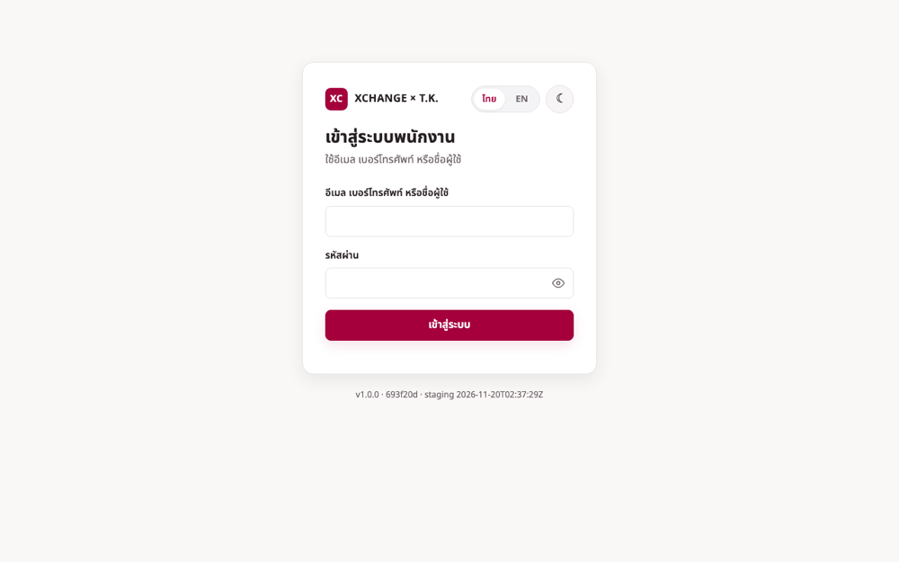

| Message | Meaning |
|---|---|
| `ชื่อผู้ใช้หรือรหัสผ่านไม่ถูกต้อง` | Wrong identifier or password. |
| `ลองหลายครั้งเกินไป กรุณารอสักครู่แล้วลองใหม่` | Too many attempts; wait and try again. |
| `บัญชีถูกล็อกชั่วคราว กรุณาลองใหม่ภายหลัง` | The account is locked for a while. |
| `บัญชีถูกระงับ` / `บัญชีนี้ถูกระงับที่ระบบยืนยันตัวตน` | The account is suspended (in XCHANGE, or in the central Identity service). Ask the owner. |
| `บัญชีนี้ยังไม่มีผู้ใช้ใน XCHANGE ให้เจ้าของร้านสร้างบัญชีให้` | The login exists but has no XCHANGE user. The owner must create one (4.2). |
| `ระบบยืนยันตัวตนไม่พร้อมใช้งาน กรุณาลองใหม่ภายหลัง` | Identity is down or was just restarted. Wait a minute (README "Stopping and starting again"). |

### 2.2 The first password change (every new account)

A new account, and an account whose password the owner reset, must set its own password before anything else.

1. Sign in with the temporary password. The card changes to `เปลี่ยนรหัสผ่าน`.
2. Fill `รหัสผ่านปัจจุบัน` (the temporary password), then `รหัสผ่านใหม่` and `ยืนยันรหัสผ่านใหม่`. The new password must be 12 to 128 characters (`รหัสผ่านต้องมีความยาว 12–128 ตัวอักษร`).
3. Press `บันทึกรหัสผ่านใหม่`.
4. The card goes back to the sign-in form with `เปลี่ยนรหัสผ่านเรียบร้อยแล้ว กรุณาเข้าสู่ระบบด้วยรหัสผ่านใหม่`. Sign in with the new password.

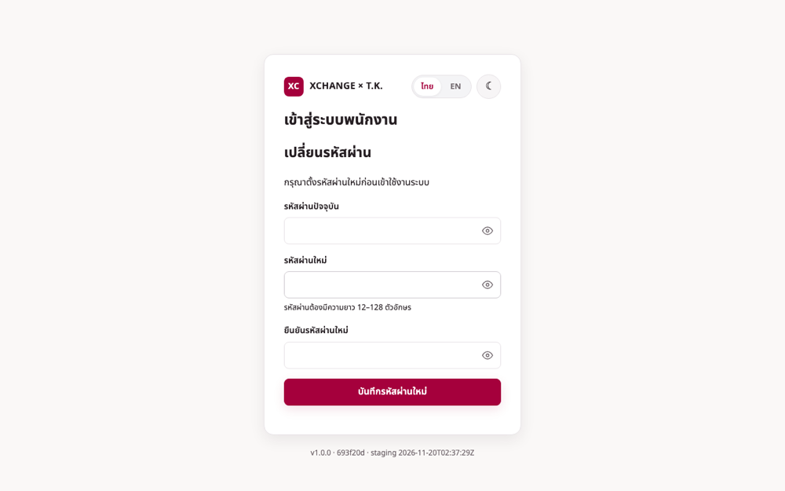

Errors: `รหัสผ่านใหม่และยืนยันรหัสผ่านไม่ตรงกัน` (the two new ones differ), `รหัสผ่านปัจจุบันไม่ถูกต้อง` (wrong temporary password), `รหัสผ่านใหม่ ไม่ถูกต้อง` (Identity refused the new password; choose another).

### 2.3 Language and light/dark

- **Language:** the `ไทย` / `EN` switch is at the top of the sign-in card and in the header of every staff page. The customer app has `TH` / `EN` / `中文`. The browser remembers the choice.
- **Light/dark:** the round ☾ / ☀ button (`สลับโหมดสว่าง / มืด`) is on the sign-in card and in the staff header. With no choice saved, the page follows the computer's setting. Customer pages, the rate board and printouts always stay light.

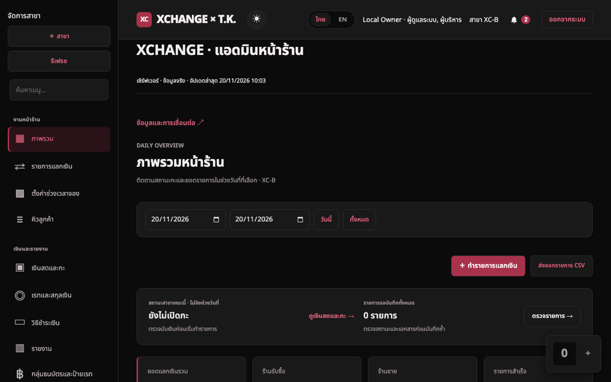

### 2.4 Sign out

Press `ออกจากระบบ` at the top right.

---

## 3. The screens and how to get around

| Address | Who | What it is |
|---|---|---|
| `/` (admin) | everyone except tellers lands here | Runs the shop. The left menu has four groups: `งานหน้าร้าน`, `เงินและรายงาน`, `ข้อมูลและทีม`, `เครื่องมือ`. You only see the items your role allows. `ค้นหาเมนู…` filters the menu. |
| `/staff` | every staff member | `ระบบพนักงาน`: clock in and out, my shift, cash transfers, the posted rates, customer holds. |
| `/desk` | tellers, branch managers | `ทำรายการแลกเปลี่ยนเงิน`: the counter. |
| `/desk/queue` | tellers, branch managers | `คิวหน้าเคาน์เตอร์`: issue and call queue numbers. |
| `/staff/report` | managers, finance, executive | `รายงานปิดวัน`: the daily close report. |
| `/staff/settings` | every staff member | `ตั้งค่า`: links to the settings your role can see. |
| `/staff-guide` | every staff member | The older in-app staff guide. |
| `/devices`, `/_xc/device-agents` | managers, owner | Device jobs, and pairing the counter Mac (section 11). |
| `/rates?branch=MAIN` | anyone | The public rate board (section 12). |
| `/queue-display?branch=MAIN` | anyone | The public queue screen (section 12). |
| `/app` | customers | The customer app (section 13). |

The staff header shows `เคาน์เตอร์` (counter), `คีย์ย้อนหลัง` (backdated keying), `ตู้เซฟ` (safe), `รายงาน` (reports) and `ตั้งค่า` (settings), each only when your role allows it, plus your name and role, the branch (`สาขา …`) and a bell for notifications.

On staff pages a small queue card floats at the bottom right (`ไม่มีคิวลูกค้ารอ · …` or `มีคิวลูกค้ารอ {n} รายการ`) with `เปิดคิว / รับเรื่อง →`. It can cover buttons at the right edge of a card; scroll or collapse it with `−`.

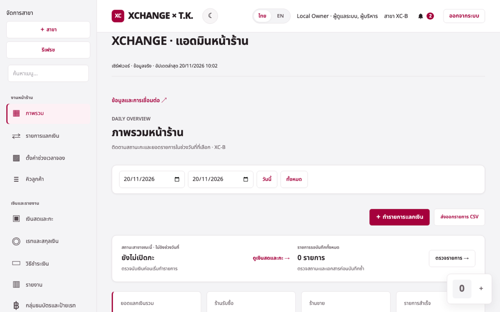

---

## 4. Owner and admin: first-time setup

Do these once, in this order, on a new install. Everything here is in the admin (`/`). Each step says who can do it. **No value is built in**: until the owner sets a limit or a rule, the thing that needs it is refused, and the refusal names what is missing.

### 4.1 Branch, opening hours and shifts — owner or `ADMIN`

The install starts with one branch, code `MAIN`.

1. Menu `ข้อมูลและทีม` › `สาขาและการเปิดทำการ`. Pick the branch in `เลือกสาขา`.
2. Under `ข้อมูลสาขาและเวลาทำการ`, check `รหัสสาขา`, `ชื่อสาขา`, `ที่อยู่` and `เขตเวลา` (for Thailand, `Asia/Bangkok`). Tick `เปิดรับการจอง` if customers may book times in the app.
3. Under `เวลาเปิดทำการรายสัปดาห์`, tick each day the branch opens (the label turns from `ปิดทำการ` to `เปิด`) and set the opening and closing time.
4. Press `บันทึกข้อมูล`. You should see `บันทึกข้อมูลสาขาเรียบร้อยแล้ว`.
5. Check the `กะทำงาน` card. A new branch has three shifts, `A 06:00–14:00`, `B 14:00–22:00`, `C 22:00–06:00`. Change them with `เพิ่มกะ`, `ลบกะ` and `บันทึกกะ` if needed. A teller can only open a shift during one of these windows.

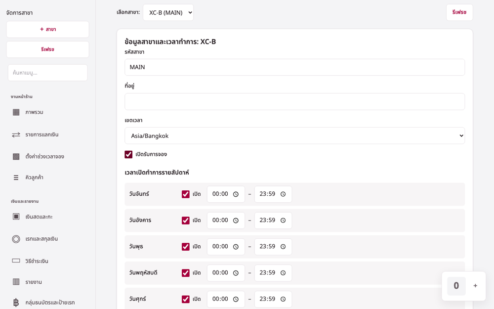

To add a branch: press `＋ สาขา` at the top of the left menu, type a name in `เพิ่มสาขา` and press `สร้างสาขา`. Each branch has its own cash, stock, shifts, transactions and rates.

Errors: `กรุณากรอกเขตเวลา`, `รหัสสาขาซ้ำกับสาขาอื่น`, `กรุณาระบุชื่อสาขาที่ไม่ซ้ำ`; shift errors such as `เวลาพักต้องอยู่ภายในเวลากะ` or `กะทั้งหมดต้องอยู่ภายใน 24 ชั่วโมงนับจากกะแรก`.

### 4.2 Staff accounts and roles — owner or `ADMIN`

1. Menu `ข้อมูลและทีม` › `ผู้ใช้งานและสิทธิ์`, tab `ผู้ใช้งาน`. Press `สร้างผู้ใช้ใหม่`.
2. Fill `ชื่อ-นามสกุล` and `เบอร์โทรศัพท์ (ใช้เข้าสู่ระบบ)` (starts with `0` or `+`). `รหัสผู้ใช้` and `อีเมล` are optional.
3. Choose `บทบาท` (role) and `สาขา`. `ทั่วทั้งองค์กร (ทุกสาขา)` means organisation-wide; a teller or branch manager must have one branch.
4. Press `สร้างผู้ใช้`. You should see `สร้างบัญชีผู้ใช้เรียบร้อยแล้ว` and a `รหัสผ่านชั่วคราว` box. **It is shown once** (`รหัสผ่านนี้จะแสดงเพียงครั้งเดียว กรุณาคัดลอกและส่งมอบให้ผู้ใช้`): press `คัดลอก`, hand it to the person privately, then press `รับทราบแล้ว`.
5. The person signs in and sets their own password (2.2).

| Create user | One-time password (blurred here) |
|---|---|
| 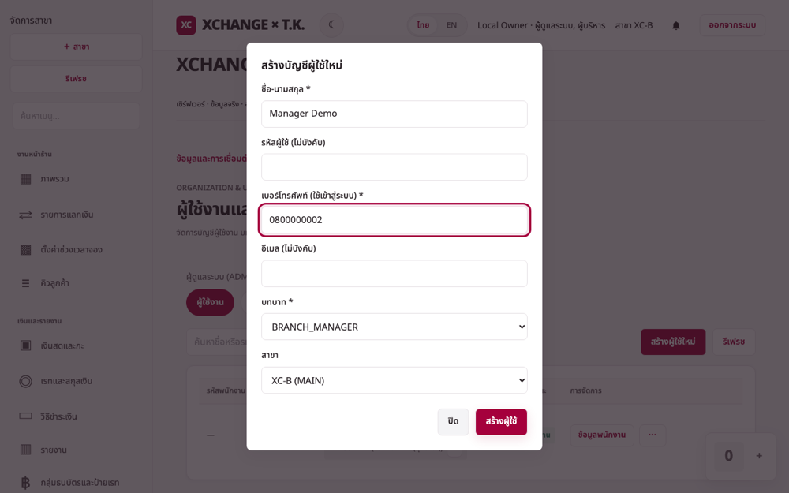 | 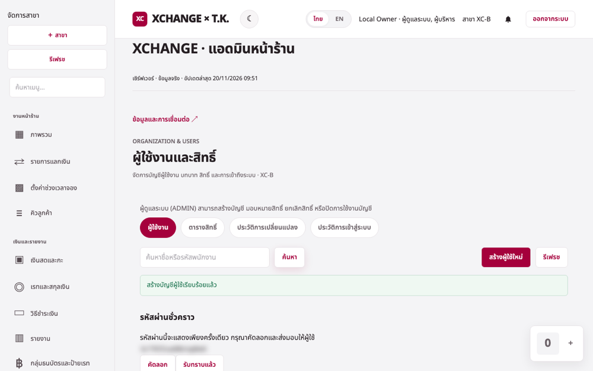 |

Other actions on a user's row:
- `มอบหมายสิทธิ์` (under `การจัดการเพิ่มเติม`) adds a role, optionally with `วันเริ่มมีผล` and `วันสิ้นสุด`; `ยกเลิกสิทธิ์` removes one.
- `รีเซ็ตรหัสผ่าน` › `ยืนยันรีเซ็ตรหัสผ่าน` makes a new one-time password; the person must change it at the next sign-in.
- `ระงับชั่วคราว` / `ยกเลิกระงับ` suspends and resumes; `ปิดบัญชี` disables (no confirmation box); `เปิดใช้งานอีกครั้ง` re-enables.

Rules the server enforces: you cannot change your own account (`แก้ไขบัญชีของตัวเองไม่ได้`); only the owner can touch `ADMIN` or `EXECUTIVE` users; the last active owner cannot be removed (`ต้องมีเจ้าของที่ยังใช้งานอยู่อย่างน้อยหนึ่งคน`); someone still holding cash or a handover cannot be disabled (`พนักงานคนนี้ยังถือเงินสดหรือมีการส่งมอบที่ยังไม่เสร็จ`).

### 4.3 Currencies and rates — `RATE_MANAGER` drafts, owner approves

A rate set goes draft → approval → publish. The counter, the rate board and the customer app only use the **published** set.

1. As the rate manager: menu `เงินและรายงาน` › `เรทและสกุลเงิน`. Under `ฉบับร่างเรทปัจจุบัน`, press `สร้างฉบับร่างใหม่`.
2. Choose a currency in the list next to `เพิ่มสกุลเงิน` and press `เพิ่มสกุลเงิน`; repeat for each currency.
3. For each line, set the buy side and the sell side to `กำหนดเอง` (manual), type the rate, and type a `เหตุผล`.
   - **Use `กำหนดเอง` on a new install.** `อัตโนมัติ` computes the rate from a formula and the tier policy; with neither set, the line publishes with no price and shows `ยังไม่ตั้ง`.
   - The sell rate must not be below the buy rate (`เรทร้านขายต้องไม่น้อยกว่าเรทร้านรับซื้อ`).
4. Press `บันทึกรายการเรท`, then `จำลองเรท` (each line shows `อยู่ในกรอบ` or `นอกกรอบ`), then `ส่งขออนุมัติ`.
5. As the owner: menu `เครื่องมือ` › `คำขออนุมัติ`. The card `เผยแพร่เรท` lists the lines. Press `อนุมัติ` (or type a reason in `เหตุผลการตัดสินใจ` and press `ปฏิเสธ`).
6. As the rate manager again: press `เผยแพร่เรท`. The table `เรทหน้าร้าน` now shows the rates.

| Draft with manual rates | Approval card |
|---|---|
| 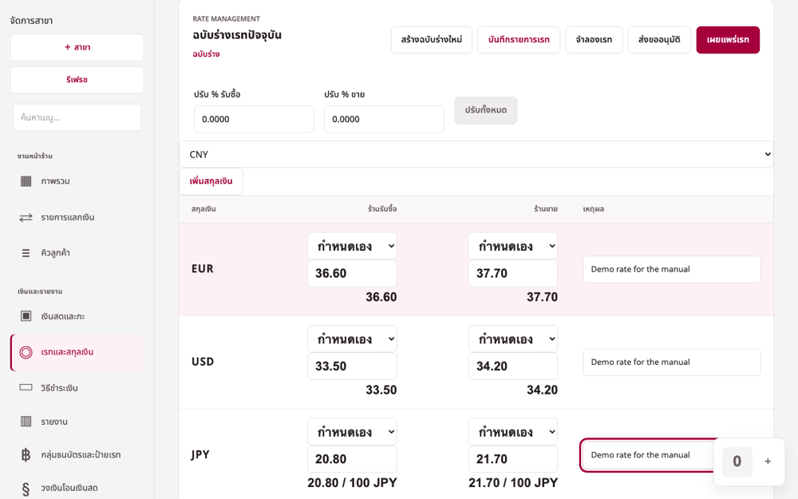 | 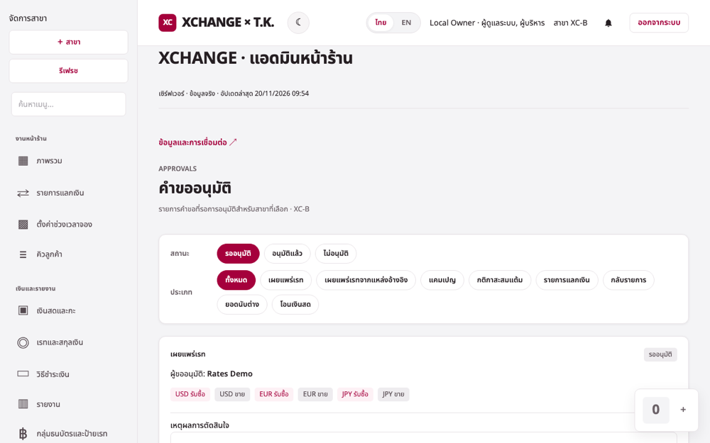 |

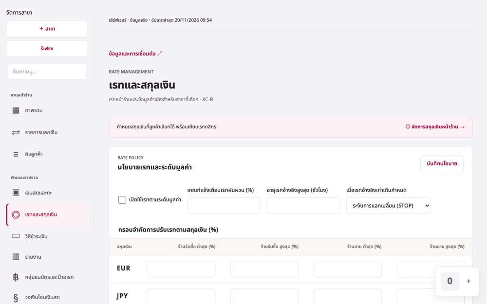

The section `เทียบเรท ธปท. และต้นทุนคู่ค้า` shows Bank of Thailand reference rates for comparison only.

### 4.4 The THB cash rounding step — owner (`EXECUTIVE`)

**Without this the counter refuses every cash quote** with `pricingRuleNotSet:thbCashStep: the Owner has not set the THB cash step`.

1. Menu `เงินและรายงาน` › `ราคาเรทตามขั้น`, card `กฎราคาของเจ้าของ`.
2. In `ปัดเงินสดบาททีละ (บาท)` type the step cash is rounded to (for example `1`). The hint under an empty field says what is refused while it is not set.
3. Press `บันทึก`.

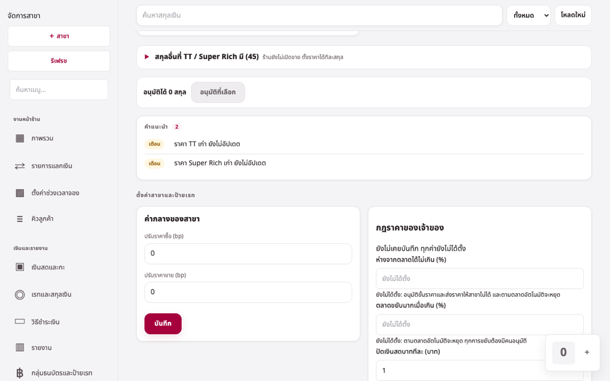

The other fields on that card (distance from market, large-move threshold, rate decimals, branch adjustment cap, and so on) drive the market-based tier pricing; each says what stops while it is empty.

### 4.5 Cash limits — owner (`EXECUTIVE`)

Every staff member can see these two screens; only the owner can save them.

**Cash-transfer limit** — menu `เงินและรายงาน` › `วงเงินโอนเงินสด`:
1. Add a currency with `เพิ่มสกุลเงิน` if it is not listed, and type its limit in `วงเงิน`.
2. Press `บันทึกวงเงิน` (`บันทึกวงเงินแล้ว`).
3. A transfer up to the limit is approved by the source branch's manager; above the limit, or in a currency left blank (`ช่องที่เว้นว่าง: ทุกการโอนสกุลนี้ต้องให้ผู้บริหารอนุมัติ`), only an executive can approve it.

**Count-difference limit** — menu `เงินและรายงาน` › `เกณฑ์ยอดนับต่าง`:
1. Type an amount in `เกณฑ์ยอดนับต่าง (THB)`, or tick `ไม่จำกัดเกณฑ์ (ส่งทุกยอดต่างให้ฝ่ายการเงิน)`.
2. Press `บันทึกเกณฑ์`.
3. A shift count that differs from the system by more than this goes to finance for approval (section 9).
4. On the same screen, `ระดับเตือนให้เบิก OD` sets, per currency, the drawer level at which the counter warns the manager to top it up from the safe.

| Transfer limit | Count-difference limit |
|---|---|
| 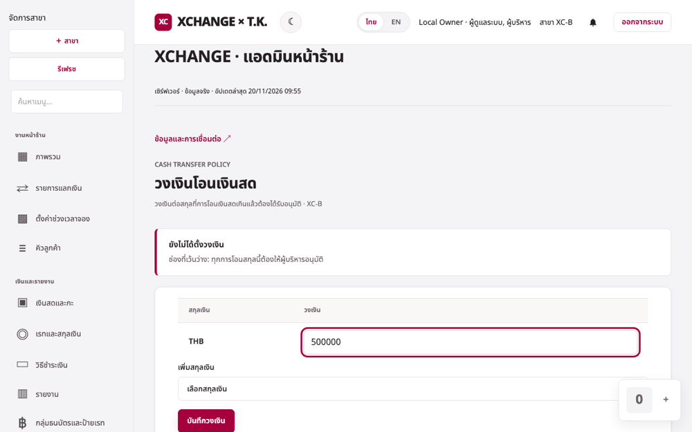 | 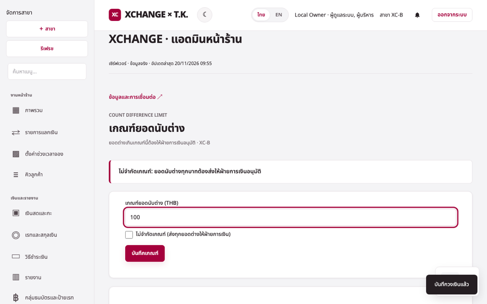 |

### 4.6 Payment methods — owner (`EXECUTIVE`)

Menu `เงินและรายงาน` › `วิธีชำระเงิน`. For each of `เงินสด`, `บัตรเครดิต`, `Alipay`, `พร้อมเพย์`, `โอนธนาคาร`: tick `เปิดใช้`, choose `รับเงินบาทจากลูกค้า` (when the shop sells) and/or `จ่ายเงินบาทให้ลูกค้า` (when the shop buys), and optionally `ชื่อบัญชี / จุดรับ–จ่าย` and `ข้อความแนะนำลูกค้า`. Press `บันทึกการตั้งค่า`. At least one method must be open for buying and one for selling. In the local run, cash was offered at the counter without changing this screen.

### 4.7 Other settings (owner) — short reference

| Menu item | What it sets | Who saves |
|---|---|---|
| `ตั้งค่าช่วงเวลาจอง` | Booking slot length and capacity, closure days, booking policy | `ADMIN`/owner; rules and capacity owner only |
| `ความยินยอมและการเก็บรักษา` | The customer terms (`TERMS`) and marketing consent texts per language (`เผยแพร่`), and data-retention days. **The customer app cannot sign anyone up until a `TERMS` text is published in that language.** | owner |
| `แอปลูกค้า` | Which sign-in codes the customer app offers (`อีเมล` / `SMS`) | owner |
| `เกณฑ์แจ้งเตือน` | Stale-data minutes and per-currency minimum stock for alerts | owner |
| `ตั้งค่าแจ้งเตือนเรท` | Limits for customer rate alerts; customers cannot create alerts until this is saved | owner |
| `กลุ่มธนบัตรและป้ายเรท` | Banknote groups and rate-board keys per currency | rate manager, owner |
| `ราคาตั้งต้น`, `สูตรคำนวณราคา` | Organisation starting prices and the pricing formula | owner |
| `แคมเปญการตลาด`, `กฎคะแนนสะสมและระดับสมาชิก`, `กลุ่มสมาชิก` | Campaigns, loyalty rules, member groups (each goes through approval) | marketing, managers, owner |

---

## 5. Finance: putting cash into the safe

A teller's opening cash comes out of the branch safe, so **the safe must hold cash before the first shift can open**. Cash enters a safe only through a transfer.

Who: anyone with cash management (`FINANCE`, `BRANCH_MANAGER`, `EXECUTIVE`) records it; someone else approves it.

1. On `/staff`, card `การโอนเงินสด`, press `โอนเงินสดใหม่`.
2. Choose `ประเภท` `เงินเข้าภายนอก` (money in from outside, for example from the bank).
3. Type a `หมายเหตุ`, and the number of notes of each denomination.
4. Press `บันทึก`. The transfer is created and sent for approval at once; its status is `รออนุมัติ`.
5. The approver (the branch manager when within the limit of 4.5, otherwise an executive) opens admin › `คำขออนุมัติ`, finds the `โอนเงินสด` card and presses `อนุมัติ`.
6. Back on `/staff`, the creator presses `ส่งเงิน` (status `ส่งออกแล้ว`), then `รับเงิน`, counts each denomination received (`นับแต่ละรายการที่ได้รับ ไม่ต้องดูจำนวนที่ส่งมา`) and saves. The status becomes `รับแล้ว`.

| New transfer | Manager approves it |
|---|---|
| 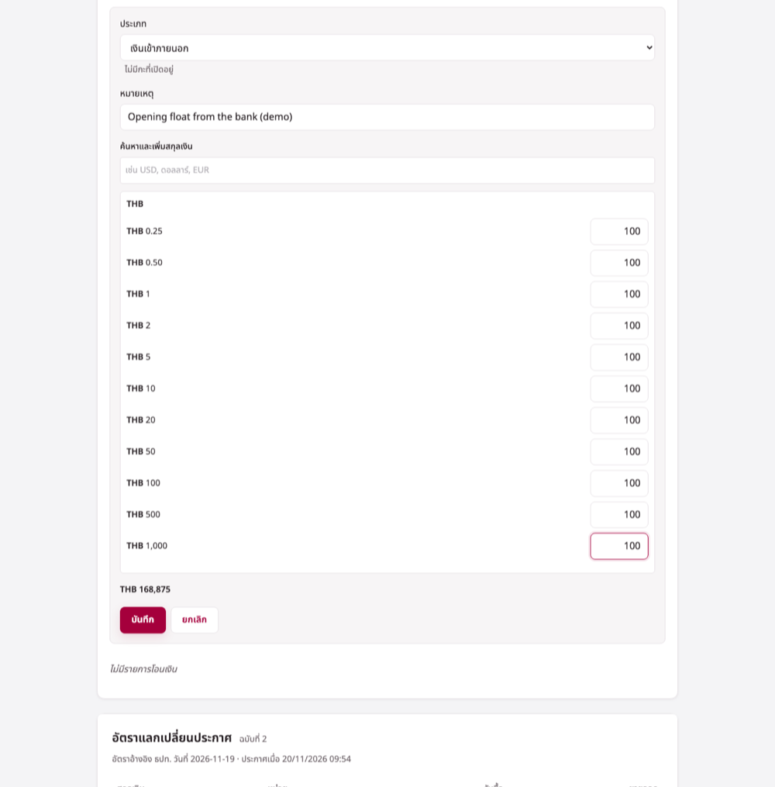 | 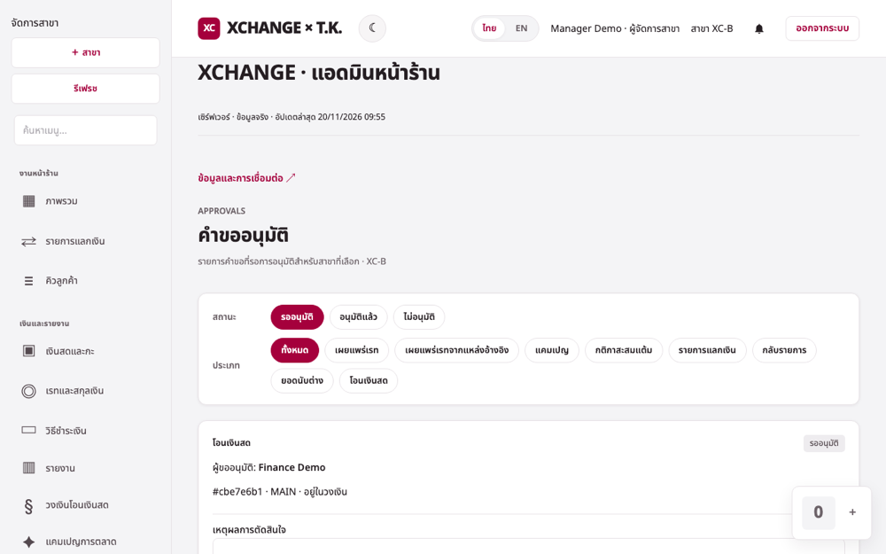 |

The same card handles the other kinds: `โอนระหว่างสาขา` (needs `สาขาปลายทาง`), `ลิ้นชักเข้าเซฟ` (drawer to safe), `เบิก OD` (safe to a teller's drawer; pick `เลือกกะของพนักงาน`) and `เงินออกภายนอก`. A teller without cash management sees this card as `เบิก OD เข้าลิ้นชัก` and can only `รับเงิน` a top-up sent to their own drawer. Finance closes a received transfer with `กระทบยอด` (status `กระทบยอดแล้ว`).

Errors: `จำนวนต้องเป็นจำนวนเต็มตั้งแต่ 1 ขึ้นไป`, `จำนวนเกินค่าสูงสุดที่กำหนด`, `ไม่มีกะที่เปิดอยู่` (a `เบิก OD` with no open shift). The approver can never be the person who created the transfer.

---

## 6. Teller and manager: opening the day

### 6.1 Clock in — every staff member

On `/staff`, the first card shows the branch-day state and a button `ลงเวลาเข้า`. Press it. It becomes `ลงเวลาออก`. A teller cannot open a shift before clocking in (`ลงเวลาเข้างานก่อน จึงจะเปิดกะได้`).

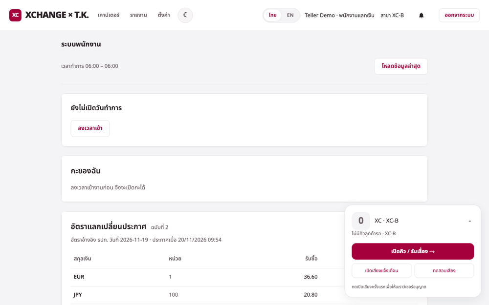

The first card's title is the branch-day state: `ยังไม่เปิดวันทำการ`, `เตรียมกะแล้ว · รอยืนยันเปิดบริการ`, `เปิดรับรายการ`, `ตัดรายการแล้ว / รอนับ`, `กำลังตรวจและส่งมอบ`, `ปิดวันทำการแล้ว`.

### 6.2 Open a shift with the opening count — teller counts, manager verifies

1. Teller: card `กะของฉัน`, press `นับเปิดกะ`. (The counter shows the same button when no shift is open: `ยังไม่มีกะเปิด กรุณานับเงินเปิดกะ`.)
2. If several shift windows cover the current time, choose one. Outside every window the form shows `นอกเวลากะ` and cannot be saved.
3. Type how many notes and coins of each denomination are in the drawer. Add other currencies with `ค้นหาและเพิ่มสกุลเงิน`. An empty drawer is entered as `0`.
4. Press `บันทึก`. The card shows `ยอดนับเปิดกะรอผู้จัดการตรวจรับรอง`.
5. Manager (a different person): on `/staff`, card `กะของฉัน`, list `รายการนับที่รอยืนยัน`, press `ยืนยัน` on the `เปิดกะ` row. The counted cash moves from the safe into the teller's drawer, and the shift is open.

| Opening count | Manager verifies |
|---|---|
| 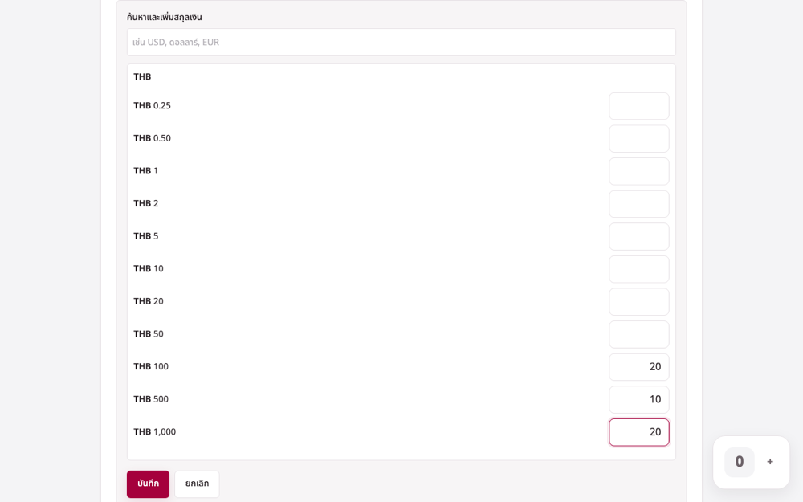 | 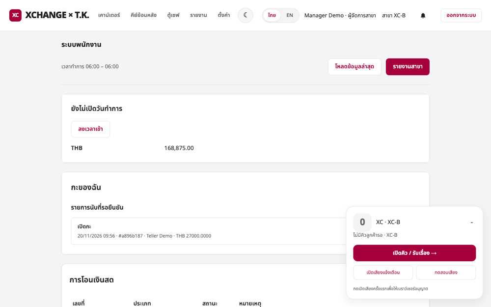 |

Errors: `จำนวนต้องเป็นจำนวนเต็มตั้งแต่ 0 ขึ้นไป`, `กรอกจำนวนอย่างน้อยหนึ่งช่อง ลิ้นชักว่างให้กรอก 0`, `มีกะเปิดอยู่แล้ว กรุณารีเฟรช`, `ผู้ตรวจนับและผู้รับรองต้องไม่เป็นบุคคลเดียวกัน` (the counter tried to verify their own count). If the safe holds too little, the verify is refused; fund the safe first (section 5).

### 6.3 Start service and open the queue — branch manager

1. Once a shift is open, the first card says `เตรียมกะแล้ว · รอยืนยันเปิดบริการ` and shows `เปิดบริการ`. Press it, check `ตรวจอุปกรณ์ ระบบ และเรทบนจอตรงกับชุดอนุมัติล่าสุดแล้ว?`, and press `ยืนยัน`. The card shows `เปิดรับรายการ`.
2. Open `/desk/queue` and press `เปิดรับคิวสาขา` so customers can take numbers.

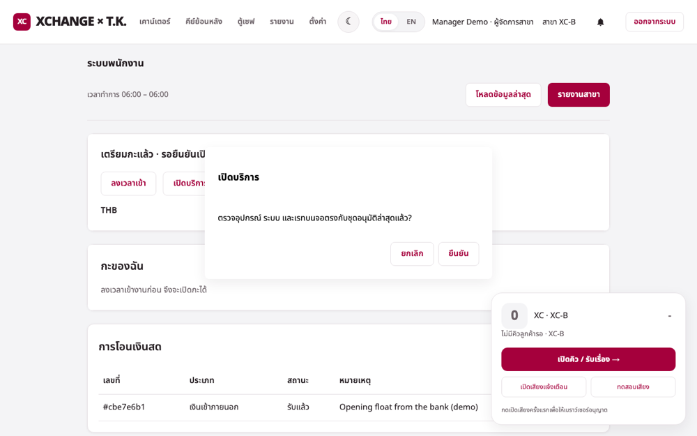

---

## 7. Teller: serving customers at the counter

### 7.1 Queue numbers — teller or branch manager

Page `/desk/queue` (`คิวหน้าเคาน์เตอร์`):

1. A walk-in customer without a number: press `ออกบัตรคิวหน้าร้าน`. The new number (for example `W001`) appears under `รอเรียก`.
2. Press `เรียกคิวถัดไป` (or `เรียก` on a row). The ticket moves to `กำลังให้บริการ` with the tag `ของฉัน`, and the public queue screen shows it.
3. On your ticket: `เรียกซ้ำ` (call again), `ข้าม` (skip), `เริ่มให้บริการ` (start).
4. Go to the counter (`เคาน์เตอร์`) and make the exchange (7.2). Saving an exchange finishes the ticket.
5. If the customer leaves without exchanging: `ไม่มีการขาย` › `ยืนยันไม่มีการขาย`. To cancel a waiting ticket: `ยกเลิก`, type `เหตุผลที่ยกเลิก`, `ยืนยันยกเลิก`.
6. `พักเคาน์เตอร์` pauses your counter; `เปิดรับคิวต่อ` resumes it.

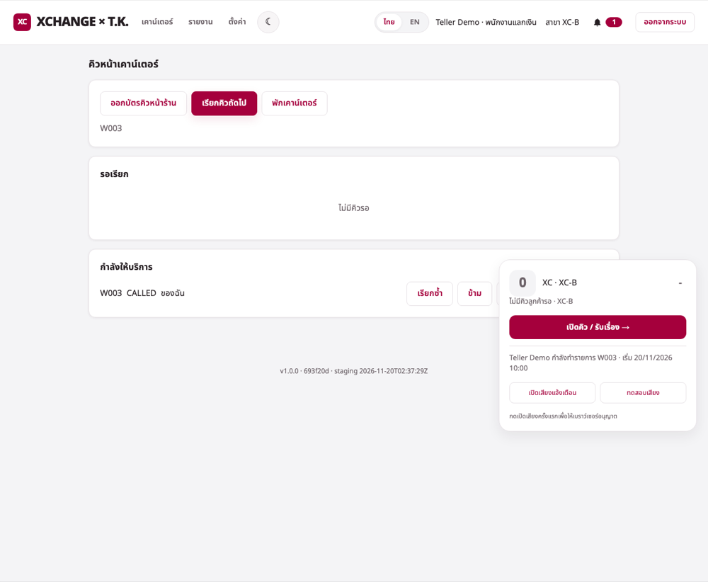

Errors: `ไม่มีคิวที่รออยู่`, `คิวสาขาปิดอยู่` (the manager has not opened the queue), `ยังไม่ได้เปิดกะ กรุณาเปิดกะก่อน`, `เคาน์เตอร์พักอยู่ กรุณาเปิดรับคิวก่อน`, `เคาน์เตอร์นี้กำลังให้บริการคิวอื่นอยู่ กรุณาเสร็จสิ้นคิวปัจจุบันก่อน`, `คิวนี้ไม่ใช่เคาน์เตอร์ของคุณ`.

### 7.2 Buy or sell foreign currency — teller (or branch manager)

Page `/desk`, `ทำรายการแลกเปลี่ยนเงิน`. Five steps across the top: `01 เลือกเรท`, `02 พาสปอร์ต`, `03 การจอง`, `04 ชำระเงิน`, `05 ใบเสร็จ`. The right column, `สรุปรายการ`, follows every step.

The two directions are named from the shop's side:
- `ร้านรับซื้อ (BUY)`: the customer sells foreign currency and the shop pays baht (`ร้านจ่ายเงิน THB ให้ลูกค้า`).
- `ร้านขาย (SELL)`: the customer buys foreign currency and the shop takes baht (`ร้านรับเงิน THB จากลูกค้า`).

**Step 1 — rate and amount**
1. Choose `ประเภทรายการ`, `สกุลเงิน` (only currencies with a published rate for that direction) and type the foreign `จำนวนเงิน`.
2. The rate is not typed. The server quotes it from the published set and the summary shows `เรทที่จอง` (for example `33.5000 ต่อ 1.0000 USD`) and `ยอดแลกก่อนค่าบริการ`. `เรทอ้างอิง (ไม่บังคับ)` is optional.
3. Press `ถัดไป · พาสปอร์ต / ลูกค้า →`.

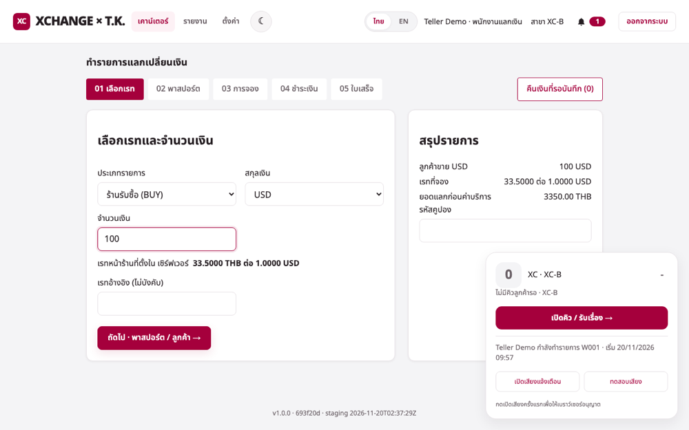

**Step 2 — passport**
1. Attach the passport scan or photo in `เลือกไฟล์สแกน / รูปถ่าย` (JPG, PNG, WebP or PDF, up to 15 MB; HEIC is refused). With a passport scanner, `สแกนพาสปอร์ต`; with a reader, `อ่านและเติมข้อมูล` fills the fields (`ผลอ่านไม่ใช่การรับรองความแท้ของเอกสาร`). Without one: `ไม่มีเครื่องอ่านพาสปอร์ตที่สาขานี้ กรุณากรอกข้อมูลเอง`.
2. Fill `ชื่อตามพาสปอร์ต`, `เลขพาสปอร์ต` and `สัญชาติ`. `วันเกิด (ไม่บังคับ)` and `วันหมดอายุพาสปอร์ต (ไม่บังคับ)` are optional.
3. Check the person against the passport and tick `ตรวจตัวตนลูกค้ากับพาสปอร์ตแล้ว`.
4. Press `สร้างรหัสลูกค้า · ไปจอง →`. The summary shows the customer code (for example `CX-00000001`). The same passport later reuses the same customer.

`ข้ามข้อมูลลูกค้า →` skips the passport and records the customer as `WALK-IN`. It is refused for a booked ticket (`คิวนี้เป็นการจอง ต้องกรอกพาสปอร์ตของผู้จอง ข้ามข้อมูลลูกค้าไม่ได้`). There is no customer search on this step, and no amount on `main` that forces a passport: whether to skip is the shop's rule.

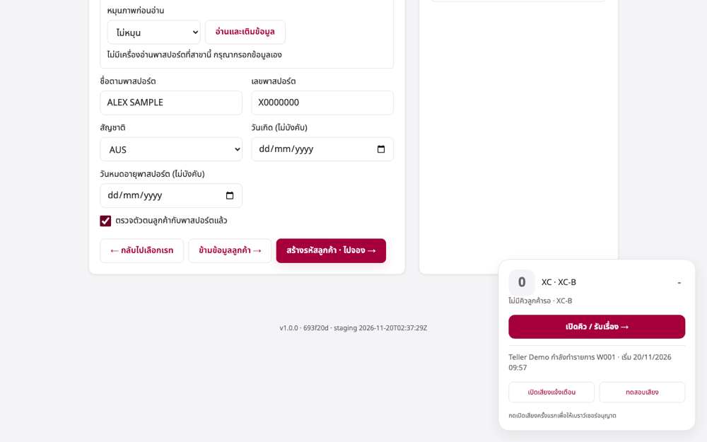

**Step 3 — details**
The page shows the name, `รหัสพนักงาน` and `วันที่มีผล`. Press `ยืนยันข้อมูล →` (walk-in) or `ยืนยันการจอง →` (booked customer). For a walk-in this also ties the sale to your called queue ticket.

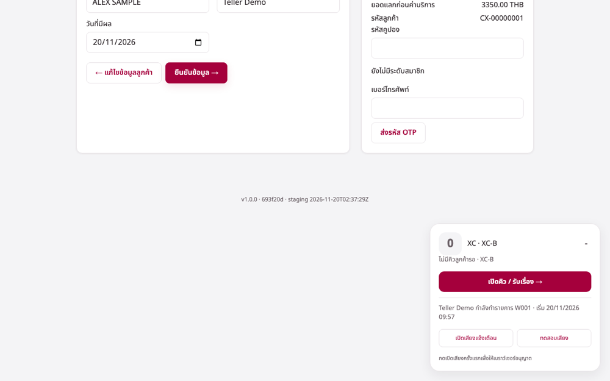

**Step 4 — payment**
1. Choose `วิธีชำระเงิน`. Only the methods the owner opened for this direction are offered (4.6).
2. For cash, `เลขอ้างอิง` is not needed. For any other method, `ชื่อบัญชี`, `เลขอ้างอิง` and a `สลิป` (JPG, PNG, WebP or PDF up to 15 MB) are required.
3. Optional: `ค่าบริการ THB`, `ค่าธรรมเนียมธนาคาร THB`, `หมายเหตุบัญชี`.
4. Tick `ยืนยันว่าตรวจรายการและยอดสุทธิ {net} THB ครบถ้วนแล้ว`.
5. Press `ยืนยันและบันทึกบัญชี →`. For cash the browser asks `ยืนยันว่าได้ตรวจสกุล ชนิดราคา และจำนวนธนบัตรก่อนส่งมอบแล้ว?`; count the notes, then press OK.

`ยกเลิกการจอง / แก้ไข` drops the quote and returns to step 1.

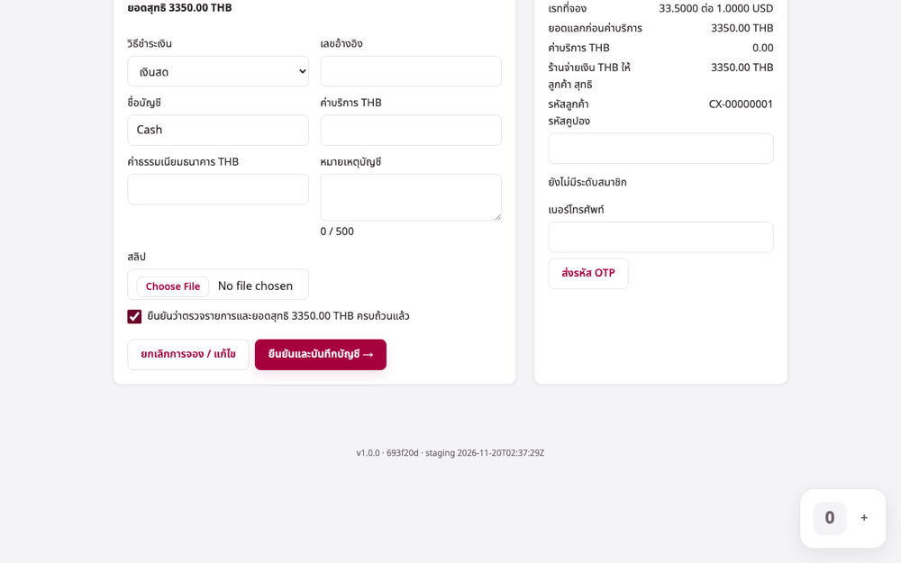

**Step 5 — receipt**
You should see `บันทึกเอกสารแล้ว` and `เลขที่เอกสาร XC-YYYYMMDD-NNNNNN`. Then:
- `พิมพ์ใบเสร็จ NEOCAL 80 มม.` prints the receipt (80 mm paper, 100 % scale, browser headers and footers off). Printing needs a printer set up (section 11). **(Printing not run locally: no printer.)**
- `เปิดรายการในหน้าแอดมิน` opens the transaction; `ทำรายการใหม่` starts the next customer.

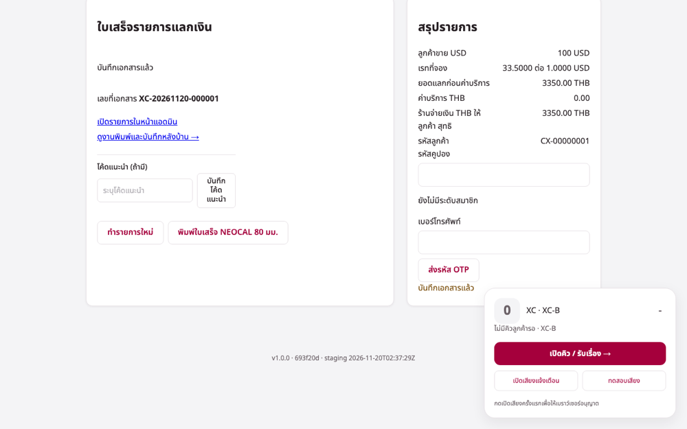

When the amount is above the branch's approval limit, step 5 shows `รายการรออนุมัติจากผู้จัดการสาขา` instead; the branch manager approves it under `คำขออนุมัติ` (`รายการแลกเงิน`). **(Not run locally: no approval limit was set.)**

Common refusals on the counter:

| Message | What to do |
|---|---|
| `pricingRuleNotSet:thbCashStep: the Owner has not set the THB cash step` | The owner sets the cash step (4.4). |
| `สาขานี้ยังไม่มีเรทประกาศสำหรับรายการ…` / `สาขานี้ไม่มีเรทประกาศของ {code} …` | No published rate for that currency and direction (4.3). |
| `ยังไม่มีกะเปิด — เปิดกะที่หน้าพนักงาน › กะของฉัน › นับเปิดกะ …` | Open a shift (6.2). |
| `เงินในลิ้นชักไม่พอจ่ายรายการนี้` / `ให้ผู้จัดการสาขาเบิก OD จากตู้เซฟเข้าลิ้นชักก่อนบันทึกรายการ` | The drawer cannot pay this out. The manager sends a `เบิก OD` (section 5); the teller presses `รับเงิน`; the page then continues by itself. |
| `ตรวจชื่อบัญชี เลขอ้างอิง สลิป พาสปอร์ต และยอดสุทธิให้ครบ` | A required payment field or the tick box is missing. |
| `ยังไม่ทราบผลการบันทึก กด "ลองบันทึกซ้ำ" ได้ ระบบไม่บันทึกรายการเดียวกันซ้ำ` | The connection dropped while saving. Press `ลองบันทึกซ้ำ`; it never saves twice. |

### 7.3 Look at or reprint a past transaction

Open `/desk/transactions/<id>` (from `เปิดรายการในหน้าแอดมิน`, or from the admin transactions list). The page shows the header, `อัตราและจำนวนเงิน`, `การชำระเงิน`, `เอกสาร` and `ประวัติการดำเนินการ`. In `เอกสาร`, `พิมพ์ซ้ำ` reprints a receipt.

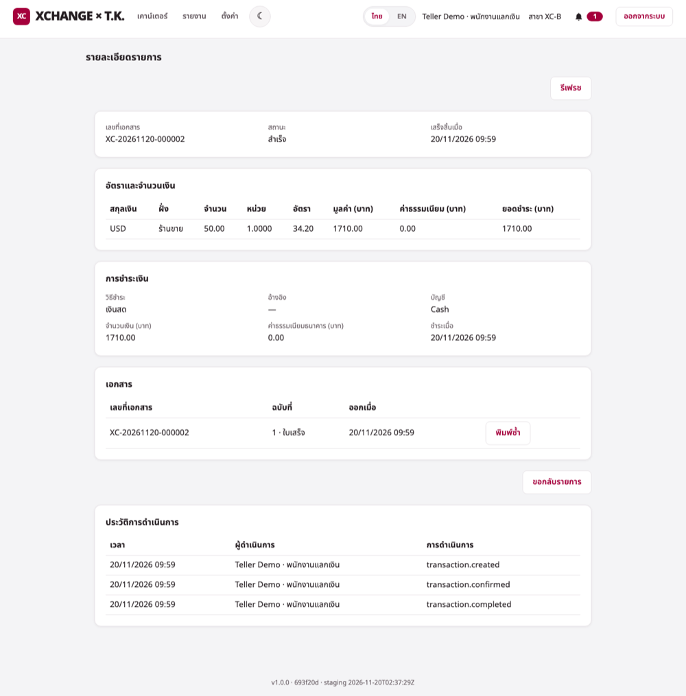

### 7.4 Backdated keying — branch manager or executive (not run locally)

`คีย์ย้อนหลัง` (`/desk/backdated`) records an exchange that already happened, for example while the system was down. Search and choose the customer, then fill `ฝั่งรายการ`, `สกุลเงิน`, `จำนวนเงินตราต่างประเทศ`, `อัตราแลกเปลี่ยน` (typed by hand here), fees, `วันและเวลาที่ชำระจริง`, the payment fields and an optional `รูปพาสปอร์ต`; press `บันทึกรายการย้อนหลัง`. The cash goes to the branch safe, not a drawer. The paid time cannot be in the future and its business day must not be closed. **Not run for this manual** (time); described from `web/src/screens/desk-backdated/`.

---

## 8. Corrections: cancel, reverse and refund

| Situation | Who | How | Approval |
|---|---|---|---|
| Saved but no document number yet (`CONFIRMED`) | teller | `ยกเลิกรายการ` on the transaction page, with a reason | none |
| Completed today, must be undone | teller asks, finance approves, teller pays back | below | `FINANCE` |
| Queue ticket, no exchange | teller | `ไม่มีการขาย` or `ยกเลิก` (7.1) | none |

**Reverse a completed transaction:**
1. Teller: on the transaction page, press `ขอกลับรายการ`, type `เหตุผลในการขอกลับรายการ`, press `ยืนยัน`. You should see `ส่งคำขอกลับรายการแล้ว`. Only on the same business day, and once per transaction.
2. Finance (another person): admin › `คำขออนุมัติ`, card `กลับรายการ`, `อนุมัติ`.
3. Teller: on `/desk`, press `คืนเงินที่รอบันทึก ({n})`, then `บันทึกคืนเงิน` › `ยืนยัน`. The money moves back through the drawer, and a refund document (`…-R2`) can be printed with `พิมพ์ใบคืนเงิน`.

| Ask for the reversal | Post the refund |
|---|---|
| 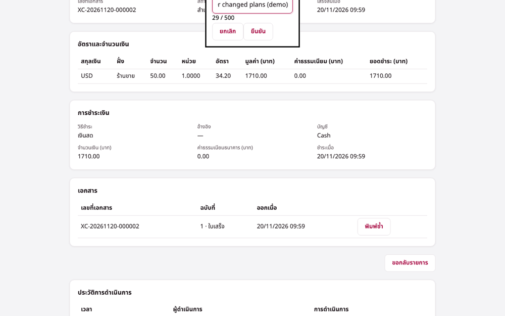 | 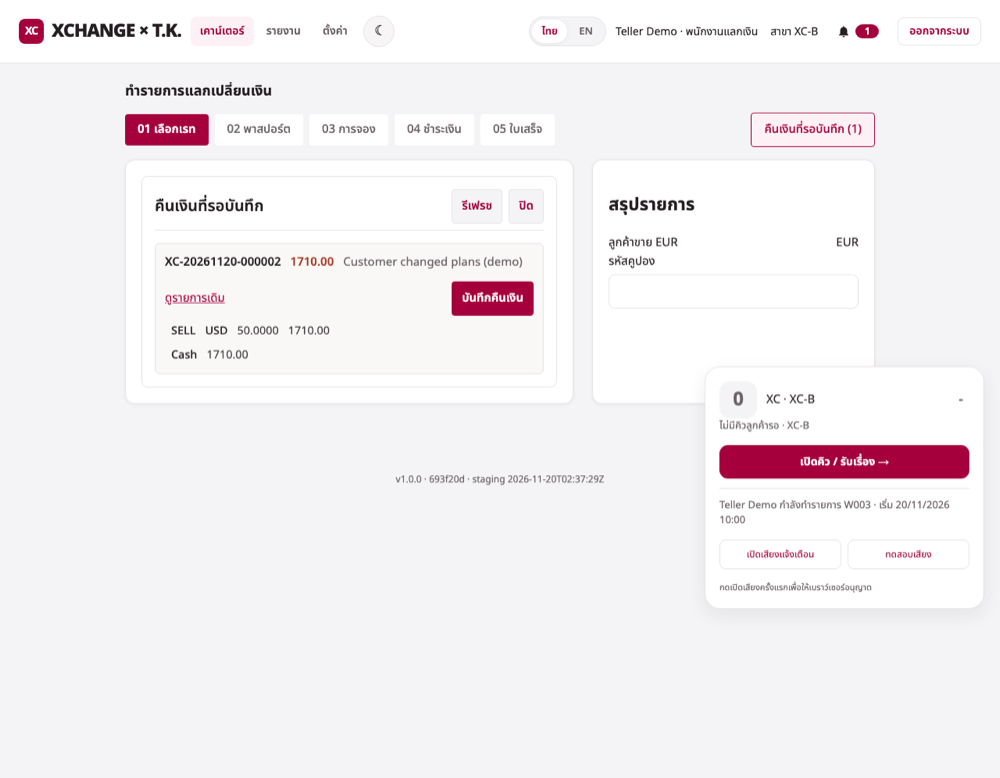 |

Errors: `พ้นกำหนดเวลาที่สามารถคืนเงินได้`, `ไม่พบกะที่เปิดอยู่สำหรับการทำรายการ`, `ธนบัตรในลิ้นชักไม่เพียงพอต่อการคืนเงิน`.

---

## 9. Closing the day

Order: finish every queue ticket → manager closes the queue and cuts off → each teller counts the close → manager verifies → teller clocks out.

1. **Tickets.** A shift cannot close while you still hold a called or serving ticket (`ปิดกะไม่ได้ ยังมีคิวที่เรียกหรือกำลังให้บริการค้างอยู่ …`). Finish each one: exchange, `ไม่มีการขาย` or `ข้าม`.
2. **Manager:** on `/desk/queue` press `ปิดรับคิวสาขา`; on `/staff` press `ตัดรายการ` (cut-off; no new exchanges after this).
3. **Teller:** `/staff`, `กะของฉัน`, `นับปิดกะ`. Each currency shows `ตามระบบ {amount}` (what the system expects). Type what is really in the drawer and press `บันทึก`. The card shows `ยอดนับปิดกะรอผู้มีสิทธิ์ตรวจรับรอง`.
4. **Manager:** under `รายการนับที่รอยืนยัน`, `ยืนยัน` the `ปิดกะ` row (or `ปฏิเสธ` with a reason). The row shows `ผลต่าง` per currency.
   - A difference within the count-difference limit (4.5) is booked to the branch's variance.
   - A larger one goes to finance: `ยอดต่างเกินเกณฑ์ ส่งให้ฝ่ายการเงินอนุมัติแล้ว ยังไม่ถือว่ารับรอง`. Finance decides it under `คำขออนุมัติ` (`ยอดนับต่าง`). **(Not run locally: the counts balanced.)**
5. **Teller:** press `ลงเวลาออก`.

A teller can also hand the drawer to another teller mid-day with `ส่งมอบเงิน` (choose `ผู้รับมอบ`, count, `บันทึก`); the receiver accepts with `รับมอบ` or refuses with `ปฏิเสธ`. **(Not run locally.)**

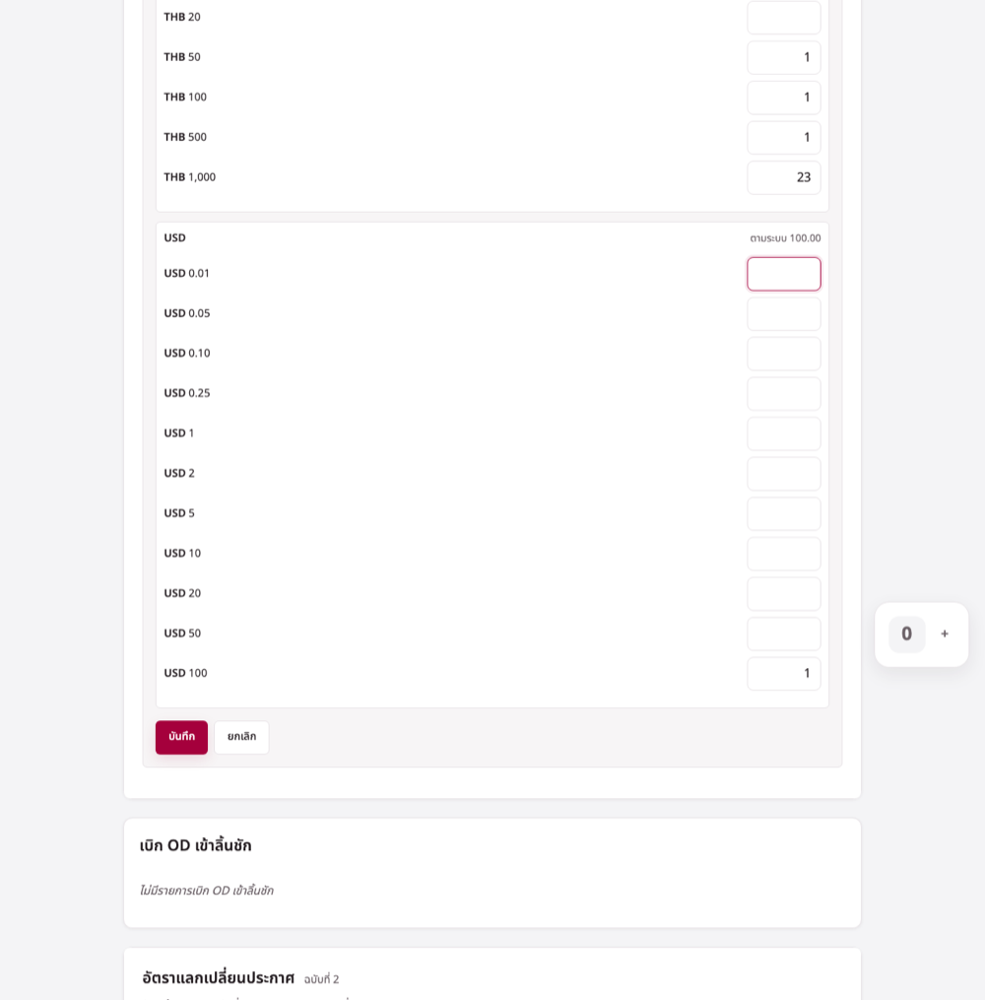

**Daily close report** — managers, finance and executives: `/staff`, button `รายงานสาขา` (or `/staff/report`). Pick `วันที่`; `พิมพ์ / บันทึก PDF` prints it. It shows `รายการสำเร็จ`, the shop-buy and shop-sell values, `กลับรายการแล้ว`, the counted drawer and safe per currency with differences (`รอนับ` where not counted), transfers and exceptions, and who counted and certified (`ผู้นับ` / `ผู้รับรอง`). Its status line reads `ยอดเบื้องต้น · ยังไม่ปิดกะ`, `ปิดกะแล้ว · รอกระทบยอด` or `กระทบยอดแล้ว`.

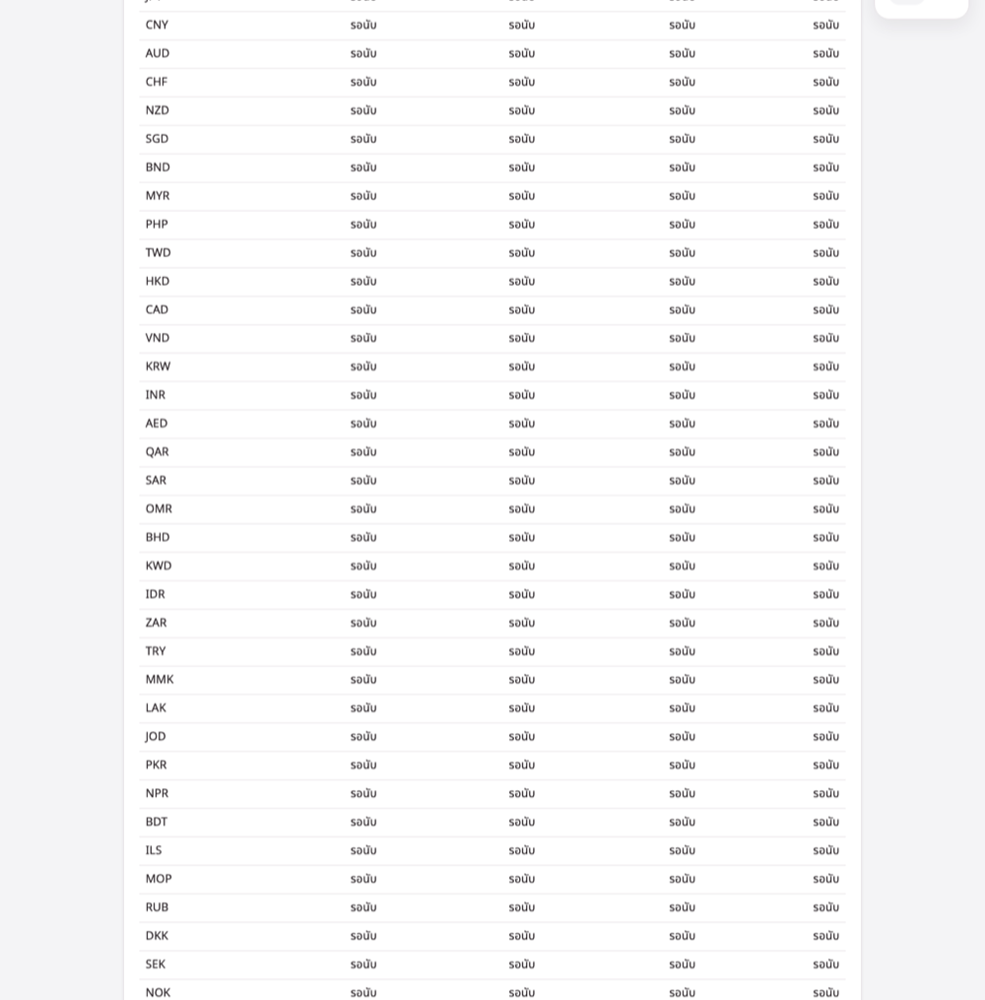

---

## 10. Approvers, executives and finance: approvals, reports, transactions

### 10.1 Approvals — branch manager, finance, executive

Admin › `เครื่องมือ` › `คำขออนุมัติ`. Filter by `สถานะ` and `ประเภท`. Each card shows `ผู้ขออนุมัติ` and the details. Press `อนุมัติ`, or type `เหตุผลการตัดสินใจ` and press `ปฏิเสธ` (a reason is required to reject; `ต้องระบุเหตุผลเมื่อปฏิเสธ`). A card you may not decide shows `รอผู้มีสิทธิ์อนุมัติ`.

| Card | Decided by |
|---|---|
| `เผยแพร่เรท`, `แคมเปญ`, `กติกาสะสมแต้ม` | executive |
| `โอนเงินสด` | branch manager within the limit; executive above it |
| `รายการแลกเงิน` | branch manager |
| `กลับรายการ`, `ยอดนับต่าง` | finance |

### 10.2 Transactions — everyone with branch read access

Admin › `งานหน้าร้าน` › `รายการแลกเงิน`. Choose the dates at the top (`วันนี้`, `ทั้งหมด`, or two dates). Filter with `ค้นหารายการ`, `ประเภทรายการ`, `สถานะ`, `สกุลเงิน`, `ช่องทาง`. Click a document number for `รายละเอียดรายการ` (rate, amounts, fees, method, staff, slip `เปิดสลิป ↗`, receipt). `ส่งออกรายการ CSV` appears only for roles allowed to export.

| List | Detail |
|---|---|
| 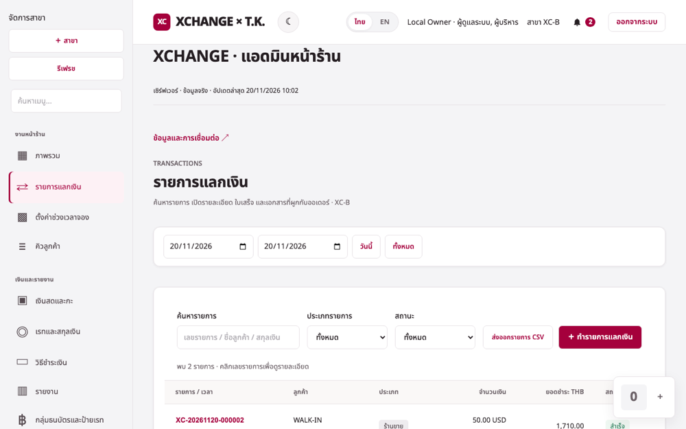 | 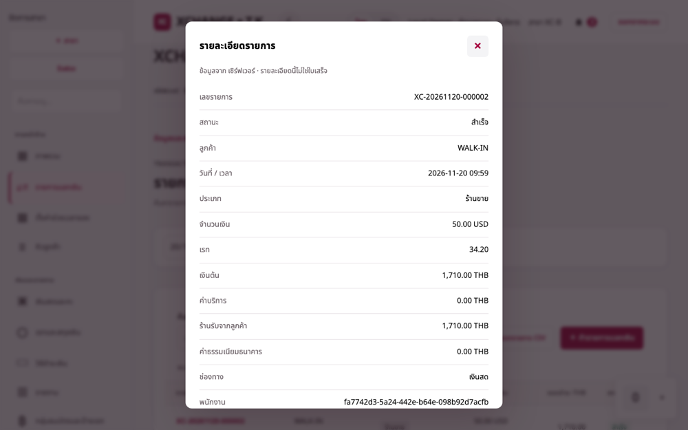 |

### 10.3 Reports and overviews

- `ภาพรวม` (overview): totals for the chosen dates, and `สถานะสาขาขณะนี้` (is a shift open).
- `รายงาน` (`DAILY REPORT`): tabs `ช่องทางชำระเงิน`, `สกุลเงินและส่วนต่าง`, `แยกพนักงาน`.
- `เงินสดและกะ`: cash in and out and stock for the branch; managers verify waiting counts here too (`ยอดนับรอตรวจรับรอง` › `ตรวจรับรอง`). Opening and closing a shift is done on `/staff`, not here.
- `กระทบยอดและรับรอง` (finance, executive): pick a single day, review, optionally type `หมายเหตุ`, press `รับรอง`.
- `ภาพรวมผู้บริหาร` (executive): all branches. Some tiles show `… ยังคำนวณไม่ได้` because the systems they need are not built yet.

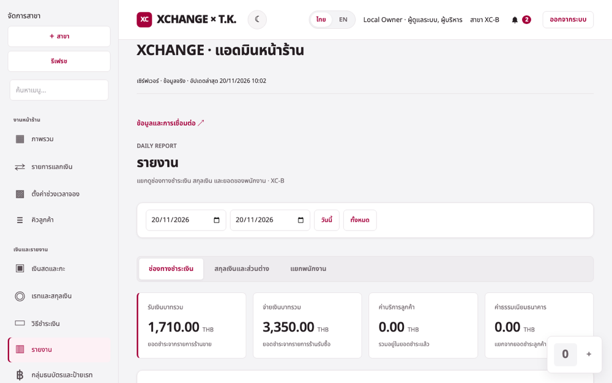

---

## 11. Devices: counter Mac, drawer, printer, tablets

### 11.1 Pair a counter Mac (drawer and printer agent) — owner

1. Open `/_xc/device-agents` (`จัดการเครื่องคุมลิ้นชัก (Device Agents)`) signed in as the owner.
2. Type the branch code (`รหัสสาขา (เช่น MAIN, B9)`) and a machine name (`ชื่อเครื่อง (เช่น Mac เคาน์เตอร์ 1)`), and press `สร้างรหัสเชื่อมต่อ`.
3. A box `รหัสสำหรับเชื่อมต่อเครื่อง (Pairing Code)` shows the code and an install command, **once**, valid for 10 minutes (`รหัสนี้จะแสดงเพียงครั้งเดียว และหมดอายุภายใน 10 นาที`).
4. On the shop Mac, run the command shown (`xc-device-agent install --server … --code … --cups-queue <printer queue>`; use `--tcp <host:port>` instead of `--cups-queue` for a network printer). Then press `รับทราบและปิด`.
5. The row's `สถานะ` becomes `ONLINE` once the agent checks in (`PENDING` until then; `OFFLINE` after 60 seconds of silence). `ขอรหัสใหม่` issues a new code; `ยกเลิก` revokes the machine.

Steps 1–3 and 5 (`PENDING`) were run locally; **step 4 was not** (no agent machine).

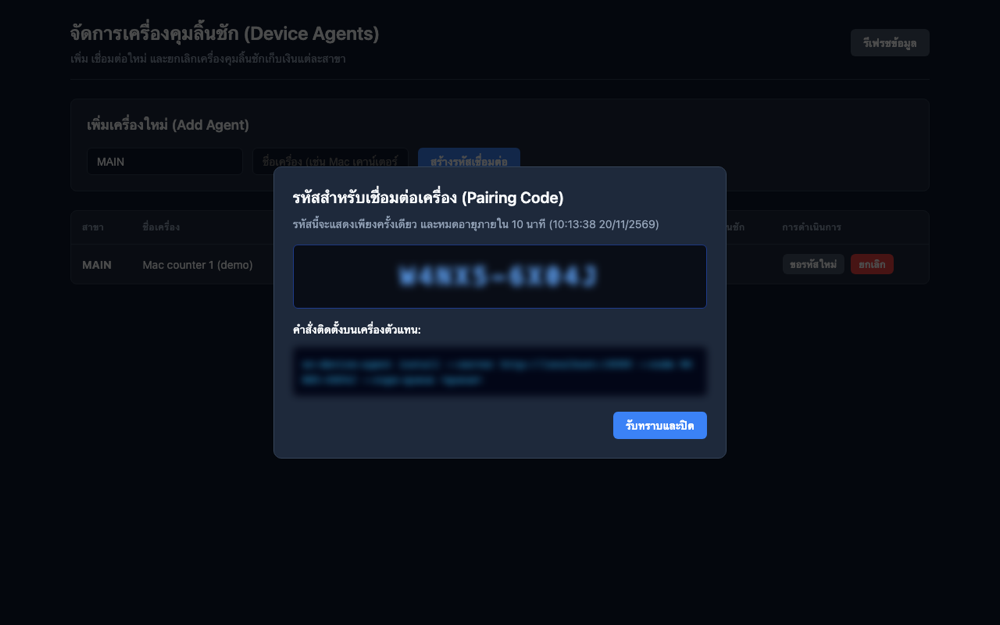

The XC Counter Mac app (`counter-app/`) has its own pairing screen, `รหัสจับคู่เคาน์เตอร์` › `จับคู่` (not run locally).

### 11.2 Device jobs — `/devices`

`งานหน้าร้านและอุปกรณ์` lists the printer, scanner and banknote counter, print and drawer jobs, and a back-office log. On a branch without a real printer, the printer is a simulator (`เครื่องพิมพ์ของสาขานี้เป็นตัวจำลอง · ไม่ส่งคำสั่งไปเครื่องพิมพ์หรือลิ้นชักจริง`). `ตัวอย่างสลิป 80 มม.` previews a receipt.

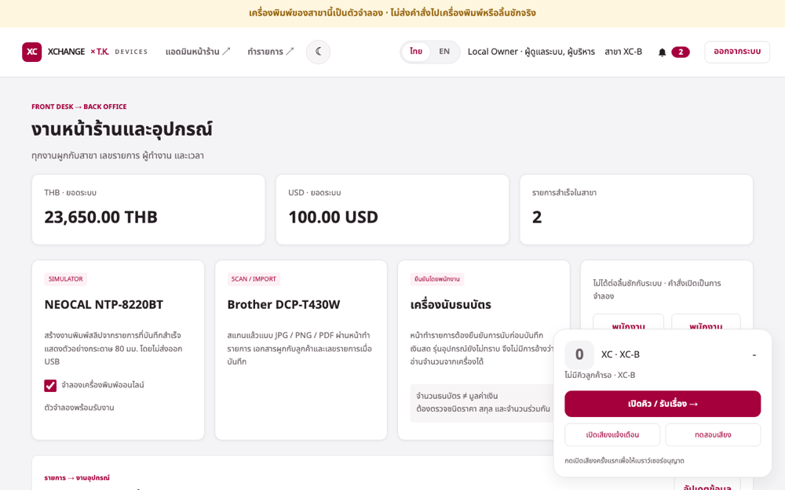

### 11.3 Branch tablets — not run locally

On `สาขาและการเปิดทำการ`, card `แท็บเล็ตของสาขา`: type `ชื่อแท็บเล็ต`, press `เพิ่มแท็บเล็ต`, and scan the QR shown (once, 10 minutes) with the tablet. **Not run locally** (no tablet).

---

## 12. Public screens: rate board and queue display

Neither needs a sign-in, and neither has a language or theme switch.

**Rate board** — `/rates?branch=MAIN` (use the branch code). A portrait signage board, scaled to the screen, refreshing every 10 seconds. It shows the published buy and sell rates; currencies without a published rate show `ติดต่อเคาน์เตอร์ · Contact the counter`. `เต็มจอ` goes fullscreen; `&attract=0` turns the animations off. If the branch has booking on, a QR `สแกนจองคิว` links to the app. If it cannot reach the server for 30 seconds, it hides the rates and says `กรุณาสอบถามเรทที่เคาน์เตอร์ · Please ask at the counter`. With no `?branch=` it says `หน้านี้ต้องระบุสาขา`.

**Queue display** — `/queue-display?branch=MAIN`. Shows `กำลังเรียกคิว` and `เรียกแล้วล่าสุด`, refreshing every 5 seconds. Press `เปิดเสียงเรียกคิว` once to allow the chime, and `เต็มจอ` for fullscreen.

| Rate board | Queue display |
|---|---|
| 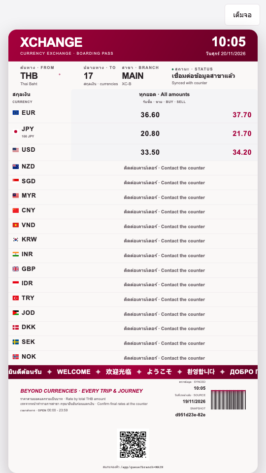 | 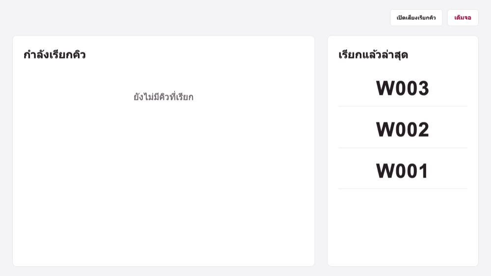 |

---

## 13. The customer app (`/app`)

For customers, on a phone. Languages `TH` / `EN` / `中文`; always light. The bottom menu is `หน้าแรก`, `สาขา`, `การจอง`, `ประวัติ`, `ผู้ช่วย`.

**Sign up** (`/app/sign-up`, `สมัครสมาชิก`): fill `ชื่อที่แสดง`, `เบอร์โทรศัพท์หรืออีเมล` (a new account needs a phone number) and `รหัสผ่าน`; optionally tick `รับข่าวสารและโปรโมชันทาง SMS`; press `สมัครสมาชิก`. The button works only once the terms have loaded; if the owner has not published `TERMS` in that language, the page says `ยังไม่มีข้อกำหนดการใช้บริการในภาษานี้ กรุณาเลือกภาษาอื่น` (4.7). An existing account gets `บัญชีนี้สมัครสมาชิกแล้ว กรุณาเข้าสู่ระบบ`.

**Sign in** (`/app/sign-in`): tab `รหัสยืนยันทาง SMS` (a one-time code by SMS or email; it never creates an account: `ยังไม่มีบัญชี กรุณาสมัครสมาชิก`) or tab `รหัสผ่าน` (phone and password). Only the password tab was run locally (no SMS or email service).

| Sign up | Home, signed in | Membership |
|---|---|---|
| 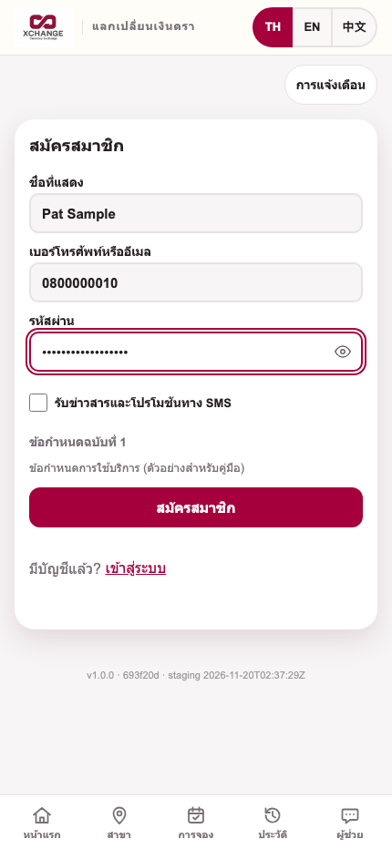 | 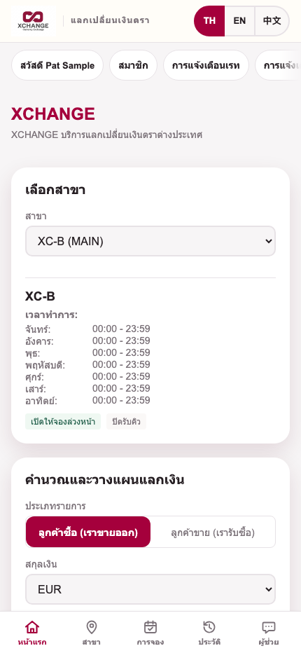 | 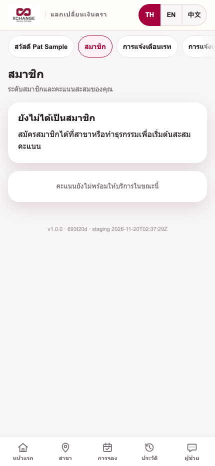 |

What a customer can do:

| Page | What | Sign-in | Run locally |
|---|---|---|---|
| `/app` `หน้าแรก` | Branch info, today's rates (`อัตราแลกเปลี่ยนประจำวัน`), a calculator (`คำนวณและวางแผนแลกเงิน`), save a plan | no | yes |
| `/app/branches` `สาขา` | Branches, hours, queue status, `รับบัตรคิว` (take a number), `ดูอัตราแลกเปลี่ยน` | to take a number | page yes; number no |
| `/app/book` `จองคิวล่วงหน้า` | Book a time: branch, date, slot, currency, direction, amount, `ยืนยันการจอง`; you get a QR to show at the counter | yes | no (no booking slots were set) |
| `/app/bookings` | My bookings: cancel, change time, new QR | yes | no |
| `/app/queue?branch=…` | Ask for a queue number by QR, then follow its status | yes | no |
| `/app/history` `ประวัติ` | My exchanges and receipts | yes | yes (empty) |
| `/app/member` | Tier and points; `คะแนนยังไม่พร้อมให้บริการในขณะนี้` when the loyalty service is not connected | yes | yes |
| `/app/rate-alerts` | Alert me when a rate reaches a target (after the owner saves `ตั้งค่าแจ้งเตือนเรท`) | yes | page only |
| `/app/verification` | Upload an identity document for review | yes | no |
| `/app/assistant` `ผู้ช่วย` | Rule-based help on rates, branches and queues (not a chatbot) | no | no |

The app has no dark mode.

---

## 14. Messages you may see, and what they mean

| Message | Meaning |
|---|---|
| `เซิร์ฟเวอร์ขัดข้อง` | The server failed. Try again; if it repeats, tell the administrator. |
| `เชื่อมต่อเซิร์ฟเวอร์ไม่ได้ กรุณาลองใหม่` | No connection to the server. |
| `เซสชันสิ้นสุด กรุณาเข้าสู่ระบบใหม่` | Signed out; sign in again. |
| `บทบาทนี้ไม่มีสิทธิ์ทำรายการนี้` | Your role may not do this. Ask the owner. |
| `เฉพาะเจ้าของระบบเท่านั้น` | Only the owner may do this. |
| `ข้อมูลมีการเปลี่ยนแปลง กรุณาโหลดหน้าใหม่แล้วลองอีกครั้ง` | Someone else changed it meanwhile. Reload and redo. |
| `ข้อมูลไม่ถูกต้อง กรุณาตรวจสอบค่าที่กรอก` / `{field} ไม่ถูกต้อง` | A value is invalid. |
| A message in English starting with a code (for example `pricingRuleNotSet:…`, `dayClosed: …`) | A server refusal that has no Thai wording yet. The code says what is missing. |

---

## 15. How this manual relates to the in-app staff guide

`/staff-guide` (`คู่มือพนักงาน XC Desk v2`, with `พิมพ์คู่มือ`) has six short cards: sign in and check the branch; open the shift and check rates; the customer picks an exchange at the kiosk; take the queue and check the passport; save and print the receipt; hand over and close the shift. Its advice still holds (count real cash, check the passport in person, print at 80 mm and 100 %, close only after the handover). Where it differs from `main`:

- It names roles Front, Backend, Manager, Rates, Monitor; the current roles are in section 1.
- It describes status names (Checking ID, Pending) that the counter no longer shows.
- It says nothing about the prerequisites a new install needs (safe funding, published rates, the THB cash step, two people for every check); sections 4 to 6 cover them.

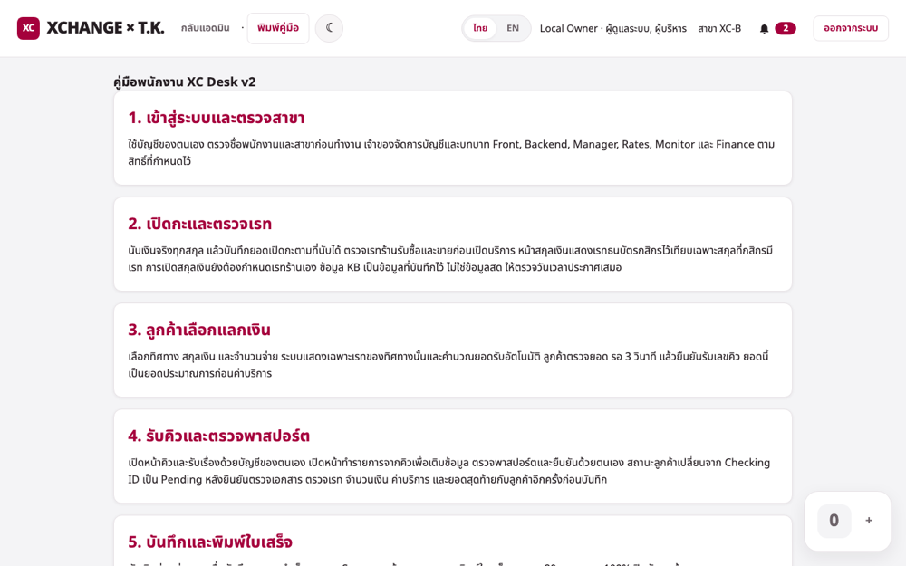
