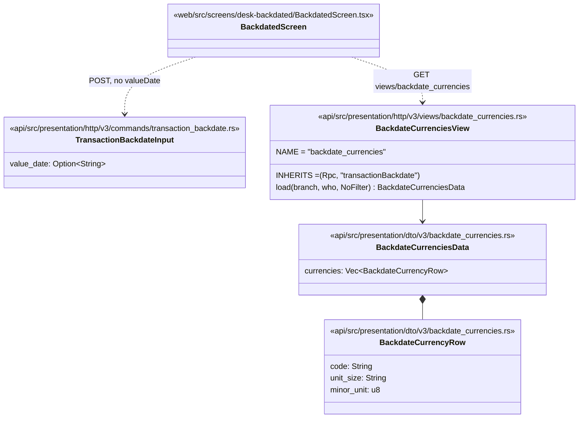

# Backdated keying: enter a past exchange at its real time

> designed-by: claude/6bb512ce (sub-controller "AG controller backdated keying", lane controller claude/022a7453) · 2026-11-04 ICT
> Measured on `origin/main` `addb1536e`. Every `file:line` below is at that sha.
> Feature branch: `feat/backdated-keying`. Notice issue: #564.

## 0. Why, and what the owner decided

The owner wants to replay the shop's real orders (first case: the Telegram orders of 2026-11-04, 48 BUY rows) into
xc-v3 at their real times, and have the books reconcile exactly. Today every LIVE sale needs the keyer's open shift.
It is priced from the branch's current publication, posts into the shift's drawer, and is stamped with today's date.
So a past deal cannot be entered as it happened.

Owner's orders, 2026-11-04 ~20:30 ICT (verbatim): *"จำลอง เวลา ของจริงเลย"* · *"แบบ คีย์ย้อนหลังได้"* ·
*"ตั้งเวลา คีย์ย้อนหลังได้"* · *"ไม่ต้องมี กะ"* · *"ตั้งโหมด คีย์ ย้อนหลัง"*. The owner then approved these four rules
(*"Use these 4"*). They are **decided** and must not be asked again:

| # | Rule |
|---|---|
| R1 | **Who:** Owner and Manager roles only. Tellers cannot. |
| R2 | **Time:** the keyer picks the deal's real date and time (`paid_at`, `value_date`). The system still stores the real entry time and who entered it, separately, and marks the row as backdated. |
| R3 | **Cash without a shift:** no open shift is needed. Cash posts straight to the branch SAFE and is counted on that business date. |
| R4 | **Rate:** the rate the shop really used, as typed, not the published rate. The receipt and reports carry a "ย้อนหลัง" (backdated) label. |
| G | **Guard:** a backdate may only go into a business date that is not closed. A closed day is refused. |

**Still open: these need the owner (§11).** Q1, whether a passport file is required. Q2, whether the approval rules apply.

## 1. What exists today (survey)

There is no backdate, late-entry or import path on main. I grepped `api/`, `web/` and `docs/` for
`backdat|ย้อนหลัง|late.?entry|retro`, and searched issues and PRs for "backdate". The only hits were unrelated test
fixtures. The pieces this feature builds on:

| Piece | Where | What it does today |
|---|---|---|
| Create a sale | `api/src/presentation/http/v3/commands/transactions.rs:339-429` → `CreateTransaction::run_inner` `api/src/application/workflows/exchange/create.rs:220-471` | A DRAFT made from an ACTIVE quote, where every figure comes from the quote. `paid_at` and `value_date` already come from the caller (`transactions.rs:357-361`). `recorded_at = now` and `recorded_by = who` (`create.rs:408-409`). |
| Shift required | `create.rs:348-367` | A LIVE sale needs the keyer's OPEN shift; otherwise `ShiftError::NoOpenShift` (`transactions.rs:177` → `409 noOpenShift`). |
| DB guard | `api/migrations/20261007190000_transactions.sql:35` | `CHECK ((mode = 'LIVE') = (shift_id IS NOT NULL))`. It is unnamed, so Postgres calls it `transactions_check`, and no later migration changes it. **A LIVE row with no shift is impossible today.** |
| Rate | `quote_lines.published_rate_line_id NOT NULL`, `quotes.publication_id NOT NULL` (`20261014100000_quotes.sql:12,27`) | Every quote is tied to a publication line, so a typed rate cannot be a quote. |
| Complete | `CompleteExchange::run_in` `api/src/application/workflows/exchange/complete.rs:207-381` | Requires the shift still OPEN (`:222-244`) and the quote still valid (`:246-253`). It posts both legs (`legs()` `:87-144`, foreign at `CashPlace::Drawer(shift)`, THB at the drawer for cash and at `Bank` otherwise). It numbers the document and stamps `completed_at` and the receipt with `now` (`:305-314`). |
| Document number | `DocumentRef::format/counter_key` `api/crates/xc-exchange/src/domain/exchange/value_objects/document_ref.rs:12-30` | `XC-<Bangkok date of now>-NNNNNN`, with one counter per org × mode × date. |
| SAFE | `CashPlace::Safe(BranchId)` `api/crates/xc-cash/src/domain/posting.rs:27`; account kind `ledger_postings.rs:524` | SAFE is already a posting place. Balances are the sum of `ledger_entries` (`20261110120000_ledger.sql:29-37`). A posting never takes an account below zero (`stockInsufficient`). |
| Business date in reports | `ledger_cash_facts.rs:255-256` (`t.value_date`), `staff_daily_report.rs:130-137` (`completed_at`), `margin.rs:24` (`value_date`) | Exchange figures are dated by `value_date` or `completed_at`. `ledger_postings.posted_at` dates only reversals. |
| Closed day | `reconciliation_certifications (organization_id, branch_id, business_date, …)` `20261031130000_executive_finance.sql:28-43`, append-only; reader `CertificationRepository::for_day` `api/src/infrastructure/finance/certification_repository.rs:95` | FINANCE certifies a branch-day's sheet. This is the only per-date "closed" record. `ops_state.phase` (`20261007140000_custody.sql:4`) holds today's phase only. |
| Arithmetic | `ExchangeArithmetic::try_thb` `api/crates/xc-kernel/src/money/exchange_arithmetic.rs:22` | `amount × rate ÷ unit_size`, rounded HALF_UP to 2 dp once. |
| Permissions | `Permission` `api/crates/xc-auth/src/domain/access/permission.rs`; seeds `role_grants.rs:113-132` (`SEED_VERSION = 10`, `SEED_ADDITIONS`); seeded at boot by `infrastructure/access/role_grant_store.rs:139-271` | A new permission is a code seed, not a SQL migration. The Owner standing is org-wide EXECUTIVE + ADMIN (`standing.rs:70-82`). |
| Commands and policy rows | one file per command in `api/src/presentation/http/v3/commands/` (generated by `api/build.rs:247-272`); one file per policy area in `api/crates/xc-auth/src/domain/policy/areas/` | Adding a command or an area adds a file. No shared file changes. |
| Web pages | `web/pages/*.html` read by `web/vite.config.ts:9-24`; `<meta name="xc-path">` + `xc-gate` (e.g. `web/pages/desk-transaction.html`) | Adding a page adds a file. |

## 2. Shape of the solution

A **separate command**, `POST /api/transactions/backdated` (`transactionBackdate`). It writes one COMPLETED, backdated
sale in one transaction: validate → price at the typed rate → insert DRAFT (backdated) → CONFIRMED → post to SAFE →
number, receipt and COMPLETED at the deal time.

**Why not extend `POST /api/transactions`:** that route's contract is "every figure is the quote's" (`create.rs:1-2`).
A quote cannot hold a typed rate (`published_rate_line_id NOT NULL`). Confirm and complete both re-check the quote
against the current publication (`complete.rs:253`). Bending all three would change the desk sale for every teller.
A separate command leaves the desk path untouched, and its own policy row keeps tellers out by permission (R1).

```mermaid
classDiagram
    class TransactionBackdateCommand {
      <<api/src/presentation/http/v3/commands/transaction_backdate.rs>>
      NAME = "transactionBackdate"
      ROUTE = "/api/transactions/backdated"
      INHERITS = (Rpc, "transactionBackdate")
      run(tx, branch, who, TransactionBackdateInput, key) Result~TransactionDto, V3Error~
    }
    class TransactionBackdateInput {
      <<same file>>
      customerId: String
      side: String
      currency: String
      quantity: String
      rate: String
      feeThb: String?
      expectedSettleThb: String?
      payment: TransactionPaymentInput
      valueDate: String
      passport: UploadRef?
      notes: String
    }
    class BackdateSale {
      <<api/src/application/workflows/exchange/backdate.rs>>
      new(pool, files) BackdateSale
      run_in(tx, BackdateRequest, who: SaveActor, now) AppResult~ExchangeTransaction~
    }
    class BackdateRequest {
      <<same file>>
      branch_id, customer_id, side, currency, quantity: ForeignAmount
      rate: Rate, fee_thb: Money, expected_settle_thb: Option~Money~
      payment: CreatePayment, value_date: NaiveDate
      passport_key: Option~String~, notes: String
    }
    class BackdateWindow {
      <<api/crates/xc-exchange/src/domain/transaction/backdate_window.rs>>
      check(paid_at, value_date, now, tz: Tz, closed: bool) Result~(), BackdateRefusal~
    }
    class BackdateRefusal {
      <<same file>>
      PaidAtInFuture
      ValueDateNotPaidDate
      ValueDateInFuture
      DayClosed
      code() &str
    }
    class BackdatePricing {
      <<api/crates/xc-exchange/src/domain/transaction/backdate_pricing.rs>>
      price(quantity, rate, unit_size, fee_thb, expected_settle) Result~PricedLine, PricingRefusal~
    }
    class PricedLine {
      <<same file>>
      thb_amount: Money
      fee_thb: Money
      settle_thb: Money
    }
    class BackdateMark {
      <<api/crates/xc-exchange/src/domain/transaction/backdate_mark.rs>>
      entered_at: DateTime~Utc~
      entered_by: String
    }
    class TransactionStore {
      <<trait, api/crates/xc-exchange/src/domain/transaction/repository.rs>>
      insert_backdated_draft_in(tx, t) AppResult~()~
      backdate_mark_in(tx, id) AppResult~Option~BackdateMark~~
    }
    class PgTransactionStore {
      <<api/crates/xc-exchange/src/infrastructure/transaction/store.rs>>
    }
    class ClosedDays {
      <<api/src/infrastructure/finance/closed_days.rs>>
      is_closed_in(tx, branch, date) AppResult~bool~
    }
    class CompleteExchange {
      <<api/src/application/workflows/exchange/complete.rs>>
      run_backdated_in(tx, id, who, deal_at, mark) AppResult~CompletedExchange~
      legs(t, place: CashPlace) Vec~PostingRequest~
    }
    class ReceiptMarks {
      <<api/crates/xc-exchange/src/domain/exchange/entities/receipt.rs>>
      backdated: Option~BackdateMark~
    }
    class TransactionDto {
      <<api/src/presentation/dto/v3/transaction.rs>>
      backdate: Option~BackdateMarkDto~
      with_backdate(Option~BackdateMark~) Self
    }
    class ExchangeBackdate {
      <<Permission variant, xc-auth permission.rs; seed v11 role_grants.rs>>
    }
    TransactionBackdateCommand --> BackdateSale : builds BackdateRequest, calls run_in
    TransactionBackdateCommand ..> ExchangeBackdate : policy row areas/backdated_keying.rs
    BackdateSale --> BackdateWindow : check
    BackdateSale --> ClosedDays : is_closed_in
    BackdateSale --> BackdatePricing : price
    BackdateSale --> TransactionStore : insert_backdated_draft_in, set_status_in
    BackdateSale --> CompleteExchange : run_backdated_in
    CompleteExchange --> ReceiptMarks : receipt_html_marked
    PgTransactionStore ..|> TransactionStore
    TransactionBackdateCommand --> TransactionDto : with_backdate
```



### 2.1 Who provides, who uses, and the file each lives in

Every class that two tickets touch sits in its own file.

| Item | File | Provided by | Used by |
|---|---|---|---|
| `Permission::ExchangeBackdate` variant | `xc-auth/src/domain/access/permission.rs`, `permission_module.rs` | skeleton (the policy row does not compile without it) | policy row |
| seed v11 on EXECUTIVE and BRANCH_MANAGER | `xc-auth/src/domain/access/role_grants.rs` | BK-1 | — |
| policy row `(Rpc, "transactionBackdate") → ExchangeBackdate` | `xc-auth/src/domain/policy/areas/backdated_keying.rs` (new) | skeleton | command |
| `BackdateWindow`, `BackdateRefusal` | `xc-exchange/src/domain/transaction/backdate_window.rs` (new) | BK-2 | `BackdateSale` |
| `BackdatePricing`, `PricedLine`, `PricingRefusal` | `xc-exchange/src/domain/transaction/backdate_pricing.rs` (new) | BK-3 | `BackdateSale` |
| `BackdateMark` | `xc-exchange/src/domain/transaction/backdate_mark.rs` (new, type only) | skeleton | store, receipt, DTO |
| `TransactionStore::{insert_backdated_draft_in, backdate_mark_in}` | trait in `repository.rs`, impl in `infrastructure/transaction/store.rs` | trait: skeleton · impl: BK-4 | `BackdateSale`, views |
| `ClosedDays::is_closed_in` | `api/src/infrastructure/finance/closed_days.rs` (new) | BK-5 | `BackdateSale` |
| `ReceiptMarks`, `receipt_html_marked` | `xc-exchange/src/domain/exchange/entities/receipt.rs` | BK-6 | `CompleteExchange::run_backdated_in` |
| `CompleteExchange::run_backdated_in`, `legs(t, place)` | `api/src/application/workflows/exchange/complete.rs` | BK-7 | `BackdateSale` |
| `BackdateSale`, `BackdateRequest` | `api/src/application/workflows/exchange/backdate.rs` (new) | BK-8 | command |
| `TransactionBackdateCommand` + input | `api/src/presentation/http/v3/commands/transaction_backdate.rs` (new) | BK-9 | web |
| `TransactionDto.backdate` + `with_backdate` | `api/src/presentation/dto/v3/transaction.rs` | BK-10 | command, `views/transaction.rs` |
| desk detail sets `backdate` from `backdate_mark_in` | `api/src/presentation/http/v3/views/transaction.rs` | BK-10 | web |
| `backdated: bool` per report row | `api/src/presentation/http/v3/views/admin_transactions.rs` | BK-12 | web |
| migration | `api/migrations/20261226210000_transactions_backdated.sql` | BK-M (owner approval) | store |
| web screen + page | `web/pages/desk-backdated.html`, `web/src/screens/desk-backdated/` (new) | BK-11 | — |

**Fallback while a provider is unmerged:** every new type and signature is in the skeleton commit, with `todo!()`
bodies. A consumer compiles against the skeleton and its tests fail at the `todo!()` until the provider lands.
Nobody waits, and nobody edits another ticket's file.

## 3. Permission (R1)

- `[required]` New `Permission::ExchangeBackdate` (wire name `exchangeBackdate`). It is seeded in `RoleGrants` at
  `SEED_VERSION = 11` (`SEED_ADDITIONS` gets `(11, Permission::ExchangeBackdate)`) on **EXECUTIVE** and **BRANCH_MANAGER**
  only.
- The Owner standing is org-wide EXECUTIVE + ADMIN (`standing.rs:70-82`), so it holds the permission through
  EXECUTIVE. "Manager" is `Role::BranchManager`. ADMIN alone, RATE_MANAGER, TELLER, FINANCE and MARKETING do not get it.
- ⚠️ The consequence: an org-wide EXECUTIVE who is not the Owner also gets it. RBAC grants by role, not by standing,
  so this is the closest mapping. If the owner wants EXECUTIVE-without-ADMIN excluded, that is a policy-row change
  (`Need::Owner`-style), not a seed change (§11 Q3).
- `[required]` The policy row lives in `areas/backdated_keying.rs`:
  `(EntryPath::Rpc, "transactionBackdate") → Need::Permission(Permission::ExchangeBackdate)`, `RowScope::Request`.
  A teller is refused by the seam with `400 roleNotAllowedHere`, before any read.
- Seeding needs no SQL. `role_grant_store.rs` re-seeds built-in groups whose `seed_version < SEED_VERSION` at boot.

## 4. API (R2, R4)

`POST /api/transactions/backdated`, `Idempotency-Key` required (the command seam replays a repeat and refuses the
same key with another body, as every v3 command does).

```jsonc
{
  "customerId": "c-…",            // [required] an existing LIVE customer of this branch
  "side": "BUY",                  // [required] "BUY" | "SELL" (shop side)
  "currency": "USD",              // [required] not THB
  "quantity": "500",              // [required] foreign amount, > 0, the currency's minor unit
  "rate": "32.15",                // [required] THB per the branch's unit_size for this currency, as the shop used it; ≤ 8 dp, > 0
  "feeThb": "0",                  // optional, default "0"
  "expectedSettleThb": "16075.00",// optional; if present it must equal the computed settle, or 400 (see §6)
  "payment": {                    // [required] the existing TransactionPaymentInput (transactions.rs:87-97)
    "method": "Cash", "reference": "", "account": "", "slip": null,
    "bankFeeThb": "0",
    "paidAt": "2026-11-04T13:23:00+07:00"   // [required] the deal's real time
  },
  "valueDate": "2026-11-04",      // [required] the business date; must be paidAt's local date (§5)
  "passport": { "uploadKey": "…" },        // see §11 Q1
  "notes": ""
}
```

**Answer:** `200` + `TransactionDto`, `status = "COMPLETED"`, with
`backdate: { enteredAt, enteredBy }` (§9).

| Case | Answer |
|---|---|
| Caller lacks `exchangeBackdate` (teller) | `400 roleNotAllowedHere` (the seam's status for that code across this API, `actor_role_5630_test.rs:373`); nothing read or written |
| `paidAt` later than now | `400 validationFailed`, field `payment.paidAt` |
| `valueDate` ≠ `paidAt`'s date in the branch timezone | `400 validationFailed`, field `valueDate` |
| `valueDate` after today in the branch timezone | `400 validationFailed`, field `valueDate` |
| `valueDate` is a closed day (§5) | `409 dayClosed`; nothing written |
| `rate` not a positive decimal of ≤ 8 dp | `400 validationFailed`, field `rate` |
| `expectedSettleThb` ≠ computed settle | `400 validationFailed`, field `expectedSettleThb`; the message names the computed figure |
| currency THB or not in the register | `400 validationFailed`, field `currency` |
| customer not found / another branch's | `404 notFound` / `403 outOfScope`, as `exchange_customer_in` answers today |
| customer is DEMO | `400 validationFailed`, field `customerId` (backdated keying is LIVE only) |
| SAFE would go below zero | `409 stockInsufficient` (the posting's refusal); nothing written |
| Same `Idempotency-Key` + same body | the first answer, replayed |

## 5. Time, audit and the closed day (R2, G)

- `[required]` The row is stored with `paid_at = payment.paidAt`, `value_date = valueDate`, `recorded_at = now`
  (the real entry time) and `recorded_by = who.id` (the real keyer). `staff_id = who.username`. The new column
  `backdated = true` (§10).
- `[required]` The **deal time** `deal_at = paid_at` stands in for `now` in three places only: the document number
  (`next_document_ref_in(tx, id, deal_at)`, so the sale is numbered `XC-<deal date>-NNNNNN` on that date's counter),
  `completed_at`, and the receipt's `issued_at`. Every audit timestamp (`audit_events`, `files.created_at`,
  `ledger_postings.posted_at`) stays the real time.
- `[required]` `BackdateWindow::check(paid_at, value_date, now, tz, closed)` refuses, in this order:
  `PaidAtInFuture` (`paid_at > now`) → `ValueDateNotPaidDate` (`value_date ≠ paid_at` in `tz`) → `ValueDateInFuture`
  (`value_date > now` in `tz`) → `DayClosed` (`closed`). Today counts as a past date, so a backdate into today is
  allowed while today is not closed.
- `[required]` **Closed day = certified day.** `ClosedDays::is_closed_in(tx, branch, date)` is
  `SELECT EXISTS (SELECT 1 FROM reconciliation_certifications WHERE branch_id = $1 AND business_date = $2)`.
  A certification is FINANCE's sign-off on a branch-day's sheet. It is the only per-date close record on main,
  and it is append-only, so "closed" can never be undone by an edit. A new certification after a backdate makes that
  date closed for the next backdate. (The sheet the backdate changed was certified after it, so its hash already
  includes the row.)
- ⚠️ This is **not** xc-shift's "day closed". There, a day reads `Phase::Closed` when `ops_state.phase` is `CUT_OFF`
  and no shift is OPEN (`BranchDay::read_phase`, `xc-shift/src/domain/custody/branch_day.rs:58`), and only today's
  phase is held. Under that meaning, a backdate into today is refused once the last shift's CLOSE is verified.
  This design uses the certification instead; the owner confirms it (§11 Q4).
- `[required]` An audit event `transaction.backdated` is appended (same writer as `create.rs:448-466`) with
  `after: { paidAt, valueDate, rate, enteredAt, enteredBy }`.

## 6. Price at the typed rate (R4)

- `[required]` `unit_size` and the minor unit come from the branch's currency register, as the compat save reads them
  (`save_transaction.rs:315-319`, `PgCurrencyRegister`). The typed `rate` is THB per that `unit_size`.
- `[required]` `thb_amount = ExchangeArithmetic::try_thb(quantity, rate, unit_size)` (HALF_UP, 2 dp, once).
  BUY: `settle_thb = thb_amount − fee_thb` (what the shop pays the customer). SELL: `settle_thb = thb_amount + fee_thb`.
  `settle_thb ≤ 0` is refused (`validationFailed`, field `feeThb`).
- `[required]` No cash rounding (`cash_rounding` migration 20261226090000) is applied. A typed deal is booked to the
  satang as computed. If the shop really paid a rounded figure, the keyer types `expectedSettleThb`. Any difference is
  refused, so a mismatch shows up at entry and does not reach the books.
- `[required]` The line stores `rate_snapshot = rate`, `reference_rate = None`, `quote_line_id = None`,
  `denomination_id = NULL`. No publication, quote or `quote_lines` row is read or written.

## 7. SAFE posting without a shift (R3)

- `[required]` `legs(t, place)` takes the cash place instead of a shift id. Today's call becomes
  `legs(&t, CashPlace::Drawer(shift))`, with unchanged behaviour. The backdated path calls
  `legs(&t, CashPlace::Safe(t.branch_id))`.
- BUY cash: foreign `Customer → SAFE`, THB `SAFE → Customer`. BUY transfer: foreign `Customer → SAFE`, THB
  `Bank → Customer`. SELL is the mirror image. These are the same legs as today, with the drawer replaced by the SAFE.
- `[required]` The foreign stock moves exactly as a desk BUY's does (lane controller, 2026-11-04). The SAFE is an
  "inside" place (`ledger_postings.rs:532-536`), so `Customer → SAFE` takes the same acquire arm as
  `Customer → Drawer`: one `inventory_lots` row, an `inventory_movements` row and the `inventory_positions` update in
  the posting itself (`:745-777`, `:1094-1140`). A SELL disposes at the average. `backdate_http_test::b1` pins the
  position and the lot.
- `[required]` The posting keeps the ledger's never-below-zero rule. A backdated BUY in cash needs the THB in the SAFE
  at entry time, or it is refused `stockInsufficient`. A replay funds the SAFE first through the normal external-in
  transfer. No negative-stock approval is offered on this path.
- `[required]` `CompleteExchange::run_backdated_in` skips, compared with `run_in`: the shift-open check (`:222-244`),
  the quote check (`:246-253`), the count-first check (`:255-258`; there is no drawer count for the SAFE), every
  `ExchangeEffects` phase (`:273-275`, `:293-295`, `:372-374`), the queue-ticket and booking finish (`:315-335`), and the
  save steps' `after_in` (`:337-369`). The effects and save steps are skipped because they act on a live desk sale:
  quote reservations, benefit redemption, the loyalty outbox, devices, kiosk, booking and the broker feed. A past deal
  must not redeem a benefit or fire a notification today. Reversing a backdated sale is out of scope (§12).

## 8. Receipt label (R4)

- `[required]` `ReceiptMarks { backdated: Option<BackdateMark> }` (default: none) and
  `receipt_html_marked(form, document_ref, branch_name, marks)`. `receipt_html` becomes
  `receipt_html_marked(…, ReceiptMarks::default())`, so every existing caller prints the same bytes.
- `[required]` With `backdated = Some(m)` the receipt's banner slot (the `{{DEMO_BANNER}}` placeholder, `receipt.rs:13-18`)
  prints `ย้อนหลัง · บันทึกเมื่อ <m.entered_at, Asia/Bangkok, dd/MM/yyyy HH:mm>`. A DEMO receipt is never backdated.

- Audit (decided 2026-11-04, owner review input on PR 6169): a backdated sale writes **one** audit event,
  `transaction.backdated` (§5), and no `transaction.created` / `transaction.confirmed`. The draft and its confirmation
  happen inside the same call by the same keyer, with no approval in between (§11 Q2 = A), so separate events would
  add no fact. `transaction.backdated` carries the deal time, the business date, the rate and the real entry.

## 9. Reads and reports (R4)

- `[required]` `TransactionDto` gains `backdate: Option<BackdateMarkDto>` (`#[ts(optional = nullable)]`,
  `{ enteredAt: String (RFC 3339), enteredBy: String }`). `from_domain` sets `None`. `with_backdate(mark)` sets it.
  The optional field keeps every existing web fixture valid.
- `[required]` The backdate command answers with it set. `views/transaction.rs` (the desk transaction detail) reads
  `backdate_mark_in` and sets it.
- Report rows: `views/admin_transactions.rs` gains `backdated: bool` per row (BK-12). The staff daily report
  (`views/staff_daily_report.rs`) is held by `feat/board-currencies` (claude/94389a6b) and changes after that branch
  merges (§12). The executive and ledger facts already date exchanges by `value_date` (§1), so a backdated sale counts
  on its business date with no change.

## 10. Data migration

`api/migrations/20261226210000_transactions_backdated.sql` (slot from `scripts/migration-slot.sh next`, 2026-11-04 ICT;
renumber at merge time):

```sql
-- Backdated keying (docs/design/backdated-keying.md §10): a LIVE sale keyed after the fact has no shift.
ALTER TABLE transactions ADD COLUMN backdated boolean NOT NULL DEFAULT false;

-- Replace the unnamed CHECK ((mode = 'LIVE') = (shift_id IS NOT NULL)) of 20261007190000_transactions.sql:35,
-- found by its definition so the drop does not depend on the generated name.
DO $$
DECLARE con text;
BEGIN
    SELECT c.conname INTO con
    FROM pg_constraint c
    WHERE c.conrelid = 'transactions'::regclass
      AND c.contype = 'c'
      AND pg_get_constraintdef(c.oid) ILIKE '%mode%LIVE%shift_id IS NOT NULL%';
    IF con IS NULL THEN
        RAISE EXCEPTION 'transactions mode/shift check not found';
    END IF;
    EXECUTE format('ALTER TABLE transactions DROP CONSTRAINT %I', con);
END $$;

ALTER TABLE transactions ADD CONSTRAINT transactions_shift_by_mode_check CHECK (
       (mode = 'DEMO' AND shift_id IS NULL     AND NOT backdated)
    OR (mode = 'LIVE' AND shift_id IS NOT NULL AND NOT backdated)
    OR (mode = 'LIVE' AND shift_id IS NULL     AND backdated)
);

CREATE INDEX transactions_backdated_day_idx ON transactions (branch_id, value_date) WHERE backdated;
```

1. **Existing rows after the migration:** every row gets `backdated = false`. The old CHECK held for each one, so
   LIVE rows have a shift and DEMO rows have none. Both satisfy the first two arms of the new CHECK, and the
   `ADD CONSTRAINT` validates this at migration time. A row that broke it would fail the migration loudly, never silently.
2. **Backfill:** none. The default *is* the truth for every existing row, because no backdated sale existed before
   this migration.
3. **Deploy order:** migrations run at boot (`sqlx::migrate!`), before the new binary serves. The old binary keeps
   working on the new schema: it never writes `backdated` (the default fills it), and every row it writes satisfies
   the new CHECK's first two arms, exactly as before. The new column has a default, so nothing that reads
   `transactions` by name breaks.
4. **What `down` loses:** dropping the column loses the marker, and the old CHECK cannot be restored while any
   backdated row exists. Down is therefore: refuse if `EXISTS (SELECT 1 FROM transactions WHERE backdated)`, else drop
   the new constraint and index, re-add `CHECK ((mode = 'LIVE') = (shift_id IS NOT NULL))`, and drop the column.
   It is written as a commented block at the end of the file, as `20261111170000_transaction_states.sql:241-259` does.

🔴 This migration needs the **owner's approval before it merges** (fleet rule). Deploy is a separate owner order.

## 11. Open: for the owner (one batch)

| Q | Question | Options | I propose |
|---|---|---|---|
| Q1 | Does a backdated sale need a passport file? Today every sale writes a `transaction_files` PASSPORT row (`store.rs` `insert_draft_in`), and the Telegram orders may have no scans. | **A.** Required as today: the replay must upload one image per row. **B.** Optional for backdated only: no PASSPORT row; the customer record is still required. Readers that join the PASSPORT row must allow it to be missing (an extra ticket). | **B**: the deal already happened, and the customer record still names the person. A also blocks tonight's replay unless scans exist. |
| Q2 | Do the exchange approval rules (`ApproveExchangeTransaction`) apply to a backdated sale? | **A.** No: the keyer is an Owner or Manager, who decides those approvals anyway, and the audit event records the keyer. **B.** Yes: a backdate above a threshold waits for approval, and the replay stalls row by row. | **A** |
| Q3 | Should an org-wide EXECUTIVE who is not the Owner also be allowed (§3)? | **A.** Yes (EXECUTIVE + BRANCH_MANAGER seeded). **B.** Owner standing + BRANCH_MANAGER only (policy row by standing). | **A**: today only the Owner holds EXECUTIVE org-wide. |
| Q4 | Which "closed day" refuses a backdate (§5)? | **A.** A FINANCE-certified day (`reconciliation_certifications`). **B.** Also today once xc-shift reads it `CLOSED` (cut-off, no OPEN shift), which refuses a same-day replay after closing. | **A**: B blocks keying tonight's orders after the shop closes. |

**If no answer comes:** the skeleton and the function tickets go ahead on A/B/A/A. Q1 only changes BK-8 and one
store reader, Q4 only changes BK-5, and the migration does not depend on any of the four.

**Decided** (the owner, ~21:0x ICT 2026-11-04, *"Approve all"*, relayed by the lane controller claude/022a7453 on
PR 6133): the migration of §10 as written · **Q1 = B** (the passport is optional for a backdated sale only; with none,
no PASSPORT row is written, and readers already read a missing row as an empty key, `store.rs:230`) · **Q2 = A** (no
approval request) · **Q3 = A** (role-based: EXECUTIVE and BRANCH_MANAGER). Q4 was not in that batch; the tickets
build A (a certified day), which only BK-5 would change.

**Replay order** (review follow-up on PR 6133): a backdated BUY's lot is stamped at entry time, and a backdated SELL
disposes at the average as it stands at entry. So a replay keys its rows in deal-time order, and before any later
live sale of the same currency, or its costs will not match the shop's books. Document numbers follow entry order
within a date (`DocumentRef` uses Bangkok time; every branch today is in Asia/Bangkok).

## 12. Out of scope (stated so nobody assumes it)

- Reversing a backdated sale (the reversal path checks the shift).
- Editing or deleting a backdated sale after entry. A mistake is corrected through the normal reversal once that
  exists, never by an update.
- The staff daily report label: it waits for `feat/board-currencies` to merge (it holds `views/staff_daily_report.rs`).
- Bulk import from a file. The replay calls the command once per row with its own `Idempotency-Key`.

## 13. Web

- `[required]` New page `web/pages/desk-backdated.html` with `<meta name="xc-path" content="/desk/backdated">` and
  `<meta name="xc-gate" content="branch">`. Screen `web/src/screens/desk-backdated/`: a form with customer search
  (the desk's existing customer picker), side, currency, quantity, rate, fee, method and reference, and a
  **date + time picker for `paidAt`** that pre-fills `valueDate` from the picked date. It shows the computed THB live
  (same arithmetic as §6) and an optional "THB actually paid" field (`expectedSettleThb`). Submitting shows the
  receipt with the ย้อนหลัง banner.
- `[required]` The desk header shows a "คีย์ย้อนหลัง" (backdated keying) link only when the caller holds `exchangeBackdate`. A teller never sees it.
  The route itself is the real guard (§3).
- The screen has TH/EN text only (staff screen, ruling `xchange-zh-cn-customer-facing-screens-only`).

## 14. Behaviour table (the up-front tests lock these)

| # | Case | Required result |
|---|---|---|
| B1 | Owner, BUY 500 USD cash at `rate 32.15`, `paidAt` 2026-11-04 13:23 ICT, `valueDate` 2026-11-04, no shift open anywhere, SAFE funded | 200; COMPLETED; `backdated = true`; `shift_id IS NULL`; `paid_at` as sent; `recorded_at` within the request; `recorded_by` = Owner's id; `completed_at = paid_at`; `document_ref` starts `XC-20261104-`; SAFE USD +500, SAFE THB −16075.00 |
| B2 | Branch Manager, same | 200, as B1 |
| B3 | Teller, same | 400 `roleNotAllowedHere`; no row |
| B4 | `valueDate` certified | 409 `dayClosed`; no row, no posting |
| B5 | `paidAt` one minute in the future | 400 `validationFailed` `payment.paidAt` |
| B6 | `paidAt` 2026-11-04 00:30 ICT, `valueDate` 2026-11-03 | 400 `validationFailed` `valueDate` |
| B7 | `rate` with 9 dp | 400 `validationFailed` `rate` |
| B8 | `expectedSettleThb` 16075.01 for B1's figures | 400 `validationFailed` `expectedSettleThb`, message contains `16075.00` |
| B9 | SAFE THB 100.00, B1's sale | 409 `stockInsufficient`; no row |
| B10 | DEMO customer | 400 `validationFailed` `customerId` |
| B11 | Receipt of B1 | contains `ย้อนหลัง`; a normal sale's receipt does not and is byte-identical to today's |
| B12 | `POST /api/transactions` with no open shift | still `409 noOpenShift` (unchanged) |
| B13 | Insert LIVE, `shift_id NULL`, `backdated = false` straight into the DB | refused by `transactions_shift_by_mode_check` |
| B14 | B1 repeated with the same `Idempotency-Key` | same answer, one row |
| B15 | `GET` the desk transaction detail of B1 | `backdate.enteredBy` = Owner's id, `backdate.enteredAt` = `recorded_at` |
| B16 | `BackdateWindow::check` with `value_date` = today (branch tz) and not closed | Ok |
| B17 | `BackdatePricing::price` JPY qty 10000, `unit_size` 100, rate 0.2155 → | `thb_amount` 21.55 |

## 15. After day 4's keying (F44, F46; sub-controller claude/3b81c9d5, 2026-11-06)

claude/94389a6b keyed the owner's 104 real orders of 4 Nov on xc-v3 (`#564` issuecomment-6677985090). Two form
defects came out of it. The owner approved cutting both ("เร่ง ออกใบจ่ายงาน", relayed by claude/d0aad3). F45 (which date a
receipt number carries) is an open question on `#564` and is **not** part of this section.

### 15.1 F44: the server dates the deal, the form does not guess

- **Today:** the server already decides the business date. `BackdateWindow::check` refuses any `valueDate` that is
  not `ShiftPlan::business_date_of(paidAt)` (CS-20b, `backdate.rs:376-389`). The form has its own rule, the calendar date of
  `paidAt` (`valueDateFromPaidAt`, `BackdatedScreen.tsx:89`), so every deal paid between midnight and the 06:00 cutover defaults to the wrong
  day. The keyer of 4 Nov changed 23 rows by hand.
- `[required]` `TransactionBackdateInput.value_date` becomes `Option<String>` (`#[serde(default)]`,
  `#[ts(optional = nullable)]`), as `TransactionCreateInput.value_date` already is (`transactions.rs:118`).
- `[required]` Absent or `null` ⇒ the command derives it before building `BackdateRequest`, the way the live create does
  (`transactions.rs:369-381`). It loads the branch plan with `ShiftPlanService::plan_in` and takes
  `plan.business_date_of(paid_at)`, falling back to `paid_at`'s date in `plan.timezone()` for an empty plan. `BackdateRequest`,
  `BackdateSale::run_in` and `BackdateWindow` are unchanged, so a sent `valueDate` is still checked exactly as in §4.
- `[required]` The form sends no `valueDate`. It has no `valueDate` input, and `valueDateFromPaidAt` is deleted. The receipt it
  links to already prints the business date (§8), so the form adds no date of its own.
- §4's row "`valueDate` ≠ `paidAt`'s date" now reads: a **sent** `valueDate` that is not `paidAt`'s business date ⇒
  `400 validationFailed valueDate`.

### 15.2 F46: the form reads units from the table the server prices with

- **Today:** the form's only currency source is `desk_config` (`BackdatedScreen.tsx:206`), which lists only currencies with a
  published desk rate, with `unitSize` as `"1.0000"`. The server accepts any currency in `currencies` and prices
  with that table's `unit_size` (`backdate.rs:182-184`). For a currency without a desk rate, the form falls back to `'1'`. That
  is wrong for KRW (1000), and prints in a different form from the desk's.
- `[required]` New view `backdate_currencies` (`http/v3/views/backdate_currencies.rs`; DTO
  `dto/v3/backdate_currencies.rs`). It inherits `(EntryPath::Rpc, "transactionBackdate")`, so it reaches whoever the
  command reaches. Its data is `{ currencies: [{ code, unitSize, minorUnit }] }`: every row of `currencies` except THB, ordered by
  code, with `unitSize` normalised (`"1"`, `"100"`, `"1000"`).
- `[required]` The form's currency list and unit come from `backdate_currencies` only. `desk_config` is no longer read by
  this screen. A code typed that is not in the list shows no unit and no computed THB (the server will refuse it with
  `validationFailed currency`).



| Ticket | Owns | Uses |
|---|---|---|
| F44 | `transaction_backdate.rs` (the derive), generated `transaction_backdate.ts`, the form's date handling | `ShiftPlanService`, unchanged `BackdateSale` |
| F46a | `BackdateCurrenciesView::load` | the skeleton's DTO and registration |
| F46b (after F44) | the form's currency list and unit | F46a's view |

No data migration: no table, column or constraint changes.

### 15.3 Behaviour (the up-front tests lock these)

| # | Case | Required result |
|---|---|---|
| F44-1 | B1's body without `valueDate`, `paidAt` 2026-11-04 13:23 ICT | 200; the row's `value_date` = 2026-11-04 |
| F44-2 | Without `valueDate`, `paidAt` 2026-11-05 02:59 ICT (default plan, cutover 06:00) | 200; `value_date` = 2026-11-04 |
| F44-3 | `valueDate: null`, `paidAt` 2026-11-05 02:59 ICT | as F44-2 |
| F44-4 | `valueDate` 2026-11-05 sent, `paidAt` 2026-11-05 02:59 ICT | 400 `validationFailed` `valueDate` (unchanged, CS-20b) |
| F44-5 | The form, any `paidAt` picked | no `input[name="valueDate"]`; the POST body has no `valueDate` key |
| F46-1 | `GET views/backdate_currencies` as the Owner | 200; no THB; codes ascending; USD `unitSize` "1", JPY "100", KRW "1000"; JPY `minorUnit` 0 |
| F46-2 | The form, KRW typed, rate 0.0250, quantity 100000 (KRW absent from `desk_config`) | label "ต่อหน่วย 1000 KRW"; computed THB 2.50 |
| F46-3 | The form, USD typed | label "ต่อหน่วย 1 USD", never "1.0000" |
| F46-4 | The form, an unknown code typed | no unit in the label, no computed THB |

### 15.4 F20b: the mark on Reports, Slips and the CSV exports (owner, 2026-11-07)

F20 (#6430) put "ย้อนหลัง" on the desk detail, the Admin list and the Admin detail. Three more places list a sale and still
don't say whether it was keyed after the fact. The owner approved marking them (relayed by claude/d0aad3, 14:0x ICT
2026-11-07). The API already sends what they need: both `admin_transactions` and `admin_slips` build their rows with
`TransactionRow::from_sql_row`, which carries `t.backdated` (`api/src/presentation/dto/v3/transaction_row.rs:37`, `:347-352`).
So this is web only: no new type, no new signature, no migration.

| Ticket | File (owns) | Change |
|---|---|---|
| F20b-1 | `web/src/screens/admin/parts/live-csv.ts` | `LIVE_CSV_HEADERS` gains a last header `Backdated`; `liveCsvRow` a last cell, `YES` or empty. Transactions, Overview and Reports all export through it (#868), so all three get it |
| F20b-2 | `web/src/screens/admin/reports/Reports.tsx`, `reports/i18n.ts` | The per-employee list shows the pill beside the number; the employee CSV gains a last column `ย้อนหลัง`, `ใช่` or empty. The word comes from the menu's own table (W10) |
| F20b-3 | `web/src/screens/admin/slips/Slips.tsx`, `slips/i18n.ts` | The slips list shows the pill beside the number, worded from the menu's own table |

The pill is the one F20 used: `<span class="pill" data-backdated="true">`, rendered only when `row.backdated`. The new column
goes last, so a reader that indexes the old columns still finds them where they were.

Behaviour (the up-front tests lock these):

| # | Case | Required result |
|---|---|---|
| F20b-1 | `LIVE_CSV_HEADERS`; `liveCsvRow` on a backdated and a live row | 22 headers, the last `Backdated`; cells end `YES` / empty |
| F20b-2a | Reports, employee tab, a backdated and a live row | one pill reading ย้อนหลัง in the backdated row's first cell; none on the live row |
| F20b-2b | Reports, employee CSV | 13 columns, the last `ย้อนหลัง`; `ใช่` / empty |
| F20b-3 | Slips, a backdated and a live row; then in English | one pill in the backdated row's number cell, ย้อนหลัง / Backdated; none on the live row |

Tests restated for the new columns (ticket author): `live-csv.test.ts`, `Transactions.test.tsx`, `Reports.test.tsx`,
`Reports.extra.test.tsx`. Each says so in a header comment.
