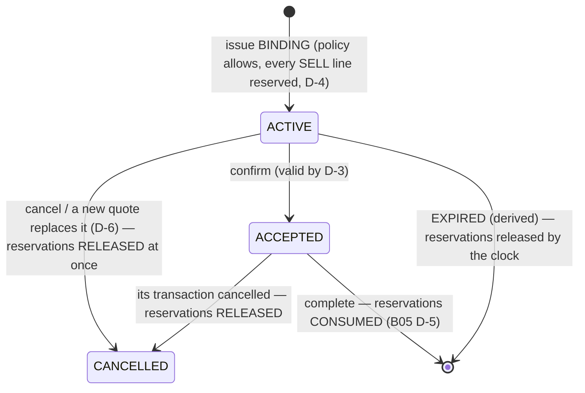

# Binding quote: the rate lock of Blueprint phase 6

> Draft by claude/dell-claude-5 for the xchange BE lane controller claude/a90ab16c (#564), on `origin/main`
> `8444e835` (citations re-checked on `584ddec6`, 2026-10-20, after RBAC §11 landed). The owner ordered it on 2026-10-19 (PR 3334 issuecomment-6263220520, verbatim): *"B05: use all six
> recommendations in PR 3334's §9 (O-1 A through O-6 A). Design the binding quote next, in the same round."*
> B05's O-1 A makes the binding quote the **only** caller that reserves stock (`stock-reservation.md` D-12).
> Every rule below cites its source. The eight rules the Blueprint left open were decided by the owner on
> 2026-10-19 (§9). One value is still owed by the owner: **O-3's lock range** (D-10, §3).

| Blueprint v2 (`docs/blueprint/XC-Desk-Blueprint-Data-Model-v2.html`) | Text |
|---|---|
| §01 scope | *"การจองเริ่มด้วยจองคิว • ไม่รับชำระเงินออนไลน์ในขอบเขตนี้ • แอปติดตั้งและล็อกเรทอยู่ระยะถัดไป"* |
| §06 Quote | *"ACTIVE → ACCEPTED \| EXPIRED \| CANCELLED"* — *"indicative สำหรับจองคิว; binding สำหรับล็อกเรทในระยะ 6; quote ใหม่เมื่อเปลี่ยนจำนวน/สิทธิ"* |
| §07 Quote | *"Quote(id, customer_id FK nullable, branch_id FK, type, expires_at, status, benefit_snapshot JSON)"* |
| §08 | *"QuoteLine → StockReservation 1:0..N ใช้เฉพาะ binding quote ระยะ 6"* |
| §09 Complete exchange | *"validate branch/shift/quote → ตรวจเงินและธนบัตร → consume reservation ถ้ามี → post ledger/inventory → …"* |
| §10 | `POST /api/quotes` *"quote id, type, expiry, units, final amount, benefits; server คำนวณทั้งหมด"*; `complete` *"quote ยังมีผล"*; errors *"QUOTE_EXPIRED … STOCK_INSUFFICIENT … APPROVAL_REQUIRED, IDEMPOTENCY_CONFLICT"* |
| §13 phase 6 | *"Rate lock / app reservation expiry คืน stock; complete ใช้ quote lock ที่ถูกต้อง; network retry ไม่ซ้ำ; app อ่านข้อมูลชุดเดียวกับเว็บ"* |
| §16 PlannerDraft | *"draft ไม่จอง ไม่กัน stock ไม่ล็อกเรท; เปิดใหม่ต้อง re-quote"* |
| §19 T1 (owner, 9–11 Oct) | quote lifetime *"5 นาที (แนะนำ) แต่ให้ ตั้งค่าเองได้"* ⇒ 300 s, ADMIN may change; **"หมดทันทีเมื่อเผยแพร่เรทใหม่"** (`quote-transaction.md` §0 T1) |
| §19 R-11 / G-5 | board prices: a customer's quote ends at once on every new board publication, *"หมดทันทีตาม T1 (แนะนำ)"* |

---

## 1. v3 today (measured at `8444e835`; re-checked on `584ddec6`)

| Fact | Where |
|---|---|
| `quotes.type` admits `INDICATIVE`/`BINDING`, then a second CHECK forbids `BINDING` | `api/migrations/20261014100000_quotes.sql:9` (`CHECK (type IN ('INDICATIVE', 'BINDING')) CHECK (type = 'INDICATIVE')`); `quote-transaction.md` §3.1: *"BINDING is phase 6 (#555); dropped by its design"* |
| Channels already stored: `DESK`, `KIOSK`, `BOOKING`, `APP` | `20261014100000_quotes.sql:10`; `QuoteChannel` (`api/crates/xc-exchange/src/domain/quote/quote.rs:55-60`) |
| `QuoteService` is the one issuer for every channel and always writes `INDICATIVE` | `api/src/application/workflows/exchange/quote.rs:140`, `:514` (`quote_type: "INDICATIVE"`); `quote-transaction.md` D-8 |
| Lifetime: `exchange_settings.quote_ttl_seconds` (default 300, 30–3600), read per issue | `20261014100000_quotes.sql:44-49`; `quote.rs:281-282` |
| Validity is one rule for every quote: `now < expires_at && publication_id == current` | `Quote::is_valid` (`quote.rs:104-105`); checked at confirm and complete through `check_valid_in` (`api/src/application/workflows/exchange/create.rs:92-105`) → `quoteExpired`; `quote-transaction.md` D-5, D-6 |
| `Quote.quote_type` is a `String`, not a type | `quote.rs:89` |
| A booking holds no rate and no lock; its quote, if any, is indicative | `booking-slots.md` B1; mapping K5/Q5 (`xc-desk-blueprint-v2-mapping.md:253`, `:290`) |
| The stock store a binding quote reserves through | `stock-reservation.md` (B05, PR 3334): `StockReservations::reserve_in` / `consume_for_quote_in` / `release_for_quote_in` |

---

## 2. Decisions

| # | Decision | Source |
|---|---|---|
| D-1 | **A binding quote is a quote, not a new aggregate.** Same `quotes` / `quote_lines` rows, `type = 'BINDING'`, issued by the same `QuoteService` (one priced path for every channel). The second CHECK is dropped; the `IN` list stays. | §06, §07 (`type` is a column of Quote); `quote-transaction.md` D-8, §3.1 |
| D-2 | **`QuoteType` becomes a type** (`Indicative`, `Binding`) instead of the `String` at `quote.rs:89`, parsed at the edge like `QuoteChannel`. | the existing pattern `QuoteChannel` (`quote.rs:55-80`) |
| D-3 | **Validity is one rule chosen by type.** `Quote::is_valid(now, current)` keeps today's meaning for `Indicative` (`now < expires_at` **and** the publication is the branch's current one). For `Binding` it is **`now < expires_at`, whatever is published since** (O-4 A): the rate is locked until `expires_at`, so a binding quote reverses T1's *"หมดทันทีเมื่อเผยแพร่เรทใหม่"* for this type only. One function, called from the existing `check_valid_in` at confirm and complete; no caller decides it. | §13 phase 6 *"complete ใช้ quote lock ที่ถูกต้อง"*; `quote-transaction.md` D-5, D-6; O-4 A (§9) |
| D-4 | **Issuing reserves stock in the same DB transaction.** For each SELL line, `StockReservations::reserve_in` with the quote line and its `expires_at` (B05 D-7, D-15). Any refusal (`stockInsufficient`) refuses the whole binding quote: no quote, no partial reservations. | §08; B05 D-4, D-12, D-15, D-16 |
| D-5 | **Release on cancel, release by expiry, consume on completion: B05's paths, unchanged.** Cancelling the quote (or its transaction) releases at once (B05 D-6, SR-3); expiry releases by the clock (B05 D-3); `CompleteExchange` consumes before posting (B05 D-5, SR-2). | §07 *"release on expire/cancel"*; §09; §13 phase 6 |
| D-6 | **A change is a new quote.** Changing quantity or benefits issues a new binding quote and cancels the old one (which releases its reservations, D-5). A binding quote is never edited. | §06 *"quote ใหม่เมื่อเปลี่ยนจำนวน/สิทธิ"* |
| D-7 | **Issuing is idempotent.** The command takes `Idempotency-Key`; a replay returns the same quote and makes no second reservation (B05 D-8). | §13 phase 6 *"network retry ไม่ซ้ำ"*; `quote-transaction.md` CM-1 |
| D-8 | **A booking's quote stays indicative**, and a PlannerDraft locks nothing. | §06 *"indicative สำหรับจองคิว"*; §16; `booking-slots.md` B1 |
| D-9 | **No money at issue, no deposit, no fee** (O-6 A). A binding quote writes no payment row; a lock that is not used simply expires, and its reservations are released by the clock (B05 D-3). | §01 *"ไม่รับชำระเงินออนไลน์ในขอบเขตนี้"*; O-6 A (§9) |
| D-10 | **The lifetime is an ADMIN setting with no default** (O-3 A): `exchange_settings.binding_quote_ttl_seconds`, `NULL` until entered. **No value ⇒ binding quotes are off** for that organisation: `QuoteService` refuses `validationFailed: binding quotes are not enabled`. 🔴 **Range: owner-owed (O-3), no default.** The owner will give the lock range separately; until then the column checks only that a value is a positive number of seconds, and **the bounds CHECK is added (by a migration of its own) when the owner gives them**. No number in this design is a guess at that range. | §19 T1 (*"ให้ ตั้งค่าเองได้"*); `executive-finance.md` E-3; O-3 A (§9) |
| D-11 | **`complete` uses the transaction's own quote.** The exchange carries one `quote_id`; a binding quote is `ACCEPTED` by at most one transaction (the existing `accepted_by_transaction_id` CHECK). | §13 phase 6; `20261014100000_quotes.sql:20` |
| D-12 | **The response says what is locked and until when**: `type`, `expiresAt`, and per line `reservedQuantity`. | §10 `POST /api/quotes` *"type, expiry …"*; §13 *"app อ่านข้อมูลชุดเดียวกับเว็บ"* |
| D-13 | **Only TELLER and BRANCH_MANAGER may issue** (O-1 A), through a new permission `Permission::BindingQuoteIssue` that only those two built-in groups hold. `ExchangeTransact` cannot be reused: since RBAC §11 it maps to (Customers, Create) (`api/crates/xc-auth/src/domain/access/permission_module.rs:95-100`), so every group with Customers at Create or above holds it, EXECUTIVE included (Customers Full in `RoleGrants::seed`, `role_grants.rs:114`), and O-1 A refuses EXECUTIVE. So `[required]` `BindingQuoteIssue` is a **no-module** permission (`PermissionModule::module` → `None`, the list at `permission_module.rs:131`), named only in the explicit lists of `Role::Teller` and `Role::BranchManager` in `RoleGrants::seed` (`role_grants.rs:204`, `:219`). Existing groups get it through #3976's `SEED_ADDITIONS` (D-18), because `seed_missing` seeds only groups with no rows. Every other group is refused by the command seam's permission answer. | O-1 A (§9); `user-management-rbac.md` §11.2, §11.5 item 2 |
| D-14 | **Only the `DESK` channel, for now** (O-2 A, *"APP later"*). A binding-quote request on `APP`, `KIOSK` or `BOOKING` is refused `validationFailed` on `channel`, with no quote and no reservation. `APP` is enabled by a later design when the app ships; `KIOSK` and `BOOKING` stay indicative (§06, D-8). | O-2 A (§9) |
| D-15 | **Over the branch limit ⇒ BRANCH_MANAGER approval before issue** (O-5 A: T2 reused at issue). If the quote's total `settle_thb` exceeds the branch's `approval_limit_thb` (`branch_exchange_limits`, read by `approval_limit_in`, `api/crates/xc-exchange/src/domain/settings/repository.rs:16`; `NULL` = no limit), the issue opens an AP-1 request of type `BINDING_QUOTE` and answers `409 approvalRequired` with no quote and no reservation. The retry that names the APPROVED request issues it. The decider is a BRANCH_MANAGER of the quote's branch, and the proposer never decides, as T2 (`quote-transaction.md` §5.1). The subject is registered under `approval_subjects/` (D-19). | O-5 A (§9); T2; owner 2026-10-20: A only |
| D-16 | **A binding quote and a booking are independent** (O-7 A). A booking's quote stays indicative (D-8, B1); cancelling or moving a booking never touches a binding quote; a booked slot never extends a lock's `expires_at`. | O-7 A (§9); `booking-slots.md` B1 |
| D-17 | **A binding quote names a verified customer** (O-8 A). `customer_id` is required, and `Readiness::of(pool, customer)` (`api/crates/xc-verification/src/application/readiness.rs:16`, V12) must answer `Verified { until }` with `until > now`. `None`, `Pending`, `NeedsUpdate`, `Expired`, or no customer ⇒ `validationFailed` on `customerId`, no quote. This is the one place readiness gates something (V12 says *"nothing refuses on it"* for bookings and the desk; O-8 A adds this gate for binding quotes only). | O-8 A (§9); `verification.md` V12 |
| D-18 | **The new permission reaches existing built-in groups through #3976's seed versions, not a migration of its own.** The owner ruled option B on #3976 (2026-10-20: *"go with B, track the seed version per built-in group, one migration"*). BQ-7 adds `(3, Permission::BindingQuoteIssue)` to `RoleGrants::SEED_ADDITIONS` and raises `RoleGrants::SEED_VERSION` to **3** (version 2 is #3976's `MarketRatesRefresh`), next to the TELLER and BRANCH_MANAGER seed lists (D-13). At boot, `seed_additions` grants each permission newer than a built-in group's `roles.seed_version` that the group's `RoleGrants::seed` holds, once, then raises the group to `SEED_VERSION`. So TELLER and BRANCH_MANAGER gain `BindingQuoteIssue`; no other built-in group gains it (their seeds don't hold it); custom groups are never touched; and an owner who removed it later never gets it back. A fresh database gets it from `seed_missing`, which sets `seed_version = SEED_VERSION`. | #3976 §5 (the design), its ruling; `user-management-rbac.md` §11.5 item 2 |
| D-19 | **The approval subject is registered like every AP-1 type.** One file per subject under `api/src/bootstrap/approval_subjects/`: `binding_quote.rs` with `pub const TYPE: &str = "BINDING_QUOTE"` and `register` forwarding to `workflows::exchange::binding_approval::register`, exactly as `exchange_transaction.rs` does. The registry is generated from that directory at build time (`approval_subjects/mod.rs` `include!(concat!(env!("OUT_DIR"), …))`), so no `mod.rs` line is needed. A type missing there is hidden from the `approval_requests` view, so no BRANCH_MANAGER could decide it (the `CASH_TRANSFER` bug fixed by #3858, PR 3862). | `api/src/bootstrap/approval_subjects/exchange_transaction.rs`; #3858 |

---

## 3. Tables (one migration; slot assigned by the lane controller on #564)

```
-- quotes: drop the second CHECK only
ALTER TABLE quotes DROP CONSTRAINT <name of CHECK (type = 'INDICATIVE')>;   -- the IN ('INDICATIVE','BINDING') CHECK stays

-- exchange_settings: the lock's lifetime (D-10)
ALTER TABLE exchange_settings
  ADD COLUMN binding_quote_ttl_seconds integer NULL CHECK (binding_quote_ttl_seconds > 0);   -- NULL = off; no default
  -- range: owner-owed (O-3), no default; the bounds CHECK is added, by its own migration, when the owner gives them
```

- The CHECK's name is found from `pg_constraint` in the migration (it was declared inline, so Postgres named it). The migration asserts that exactly one such constraint exists before dropping it.
- **No grant rows in this migration.** `BindingQuoteIssue` reaches TELLER and BRANCH_MANAGER through #3976's boot step `seed_additions` (D-18), not SQL here. O-2 is code (a channel check); O-5 reuses `branch_exchange_limits` and AP-1's `approval_requests`, whose `type` is free text (`api/migrations/20261010110000_approvals.sql:3`), so `BINDING_QUOTE` needs no schema change. O-6, O-7 and O-8 add no column.
- **O-5's exposure cap is out:** decided, A only: the exposure cap is out (owner 2026-10-20, claude/5edf7bb5 issuecomment-6286218372); a cap would be a later, separate design.

---

## 4. Behaviour

### 4.1 States (unchanged; the type changes what holds)


### 4.2 Behaviour rows (each one test)

| # | Case | Required result |
|---|---|---|
| Q1 | organisation with `binding_quote_ttl_seconds` NULL, issue BINDING | `validationFailed` (off, D-10); no quote; no reservation |
| Q2 | TTL set, SELL 100 USD, available 300 | `BINDING` quote, `expires_at = now + ttl`; one `RESERVED` row of 100 with the same `expires_at` |
| Q3 | SELL 100 USD, available 60 | `stockInsufficient`; no quote; no reservation (D-4) |
| Q4 | two SELL lines, the second short | `stockInsufficient`; neither line reserved |
| Q5 | a BUY line | quote issued; no reservation for it (B05 D-15) |
| Q6 | the same issue sent twice with one `Idempotency-Key` | one quote; one reservation per line (D-7) |
| Q7 | quantity changed | a new quote; the old one `CANCELLED`; its reservations `RELEASED` / `CANCELLED` (D-6) |
| Q8 | confirm, then complete, within the lifetime | `ACCEPTED`, then `COMPLETED`; reservations `CONSUMED` before the posting (B05 S8) |
| Q9 | complete after `expires_at` | `quoteExpired` (D-3); nothing posted |
| Q10 | the transaction cancelled after confirm | quote `CANCELLED`; reservations `RELEASED` at once |
| Q11 | an `INDICATIVE` quote | behaves exactly as today; no reservation (regression guard for D-3) |
| Q12 | a booking's quote, a PlannerDraft | always `INDICATIVE`; no reservation (D-8) |
| Q13 | the response | carries `type`, `expiresAt`, and `reservedQuantity` per line (D-12) |
| Q14 | O-1: a TELLER, and a BRANCH_MANAGER, issue | both issued |
| Q15 | O-1: EXECUTIVE, ADMIN, RATE_MANAGER, FINANCE, MARKETING, CUSTOMER issue | each refused by the permission answer; no quote; no reservation (D-13) |
| Q16 | O-2: channel `APP`, `KIOSK`, `BOOKING` | `validationFailed` on `channel`; no quote; no reservation (D-14) |
| Q17 | O-4: a new rate publication after issue, then confirm and complete before `expires_at` | both succeed at the quote's own `final_rate` (D-3) |
| Q18 | O-4: the same with an `INDICATIVE` quote | `quoteExpired`, as today (D-3, regression guard) |
| Q19 | O-5: total `settle_thb` ≤ the branch limit, or the branch has no limit | issued with no approval request (D-15) |
| Q20 | O-5: total `settle_thb` > the branch limit | `409 approvalRequired`; one PENDING `BINDING_QUOTE` request; no quote; no reservation (D-15) |
| Q21 | O-5: the retry naming that request after a BRANCH_MANAGER of the branch APPROVED it | issued, with its reservations (D-4, D-15) |
| Q22 | O-5: the request REJECTED; or the proposer tries to decide it; or the retry changes a quantity | refused; the proposer's decision is refused (no self-decision); a changed request is `staleVersion` (D-15) |
| Q23 | O-6: issue, then let it expire unused | no payment row at issue; after `expires_at` its reservations count as released; nothing charged (D-9) |
| Q24 | O-7: the customer's booking is cancelled or moved while the binding quote is live | the binding quote stays `ACTIVE` with the same `expires_at`; a booking can carry only an `INDICATIVE` quote (D-16, D-8) |
| Q25 | O-8: no `customer_id`; or a customer whose readiness is `None`, `Pending`, `NeedsUpdate`, `Expired`, or `Verified { until ≤ now }` | `validationFailed` on `customerId`; no quote (D-17) |
| Q26 | O-8: a customer `Verified { until > now }` | issued (D-17) |
| Q27 | O-5: a PENDING `BINDING_QUOTE` request | listed in the `approval_requests` view for a BRANCH_MANAGER of the quote's branch, and decidable there (D-19) |
| Q28 | a TELLER and a BRANCH_MANAGER built-in group at `seed_version` 2, then boot | each gains exactly `BindingQuoteIssue` from `seed_additions` and ends at `seed_version` 3; no other built-in group and no custom group gains it (D-18) |
| Q29 | an owner removed `BindingQuoteIssue` from TELLER after it was granted, then boot | it is not re-added (D-18) |
| Q30 | a fresh database: `seed_missing` | TELLER and BRANCH_MANAGER hold `BindingQuoteIssue`, at `seed_version` 3, with no duplicates (D-18) |

O-3's range has no row: it is owner-owed, and its bounds CHECK and test come with the owner's numbers (D-10).

---

## 5. Class diagram

```mermaid
classDiagram
  class QuoteType {
    <<xc-exchange domain/quote/quote_type.rs>>
    Indicative
    Binding
    +as_str() str
    +parse_db(s) Option~QuoteType~
  }
  class Quote {
    <<xc-exchange domain/quote/quote.rs>>
    +quote_type: QuoteType
    +is_valid(now, current_publication) bool
  }
  class BindingQuotePolicy {
    <<xc-exchange domain/quote/binding_policy.rs>>
    +ttl: Option~Duration~
    +check_channel(channel) Result
    +check_customer(readiness, now) Result
    +needs_approval(settle_thb, limit) bool
  }
  class BindingQuoteSubject {
    <<api src/application/workflows/exchange/binding_approval.rs>>
    type_name() = BINDING_QUOTE
    version_hash(request) sha256
    may_decide(who, request) BRANCH_MANAGER of the branch
    allows_self_decision() false
  }
  class BindingQuoteIssuePermission {
    <<xc-auth domain/access/permission.rs + permission_module.rs + role_grants.rs>>
    Permission::BindingQuoteIssue (no module)
    RoleGrants::seed: TELLER, BRANCH_MANAGER only
  }
  class BindingQuoteApprovalRegistration {
    <<api src/bootstrap/approval_subjects/binding_quote.rs>>
    TYPE = BINDING_QUOTE
    register(registry, pool)
  }
  class BindingSettingsRepository {
    <<trait · xc-exchange domain/quote/binding_settings.rs>>
    +load_in(tx, org) AppResult~BindingQuotePolicy~
  }
  class PgBindingSettings {
    <<xc-exchange infrastructure/binding_settings_repository.rs>>
  }
  class IssueBindingQuote {
    <<api src/application/workflows/exchange/binding_issue.rs>>
    +run_in(tx, req, actor) AppResult~IssuedQuote~
  }
  class QuoteService {
    <<api src/application/workflows/exchange/quote.rs>>
    +price_in(tx, req, QuoteType) AppResult~Quote~
  }
  class StockReservations {
    <<trait · xc-cash domain/reservation/port.rs (B05)>>
  }
  class BindingQuoteIssueCommand {
    <<api src/presentation/http/v3/commands/binding_quote_issue.rs>>
  }
  class BindingQuoteArea {
    <<xc-auth domain/policy/areas/binding_quote.rs>>
  }
  class CheckValid {
    <<api src/application/workflows/exchange/create.rs: check_valid_in>>
  }
  Quote --> QuoteType
  BindingSettingsRepository <|.. PgBindingSettings
  BindingSettingsRepository ..> BindingQuotePolicy : builds
  IssueBindingQuote --> BindingSettingsRepository
  IssueBindingQuote --> QuoteService : price_in(…, Binding)
  IssueBindingQuote --> StockReservations : reserve_in per SELL line
  BindingQuoteIssueCommand --> IssueBindingQuote
  BindingQuoteIssueCommand --> BindingQuoteArea : who may call
  BindingQuoteArea --> BindingQuoteIssuePermission : needs
  IssueBindingQuote --> BindingQuoteSubject : opens / reads the AP-1 request (O-5)
  BindingQuoteApprovalRegistration --> BindingQuoteSubject : register forwards to binding_approval::register
  IssueBindingQuote --> BindingQuotePolicy : channel, customer, limit
  CheckValid --> Quote : is_valid(now, current)
```

### 5.1 Who provides, who uses

| Provides | Ticket | Used by |
|---|---|---|
| migration (§3) | BQ-0 | BQ-1, BQ-2 |
| `QuoteType`; `Quote.quote_type: QuoteType`; `Quote::is_valid(now, current)` by type (D-3) | BQ-1 (core) | BQ-3, BQ-4, every quote reader |
| `BindingQuotePolicy` (ttl, channel, customer, limit: D-10, D-14, D-15, D-17), trait `BindingSettingsRepository`, `PgBindingSettings` | BQ-1 (core) | BQ-2, BQ-3 |
| `BindingQuoteSubject` (AP-1, D-15) and its registration file under `approval_subjects/` (D-19) | BQ-6 | BQ-3, the `approval_requests` view |
| `Permission::BindingQuoteIssue` (no module) in `RoleGrants::seed` for TELLER and BRANCH_MANAGER (D-13) | BQ-7 | BQ-5 |
| `(3, BindingQuoteIssue)` in `RoleGrants::SEED_ADDITIONS`, `SEED_VERSION` = 3 (D-18), granted at boot by #3976's `seed_additions` | BQ-7 | TELLER and BRANCH_MANAGER at runtime |
| `QuoteService::price_in(…, QuoteType)` (writes the given type; today's callers pass `Indicative`) | BQ-2 | BQ-3 |
| `IssueBindingQuote` (D-4, D-6, D-7) | BQ-3 | BQ-5 |
| `check_valid_in` applies validity by type (D-3) | BQ-4 | confirm, complete |
| command `bindingQuoteIssue` + its policy area | BQ-5 | the desk / app screens (separate web tickets) |
| `StockReservations` (reserve / release / consume) | B05 SR-1 … SR-3 | BQ-3, cancel, complete |

**Stubs for parallel work.** BQ-1 lands `QuoteType`, `BindingQuotePolicy` and the repository trait with `todo!()` bodies first (a skeleton commit on `feat/binding-quote`), so BQ-2 … BQ-5 build against the signatures. B05's skeleton (`StockReservations`) is the other stub BQ-3 needs.

---

## 6. Data migration

1. **Existing rows.**
   - Every `quotes` row is `INDICATIVE` (the CHECK being dropped guarantees it) and keeps its meaning; validity for `Indicative` is unchanged (D-3).
   - Every `exchange_settings` row gets `binding_quote_ttl_seconds = NULL`, so binding quotes are off everywhere until someone enters a value (D-10).
   - `role_permission_grants` is not changed by this migration: the grant comes from #3976's boot step (D-18).
2. **Backfill: none.** No row needs a value the migration writes. Binding quotes stay off until ADMIN enters a lifetime, and the permission is granted at boot by #3976's `seed_additions`. After deploy, count it: `SELECT role_code FROM role_permission_grants WHERE permission = 'BindingQuoteIssue';` should list TELLER and BRANCH_MANAGER (those whose owner has not removed it since).
3. **Deploy order: migration first, then the binary, after #3976.**
   - #3976's migration and `seed_additions` must already be deployed (BQ-7 waits on it).
   - The new binary brings `SEED_VERSION` 3, so its boot step grants `BindingQuoteIssue`. An old binary refuses an unknown stored permission (`parse_perm`, `role_grant_store.rs:34-36`, *"invalid stored permission"*), so **once the new binary has granted it, a rollback to an older binary first deletes the `BindingQuoteIssue` rows** (and resets those groups' `seed_version` to 2).
   - The new binary on the old schema finds no `binding_quote_ttl_seconds` and so issues no binding quote.
4. **`down`.**
   - Drops `binding_quote_ttl_seconds`.
   - Re-adds `CHECK (type = 'INDICATIVE')`. The CHECK cannot be re-added while a `BINDING` row exists, so `down` first sets every live binding quote `CANCELLED` and releases its reservations.
   - **It loses** every binding quote issued (they become cancelled history) and the lifetime setting. It changes no grant row: the grants are ordinary rows from #3976's boot step, removed only by the rollback step in item 3.

**Owner approval needed before merge** (a schema change).

---

## 7. Tickets (one core, then functions with disjoint File scopes; on `feat/binding-quote`)

| # | What | File scope | Waits on |
|---|---|---|---|
| BQ-0 | migration (§3): the CHECK and the lifetime column | `api/migrations/<slot>_binding_quote.sql` · `api/tests/binding_quote_migration_test.rs` | the slot (#564) · **owner approval before merge** (a schema change) · O-3's bounds CHECK is **not** in it (owner-owed) |
| BQ-1 | core: `QuoteType`, `Quote::is_valid` by type, `BindingQuotePolicy`, settings trait and Pg impl (D-3, D-10, D-14, D-15, D-17), Q16, Q19, Q25, Q26 at the policy level | `api/crates/xc-exchange/src/domain/quote/quote_type.rs` · `…/quote.rs` · `…/binding_policy.rs` · `…/binding_settings.rs` · `api/crates/xc-exchange/src/infrastructure/binding_settings_repository.rs` · `api/crates/xc-exchange/tests/binding_policy_test.rs` | BQ-0 |
| BQ-2 | `QuoteService::price_in` takes the type | `api/src/application/workflows/exchange/quote.rs` · `api/tests/quote_type_test.rs` | BQ-1's skeleton |
| BQ-3 | `IssueBindingQuote` (D-4, D-6, D-7, D-9, D-14, D-15, D-16, D-17), Q2–Q7, Q16, Q19–Q26 | `api/src/application/workflows/exchange/binding_issue.rs` · `api/tests/binding_issue_test.rs` | BQ-1 skeleton; BQ-6 skeleton; B05 SR-1 skeleton |
| BQ-4 | validity by type at confirm and complete (D-3), Q8–Q11, Q17, Q18 | `api/src/application/workflows/exchange/create.rs` · `api/tests/binding_validity_test.rs` | BQ-1 skeleton |
| BQ-5 | command `bindingQuoteIssue` + policy area (D-12, D-13), Q1, Q13–Q15 | `api/src/presentation/http/v3/commands/binding_quote_issue.rs` · `api/crates/xc-auth/src/domain/policy/areas/binding_quote.rs` · `api/tests/v3_binding_quote_issue_test.rs` | BQ-3; BQ-7 |
| BQ-6 | `BindingQuoteSubject`: AP-1 subject `BINDING_QUOTE` (D-15), registered (D-19), Q22, Q27 | `api/src/application/workflows/exchange/binding_approval.rs` · `api/src/bootstrap/approval_subjects/binding_quote.rs` · `api/tests/binding_approval_test.rs` | BQ-1 skeleton |
| BQ-7 | `Permission::BindingQuoteIssue`: a no-module permission, in `RoleGrants::seed` for `Role::Teller` and `Role::BranchManager` only (D-13), registered as `(3, BindingQuoteIssue)` in `RoleGrants::SEED_ADDITIONS` with `SEED_VERSION` = 3 (D-18), Q14, Q15, Q28–Q30. **Must stay green:** #3976's gate `api/crates/xc-auth/tests/rbac_seed_version_test.rs` (its anti-forget test `every_permission_is_in_the_version_1_baseline_or_in_seed_additions` goes red if the permission is added without its `SEED_ADDITIONS` entry) | `api/crates/xc-auth/src/domain/access/permission.rs` · `api/crates/xc-auth/src/domain/access/permission_module.rs` · `api/crates/xc-auth/src/domain/access/role_grants.rs` · `api/crates/xc-auth/tests/binding_quote_permission_test.rs` | **#3976 merged first**: it adds `SEED_VERSION`, `SEED_ADDITIONS` and `seed_additions`, and it also edits `role_grants.rs`, so BQ-7 follows it and rebases over it; without it the new permission reaches no existing group. ⚠️ the three xc-auth files are shared with the RBAC lane, so check open PRs on them at release (`gh pr list --json files`) |

Registration lines (not locked): the approval subject needs none (build-generated, D-19); `xc-exchange/src/domain/quote/mod.rs`, `xc-exchange/src/infrastructure/mod.rs`, `api/src/application/workflows/exchange/mod.rs`, the commands registry, the policy areas registry.

🔴 **Collision with B05:** none. B05 SR-2 edits `complete.rs` and `effects.rs`, SR-3 `cancel.rs`; this design edits `create.rs` (BQ-4) and `quote.rs` (BQ-2), and calls B05's port from a new file (BQ-3).

---

## 8. Do not touch

`booking-slots.md` B1 (a booking holds no rate), the kiosk's and desk's indicative path (Q11), T1's 300-second default for indicative quotes, and B05's store.

---

## 9. Decided (owner, 2026-10-19)

Source (O-5's cap, 2026-10-20: in its row): the owner, 2026-10-19, verbatim (claude/a90ab16c on PR 3424, issuecomment-6263510458): *"Accept every recommendation: binding quote O-1 A, O-2 A (APP later), O-3 A, O-4 A, O-5 A, O-6 A, O-7 A, O-8 A … For O-3 I'll give the lock range separately."*

| # | Question | Answer | Where it lands |
|---|---|---|---|
| O-1 | Who may issue a binding quote? | **A.** TELLER and BRANCH_MANAGER at the counter. | D-13, D-18, BQ-7, BQ-5; Q14, Q15, Q28–Q30 |
| O-2 | From which channels? | **A.** `DESK` only; **`APP` later** (owner's words), in its own design when the app ships. | D-14; Q16 |
| O-3 | How long does a lock last? | **A.** An ADMIN setting with no default, off until entered. **Range: owner-owed** (*"I'll give the lock range separately"*): no default, and the bounds CHECK is added, by its own migration, when the owner gives them. | D-10, §3, BQ-0 |
| O-4 | Does a new rate publication end a binding quote? | **A.** No: valid until `expires_at`, whatever is published. | D-3, BQ-4; Q17, Q18 |
| O-5 | Approval or caps? | **A only.** T2's branch limit reused at issue: over the limit ⇒ BRANCH_MANAGER approval first. The exposure cap is out (owner 2026-10-20, asked in claude/5edf7bb5's session, issuecomment-6286218372: *"A only"*); a cap would be a later, separate design. | D-15, D-19, BQ-6, BQ-3; Q19–Q22, Q27 |
| O-6 | Deposit or cancellation terms? | **A.** None: an unused lock simply expires. | D-9; Q23 |
| O-7 | What happens to a booking? | **A.** Independent: neither touches the other, and a slot never extends a lock. | D-16; Q24 |
| O-8 | Must a binding quote name a customer? | **A.** Yes, a verified customer. | D-17; Q25, Q26 |

**Class (proposed):** BQ-0 `class:guarded` (schema); BQ-1, BQ-3, BQ-4, BQ-6 `class:logic` (lock, stock and approval rules); BQ-2, BQ-5 `class:logic`; BQ-7 `class:guarded` (a permission).
