# Bounded inputs: one parse at the boundary for every numeric and enum write input

> Design row (Rule A) for tracking issue #2054. Written by claude/d7aa64 on the BE controller's (claude/7ca80c) order, 2026-10-16. **Proposal: no code until the lane controller rules.**

## 1. Problem (measured on main `67e132f6`; full list in #2054)

20 write-input fields in 12 commands and routes are bounded only by their database column (`numeric(p,s)` or a `CHECK`).

- **Too many integer digits** overflow the column. The command answers 500, and sometimes the raw Postgres text reaches the client.
- **Too many decimals** are silently rounded by the column. If the rounded value then breaks a `CHECK (> 0)`, the request fails the same way.
- **Unknown enum strings** hit a `CHECK IN (…)` and fail the same way.

The root is the same in every case. Each command parses with raw `Decimal::from_str`, serde `Decimal` or `ForeignAmount::from_decimal`, and none of these knows the bound. The kernel already has a complete bounded parser, `xc_kernel::money::money::parse_decimal` (`money.rs:102`). But it is `pub(crate)` and accepts no negative values, and on main only `Money::parse` calls it (`money.rs:37`). `Rate::parse` (`rate.rs:17-57`) and `ForeignAmount::parse` (`foreign_amount.rs:17-51`) carry inline copies of the same checks; both also refuse zero, and `Rate` rescales its value to 4–8 places. `RatePercent`, `UnitSize` and `CompatRate` have no magnitude cap.

Fixing each command separately (#2039, #2040, #2041) repairs the place the error shows up, not its cause. The next new field would repeat it.

## 2. Decisions (proposed)

| # | Decision |
|---|---|
| B-1 | **One kernel core.** A public `Bound` describes the column it protects, and its `parse` is the only place that checks scale, sign and magnitude. The `numeric(p,s)` shape is spelled exactly as in the migration, so a reviewer can compare the two directly. |
| B-2 | **The existing typed parsers sit on it.** `Money::parse`, `Rate::parse` and `ForeignAmount::parse` become thin wrappers over `Bound`, with no change in behaviour (their current tests pin that). **Their cap is inclusive:** all three accept exactly `Money::MAX_INPUT_UNITS` (10^8) and refuse anything above it (`money.rs:31`, `:144`; `rate.rs:46`; `foreign_amount.rs:47`). A `numeric(p, s)` bound is strict and a power of ten, so no `(p, s)` gives that range. The wrappers therefore use `Bound::numeric(..).at_most(Money::MAX_INPUT_UNITS)`, an inclusive maximum, while `numeric(p, s)` alone stays the column bound. `Rate` and `ForeignAmount` use `Sign::Positive` (they refuse zero), and `Rate` keeps its 4–8-place rescale after `Bound::parse`. `RatePercent::parse` and `UnitSize::parse` gain the magnitude cap of the column they are stored in. |
| B-3 | **One presentation helper for v3.** `v3::input::decimal(field, text, bound)` and `v3::input::one_of(field, text, allowed)` map a refusal to the house answer: **400 `validationFailed`** with the field name, and nothing written. **Any trimming of surrounding whitespace happens here, at the presentation boundary, before `Bound`**; `Bound` itself never trims. Non-v3 routes call `Bound::parse` and refuse in their own file's existing shape. |
| B-4 | **A request DTO carries a string, never a serde `Decimal`.** Input fields that are decimals are `String` and are parsed through B-3. A serde `Decimal` accepts any magnitude and any scale before any of our code runs; `bookingCreate.quantity` is that case. |
| B-5 | **A source-scan guard** (§5) keeps every new field on the core. |
| B-6 | **No database change.** The columns stay as they are, and the app-side bound equals the column's bound. |
| B-7 | **Integer and reference inputs use the same core** (the lane controller's ruling, 2026-10-16). `IntBound::integer(min, max)` mirrors an integer `CHECK` (`BETWEEN`, `> 0`, `>= 0`). A value that names a row (a currency code, and later others) is checked to exist **before** the write, inside the same transaction, and a missing row answers 400 `validationFailed` with the field. It never reaches the foreign key. |

## 3. Shape (the class diagram; names are `[proposed]`)

```mermaid
classDiagram
  class Bound { <<xc-kernel money/bounded.rs>> +numeric(precision u8, scale u8, sign Sign) Bound +at_most(max i64) Bound +parse(text) Result~Decimal, BoundError~ }
  class Sign { <<xc-kernel money/bounded.rs>> Positive | NonNegative | Signed }
  class BoundError { <<xc-kernel money/bounded.rs>> Syntax | TooManyDecimals | OutOfRange | Sign }
  class IntBound { <<xc-kernel money/bounded.rs>> +integer(min i64, max i64) IntBound +check(v i64) Result~i64, BoundError~ }
  class Money { <<xc-kernel money/money.rs>> +parse() }
  class Rate { <<xc-kernel money/rate.rs>> +parse() }
  class ForeignAmount { <<xc-kernel money/foreign_amount.rs>> +parse(text, units) }
  class RatePercent { <<xc-kernel money/rate_percent.rs>> +parse() bounded numeric(9,4) }
  class UnitSize { <<xc-kernel money/unit_size.rs>> +parse() bounded }
  class V3Input { <<api presentation/http/v3/input.rs>> +decimal(field, text, Bound) Result~Decimal, V3Error~ +one_of(field, text, allowed) Result~&'static str, V3Error~ +integer(field, v, IntBound) Result~i64, V3Error~ +must_exist(tx, field, RowRef, value) Result~(), V3Error~ }
  Money --> Bound
  Rate --> Bound
  ForeignAmount --> Bound
  RatePercent --> Bound
  UnitSize --> Bound
  V3Input --> Bound
  V3Input --> IntBound
```



```rust
// api/crates/xc-kernel/src/money/bounded.rs (new; one `mod bounded;` + `pub use` line in money/mod.rs)
pub enum Sign { Positive, NonNegative, Signed }
pub struct Bound { int_digits: u8, scale: u8, sign: Sign, max_inclusive: Option<i64> }
impl Bound {
    /// The bound of a `numeric(precision, scale)` column: |v| < 10^(precision − scale), at most `scale` decimals.
    pub const fn numeric(precision: u8, scale: u8, sign: Sign) -> Self;
    /// An inclusive maximum, |v| <= max, used by B-2's wrappers (`Money::MAX_INPUT_UNITS` = 10^8 is accepted, 10^8 + 0.01 refused).
    /// It replaces the strict power-of-ten limit of `numeric`; `max` must not exceed what the column holds.
    pub const fn at_most(self, max: i64) -> Self;
    /// Exactly as strict as today's `parse_decimal` (`money.rs:102-151`): no trimming; digits and one '.' only, with no
    /// leading or trailing '.'; a leading '-' only when `sign` is `Signed`, never '+'; more decimals than `scale` refused
    /// unless the extra digits are zeros; out of range refused.
    pub fn parse(&self, text: &str) -> Result<Decimal, BoundError>;
}
pub enum BoundError { Syntax, TooManyDecimals { max: u8 }, OutOfRange, Sign }
/// An integer CHECK: `min ..= max` (e.g. `BETWEEN 5 AND 240`, `> 0` = `1 ..= i64::MAX`).
pub struct IntBound { min: i64, max: i64 }
impl IntBound { pub const fn integer(min: i64, max: i64) -> Self; pub fn check(&self, v: i64) -> Result<i64, BoundError>; }

// api/src/presentation/http/v3/input.rs (new; one `pub mod input;` line in v3/mod.rs). It is not under views/actions/commands, so the OR-4 route guard does not scan it.
pub fn decimal(field: &'static str, text: &str, bound: Bound) -> Result<Decimal, V3Error>;      // 400 validationFailed, `field`
pub fn one_of(field: &'static str, text: &str, allowed: &[&'static str]) -> Result<&'static str, V3Error>;
pub fn integer(field: &'static str, v: i64, bound: IntBound) -> Result<i64, V3Error>;              // 400 validationFailed, `field`
/// A value that must name an existing row: `SELECT 1 FROM <table> WHERE <key> = $1` in the command's transaction.
pub async fn must_exist(tx: &mut Transaction<'_, Postgres>, field: &'static str, table_key: RowRef, value: &str) -> Result<(), V3Error>;
pub enum RowRef { Currency }   // one variant per referenced table; the SQL is fixed per variant (no string-built table names)
```

- **Edge cases** (lane controller's ruling, option 1, on claude/087e0c's review): `Bound` keeps today's strictness exactly, so B-2 changes no behaviour.
  - `""`, `" 1"`, `"1 "`, `"+1"`, `".5"`, `"5."`, `"1e5"` → `Syntax`.
  - `"-1"` and `"-0.00"` → `Sign` under `Positive` and `NonNegative`; they are accepted only under `Signed` (and `"-0.00"` there is `0`).
  - `"1.230"` with `scale` 2 → accepted, because the extra digit is a zero, as `parse_decimal` does today; `"1.234"` → `TooManyDecimals`.
  - Any trimming belongs to `v3::input::decimal` (B-3), not to `Bound`.
- **Who provides, who uses:**

| Provided by | Used by | If not landed yet |
|---|---|---|
| `Bound` (ticket K-1) | B-2's typed parsers (K-2), `V3Input` (P-1), and the non-v3 routes | every other ticket waits; there is no stub, because K-1 is small |
| `V3Input` (P-1) | each v3 command in #2054 (R-tickets) | R-tickets wait for P-1 |

## 4. Tickets (after the ruling)

| # | Owns | Starts after |
|---|---|---|
| K-1 | `xc-kernel/src/money/bounded.rs` (new), its tests, and the `money/mod.rs` lines | this design |
| K-2 | `money.rs`, `rate.rs` and `foreign_amount.rs` move onto `Bound` with no change in behaviour; `rate_percent.rs` and `unit_size.rs` gain caps. **Up-front tests** (written to pass on main today, and still pass after K-2) pin today's refusals and acceptances of `Money::parse`, `Rate::parse` and `ForeignAmount::parse`: `""`, leading or trailing space, `"+1"`, `"-1"`, `"-0.00"`, `".5"`, `"5."`, `"1e5"`, too many decimals (non-zero and zero extra digits), and **both sides of the cap**: `"100000000"` and `"100000000.00"` accepted, `"100000000.01"` and `"100000001"` refused, for each of the three parsers | K-1 |
| P-1 | `api/src/presentation/http/v3/input.rs` (new), its tests, and the `v3/mod.rs` line | K-1 |
| R-* | one ticket per command file in #2054 that is not yet ticketed: `bookings/create.rs` (and its DTO to `String`), `quotes.rs` (through `ForeignAmount::parse`), `rate_alert_create.rs`, `org_starting_price_save.rs`, `planner.rs` and `planner_draft_save.rs`, `rate_policy_save.rs` tiers, `campaign_simulate.rs` scenario `amount` (`:148` at `8d45e81f`, today `Decimal::from_str(&s.amount)` with no bound; parsed through `ForeignAmount::parse` with the scenario currency's units, so positive, at most the currency's minor-unit decimals and `<= 10^8`, refused as 400 `validationFailed` on `amount`), and `device_agent.rs` claim `transport` (non-v3: `Bound`/enum with its own refusal) | P-1 (K-2 for the RatePercent and UnitSize hits) |
| R-int | `bookings/slot_rule.rs` (`slot_minutes` 5..=240, `capacity` ≥ 1, `horizon_days` 1..=90; `booking_slots.sql:36-38`), `bookings/policy.rs` (`cancel_cutoff` ≥ 0, `no_show_grace` ≥ 0, `confirm_expiry` ≥ 1; `:25-27`), and `bookings/create.rs` `currency` through `must_exist(Currency)` | P-1; after #1641 and #2008, which hold `bookings.rs` |
| R-re | #2039, #2040 and #2041, which are already in flight with local checks, are re-pointed onto `V3Input`, with the same answers | P-1, and each ticket merged |
| G-1 | the guard (§5) | all R-* merged, or merged with a shrinking allowlist that names each open R-ticket |

`mod.rs` and `money/mod.rs` are shared files, so K-1 and P-1 each touch one shared line and run in the controller's shared order. The R-tickets touch only their own command file.

## 5. Guard (G-1)

`api/tests/bounded_inputs_guard_test.rs` reads the source under `api/src/presentation/**`, with `//` lines dropped, and fails on:

- `Decimal::from_str(`, `ForeignAmount::from_decimal(` or `UnitSize::from_decimal(` in a presentation file;
- a field typed `Decimal` / `Option<Decimal>` / `Vec<Decimal>` in a `Deserialize` struct under `presentation/dto/**` or `presentation/http/**`.

Anything else passes only through an explicit allowlist, one entry per file with a reason. A stale entry (a file that no longer matches) also fails. The guard proves itself on fixture strings in both directions, the same pattern as #2048's same-origin guard.

## 6. Not in this design (left to the controller)
- **A 400 that carries database text.** `bookingCreate`, `slotRuleSet` and `bookingPolicySet` map store errors to `400 badRequest` with the raw message. #2029 fixes 5xx only. The R-tickets remove the inputs that reach those errors, but the mapping itself stays a leak until it is decided separately.
- **Arithmetic overflow.** `ExchangeArithmetic::thb`'s plain `Decimal *` panics on overflow, and `Money::minor()` truncates silently with `as i64`. Bounding the inputs (B-1) makes both unreachable from requests. The checked forms are now on main (`try_thb`, `exchange_arithmetic.rs:29`, #2064; `Money::try_minor`, `money.rs:57`, PR 2071), and moving the callers is tracked on #2063, not here.

## 6a. Kernel arithmetic errors (K-a callers; lane controller's ruling, 2026-10-16)

`ExchangeArithmetic::try_thb` and `try_foreign_for_thb` (#2064) answer `Err(ArithmeticOverflow)`. Callers that return a `Result` map that error to their own existing invalid-input error. The one exception adds a variant to a public type, so it is recorded here (Rule A):

| Type | New variant | File | Raised by | Mapped at the boundary |
|---|---|---|---|---|
| `xc_kernel::money::QuoteError` | `ArithmeticOverflow` (it mirrors K-a's `ArithmeticOverflow`; `#[error("the amount is too large to price")]`) | `api/crates/xc-kernel/src/money/quote.rs:12` | `Quote::per_unit` (`:32`), when `try_thb` overflows at `:43` | **No production caller today.** On main `f0d76485`, `Quote::per_unit` is called only from tests (`xc-kernel/tests/{quote_test,money_delta_test,rate_units_test}.rs`, `xc-shift/tests/…`). If a v3 command ever calls it, the variant maps to **400 `validationFailed`** with the input field, because quantities and amounts in a quote come from the client. |

- **Exhaustive matches on `QuoteError` that need the new arm:** only `api/crates/xc-kernel/tests/quote_test.rs:72-75`, which maps the variants to wire strings. Adding one arm there is the code ticket's listed exception to "never edit a provided test". Nothing in `api/src` or `api/crates/*/src` matches on `QuoteError`.

## 6b. Cash transfer quantity bound (lane controller's ruling, 2026-10-16; #2063 / #2088)

Each transfer line posts `face_value × qty` to the ledger. The column is `ledger_entries.quantity_signed numeric(20,4)`, so `|v| < 10^16` units. That is **below** the `i64` hundredths range (about 9.2×10^16 units) that #2088's checked arithmetic guards. A total between the two passes #2088's check, then fails at the INSERT as a 500.

The boundary bound therefore has to keep the **posted** figure inside the column, not just inside `i64`:

| Input | Where parsed | Bound (B-7 `IntBound` and a product check) | Refusal |
|---|---|---|---|
| `lines[].qty`, `qtyReceived` (cash transfers) | `api/src/presentation/http/v3/commands/cash.rs:116` (`whole_number`, today ≤ `i32::MAX`) | `qty ≥ 1`. **And `face_value × qty < 10^16` units per line**, with **each currency's sum `< 10^16`**, checked when the transfer is created, so the values the ledger column receives always fit | 400 `validationFailed`, field `lines` |

- This becomes one R-ticket (`cash.rs` transfer commands), after #2088 and the `transferCreate` early-check ticket, which already refuses `i64` overflow at create. The R-ticket tightens that bound from `i64` to the column. It does not add a second check.
- No schema change (B-6). The bound mirrors the column.

## 7. Data migration
None. No table, column, constraint or stored value changes (B-6).
