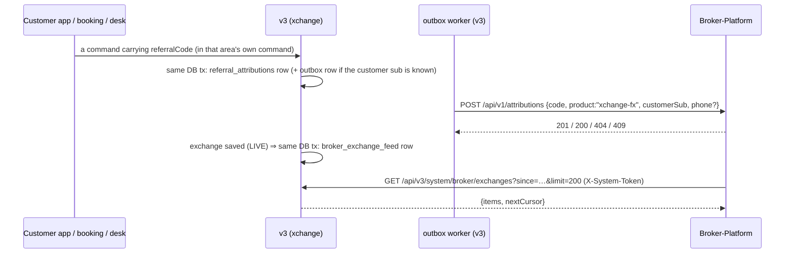
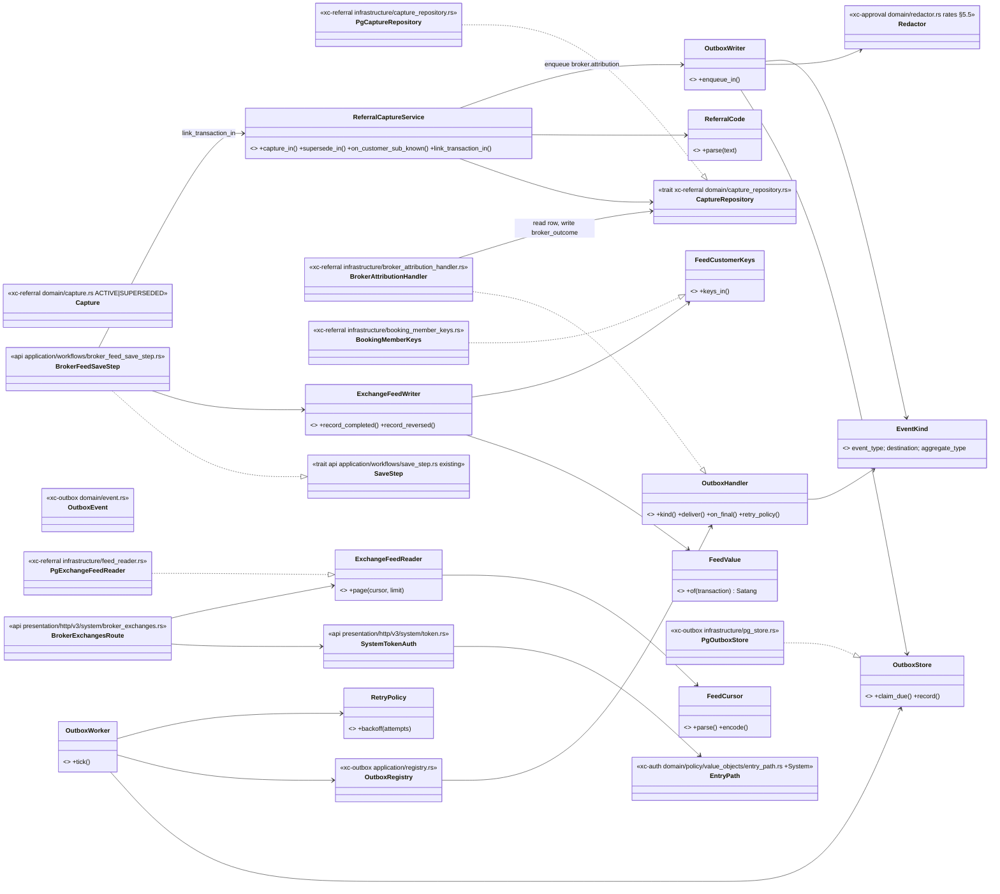

# Blueprint phase 3, v3's half of the Broker seam: attribution capture, the outbox, and the exchange feed (#563)

> written-by: claude/2b9ffb on the order of the xchange lane controller claude/608dff (2026-10-09)

Brokers, referral codes, the attribution window, commission and payout belong to **Broker-Platform** (owner, O-1 in
the mapping). v3 builds only two things:

| Piece | Direction | What it does | Here |
|---|---|---|---|
| **Attribution capture + push** | v3 → Broker | v3 records the referral code a customer arrives with, and reports it to Broker's `POST /api/v1/attributions` from an outbox | §4, §5 |
| **The exchange feed** | Broker → v3 (pull) | Broker reads completed and reversed LIVE exchanges from `GET /api/v3/system/broker/exchanges` | §6, §7 |

- Source: the owner's Blueprint, `docs/blueprint/XC-Desk-Blueprint-Data-Model-v2.html` (#565). "§N" below means the
  Blueprint's own section.
- Gap list: `docs/design/xc-desk-blueprint-v2-mapping.md`, rows K8, OutboxEvent/IdempotencyRecord, phase 3.
- Shared seams come from `docs/design/blueprint/rates.md` (cited as "rates §N"): `CommandAction`, `idempotency_records`,
  `audit_events`, `Redactor`.
- v3 is measured at `origin/main` `1bf3323`. Broker-Platform is measured at `a61a19c` (PR 66 merged).

---

## 0. What is already agreed (contract, not proposals)

**The wire shape.** Broker-Platform `docs/design/broker-platform.md` §12.3 at `a61a19c` defines the pull. Broker's
§7 defines the attribution call. **This design copies both unchanged.** Any difference between this file and those
sections is a bug in this file.

**The five conditions** come from the xchange lane controller on #563: issuecomment-6073290907, as corrected by
issuecomment-6073311433. Broker accepted them in issuecomment-6074245910.

| # | Condition | Where it is met |
|---|---|---|
| 1 | `valueSatang` is the THB value of the exchange's completed lines, fixed at completion. Today one exchange is one row, so it is `principal × 100` | §6.2 `FeedValue`; stored once in `broker_exchange_feed.value_satang` |
| 2 | `REVERSED` and `reversedSatang` exist only after #552. Until then, rows are `COMPLETED`, `reversedSatang = 0` and `reversedAt = null` | §6.3; #552 calls `ExchangeFeedWriter::record_reversed` |
| 3 | A row with neither `customerSub` nor `phone` is valid; Broker skips it | §6.2 `FeedCustomerKeys`: the rows are written anyway |
| 4 | The system token is a new v3 entry path, used by this feed only | §7 `EntryPath::System` |
| 5 | The attribution push is an outbox row written in the same transaction as the event that creates it, delivered by a worker with its own idempotency key | §5 |

**The owner's answers recorded on #563** (issuecomment-6073227876, Broker controller claude/eb72d565, 2026-10-09):

- C1 *"ทั้งสองแบบ"* (both kinds): Broker sells two xchange products.
  - `xchange` is the v3 install deal; it is manual and stays in Broker.
  - `xchange-fx` is the exchanges of a referred customer, pulled from v3.
- C2 *"ทุกรายการในช่วงเวลา"* (every exchange inside the window): every completed exchange inside Broker's 90-day window
  earns a commission. Broker counts it. v3 sends every completed LIVE exchange and filters nothing.
- C3/C4 *"บุคคลก่อน บริษัททีหลัง"* (individuals first, companies later): partners are individuals for now.
  - Attribution is **per customer**, not per transaction (C3 was not chosen).
  - Partner bookings (R03) attribute the *customer*.
- X5 (Broker side, issuecomment-6074245910): `valueSatang` is the THB amount of the exchange, *"ยอดเงินบาทของรายการ"*.
  It is not the margin.

---

## 1. v3 today (measured at `1bf3323`)

**Exchanges** (`api/migrations/20261007190000_transactions.sql`):
- One row per exchange: `principal numeric(20,2)` at `:19` is the THB amount.
- `mode` is `LIVE` or `DEMO` (`:7`).
- Rows are never updated, so there is no `updated_at`. `recorded_at` is at `:32`.

**Customers:**
- `customers` is keyed by branch + passport (`20261007120000_customers.sql:6-18`).
- It has no phone and no Identity subject.

**Bookings** (`20261008130000_bookings.sql`):
- A booking carries a typed `phone` (`:19`), which nobody checks.
- A booking may carry `member_id`. A member's `phone` was checked by staff: `members.verified_at NOT NULL` (`:6-9`).

**The save path.** Every exchange is written by `SaveTransactionWorkflow::save_as_booked`
(`api/src/application/workflows/save_transaction.rs:197`).
- Other contexts hook into it as `SaveStep`s (`save_step.rs:72-97`). `after_in` runs inside the save's DB transaction
  and must be safe to repeat (`:88-90`).
- The compat save registers its steps at `api/src/application/compat/actions/save.rs:52-71`.

**Nothing in v3 refers to Broker:**
- no referral code anywhere in the schema or the domain;
- no outbox (mapping row OutboxEvent: *"No outbox: post-save work runs in the same DB transaction"*);
- no machine entry path. `EntryPath` (`api/crates/xc-auth/src/domain/policy/value_objects/entry_path.rs:5-22`) has
  sessions and devices only. `authenticate_and_authorize` (`api/src/presentation/http/v3/view.rs:331-353`) resolves
  owner and staff sessions only.

**Timer work in the binary.** Bootstrap already runs one background loop: `tokio::spawn(purge_on_a_timer(…))` at
`api/src/bootstrap/mod.rs:181`.

---

## 2. Decisions

- **D-1. v3 keeps the code, Broker resolves the broker.**
  - v3 stores the referral **code as text** and the event it was captured on.
  - It does not store a broker, a partner, a commission or a window. Those belong to Broker-Platform (O-1).
  - The Blueprint's `ReferralAttribution` is v3's capture record. `ReferralCode` is Broker's, so v3 refers to it by
    its code (§12).
- **D-2. One active capture per transaction and per booking** (§07: *"หนึ่ง attribution หลัก active ต่อธุรกรรม;
  เก็บเหตุผลเปลี่ยน"* — one main active attribution per transaction; keep the reason for a change).
  - Two partial unique indexes enforce it.
  - A change never updates the code. It writes a new row that `supersedes` the old one, with a reason. The old row
    turns `SUPERSEDED`.
- **D-3. The push carries the customer, not the transaction.**
  - Broker's call is `{code, product, customerSub, phone?}`, with `customerSub` **required** (Broker §7).
  - So a capture is pushed only once v3 knows the customer's Identity subject.
  - A capture without one is kept and waits. #554 (customer identity) calls `on_customer_sub_known` when a customer is
    linked (§4.3).
  - The product is always `xchange-fx`.
- **D-4. One outbox core for every outbound event** (♻️ rule).
  - `xc-outbox` holds the table, the writer, the worker, the retry policy and the redaction.
  - Each event type is one `OutboxHandler` file in its own area: the Broker attribution here, #551's completion events
    later.
  - The same key with a different payload is a conflict, as rates §5.6 says for commands.
- **D-5. The feed reads a projection written at completion.**
  - `broker_exchange_feed` holds one row per completed LIVE exchange.
  - A `SaveStep` writes it in the save's own transaction, with `value_satang` fixed then (condition 1).
  - #552 updates the reversal fields; #551 moves the writer to its completion step.
  - The feed endpoint reads only this table, so it does not change when #551 replaces the transaction model.
- **D-6. Phones leave v3 only when they were verified.**
  - A feed row's `phone` and a push's `phone` come from a **verified** source only. Today that is the booking's member
    (`members.verified_at`); #554 adds others.
  - A booking's typed phone is never sent.
  - This is Broker's own rule for jh-api (Broker §6a, *"phone only when jh-api holds it as verified"*), applied here.
    An unverified phone in the feed would let anyone type a stranger's number and match a stranger's attribution.

---

## 3. Who calls what



---

## 4. Attribution capture

### 4.1 Table (Blueprint §07 `ReferralAttribution`; name kept)

```
referral_attributions(
  id              uuid PK,
  organization_id text NOT NULL,                 -- the single organisation's constant until #550 (Q7)
  branch_id       text NOT NULL REFERENCES branches(id),
  code            text NOT NULL CHECK (code ~ '^[A-Za-z0-9_-]{1,64}$'),   -- Broker's code, as typed, trimmed
  customer_id     text NOT NULL REFERENCES customers(id),  -- Blueprint §07: required
  customer_sub    text NULL,                     -- Identity subject, when known (#554/#558)
  booking_id      text NULL REFERENCES bookings(id),
  transaction_id  uuid NULL REFERENCES transactions(id),
  source          text NOT NULL CHECK (source IN ('APP','BOOKING','DESK')),
  captured_at     timestamptz NOT NULL,
  captured_by     text NOT NULL,                 -- actor id, or "customer:<sub>"
  status          text NOT NULL CHECK (status IN ('ACTIVE','SUPERSEDED')),
  supersedes_id   uuid NULL REFERENCES referral_attributions(id),
  reason          text NULL,
  pushed_at       timestamptz NULL,              -- when an outbox row was written for it
  broker_outcome  text NULL CHECK (broker_outcome IN
                    ('CREATED','EXISTING','UNKNOWN_CODE','SELF_REFERRAL','HELD_BY_OTHER','REFUSED','EXPIRED')),
  CHECK ((supersedes_id IS NULL) = (reason IS NULL))
)
CREATE UNIQUE INDEX one_active_per_transaction ON referral_attributions (transaction_id)
  WHERE status = 'ACTIVE' AND transaction_id IS NOT NULL;
CREATE UNIQUE INDEX one_active_per_booking ON referral_attributions (booking_id)
  WHERE status = 'ACTIVE' AND booking_id IS NOT NULL;
CREATE INDEX referral_attributions_waiting ON referral_attributions (customer_id)
  WHERE status = 'ACTIVE' AND pushed_at IS NULL;
```

- **`customer_id` is required, as in the Blueprint.** A capture is written only on something that already has a v3
  customer:
  - an exchange always has one (`transactions.customer_id NOT NULL`, `transactions.sql:11`);
  - a booking has one through its member (`bookings.member_id` → `members.customer_id`), or through the customer
    record #554 adds for app bookings (#555, #558).

  A booking with no customer yet refuses a capture with `NoCustomer` (400 `validationFailed`, field `referralCode`).
  The customer's code is then entered when the exchange completes, which always has a customer (§4.3). The bookings and
  customer-app designs say how their booking gets a customer before it captures. This design does not decide it.
- **The code's pattern is `[proposed]`.** Broker generates the codes. The ticket author checks Broker's code format
  before writing the test, and copies it here if it differs.
- When a booking becomes an exchange (`bookings.transaction_ref`), the booking's ACTIVE row gets the `transaction_id`
  set in the same save. It stays one row. This is the only UPDATE apart from `status`, `pushed_at` and
  `broker_outcome`.

### 4.2 The service

`ReferralCaptureService` (`api/crates/xc-referral/src/application/capture_service.rs`) runs inside the caller's
transaction:

```rust
pub struct CaptureInput { pub code: ReferralCode, pub on: CaptureTarget, pub source: CaptureSource,
                          pub customer: CustomerRef, pub by: ActorRef, pub at: DateTime<Utc> }
pub enum CaptureTarget { Booking(BookingId), Transaction(TransactionId) }
impl ReferralCaptureService {
    /// First capture on a target. An ACTIVE row with the same code ⇒ Ok (repeat); a different code ⇒ AlreadyCaptured.
    pub async fn capture_in(&self, tx: &mut PgTx, input: CaptureInput) -> Result<CaptureId, CaptureError>;
    /// Replace the ACTIVE code of a target, with a reason (D-2). Writes the audit event (rates §5.1 audit_events).
    pub async fn supersede_in(&self, tx: &mut PgTx, target: CaptureTarget, code: ReferralCode,
                              reason: NonEmpty, by: ActorRef, at: DateTime<Utc>) -> Result<CaptureId, CaptureError>;
    /// #554 calls this when a customer gets an Identity subject: every ACTIVE, unpushed capture of that
    /// customer gets its customer_sub and an outbox row.
    pub async fn on_customer_sub_known(&self, tx: &mut PgTx, customer: &CustomerId, sub: &CustomerSub)
        -> Result<u32, CaptureError>;
    /// The booking → exchange link: moves the booking's ACTIVE capture onto the transaction.
    pub async fn link_transaction_in(&self, tx: &mut PgTx, booking: &BookingId, transaction: &TransactionId)
        -> Result<(), CaptureError>;
}
```

- A capture whose `customer_sub` is known writes its outbox row in the same transaction (§5.3) and sets `pushed_at`.
  Otherwise it waits for `on_customer_sub_known`.
- `ReferralCode::parse` trims, checks the pattern, and refuses an empty code (`validationFailed`, field
  `referralCode`).
- **Errors.** `AlreadyCaptured` is 409 `referralAlreadyCaptured`, which tells the caller to supersede instead.
  `NoSuchTarget` is 400. `NoCustomer` (a booking without a v3 customer) and a bad code are 400 `validationFailed`.
- **The callers live in their own areas' designs:**
  - #555 (bookings) adds `referralCode?` to its booking command;
  - #558 (customer app) adds it to C02 `/app/book`;
  - #551 (quote and completion) adds it to the desk completion.

  Each calls `capture_in` in its own transaction. **This design edits none of their files.**

### 4.3 Routes (v3 command seam, rates §6)

| Method + path | Command | Who | Body → answer | |
|---|---|---|---|---|
| `POST /api/transactions/{id}/referral` | `attachReferral` | StaffDesk teller of that branch, OWNER | `{referralCode}` → 200 `{captureId, status}` · 409 `referralAlreadyCaptured` | [proposed] |
| `POST /api/referral-attributions/{id}/supersede` | `supersedeReferral` | OWNER | `{referralCode, reason}` → 200 `{captureId}` · 400 empty reason · 409 `staleVersion` if the row is no longer ACTIVE | [proposed] |
| `GET /api/v3/views/referral_attributions?branch=&transaction=` | view | OWNER | the rows, newest first; `customer_sub` masked (rates §5.5) | [proposed] |

- Both commands take `Idempotency-Key` (rates §5.6).
- The roles are `[proposed]` and the owner answers them (§10 O-2). The tickets ship OWNER-only on both routes until
  then. Adding the teller later is one policy row.

---

## 5. The outbox (shared core, Blueprint §07 `OutboxEvent`, §09)

**This is the lane's single outbox core** (lane controller claude/608dff, 2026-10-09). Every outbound event of v3 is
written to it, and no area designs a second one:
- the Broker attribution here;
- #551's completion events (§09 *"write outbox ใน DB transaction เดียว"*);
- #553's THB GL summary to AccountZing;
- #559's Loyalty events.

**The core is destination-neutral.** `xc-outbox` names no destination, no URL, no token and no event type. Each
destination is one `OutboxHandler` implementation in its own area's crate, which owns:
- its wire body;
- its auth;
- how it reads the answer;
- its retry policy (♻️ rule).

The core owns everything that must be right for all destinations: the same-transaction write, idempotency, the claim
and lease, retry timing, expiry and redaction.

### 5.1 Table

```
outbox_events(
  id               uuid PK,
  seq              bigint GENERATED ALWAYS AS IDENTITY UNIQUE,   -- enqueue order, for per-aggregate FIFO
  organization_id  text NOT NULL,
  event_type       text NOT NULL,                 -- "broker.attribution", "loyalty.exchange_completed", …
  destination      text NOT NULL,                 -- "broker", "loyalty", "accountzing", … (EventKind, §5.2)
  aggregate_type   text NOT NULL,                 -- "referral_attribution", "transaction", …
  aggregate_id     text NOT NULL,                 -- e.g. the referral_attributions id
  idempotency_key  text NOT NULL,                 -- sent with the delivery; the receiver dedupes on it
  payload_hash     text NOT NULL,                 -- sha256 of the canonical payload; same key + other hash ⇒ conflict
  payload_redacted jsonb NOT NULL,                -- through Redactor (rates §5.5): no phone, no token, no passport
  status           text NOT NULL CHECK (status IN ('PENDING','DELIVERED','FAILED','EXPIRED')),
  attempts         int  NOT NULL DEFAULT 0,
  next_attempt_at  timestamptz NOT NULL,
  last_http_status int  NULL,
  last_error       text NULL,                     -- redacted, ≤ 500 chars
  created_at       timestamptz NOT NULL,
  delivered_at     timestamptz NULL,
  UNIQUE (organization_id, event_type, idempotency_key)        -- Blueprint §07 PK(org, operation, key)
)
CREATE INDEX outbox_due ON outbox_events (next_attempt_at) WHERE status = 'PENDING';
CREATE INDEX outbox_fifo ON outbox_events (aggregate_type, aggregate_id, destination, seq) WHERE status = 'PENDING';
```

**The payload holds references, never personal data.** For example, `{"captureId": "…"}`. The handler rebuilds the
wire body from the source rows when it sends (§5.4). That is why `payload_redacted` can be fully redacted, as §07 asks,
and still be enough to deliver.

### 5.2 Domain and ports

```rust
// api/crates/xc-outbox/src/domain/handler.rs
// api/crates/xc-outbox/src/domain/event_kind.rs — declared once per event by the area that owns it (as a static),
// and used by both its writer call and its handler.
pub struct EventKind { pub event_type: &'static str, pub destination: &'static str, pub aggregate_type: &'static str }
// One implementation per destination and event type; the core never matches on event_type itself.
pub trait OutboxHandler: Send + Sync {
    fn kind(&self) -> &'static EventKind;
    /// The destination's own retry timing; the default is RetryPolicy::default().
    fn retry_policy(&self) -> RetryPolicy { RetryPolicy::default() }
    /// Build the request from the source rows and send it once. No retry inside; the worker owns retries.
    fn deliver<'a>(&'a self, event: &'a OutboxEvent) -> BoxFuture<'a, DeliveryResult>;
    /// After a final answer, record it on the source (e.g. referral_attributions.broker_outcome).
    fn on_final<'a>(&'a self, tx: &'a mut PgTx, event: &'a OutboxEvent, outcome: &'a FinalOutcome)
        -> BoxFuture<'a, AppResult<()>>;
}
pub enum DeliveryResult { Final(FinalOutcome), Retry { http_status: Option<u16>, error: String } }
// api/crates/xc-outbox/src/domain/retry_policy.rs
pub struct RetryPolicy { pub first: Duration, pub cap: Duration, pub expire_after: Duration }
// Default: 5 s doubling to a 10-minute cap; rows expire 7 days after created_at (Broker §6a, the same as jh-api).
// A destination that needs other timing (for example #553's daily GL summary) overrides retry_policy().
```

- **`OutboxWriter::enqueue_in(tx, kind: &EventKind, aggregate_id, key, payload)`**
  (`xc-outbox/src/application/writer.rs`) runs in the caller's transaction.
  - The same `(organization_id, event_type, key)` with the same hash is a no-op that returns the existing id.
  - The same key with a different hash is `IdempotencyConflict` (§09).
- **Fan-out: one row per destination** (lane controller's ruling, 2026-10-09). One business event that several
  services must hear is enqueued as **one outbox row per destination**, each with its own `EventKind`, in the same
  transaction. For example, a completed exchange is `loyalty.exchange_completed` (#559) plus
  `accountzing.gl_summary` (#553), each with its own key.
  - A handler never forwards to a second destination, and no handler fans out internally.
  - Each destination therefore retries, orders and fails on its own, and one service's outage never delays another.
  - A rollback of the business transaction writes none of them.
- **Per-aggregate FIFO, in the core** (lane controller's ruling: ordering is safety logic, ♻️ rule).
  - The worker never delivers a row while an **earlier** row (lower `seq`) with the same
    `(aggregate_type, aggregate_id, destination)` is still `PENDING`. Pending includes in backoff and leased in flight.
  - So a reversal for transaction T never reaches Loyalty before T's earn, even when the earn is in backoff.
  - Other aggregates and other destinations are not blocked.
  - An earlier row that ends `DELIVERED`, `FAILED` or `EXPIRED` releases the next one. A final failure is recorded on
    the source by `on_final`; it does not hold the aggregate forever.
  - Receivers may therefore assume in-order delivery per aggregate. They must still dedupe, because delivery is at
    least once.
- **`OutboxWorker`** (`xc-outbox/src/application/worker.rs`) is started once, by the registration seam of §11.1, with
  `tokio::spawn`, like `purge_on_a_timer` (`bootstrap/mod.rs:181`). It ticks every 5 s:
  1. **Claim**, in a short transaction: `SELECT … FROM outbox_events e WHERE status='PENDING' AND next_attempt_at <=
     now() AND NOT EXISTS (SELECT 1 FROM outbox_events p WHERE p.status='PENDING' AND p.aggregate_type=e.aggregate_type
     AND p.aggregate_id=e.aggregate_id AND p.destination=e.destination AND p.seq < e.seq) ORDER BY seq LIMIT 20 FOR
     UPDATE SKIP LOCKED` (index `outbox_fifo`). It sets `next_attempt_at = now() + 60 s` (the lease) and
     `attempts = attempts + 1`, then commits.
  2. **Deliver** each event through the registry's handler, outside any DB transaction.
  3. **Record**, in one transaction per event:
     - `Final`: `DELIVERED` (2xx) or `FAILED` (another final 4xx), plus `handler.on_final`.
     - `Retry`: `next_attempt_at = now() + handler.retry_policy().backoff(attempts)`.
     - A row older than `expire_after` turns `EXPIRED`, plus `on_final(Expired)`.
- **Delivery is at least once.** A crash between "deliver" and "record" sends the event again after the lease.
  - That is why every handler sends the row's `idempotency_key`, and why the receiver must dedupe.
  - Broker answers a repeat of the same customer, code and product with 200 `Existing`.
- **No event is lost by a failed send.** Business work never waits for delivery, and a Broker outage never blocks a
  booking or an exchange.
- **`OutboxRegistry`** (`xc-outbox/src/application/registry.rs`) maps `kind().event_type` to `Arc<dyn OutboxHandler>`.
  - It is built from the generated table of §11.1, so adding a destination is one new file, never an edit to the core
    or to bootstrap.
  - Two handlers with the same `event_type`, or a handler whose `EventKind` differs from the one its rows were written
    with, fail the boot.
  - An event with no handler stays `PENDING` and logs one warning per tick, never a panic.

### 5.3 The Broker attribution event

- `EventKind { event_type: "broker.attribution", destination: "broker", aggregate_type: "referral_attribution" }`,
  declared in `xc-referral/src/domain/events.rs`; `aggregate_id` = the capture id.
- `idempotency_key = "attr:<capture id>"`.
- Written by `ReferralCaptureService` (§4.2) when the capture has a `customer_sub`.

### 5.4 `BrokerAttributionHandler`

File: `api/crates/xc-referral/src/infrastructure/broker_attribution_handler.rs`.

**How it sends:**
- Request: `POST {XC_BROKER_BASE_URL}/api/v1/attributions`.
- Headers:
  - `Authorization: Bearer {XC_BROKER_SERVICE_TOKEN}` (Broker §6a `ServiceCaller`; the owner registers `xchange:<token>`
    in `BROKER_SERVICE_TOKENS`);
  - `Idempotency-Key: attr:<id>`.
- Body: `{code, product: "xchange-fx", customerSub, phone?}`, built from the capture row when it sends.
  - `phone` is present only from a verified source (D-6).

**How it reads Broker's answer** (Broker §7, `[required]`):

| Broker answer | Result | `broker_outcome` |
|---|---|---|
| 201 | Final | `CREATED` |
| 200 | Final | `EXISTING` |
| 404 | Final | `UNKNOWN_CODE` |
| 409 `self_referral` | Final | `SELF_REFERRAL` |
| 409 `held_by_other_broker` | Final | `HELD_BY_OTHER` |
| any other 4xx except 401/408/429 | Final | `REFUSED` |
| 401, 408, 429, 5xx, network error, timeout (10 s) | Retry | — |
| expired after 7 days | — | `EXPIRED` |

**Configuration:**
- `XC_BROKER_BASE_URL` and `XC_BROKER_SERVICE_TOKEN` are read at boot.
- If either is unset or blank, the handler is **not registered**. Events stay `PENDING` until it is, and they expire
  after 7 days.
- The token is never logged.
- Setting both is a deploy step for the owner.

---

## 6. The exchange feed (Broker pulls)

### 6.1 Table

```
broker_exchange_feed(
  transaction_id  uuid PRIMARY KEY REFERENCES transactions(id),
  organization_id text NOT NULL,
  branch_id       text NOT NULL,
  customer_sub    text NULL,
  phone           text NULL,                     -- verified source only (D-6), E.164 as stored
  status          text NOT NULL CHECK (status IN ('COMPLETED','REVERSED')),
  value_satang    bigint NOT NULL CHECK (value_satang > 0),
  reversed_satang bigint NOT NULL DEFAULT 0 CHECK (reversed_satang BETWEEN 0 AND value_satang),
  completed_at    timestamptz NOT NULL,
  reversed_at     timestamptz NULL,
  updated_at      timestamptz NOT NULL,
  CHECK ((status = 'REVERSED') = (reversed_at IS NOT NULL)),
  CHECK (status = 'REVERSED' OR reversed_satang = 0)
)
CREATE INDEX broker_exchange_feed_cursor ON broker_exchange_feed (updated_at, transaction_id);
```

- **LIVE exchanges only.** A `DEMO` save writes no row. A booking or an unfinished exchange is not in the table (Broker
  §12.3: *"completed exchanges only"*).
- `updated_at` is set by v3 to `clock_timestamp()` at write. Broker's 10-minute lookback (Broker §7) covers a slow
  transaction committing behind a cursor.

### 6.2 Writing it

`ExchangeFeedWriter` (`api/crates/xc-referral/src/application/feed_writer.rs`):

```rust
pub async fn record_completed(&self, tx: &mut PgTx, t: CompletedExchange) -> AppResult<()>;
// INSERT … ON CONFLICT (transaction_id) DO NOTHING — a repeated save answers from the stored row and changes nothing
pub async fn record_reversed(&self, tx: &mut PgTx, id: TransactionId, reversed_total: Satang, at: DateTime<Utc>)
    -> AppResult<()>;   // #552 calls it; cumulative, never a delta; never more than value_satang
```

- **`FeedValue`** (`xc-referral/src/domain/feed_value.rs`) is the one place that computes `value_satang`:
  - **until #551:** `transactions.principal × 100`, which is exact because `principal` has 2 places
    (`transactions.sql:19`);
  - **after #551:** the sum of the THB value of the transaction's completed lines, computed by #551's completion.
    #551 replaces the body of `FeedValue::of`, and its design names the line type.
  - Either way the value is computed **once, at completion**, and never re-priced.
- **`FeedCustomerKeys`** (trait, `xc-referral/src/domain/customer_keys.rs`): `fn keys_in(tx, transaction) ->
  (Option<CustomerSub>, Option<VerifiedPhone>)`.
  - Today's implementation, `BookingMemberKeys`, takes the phone of the booking's member when the exchange came from a
    booking with `member_id`. Otherwise both are `None`.
  - #554 provides a new implementation (customer sub and verified phone) and swaps it in bootstrap.
  - Rows with neither key are written anyway (condition 3).
- **`BrokerFeedSaveStep`** (`api/src/application/workflows/broker_feed_save_step.rs`) implements `SaveStep`. Its
  `after_in` runs in the save's transaction (`save_step.rs:88-96`). On a LIVE save it calls:
  1. `record_completed`;
  2. `ReferralCaptureService::link_transaction_in`, when the save used a booking.

  It is registered last in `compat/actions/save.rs`. After #551 it moves to #551's completion step, and #551's design
  says so.

### 6.3 Reversal (after #552)

- #552's reversal calls `record_reversed` in its own transaction.
- A partial reversal sets the cumulative amount. A full one sets `reversed_satang = value_satang`. Both set
  `status = REVERSED`, `reversed_at` and a new `updated_at`.
- Until #552 ships, no code path sets `REVERSED` (condition 2). The CHECKs already allow it, so #552 needs no
  migration on this table.

### 6.4 The endpoint (Broker §12.3, `[required]`, unchanged)

`GET /api/v3/system/broker/exchanges?since=<cursor>&limit=<n>`, with header `X-System-Token`.

**The response** is `200`, `Cache-Control: no-store`:
```
{ items: [ { id, customerSub, phone, status, valueSatang, reversedSatang, completedAt, reversedAt, updatedAt } ],
  nextCursor }
```

**The fields:**
- `id` is the transaction id as a string.
- `customerSub` and `phone` may each be `null`.
- `valueSatang` and `reversedSatang` are JSON integers.
- The three times are RFC 3339 UTC with `Z`. `reversedAt` is `null` unless reversed.

**Paging:**
- **The cursor grammar** (`FeedCursor`), which must accept the cursors Broker builds as well as v3's own:
  - the shape is `<time>_<id>`, split at the **first** `_`;
  - `<time>` is any RFC 3339 timestamp: any fractional precision from 0 to 9 digits, `Z` or a numeric offset. It is
    converted to UTC. A precision below microseconds pads with zeros; one above truncates to microseconds, which is
    the precision of `timestamptz`;
  - `<id>` is any UUID in hyphenated form, **the nil UUID included**. Broker's lookback cursor is `stored − 10 min`
    with the nil UUID (`control_plane.rs:66-69` at `a61a19c`), and a fresh source starts at "now" the same way;
  - **v3 writes** `to_rfc3339_opts(SecondsFormat::Micros, true)` plus the hyphenated id, exactly as Broker's
    `CpCursor::encode` (`control_plane.rs:56-59`), so both sides print the same string for the same position;
  - anything else is `400`.
- The page is `WHERE (updated_at, transaction_id) > ($t, $id) ORDER BY updated_at, transaction_id LIMIT n`, on the
  index of §6.1.
- `nextCursor` is the last item's cursor. **On an empty page it is `null`** (Broker §7, `:332`: *"`nextCursor: null`
  only on an empty page"*). Broker keeps its stored cursor on `null` (`:422-427`). Echoing `since` would let a quiet
  tick store a cursor 10 minutes older each time.
- `since` absent ⇒ from the beginning.
- `limit` defaults to 200 and may be 1..=200.
- **Every organisation's rows are in one feed.** v3 has one organisation until #550. #550 decides whether the feed
  becomes per organisation (§10 O-3).

**Errors:**
- `400` malformed `since` or a `limit` outside 1..=200;
- `401` missing or wrong token;
- `500` anything else.

All three use the body `{error}`, and no body echoes the token.

This feed is polled, which the fleet rule 🔁 covers: the cursor is the client's version, and an empty page is the
O(1) "unchanged" answer.

---

## 7. The system entry path

> **Superseded (owner, 2026-10-10, #563 issuecomment-6095061095).** FD-3 #974 checks `X-System-Token` inside its own
> route file, registered with one line. There is no `EntryPath::System`, no `Actor::Service`, no area row and no
> system-route seam. The text below is kept as the record of what was replaced.

- `EntryPath::System` is a new variant in `entry_path.rs`, added once by the seam ticket PL-0 (§11.1).
- The policy row is `brokerExchangeFeed`, on `System`, for the actor `Actor::Service("broker")`.
  - It lives in FD-3's own area-rows file, `xc-auth/src/domain/policy/areas/broker_feed.rs` (§11.1).
  - No session ever matches it, and `System` matches no other action.
- **`SystemTokenAuth`** (`api/src/presentation/http/v3/system/token.rs`) reads `X-System-Token`. It compares it in
  constant time against `XC_BROKER_FEED_TOKEN`, read at boot.
  - Unset or blank means the route answers `401` to everyone. It never panics.
  - The token is not the outbound `XC_BROKER_SERVICE_TOKEN` (§5.4). They are two secrets in two directions, as in
    Broker §6a.
- **`authenticate_and_authorize`** (`view.rs:331`) gains one branch: for `EntryPath::System` it asks `SystemTokenAuth`
  instead of `SessionReader`. Everything after that, the policy check and `V3Error`, is unchanged.
- The route lives in `api/src/presentation/http/v3/system/broker_exchanges.rs`. It is registered by the generated
  system-route table of §11.1, so FD-3 edits neither `http/v3/mod.rs` nor `build.rs`. It is not a `ViewEntry`,
  because its path is outside `/api/v3/views`.

---

## 8. Class diagram



The HTTP side of §4.3 is one file per command and view, as in rates §7:
- `api/src/presentation/http/v3/commands/{attach_referral,supersede_referral}.rs`;
- `views/referral_attributions.rs`;
- the matching `dto/v3/*.rs`.

### 8.1 Who provides, who uses

| Provider | Used by |
|---|---|
| `OutboxWriter`, `OutboxWorker`, `OutboxHandler` (the lane's single outbox core) | the Broker attribution now; #551 completion events, #553 GL summary to AccountZing, #559 Loyalty events — each one `OutboxHandler` file in its own area plus one `bootstrap/outbox_handlers/<destination>.rs` |
| `ReferralCaptureService::capture_in` | #555 bookings, #558 customer app (C02), #551 desk completion, and the attach route here |
| `ReferralCaptureService::on_customer_sub_known` | #554, when a customer is linked to an Identity subject |
| `ExchangeFeedWriter::record_completed` | `BrokerFeedSaveStep` now; #551's completion step later |
| `ExchangeFeedWriter::record_reversed` | #552 |
| `FeedValue` | the feed writer only; #551 replaces its body |
| `FeedCustomerKeys` | the feed writer and `BrokerAttributionHandler`; #554 adds its implementation |
| `EntryPath::System` + `SystemTokenAuth` | this feed only; any later machine route needs its own design and its own token |
| `Redactor` (rates §5.5, AP-1) | `OutboxWriter` |

**If a provider has not landed yet,** follow rates §7.1. The consuming ticket declares a stub with the exact signature
above in its own file, with a comment saying it will move. It never edits the provider's file.
- `Redactor` comes from AP-1.
- `CommandAction` and `idempotency_records` come from CM-1.

---

## 9. Data migration

v3 is not installed anywhere. Its data is test data (D6), and the test database `xc_v3` on do-sgp1 may be recreated.
The owner approved v3 migrations until the first install. The migrations are still written to run correctly on a
database that already has rows. A merged migration is never edited.

**Version block.** #563 owns `20261013*` (the lane controller's per-area blocks on #564, issuecomment-6074369626).
So these files sort after org/roles (`20261011*`, #550 PR 589), which creates the organisations that
`organization_id` refers to, and after cash (`20261012*`). They come before the exchange core (`20261014*`, #551),
the reversal (`20261016*`, #552) and customer identity (`20261019*`, #554), which build on them.

**1. `api/migrations/20261013100000_outbox.sql`** (OB-1)

- Creates `outbox_events` (§5.1).
- **Existing rows:** none; the table is new.
- **Backfill:** none.
- **Deploy order:** it runs at boot with the OB-1 binary (`sqlx::migrate!`). An older binary never reads the table.
- **`down`** drops the table. Undelivered events are lost; a capture whose event was lost keeps `pushed_at` set and is
  not re-sent. `down` says so in a comment.

**2. `api/migrations/20261013110000_referral_attributions.sql`** (RA-1)

- Creates `referral_attributions` (§4.1).
- **Existing rows:** none in the new table. No existing table changes.
- **Backfill:** none. v2's referrals are not carried into v3 (O-1), and v3 has never recorded a code.
- **Deploy order:** it ships with the RA-1 binary.
- **`down`** drops the table and loses every capture and its `broker_outcome`. Broker keeps its own attributions.

**3. `api/migrations/20261013120000_broker_exchange_feed.sql`** (FD-1)

- Creates `broker_exchange_feed` (§6.1) and its cursor index.
- **Existing rows:** existing LIVE transactions get **no** feed row.
  - Broker's `XchangeSource` starts at "now" (Broker §12.3: *"a fresh source starts at "now""*), so it would never
    read them.
  - The rows are test data (D6).
  - Count before deploy, to record what is skipped:

    ```sql
    SELECT count(*) FROM transactions WHERE mode = 'LIVE';
    ```
- **Backfill:** none, for the reason above. If the owner wants history in the feed, a backfill is
  `INSERT … SELECT id, …, round(principal * 100)::bigint, 'COMPLETED', recorded_at, … FROM transactions WHERE mode =
  'LIVE'` with keys NULL. That is a separate, owner-approved step, not in this migration.
- **Deploy order:** the migration and the binary that writes it (FD-2) ship together. The FD-1 binary alone has the
  table but no writer. A save made between FD-1 and FD-2 has no row; that is test data, and the same "starts at now"
  reasoning applies.
- **`down`** drops the table. Broker's cursor then points past rows that no longer exist; the next page is empty until
  new exchanges are written. Broker's deals already stored are unaffected.

`transactions`, `bookings`, `members` and `customers` are not altered by this design.

---

## 10. Must ask the owner (not decided here)

| # | Question | Blocks | Meanwhile |
|---|---|---|---|
| O-1 | `xchange-fx` commission rule values (Broker side: 1 % per exchange, `percent_bp = 100`, `value_includes_vat = false`, owner 2026-10-09 on #563) | nothing in v3 | v3 sends every completed LIVE exchange; Broker applies its rule |
| O-2 | Who may attach a code to a completed exchange, and who may replace one (§4.3)? See below | the role rows of `attachReferral` / `supersedeReferral` | both ship OWNER-only |
| O-3 | Once #550 adds organisations: one feed for all, or a token per organisation | #550's design | one feed, one token (one organisation today) |
| O-4 | The two Broker URLs/tokens (`XC_BROKER_BASE_URL`, `XC_BROKER_SERVICE_TOKEN`, `XC_BROKER_FEED_TOKEN`) | deploy only | unset ⇒ no push (events wait, expire in 7 days) and the feed answers 401 |

**O-2 in full.** Must ask the owner; this design does not decide it.

- **Why it matters.** The code decides who earns a commission. Whoever may attach or replace it can move money
  between brokers. The Blueprint asks for one active attribution per exchange and a reason for every change (§07). It
  does not say who may make the change.
- **Options:**
  - **A. OWNER only, for both.** Safest. The teller cannot attach a code a customer gives at the counter, so that code
    is lost unless the owner adds it later. Reversible: adding a role later is one row.
  - **B. The teller attaches, OWNER replaces.** The teller enters the code the customer gives at the counter, on that
    branch's exchange, at completion or within the same shift. Only OWNER replaces an active code, with a reason, and
    the replacement is audited. It captures the most codes, and changing who earns stays with the owner. Reversible.
  - **C. The teller attaches and replaces.** Most convenient. A teller could move a commission to a broker they know,
    with only the audit to catch it.
- **I propose B.** A customer's code reaches the counter, so the teller must be able to enter it. Changing it is a
  money decision, and that stays with OWNER. This matches rates A2/A5, where the owner decides out-of-bound changes.
- **If there is no answer,** both routes ship as A and the teller row is added when the owner answers.

The amount Broker pays on (X5) and the window (90 days, owner Q3) are Broker's and already decided. v3 does not repeat
or enforce them.

---

## 11. Tickets

Each ticket owns disjoint files. The order is by start dependency.

| # | Ticket | Owns | Starts after |
|---|---|---|---|
| OB-1 | outbox core (destination-neutral) | new crate `api/crates/xc-outbox/**`; migration 1; `api/Cargo.toml` workspace member line | this design; AP-1 (`Redactor`) or a stub per §8.1 |
| PL-0a #910 | the outbox-handler seam (§11.1 row 2) and the worker spawn | `api/build_support/outbox_handlers.rs`, `api/build.rs` (one block), `api/src/bootstrap/{mod.rs, outbox_handlers/mod.rs}` | OB-1 |
| PL-0b | the policy-rows seam on `Policy::need` (§11.1 row 1, rebuilt 2026-10-10) | `xc-auth/build.rs` (new), `xc-auth/src/domain/policy/areas/mod.rs` (new), `xc-auth/src/domain/policy/entities/policy.rs` (the `AREA_ROWS` lookup at the top of `Policy::need` only) | `policy.rs` free: PR 876 (merged) and #874 |
| RA-1 #979 | capture domain, table and service | new crate `api/crates/xc-referral/` **`domain/{referral_code,capture,capture_repository}.rs`, `application/capture_service.rs`, `infrastructure/capture_repository.rs`**, `lib.rs`, `Cargo.toml`; migration 2 | OB-1 |
| RA-2 #980 | the Broker attribution handler | `xc-referral/src/infrastructure/broker_attribution_handler.rs`; `api/src/bootstrap/outbox_handlers/broker_attribution.rs` (its registration file) | RA-1 #979, PL-0a #910 |
| RA-3 #981 | routes: attach, supersede, view | `http/v3/commands/{attach_referral,supersede_referral}.rs`, `http/v3/views/referral_attributions.rs`, the matching `dto/v3/*.rs` and generated TS, `xc-auth/src/domain/policy/areas/referral.rs` (its 3 rows) | RA-1 #979, CM-1, PL-0b #1014 |
| FD-1 #972 | feed domain, table, writer and reader; **the `xc-referral` crate shell** (RA-1 #979 was not cut first) | `xc-referral/` (`Cargo.toml`, `lib.rs`), `xc-referral/src/domain/{feed_value,customer_keys,feed_reader,feed_cursor}.rs`, `application/feed_writer.rs`, `infrastructure/{feed_reader,booking_member_keys}.rs`; migration 3 | — |
| FD-2 #973 | the save step | `api/src/application/workflows/broker_feed_save_step.rs`; one line in `api/src/application/compat/actions/save.rs:52-71` | FD-1 |
| FD-3 #974 | system token and the endpoint, **checked inside the route** (owner, 2026-10-10, §7) | `api/src/presentation/http/v3/system/**` (`token.rs`, `broker_exchanges.rs`, `mod.rs`); one registration line in `http/v3/mod.rs`. **No** `view.rs` branch, **no** area row, **no** `EntryPath::System` | FD-1 #972 |

### 11.1 Registration seams instead of shared files (lane controller's ruling, 2026-10-09; rebuilt 2026-10-10)

**Why a seam.** Every area that adds a route also adds its permission row. Without a seam, they all edit one file.
- Measured 2026-10-10T08:2xZ: **10 open tickets reserve `api/crates/xc-auth/src/domain/policy/entities/policy.rs`**:
  #874, #926, #945, #981, #993, #994, #995, #997, #1003, #1012. (Re-run: `gh issue list --state open --json body` and match the path line.)
- The queue locks a reserved file for one ticket at a time, so these 10 would run one after another.
- By the fleet's 🧩 rule, one file that most tickets must touch means the design is unfinished. The seam turns "add a row to `policy.rs`" into "add your own file".

**What changed on 2026-10-10.**
- The 2026-10-09 version of this section was written for `Policy::allow` and a `roles` list, before OR-4.
- On `main` (`59c10a29`), routes are checked by `Policy::need(path, action) -> Option<Need>` (`policy.rs:524`), then `Policy::authorize`. OR-4b #767 moves every v3 route onto it.
- So the rows now carry a `Need`, not roles.
- The system-route seam and `EntryPath::System` are dropped (§7, the owner's FD-3 ruling).

| Seam | Mechanism | A new area adds | Ticket |
|---|---|---|---|
| **Policy rows per area** | see "The policy-rows seam" below | `xc-auth/src/domain/policy/areas/<area>.rs` | PL-0b |
| **Outbox handlers** | `api/build.rs` scans `src/bootstrap/outbox_handlers/*.rs`. Each file has `pub fn handler(state: &AppState) -> Option<Arc<dyn OutboxHandler>>`, where `None` means not configured. Bootstrap builds `OutboxRegistry` from the generated list and spawns `OutboxWorker` | `outbox_handlers/<destination>.rs` | PL-0a #910 |
| ~~System routes~~ | dropped 2026-10-10. A machine or public route outside `/api/v3/views` registers with one line in `http/v3/mod.rs` (FD-3 #974, APP-5 #995) | — | — |

**The policy-rows seam (PL-0b)** [required: names, files, behaviour]
```rust
// api/crates/xc-auth/src/domain/policy/areas/mod.rs  (new)
pub struct AreaRow { pub path: EntryPath, pub action: &'static str, pub need: Need }
// generated by api/crates/xc-auth/build.rs from areas/*.rs (mod.rs excluded):
//   one `#[path] pub mod <area>;` per file, and
pub static AREA_ROWS: &[&[AreaRow]] = &[/* <area>::ROWS, … in file-name order */];
// each area file, e.g. areas/referral.rs:
pub const ROWS: &[AreaRow] = &[
    AreaRow { path: EntryPath::Rpc, action: "attachReferral", need: Need::Permission(Permission::ReferralAttach) },
];
```
- **`Policy::need(path, action)` consults `AREA_ROWS` first.** The first row with the same `(path, action)` answers `Some(row.need)`. Otherwise today's match answers, unchanged. `Policy::authorize` and its path-level refusal sentences do not change.
- **A file without `pub const ROWS: &[AreaRow]`, or whose name is not a module name, fails the build** (`xc-auth/build.rs`, the same rule as `api/build_support/views.rs`).
- **Duplicates and shadowing fail the required `api` check through a test, not the compiler.** A build script cannot evaluate `EntryPath` values without parsing Rust, so `xc-auth/tests/area_rows_test.rs` asserts two things:
  1. no `(path, action)` appears twice across `AREA_ROWS`;
  2. no area row's `(path, action)` is already answered by today's match, so an area file can only **add** a row, never silently override one.

  To make (2) testable, the old match moves behind `fn need_table(path, action)` in the same file, and `need` calls it.
- **Two PRs that each add the same `(path, action)` in different area files** are each green alone. The fleet's merge rule catches the pair: `git merge-base --is-ancestor origin/main <head>` must hold before merge. `xchange`'s `main` has `strict: false` (measured 2026-10-10), so GitHub does not force it, and the rule is the guard. The second PR therefore re-runs on a base that contains the first one's file, and `area_rows_test` fails there.
- **`Need` stays where it is** (`entities/policy.rs:499`). Area files import it.

**After PL-0b merges, each area owns its file** (the tickets' file scopes are re-pointed then):

| Ticket | Area file |
|---|---|
| LG-3b #926 | `areas/cash_limits.rs` |
| OR-5a #945 | `areas/org_admin.rs` |
| RA-3 #981 | `areas/referral.rs` |
| APP-3 #993 | `areas/notifications.rs` |
| APP-4 #994 | `areas/customer_app.rs` |
| APP-5 #995 | none: the public routes need no policy row (#995 ruling) |
| APP-6 #997 | `areas/assistant.rs` |
| APP-11 #1003 | `areas/customer_history.rs` |
| receipt route #1012 | `areas/receipts.rs` |

#874 changes rows that already exist in `policy.rs` (`allow_rpc`'s staff arm and `role_permissions.rs`). It stays as it is, and PL-0b starts after it.

**Up-front tests for PL-0b** (written by the ticket author before dispatch):
- an `areas/` file with one row makes `Policy::need` answer that row for that `(path, action)`, and nothing else;
- removing the file makes it answer `None` again;
- two files with one `(path, action)` fail `area_rows_test`;
- a row that `need_table` already answers fails `area_rows_test`;
- an area file with no `ROWS`, or a non-module file name, fails the build (the generator's pure-function tests, as `api/tests/v3_views_generator_test.rs`);
- every existing policy test (`xc-auth/tests/policy_*`) stays green and unedited.

**Not here, and in which design:**
- the `referralCode` fields on booking, customer-app and desk commands (#555, #558, #551);
- `on_customer_sub_known`'s caller (#554);
- `record_reversed`'s caller (#552);
- moving `BrokerFeedSaveStep` to the new completion (#551).

**Up-front tests per ticket** (🧪), each written by the ticket author before dispatch:

- **OB-1**
  - the same key with the same payload enqueues once;
  - the same key with another payload is `IdempotencyConflict`;
  - the same key in two organisations is two rows (UNIQUE includes `organization_id`);
  - fan-out: two `EventKind`s enqueued in one transaction give two rows, and a rollback gives none;
  - FIFO: a reversal enqueued after an earn of the same transaction and destination, while the earn is in backoff, is
    not claimed until the earn is `DELIVERED` (or `FAILED`/`EXPIRED`);
  - FIFO is per destination and per aggregate: the same transaction's row for another destination, and another
    transaction's row, are delivered while that earn waits;
  - `payload_redacted` has no phone (a `Redactor` deny-list key put in the payload is masked);
  - two workers claiming at once never take the same row (`SKIP LOCKED`);
  - a crash after deliver and before record re-delivers once after the lease, with the same `Idempotency-Key`;
  - backoff is 5, 10, 20 … seconds, capped at 600;
  - a row older than 7 days turns `EXPIRED` and calls `on_final`;
  - an event with no handler stays `PENDING`.
- **RA-1**
  - two ACTIVE captures on one transaction: the second is refused `AlreadyCaptured`, enforced by the index too;
  - the same code twice is a repeat, not an error;
  - supersede without a reason is refused;
  - supersede leaves exactly one ACTIVE, and the old row is `SUPERSEDED` with `supersedes_id` set;
  - a capture with a sub writes one outbox row in the same transaction, and a rollback writes neither;
  - a capture without a sub writes none, and `on_customer_sub_known` writes one per waiting capture, once;
  - `link_transaction_in` moves the booking's capture and keeps one row;
  - `ReferralCode::parse` refuses empty, too long and bad characters.
- **RA-2**, against a fake Broker:
  - each answer row of §5.4 maps to its outcome;
  - 401 and 503 retry;
  - the body is `{code, product:"xchange-fx", customerSub, phone?}` exactly;
  - `phone` is absent when the source is not verified;
  - the token is never in a log line;
  - no handler is registered when the env is unset.
- **RA-3**
  - each route's role row (OWNER; others refused);
  - a missing `Idempotency-Key` is 400;
  - the view masks `customer_sub`.
- **FD-1**
  - `FeedValue` of `principal 1234.56` is `123456`;
  - a repeated `record_completed` changes nothing, `updated_at` included;
  - `record_reversed` with a total above value is refused;
  - a partial then a full reversal leaves the cumulative amounts;
  - the cursor round-trips (`parse(encode(c)) == c`) and refuses garbage (no `_`, a bad time, a bad UUID);
  - a Broker-built lookback cursor is accepted: `now − 10 min` with the nil UUID, in Broker's own format
    (`…T…:…:….ffffffZ_00000000-0000-0000-0000-000000000000`). So are a time with 0 and with 9 fractional digits and
    one with `+07:00`, which reads as the same UTC instant;
  - a page of 3 with limit 2 gives 2 items and the cursor of the second, and the next page gives 1;
  - an empty page answers `nextCursor: null`.
- **FD-2**
  - a LIVE save writes one feed row with `value_satang = principal × 100`;
  - a DEMO save writes none;
  - a repeated submission writes none;
  - a booked save with a verified member carries the member's phone;
  - a booked save without a member has `phone` null;
  - a failing feed write undoes the save (`after_in` semantics);
  - the save's existing tests stay green.
- **FD-3**
  - no token, a wrong token and an unset env each give 401 with no token in the body;
  - a session cookie alone gives 401;
  - `limit=0` and `limit=201` give 400;
  - the JSON field names and types equal Broker §12.3 exactly: a fixture copied from Broker's T12 test is parsed
    unchanged, including an empty page with `"nextCursor": null`;
  - `since` = a Broker lookback cursor (nil UUID) answers 200, not 400;
  - `Cache-Control: no-store`;
  - `System` allows no other action.

---


### Tickets as opened (reconciled 2026-10-11)

> Owner's order 2026-10-11: every opened ticket must appear in its design's ticket list; a split is either listed here (this PR, lane controller claude/5edf7bb5) or folded back into its parent. Measured on `origin/main` `5a2b0d19` against all 605 issues. No new ticket may be opened outside this list.

| Code | Issue | State 2026-10-11 | Listed because |
|---|---|---|---|
| FD-3 hardening | #1112 | open | the system route of FD-3 (#974): `SystemToken` Debug and the 500 echo must not print the token |

## 12. Blueprint conformance (owner's rule, 2026-10-09: logic is fixed, only the look may change)

Owner, recorded on #564: *"พิมพ์ เราจะปรับ ได้ แค่เรื่อง หน้า ตา แค่นั้น ส่วน logic ห้าม แก้ไข"* (we may adjust only
the look; the logic must not be changed). Where the Blueprint's entity lives in Broker-Platform by the owner's own
decision (O-1), the row says so. That is the owner's placement, not a change to the rule.

| Blueprint rule | § | Here |
|---|---|---|
| `ReferralAttribution(customer_id FK, referral_code_id FK, booking_id FK nullable, transaction_id FK nullable, captured_at, eligibility_expires_at, status, supersedes_id FK nullable)` | 07 | §4.1 keeps the name and the nullability of every field: `customer_id` NOT NULL, `booking_id`/`transaction_id`/`supersedes_id` nullable, and no CHECK the Blueprint does not have. Every difference is in the table below |
| One main attribution active per transaction; keep the reason for a change | 07, 08 | §4.1 partial unique indexes; supersede with a required reason (D-2) |
| `OutboxEvent(event_type, aggregate_id, payload_redacted, created_at, delivered_at)` | 07 | §5.1, names kept; delivery fields added for the worker |
| `IdempotencyRecord` PK(org, operation, key); the same key with another payload is rejected | 07, 09 | §5.1 `UNIQUE (organization_id, event_type, idempotency_key)`; §5.2 `enqueue_in`; commands use rates' `idempotency_records` |
| Completion writes the outbox in the same DB transaction | 09 | §5.2 `enqueue_in(tx)`; §6.2 the feed row in the save's transaction |
| A worker reads the outbox after commit; the consumer is idempotent; a failure never pays twice | 09 | §5.2 worker; Broker dedupes (200 `Existing`, `deals` unique), and the feed is snapshots |
| Reversal ⇒ commission adjustment | 07 | Broker computes the clawback from `reversedSatang` (Broker §12.3); v3 sends the cumulative amount (§6.3) |
| One main referrer per exchange; self-referral is prevented by a verifiable identity (first/last touch and the window are §12 values) | 12 | Broker answers 409 `self_referral` on `customerSub`; v3 sends the Identity subject only (D-3) and verified phones only (D-6) |
| No secret or full PII in any log | 07, 16 | §5.1 payload holds ids only; `Redactor`; tokens never logged |
| Partner scope, commission, payout (R01–R04, phase 3 acceptance) | 03, 13 | Broker-Platform (O-1) |

**Every difference from the Blueprint's `ReferralAttribution` row:**

| Field | Difference | Why |
|---|---|---|
| `referral_code_id FK` | `code text`, no FK | `ReferralCode` lives in Broker-Platform (owner O-1). v3 has no table to point at; Broker resolves the code |
| `eligibility_expires_at` | absent | the window is Broker's (90 days, owner Q3), computed per customer by Broker; v3 would only copy a number it cannot know |
| `id`, `customer_id`, `booking_id`, `transaction_id`, `captured_at`, `status`, `supersedes_id` | same name, same nullability | — |
| added: `organization_id`, `branch_id` | v3's scoping columns | Q7 (`organization_id` on every row); branch scope as every v3 table |
| added: `customer_sub` | the Identity subject, when known | Broker's push requires it (D-3) |
| added: `source`, `captured_by`, `reason` | where it came from, who, and why it changed | §07's own note *"เก็บเหตุผลเปลี่ยน"* (keep the reason for a change) |
| added: `pushed_at`, `broker_outcome` | delivery state of the push | the outbox's result recorded on the source (§5.4) |
| `status` values | `ACTIVE`, `SUPERSEDED` | the Blueprint names no values; these are the two its rule needs (one active, the rest replaced) |

**Where the Blueprint is silent, v3's choice, and why it is not a logic change:**

| Silent on | Choice here | Why |
|---|---|---|
| Push or pull for deals | pull (`GET …/system/broker/exchanges`) | owner C1 on #563 and Broker §12.3; Broker pulls every product the same way |
| Retry timing | 5 s doubling to 10 min, expire after 7 days | the fleet's existing outbox (jh-api, Broker §6a); §09 asks only that a retry never pays twice |
| Which phone may leave v3 | verified sources only | Broker's own rule for jh-api; an unverified phone would make attribution claimable by anyone |
| History before the feed existed | not backfilled | Broker starts at "now"; the rows are test data (D6) |
