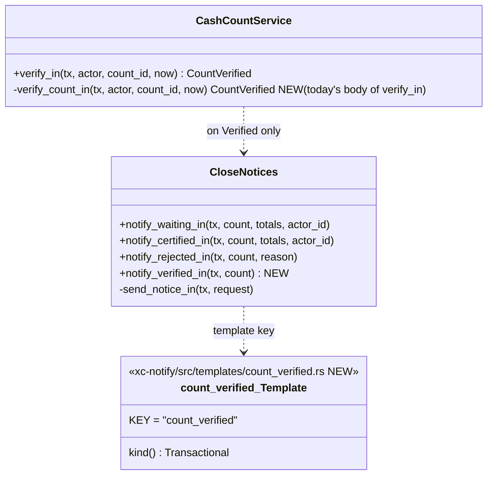

# Cash-count notices: who hears about a count, and when

> designed-by: claude/studio-claude-16 (BE sub-controller for #5643, controller claude/553782) · measured on `main` `2ea54806` (every file:line below)

#5397 had no design file; its contract lived in the ticket. This file records the notices the count service sends, and adds the one that is missing (#5643): the counter is told when the count is **verified**.

## 1. What is sent today (measured)

Every count notice goes out through `CloseNotices` (`api/crates/xc-cash/src/application/count/close_notices.rs`), on the action's own transaction, and only when the service was built `.with_notices(...)`. Each insert runs inside its own savepoint, so a failed notice is logged and never fails the action (`send_notice_in`, `close_notices.rs:94-125`, #5408 and #5536).

| Event | Where it is sent | Template | To |
|---|---|---|---|
| A CLOSE count is submitted | `submit_in` → `notify_waiting_in` (`count_service.rs:1023`) | `close_count_waiting` | the org's Executives and the branch's managers, minus the actor |
| A CLOSE count is verified | `verify_in` → `notify_certified_in` (`count_service.rs:1405`) | `shift_close_certified` | the same set, minus the verifier |
| Any count is rejected | `reject_in` → `notify_rejected_in` (`count_service.rs:1089`, `close_notices.rs:64-92`) | `count_rejected` | the count's `counted_by` only |
| **Any count is verified** | **nothing** | — | — |

The verify route already builds the service with its notices port (`CountVerify::new`, `api/src/presentation/http/v3/commands/cash.rs:342-355`). So #5421's problem, a route built without notices, does not apply here. The gap is in `verify_in` itself (`count_service.rs:1095`). `verify` (`:175`) only wraps `verify_in`.

The symptom (#5643 §2, desk round 4 on xc-v3 `eb1c31e0`): a manager verifies the teller's OPEN count, and the shift opens. The teller's `my_notifications` does not change, so the teller's card shows "waiting" until a reload.

## 2. Behaviour

| # | Case | Must hold |
|---|---|---|
| V1 | A count of any kind (`OPEN`, `CLOSE`, `SAFE_OPEN`, `SAFE`) is verified: `verify_in` answers `CountVerified::Verified` | In the same transaction, one notice goes to the count's `counted_by` and to nobody else, with template `count_verified`. A CLOSE count still sends its `shift_close_certified` notices to the managers, as today. |
| V2 | `verify_in` answers `CountVerified::AwaitingFinance` (first time, or again while the request is PENDING) | No `count_verified`. See §3. |
| V2b | FINANCE approves the difference, then the manager verifies again | That verify answers `Verified` and sends the one `count_verified` (V1). |
| V3 | A verify is refused: the counter verifying their own count, already verified, rejected, not the newest, balances changed, refused by FINANCE, no permission | No notice. |
| V4 | The `count_verified` insert fails | The verify still commits: the count is verified and the shift is opened or closed. The failure is logged by `send_notice_in`. |
| V5 | The service was built without `with_notices` | The verify behaves as before. |

**The notice:**
- recipient: the count's `counted_by`;
- event id: `count-verified:{count id}`;
- object: `cash_count` / the count id. This is the same object the reject notice uses, so the staff bell's existing `cash_count` feed picks it up (`web/src/shared/ui/notice-bell/`, pinned by `NoticeBell.feed.test.tsx:79`).
- params, exactly:
  - `kind`: `count.kind.as_str()`;
  - `branch`: `DisplayValue::server_id(branch)`;
  - `counted_on`: `DisplayValue::date` of `counted_at` in Thai time;
  - `counted_time`: Thai `HH:MM`.

  These are the reject notice's params without `reason`. Build them the same way (`close_notices.rs:70-79`). A text param holding a 4-digit run is refused as PII, so the date must be a `DisplayValue::date`.
- template `count_verified`, transactional. Title `ยอดนับเงินได้รับการรับรองแล้ว`. Body `ยอด{นับเปิดกะ|นับปิดกะ|นับเปิดตู้เซฟ|นับตู้เซฟ}ของคุณ ({counted_on} {counted_time}) ที่สาขา {branch} ได้รับการรับรองแล้ว`. Every locale renders the same Thai text, because server texts are Thai only (`docs/design/walkin-queue.md:15`). Templates have no en/zh catalogue: "parity" here means `Locale::En` and `Locale::Zh` render the Thai text, which the template test pins.

## 3. Ruling: AWAITING_FINANCE sends nothing; only the final VERIFIED notifies

A CLOSE count whose difference is above the branch limit answers `AwaitingFinance` (`count_service.rs:1270`, `:1293`). The rule is to notify on `Verified` only, for three reasons:

1. **Nothing changed for the counter.** The count is still unverified (`verified_at` is null), and the shift is still open. "Waiting" is still the true state of the teller's card, so a notice would announce a step the teller can't act on.
2. **It would repeat.** Every verify press while the request is PENDING answers `AwaitingFinance` again (`count_service.rs:1268-1270`), and each would send another notice.
3. **The final step already goes through `verify_in`.** FINANCE's decision does nothing to the count (`on_decided` is a no-op, `api/crates/xc-cash/src/application/ledger_approval/count_difference.rs:101-108`). After approval, the manager verifies again, that call answers `Verified`, and V1 sends the notice.

Not covered by this ruling:
- FINANCE **rejects** the difference. The next verify answers `RejectedByFinance` (`count_service.rs:1265-1267`), the count stays waiting, and the counter is not told. That gap is recorded on #5643 for the controller; it is not part of this delta.
- The teller's card showing "waiting for FINANCE" is a screen question for the desk-shift design (#5637). It can read the verify answer's `AWAITING_FINANCE` status (`cash.rs:390-394`) and needs no notice.

## 4. Class delta

- **One send site.** Move today's body of `verify_in` into a private `verify_count_in`, unchanged. `verify_in` calls it. When the answer is `CountVerified::Verified(count)` and `self.notices` is set, it calls `CloseNotices::notify_verified_in(tx, &count)`, then returns the answer. That one site covers the OPEN, CLOSE and SAFE returns (`count_service.rs:1203`, `:1409`, `:1484`), and leaves out `AwaitingFinance` and every error by construction. Do not add a call at each return.
- `notify_verified_in` goes through `send_notice_in`, as `notify_rejected_in` does: savepoint, carry on, log (#5408 / #5536).
- The template is one new file. `xc-notify/build.rs` registers every file in `src/templates/`, so no other edit is needed. Its four-line kind→Thai `match` copies `count_rejected.rs:25-31`. That is acceptable: the two templates name the same four kinds, and the template folder cannot hold a non-template helper file, because `build.rs` would list it.
- No migration, no DTO change, no FE change.

## 5. Up-front tests

On branch `test/5643-verify-notice` (head `4a7457c7`), based on main `2ea54806`. Do not edit, delete or weaken them.

| File | Pins |
|---|---|
| `api/crates/xc-cash/tests/count_verify_notice_test.rs` (new, fake `Notifications`) | V1 for OPEN, CLOSE and SAFE (the SAFE case also checks that the Thai day rolls over at 17:00 UTC); V2/V2b; V3; V4 with a failing insert |
| `api/tests/count_verify_route_notice_test.rs` (new, the whole route table, real `notifications` table) | VR1: verify via `POST /api/cash-counts/{id}/verify` writes one `count_verified` row for the counter, readable through `my_notifications`, with a body saying `ได้รับการรับรองแล้ว`. VR2: a refused second verify writes no second row. |
| `api/crates/xc-notify/tests/count_verified_template_test.rs` (new) | registered and transactional; exact Thai title and body for each kind; En and Zh render the Thai text |
| `api/crates/xc-cash/tests/shift_close_notices_test.rs` (**restated**) | N1 used to say "an OPEN count's verify sends nothing", and N3 used to say "the teller gets nothing on certify". Both now expect exactly one `count_verified` to the teller. N4 checks `branch` and `shift` on the shift-close notices only (`count_verified` has no `shift` param). Nothing else changed. |

The `count_rejected` tests are untouched, because they filter by template (`count_reject_notice_test.rs`, `count_reject_route_notice_test.rs`, `count_notice_failure_test.rs`). `shift_close_notices_v3_test.rs` reads only the manager's rows. A sweep at `2ea54806` of every `api/tests` and `api/crates/*/tests` file using `with_notices`, `my_notifications` or `FROM notifications` found no other test that counts notices after a verify.

Measured on the Mac Studio, 2026-10-30 ~11:15 ICT, at the test branch head `4a7457c7`:

| Suite | Result | Why |
|---|---|---|
| xc-notify `count_verified_template` | 4/4 fail | no template |
| xc-cash `count_verify_notice_test` | 5/6 fail at "exactly one count_verified notice" / "attempted once" | — |
| xc-cash `count_verify_notice_test` V3 | passes | on purpose: it guards refusals |
| xc-cash `shift_close_notices_test` | N1 and N3 fail | they wait for the new notice |
| xc-cash `shift_close_notices_test` N2, N4, N5 | pass | — |
| xchange `count_verify_route_notice_test` | 2/2 fail at the row count | — |
| `count_notice_failure_test` | 3/3 pass | — |

## 6. Function ticket

There is **one** ticket, for one Gemini 4 Argon worker (`class:logic`):
- `CloseNotices::notify_verified_in`;
- the `verify_in` / `verify_count_in` split;
- the template file.

It is not split because the route test (VR1) and the restated N1/N3 only go green when the template and the send have both landed. Two tickets would either put red tests on main or chain one ticket behind the other. The whole change is about 80 lines in three files.
