# Blueprint cash: shifts per teller, counts, hand-over and transfers (#582)

> designed-by: claude/89458e53 · 2026-10-09 · measured on `main` at `77e4b37`
> Source of the rules: *XC Desk — Blueprint & Data Model v2* (XC X TK, 2026-10-08) §02, §06, §07, §09, §12, screens
> B01 `/desk/shift` and B05 `/desk/cash`. Gap list: `docs/design/xc-desk-blueprint-v2-mapping.md` (B01, B05, §3.1).
> Built on: PR 570 `docs/design/blueprint/rates.md` (approval core `xc-approval`, the `CommandAction` seam), #550
> (roles and organisation), #553 (ledger, inventory cost, the in-transit account).

## 0. The owner's answers (2026-10-09, in session claude/89458e53)

| # | Question | Answer (verbatim) |
|---|---|---|
| A1 | Lock v2's custody roles as §12's "ผู้รับรอง"? | **"กำหนดใหม่ตามบทบาท Blueprint"**, then confirmed the reading in §3: **"ใช้ชุดนี้"** |
| A2 | v3 cash features the Blueprint does not mention (customer holds, attendance, cash target, start-service and cut-off, drawer↔safe, external in/out) | **"เก็บไว้ ผูกบทบาท Blueprint"** |
| A3 | Scope: this ticket = shifts per teller, counts by denomination, hand-over, transfers and certifier roles; the ledger stays with #553 | **"ตกลง"** |
| A4 | Roles for the kept features (table §3.2) | **"ใช้ตามนี้"** |
| A5 | Transfer approval: within the limit → the source branch's BRANCH_MANAGER; above it → EXECUTIVE; the limit is data EXECUTIVE sets, not code; the approver is never the creator | **"ใช้ตามนี้"** |
| A6 | Who certifies the day's first opening count (no hand-over) | **"BRANCH_MANAGER"** |
| A7 | (was Q1) The face values to seed per currency | **"Current series"**: every note and coin of each central bank's current series, for the seven seeded currencies; the list is checked in CA-1's review |
| A8 | (was Q2) May a teller hold OPEN shifts at two branches on the same day? | **"No"**: one OPEN shift per teller across all branches |
| A9 | Carry v3's old `custody_requests` into counts and transfers when the request model is retired? | **"Don't carry"**: CA-10 drops them unconverted; count and back up first, the owner orders that deploy |

Standing owner rules this design obeys: *"follow the Blueprint fully"* (PR 527, issuecomment-6073063976) and
*"logic ห้ามแก้ไข — ปรับได้แค่หน้าตา"* (recorded on #564). §11 checks every Blueprint item against this design.

## 1. v3 today (measured at `77e4b37`)

| Fact | Evidence |
|---|---|
| A shift belongs to the **branch**: one OPEN shift per branch, no teller or drawer column | `api/migrations/20261007110000_shifts.sql:1-16` (`shifts_one_open_per_branch`) |
| Counts are not records. They are JSON count sheets inside a v2-style **custody request** (`OPEN`, `HANDOVER`, `CLOSE`, `SAFE_OPEN`, `SAFE_IN`, `SAFE_OUT`, `EXTERNAL_IN`, `EXTERNAL_OUT`), one PENDING per branch, signed by v2's roles | `20261007140000_custody.sql:22-43`; `xc-shift/src/domain/custody/value_objects/request_kind.rs:4-13`; `custody_machine.rs:116-925` |
| One **custodian** per branch may save exchanges | `ops_state.custodian_id` (`custody.sql:5`); `CustodyMachine::check_save` (`custody_machine.rs:1156-1227`) |
| Roles are v2's (FRONT, BACKEND, MANAGER, MONITOR, FINANCE, …) mapped to `CustodyRole` | `xc-auth/.../role.rs:5-16`; `api/src/application/custody_role.rs:14-33` |
| The safe and the target are single jsonb balances with no history | `ops_state.safe`, `ops_state.target` (`custody.sql:7-8`) |
| An exchange changes `shift_balances.expected` of the branch's open shift | `workflows/save_transaction.rs:299-342` → `ShiftService::apply_delta_in` (`service.rs:384-415`) |
| The owner's direct shift actions (`adminOpenShift`, `adminCloseShift`, `adminMoveStock`) work only while custody is off | `compat/rpc.rs:361-398`, `custody/service.rs:210-222` |
| Tests pinning the request model: 49 in `custody_machine_test.rs`, 19 in `custody_service_test.rs`, ~20 more files; four v2 fixtures replay it (`v2_custody_cases.json` 3,450 probes + 417 story steps; `v2_custody_service_cases.json`; `api/tests/fixtures/rpc/ops_actions.json` 140 steps; `snapshot/custody.json` 255 steps) | `api/crates/xc-shift/tests/`, `api/tests/` |

## 2. Decisions

| # | Decision | Source |
|---|---|---|
| C1 | **A shift belongs to a teller.** `shifts.teller_id`; one OPEN shift per teller, across branches (A8); several tellers may serve at once, each on their own drawer. An exchange posts to **the saver's own** open shift. The branch-wide custodian is removed. | Blueprint §07 Shift *"กะเป็น teller/cash drawer scope; shift ย่อยแยกพนักงานได้"* |
| C2 | **A count is a record.** `cash_counts(kind, counted_by, verified_by)` with `cash_count_lines` per currency and denomination (`qty`, `expected`, `difference`). A count is verified (`verified_by` set) by a person other than the counter. The Blueprint's Count has no status column and no rejection, so this design adds none: a count is waiting while `verified_by` is NULL, and a verifier who disagrees has the counter count again, which writes a new count. | §07 Count, Line |
| C3 | **Hand-over is a record between two shifts.** The outgoing teller's HANDOVER_OUT count closes their shift; the receiving teller certifies it, and the same lines open the receiver's shift. | §07 Handover; A1 |
| C4 | **Transfers between branches** follow §06 exactly: DRAFT → APPROVED → DISPATCHED → RECEIVED → RECONCILED, with lines `qty_sent` / `qty_received`, and **no other state**. A refused approval is recorded on the approval request (A06 *"อนุมัติ/ปฏิเสธพร้อมเหตุผล"*); the transfer stays DRAFT and its creator may edit and submit it again. A difference at receipt is an exception, never forced to match. | §06, §07 CashTransfer, A06 |
| C5 | **v3's drawer↔safe and external moves are kept** (A2) and walk **the same five states** through one shared core (♻️): a transfer and a move differ only in their two ends. | A2, A4 |
| C6 | **Approval** of a transfer or move goes through PR 570's approval core: one `ApprovalSubject` + one `ApprovalPolicy`. Within the limit: the source branch's BRANCH_MANAGER; above: EXECUTIVE; the limit is a policy version EXECUTIVE saves; the core already refuses the proposer. | A5; PR 570 §5.2-§5.4 |
| C7 | **Money and ledger**: every state change that moves cash calls the posting port of #553 (§4.6). Until #553 lands, the port's interim implementation keeps today's behaviour (`shift_balances.expected`, `stock_movements`, `ops_state.safe`). | A3 |
| C8 | **Writes are `CommandAction`s** (PR 570 §6) with an `Idempotency-Key`; v2's `ops*` RPC names are retired with the request model. | §09, §10 |
| C9 | **The kept branch day** (start service, cut-off, drafts begun before cut-off that carry a save past it, the cash target, attendance, customer holds) stays as v3 behaviour, rebound to the Blueprint's roles (§3.2). | A2, A4 |
| C10 | v2's fixture replays that pin the request model are **retired**, not edited: the request model is gone. The rules they pinned that survive are restated as new tests (§9). | consequence of A3 |

## 3. Who does what

Roles are the Blueprint's (§02), from #550's design (PR 589, `docs/design/blueprint/org-roles-branches.md` §3.1):
EXECUTIVE, ADMIN, RATE_MANAGER, BRANCH_MANAGER, TELLER, FINANCE, MARKETING, VERIFICATION_REVIEWER. PR 589 maps
today's accounts by duty (BACKEND and MANAGER → BRANCH_MANAGER, MONITOR → VERIFICATION_REVIEWER).

**Access is a permission, checked once** by PR 589's `Authorizer::check(actor, Permission, target)` (§3.5 there),
from its single `RolePermissions` table. This design writes **no role literal**: each step below names the
permission it needs, and the person rules that are not about roles (counter ≠ verifier, the receiving teller, the
shift's own teller) live in `xc-cash/src/domain/person_rules.rs`. The four permissions this design added
(`AttendanceClock`, `CustomerHoldPlace`, `CashTargetSet`, `BranchDayOperate`) are in PR 589 §3.4 at `71f03ca`, in its
one `role_permissions.rs` table (OR-2), so this design edits no permission file (§5.1).

### 3.1 Counting, hand-over and transfers (A1, A5, A6)

| Step | Who (owner's answer) | Permission (PR 589 §3.4) + person rule |
|---|---|---|
| Open a shift: count (first of the day) | **TELLER** | `ShiftOperate`; counts for their own new shift |
| Open a shift: verify | **BRANCH_MANAGER** (A6) | `ShiftCloseCertify`; not the counter |
| Hand-over: count | outgoing **TELLER** | `ShiftOperate`; the shift's own teller |
| Hand-over: verify (accept) or reject | the **receiving TELLER** | `ShiftOperate`; is `handovers.receiver_id`, not the counter. Done with `handoverAccept` / `handoverReject` (§4.4), never `countVerify`: `countVerify` refuses a HANDOVER_OUT count (`OnlyThroughHandover`, `xc-cash/src/application/count/count_service.rs:294-297`) |
| Close a shift: count / verify | **TELLER** / **BRANCH_MANAGER** (B01 *"ปิดและรับรอง"*) | `ShiftOperate` (own shift) / `ShiftCloseCertify`, not the counter |
| Transfer: create, dispatch | **BRANCH_MANAGER** or **FINANCE** of the source branch | `CashManage` on the source branch |
| Transfer: approve | within limit → a BRANCH_MANAGER of the source branch; above → EXECUTIVE; never the creator (A5) | `ApprovalsDecide` + `TransferApprovalPolicy` (PR 570 §5.2-§5.4) |
| Transfer: receive (*"ผู้รับรับรองยอดจริง"*) | a person of the destination | `CashManage` on the destination branch; not the creator |
| Transfer: reconcile | **FINANCE** | `FinanceReconcile`; not the creator or the receiver |
| Transfer limit: save a policy version | **EXECUTIVE** (A5: *"the limit is data EXECUTIVE sets"*) | `CashTransferPolicySet`, **new**, EXECUTIVE only. No existing permission matches A5: `RatePolicySave` is also RATE_MANAGER's and `SystemSettings` also ADMIN's (`xc-auth/src/domain/access/role_permissions.rs`). Added by **CA-0p** (§9) |

### 3.2 Kept features (A2, A4)

| Feature | Who (A4) | Permission | Was (v2 role) |
|---|---|---|---|
| Clock in / out (attendance) | every staff role | `AttendanceClock` (PR 589 §3.4 @ `71f03ca`): every role except CUSTOMER — EXECUTIVE, ADMIN, RATE_MANAGER, BRANCH_MANAGER, TELLER, FINANCE, MARKETING, VERIFICATION_REVIEWER | any |
| Put a customer on hold | **TELLER** or **BRANCH_MANAGER** | `CustomerHoldPlace` (TELLER, BRANCH_MANAGER) | FRONT, MONITOR |
| Review and release a hold | **VERIFICATION_REVIEWER** | `VerificationReview` | MONITOR |
| Set the cash target | **FINANCE** | `CashTargetSet` (FINANCE) | FINANCE |
| Start service, cut-off | **BRANCH_MANAGER** | `BranchDayOperate` (BRANCH_MANAGER) | BACKEND |
| Begin a transaction draft while the branch day is OPEN, so the save may complete after cut-off (`draftBegin`, §4.4; v2 `branch_day.rs:156-158`, CA-7b `service.rs:493`) | **TELLER** or **BRANCH_MANAGER** (owner, 2026-10-11, §10 Q11), on their own OPEN shift (§4.4) | → `ShiftOperate`; the saver's own OPEN shift. No new permission is needed: `ShiftOperate` is held by exactly these two roles (`role_permissions.rs:52`, `:74`) and already means acting on one's own shift (§3.1) | FRONT (`custody_machine.rs`, `BeginTransaction` arm) |
| Safe opening count / verify | **FINANCE** / **BRANCH_MANAGER** | `CashManage` / `ShiftCloseCertify`; not the counter | FINANCE + MONITOR signature |
| Drawer↔safe, external in/out: create, dispatch | **BRANCH_MANAGER** or **FINANCE** | `CashManage` | FRONT propose, BACKEND dispatch |
| … approve | per A5 | `ApprovalsDecide` + `TransferApprovalPolicy` | signatures |
| … receive | the teller whose drawer receives; BRANCH_MANAGER for the safe; FINANCE for external in | `ShiftOperate` + own shift / `CashManage` | BACKEND commit |
| … reconcile | **FINANCE** | `FinanceReconcile` | FINANCE |

## 4. Model

### 4.1 Tables

```
-- Every person column below is `uuid REFERENCES users(id)` (PR 589 migration 2, OR-2); none references `employees`,
-- which PR 589's OR-7 drops. Every new table has `organization_id uuid NOT NULL REFERENCES organizations(id)` and,
-- where it has a branch column, the composite FK `(organization_id, <branch column>) → branches(organization_id, id)`
-- (PR 589 D-1, §8 "every other table"). Every table has `created_at`; the mutable ones (cash_counts, handovers,
-- cash_transfers) also `updated_at`. Lines, totals and policy versions are immutable (`created_at` only).

shifts                       -- existing table, changed (CA-1 adds the column, CA-3 swaps the index)
  + teller_id uuid NOT NULL REFERENCES users(id)          -- C1
  + opened_by_count uuid NULL REFERENCES cash_counts(id)  -- CA-3, transitional: the verified OPEN/hand-over count
                                                          -- that opened it; NULL = opened by v2's path. CA-10 drops it
  - DROP INDEX shifts_one_open_per_branch                 -- CA-3
  + CREATE UNIQUE INDEX shifts_one_open_per_teller ON shifts (teller_id)
      WHERE status = 'OPEN' AND opened_by_count IS NOT NULL                       -- CA-3, A8 (count-opened shifts)
  + CREATE UNIQUE INDEX shifts_one_open_per_branch_v2 ON shifts (branch_id)
      WHERE status = 'OPEN' AND opened_by_count IS NULL                           -- CA-3 → CA-10, v2's own rule
  (end state, CA-10: drop opened_by_count and shifts_one_open_per_branch_v2;
   shifts_one_open_per_teller ON shifts (teller_id) WHERE status = 'OPEN' — every shift, A8)

**Why two indexes until CA-10** (lane controller's ruling, 2026-10-10, option A): v2's open path
(`adminOpenShift` → `ShiftService::open_in`) runs until CA-10, which deletes v2's `ShiftService::open` / `open_in` with it (the `ShiftService` itself stays, §6), and CA-1's opener resolution maps `"owner"` to one
user, so the owner opens shifts at several branches as one teller. A8 applied to those shifts would refuse v2's own
flows (measured on the CA-3 tests' first run: 75 `shifts_one_open_per_teller` violations across about 25 test files).
So A8 binds the shifts the v3 count path opens, and v2's shifts keep v2's one-per-branch rule. The marker is
scaffolding, not Blueprint model: CA-10 removes it and A8 then binds every shift.

cash_counts(id uuid PK, organization_id, branch_id, shift_id FK NULL,   -- NULL for the safe's counts
            kind text CHECK (kind IN ('OPEN','HANDOVER_OUT','CLOSE','SAFE_OPEN','SAFE')),
            counted_by uuid, counted_at timestamptz, verified_by uuid NULL, verified_at timestamptz NULL,
            note text, idempotency_key text, UNIQUE (branch_id, idempotency_key),
            CHECK (verified_by IS NULL OR verified_by <> counted_by), created_at, updated_at)
cash_count_lines(count_id FK, currency char(3), denomination_id FK denominations, qty integer CHECK (qty >= 0),
                 created_at, PRIMARY KEY (count_id, currency, denomination_id))
cash_count_totals(count_id FK, currency char(3), counted numeric(20,4), expected numeric(20,4) NULL,
                  difference numeric(20,4) NULL, created_at, PRIMARY KEY (count_id, currency))
handovers(id uuid PK, organization_id, branch_id, from_shift_id FK, to_shift_id FK NULL, count_id FK UNIQUE,
          receiver_id uuid, status text CHECK (status IN ('PENDING','ACCEPTED','REJECTED')), created_at, updated_at)
cash_transfers(id uuid PK, organization_id,
               kind text CHECK (kind IN ('BRANCH','DRAWER_TO_SAFE','SAFE_TO_DRAWER','EXTERNAL_IN','EXTERNAL_OUT')),
               from_branch_id, to_branch_id NULL, from_shift_id FK NULL, to_shift_id FK NULL,
               status text CHECK (status IN ('DRAFT','APPROVED','DISPATCHED','RECEIVED','RECONCILED')),   -- §06, nothing else
               created_by uuid, approval_request_id uuid NULL, dispatched_at/by uuid NULL, received_at/by uuid NULL,
               reconciled_at/by uuid NULL, reconcile_note text NULL, note text, idempotency_key text,
               UNIQUE (from_branch_id, idempotency_key), created_at, updated_at)
cash_transfer_lines(transfer_id FK, currency char(3), denomination_id FK denominations,
                    qty_sent integer, qty_received integer NULL, created_at,
                    PRIMARY KEY (transfer_id, currency, denomination_id))
cash_transfer_policy_versions(version text PK, organization_id, limits jsonb,   -- {CUR: max amount}, set by EXECUTIVE (A5)
                              set_by uuid, created_at)
```

- **Amounts.** Every amount is `numeric(20,4)`, the storage `rates.md` D-2 sets for every foreign amount (and the
  Blueprint's `Denomination.face_value DECIMAL(20,4)`). An amount with more places than its currency's
  `currencies.minor_unit` is refused (`TooManyDecimals`, the same rule as D-2), never rounded. `qty` is a whole
  number of notes or coins, so a total `Σ qty × face_value` never has more places than the face values.

- **Denominations.** Lines reference PR 570's `denominations` table (`docs/design/blueprint/rates.md` §3.4), which
  this design extends with face-value rows per currency (data only, §8; the current series, A7). A line is `qty` notes or coins of one
  face value. `cash_count_totals.counted` = Σ `qty × face_value` per currency, computed by the server.
- **Expected per denomination.** The Blueprint's Line carries `expected` and `difference` per denomination. v3 knows
  stock per currency only; per-denomination stock is #553's inventory. Until #553 provides it, `expected` and
  `difference` live on `cash_count_totals` per currency, and the per-denomination columns are added by #553's
  migration. Recorded as a staged item in §11, not a change of rule.
- **One kind, two ends.** `cash_transfers.kind = 'BRANCH'` is the Blueprint's transfer. The other four kinds are v3's
  kept moves (C5); their ends are a shift (drawer), the branch safe, or outside, as the kind says. `CHECK`s per kind
  fix which end columns are set.
- **Exceptions.** A non-zero `difference` on a verified count, or `qty_received ≠ qty_sent` on a RECEIVED transfer,
  writes a row in the existing `cash_exceptions` (C4, §06 *"difference เป็น exception ไม่บังคับตรง"*); FINANCE's
  reconcile reviews it.

  **The row has the existing shape (CA-7d, added 2026-10-12).** "Existing" means the row shape the kept readers
  decode, not only the table. Every row is one `CashException` (`xc-shift/src/domain/custody/entities/cash_exception.rs:13-24`),
  serialised by the kept `exception_data` (`xc-shift/src/infrastructure/custody/custody_repository.rs:247`). The
  readers that need that shape are `exception_from_row` (`decode.rs:591`, which refuses a row without `requestId` or
  `status`), the branch's custody load (`custody_repository.rs:503`, `?` on every row; called by `api/src/infrastructure/custody/employee_custody.rs:138`), `exceptions_between`
  (`custody_pages.rs:335`, filtered on `data->>'at'`) and the executive alerts (`alert_facts.rs:112`).

  Why this is written down: CA-3, CA-4 and CA-5 each hand-built `{countId|transferId, currency, difference}` instead
  (`count_service.rs:1094`, `handover_service.rs:350`, `transfer_flow.rs:328` on `main` `4bfe4d7d`). With one such row
  at a branch, `exception_from_row` fails on `requestId`, so that branch's custody state no longer loads, and
  `exceptions_between` never returns the row (#1350 issuecomment-6115209737).

  One exception per event, holding every currency that differs:

  | Field | Value |
  |---|---|
  | `id` | `EX-<uuid>`, as today |
  | `request_id` | the source object's id: the count's id (a count verify, and the count a hand-over is accepted on), or the transfer's id (a receipt) |
  | `status` | `Open` |
  | `cash_variance` | the differences when the place that differs is a drawer (a shift's count, a hand-over); otherwise `None` |
  | `safe_variance` | the differences when the place that differs is the branch safe (a SAFE count, a receipt into the safe); otherwise `None` |
  | `target_difference` | `None` (that field is the branch-day target's, C9) |
  | `note` | `"COUNT <id>"`, `"HANDOVER <id>"` or `"TRANSFER <id>"`, so a reader can tell the source without a lookup |
  | `at` | the command's `now` |
  | `reviewed_by`, `reviewed_at` | `None` |

  A difference is counted − expected (count, hand-over) or received − sent (receipt), per currency, in the
  `StockDelta` of that field; currencies with no difference are absent.

  **The writer.** One function in `xc-shift`, next to `exception_data`, writes the row on the caller's transaction,
  at `position` = `COALESCE(MAX(position) + 1, 0)` on the branch.
  - **Why 0-based, not the three sites' `COALESCE(MAX(position), 0) + 1`:** the custody save writes `position` as the
    0-based index into the branch's list (`custody_repository.rs:716-730`), and the table is `UNIQUE (branch_id, position)`.
  - With the old rule, a branch's first appended row sits at 1. The next v2 custody completion with a difference
    (`custody_machine.rs:646`) then writes index 1 and violates the unique key.
  - That path becomes reachable once the load stops failing, so a dense 0-based list is required. `xc-cash` already depends
  on `xc-shift` (`xc-cash/Cargo.toml:17`). The three sites build the `CashException` and call it, so no other crate
  writes `cash_exceptions.data`.

  ```rust
  // api/crates/xc-shift/src/infrastructure/custody/custody_repository.rs   [required name; proposed signature]
  pub async fn append_cash_exception_in(
      tx: &mut Transaction<'_, Postgres>,
      branch: &BranchId,
      exception: &CashException,
  ) -> AppResult<()>;
  ```

  **Data migration.**
  1. **Existing rows:** rows of the hand-built shape exist only in v3 test databases (v3 holds test data, D6). No
     schema changes.
  2. **Backfill:** none, because there is no real data. A test database holding such rows is **recreated**; that is
     the only cleanup this design names. Deleting the rows by hand would leave gaps in the dense `position` list and
     collide in the same way as the position rule above. Count them first with
     `SELECT count(*) FROM cash_exceptions WHERE NOT (data ? 'requestId')`.
  3. **Deploy order:** there is no migration. The fixed binary writes the full shape from its first request.
  4. **`down`:** none.

  **Not built here, and named so it isn't assumed:** only a custody request's Reconcile marks an exception
  `REVIEWED` today (`custody_machine.rs`). Rows keyed by a count or a transfer id therefore stay `OPEN` until FINANCE's
  review of them exists. §4.1 above says FINANCE's reconcile reviews them, and no ticket in §9 builds that yet. It is
  recorded in §11 as staged. It is not a regression, because before CA-7d these rows could not be read at all.
- **Kept as they are:** `ops_state` (phase, entity, target, safe, cutoff, service_opened_at) minus `custodian_id`;
  `attendance`; `customer_holds`; `tx_drafts`; `cash_exceptions`; `ops_events`.
- **Removed, by CA-10 only** (while the request model still runs, its tables and `custodian_id` stay): `custody_requests`,
  `custody_signatures`, `ops_state.custodian_id`.

### 4.2 States

```
cash_counts:     no status column (Blueprint §07 Count): waiting while verified_by IS NULL --verify(by ≠ counter)--> verified.
                 A recount is a new count of the same (shift, kind); only the newest count of that pair can be
                 verified, and the older ones stay as history.
handovers:       PENDING --receiver verifies-----> ACCEPTED        (closes from_shift, opens to_shift)
                 PENDING --receiver rejects------> REJECTED
cash_transfers:  DRAFT --approve--> APPROVED --dispatch--> DISPATCHED --receive(qty_received)--> RECEIVED --reconcile--> RECONCILED
                 (§06's five states only. An approver's refusal is the ApprovalRequest's REJECTED, PR 570; the transfer
                  stays DRAFT, and the creator edits it and submits again.)
branch day:      CLOSED --first OPEN count verified--> READY --start service--> OPEN --cut-off--> CUT_OFF
                 CUT_OFF --last open shift CLOSE verified--> CLOSED
```

The branch day keeps v3's phase names (C9). `COUNTING` goes: with shifts per teller, "counting" is a property of
each shift's CLOSE count, not of the branch.

CLOSED is read, not stored, at the end of a day: a stored CUT_OFF with no OPEN shift left reads as CLOSED
(`BranchDay::read_phase`). So "CLOSED --first OPEN count verified--> READY" (CA-7e, added 2026-10-15 on #626 Q1) applies
to the phase **as read before the count's shift is inserted**: stored CLOSED, no `ops_state` row, or stored CUT_OFF
with no OPEN shift become READY on the verify's transaction; READY, OPEN, and CUT_OFF with another shift still open are
left as stored. Only `phase` is written (v2's OPEN commit wrote no other field). Until CA-7e, the only writer of READY
was the commit of a v2 OPEN request (`custody_machine.rs:533`), which CA-10 deletes.

### 4.3 Rules the machine enforces (domain, not screens)

| Rule | Where |
|---|---|
| a shift opens only when its OPEN count, or the hand-over's count, is verified | `ShiftService::open_on_verified` |
| one OPEN shift per teller, across branches (A8), over the shifts a count opened (until CA-10: every shift) | `shifts_one_open_per_teller`; `ShiftService::open_on_verified` answers `shiftAlreadyOpen` before the insert. A v2-opened shift (`opened_by_count IS NULL`) does not count against A8 until CA-10 |
| v2's path (`open_in`, `active_in(branch)`, `apply_delta_in(branch)`) sees only v2-opened shifts until CA-10 | `shift_repository.rs`: its per-branch reads add `AND opened_by_count IS NULL` |
| `verified_by ≠ counted_by`; the verifier's role per §3.1; only the newest count of its (shift, kind) is verified | `CashCountService::verify` |
| a CLOSE or HANDOVER_OUT count's `expected` = the shift's expected at the moment of counting; a later exchange on that shift refuses the verify (`balancesChanged`) | `CashCountService::verify` |
| an exchange posts to the saver's own OPEN shift; no open shift → `noOpenShift` | `save_transaction.rs` (C1) |
| after cut-off, a save needs the saver's own OPEN draft (kept rule, `custody_machine.rs:1194-1214`) | `BranchDay::check_save` |
| transfer: only §06's five states; a refused approval leaves it DRAFT; creator ≠ approver (core); dispatch only from APPROVED; receive only by the destination; reconcile only RECEIVED, by FINANCE, not the creator or the receiver | `TransferFlow` |
| a move out of a drawer or the safe cannot exceed its expected balance (`stockInsufficient`) | `TransferFlow::dispatch` via the posting port |

### 4.4 Commands (C8)

All are `CommandAction`s (PR 570 §6). Routes follow the Blueprint's §10 naming style; §10 names none for cash, so
these are [proposed] and may be renamed in review without changing logic.

| Command | Route | Role |
|---|---|---|
| `countSubmit` | `POST /api/cash-counts` | per kind, §3 |
| `countVerify` | `POST /api/cash-counts/{id}/verify` | §3.1 |
| `handoverStart` | `POST /api/handovers` (creates the HANDOVER_OUT count) | TELLER |
| `handoverAccept` | `POST /api/handovers/{id}/accept` `{id}` → `HandoverService::accept` (`handover_service.rs:286`): PENDING → ACCEPTED (§4.2) | the receiving TELLER (§3.1): `ShiftOperate` + `PersonRules` receiver |
| `handoverReject` | `POST /api/handovers/{id}/reject` `{id}` → `HandoverService::reject` (`handover_service.rs:240`): PENDING → REJECTED (§4.2). **No reason field**: `reject` takes none and `handovers` has no column for one (§4.1) | the receiving TELLER (§3.1): `ShiftOperate` + `PersonRules` receiver |
| `transferCreate` | `POST /api/cash-transfers` | BRANCH_MANAGER, FINANCE |
| `transferSubmit` | `POST /api/cash-transfers/{id}/submit` (asks the approval core) | the creator |
| `transferDispatch` / `transferReceive` / `transferReconcile` | `POST /api/cash-transfers/{id}/dispatch` · `/receive` · `/reconcile` | §3.1, §3.2 |
| `transferPolicySave` | `PUT /api/cash-transfer-policy` `{limits: {CUR: str}}` | EXECUTIVE: `CashTransferPolicySet` (§3.1) |
| `dayStartService` / `dayCutoff` / `dayTarget` | `POST /api/branch-day/start` · `/cutoff` · `/target` | §3.2 |
| `clock` | `POST /api/attendance` | every staff role |
| `holdCreate` / `holdRelease` | `POST /api/customer-holds` · `/{id}/release` | §3.2 |
| `draftBegin` | `POST /api/tx-drafts` | TELLER or BRANCH_MANAGER, own open shift, while the branch day is OPEN (a draft lets the save complete after cut-off; at CUT_OFF `draftBegin` answers `NotCustodianInOpenService`): `ShiftOperate` (§3.2) |

Approval decisions use PR 570's `POST /api/approvals/{id}/decide`.

**Two tickets serve this table** (lane controller's rulings on #624, issuecomment-6104644196):
- **CA-8:** the count, hand-over and transfer commands, including `handoverAccept`, `handoverReject` and
  `transferPolicySave`.
- **CA-8b:** the seven branch-day commands `dayStartService`, `dayCutoff`, `dayTarget`, `clock`, `holdCreate`,
  `holdRelease` and `draftBegin`. They wrap CA-7b's `BranchDayService` (§4.8), not v2's `CustodyService::command`,
  whose machine still checks v2 roles (for example hold = FRONT or MONITOR) against A4.

**`transferPolicySave` writes the version itself.** Nothing writes `cash_transfer_policy_versions` today: the table is
CA-1's (`api/migrations/20261012100000_cash.sql:218`) and `xc-cash` only reads it
(`xc-cash/src/infrastructure/transfer_repository.rs:390`). The command inserts one version row on the transaction the
seam hands its `run`, as `ratePolicySave` writes `rate_policy_versions` (`api/src/presentation/http/v3/commands/rate_policy_save.rs`).
The row holds `limits` `{CUR: max amount}` and `set_by` = the actor (§4.1). An amount with more places than its
currency's `minor_unit` is refused (`TooManyDecimals`, §4.1 "Amounts"). It starts after **CA-0p** (§9), which adds the permission and this command's area row.

**Where each command's permission is declared** (lane controller's ruling G2 on #624, the #573 precedent):
- **Area rows.** Since OR-4b, a v3 command declares `INHERITS: (EntryPath, action)` (`api/src/presentation/http/v3/command.rs:37`).
  `Policy::authorize` resolves the action through PL-0b's area rows.
- **One area file per ticket**, never `policy.rs`:
  - CA-0p: `api/crates/xc-auth/src/domain/policy/areas/cash_transfer_policy.rs` (the `transferPolicySave` row only);
  - CA-8: `areas/cash.rs` (every other CA-8 command and view);
  - CA-8b: `areas/branch_day.rs`.

  `xc-auth/build.rs` scans the folder, so no `mod` line is needed.
- **Each row is the union of what the service checks**, so the service's own refusal is still reached (rows in
  #624's ruling).
- **Entry path.** Every command and view here inherits `EntryPath::Rpc` (ruling G2a).
  - Rpc takes the signed-in actor of either session (`extractors/actor.rs:204-236`, `view.rs:339-362`).
  - StaffRpc refuses an Owner-kind EXECUTIVE+ADMIN, and `clock` and `transferPolicySave` need them.

**How the commands are registered** (G6):
- **Only flat files are registered.** `api/build.rs` registers only plain files directly in `http/v3/commands/`
  (`build.rs:246-247`, `path.is_file()`), each with `pub fn register(` and `pub fn export_types(`
  (`build_support/commands.rs:38-47`).
- **No command subdirectory exists on main.** A group of commands is one flat file holding several `CommandAction`s,
  e.g. `denomination_groups.rs` (three commands, `:51`, `:121`, `:196`; one `register` `:236`).
- **Every file under `commands/` must hold a command.** `api/tests/or4_routes_guard_test.rs` walks `commands/`
  recursively (`rust_files` `:38-46`, called from `v3_route_files` `:67-76`) and requires every non-`mod.rs` file
  to declare `INHERITS` or `PUBLIC_ROUTE` (the test from `:78`).
  A flat file holding only `register`/`export_types`, with the commands in child files, fails it (measured by the
  reviewer of PR 1269, issuecomment-6104706651).
- **So each ticket's commands all live in one flat file**, exactly as `denomination_groups.rs` does:
  - CA-8: every CA-8 `CommandAction` in `api/src/presentation/http/v3/commands/cash.rs`;
  - CA-8b: every CA-8b `CommandAction` in `api/src/presentation/http/v3/commands/branch_day.rs`.

  Each file also holds the group's one `register` and `export_types`. Neither ticket creates a subdirectory of
  `commands/`.

### 4.5 The shared transfer core (♻️)

```rust
// api/crates/xc-cash/src/domain/transfer/ends.rs   [required names]
pub trait TransferEnds: Send + Sync + 'static {
    fn kind(&self) -> TransferKind;                 // BRANCH, DRAWER_TO_SAFE, … (a method, so the trait is dyn-safe)
    /// Which ends this kind needs, and who may create and receive it (§3).
    fn check_create(&self, who: &access::Actor, t: &NewTransfer) -> Result<(), CashError>;
    fn check_receive(&self, who: &access::Actor, t: &CashTransfer) -> Result<(), CashError>;
    /// The postings at DISPATCHED and at RECEIVED (C7).
    fn on_dispatch(&self, t: &CashTransfer) -> Result<Vec<PostingRequest>, TransferError>;   // amended 2026-10-16 (#2063)
    fn on_receive(&self, t: &CashTransfer) -> Result<Vec<PostingRequest>, TransferError>;    // amended 2026-10-16 (#2063)
}
```

**Checked transfer totals (amended 2026-10-16; tracking #2063, kernel K-b #2065).**
- **What overflows:** a line's total is `face_value × qty`, in hundredths. `face_value` is stored, at most 100,000,000 units, read through `Money::parse`. `qty` is typed by staff, at most `i32::MAX` (`cash.rs:116` `whole_number`). So staff input alone can push a line, or a currency's sum of lines, past `i64::MAX` hundredths.
- **What happens today** (measured on the K-b branch `d905ce39`):
  - debug and test builds panic;
  - release builds **wrap silently**: `is_within_limit` answers `true` for an overflowing transfer, and `on_dispatch`/`on_receive` answer `[]`, so dispatch posts nothing and still moves to DISPATCHED.
- **Rule:** every line total and every per-currency sum is computed with `Money::try_minor` plus `checked_mul`/`checked_add`. An overflow is `TransferError::Validation(…)`, which reaches the client as **400 `validationFailed`** (`AppError::Domain` → `from_cash_error`, `cash.rs:131`): staff caused it, and staff fix it with a smaller quantity.
- **Stored-data-only sites** map an overflow to `AppError::Internal` (500), not 400, because only corrupt data could reach them:
  - the ledger-balance comparison at `transfer_flow.rs:522`;
  - the receipt valuation at `:644`;
  - `finance/sheet_parts.rs`, which reads only DISPATCHED/RECEIVED transfers that were already checked.
- **Signatures that change** (public, so recorded here):

| Item | File | Today | After |
|---|---|---|---|
| `TransferEnds::on_dispatch` / `on_receive` | `xc-cash/src/domain/transfer/ends.rs:21`, `:24` | `Vec<PostingRequest>` | `Result<Vec<PostingRequest>, TransferError>` |
| `TransferPolicy::is_within_limit` | `xc-cash/src/domain/transfer/transfer_policy.rs` | `bool` | `Result<bool, TransferError>` |
| `TransferLine::sent_minor` / `received_minor` | `xc-cash/src/domain/transfer/cash_transfer.rs:136`, `:140` | `i64` | `Result<i64, TransferError>` |

- **Every site of the checked math, with its mapping** (measured on main `8f733a91`; claude/029418's review):

| Site | What it computes | Input | Overflow answers |
|---|---|---|---|
| `kinds/branch.rs:82` (dispatch), `:116` (receive) | `face_value × qty` per line, and the per-currency sum, inside `impl TransferEnds` | staff-typed `qty` | 400 `validationFailed` |
| `kinds/external.rs:72`, `:107` | the same | staff | 400 |
| `kinds/safe.rs:110`, `:147` | the same | staff | 400 |
| `transfer_policy.rs:25` `is_within_limit` (line totals `:29`, sum `:41`) | the limit check | staff | 400 |
| `transfer_flow.rs:322`, `:324` and the `+=` sums after them (`write_exceptions`, at receive) | `face_value × qty_sent` and `× qty_received` per line | **staff** (`qty_received` is what staff just counted) | **400** |
| `transfer_flow.rs:436` `.map(\|p\| p.is_within_limit(&t.lines))` | the limit check at submit | staff | 400 **before any approval decision**. The `Option<Result<…>>` becomes a `Result<Option<…>>` with `transpose()?` |
| `transfer_flow.rs:515` (`on_dispatch`), `:593` (`on_receive`) | callers of the trait | staff | 400, propagated with `?` |
| `transfer_flow.rs:522` | ledger-balance comparison | stored | 500 `AppError::Internal` |
| `transfer_flow.rs:644` | reconcile on stored quantities | stored | 500 |
| `api/src/application/finance/sheet_parts.rs:216`, `:221`, `:287`, `:288` (`sent_minor`/`received_minor`) | finance sheet over DISPATCHED/RECEIVED rows | stored, already checked when dispatched/received | 500 |

- **No state is advanced when the arithmetic fails** (required):
  - **Dispatch** (`dispatch_on`). `on_dispatch` (`:515`) runs **before** `mark_dispatched` and `post_in`, so a `?` there returns before any state change. That order must be kept.
  - **Receive** (`receive_on`). Today `mark_received` runs **before** `on_receive` (`:593`) and `write_exceptions` (`:595`). An error there is undone only because the caller drops the transaction without `commit()`. **Required:** the receive path computes `on_receive` and the exception totals **before** `mark_received`, the same order as dispatch, so that correctness does not rest on the transaction being dropped. The caller must still never commit on `Err`.
  - **Tests that must pin it:**
    - an overflowing dispatch leaves the transfer in its prior state with **no `ledger_postings` row**;
    - an overflowing receive leaves it **DISPATCHED**, with no posting and **no `cash_exceptions` row**.
- **Blocker:** `Money::try_minor` is K-b, #2065 (PR 2071). It is **not yet on main** (no `fn try_minor` at `8f733a91`), so the code ticket #2088 is blocked until PR 2071 merges.
- **Existing tests whose call sites gain `.unwrap()`/`?`** (no assertion changes):
  - `xc-cash/tests/moves_test.rs:424`, `:429`;
  - `xc-cash/tests/transfers_test.rs:363`, `:379`, `:398`;
  - `api/tests/finance_sheet_parts_test.rs:1104-1115`.

`TransferFlow` (`api/crates/xc-cash/src/application/transfer/transfer_flow.rs`) owns the five states, the
exception at receipt, idempotency and the call to the approval core; it is generic over `Arc<dyn TransferEnds>`
held in a registry keyed by `kind()`. `access::Actor` is PR 589's (`xc-auth/src/domain/access/actor.rs`, OR-2;
the extractor supplies it from OR-3). **Adding a kind is one file** in `xc-cash/src/domain/transfer/kinds/`.
`TransferApprovalSubject` + `TransferApprovalPolicy` (`xc-cash/src/application/approval/transfer.rs`) implement
PR 570's `ApprovalSubject` / `ApprovalPolicy` for every kind (A5).

### 4.6 The posting port (seam with #553)

```rust
// api/crates/xc-cash/src/domain/posting.rs   [proposed — #553 owns the final shape]
pub enum CashPlace { Drawer(ShiftId), Safe(BranchId), InTransit(TransferId), Outside }
pub struct PostingRequest { pub from: CashPlace, pub to: CashPlace, pub currency: CurrencyCode, pub amount: Money, pub source: SourceRef }
pub trait CashPostings: Send + Sync {
    fn post_in<'a>(&'a self, tx: &'a mut Transaction<'_, Postgres>, req: &'a [PostingRequest]) -> BoxFuture<'a, AppResult<()>>;
    fn expected_in<'a>(&'a self, tx: &'a mut Transaction<'_, Postgres>, place: &'a CashPlace) -> BoxFuture<'a, AppResult<Balances>>;
}
```

`InterimCashPostings` (`xc-cash/src/infrastructure/interim_postings.rs`) implements it on today's tables:
Drawer = `shift_balances.expected` + a `stock_movements` row; Safe = `ops_state.safe`; InTransit and Outside are
not balances (a dispatch moves out, a receipt moves in). #553 replaces it with ledger postings without touching
any caller. Until then the Blueprint's separate in-transit account (§11 *"เงิน in-transit แยก"*) is **staged**:
money in transit is the sum of DISPATCHED transfers' lines, readable from `cash_transfers`, not a balance (§11).

### 4.7 Reads

New views (parent §4 view contract): `cash_counts` (paged, filter `shift`, `status`), `cash_transfers` (paged,
filter `status`, `kind`), `handovers_pending` (branch), `my_shift` (the caller's open shift and its expected
balances), plus `denominations` (the rows of the existing `denominations` table that have a face value, `{ id, currency, faceValue, groupCode }` ordered by currency, face value, id; the catch-all row with no face value is excluded because a count line multiplies `qty × face_value`; read under `cash_counts`'s permission, so that whoever counts can build count and transfer lines by `denominationId`) and `handover_receivers` (the session branch's active users who hold `ShiftOperate` there, excluding the caller, `{ userId, name }` by name: exactly the people who could later accept the hand-over; authorised like `handoverStart`). Both added to CA-8 on 2026-10-11, #624 issuecomment-6107796305 and issuecomment-6107853376. The staff page's `staff_floor` (`docs/design/xchange-v3-wave3-staff.md` §3.4) loses `mine`/custodian and
gains `myShift`; its `staff_requests` view is replaced by these two lists (§10).

**The transfer-limit policy read (CA-8c, added 2026-10-11).** The policy screen (CA-9b) needs the current limits
before it can offer a new version, and the list above has no view for them. `cash_transfer_policy` (organisation,
not paged) answers the newest row of `cash_transfer_policy_versions` (`20261012100000_cash.sql:218`):
`{ version, limits: { CUR: str }, setBy, createdAt }`, or `null` when no version exists yet. It inherits
`(EntryPath::Rpc, "transferPolicySave")`, CA-0p's row (`areas/cash_transfer_policy.rs`), so exactly the role that may
save a version may read it (EXECUTIVE, `CashTransferPolicySet`), and no new area row is written. Amounts are strings (§4.1).

**One limits parser for the save and both readers (amended 2026-10-16 for #2116).** Before this, the save checked an
amount with `Decimal::from_str` after trimming but stored the untrimmed text, the enforcing reader
(`transfer_repository.rs` `find_latest_policy`) silently dropped every entry it could not read, and the view read
`{}` for any value that was not a string map. A dropped currency counts as **above** the limit (`is_within_limit`),
so nothing was let through, but an admin saw a limit that was not enforced.
- [required] `TransferPolicy::parse_limits(&serde_json::Value) -> Result<HashMap<CurrencyCode, Money>, InvalidLimits>`
  in `xc-cash/src/domain/transfer/transfer_policy.rs`. It accepts only a JSON object whose every key is an exact
  `CurrencyCode::parse` code (no trimming) and whose every value is a string that `Money::parse` reads (≥ 0, at most
  2 decimal places, at most `Money`'s 100,000,000). It collects every offending entry, not just the first.
  `InvalidLimits { entries: Vec<InvalidLimit> }`, `InvalidLimit { currency: String, raw: String, reason: String }`;
  `raw` is the stored JSON value as text. A stored value that is not an object is one entry with `currency` `""`.
  `{}` is valid (no limits: every transfer is above the limit, as today).
- [required] **Submit** (`find_latest_policy`, `api/crates/xc-cash/src/infrastructure/transfer_repository.rs`, the only enforcing reader): `parse_limits(..)` or `AppError::Internal`
  (500, logged, naming the organisation and the policy version). A policy is enforced whole or not at all, never
  entry by entry.
- [required] **View** `cash_transfer_policy` (`api/src/presentation/http/v3/views/cash_transfer_policy.rs`) never
  answers 500 for a corrupt policy, because the admin must see it to replace it. `CashTransferPolicyData`
  (`api/src/presentation/dto/v3/cash_transfer_policy.rs:13`, exported by ts-rs `export_all` at `:45`) gains
  `valid: bool` and `invalidEntries: [{ currency, raw, reason }]` (camelCase; empty when valid; the entry type is a new
  struct in the same DTO file, exported beside it). When invalid, `limits` holds only the entries that parsed,
  normalised to `Money`'s text; `invalidEntries` holds the rest.
- [required] **Both producers of `CashTransferPolicyData` set the new fields:** the view's `load`
  (`views/cash_transfer_policy.rs:114`) from `parse_limits`, and `transferPolicySave`
  (`api/src/presentation/http/v3/commands/cash.rs:359`), which answers `valid: true`, `invalidEntries: []`.
- [required] **The web type is regenerated and committed:** `web/src/shared/api/generated/cash_transfer_policy.ts`.
  Checked the way the other views are (e.g. `api/tests/v3_admin_branches_view_test.rs:531-537`
  `the_generated_file_is_committed`): a test compares the committed file with what the DTOs export.
- **Who shows `invalidEntries` to the admin:** displayed by **CA-9c** (FE, controller claude/e8020026, on
  `web/src/screens/admin/cash-policy/CashPolicy.tsx`, blocked by #2116). #2116 does not touch `CashPolicy.tsx`.
- [required] **Save** (`transferPolicySave`, `api/src/presentation/http/v3/commands/cash.rs`) checks each entry with the same per-entry rule as `parse_limits`, before the existing
  `currencies` lookup and `TooManyDecimals` check (which stay, in that order, with their current answers), and stores
  exactly what it checked. A key that is not an exact code (padded, unknown, or equal to another key after trimming)
  is 400 `validationFailed` field `currency`. An amount `Money::parse` refuses (padded, `+`, negative, more than 2
  decimal places, above 100,000,000) is 400 `validationFailed` field `limits`. A limit is a threshold, so 2 decimal
  places are enough for every currency, including 3-place ones.
- **A save replaces the whole policy:** it inserts a new `cash_transfer_policy_versions` row holding the full map,
  and both readers read only the newest row. Re-saving a clean policy therefore clears a corrupt one. No migration.

**Per-teller shift reads (CA-10p, added 2026-10-17; BE controller claude/56a74fcd's ruling on #626, issuecomment of 08:37Z).**
After M3 a branch holds one OPEN shift per teller (`shifts_one_open_per_teller` over every OPEN shift, §8 M3), so
"the branch's active shift" (`ShiftRepository::active` / `active_in(branch)`,
`xc-shift/src/infrastructure/shift/shift_repository.rs:384`, `:543` @ `955ab5d1`) has no single answer. Its readers
move to these reads in CA-10p, before CA-10 deletes the per-branch reads (§6 Q4):
- [required] `ShiftRepository::open_of_teller(teller: &str) -> AppResult<Option<Shift>>` and
  `open_of_teller_in(tx, teller: &str) -> AppResult<Option<Shift>>`, on the trait
  (`xc-shift/src/domain/shift/repositories/shift_repository.rs`) and `PgShiftRepository`. Keyed by `shifts.teller_id`,
  `status = 'OPEN'`, across branches (A8). `teller` is the `users.id` text, as `apply_delta_for_teller_in` takes it (`service.rs:509`; `teller_id = $1::uuid`). `shifts_one_open_per_teller` makes the answer one row or none; two rows
  is an `AppError::Internal` naming the teller, never "the first one".
- [required] `ShiftRepository::open_of_branch(branch: &BranchId) -> AppResult<Vec<OpenShiftRow>>`: every OPEN shift
  of the branch with its teller, ordered by `opened_at`, then `shift_id`. `OpenShiftRow` is a new read model in
  `xc-shift/src/domain/shift/entities/open_shift_row.rs`: `{ shift_id: String, teller_id: String, teller_name: String,
  opened_at: DateTime<Utc> }` (`teller_name` = `users.name`). An OPEN shift whose `teller_id` is NULL, or names no
  user, is a decode fault (`AppError::Internal`), not a row with an empty name. Since CA-1 every shift has a teller
  (`20261012100000_cash.sql:47-110`).
- [required] **What the two admin views show per branch.** `admin_overview` (`api/src/presentation/http/v3/views/admin_overview.rs:68`)
  and `admin_shift_state` (`views/admin_shift_state.rs:49`) answer the branch's OPEN shifts as
  `openShifts: [{ shiftId, tellerId, tellerName, openedAt }]` (camelCase, `openedAt` RFC 3339). An empty list means no
  shift is open. One DTO struct, `OpenShiftDto`, in `api/src/presentation/dto/v3/common.rs`, used by both views and
  exported once into `web/src/shared/api/generated/common.ts` (♻️ one shape, not one per view). Not a file of its
  own: a view may write only its own file and `common.ts` (`api/tests/v3_types_test.rs`
  `each_view_writes_only_its_own_file_and_common`; measured by CA-10p's ticket author, amended 2026-10-17).
  - `admin_overview`: `AdminOverviewStatus` (`dto/v3/admin_overview.rs:97`) gains `openShifts`. `shiftOpen` stays,
    equal to `!openShifts.is_empty()`, because the screen reads it (`web/src/screens/admin/overview/Overview.tsx:234`).
    `openedBy` (one name) **goes**: with several tellers it has no single value. The screen's "opened by" line
    (`Overview.extra.test.tsx` "Decision 2") becomes the list's names. This is a FE twin, CA-10p-FE, for the FE lane,
    merging with or before CA-10p, so the screen never reads a field that is gone.
  - `admin_shift_state`: `AdminShiftStateData` (`dto/v3/admin_shift_state.rs:10`) gains `openShifts`. `shiftOpen`
    (same rule) and `deskUrl` stay.
  - The controller's call on the display, following M3's per-teller model; the owner may reverse it.
- **Test harnesses:** `api/tests/save_common/mod.rs:399` and the xc-shift suites that find "the branch's shift" with
  `active(branch)` move to `open_of_teller` (the teller the harness opened the shift for) in CA-10p, so that CA-10's
  deletion compiles. The list is cut in CA-10p's ticket.

**`admin_cash` answers the branch's totals (CA-10q, added 2026-10-17; option A of #626 issuecomment-6232562171, chosen
that day).** `admin_cash` (`api/src/presentation/http/v3/views/admin_cash.rs`) builds every figure from one shift that
`SELECT … WHERE branch_id = $1 AND status = 'OPEN' LIMIT 1` picks (`:205-211` @ `827ed490`). After M3 that shift is
arbitrary. From CA-10q on, the view answers for **every OPEN shift of the branch**:
- [required] `AdminCashData.shift: Option<AdminCashShift>` (`dto/v3/admin_cash.rs:98`) is replaced by
  `open_shifts: Vec<OpenShiftDto>` (`openShifts`, the shared row in `dto/v3/common.rs`), read with
  `ShiftRepository::open_of_branch` and in its order. `AdminCashShift` is removed. An empty list means no shift is open.
- [required] `stock`: one row per currency, each of `opening`, `net` and `expected` the **sum** over the OPEN shifts'
  `shift_balances` of that currency (`ShiftBalances::shift_balances` per shift, `admin_cash.rs:233`). The "rated codes",
  `all` and THB-first rules of the rows stay as they are.
- [required] `stats` {`opening`, `incoming`, `outgoing`, `remaining`} and `reference`: the same queries as today
  (`admin_cash.rs` around `:323-380`) with `t.shift_id = ANY($1)` over the OPEN shifts' ids instead of `= $1`. No OPEN
  shift ⇒ `stats: null` and the zero `reference`, as today's `shift: null` path answers.
- [required] `currencies` unchanged. **`lastCounted` unchanged** (the newest CLOSED shift of the branch,
  `admin_cash.rs:153-158`): deterministic, and option A as chosen did not cover it. Summing every teller's last count
  is a separate decision if it is wanted.
- `web/src/shared/api/generated/admin_cash.ts` is regenerated, never edited by hand. The screen
  (`web/src/screens/admin/cash/Cash.tsx:281` reads `shift.staff`) moves to the list in an FE twin, CA-10q-FE, merging in
  the same batch as CA-10q, as CA-10p and #2914 do.
- **Order:** CA-10q starts after CA-10p (#2916: it uses `open_of_branch` and `OpenShiftDto`). It must merge **before
  M3 is deployed**, and it does not block CA-10's merge.

### 4.8 The branch-day service (CA-7b)

**Why it exists:**
- The kept features of C9 need one application service that takes PR 589's `access::Actor` and persists what they
  change.
- CA-7's `BranchDay` (#623) is pure and stateless. It provides `start_service`, `cut_off`, `read_phase` and
  `check_save` only (`xc-shift/src/domain/custody/branch_day.rs` on #623's branch), and persists nothing.
- v2's `CustodyService::command` (`xc-shift/src/application/custody/service.rs:280`) takes a v2 `CustodyActor`. Its
  machine checks v2 roles: `SetTarget` FINANCE, `Hold` FRONT or MONITOR, `Release` MONITOR, `BeginTransaction` FRONT
  (`custody_machine.rs`). Several of these differ from A4 (§3.2).

```rust
// api/crates/xc-shift/src/application/branch_day/service.rs   [required names; proposed signatures]
// tx: &mut Transaction<'_, Postgres> — the caller's transaction, already holding the branch lock (§4.9)
pub struct BranchDayService { /* the custody repository, ShiftService and CustodyPorts it uses; no BranchTx */ }
impl BranchDayService {
    pub async fn start_service(&self, tx, who: &access::Actor, branch: &BranchId, input: StartService, now: DateTime<Utc>) -> AppResult<Phase>;
    pub async fn cut_off(&self, tx, who: &access::Actor, branch: &BranchId, now: DateTime<Utc>) -> AppResult<Phase>;
    pub async fn set_target(&self, tx, who: &access::Actor, branch: &BranchId, amounts: Balances, now: DateTime<Utc>) -> AppResult<()>;
    pub async fn clock(&self, tx, who: &access::Actor, branch: &BranchId, direction: ClockDirection, now: DateTime<Utc>) -> AppResult<()>;
    pub async fn hold(&self, tx, who: &access::Actor, branch: &BranchId, customer_id: &str, reason: &str, now: DateTime<Utc>) -> AppResult<String>;
    pub async fn release(&self, tx, who: &access::Actor, branch: &BranchId, hold_id: &str, note: &str, now: DateTime<Utc>) -> AppResult<()>;
    pub async fn begin_draft(&self, tx, who: &access::Actor, branch: &BranchId, input: BeginDraft, now: DateTime<Utc>) -> AppResult<String>;
}
```

**What it persists, and how:**
- **Tables.** It writes the tables §4.1 keeps as they are: `ops_state` (phase, target, cutoff, `service_opened_at`),
  `attendance`, `customer_holds` and `tx_drafts`. It keeps v2's `ops_events` rows for the same steps.
- **Transaction.** It writes on the caller's transaction (§4.9). CA-8b's commands are its only callers, so it has no
  wrapper methods that open a transaction.
- **Inputs.** The inputs are v2's own (`xc-shift/src/domain/custody/commands/custody_command.rs`):
  - `StartService {equipment_ready, rates_verified, rate_updated}`;
  - `BeginDraft {side, currency, amount}`, from `BeginTransaction`.

**Who may act:**
- **Permissions.** Each method checks its permission through `Authorizer::check`, per §3.2. No role literal.
  - `start_service`, `cut_off`: `BranchDayOperate`;
  - `set_target`: `CashTargetSet`;
  - `clock`: `AttendanceClock`;
  - `hold`: `CustomerHoldPlace`;
  - `release`: `VerificationReview`;
  - `begin_draft`: `ShiftOperate` (§3.2), on the saver's own OPEN shift (§4.4).
- **Phase changes.** `start_service` and `cut_off` call `BranchDay::start_service` / `cut_off`. The window check
  (`BranchHours`, PR 589 OR-6) stays here, outside `BranchDay` (#623 §7).
- **Other rules.** Every v2 rule that is not about roles stays as v2 has it (C9):
  - a release needs an open hold and a non-empty note;
  - clock-out needs a clock-in.

No table, column or index changes (§8).

### 4.9 Services run on the caller's transaction (CA-7c)

**The rule.** Any service method a `CommandAction` calls has a form that takes `tx: &mut Transaction<'_, Postgres>`
and does all its work on that transaction, reads included. It opens no transaction and takes no lock of its own:
- the seam already holds the branch lock (`Locks::One` or `Locks::Pair`);
- the idempotency row commits on the same transaction.

The repo already works this way: `ShiftService::open_in`, `apply_delta_in`, `open_on_verified` and
`close_on_verified` (`xc-shift/src/application/shift/service.rs:178`, `:385`, `:502`, `:586`), and
`CashPostings::post_in` (§4.6).

**Why** (measured on #624, issuecomment-6105440055; lines at `59fdb3f5`):
- **The seam holds the lock.** The CM-1 seam runs `CommandAction::run` inside `BranchTx::run` / `run_pair`
  (`api/src/presentation/http/v3/command.rs:345-395`). That holds `branch_versions … FOR UPDATE`
  (`xc-kernel/src/branch_tx.rs:76-80`) on connection A, and the idempotency claim finishes on the same transaction
  (`command.rs:450`).
- **Transfers deadlock.** `TransferFlow::dispatch`, `receive` and `reconcile` open their own `BranchTx::run`
  (`xc-cash/src/application/transfer/transfer_flow.rs:290`, `:348`, `:402`) on connection B and ask for the same
  lock. B waits for A, and A waits for `run()` to return. `pg_stat_activity` in the comment shows the wait.
- **Counts and hand-overs commit apart.** `CashCountService::{submit, verify}`, `HandoverService::{start, reject,
  accept}` and `TransferFlow::{create, submit}` open a plain `pool.begin()` (`count_service.rs:138`, `:283`;
  `handover_service.rs:98`, `:246`, `:287`; `transfer_flow.rs:110`, `:165`). They take no branch lock, so they do
  not hang. But they commit outside the seam's lock and apart from its idempotency row, against §11's atomicity row.
- **No such form exists yet.** `grep "pub async fn [a-z_]*_in("` in the three files finds none.

**The forms (CA-7c), `[required names; proposed signatures]`.** `tx` is `&mut Transaction<'_, Postgres>`; every
other argument is today's.

```rust
// api/crates/xc-cash/src/application/count/count_service.rs
pub async fn submit_in(&self, tx, actor: &Actor, cmd: SubmitCount, now: DateTime<Utc>) -> AppResult<CashCount>;
pub async fn verify_in(&self, tx, actor: &Actor, count_id: &str, now: DateTime<Utc>) -> AppResult<CountVerified>;
// api/crates/xc-cash/src/application/handover/handover_service.rs
pub async fn start_in(&self, tx, actor: &Actor, cmd: StartHandover, now: DateTime<Utc>) -> AppResult<Handover>;
pub async fn accept_in(&self, tx, actor: &Actor, id: &str, now: DateTime<Utc>) -> AppResult<Handover>;
pub async fn reject_in(&self, tx, actor: &Actor, id: &str, now: DateTime<Utc>) -> AppResult<Handover>;
// api/crates/xc-cash/src/application/transfer/transfer_flow.rs
pub async fn create_in(&self, tx, who: &Actor, cmd: NewTransfer, now: DateTime<Utc>) -> AppResult<CashTransfer>;
pub async fn submit_in(&self, tx, who: &Actor, id: &str, now: DateTime<Utc>) -> AppResult<CashTransfer>;
pub async fn dispatch_in(&self, tx, who: &Actor, id: &str, now: DateTime<Utc>) -> AppResult<CashTransfer>;
pub async fn receive_in(&self, tx, branch: &BranchId, who: &Actor, id: &str, counted: Vec<NewTransferLine>, now: DateTime<Utc>) -> AppResult<CashTransfer>;
pub async fn reconcile_in(&self, tx, who: &Actor, id: &str, note: &str, now: DateTime<Utc>) -> AppResult<CashTransfer>;
```

- **Same work.** Each form does what today's method does, in the same order, with the same checks and errors. All
  reads go through `tx`, including the final re-read: `HandoverService::load` (`handover_service.rs:55-61`) and
  `TransferFlow::load` (`transfer_flow.rs:434`) read the pool today, and the pool cannot see rows written on an open
  transaction.
- **Never commits.** A form never commits or rolls back. Its `Err` rolls back the whole caller transaction
  (`branch_tx.rs:54-55`; the seam returns a `run` error as `Err`, `command.rs:430-437`).
- **Awaiting finance is a value.** Today `verify` commits and then returns `Err(AwaitingFinance)`
  (`count_service.rs:445-446`, `:469-470`), so the approval request and the written differences persist. On the seam
  that `Err` would roll them back, and FINANCE would never see the request. So `verify_in` returns
  `CountVerified::{Verified(CashCount), AwaitingFinance(request_id)}` `[proposed]`. A finance refusal stays an `Err`:
  it rolls back today too (`:441-442`). FINANCE's approval of a count difference is `ledger-inventory.md` §5.2
  (`COUNT_DIFFERENCE`); this design adds no rule to it.
- **`countVerify`'s answer.** It follows the repo's approval pattern: a step that records an approval request
  succeeds with the new state, and `approvalRequired` (409) is answered only when nothing is written
  (`commands/mod.rs:42`; `xc-rate/src/application/publication/publish_service.rs:89-130`). So `countVerify`
  answers **200** with the count's resulting state:
  - `{status: "VERIFIED"}` or `{status: "AWAITING_FINANCE", approvalRequestId}` `[proposed]`: no count DTO exists
    yet, so the field names are proposed; the values are upper case, as the stored states are
    (`handovers.status`, `cash_transfers.status`, §4.1), and the fields camelCase (wire DTOs).
  - The approval request commits on the seam's transaction together with the idempotency row, so a replay with the
    same `Idempotency-Key` returns the same answer.
  - `AwaitingFinance` is no longer an error on the v3 path. The wrapper `verify` keeps its `Err(AwaitingFinance)` for
    today's callers, so `count_verify_gate_test.rs:946-949` stays green.
- **Wrappers.** Today's methods keep their signatures. Each opens the transaction it opens today (`pool.begin()`, or
  `BranchTx::run` on the same branch for dispatch, receive and reconcile), calls its form and commits. `verify`
  turns `AwaitingFinance` back into today's `Err`. So their existing tests stay unedited.
- **Which lock the command takes.** A form assumes the caller holds the branch lock. CA-8's `locks()` names it:
  - `transferDispatch`: the source branch;
  - `transferReceive`: the default `Locks::One(<session branch>)`, with no `locks()` override. The receiver works at
    the destination, so the session branch is the destination. `receive_in` takes that branch and refuses
    `outOfScope` when the transfer's destination is not it; the wrapper passes `destination(&t)`. The body stays
    `{id, lines}`, with no `fromBranchId`. Why one lock: `locks()` is synchronous and sees only `(branch, input)`
    (`command.rs:48-51`), and today's `receive` locks only the destination (`transfer_flow.rs:342-349`). If a later
    ticket (LG-4) makes receive write the source branch's rows, it revisits the lock then (lane controller's ruling,
    #624 issuecomment-6105777926);
  - `transferReconcile`: the destination (`destination()`, `transfer_flow.rs:448`);
  - counts, hand-overs, `transferCreate`, `transferSubmit`: `Locks::One` on the request's branch.
- **No new behaviour.** No permission, table, column or route changes. CA-7b's `BranchDayService` (§4.8) follows
  the same rule from the start.

## 5. Class diagram

```mermaid
classDiagram
  class Shift { <<xc-shift domain/shift/entities/shift.rs>> +teller_id  column shifts.teller_id, read by the repository, not a struct field }
  class ShiftService { <<xc-shift application/shift/service.rs>> +open_on_verified() +close_on_verified() +apply_delta_in(teller)  v2's open/open_in go in CA-10 }
  class ShiftRepository { <<trait xc-shift domain/shift/repositories/shift_repository.rs  PgShiftRepository in infrastructure/shift/shift_repository.rs>> +open_of_teller(teller) Option~Shift~ +open_of_teller_in(tx, teller) Option~Shift~ +open_of_branch(branch) Vec~OpenShiftRow~  CA-10p; active/active_in(branch) go in CA-10 }
  class OpenShiftRow { <<xc-shift domain/shift/entities/open_shift_row.rs  CA-10p>> +shift_id +teller_id +teller_name +opened_at }
  class OpenShiftDto { <<api presentation/dto/v3/common.rs  CA-10p, exported once into common.ts>> +shiftId +tellerId +tellerName +openedAt }
  class AdminOverviewView { <<api presentation/http/v3/views/admin_overview.rs>> status.openShifts }
  class AdminShiftStateView { <<api presentation/http/v3/views/admin_shift_state.rs>> openShifts }
  class CashCount { <<xc-cash domain/count/cash_count.rs  state machine>> }
  class CountLine { <<xc-cash domain/count/count_line.rs>> }
  class CashCountService { <<xc-cash application/count/count_service.rs>> +submit() +verify() +submit_in(tx) +verify_in(tx)  CA-7c }
  class Handover { <<xc-cash domain/handover/handover.rs>> }
  class HandoverService { <<xc-cash application/handover/handover_service.rs>> +start_in(tx) +accept_in(tx) +reject_in(tx)  CA-7c }
  class CashTransfer { <<xc-cash domain/transfer/cash_transfer.rs  state machine>> }
  class TransferEnds { <<trait xc-cash domain/transfer/ends.rs  dyn-safe>> +kind() TransferKind +on_dispatch() Result~Vec~PostingRequest~~ +on_receive() Result~Vec~PostingRequest~~ }
  class CashAreaRows { <<xc-auth domain/policy/areas/cash.rs  (EntryPath::Rpc, command) → Need  CA-8>> }
  class BranchDayAreaRows { <<xc-auth domain/policy/areas/branch_day.rs  CA-8b>> }
  class CashCommands { <<api presentation/http/v3/commands/cash.rs  every CA-8 command, one flat file>> }
  class BranchDayCommands { <<api presentation/http/v3/commands/branch_day.rs  every CA-8b command, one flat file>> }
  class BranchDayService { <<xc-shift application/branch_day/service.rs  CA-7b, every method takes the caller's tx>> +start_service(tx) +cut_off(tx) +set_target(tx) +clock(tx) +hold(tx) +release(tx) +begin_draft(tx) }
  class BranchTransfer { <<xc-cash domain/transfer/kinds/branch.rs>> }
  class SafeMove { <<xc-cash domain/transfer/kinds/safe.rs  DRAWER_TO_SAFE, SAFE_TO_DRAWER>> }
  class ExternalMove { <<xc-cash domain/transfer/kinds/external.rs  EXTERNAL_IN, EXTERNAL_OUT>> }
  class TransferFlow { <<xc-cash application/transfer/transfer_flow.rs>> +create_in(tx) +submit_in(tx) +dispatch_in(tx) +receive_in(tx, branch) +reconcile_in(tx)  CA-7c }
  class TransferApprovalSubject { <<xc-cash application/approval/transfer.rs>> }
  class TransferPolicy { <<xc-cash domain/transfer/transfer_policy.rs  limits per currency>> +parse_limits(Value) Result~HashMap~ +is_within_limit() Result~bool~ }
  class CashPostings { <<trait xc-cash domain/posting.rs>> }
  class InterimCashPostings { <<xc-cash infrastructure/interim_postings.rs>> }
  class CashRepository { <<trait xc-cash domain/repository.rs>> }
  class PgCashRepository { <<xc-cash infrastructure/repository.rs>> }
  class PersonRules { <<xc-cash domain/person_rules.rs  counter≠verifier, receiver, own shift>> }
  class Authorizer { <<xc-auth  PR 589 §3.5>> +check(actor, permission, target) }
  class BranchDay { <<xc-shift domain/custody/branch_day.rs  phases, cut-off, drafts, target>> }
  class ApprovalService { <<xc-approval  PR 570>> }
  class ApprovalSubject { <<trait xc-approval  PR 570>> }

  CashCountService --> CashCount
  CashCount *-- CountLine
  CashCountService --> ShiftService : open/close on verify
  ShiftService --> ShiftRepository
  ShiftRepository --> Shift : open_of_teller
  ShiftRepository --> OpenShiftRow : open_of_branch
  AdminOverviewView --> ShiftRepository : open_of_branch (CA-10p)
  AdminShiftStateView --> ShiftRepository : open_of_branch (CA-10p)
  AdminOverviewView --> OpenShiftDto
  AdminShiftStateView --> OpenShiftDto
  CashCountService --> Authorizer
  CashCountService --> PersonRules
  TransferFlow --> Authorizer
  HandoverService --> CashCountService
  HandoverService --> Handover
  TransferFlow --> CashTransfer
  TransferFlow --> TransferEnds
  TransferEnds <|.. BranchTransfer
  TransferEnds <|.. SafeMove
  TransferEnds <|.. ExternalMove
  TransferFlow --> ApprovalService
  ApprovalSubject <|.. TransferApprovalSubject
  TransferApprovalSubject --> TransferPolicy
  TransferFlow --> CashPostings
  CashCountService --> CashPostings : expected_in
  CashPostings <|.. InterimCashPostings
  CashCountService --> CashRepository
  TransferFlow --> CashRepository
  CashRepository <|.. PgCashRepository
  CashAreaRows --> Authorizer : each command's Need
  BranchDayAreaRows --> Authorizer : each command's Need
  CashCommands --> CashCountService : *_in(tx) (CA-7c)
  CashCommands --> HandoverService : *_in(tx) (CA-7c)
  CashCommands --> TransferFlow : *_in(tx) (CA-7c)
  BranchDayCommands --> BranchDayService : seam's tx
  BranchDayService --> BranchDay : start_service, cut_off
  BranchDayService --> Authorizer
```



No service in this design writes a role name: access goes through PR 589's `Authorizer` (♻️: safety logic in one
core), and `PersonRules` holds only the rules about *which person* (the same person may not both count and verify,
the receiver of a hand-over, a teller's own shift).

### 5.1 Who provides, who uses

| Provider | Used by | Fallback if not merged |
|---|---|---|
| #550 / PR 589 `users` (migration 2, OR-2) | every person column (§4.1); CA-1's `teller_id` fill reads `users.legacy_employee_id` | none — CA-1 starts after OR-2, and **CA-1 merges before OR-7** (OR-7's cleanup migration `20261030100000` drops `legacy_employee_id`) |
| #550 / PR 589 `access::Actor` (OR-2 type, supplied by OR-3's extractor) | every service signature (§4.5) | none — CA-2 starts after OR-2 and OR-3 |
| #550 / PR 589 OR-4 `policy.rs` (the route table) and OR-4b/PL-0b's area rows | nothing in `policy.rs`: CA-8 and CA-8b add their rows in `areas/cash.rs` and `areas/branch_day.rs` (§4.4) | not needed — neither touches a file OR-4 owns; both start after OR-4 |
| CA-0p `CashTransferPolicySet` (§9) | `transferPolicySave`'s permission and its area row | none — `transferPolicySave` starts after it; the rest of CA-8 does not wait |
| CA-7b `BranchDayService` (§4.8) | CA-8b's seven commands | none — CA-8b starts after CA-7b |
| CA-7c the `_in` forms of `CashCountService`, `HandoverService` and `TransferFlow` (§4.9) | CA-8's count, hand-over and transfer commands | none — CA-8 starts after CA-7c |
| #550 / PR 589 `Role`, `Permission`, `RolePermissions`, `Authorizer` | every command | none — CA-2 onward start after PR 589's permission ticket. The four permissions this design needs beyond PR 589 §3.4's first list (`AttendanceClock`, `CustomerHoldPlace`, `CashTargetSet`, `BranchDayOperate`) are in PR 589 at `71f03ca`, owned by its OR-2 ticket |
| #550 / PR 589 §6 `BranchHours::window(date)` | the branch day's time checks (today `custody_machine.rs:746`, `:804`, `:1195`) | ordering: PR 589's OR-6 edits those lines in `custody_machine.rs`; CA-7 moves them into `branch_day.rs`. **OR-6 merges first; CA-7 starts after it** and carries `BranchHours` along |
| PR 570 AP-1 `xc-approval` | `TransferApprovalSubject` | none — CA-5 starts after AP-1 |
| PR 570 CM-1 `CommandAction` | every command (§4.4) | none — CA-8 starts after CM-1 |
| PR 570 RU-1 `denominations` | count and transfer lines | none — CA-1's migration needs the table |
| #553 ledger | `CashPostings` | `InterimCashPostings` (§4.6) |
| CA-10p `ShiftRepository::open_of_teller` / `open_of_teller_in` / `open_of_branch`, `OpenShiftRow`, `OpenShiftDto` (§4.7) | `admin_overview`, `admin_shift_state`, `api/tests/save_common`, the xc-shift harnesses; then CA-10's deletion of `active`/`active_in(branch)` | none — CA-10 starts after CA-10p |

## 6. What is retired

| Retired | Replaced by |
|---|---|
| `custody_requests`, `custody_signatures`, `RequestKind`, `RequestStatus`, the request half of `CustodyMachine` (`opsPropose`, `opsSign`, `opsDispatch`, `opsCommit`, `opsReject`, `opsReconcile`) | counts, hand-overs, transfers (§4) |
| `ops_state.custodian_id` and `check_save`'s custodian rule | the saver's own open shift (C1) |
| the 13 `ops*` compat RPC actions (`compat/actions/custody.rs:38-52`) and their policy rows (`policy.rs:397-475`) | the commands of §4.4 |
| the admin direct shift actions (`adminOpenShift`, `adminCloseShift`, `adminMoveStock`, `compat/rpc.rs:361-398`) | counts and moves; the admin cash menu (#467) moves to them (CA-9) |
| the Enable switch and its six-role check (`employees.rs:174-180`), the `enabled` gate in the save checks (`custody/service.rs:238`, `:282`; `branch_day.rs:303`), and the `ops_state.enabled` column (M3) | none: the Blueprint's model always applies (#626 Q2, 2026-10-15) |
| v2's custody command engine: `CustodyService::command` (`xc-shift/src/application/custody/service.rs:343`), `CustodyMachine::apply` and every v2 command handler of the machine (clock, target, start service, cut-off, hold, release, begin, and the request half above). Its callers retire with it: the 13 `ops*` actions (`compat/actions/custody.rs`), and `PgEmployeeCustody::set_entity` / `enable` (`src/infrastructure/custody/employee_custody.rs:64-75`, `:143-157`, which send `opsSetEntity` / `opsEnable`) with the `entity` and `enable` actions of `POST /api/employees` (`employees.rs:167-200`) | CA-8b's commands on `BranchDayService` (§4.4, §4.8). `enable`: none (the Enable switch above). `entity`: none yet (Q5: a read-only column until an org-settings design gives it a writer). Both `/api/employees` actions then answer as an action the route does not know (#626 Q7, 2026-10-15) |
| v2 fixture replays of the request model: `custody_machine_test.rs:1525,1545,1573`, `custody_service_test.rs:160,170`, `rpc_ops_test.rs`, the custody parts of `rpc_test.rs`, `employee_custody_test.rs`, `compat_*` custody steps; fixtures `v2_custody_cases.json`, `v2_custody_service_cases.json`, `rpc/ops_actions.json`, `snapshot/custody.json` | §9's tests (the surviving rules restated) |

`v2_shift_cases.json` and `v2_stock_cases.json` survive: the `ShiftService` and the stock delta of an exchange stay. What leaves the `ShiftService` in CA-10 is **v2's whole shift path** (decided 2026-10-17, #626 issuecomment-6232572390): `open` / `open_in` (`service.rs:145`, `:208` @ `955ab5d1`), `close` / `close_in` (`:187`, `:365`), `move_stock` / `move_stock_in` (`:166`, `:285`), `apply_delta_in(branch)` (`:457`) and the per-branch reads `active` / `active_in` (Q4). Each loses its last production caller in CA-10: the custody engine Q7 deletes (`custody/service.rs:481`, `:508`, `:536`), `adminMoveStock` (`compat/rpc.rs:455`), and the v2-actor save path (`save_transaction.rs:522`, Q4). What stays: `open_on_verified` / `close_on_verified`, `apply_delta_for_teller_in`, `shifts`, `movements` and CA-10p's reads. A case of those fixtures that drives v2's open, close or move retires with it; `v2_stock_cases.json` stays (the stock delta survives through `apply_delta_for_teller_in`).

**What CA-10 keeps, and how** (the BE lane controller's rulings Q2–Q6 on #626, 2026-10-15):
- *Q3, the custodian's rules.* Wherever a rule asked for "the custodian", it asks whether the actor holds an OPEN shift
  of their own (C1, `teller_id` = their `users.id`): beginning a transaction, the save's custodian rule, and the
  clock-out duty check. Disabling an employee is refused while they hold an OPEN shift or a PENDING hand-over (CA-4).
- *Q4.* The v2-actor save path and the per-branch reads `ShiftRepository::active` / `active_in(branch)` go with v2's
  path: a non-teller session cannot save. Their readers move first, to `open_of_teller` / `open_of_branch` (§4.7, CA-10p).
- *Q5.* `ops_state.entity` stays a read-only column (no writer once `opsSetEntity` goes) until an org-settings design
  gives it one. `Phase::Counting` goes (§4.2).
- *Q7.* What stays of `CustodyService`: the reads its remaining callers use, `state` and `events` (`compat/snapshot.rs`), and
  the save gate `check_save_in` / `check_teller_save_in` / `complete_draft_in` (`custody_save_step.rs`), with
  `CustodyMachine::check_save` and `complete_draft` under them. `check_direct_shift_action_in` goes with the direct shift
  actions. The xc-shift suites whose subject is the retired engine are deleted. Those that also test a kept rule keep
  that rule's cases, set up by SQL instead of `ops*` commands (part 2b of CA-10's provided commit).
  **The web consumer goes with the two employee actions.** The admin employees screen posts both:
  `web/src/screens/admin/employees/Employees.tsx:306` (`action: 'enable'`, the Enable control) and `:349` (`action: 'entity'`,
  the entity form), pinned by `Employees.test.tsx:734-845`. The Enable control and the entity form leave the screen; if the
  screen shows the entity, it shows it read-only (Q5). This is an FE twin ticket of CA-10 for the FE lane, which merges with
  or before CA-10's API change, so the screen never posts an action the route no longer knows.
- *Q6.* The compat snapshot keeps `operations.custodian` (`null`) and `operations.requests` (`[]`); removing those keys
  is a separate compat decision.

## 7. Known differences from v2 (all decided by A1–A9 or by the Blueprint)

| v2 / v3 today | After |
|---|---|
| one shift per branch, one custodian | one shift per teller (one at a time, across branches), several tellers at once |
| a count is a JSON sheet in a request; one PENDING request per branch | a count is a record with lines; any number of counts and transfers in flight |
| signatures by FRONT/MONITOR/MANAGER, commit by BACKEND | verify and approve by the roles of §3 |
| `HANDOVER` closes and reopens the branch's one shift | hand-over moves cash between two tellers' shifts |
| SAFE_* / EXTERNAL_* request kinds | transfer kinds on the five-state flow |
| `COUNTING` phase | gone (counting is per shift) |

## 8. Data migration

v3 has not been installed for a shop and starts empty (`xchange-v3.md` D6); the test instance holds test data only.
The owner approved v3's migrations until its first install (2026-10-06, recorded on the lane's tickets). The answers
below are still written out as the fleet rule requires.

Three migrations, in this order. Their timestamps sit in the chain of the designs they build on: PR 570's
`20261010100000_rate_units.sql` (RU-1, `denominations`) … `20261010130000`, PR 589's
`20261011110000_users_roles.sql` (OR-2) and `20261030100000_drop_password_login.sql` (OR-7, PR 589 at `0cef42a`).
Versions follow the controller's allocation (#564 issuecomment-6074369626 and -6074383060): cash's feature
migrations are in the block `20261012*`, and **transitional drops are in the cleanup block `20261030*`**, ordered
after every feature block. OR-7's migration, which drops `legacy_employee_id`, is `20261030100000` and waits for
CA-1 to merge. This design's M3 is `20261214100000` (the lane controller's ruling of 2026-10-13 on #626: the earlier `20261030110000` sorted before M2 `20261109100000`).

**M1. `api/migrations/20261012100000_cash.sql` (CA-1): create only.**
1. *Existing rows.* Nothing existing changes meaning. `shifts` gains `teller_id`, filled for every existing row from
   `opened_by` by the **opener resolution** below. Then `SET NOT NULL`.
   *Opener resolution* (M1's fill and the binary's lookup alike; the first that matches wins):
   1. a `users.id` (`users.id::text = opened_by`);
   2. an `employees.id` → that employee's user (`users.legacy_employee_id = opened_by`);
   3. an `employees.username` → the same user (`users.legacy_employee_id = employees.id WHERE employees.username =
      opened_by`);
   4. `"owner"` (`extractors/actor.rs:26`) or an `owners.username` → the one organisation-wide EXECUTIVE + ADMIN user
      (`legacy_employee_id IS NULL`, migration 2 / the mirrored `create_owner`).
   No match → M1 `RAISE`s naming the shift; the binary refuses with `tellerUnknown`. Forms 2–4 exist because
   `shifts.opened_by` holds two shapes today: the custody path writes the employee id or `"owner"`
   (`xc-shift/src/application/custody/service.rs:383`), and the compat `/api/rpc` path writes the caller's
   **username** (`compat/rpc.rs:383`), which v2 prints as `staff` (`v2_json.rs:420`). Usernames are unique within each
   table (`20261007150000_accounts.sql:3`, `:20`) and `create_owner` refuses an employee's username
   (`account_repository.rs:521`), so forms 3 and 4 never both match. **OR-7 removes forms 2–4** with `employees` and
   `owners`. The old `shifts_one_open_per_branch` index stays. The new
   tables start empty. `denominations` gains the face-value rows (A7). `custody_requests`, `custody_signatures` and
   `ops_state.custodian_id` are **not touched**: the request model still runs until CA-10.
2. *Backfill.* The `teller_id` fill above, and the face values. Count first:
   `SELECT count(*) FROM shifts s WHERE NOT EXISTS (SELECT 1 FROM users u WHERE u.id::text = s.opened_by OR u.legacy_employee_id = s.opened_by) AND NOT EXISTS (SELECT 1 FROM employees e JOIN users u ON u.legacy_employee_id = e.id WHERE e.username = s.opened_by) AND NOT (s.opened_by = 'owner' OR EXISTS (SELECT 1 FROM owners o WHERE o.username = s.opened_by));` (forms 1–4 of item 1; must be 0, else the migration `RAISE`s naming one. Types: `users.id` uuid, cast to text; `users.legacy_employee_id`, `employees.id`, `employees.username`, `owners.username` and `shifts.opened_by` all text, `20261007150000_accounts.sql`, `20261007110000_shifts.sql`, migration 2. Run against a migrated schema: it answers 0 on a schema with no orphan opener)
   `SELECT count(*) FROM users u WHERE u.legacy_employee_id IS NULL AND EXISTS (SELECT 1 FROM user_roles r WHERE r.user_id = u.id AND r.role_code = 'EXECUTIVE' AND r.branch_id IS NULL);` (must be 1, else `RAISE`, **but only when some shift's opener is form 4**, i.e. when `SELECT count(*) FROM shifts s WHERE s.opened_by = 'owner' OR EXISTS (SELECT 1 FROM owners o WHERE o.username = s.opened_by);` is not 0: on a fresh install the migrations run before the owner is created, `shifts` is empty, and the owner's `users` row comes later from the mirrored `create_owner`, PR 636; requiring it here would stop the first boot)
   The face values (A7): every note and coin in the current series of THB, USD, EUR, GBP, JPY, CNY and KRW, written
   out in the migration. The owner settled the edge values on 2026-10-09 (#617): EUR 500 and JPY 2,000 are seeded;
   THB 1/5/10 satang, USD 0.50 and KRW 1/5 are not. CA-1's up-front test pins the list.
3. *Order.* After OR-2's migration 2 (it reads `users`), and before OR-7's drop of `legacy_employee_id`
   (`20261030100000`, cleanup block), both by version and by merge order (§5.1). So M1 is plain SQL that reads
   `users.legacy_employee_id`. The binary of the same release writes `teller_id` on every
   shift it opens (`shift_repository.rs`). The opener id it receives changes form at PR 589's **OR-3** (the
   extractor then yields `access::Actor`, whose id is a `users.id`, and `"owner"` no longer arrives), not at OR-7.
   So from CA-1 on, the lookup is the four-form opener resolution of item 1 (PR 589 §9 migration 3 at `d980955`;
   PR 590 issuecomment-6074504097; forms 3–4 added by the lane controller's ruling, 2026-10-09); no match →
   `tellerUnknown`, and the shift is not opened. OR-7 later removes forms 2–4. The previous binary cannot insert a shift once
   the column is NOT NULL, so migration and binary deploy together, as every v3 release.
4. *`down` loses* the new tables (empty until CA-3 writes them), the face-value rows and `teller_id`.

**M2. `api/migrations/20261031080000_shift_per_teller.sql` (CA-3): the marker and the two indexes (§4.1).**
   *Version:* after every migration on main at the time of release (lane controller 2026-10-10; was `20261012110000`, which sorted before main's `20261030160000` and would have given fresh and existing databases different histories; the gate is #847).
1. *Existing rows.* `ADD COLUMN opened_by_count uuid NULL REFERENCES cash_counts(id)`: every existing shift gets
   NULL, so it counts as v2-opened and stays under v2's rule. `DROP INDEX shifts_one_open_per_branch`; `CREATE UNIQUE
   INDEX shifts_one_open_per_teller ON shifts (teller_id) WHERE status = 'OPEN' AND opened_by_count IS NOT NULL` (A8)
   and `shifts_one_open_per_branch_v2 ON shifts (branch_id) WHERE status = 'OPEN' AND opened_by_count IS NULL`.
2. *Backfill.* None: no shift was opened by a count before CA-3 (CA-3 writes the first counts), so NULL is true of
   every existing row. No precheck is needed for the teller index (it covers no existing row); the v2 index covers
   exactly the rows the dropped per-branch index covered, so it cannot fail where that one held.
   Count before deploy, for the record: `SELECT count(*) FROM shifts WHERE status = 'OPEN';`
3. *Order.* With CA-3's binary, which sets `opened_by_count` on every shift it opens from a count and keeps v2's
   per-branch reads on `opened_by_count IS NULL`. The old binary still runs on this schema (its shifts are v2-opened),
   but it must not run once a count-opened shift exists, because its `active_in(branch)` would see two OPEN shifts.
4. *`down`* drops both indexes and the column (**the marker is lost**: count-opened shifts become indistinguishable
   from v2's), and restores `shifts_one_open_per_branch`, which fails if a branch holds two OPEN shifts.

**CA-10's part of M2's end state** (in M3, below): `DROP INDEX shifts_one_open_per_branch_v2`, `DROP COLUMN
opened_by_count`, and `shifts_one_open_per_teller` recreated over every shift (`WHERE status = 'OPEN'`), after the
precheck `SELECT teller_id, count(*) FROM shifts WHERE status = 'OPEN' GROUP BY 1 HAVING count(*) > 1;` is empty
(else `RAISE`: close the extra shifts first).

**M3. `api/migrations/20261214100000_retire_custody_requests.sql` (CA-10): drop the request model.**
1. *Existing rows.* `custody_requests` and `custody_signatures` are dropped **unconverted** (A9): v3 holds test data
   only, and their history is not carried into counts or transfers. `ops_state.custodian_id` is dropped here, in the
   same release that removes `check_save`'s custodian rule and the `ops*` actions, never earlier. `ops_state.enabled`
   is dropped too (#626 Q2, 2026-10-15): CA-10 removes the gate that read it, so every branch behaves as enabled.
2. *Backfill.* None (A9). Count before deploy, and take a backup:
   `SELECT kind, status, count(*) FROM custody_requests GROUP BY 1,2;`
   `SELECT count(*) FROM custody_signatures;`
3. *Order.* With CA-10's binary, which no longer reads those tables or the column. The old binary fails against M3.
   M3 also finishes M2's end state (above): it drops `shifts_one_open_per_branch_v2` and `shifts.opened_by_count`
   and widens `shifts_one_open_per_teller` to every OPEN shift.
4. *`down`* recreates the tables and the columns empty (`enabled` as `false`): **the dropped rows are lost**; only the
   backup brings them back.

M3 is a destructive operation: the deploy that runs it is ordered by the owner.

## 9. Tickets

Each owns disjoint files. Up-front tests are written by the ticket author (claude/89458e53) on each ticket's
`feat/…` branch once its start dependencies are merged.

| # | Ticket | Owns | Starts after |
|---|---|---|---|
| CA-0p | the `CashTransferPolicySet` permission (§3.1): the variant, its role grant to EXECUTIVE only, and `transferPolicySave`'s area row. Same shape as `CashLimitsManage`: a variant in `permission.rs`, its grants in `role_permissions.rs`, and its rows in its own area file `areas/cash_limits.rs` | `api/crates/xc-auth/src/domain/access/permission.rs` (one variant), `api/crates/xc-auth/src/domain/access/role_permissions.rs` (the role grant: one line in EXECUTIVE's list), `api/crates/xc-auth/src/domain/policy/areas/cash_transfer_policy.rs` (new: `(EntryPath::Rpc, "transferPolicySave")` → `CashTransferPolicySet`), `api/crates/xc-auth/tests/cash_transfer_policy_permission_test.rs` (new) | this design; independent of CA-1…CA-8 |
| CA-1 | schema (§4.1) and `denominations` face values (A7): migration M1, create only | `api/migrations/20261012100000_cash.sql`; `xc-shift/src/infrastructure/shift/shift_repository.rs` (`teller_id` read/write only, with the two-form opener lookup of §8 M1 item 3) | this design, PR 570 RU-1, PR 589 OR-2. **Merges before PR 589 OR-7** (§8 M1) |
| CA-2 | the crate skeleton and `PersonRules` | `api/crates/xc-cash/{Cargo.toml,src/lib.rs}`, workspace `Cargo.toml` (one line), `xc-cash/src/domain/person_rules.rs`, its tests | PR 589 OR-2 (permissions incl. the four new ones, `access::Actor`, `Authorizer`). Not OR-3: CA-2/CA-3 take `access::Actor` as a value; only CA-8's routes need OR-3's extractor (lane controller's ruling, 2026-10-09) |
| CA-3 | counts and shifts per teller | `xc-cash/src/domain/count/**`, `xc-cash/src/application/count/**`, `xc-cash/src/domain/repository.rs`, `xc-cash/src/infrastructure/repository.rs`, `xc-shift/src/application/shift/service.rs` (`open_on_verified`, `close_on_verified`, `apply_delta_for_teller_in`), `xc-shift/src/infrastructure/shift/shift_repository.rs` (`opened_by_count` on insert; v2's per-branch reads on `opened_by_count IS NULL`), `xc-cash/src/domain/posting.rs`, `xc-cash/src/infrastructure/interim_postings.rs`, `api/migrations/20261031080000_shift_per_teller.sql` (§8 M2) | CA-1, CA-2 |
| CA-4 | hand-over | `xc-cash/src/domain/handover/**`, `xc-cash/src/application/handover/**` | CA-3 |
| CA-5 | the transfer core, BRANCH kind, approval subject and policy | `xc-cash/src/domain/transfer/{cash_transfer.rs,ends.rs,transfer_policy.rs,kinds/branch.rs,kinds/mod.rs}`, `xc-cash/src/application/transfer/**`, `xc-cash/src/application/approval/**` | CA-3, PR 570 AP-1 |
| CA-6 | safe and external kinds | `xc-cash/src/domain/transfer/kinds/{safe.rs,external.rs}` | CA-5 |
| CA-7 | the branch day rebound (C9), exchange save on the saver's shift | `xc-shift/src/domain/custody/branch_day.rs` (new, from the kept half of `custody_machine.rs`), `api/src/application/workflows/save_transaction.rs`, `custody_save_step.rs` | CA-3, PR 589 OR-6 |
| CA-7b | the branch-day service (§4.8): the kept features of C9 on `access::Actor`, persisted | `api/crates/xc-shift/src/application/branch_day/**` (new), `xc-shift/src/application/mod.rs` (one line), `api/crates/xc-shift/tests/branch_day_service_test.rs` (new) | CA-7 (#623: `BranchDay::start_service` / `cut_off`), PR 589 OR-2 and OR-6 |
| CA-7c | the xc-cash services on the caller's transaction (§4.9): `CashCountService::{submit_in, verify_in}`, `HandoverService::{start_in, accept_in, reject_in}`, `TransferFlow::{create_in, submit_in, dispatch_in, receive_in, reconcile_in}`; today's methods become wrappers over them, so their tests stay unedited | `api/crates/xc-cash/src/application/count/count_service.rs`, `api/crates/xc-cash/src/application/handover/handover_service.rs`, `api/crates/xc-cash/src/application/transfer/transfer_flow.rs`, `api/crates/xc-cash/tests/services_on_caller_tx_test.rs` (new) | CA-4, CA-5, CA-6, CA-7 (all merged) |
| CA-7d | the exception row shape (§4.1 "Exceptions", added 2026-10-12): `append_cash_exception_in` and the three writers moved onto it | `api/crates/xc-shift/src/infrastructure/custody/custody_repository.rs` (the one function), `api/crates/xc-cash/src/application/count/count_service.rs`, `api/crates/xc-cash/src/application/handover/handover_service.rs`, `api/crates/xc-cash/src/application/transfer/transfer_flow.rs` (each: its exception write only), `api/crates/xc-cash/tests/cash_exception_shape_test.rs` (new) | CA-7c (merged); LG-4 #929, which holds the three xc-cash files |
| CA-7e | the branch day opens on the first verified OPEN count (§4.2, #626 Q1): `BranchDay::ready_on_open_count(stored, open_shifts_before) -> Option<Phase>` (pure; `Some(Ready)` when `read_phase` gives CLOSED, a missing row counting as CLOSED) and `day_ready_on_open_count_in(tx, branch)` beside `append_cash_exception_in` (reads `ops_state.phase` and the branch's OPEN shifts on the caller's transaction, writes only `phase`), called by `CashCountService::verify_in` for an OPEN count **before** `ShiftService::open_on_verified`. Hand-over accepts do not call it | `api/crates/xc-shift/src/domain/custody/branch_day.rs` (the one function), `api/crates/xc-shift/src/infrastructure/custody/custody_repository.rs` (the one function), `api/crates/xc-cash/src/application/count/count_service.rs` (the one call in `verify_in`), `api/crates/xc-cash/tests/ca7e_day_ready_on_open_count_test.rs` (new), `api/crates/xc-shift/tests/ca7e_ready_on_open_count_rule_test.rs` (new, the pure table) | CA-7, CA-7c, CA-7d (merged). **CA-10 starts after it** |
| CA-8 | the count, hand-over and transfer commands of §4.4 (with `handoverAccept`, `handoverReject`, `transferPolicySave`) and the six views of §4.7 (with `denominations` and `handover_receivers`) | `api/src/presentation/http/v3/commands/cash.rs` (every CA-8 command in this one flat file, §4.4 G6), `api/crates/xc-auth/src/domain/policy/areas/cash.rs` (the area rows except `transferPolicySave`'s, §4.4), `views/{cash_counts,cash_transfers,handovers_pending,my_shift,denominations,handover_receivers}.rs`, their DTOs and generated TS. **Not** `policy.rs` (PR 589 OR-4's) | CA-4…CA-7, **CA-7c** (§4.9), PR 570 CM-1, PR 589 OR-4, and PR 589 **OR-3** (the extractor that supplies `access::Actor` to the routes). **`transferPolicySave` alone** also starts after CA-0p |
| CA-8b | the seven branch-day commands of §4.4 (`dayStartService`, `dayCutoff`, `dayTarget`, `clock`, `holdCreate`, `holdRelease`, `draftBegin`) on CA-7b's service | `api/src/presentation/http/v3/commands/branch_day.rs` (every CA-8b command in this one flat file, §4.4 G6), `api/crates/xc-auth/src/domain/policy/areas/branch_day.rs`, `api/src/presentation/dto/v3/branch_day.rs`, `web/src/shared/api/generated/branch_day.ts`, `api/tests/v3_branch_day_commands_test.rs` | CA-7b, PR 570 CM-1, PR 589 OR-3 and OR-4. `draftBegin` starts with the rest of CA-8b; its area row (`ShiftOperate`) is in `areas/branch_day.rs`. **`dayStartService`'s body** is `{equipmentReady, ratesVerified, rateVersion}` (SD C2). `rateVersion` is v2's `rate_updated` (`custody_command.rs:30-34`): the `published_at` time, as ISO-8601 text, of the branch's current rate publication that the client showed (`api/src/infrastructure/custody/custody_ports.rs:40`, `:79`). A value other than the current one is refused, as v2 does (`ServiceChecksIncomplete`, `custody_machine.rs:812`) |
| CA-8c | the CA-8 leftover: `transferPolicySave` (§4.4 table, written by this design to CA-8, but #624 closed with PR 1325 without it: `git grep transferPolicySave origin/main -- api/src web/src` finds 0 on 2026-10-11) and the read view `cash_transfer_policy` (§4.7, added 2026-10-11) | `api/src/presentation/http/v3/commands/cash.rs` (the one command, appended), `api/src/presentation/http/v3/views/cash_transfer_policy.rs` (new), `api/src/presentation/dto/v3/cash_transfer_policy.rs` (new), `web/src/shared/api/generated/cash_transfer_policy.ts` (generated), `api/tests/v3_cash_transfer_policy_test.rs` (new). Not the area file: CA-0p's row covers both | CA-0p, CA-8 (merged) |
| CA-9 | admin cash menu (B05) | `web/src/screens/admin/cash/**`, plus the one allowed edit to `web/src/screens/admin/menus.test.ts` its ticket names | CA-8 |
| CA-9b | transfer policy screen (split from CA-9 on 2026-10-11, because its save and read did not exist) | `web/src/screens/admin/cash-policy/**`, plus the one allowed edit to `web/src/screens/admin/menus.test.ts` (`'cash-policy'` in `BLUEPRINT_MENUS`, `CashTransferPolicySet` in `BLUEPRINT_NEEDS`) | CA-8c |
| CA-9c | the policy screen shows a corrupt stored policy and the save's new field refusals (§4, "One limits parser", amended 2026-10-16 for #2116). When `valid` is false, `CashPolicy.tsx` lists every `invalidEntries` item (currency, stored `raw`, `reason`) above the form, with a line telling the admin that saving the form replaces the whole policy. `limits` then holds only the entries that parsed. A save's 400 `validationFailed` with field `currency` or `limits` is shown beside the form, not as a generic error. Reads the regenerated `web/src/shared/api/generated/cash_transfer_policy.ts`, which #2116 commits | `web/src/screens/admin/cash-policy/CashPolicy.tsx`, `web/src/screens/admin/cash-policy/i18n.ts`, one new test file in that folder | CA-9b; #2116 merged |
| CA-10p | readers of "the branch's shift" move to per-teller reads (§4.7): `open_of_teller`, `open_of_teller_in`, `open_of_branch`, `OpenShiftRow`, `OpenShiftDto`; `admin_overview` and `admin_shift_state` answer `openShifts`; `save_common` and the xc-shift harnesses use `open_of_teller` | `xc-shift/src/domain/shift/repositories/shift_repository.rs`, `xc-shift/src/infrastructure/shift/shift_repository.rs` (the three reads only), `xc-shift/src/domain/shift/entities/open_shift_row.rs` (+ one `mod` line), `api/src/presentation/dto/v3/{common.rs,admin_overview.rs,admin_shift_state.rs}`, `api/src/presentation/http/v3/views/{admin_overview.rs,admin_shift_state.rs}`, the generated `.ts` files, the test harnesses its ticket lists | this section merged; **CA-10 starts after it** (FE twin CA-10p-FE: the overview's "opened by" line shows the list) |
| CA-10q | `admin_cash` answers the branch's totals (§4.7): `openShifts`, summed `stock`, `stats` / `reference` over every OPEN shift | `api/src/presentation/http/v3/views/admin_cash.rs`, `api/src/presentation/dto/v3/admin_cash.rs`, `web/src/shared/api/generated/admin_cash.ts`, its tests | CA-10p; merges before M3 is deployed (FE twin CA-10q-FE in the same batch) |
| CA-10 | retire the request model (§6) | `custody_machine.rs` (request half), `request.rs`, `compat/actions/custody.rs`, `compat/rpc.rs` (direct shift actions), `employees.rs` (Enable), the custody rows of the compat route table (OR-4 merged before CA-8, so no open ticket holds it), the retired tests and fixtures, `api/migrations/20261214100000_retire_custody_requests.sql` (§8 M3: drops the request tables, `ops_state.custodian_id` and `ops_state.enabled`, and finishes M2's end state: drops `shifts.opened_by_count` and `shifts_one_open_per_branch_v2`, widens `shifts_one_open_per_teller` to every shift); **delete `xc-exchange`'s customer shims and the `Mode` re-export** (`xc-exchange/src/{domain,application,infrastructure}/customer/**`, #554 §9.2) and point their importers at `xc-customer` / `xc-kernel::mode` | CA-8, CA-8b, CA-9, and the `/staff` tickets moved to the new model; CA-7e; and the test splits CA-10a #1632, CA-10b #1633, CA-10c #1893 |
| CA-10-FE | the admin employees screen stops sending the two `POST /api/employees` actions CA-10 retires (§6, Q7): no Enable control or dialog, no entity form, no enabled/not-enabled state line; the entity, if shown, read-only (Q5) | `web/src/screens/admin/employees/Employees.tsx`, `web/src/screens/admin/employees/i18n.ts`, `web/src/screens/admin/employees/Employees.test.tsx`, `web/src/screens/admin/employees/worded.test.tsx`, `web/src/screens/admin/employees/Employees.rework.test.tsx` (their `enable`/`entity` cases and the stale-operations checks, which now observe the read-only entity) | CA-10's design (§6 Q7, merged 08345970); **merges with or before CA-10's API change**, so the screen never posts an action the route no longer knows. FE lane (claude/e8020026) |

**The `/staff` tickets** (#571, #572, #573–#580, `docs/design/xchange-v3-wave3-staff.md`) were cut against the request
model. #572 is superseded (the new count commands take strings from the start). #571 keeps holds, attendance,
exceptions and `open_holds`; its request reads are replaced by CA-8's views. #573–#580 are re-cut against this
design after it merges; the staff design gets a follow-up PR replacing its §3–§6 request parts.

### 9.1 Tests written before implementation

| Ticket | Tests (red until implemented) |
|---|---|
| CA-0p | EXECUTIVE holds `CashTransferPolicySet`, and no other role does (RATE_MANAGER and ADMIN included); `Policy::authorize` on `(Rpc, "transferPolicySave")` grants EXECUTIVE and answers `roleNotAllowedHere` to every other role |
| CA-1 | on a fixture DB with employee- and owner-opened shifts: every shift gets the right `teller_id` (employee → its user, owner → the EXECUTIVE + ADMIN user); an unmapped `opened_by` aborts; the binary's `teller_id` write resolves an employee id, `"owner"` and a plain `users.id` to the same user row, and an unknown id refuses the open (`tellerUnknown`); on a fresh database every migration applies in version order; `custody_requests` and `custodian_id` untouched; every new table has `organization_id` and its composite FK refuses another organisation's branch; face values seeded per A7; an amount with more places than `minor_unit` refused |
| CA-2 | `PersonRules`: counter = verifier refused; hand-over verified only by its receiver; a teller acts only on their own shift. The role × permission matrix is PR 589's test, not this ticket's |
| CA-3 | OPEN count verified by BRANCH_MANAGER opens the teller's shift; same person refused; two tellers hold two OPEN shifts; one teller cannot open a second shift at another branch (A8); a v2-opened shift does not count against A8, and two v2-opened OPEN shifts at one branch are still refused (M2's two indexes); a recount supersedes: only the newest count of (shift, kind) verifies; an exchange posts to the saver's shift only; CLOSE verify refused after a later exchange (`balancesChanged`); a non-zero difference writes an exception |
| CA-4 | hand-over closes A's shift and opens B's with the same lines; only B verifies; reject leaves A open |
| CA-5 | the five states in order, every illegal jump refused, no sixth state; a refused approval leaves the transfer DRAFT and it can be submitted again; `TransferEnds` held as `Arc<dyn TransferEnds>`; within limit approved by a BRANCH_MANAGER, above by EXECUTIVE only, never the creator; receipt with fewer notes writes an exception; dispatch beyond the drawer's expected refused |
| CA-6 | each kept kind moves the right balances at dispatch and receipt (the money flow of `custody_machine.rs:420-634`, restated) |
| CA-7 | start-service and cut-off by BRANCH_MANAGER; after cut-off a save needs the saver's own draft; the day closes when the last shift's CLOSE is verified |
| CA-7b | the tests open the transaction and lock the branch (`branch_versions … FOR UPDATE`) themselves, as the seam does, and pass it to each method; each method refuses an actor without its §3.2 permission (no role literal); start-service only from READY and cut-off only from OPEN, through `BranchDay`; target, attendance, hold and draft rows written on that transaction, and a rollback leaves none; a release needs an open hold and a note; clock-out needs a clock-in; a draft only on the teller's own OPEN shift |
| CA-7c | each `_in` form, called on a transaction that already holds the branch's `branch_versions … FOR UPDATE` (the destination's, for `receive_in`), finishes under `SET LOCAL statement_timeout` (no self-wait) and its rows read back on that transaction; rolling that transaction back leaves no rows (counts, hand-overs, transfers, postings, exceptions, approval requests); `verify_in` returns `AwaitingFinance` as a value and the approval request survives the caller's commit; `receive_in` refuses `outOfScope` when the transfer's destination is not the branch it is given; the wrappers behave as before (their existing tests pass unedited) |
| CA-7d | a verified count with a THB and a USD difference writes **one** row; `exception_from_row` decodes it with `status` OPEN, `request_id` = the count id, `cash_variance` holding both currencies and `at` = the command's time. After it, the branch's custody state still loads and `exceptions_between` around that time returns it. A SAFE count fills `safe_variance`. On a branch whose list already holds n rows (positions 0…n−1), the new row takes position n; on an empty branch, 0; after it, a v2 custody completion with a difference still saves (no `UNIQUE (branch_id, position)` violation). A hand-over with a difference writes the same shape with its count id. A receipt with fewer notes writes `safe_variance` or `cash_variance` by its destination, and `request_id` = the transfer id. No other crate writes `cash_exceptions` (`git grep -n "INTO cash_exceptions" -- 'api/crates/*/src' api/src` lists only `custody_repository.rs`). The existing in-source test at `count_service.rs:698`, which reads `data->>'countId'`, changes with this ticket: it is listed as changed by decision |
| CA-7e | on a transaction holding the branch's `branch_versions … FOR UPDATE`, verifying an OPEN count moves the branch day to READY when it reads CLOSED before the shift is inserted: no `ops_state` row (a row is created with phase READY), stored CLOSED, and stored CUT_OFF with no OPEN shift (yesterday's closed day). It is left as stored when READY, OPEN, or CUT_OFF with another teller's shift still open. Only `phase` changes (target, safe, cutoff, entity, service_opened_at unchanged). A refused verify (same person, older recount) and a rolled-back transaction leave the phase unchanged. A CLOSE count and a hand-over accept leave the phase unchanged (READY is what `BranchDay::start_service` needs, `branch_day.rs:46`). `ready_on_open_count` is pinned as a pure table of (stored, open shifts) pairs |
| CA-8 | every command's route, role refusals, `Idempotency-Key` replay and conflict; views page per the parent contract; `handoverAccept` / `handoverReject` by the receiver only, refused to anyone else and on a non-PENDING hand-over; `transferPolicySave` writes one version row, refuses a non-EXECUTIVE and `TooManyDecimals`; `countVerify` with a difference over the limit answers 200 `AWAITING_FINANCE` and leaves exactly one PENDING approval request |
| CA-8b | every command's route, role refusals, `Idempotency-Key` replay and conflict; each command's effect read back through CA-7b's tables |
| CA-8c | `transferPolicySave` writes one version row, refuses a non-EXECUTIVE (`roleNotAllowed`) and `TooManyDecimals`, and replays on the same `Idempotency-Key`; `cash_transfer_policy` answers `null` before the first save and the newest version after two saves, and refuses a non-EXECUTIVE |
| CA-9 | vitest per screen: what each role sees and the payload sent |
| CA-9b | vitest: the form shows the current limits from `cash_transfer_policy` (and an empty form on `null`), saves through `transferPolicySave` with an `Idempotency-Key`, keeps amounts as strings, and the menu is hidden without `CashTransferPolicySet` |
| CA-9c | vitest: a policy with `valid: false` lists each invalid entry's currency, stored value and reason, and still shows the parsed limits in the form; `valid: true` shows no such list; a save answered 400 `validationFailed` with field `currency` or `limits` shows its message beside the form (not `error.serverError`); a 5xx still goes through `wordedError` |
| CA-10 | the workspace builds and passes with the old tables, `custodian_id`, `enabled`, actions and fixtures gone; `grep` finds no `opsPropose`/`custody_requests`/`custodian_id`/`opened_by_count` outside migrations; after M3, `shifts_one_open_per_teller` binds every OPEN shift and `shifts_one_open_per_branch_v2` is gone |
| CA-10-FE | vitest: the screen renders no Enable control, no entity form and no enabled/not-enabled line; no user path posts `enable` or `entity`; the stored entity shows as read-only text `company · site` and in no field, and a failed read for another branch does not keep the previous branch's entity; create, reset and disable post as before |

## 10. Must ask the owner (not decided here; answered questions stay, marked)

| # | Question | Why |
|---|---|---|
| Q11 | Which permission may begin a transaction draft after cut-off (`draftBegin`)? §4.4 says TELLER, on their own OPEN shift. In the role table, TELLER alone holds `ExchangeTransact` (`role_permissions.rs`). | A4 approved §3.2's table, and it had no row for drafts, so no owner answer named this permission. **Answered — owner, 2026-10-11: TELLER and BRANCH_MANAGER.** Recorded as `ShiftOperate` (§3.2), which exactly those two roles hold; no new permission |

Q1 and Q2 were answered as A7 and A8 (§0); A9 decided the old requests are not carried.

## 11. Blueprint conformance (owner's rule: logic is fixed, only the look may change)

| Blueprint item | This design |
|---|---|
| §07 Shift per teller/drawer | C1, index per (branch, teller) |
| §07 Count(kind, counted_by, verified_by), Line(currency, denomination, qty, expected, difference) | C2. **Staged:** `expected`/`difference` per denomination waits for #553's per-denomination stock; until then per currency (§4.1). No rule changes: the difference is computed by the server, as the Blueprint asks |
| §07 Handover(from_shift, to_shift, status) | C3 |
| §06 Cash transfer states, in-transit, receiver certifies, difference = exception | C4, §4.2: exactly the five states; a refusal lives on the ApprovalRequest (A06 *"อนุมัติ/ปฏิเสธพร้อมเหตุผล"*), the transfer stays DRAFT |
| §06/§07 a difference is an exception that FINANCE reviews | CA-7d writes it in the kept `CashException` shape (§4.1). **Staged:** marking a count- or transfer-keyed exception `REVIEWED` is not built; only a custody request's Reconcile does it today. No §9 ticket owns it yet |
| §11 *"เงิน in-transit แยก"* | **Staged** until #553: the interim posting port keeps no in-transit balance; money in transit is read from DISPATCHED transfers (§4.6). No rule changes |
| §07 CashTransfer(from_branch, to_branch, …), Line(qty_sent, qty_received) | `kind = BRANCH` rows; the other kinds are v3's kept features (A2) on the same table |
| §02 separation preparer / approver | the approval core (PR 570 §5.4) and `verified_by ≠ counted_by` |
| §09 atomicity: posting and state in one transaction | Every service a command calls works on the seam's transaction (§4.9), so the posting, the state change and the idempotency row commit together under the branch lock. `TransferFlow` and `CashCountService` call `CashPostings::post_in` with that transaction (`xc-kernel/src/branch_tx.rs:56`), the repo's convention (`custody_repository.rs:15-36`; `rates.md` after PR 594) |
| §09 idempotency on mutations | `Idempotency-Key` per command (C8) |
| §10 error codes | `CashError` maps to `VALIDATION_FAILED`, `OUT_OF_SCOPE`, `STALE_VERSION`, `STOCK_INSUFFICIENT`, `APPROVAL_REQUIRED`, `IDEMPOTENCY_CONFLICT` with Thai and English sentences (W10). A count waiting for FINANCE is **not** an error on the v3 path: `countVerify` answers 200 `AWAITING_FINANCE` (§4.9) |
| §12 Cash & cost: method, limits, certifier | certifier A1/A6, limits A5 as data; cost method is #553's (Q10 of the mapping) |
| §07 Handover(status): the receiver certifies or refuses | `handoverAccept` / `handoverReject` (§4.4) expose §4.2's two transitions, which CA-4's `HandoverService` already implements. Reject carries no reason because the Blueprint's Handover has no reason column, and none is added. **No schema change** |
| §12 limits as data, set by EXECUTIVE (A5) | `transferPolicySave` writes a version row into the existing `cash_transfer_policy_versions` (M1). Its permission `CashTransferPolicySet` is held by EXECUTIVE only (§3.1). **No schema change**; the permission is code, added by CA-0p |
| A2/A4 kept features (attendance, holds, cash target, start-service, cut-off, drafts) on the Blueprint's roles | CA-7b's `BranchDayService` (§4.8) checks §3.2's permissions on `access::Actor`; CA-8b exposes it. **No schema change**: the tables are §4.1's kept ones |
| A2/A4 kept feature: drafts after cut-off, on the Blueprint's roles (owner's answer to §10 Q11, 2026-10-11) | `ShiftOperate`, held by exactly TELLER and BRANCH_MANAGER (§3.2), checked by CA-7b's `begin_draft` and by `draftBegin`'s row in CA-8b's `areas/branch_day.rs`, plus the saver's own OPEN shift. **No schema change**: `tx_drafts` is §4.1's kept table, and no permission is added |
| — (build mechanics, no Blueprint item) | each command group lives in one flat file under `commands/`, as `denomination_groups.rs` does (§4.4, G6); logic unchanged. **No schema change** |
| §07 organization_id on every row; created_at/updated_at on every table | created by CA-1's M1 on every new table, with PR 589 D-1's composite FK (§4.1) |
| §07 Shift.user_id | named `teller_id` here (look only); references `users(id)` |
