# Blueprint cash: shifts per teller, counts, hand-over and transfers (#582)

> designed-by: claude/89458e53 · 2026-10-09 · measured on `main` at `77e4b37`
> Source of the rules: *XC Desk — Blueprint & Data Model v2* (XC X TK, 2026-10-08) §02, §06, §07, §09, §12, screens
> B01 `/desk/shift` and B05 `/desk/cash`. Gap list: `docs/design/xc-desk-blueprint-v2-mapping.md` (B01, B05, §3.1).
> Built on: PR 570 `docs/design/blueprint/rates.md` (approval core `xc-approval`, the `CommandAction` seam), #550
> (roles and organisation), #553 (ledger, inventory cost, the in-transit account).

## 0. The owner's answers (2026-10-09, in session claude/89458e53)

| # | Question | Answer (verbatim) |
|---|---|---|
| A1 | Lock v2's custody roles as §12's "ผู้รับรอง"? | **"กำหนดใหม่ตามบทบาท Blueprint"**, then confirmed the reading in §3: **"ใช้ชุดนี้"** |
| A2 | v3 cash features the Blueprint does not mention (customer holds, attendance, cash target, start-service and cut-off, drawer↔safe, external in/out) | **"เก็บไว้ ผูกบทบาท Blueprint"** |
| A3 | Scope: this ticket = shifts per teller, counts by denomination, hand-over, transfers and certifier roles; the ledger stays with #553 | **"ตกลง"** |
| A4 | Roles for the kept features (table §3.2) | **"ใช้ตามนี้"** |
| A5 | Transfer approval: within the limit → the source branch's BRANCH_MANAGER; above it → EXECUTIVE; the limit is data EXECUTIVE sets, not code; the approver is never the creator | **"ใช้ตามนี้"** |
| A6 | Who certifies the day's first opening count (no hand-over) | **"BRANCH_MANAGER"** |
| A7 | (was Q1) The face values to seed per currency | **"Current series"**: every note and coin of each central bank's current series, for the seven seeded currencies; the list is checked in CA-1's review |
| A8 | (was Q2) May a teller hold OPEN shifts at two branches on the same day? | **"No"**: one OPEN shift per teller across all branches |
| A9 | Carry v3's old `custody_requests` into counts and transfers when the request model is retired? | **"Don't carry"**: CA-10 drops them unconverted; count and back up first, the owner orders that deploy |

Standing owner rules this design obeys: *"follow the Blueprint fully"* (PR 527, issuecomment-6073063976) and
*"logic ห้ามแก้ไข — ปรับได้แค่หน้าตา"* (recorded on #564). §11 checks every Blueprint item against this design.

## 1. v3 today (measured at `77e4b37`)

| Fact | Evidence |
|---|---|
| A shift belongs to the **branch**: one OPEN shift per branch, no teller or drawer column | `api/migrations/20261007110000_shifts.sql:1-16` (`shifts_one_open_per_branch`) |
| Counts are not records. They are JSON count sheets inside a v2-style **custody request** (`OPEN`, `HANDOVER`, `CLOSE`, `SAFE_OPEN`, `SAFE_IN`, `SAFE_OUT`, `EXTERNAL_IN`, `EXTERNAL_OUT`), one PENDING per branch, signed by v2's roles | `20261007140000_custody.sql:22-43`; `xc-shift/src/domain/custody/value_objects/request_kind.rs:4-13`; `custody_machine.rs:116-925` |
| One **custodian** per branch may save exchanges | `ops_state.custodian_id` (`custody.sql:5`); `CustodyMachine::check_save` (`custody_machine.rs:1156-1227`) |
| Roles are v2's (FRONT, BACKEND, MANAGER, MONITOR, FINANCE, …) mapped to `CustodyRole` | `xc-auth/.../role.rs:5-16`; `api/src/application/custody_role.rs:14-33` |
| The safe and the target are single jsonb balances with no history | `ops_state.safe`, `ops_state.target` (`custody.sql:7-8`) |
| An exchange changes `shift_balances.expected` of the branch's open shift | `workflows/save_transaction.rs:299-342` → `ShiftService::apply_delta_in` (`service.rs:384-415`) |
| The owner's direct shift actions (`adminOpenShift`, `adminCloseShift`, `adminMoveStock`) work only while custody is off | `compat/rpc.rs:361-398`, `custody/service.rs:210-222` |
| Tests pinning the request model: 49 in `custody_machine_test.rs`, 19 in `custody_service_test.rs`, ~20 more files; four v2 fixtures replay it (`v2_custody_cases.json` 3,450 probes + 417 story steps; `v2_custody_service_cases.json`; `api/tests/fixtures/rpc/ops_actions.json` 140 steps; `snapshot/custody.json` 255 steps) | `api/crates/xc-shift/tests/`, `api/tests/` |

## 2. Decisions

| # | Decision | Source |
|---|---|---|
| C1 | **A shift belongs to a teller.** `shifts.teller_id`; one OPEN shift per teller, across branches (A8); several tellers may serve at once, each on their own drawer. An exchange posts to **the saver's own** open shift. The branch-wide custodian is removed. | Blueprint §07 Shift *"กะเป็น teller/cash drawer scope; shift ย่อยแยกพนักงานได้"* |
| C2 | **A count is a record.** `cash_counts(kind, counted_by, verified_by)` with `cash_count_lines` per currency and denomination (`qty`, `expected`, `difference`). A count is verified (`verified_by` set) by a person other than the counter. The Blueprint's Count has no status column and no rejection, so this design adds none: a count is waiting while `verified_by` is NULL, and a verifier who disagrees has the counter count again, which writes a new count. | §07 Count, Line |
| C3 | **Hand-over is a record between two shifts.** The outgoing teller's HANDOVER_OUT count closes their shift; the receiving teller certifies it, and the same lines open the receiver's shift. | §07 Handover; A1 |
| C4 | **Transfers between branches** follow §06 exactly: DRAFT → APPROVED → DISPATCHED → RECEIVED → RECONCILED, with lines `qty_sent` / `qty_received`, and **no other state**. A refused approval is recorded on the approval request (A06 *"อนุมัติ/ปฏิเสธพร้อมเหตุผล"*); the transfer stays DRAFT and its creator may edit and submit it again. A difference at receipt is an exception, never forced to match. | §06, §07 CashTransfer, A06 |
| C5 | **v3's drawer↔safe and external moves are kept** (A2) and walk **the same five states** through one shared core (♻️): a transfer and a move differ only in their two ends. | A2, A4 |
| C6 | **Approval** of a transfer or move goes through PR 570's approval core: one `ApprovalSubject` + one `ApprovalPolicy`. Within the limit: the source branch's BRANCH_MANAGER; above: EXECUTIVE; the limit is a policy version EXECUTIVE saves; the core already refuses the proposer. | A5; PR 570 §5.2-§5.4 |
| C7 | **Money and ledger**: every state change that moves cash calls the posting port of #553 (§4.6). Until #553 lands, the port's interim implementation keeps today's behaviour (`shift_balances.expected`, `stock_movements`, `ops_state.safe`). | A3 |
| C8 | **Writes are `CommandAction`s** (PR 570 §6) with an `Idempotency-Key`; v2's `ops*` RPC names are retired with the request model. | §09, §10 |
| C9 | **The kept branch day** (start service, cut-off, drafts after cut-off, the cash target, attendance, customer holds) stays as v3 behaviour, rebound to the Blueprint's roles (§3.2). | A2, A4 |
| C10 | v2's fixture replays that pin the request model are **retired**, not edited: the request model is gone. The rules they pinned that survive are restated as new tests (§9). | consequence of A3 |

## 3. Who does what

Roles are the Blueprint's (§02), from #550's design (PR 589, `docs/design/blueprint/org-roles-branches.md` §3.1):
EXECUTIVE, ADMIN, RATE_MANAGER, BRANCH_MANAGER, TELLER, FINANCE, MARKETING, VERIFICATION_REVIEWER. PR 589 maps
today's accounts by duty (BACKEND and MANAGER → BRANCH_MANAGER, MONITOR → VERIFICATION_REVIEWER).

**Access is a permission, checked once** by PR 589's `Authorizer::check(actor, Permission, target)` (§3.5 there),
from its single `RolePermissions` table. This design writes **no role literal**: each step below names the
permission it needs, and the person rules that are not about roles (counter ≠ verifier, the receiving teller, the
shift's own teller) live in `xc-cash/src/domain/person_rules.rs`. The four permissions this design added
(`AttendanceClock`, `CustomerHoldPlace`, `CashTargetSet`, `BranchDayOperate`) are in PR 589 §3.4 at `71f03ca`, in its
one `role_permissions.rs` table (OR-2), so this design edits no permission file (§5.1).

### 3.1 Counting, hand-over and transfers (A1, A5, A6)

| Step | Who (owner's answer) | Permission (PR 589 §3.4) + person rule |
|---|---|---|
| Open a shift: count (first of the day) | **TELLER** | `ShiftOperate`; counts for their own new shift |
| Open a shift: verify | **BRANCH_MANAGER** (A6) | `ShiftCloseCertify`; not the counter |
| Hand-over: count | outgoing **TELLER** | `ShiftOperate`; the shift's own teller |
| Hand-over: verify | the **receiving TELLER** | `ShiftOperate`; is `handovers.receiver_id`, not the counter |
| Close a shift: count / verify | **TELLER** / **BRANCH_MANAGER** (B01 *"ปิดและรับรอง"*) | `ShiftOperate` (own shift) / `ShiftCloseCertify`, not the counter |
| Transfer: create, dispatch | **BRANCH_MANAGER** or **FINANCE** of the source branch | `CashManage` on the source branch |
| Transfer: approve | within limit → a BRANCH_MANAGER of the source branch; above → EXECUTIVE; never the creator (A5) | `ApprovalsDecide` + `TransferApprovalPolicy` (PR 570 §5.2-§5.4) |
| Transfer: receive (*"ผู้รับรับรองยอดจริง"*) | a person of the destination | `CashManage` on the destination branch; not the creator |
| Transfer: reconcile | **FINANCE** | `FinanceReconcile`; not the creator or the receiver |

### 3.2 Kept features (A2, A4)

| Feature | Who (A4) | Permission | Was (v2 role) |
|---|---|---|---|
| Clock in / out (attendance) | every staff role | `AttendanceClock` (PR 589 §3.4 @ `71f03ca`): every role except CUSTOMER — EXECUTIVE, ADMIN, RATE_MANAGER, BRANCH_MANAGER, TELLER, FINANCE, MARKETING, VERIFICATION_REVIEWER | any |
| Put a customer on hold | **TELLER** or **BRANCH_MANAGER** | `CustomerHoldPlace` (TELLER, BRANCH_MANAGER) | FRONT, MONITOR |
| Review and release a hold | **VERIFICATION_REVIEWER** | `VerificationReview` | MONITOR |
| Set the cash target | **FINANCE** | `CashTargetSet` (FINANCE) | FINANCE |
| Start service, cut-off | **BRANCH_MANAGER** | `BranchDayOperate` (BRANCH_MANAGER) | BACKEND |
| Safe opening count / verify | **FINANCE** / **BRANCH_MANAGER** | `CashManage` / `ShiftCloseCertify`; not the counter | FINANCE + MONITOR signature |
| Drawer↔safe, external in/out: create, dispatch | **BRANCH_MANAGER** or **FINANCE** | `CashManage` | FRONT propose, BACKEND dispatch |
| … approve | per A5 | `ApprovalsDecide` + `TransferApprovalPolicy` | signatures |
| … receive | the teller whose drawer receives; BRANCH_MANAGER for the safe; FINANCE for external in | `ShiftOperate` + own shift / `CashManage` | BACKEND commit |
| … reconcile | **FINANCE** | `FinanceReconcile` | FINANCE |

## 4. Model

### 4.1 Tables

```
-- Every person column below is `uuid REFERENCES users(id)` (PR 589 migration 2, OR-2); none references `employees`,
-- which PR 589's OR-7 drops. Every new table has `organization_id uuid NOT NULL REFERENCES organizations(id)` and,
-- where it has a branch column, the composite FK `(organization_id, <branch column>) → branches(organization_id, id)`
-- (PR 589 D-1, §8 "every other table"). Every table has `created_at`; the mutable ones (cash_counts, handovers,
-- cash_transfers) also `updated_at`. Lines, totals and policy versions are immutable (`created_at` only).

shifts                       -- existing table, changed (CA-1 adds the column, CA-3 swaps the index)
  + teller_id uuid NOT NULL REFERENCES users(id)          -- C1
  - DROP INDEX shifts_one_open_per_branch                 -- CA-3
  + CREATE UNIQUE INDEX shifts_one_open_per_teller ON shifts (teller_id) WHERE status = 'OPEN'   -- CA-3, A8

cash_counts(id uuid PK, organization_id, branch_id, shift_id FK NULL,   -- NULL for the safe's counts
            kind text CHECK (kind IN ('OPEN','HANDOVER_OUT','CLOSE','SAFE_OPEN','SAFE')),
            counted_by uuid, counted_at timestamptz, verified_by uuid NULL, verified_at timestamptz NULL,
            note text, idempotency_key text, UNIQUE (branch_id, idempotency_key),
            CHECK (verified_by IS NULL OR verified_by <> counted_by), created_at, updated_at)
cash_count_lines(count_id FK, currency char(3), denomination_id FK denominations, qty integer CHECK (qty >= 0),
                 created_at, PRIMARY KEY (count_id, currency, denomination_id))
cash_count_totals(count_id FK, currency char(3), counted numeric(20,4), expected numeric(20,4) NULL,
                  difference numeric(20,4) NULL, created_at, PRIMARY KEY (count_id, currency))
handovers(id uuid PK, organization_id, branch_id, from_shift_id FK, to_shift_id FK NULL, count_id FK UNIQUE,
          receiver_id uuid, status text CHECK (status IN ('PENDING','ACCEPTED','REJECTED')), created_at, updated_at)
cash_transfers(id uuid PK, organization_id,
               kind text CHECK (kind IN ('BRANCH','DRAWER_TO_SAFE','SAFE_TO_DRAWER','EXTERNAL_IN','EXTERNAL_OUT')),
               from_branch_id, to_branch_id NULL, from_shift_id FK NULL, to_shift_id FK NULL,
               status text CHECK (status IN ('DRAFT','APPROVED','DISPATCHED','RECEIVED','RECONCILED')),   -- §06, nothing else
               created_by uuid, approval_request_id uuid NULL, dispatched_at/by uuid NULL, received_at/by uuid NULL,
               reconciled_at/by uuid NULL, reconcile_note text NULL, note text, idempotency_key text,
               UNIQUE (from_branch_id, idempotency_key), created_at, updated_at)
cash_transfer_lines(transfer_id FK, currency char(3), denomination_id FK denominations,
                    qty_sent integer, qty_received integer NULL, created_at,
                    PRIMARY KEY (transfer_id, currency, denomination_id))
cash_transfer_policy_versions(version text PK, organization_id, limits jsonb,   -- {CUR: max amount}, set by EXECUTIVE (A5)
                              set_by uuid, created_at)
```

- **Amounts.** Every amount is `numeric(20,4)`, the storage `rates.md` D-2 sets for every foreign amount (and the
  Blueprint's `Denomination.face_value DECIMAL(20,4)`). An amount with more places than its currency's
  `currencies.minor_unit` is refused (`TooManyDecimals`, the same rule as D-2), never rounded. `qty` is a whole
  number of notes or coins, so a total `Σ qty × face_value` never has more places than the face values.

- **Denominations.** Lines reference PR 570's `denominations` table (`docs/design/blueprint/rates.md` §3.4), which
  this design extends with face-value rows per currency (data only, §8; the current series, A7). A line is `qty` notes or coins of one
  face value. `cash_count_totals.counted` = Σ `qty × face_value` per currency, computed by the server.
- **Expected per denomination.** The Blueprint's Line carries `expected` and `difference` per denomination. v3 knows
  stock per currency only; per-denomination stock is #553's inventory. Until #553 provides it, `expected` and
  `difference` live on `cash_count_totals` per currency, and the per-denomination columns are added by #553's
  migration. Recorded as a staged item in §11, not a change of rule.
- **One kind, two ends.** `cash_transfers.kind = 'BRANCH'` is the Blueprint's transfer. The other four kinds are v3's
  kept moves (C5); their ends are a shift (drawer), the branch safe, or outside, as the kind says. `CHECK`s per kind
  fix which end columns are set.
- **Exceptions.** A non-zero `difference` on a verified count, or `qty_received ≠ qty_sent` on a RECEIVED transfer,
  writes a row in the existing `cash_exceptions` (C4, §06 *"difference เป็น exception ไม่บังคับตรง"*); FINANCE's
  reconcile reviews it.
- **Kept as they are:** `ops_state` (phase, entity, target, safe, cutoff, service_opened_at) minus `custodian_id`;
  `attendance`; `customer_holds`; `tx_drafts`; `cash_exceptions`; `ops_events`.
- **Removed, by CA-10 only** (while the request model still runs, its tables and `custodian_id` stay): `custody_requests`,
  `custody_signatures`, `ops_state.custodian_id`.

### 4.2 States

```
cash_counts:     no status column (Blueprint §07 Count): waiting while verified_by IS NULL --verify(by ≠ counter)--> verified.
                 A recount is a new count of the same (shift, kind); only the newest count of that pair can be
                 verified, and the older ones stay as history.
handovers:       PENDING --receiver verifies-----> ACCEPTED        (closes from_shift, opens to_shift)
                 PENDING --receiver rejects------> REJECTED
cash_transfers:  DRAFT --approve--> APPROVED --dispatch--> DISPATCHED --receive(qty_received)--> RECEIVED --reconcile--> RECONCILED
                 (§06's five states only. An approver's refusal is the ApprovalRequest's REJECTED, PR 570; the transfer
                  stays DRAFT, and the creator edits it and submits again.)
branch day:      CLOSED --first OPEN count verified--> READY --start service--> OPEN --cut-off--> CUT_OFF
                 CUT_OFF --last open shift CLOSE verified--> CLOSED
```

The branch day keeps v3's phase names (C9). `COUNTING` goes: with shifts per teller, "counting" is a property of
each shift's CLOSE count, not of the branch.

### 4.3 Rules the machine enforces (domain, not screens)

| Rule | Where |
|---|---|
| a shift opens only when its OPEN count, or the hand-over's count, is verified | `ShiftService::open_on_verified` |
| one OPEN shift per teller, across branches (A8) | the unique index; `ShiftService::open_on_verified` answers `shiftAlreadyOpen` before the insert |
| `verified_by ≠ counted_by`; the verifier's role per §3.1; only the newest count of its (shift, kind) is verified | `CashCountService::verify` |
| a CLOSE or HANDOVER_OUT count's `expected` = the shift's expected at the moment of counting; a later exchange on that shift refuses the verify (`balancesChanged`) | `CashCountService::verify` |
| an exchange posts to the saver's own OPEN shift; no open shift → `noOpenShift` | `save_transaction.rs` (C1) |
| after cut-off, a save needs the saver's own OPEN draft (kept rule, `custody_machine.rs:1194-1214`) | `BranchDay::check_save` |
| transfer: only §06's five states; a refused approval leaves it DRAFT; creator ≠ approver (core); dispatch only from APPROVED; receive only by the destination; reconcile only RECEIVED, by FINANCE, not the creator or the receiver | `TransferFlow` |
| a move out of a drawer or the safe cannot exceed its expected balance (`stockInsufficient`) | `TransferFlow::dispatch` via the posting port |

### 4.4 Commands (C8)

All are `CommandAction`s (PR 570 §6). Routes follow the Blueprint's §10 naming style; §10 names none for cash, so
these are [proposed] and may be renamed in review without changing logic.

| Command | Route | Role |
|---|---|---|
| `countSubmit` | `POST /api/cash-counts` | per kind, §3 |
| `countVerify` | `POST /api/cash-counts/{id}/verify` | §3.1 |
| `handoverStart` | `POST /api/handovers` (creates the HANDOVER_OUT count) | TELLER |
| `transferCreate` | `POST /api/cash-transfers` | BRANCH_MANAGER, FINANCE |
| `transferSubmit` | `POST /api/cash-transfers/{id}/submit` (asks the approval core) | the creator |
| `transferDispatch` / `transferReceive` / `transferReconcile` | `POST /api/cash-transfers/{id}/dispatch` · `/receive` · `/reconcile` | §3.1, §3.2 |
| `transferPolicySave` | `PUT /api/cash-transfer-policy` | EXECUTIVE |
| `dayStartService` / `dayCutoff` / `dayTarget` | `POST /api/branch-day/start` · `/cutoff` · `/target` | §3.2 |
| `clock` | `POST /api/attendance` | every staff role |
| `holdCreate` / `holdRelease` | `POST /api/customer-holds` · `/{id}/release` | §3.2 |
| `draftBegin` | `POST /api/tx-drafts` | TELLER, own open shift, after cut-off |

Approval decisions use PR 570's `POST /api/approvals/{id}/decide`.

**Where each command's permission is declared.** Not in `xc-auth/.../policy.rs`: PR 589's OR-4 owns that file and
reduces it to the route → permission table of the compat routes. Each cash command and view names the `Permission`
it requires in the shape PR 589 §4.1 gives v3 views (`REQUIRES: Permission`), read from one table of this design's
own, `api/src/presentation/http/v3/commands/cash/permissions.rs` (`CASH_PERMISSIONS: &[(command NAME, Permission)]`,
CA-8). Adding a cash command adds one row there and touches no file OR-4 owns.

### 4.5 The shared transfer core (♻️)

```rust
// api/crates/xc-cash/src/domain/transfer/ends.rs   [required names]
pub trait TransferEnds: Send + Sync + 'static {
    fn kind(&self) -> TransferKind;                 // BRANCH, DRAWER_TO_SAFE, … (a method, so the trait is dyn-safe)
    /// Which ends this kind needs, and who may create and receive it (§3).
    fn check_create(&self, who: &access::Actor, t: &NewTransfer) -> Result<(), CashError>;
    fn check_receive(&self, who: &access::Actor, t: &CashTransfer) -> Result<(), CashError>;
    /// The postings at DISPATCHED and at RECEIVED (C7).
    fn on_dispatch(&self, t: &CashTransfer) -> Vec<PostingRequest>;
    fn on_receive(&self, t: &CashTransfer) -> Vec<PostingRequest>;
}
```

`TransferFlow` (`api/crates/xc-cash/src/application/transfer/transfer_flow.rs`) owns the five states, the
exception at receipt, idempotency and the call to the approval core; it is generic over `Arc<dyn TransferEnds>`
held in a registry keyed by `kind()`. `access::Actor` is PR 589's (`xc-auth/src/domain/access/actor.rs`, OR-2;
the extractor supplies it from OR-3). **Adding a kind is one file** in `xc-cash/src/domain/transfer/kinds/`.
`TransferApprovalSubject` + `TransferApprovalPolicy` (`xc-cash/src/application/approval/transfer.rs`) implement
PR 570's `ApprovalSubject` / `ApprovalPolicy` for every kind (A5).

### 4.6 The posting port (seam with #553)

```rust
// api/crates/xc-cash/src/domain/posting.rs   [proposed — #553 owns the final shape]
pub enum CashPlace { Drawer(ShiftId), Safe(BranchId), InTransit(TransferId), Outside }
pub struct PostingRequest { pub from: CashPlace, pub to: CashPlace, pub currency: CurrencyCode, pub amount: Money, pub source: SourceRef }
pub trait CashPostings: Send + Sync {
    fn post_in<'a>(&'a self, tx: &'a mut Transaction<'_, Postgres>, req: &'a [PostingRequest]) -> BoxFuture<'a, AppResult<()>>;
    fn expected_in<'a>(&'a self, tx: &'a mut Transaction<'_, Postgres>, place: &'a CashPlace) -> BoxFuture<'a, AppResult<Balances>>;
}
```

`InterimCashPostings` (`xc-cash/src/infrastructure/interim_postings.rs`) implements it on today's tables:
Drawer = `shift_balances.expected` + a `stock_movements` row; Safe = `ops_state.safe`; InTransit and Outside are
not balances (a dispatch moves out, a receipt moves in). #553 replaces it with ledger postings without touching
any caller. Until then the Blueprint's separate in-transit account (§11 *"เงิน in-transit แยก"*) is **staged**:
money in transit is the sum of DISPATCHED transfers' lines, readable from `cash_transfers`, not a balance (§11).

### 4.7 Reads

New views (parent §4 view contract): `cash_counts` (paged, filter `shift`, `status`), `cash_transfers` (paged,
filter `status`, `kind`), `handovers_pending` (branch), `my_shift` (the caller's open shift and its expected
balances). The staff page's `staff_floor` (`docs/design/xchange-v3-wave3-staff.md` §3.4) loses `mine`/custodian and
gains `myShift`; its `staff_requests` view is replaced by these two lists (§10).

## 5. Class diagram

```mermaid
classDiagram
  class Shift { <<xc-shift domain/shift/entities/shift.rs>> +teller_id }
  class ShiftService { <<xc-shift application/shift/service.rs>> +open_on_verified() +close_on_verified() +apply_delta_in(teller) }
  class CashCount { <<xc-cash domain/count/cash_count.rs  state machine>> }
  class CountLine { <<xc-cash domain/count/count_line.rs>> }
  class CashCountService { <<xc-cash application/count/count_service.rs>> +submit() +verify() }
  class Handover { <<xc-cash domain/handover/handover.rs>> }
  class HandoverService { <<xc-cash application/handover/handover_service.rs>> }
  class CashTransfer { <<xc-cash domain/transfer/cash_transfer.rs  state machine>> }
  class TransferEnds { <<trait xc-cash domain/transfer/ends.rs  dyn-safe>> +kind() TransferKind }
  class CashPermissions { <<api presentation/http/v3/commands/cash/permissions.rs  command → Permission>> }
  class BranchTransfer { <<xc-cash domain/transfer/kinds/branch.rs>> }
  class SafeMove { <<xc-cash domain/transfer/kinds/safe.rs  DRAWER_TO_SAFE, SAFE_TO_DRAWER>> }
  class ExternalMove { <<xc-cash domain/transfer/kinds/external.rs  EXTERNAL_IN, EXTERNAL_OUT>> }
  class TransferFlow { <<xc-cash application/transfer/transfer_flow.rs>> }
  class TransferApprovalSubject { <<xc-cash application/approval/transfer.rs>> }
  class TransferPolicy { <<xc-cash domain/transfer/transfer_policy.rs  limits per currency>> }
  class CashPostings { <<trait xc-cash domain/posting.rs>> }
  class InterimCashPostings { <<xc-cash infrastructure/interim_postings.rs>> }
  class CashRepository { <<trait xc-cash domain/repository.rs>> }
  class PgCashRepository { <<xc-cash infrastructure/repository.rs>> }
  class PersonRules { <<xc-cash domain/person_rules.rs  counter≠verifier, receiver, own shift>> }
  class Authorizer { <<xc-auth  PR 589 §3.5>> +check(actor, permission, target) }
  class BranchDay { <<xc-shift domain/custody/branch_day.rs  phases, cut-off, drafts, target>> }
  class ApprovalService { <<xc-approval  PR 570>> }
  class ApprovalSubject { <<trait xc-approval  PR 570>> }

  CashCountService --> CashCount
  CashCount *-- CountLine
  CashCountService --> ShiftService : open/close on verify
  CashCountService --> Authorizer
  CashCountService --> PersonRules
  TransferFlow --> Authorizer
  HandoverService --> CashCountService
  HandoverService --> Handover
  TransferFlow --> CashTransfer
  TransferFlow --> TransferEnds
  TransferEnds <|.. BranchTransfer
  TransferEnds <|.. SafeMove
  TransferEnds <|.. ExternalMove
  TransferFlow --> ApprovalService
  ApprovalSubject <|.. TransferApprovalSubject
  TransferApprovalSubject --> TransferPolicy
  TransferFlow --> CashPostings
  CashCountService --> CashPostings : expected_in
  CashPostings <|.. InterimCashPostings
  CashCountService --> CashRepository
  TransferFlow --> CashRepository
  CashRepository <|.. PgCashRepository
  CashPermissions --> Authorizer : each command's Permission
```



No service in this design writes a role name: access goes through PR 589's `Authorizer` (♻️: safety logic in one
core), and `PersonRules` holds only the rules about *which person* (the same person may not both count and verify,
the receiver of a hand-over, a teller's own shift).

### 5.1 Who provides, who uses

| Provider | Used by | Fallback if not merged |
|---|---|---|
| #550 / PR 589 `users` (migration 2, OR-2) | every person column (§4.1); CA-1's `teller_id` fill reads `users.legacy_employee_id` | none — CA-1 starts after OR-2, and **CA-1 merges before OR-7** (OR-7's cleanup migration `20261030100000` drops `legacy_employee_id`) |
| #550 / PR 589 `access::Actor` (OR-2 type, supplied by OR-3's extractor) | every service signature (§4.5) | none — CA-2 starts after OR-2 and OR-3 |
| #550 / PR 589 OR-4 `policy.rs` (the route table) | nothing: cash commands declare their permission in `commands/cash/permissions.rs` (§4.4) | not needed — CA-8 touches no file OR-4 owns; CA-8 starts after OR-4 so the `REQUIRES` shape is in place |
| #550 / PR 589 `Role`, `Permission`, `RolePermissions`, `Authorizer` | every command | none — CA-2 onward start after PR 589's permission ticket. The four permissions this design needs beyond PR 589 §3.4's first list (`AttendanceClock`, `CustomerHoldPlace`, `CashTargetSet`, `BranchDayOperate`) are in PR 589 at `71f03ca`, owned by its OR-2 ticket |
| #550 / PR 589 §6 `BranchHours::window(date)` | the branch day's time checks (today `custody_machine.rs:746`, `:804`, `:1195`) | ordering: PR 589's OR-6 edits those lines in `custody_machine.rs`; CA-7 moves them into `branch_day.rs`. **OR-6 merges first; CA-7 starts after it** and carries `BranchHours` along |
| PR 570 AP-1 `xc-approval` | `TransferApprovalSubject` | none — CA-5 starts after AP-1 |
| PR 570 CM-1 `CommandAction` | every command (§4.4) | none — CA-8 starts after CM-1 |
| PR 570 RU-1 `denominations` | count and transfer lines | none — CA-1's migration needs the table |
| #553 ledger | `CashPostings` | `InterimCashPostings` (§4.6) |

## 6. What is retired

| Retired | Replaced by |
|---|---|
| `custody_requests`, `custody_signatures`, `RequestKind`, `RequestStatus`, the request half of `CustodyMachine` (`opsPropose`, `opsSign`, `opsDispatch`, `opsCommit`, `opsReject`, `opsReconcile`) | counts, hand-overs, transfers (§4) |
| `ops_state.custodian_id` and `check_save`'s custodian rule | the saver's own open shift (C1) |
| the 13 `ops*` compat RPC actions (`compat/actions/custody.rs:38-52`) and their policy rows (`policy.rs:397-475`) | the commands of §4.4 |
| the admin direct shift actions (`adminOpenShift`, `adminCloseShift`, `adminMoveStock`, `compat/rpc.rs:361-398`) | counts and moves; the admin cash menu (#467) moves to them (CA-9) |
| the Enable switch and its six-role check (`employees.rs:174-180`) | none: the Blueprint's model always applies |
| v2 fixture replays of the request model: `custody_machine_test.rs:1525,1545,1573`, `custody_service_test.rs:160,170`, `rpc_ops_test.rs`, the custody parts of `rpc_test.rs`, `employee_custody_test.rs`, `compat_*` custody steps; fixtures `v2_custody_cases.json`, `v2_custody_service_cases.json`, `rpc/ops_actions.json`, `snapshot/custody.json` | §9's tests (the surviving rules restated) |

`v2_shift_cases.json` and `v2_stock_cases.json` survive: ShiftService and the stock delta of an exchange stay.

## 7. Known differences from v2 (all decided by A1–A9 or by the Blueprint)

| v2 / v3 today | After |
|---|---|
| one shift per branch, one custodian | one shift per teller (one at a time, across branches), several tellers at once |
| a count is a JSON sheet in a request; one PENDING request per branch | a count is a record with lines; any number of counts and transfers in flight |
| signatures by FRONT/MONITOR/MANAGER, commit by BACKEND | verify and approve by the roles of §3 |
| `HANDOVER` closes and reopens the branch's one shift | hand-over moves cash between two tellers' shifts |
| SAFE_* / EXTERNAL_* request kinds | transfer kinds on the five-state flow |
| `COUNTING` phase | gone (counting is per shift) |

## 8. Data migration

v3 has not been installed for a shop and starts empty (`xchange-v3.md` D6); the test instance holds test data only.
The owner approved v3's migrations until its first install (2026-10-06, recorded on the lane's tickets). The answers
below are still written out as the fleet rule requires.

Three migrations, in this order. Their timestamps sit in the chain of the designs they build on: PR 570's
`20261010100000_rate_units.sql` (RU-1, `denominations`) … `20261010130000`, PR 589's
`20261011110000_users_roles.sql` (OR-2) and `20261030100000_drop_password_login.sql` (OR-7, PR 589 at `0cef42a`).
Versions follow the controller's allocation (#564 issuecomment-6074369626 and -6074383060): cash's feature
migrations are in the block `20261012*`, and **transitional drops are in the cleanup block `20261030*`**, ordered
after every feature block. OR-7's migration, which drops `legacy_employee_id`, is `20261030100000` and waits for
CA-1 to merge; this design's M3 is `20261030110000`.

**M1. `api/migrations/20261012100000_cash.sql` (CA-1): create only.**
1. *Existing rows.* Nothing existing changes meaning. `shifts` gains `teller_id`, filled for every existing row from
   `opened_by`: an employee id maps to `users.id WHERE legacy_employee_id = opened_by`; the owner id (`"owner"`,
   `actor.rs:26`) maps to the one `users` row migration 2 made from `owners` (EXECUTIVE + ADMIN, organisation-wide,
   `legacy_employee_id IS NULL`). Then `SET NOT NULL`. The old `shifts_one_open_per_branch` index stays. The new
   tables start empty. `denominations` gains the face-value rows (A7). `custody_requests`, `custody_signatures` and
   `ops_state.custodian_id` are **not touched**: the request model still runs until CA-10.
2. *Backfill.* The `teller_id` fill above, and the face values. Count first:
   `SELECT count(*) FROM shifts s WHERE s.opened_by <> 'owner' AND NOT EXISTS (SELECT 1 FROM users u WHERE u.legacy_employee_id = s.opened_by);` (must be 0, else the migration `RAISE`s)
   `SELECT count(*) FROM users u WHERE u.legacy_employee_id IS NULL AND EXISTS (SELECT 1 FROM user_roles r WHERE r.user_id = u.id AND r.role_code = 'EXECUTIVE' AND r.branch_id IS NULL);` (must be 1, else `RAISE`, **but only when some shift has `opened_by = 'owner'`**: on a fresh install the migrations run before the owner is created, `shifts` is empty, and the owner's `users` row comes later from the mirrored `create_owner`, PR 636; requiring it here would stop the first boot)
   The face values (A7): every note and coin in the current series of THB, USD, EUR, GBP, JPY, CNY and KRW, written
   out in the migration; the list is part of CA-1's review.
3. *Order.* After OR-2's migration 2 (it reads `users`), and before OR-7's drop of `legacy_employee_id`
   (`20261030100000`, cleanup block), both by version and by merge order (§5.1). So M1 is plain SQL that reads
   `users.legacy_employee_id`. The binary of the same release writes `teller_id` on every
   shift it opens (`shift_repository.rs`). The opener id it receives changes form at PR 589's **OR-3** (the
   extractor then yields `access::Actor`, whose id is a `users.id`, and `"owner"` no longer arrives), not at OR-7.
   So from CA-1 on, the lookup accepts **both forms** (PR 589 §9 migration 3 at `d980955`; PR 590
   issuecomment-6074504097):
   - `SELECT id FROM users WHERE id::text = $1 OR legacy_employee_id = $1`;
   - `"owner"` resolves to migration 2's one organisation-wide EXECUTIVE + ADMIN user (`legacy_employee_id IS NULL`);
   - no match → `tellerUnknown`, and the shift is not opened.
   OR-7 later removes only the legacy half (and the `"owner"` case). The previous binary cannot insert a shift once
   the column is NOT NULL, so migration and binary deploy together, as every v3 release.
4. *`down` loses* the new tables (empty until CA-3 writes them), the face-value rows and `teller_id`.

**M2. `api/migrations/20261012110000_shift_per_teller.sql` (CA-3): the index.**
1. *Existing rows.* None change. `DROP INDEX shifts_one_open_per_branch`; `CREATE UNIQUE INDEX
   shifts_one_open_per_teller ON shifts (teller_id) WHERE status = 'OPEN'` (A8).
2. *Backfill.* None. Precheck, else `RAISE`:
   `SELECT teller_id, count(*) FROM shifts WHERE status = 'OPEN' GROUP BY 1 HAVING count(*) > 1;` (must be empty;
   the owner may hold OPEN shifts at several branches under today's model: close them first).
3. *Order.* With CA-3's binary, which opens shifts per teller. The old binary works with the schema but no longer
   finds "the branch's one open shift"; it must not run after M2.
4. *`down`* restores the per-branch index and fails if two tellers of one branch hold OPEN shifts.

**M3. `api/migrations/20261030110000_retire_custody_requests.sql` (CA-10): drop the request model.**
1. *Existing rows.* `custody_requests` and `custody_signatures` are dropped **unconverted** (A9): v3 holds test data
   only, and their history is not carried into counts or transfers. `ops_state.custodian_id` is dropped here, in the
   same release that removes `check_save`'s custodian rule and the `ops*` actions, never earlier.
2. *Backfill.* None (A9). Count before deploy, and take a backup:
   `SELECT kind, status, count(*) FROM custody_requests GROUP BY 1,2;`
   `SELECT count(*) FROM custody_signatures;`
3. *Order.* With CA-10's binary, which no longer reads those tables or the column. The old binary fails against M3.
4. *`down`* recreates the tables and the column empty: **the dropped rows are lost**; only the backup brings them back.

M3 is a destructive operation: the deploy that runs it is ordered by the owner.

## 9. Tickets

Each owns disjoint files. Up-front tests are written by the ticket author (claude/89458e53) on each ticket's
`feat/…` branch once its start dependencies are merged.

| # | Ticket | Owns | Starts after |
|---|---|---|---|
| CA-1 | schema (§4.1) and `denominations` face values (A7): migration M1, create only | `api/migrations/20261012100000_cash.sql`; `xc-shift/src/infrastructure/shift/shift_repository.rs` (`teller_id` read/write only, with the two-form opener lookup of §8 M1 item 3) | this design, PR 570 RU-1, PR 589 OR-2. **Merges before PR 589 OR-7** (§8 M1) |
| CA-2 | the crate skeleton and `PersonRules` | `api/crates/xc-cash/{Cargo.toml,src/lib.rs}`, workspace `Cargo.toml` (one line), `xc-cash/src/domain/person_rules.rs`, its tests | PR 589 OR-2 (permissions incl. the four new ones, `access::Actor`, `Authorizer`). Not OR-3: CA-2/CA-3 take `access::Actor` as a value; only CA-8's routes need OR-3's extractor (lane controller's ruling, 2026-10-09) |
| CA-3 | counts and shifts per teller | `xc-cash/src/domain/count/**`, `xc-cash/src/application/count/**`, `xc-cash/src/domain/repository.rs`, `xc-cash/src/infrastructure/repository.rs`, `xc-shift/src/application/shift/service.rs` (`open_on_verified`, `close_on_verified`, `apply_delta_in(teller)`), `xc-cash/src/domain/posting.rs`, `xc-cash/src/infrastructure/interim_postings.rs`, `api/migrations/20261012110000_shift_per_teller.sql` (§8 M2) | CA-1, CA-2 |
| CA-4 | hand-over | `xc-cash/src/domain/handover/**`, `xc-cash/src/application/handover/**` | CA-3 |
| CA-5 | the transfer core, BRANCH kind, approval subject and policy | `xc-cash/src/domain/transfer/{cash_transfer.rs,ends.rs,transfer_policy.rs,kinds/branch.rs,kinds/mod.rs}`, `xc-cash/src/application/transfer/**`, `xc-cash/src/application/approval/**` | CA-3, PR 570 AP-1 |
| CA-6 | safe and external kinds | `xc-cash/src/domain/transfer/kinds/{safe.rs,external.rs}` | CA-5 |
| CA-7 | the branch day rebound (C9), exchange save on the saver's shift | `xc-shift/src/domain/custody/branch_day.rs` (new, from the kept half of `custody_machine.rs`), `api/src/application/workflows/save_transaction.rs`, `custody_save_step.rs` | CA-3, PR 589 OR-6 |
| CA-8 | commands and views (§4.4, §4.7) and their permissions | `api/src/presentation/http/v3/commands/cash/**` (including `permissions.rs`, §4.4), `views/{cash_counts,cash_transfers,handovers_pending,my_shift}.rs`, their DTOs and generated TS. **Not** `policy.rs` (PR 589 OR-4's) | CA-4…CA-7, PR 570 CM-1, PR 589 OR-4, and PR 589 **OR-3** (the extractor that supplies `access::Actor` to the routes) |
| CA-9 | admin cash menu (B05) and transfer policy screen | `web/src/screens/admin/cash/**`, `web/src/screens/admin/cash-policy/**` | CA-8 |
| CA-10 | retire the request model (§6) | `custody_machine.rs` (request half), `request.rs`, `compat/actions/custody.rs`, `compat/rpc.rs` (direct shift actions), `employees.rs` (Enable), the custody rows of the compat route table (OR-4 merged before CA-8, so no open ticket holds it), the retired tests and fixtures, `api/migrations/20261030110000_retire_custody_requests.sql` (§8 M3: drops the request tables and `ops_state.custodian_id`); **delete `xc-exchange`'s customer shims and the `Mode` re-export** (`xc-exchange/src/{domain,application,infrastructure}/customer/**`, #554 §9.2) and point their importers at `xc-customer` / `xc-kernel::mode` | CA-8, CA-9, and the `/staff` tickets moved to the new model |

**The `/staff` tickets** (#571, #572, #573–#580, `docs/design/xchange-v3-wave3-staff.md`) were cut against the request
model. #572 is superseded (the new count commands take strings from the start). #571 keeps holds, attendance,
exceptions and `open_holds`; its request reads are replaced by CA-8's views. #573–#580 are re-cut against this
design after it merges; the staff design gets a follow-up PR replacing its §3–§6 request parts.

### 9.1 Tests written before implementation

| Ticket | Tests (red until implemented) |
|---|---|
| CA-1 | on a fixture DB with employee- and owner-opened shifts: every shift gets the right `teller_id` (employee → its user, owner → the EXECUTIVE + ADMIN user); an unmapped `opened_by` aborts; the binary's `teller_id` write resolves an employee id, `"owner"` and a plain `users.id` to the same user row, and an unknown id refuses the open (`tellerUnknown`); on a fresh database every migration applies in version order; `custody_requests` and `custodian_id` untouched; every new table has `organization_id` and its composite FK refuses another organisation's branch; face values seeded per A7; an amount with more places than `minor_unit` refused |
| CA-2 | `PersonRules`: counter = verifier refused; hand-over verified only by its receiver; a teller acts only on their own shift. The role × permission matrix is PR 589's test, not this ticket's |
| CA-3 | OPEN count verified by BRANCH_MANAGER opens the teller's shift; same person refused; two tellers hold two OPEN shifts; one teller cannot open a second shift at another branch (A8); M2's precheck refuses a teller with two OPEN shifts; a recount supersedes: only the newest count of (shift, kind) verifies; an exchange posts to the saver's shift only; CLOSE verify refused after a later exchange (`balancesChanged`); a non-zero difference writes an exception |
| CA-4 | hand-over closes A's shift and opens B's with the same lines; only B verifies; reject leaves A open |
| CA-5 | the five states in order, every illegal jump refused, no sixth state; a refused approval leaves the transfer DRAFT and it can be submitted again; `TransferEnds` held as `Arc<dyn TransferEnds>`; within limit approved by a BRANCH_MANAGER, above by EXECUTIVE only, never the creator; receipt with fewer notes writes an exception; dispatch beyond the drawer's expected refused |
| CA-6 | each kept kind moves the right balances at dispatch and receipt (the money flow of `custody_machine.rs:420-634`, restated) |
| CA-7 | start-service and cut-off by BRANCH_MANAGER; after cut-off a save needs the saver's own draft; the day closes when the last shift's CLOSE is verified |
| CA-8 | every command's route, role refusals, `Idempotency-Key` replay and conflict; views page per the parent contract |
| CA-9 | vitest per screen: what each role sees and the payload sent |
| CA-10 | the workspace builds and passes with the old tables, `custodian_id`, actions and fixtures gone; `grep` finds no `opsPropose`/`custody_requests`/`custodian_id` outside migrations |

## 10. Must ask the owner (not decided here)

| # | Question | Why |
|---|---|---|
None open. Q1 and Q2 were answered as A7 and A8 (§0); A9 decided the old requests are not carried.

## 11. Blueprint conformance (owner's rule: logic is fixed, only the look may change)

| Blueprint item | This design |
|---|---|
| §07 Shift per teller/drawer | C1, index per (branch, teller) |
| §07 Count(kind, counted_by, verified_by), Line(currency, denomination, qty, expected, difference) | C2. **Staged:** `expected`/`difference` per denomination waits for #553's per-denomination stock; until then per currency (§4.1). No rule changes: the difference is computed by the server, as the Blueprint asks |
| §07 Handover(from_shift, to_shift, status) | C3 |
| §06 Cash transfer states, in-transit, receiver certifies, difference = exception | C4, §4.2: exactly the five states; a refusal lives on the ApprovalRequest (A06 *"อนุมัติ/ปฏิเสธพร้อมเหตุผล"*), the transfer stays DRAFT |
| §11 *"เงิน in-transit แยก"* | **Staged** until #553: the interim posting port keeps no in-transit balance; money in transit is read from DISPATCHED transfers (§4.6). No rule changes |
| §07 CashTransfer(from_branch, to_branch, …), Line(qty_sent, qty_received) | `kind = BRANCH` rows; the other kinds are v3's kept features (A2) on the same table |
| §02 separation preparer / approver | the approval core (PR 570 §5.4) and `verified_by ≠ counted_by` |
| §09 atomicity: posting and state in one transaction | `TransferFlow` and `CashCountService` call `CashPostings::post_in` with the transaction `BranchTx::run` hands its closure (`xc-kernel/src/branch_tx.rs:55-62`), the repo's convention (`custody_repository.rs:15-36`; `rates.md` after PR 594) |
| §09 idempotency on mutations | `Idempotency-Key` per command (C8) |
| §10 error codes | `CashError` maps to `VALIDATION_FAILED`, `OUT_OF_SCOPE`, `STALE_VERSION`, `STOCK_INSUFFICIENT`, `APPROVAL_REQUIRED`, `IDEMPOTENCY_CONFLICT` with Thai and English sentences (W10) |
| §12 Cash & cost: method, limits, certifier | certifier A1/A6, limits A5 as data; cost method is #553's (Q10 of the mapping) |
| §07 organization_id on every row; created_at/updated_at on every table | created by CA-1's M1 on every new table, with PR 589 D-1's composite FK (§4.1) |
| §07 Shift.user_id | named `teller_id` here (look only); references `users(id)` |
