# Blueprint customer app: home, history, branches, journey, assistant, notifications, sign-in (#558)

> designed-by: claude/5edf7bb5 (subagent of the xchange lane controller) · 2026-10-10 · measured on `main` at `978d94b`
> Source of the rules: *XC Desk — Blueprint & Data Model v2* §01 (MVP *"เว็บตอบสนองมือถือสำหรับลูกค้า"*), §03 C01/C04,
> §14 (Journey Pass prototype mapping), §15 C08/C09/C12/C13/C14, §16 `PlannerDraft`, `Notification/NotificationDelivery`,
> `AssistantConversation/Message`, §17, §18 (line numbers below are in the tag-stripped text of
> `docs/blueprint/XC-Desk-Blueprint-Data-Model-v2.html`: `sed 's/<[^>]*>/\n/g' | grep -v '^\s*$'`).
> Built on: `org-roles-branches.md` (OR-3 Identity sign-in BFF, `access::Actor.customer_id`, `CustomerSelf`, PL-0 seams
> via `broker-seam.md` §11.1), `customer-identity-consent.md` (CI-2 `TokenVerifier`, CI-7 `customerRegister`,
> `my_profile`, consent), `languages.md` (customer audience, TH/EN/ZH), `queue-tickets.md` (`branch_service_status`,
> `my_queue_ticket`), `rates.md` (`PublishedRates`, `CommandAction`, `idempotency_records`), `quote-transaction.md`
> (`QuoteService`, receipts), `broker-seam.md` §5 (the outbox core). #555 (bookings) is not designed yet (§5.1).
> Umbrella: #564. The owner's standing rule is *"logic ห้ามแก้ไข — ปรับได้แค่หน้าตา"*.

## 0. The owner's answers

The owner was asked in the lane controller's session (`claude/5edf7bb5`) on **2026-10-10**:
*"คำถามธุรกิจของเอกสารออกแบบ 6 ใบ (การจอง ตรวจเอกสาร แอปลูกค้า แต้ม แคมเปญ แจ้งเตือนเรท) จะให้ใช้คำแนะนำของผมตามรายการข้างบนไหม?"*
and answered *"ใช้คำแนะนำทั้งหมด"* (use every recommendation as listed). The record is on #558.

| # | Decided |
|---|---|
| C1 | mobile web in `web/` (§10 Q-C1 option A) |
| C2 | TH / EN / ZH (Q-C2 option A) |
| C3 | in-app notifications only at launch (Q-C3 option A); the channel seam stays, APP-9 is cut only when the owner asks for another channel |
| C4 | a planner draft lives 7 days, stored as an organisation setting ADMIN can change (Q-C4 option B) |

What is already decided elsewhere and is not asked again:

| Decided | Where | Effect here |
|---|---|---|
| Everyone signs in through Identity, v3 stores no password or OTP | `org-roles-branches.md` §0 B2, §5 | C14 uses OR-3's BFF routes; no demo login (§17) |
| A customer account is a `User` with role CUSTOMER linked to one customer; register records `TERMS` consent | `customer-identity-consent.md` K7, CI-7 | C14 calls `customerRegister`; C07 is CI-7's |
| Customer screens speak TH/EN/ZH, `zh-CN`, machine draft + human review | `languages.md` L-A1, L-A2, L-A4 | every screen here is under `web/src/screens/customer/**` (C1); C2 keeps exactly these three |
| Points are central Loyalty, not a second ledger here | Blueprint §19 (*"ขยาย Loyalty กลาง"*), #559 | C05's tier and points come from `membership-points.md`'s `my_membership` (LY-5); C05's "สิทธิ/คูปอง" block reads `my_benefits` (`marketing-campaigns.md` §6.3, O-3 decided on #564 issuecomment-6262478258). Neither is designed here |
| Brokers, referrals, commission and payout | Broker-Platform (#564) | C06 is not here; the `referralCode` field on app commands is `broker-seam.md`'s capture |

## 1. v3 today (measured at `978d94b`)

| Fact | Evidence |
|---|---|
| The only customer surface is the Flutter kiosk (`app/`), anonymous and branch-bound, web + Play Store `com.spacing.xchange` | `app/lib/features/kiosk/presentation/pages/{select,quote,waiting,receipt,kiosk}_page.dart`; mapping D8, D9, K15 |
| The kiosk speaks 16 languages from one JSON file | `app/assets/l10n/kiosk.json` (`"langs"` at line 2) |
| The web client is Solid + Vite, one page per screen, each page declared by `<meta name="xc-path">` / `xc-gate` and scanned at build | `web/vite.config.ts:10-25`; `api/build_support/screens.rs:39-61`; e.g. `web/pages/kiosk-queue.html:7-9` |
| The i18n core knows TH/EN only; the customer audience (TH/EN/ZH) is LN-1's | `web/src/shared/i18n/index.ts`; `languages.md` §6 |
| Customers are company-wide with `preferred_language` and `user_id` | `api/migrations/20261019100000_customers_org.sql:44-51` |
| `users` hold `auth_subject`; sessions are `user_sessions` | `api/migrations/20261011110000_users_roles.sql:44-82` |
| `access::Actor` carries `customer_id` | `api/crates/xc-auth/src/domain/access/actor.rs:6-24` |
| `Role::Customer` has `CustomerSelf` and `SignedIn` only | `api/crates/xc-auth/src/domain/access/role_permissions.rs:118` |
| The token verifier exists (CI-2) | `api/crates/xc-auth/src/domain/token/token_verifier.rs` |
| Publications are the rate source; no public route serves them yet | `api/crates/xc-rate/src/domain/publication/published_rates.rs`; `rates.md:454` named a public rates route without an owner (now `GET /api/public/orgs/:org/branches/:code/rates`, owned by P16 here); `git grep -n "api/public" origin/main -- api/src` is empty |
| Transactions carry `customer_id`; quotes may | `20261007190000_transactions.sql:11`; `20261014100000_quotes.sql:8` |
| Writes go through `CommandAction` with `Idempotency-Key` | `api/src/presentation/http/v3/command.rs`; `rates.md` §6 |
| No planner draft, notification, delivery or assistant table or type; no `/app` page | `git grep -n -i -E "planner_draft|notification_deliver|assistant_(conversation|message)" origin/main -- api/migrations api/crates` is empty (a bare `planner|assistant` also matches one test comment, `xc-shift/tests/custody_pages_test.rs:1038`, which is not a table or type); `ls web/pages` has no `app*.html` |
| No outbox crate and no PL-0 seam on `main` yet | `ls api/crates` (no `xc-outbox`); no `api/src/bootstrap/outbox_handlers/` |

## 2. Decisions

| # | Decision | Source |
|---|---|---|
| P1 | **Technology: mobile web inside `web/`** (owner C1), one page per Blueprint route under `web/src/screens/customer/<screen>/`, served by v3 like every other page. | §01 MVP, §14, §18 *"Journey Pass เป็นฐานฝั่ง Customer App"*; C1 |
| P2 | **The kiosk is not the app and is not reused as UI.** The kiosk stays anonymous, branch-bound and on its own 16 languages. What is reused is the server: `QuoteService`, `PublishedRates`, `branch_service_status`, bookings. The prototype's demo state (fixed OTP, fixed branches, client-side points) is never ported (§17). | §14, §17 |
| P3 | **Every financial state is server-side** (§17 *"financial state ห้ามพึ่ง browser memory"*): planner drafts, bookings, queue tickets, notifications and conversations are rows. Only the language choice is `localStorage` (`xc.lang`). | §17, `languages.md` §5 |
| P4 | **Customer side is converted once, at the API.** The app speaks `CUSTOMER_BUY` / `CUSTOMER_SELL`. `CustomerSide::to_shop()` (`xc-kernel/src/money/customer_side.rs`) maps `CUSTOMER_BUY → Side::Sell` and `CUSTOMER_SELL → Side::Buy`. No other code converts, and no customer-side value reaches a desk or rate type. | §17 row 1, ♻️ (safety logic in the core) |
| P5 | **A planner draft is not a commitment.** It holds no quote, no stock, no rate. Opening it computes a fresh estimate from the current publication (`planner_preview`, a compute action with no write). A real `Quote` is made only by booking (#555) or at the desk. | §16 PlannerDraft, §14 *"เปิดใหม่ต้อง re-quote"*, §18 *"draft ไม่มี booking/stock hold"* |
| P6 | **Exactly one owner per draft or conversation**: a customer, or an anonymous app session (`session_hash`). Signing in moves the session's drafts to the customer in one statement, so ownership never splits. | §16 *"เจ้าของ exactly one account/session"* |
| P7 | **The anonymous app session** is an opaque id, either random or, when a command mints it, derived with a server key from that command's organisation, name and `Idempotency-Key`, so a replay re-issues the same cookie in an `HttpOnly; Secure; SameSite=Lax` cookie `xc_app_sid`, issued by the first app command that needs it. Only its SHA-256 is stored. It reads and writes only its own drafts and conversations. | §16 `session_id`, §02 PII |
| P8 | **Notifications are durable rows, written by one service.** `NotificationService::notify_in(tx, request)` in the producer's transaction. `UNIQUE (recipient_user_id, event_id, template_key)` makes a repeat a no-op. Producers reach it through the `Notifications` port in `xc-kernel`, so queue, booking and alerts never depend on `xc-notify`. | §16 Notification, UQ; ♻️ |
| P9 | **Delivery is separate from the notification.** IN_APP is delivered when the row commits. At launch IN_APP is the only channel (owner C3). A later channel is one `notification_deliveries` row per channel, sent by an outbox handler (`broker-seam.md` §5) with the delivery id as idempotency key. A retry increments `attempt_no` on the same delivery; it never writes a new notification. | §16 Delivery, §18 *"delivery retry ไม่สร้าง logical notification ใหม่"* |
| P10 | **Templates are code, one file per template, TH/EN/ZH, with a version constant.** The notification stores `template_key`, `template_version`, `locale` (the recipient's `preferred_language` at write time) and `params` (references and display values, never PII). The view renders from the template. A push preview never carries an amount, a name or a document number. | §16 *"financial PII ไม่อยู่ push preview"*, §15 templates; `languages.md` L7 (zh reviewed) |
| P11 | **The assistant is a deterministic parser, named "XCHANGE Assistant", never presented as AI.** It turns a message into an intent (`QUOTE`, `QUEUE`, `ALERT`, `BRANCH`, `UNKNOWN`) and a *preview* (a planner draft the customer confirms, or a link). It creates nothing on its own, never asks for or stores credentials or documents, and stores only `redacted_text`. | §16 Assistant, §14 agent row, §17 last row |
| P12 | **Redaction is one core function**: `redact_text` in `xc-kernel/src/pii/text_redactor.rs` masks phone numbers, e-mail addresses, passport-like and national-id-like tokens, card-like digit runs and OTP-like 4–8 digit codes before a message is stored or logged. | §16 *"ไม่รับ credentials/เอกสารใน chat"*, ♻️ |
| P13 | **Retention is data** (`customer-identity-consent.md` U2): conversations use data type `ASSISTANT_CONVERSATION` and drafts use `PLANNER_DRAFT` in `retention_policies`. A type with no period is never purged. A draft also has its own `expires_at`: `created_at` + the organisation's draft lifetime, 7 days as seeded (owner C4). | §16 *"retention สั้นตาม policy"*, U2 |
| P14 | **The customer never moves a booking, ticket or transaction to a done state.** No app command completes, collects, calls or advances anything. The QR on the pass is #555's token, never PII. | §17 row 3, §18 *"ลูกค้าทำ completed/collect ทาง API ไม่ได้"* |
| P15 | **Polling sends only changes** (fleet rule 🔁). `my_notifications` and `my_journey` parts take `since` and answer `{changed:false}` when the version is unchanged (`notifications` per recipient: max `id` seq). The public branch list (`GET /api/public/orgs/{org}/branches`) uses an ETag of (listed count, sum(version), max(branches.created_at)) and answers 304 when unchanged (#995 ruling). | fleet rule |
| P16 | **One public read route for a branch's rates**, owned here: `GET /api/public/orgs/{org}/branches/{code}/rates` (org code in the path, lane controller ruling on #995, 2026-10-10), the §10 shape, read through `PublishedRates::current` and `Freshness`. P01's board uses the same route. | §10, `rates.md:454` |

## 3. Who does what

| Step | Who (permission) | Notes |
|---|---|---|
| Read public branches, rates, service status (C01, C08) | public | no customer data (§10 *"ไม่คืน reference cost/PII"*) |
| Save, read, delete a planner draft (C01, C09) | CUSTOMER → `CustomerSelf`, or the anonymous app session | owner check: the draft's customer is the actor's, or its `session_hash` is the cookie's |
| Ask the assistant (C12) | CUSTOMER, or the anonymous app session | rate-limited per session (§4.3) |
| Sign in / sign up (C14) | anyone → OR-3 `/api/auth/*`, then CI-7 `customerRegister` | first sign-in of a session claims its drafts (P6) |
| Read my history and receipts (C04) | CUSTOMER → `CustomerSelf` | completed and reversed transactions of `actor.customer_id` only |
| Read my journey (C09) | CUSTOMER → `CustomerSelf` | drafts here, bookings #555, ticket #556 |
| Read / mark read my notifications (C13) | any signed-in user → own rows only | `recipient_user_id = actor.user_id` |
| Write a notification | server only, through the `Notifications` port | no route writes one |

## 4. Model

### 4.1 Tables (migration `api/migrations/<version>_customer_app.sql`, version allocated by the lane controller, §8)

Every table has `organization_id uuid NOT NULL REFERENCES organizations(id)` and `created_at timestamptz NOT NULL
DEFAULT now()`; mutable tables also `updated_at`. Branch references use the composite key `(organization_id, branch_id)
→ branches(organization_id, id)` (`org-roles-branches.md` D-1).

```
planner_drafts(id uuid PK, organization_id,
    customer_id text NULL REFERENCES customers(id), session_hash text NULL,
    branch_id text NULL, currency_code text NOT NULL REFERENCES currencies(code),
    customer_side text NOT NULL CHECK (customer_side IN ('CUSTOMER_BUY','CUSTOMER_SELL')),
    quantity numeric(20,4) NULL CHECK (quantity > 0),          -- foreign amount (rates D-2: new columns are (20,4))
    budget_thb numeric(20,2) NULL CHECK (budget_thb > 0),
    version integer NOT NULL DEFAULT 1,                         -- optimistic, expected_version on update
    expires_at timestamptz NOT NULL,                            -- created_at + customer_app_settings.planner_draft_ttl_seconds (C4)
    created_at, updated_at,
    CHECK ((customer_id IS NULL) <> (session_hash IS NULL)),    -- exactly one owner (P6)
    CHECK ((quantity IS NULL) <> (budget_thb IS NULL)),         -- one input: FX amount or THB budget [proposed]
    FOREIGN KEY (organization_id, branch_id) REFERENCES branches(organization_id, id))
  CREATE INDEX planner_drafts_customer ON planner_drafts (customer_id) WHERE customer_id IS NOT NULL
  CREATE INDEX planner_drafts_session ON planner_drafts (session_hash) WHERE session_hash IS NOT NULL

customer_app_settings(organization_id uuid PK REFERENCES organizations(id),   -- C4: one row per organisation, seeded 7 days
    planner_draft_ttl_seconds integer NULL CHECK (planner_draft_ttl_seconds > 0),  -- NULL = not set: no draft can be saved
    updated_by text NOT NULL, updated_at timestamptz NOT NULL)     -- the shape of exchange_settings (quotes.sql:44-49)

notifications(id uuid PK, seq bigint GENERATED ALWAYS AS IDENTITY UNIQUE,   -- the `since` cursor (P15)
    organization_id, recipient_user_id uuid NOT NULL REFERENCES users(id),
    event_id text NOT NULL,                                      -- e.g. "queue.called:<ticket>:<n>", "rate_alert:<event id>"
    template_key text NOT NULL, template_version integer NOT NULL,
    locale text NOT NULL CHECK (locale IN ('th','en','zh')),
    object_type text NULL, object_id text NULL,                  -- the link target (C13 *"ลิงก์ถึง object"*)
    params jsonb NOT NULL DEFAULT '{}',                          -- references and display values; never PII (P10)
    created_at, read_at timestamptz NULL,
    UNIQUE (recipient_user_id, event_id, template_key))          -- §16 UQ(recipient, event, template)
  CREATE INDEX notifications_unread ON notifications (recipient_user_id, seq) WHERE read_at IS NULL

notification_deliveries(id uuid PK, organization_id, notification_id uuid NOT NULL REFERENCES notifications(id),
    channel text NOT NULL CHECK (channel IN ('IN_APP','EMAIL','PUSH','SMS')),   -- only IN_APP is written at launch (C3); the CHECK keeps the seam
    status text NOT NULL CHECK (status IN ('PENDING','SENT','FAILED','SKIPPED')),
    attempt_no integer NOT NULL DEFAULT 0, provider_ref text NULL, next_retry_at timestamptz NULL,
    skipped_reason text NULL,                                    -- e.g. noConsent, noEndpoint
    created_at, updated_at,
    UNIQUE (notification_id, channel))

assistant_conversations(id uuid PK, organization_id,
    customer_id text NULL REFERENCES customers(id), session_hash text NULL,
    locale text NOT NULL CHECK (locale IN ('th','en','zh')),
    created_at, expires_at timestamptz NULL,                     -- created_at + ASSISTANT_CONVERSATION period, NULL if unset (P13)
    CHECK ((customer_id IS NULL) <> (session_hash IS NULL)))

assistant_messages(id uuid PK, organization_id, conversation_id uuid NOT NULL REFERENCES assistant_conversations(id),
    role text NOT NULL CHECK (role IN ('CUSTOMER','ASSISTANT')),
    redacted_text text NOT NULL,                                  -- after redact_text (P12); the raw text is never stored
    parsed_intent jsonb NULL,                                     -- {kind, currency?, customerSide?, quantity?, budgetThb?, branch?}
    quote_id uuid NULL REFERENCES quotes(id),                     -- always NULL in the MVP (P11); kept for §16
    idempotency_key text NULL, created_at,
    UNIQUE (conversation_id, idempotency_key))
```

- `PUSH` endpoints (a Web Push subscription or a device token) are **not** in this migration. The owner chose in-app
  only at launch (C3); a push channel, if the owner asks for one later, adds them with its own ticket (APP-9).
- Marketing consent (`consents`, CI-6) gates **marketing** templates only. Transactional templates (queue called,
  booking reminder, a rate alert the customer set) need no marketing consent (`customer-identity-consent.md` K5).
  A template declares which it is (`TemplateKind::{Transactional, Marketing}`), and a marketing template with no
  current granted consent for the channel gets `SKIPPED` / `noConsent`.

### 4.2 States

```
planner_drafts:          (row) --update, version+1--> (row) ; deleted by the owner or by expiry / retention
                         session-owned --sign-in claim--> customer-owned        (one UPDATE, P6)
notifications:           unread --markRead--> read                              (read_at set once; a repeat is a no-op)
notification_deliveries: PENDING --sent--> SENT
                         PENDING --retry (attempt_no+1, next_retry_at)--> PENDING
                         PENDING --final failure or expiry--> FAILED
                         PENDING --no consent / no endpoint--> SKIPPED
                         IN_APP is inserted SENT in the same transaction as its notification
assistant_conversations: open --expires_at passes--> purged by the retention job
```

### 4.3 Rules the machine enforces

| Rule | Where |
|---|---|
| customer side is converted to shop side only by `CustomerSide::to_shop` | `xc-kernel/src/money/customer_side.rs` |
| a draft write needs the owner (customer or session); another owner → `outOfScope` | `PlannerService::save`, `delete` |
| a draft update with a stale `expected_version` → `staleVersion`, nothing written | `PlannerService::save` |
| a draft create with a used `Idempotency-Key` returns the first draft; a different body → `idempotencyConflict` | `CommandEndpoint` + `idempotency_records` (rates §6) |
| opening a draft never writes a quote; the preview reads the current publication and answers `stale` and `rateUnavailable` like a quote | `PlannerPreview` (compute), `PublishedRates::current`, `Freshness`, `StalePolicy` |
| sign-in claims the session's drafts and conversations in one statement; a second claim finds none | `PlannerService::claim_session_in`, `AssistantService::claim_session_in` |
| a notification with the same (recipient, event, template) is not written twice; `notify_in` returns the existing id | unique index; `NotificationService::notify_in` |
| `markRead` sets `read_at` only when NULL; it changes nothing on a second call | `NotificationService::mark_read` |
| a delivery retry updates the same delivery row; the notification is never re-written | `NotificationDeliveryHandler` (outbox handler) |
| a marketing template is not delivered on a channel without current consent (`marketing_allowed`) | `NotificationService::notify_in` |
| no message text is stored or logged before `redact_text` | `AssistantService::ask` |
| the assistant answers a preview; it calls no command | `IntentParser`, `AssistantService::ask` |
| the anonymous session is rate-limited: at most N assistant messages and M draft writes per minute → `validationFailed` / `rateLimited` [proposed N=20, M=20: look only, not a business value] | `AppSessionGuard` |
| no app route completes, collects or advances a booking, ticket or transaction | no such command exists; a route-table test asserts it (§9.1 APP-5) |

### 4.4 Commands and views

Commands are `CommandAction`s (`rates.md` §6) with `Idempotency-Key`. §10 names no `/app` API, so the routes are
[proposed] and may be renamed in review without changing logic.

**Policy rows: one area file per ticket** (PL-0 seam, `broker-seam.md` §11.1; as RF-3 `areas/referral.rs` and FD-3
`areas/broker_feed.rs`). No two tickets write rows in one file:

| Area file (`xc-auth/src/domain/policy/areas/…`) | Rows | Ticket |
|---|---|---|
| `notifications.rs` | `notificationRead`, `notificationReadAll`, view `my_notifications` | APP-3 |
| `customer_app.rs` | `plannerDraftSave`, `plannerDraftDelete`, compute `planner_preview`, view `my_planner_drafts`, `appSettingsSave` (ADMIN) | APP-4 |
| `assistant.rs` | `assistantAsk`, view `my_assistant_conversation` | APP-6 |
| `customer_history.rs` | view `my_transactions` | APP-11 |

| Command / view | Route | Who |
|---|---|---|
| `plannerDraftSave` (create, or update with `expectedVersion`) | `POST /api/app/planner-drafts` · `PUT /api/app/planner-drafts/{id}` | `CustomerSelf` or app session |
| `plannerDraftDelete` | `POST /api/app/planner-drafts/{id}/delete` | same |
| compute `planner_preview` (no write) | `POST /api/v3/compute/planner_preview` | same, or public with an inline draft |
| `assistantAsk` | `POST /api/app/assistant/messages` | `CustomerSelf` or app session |
| `notificationRead` / `notificationReadAll` | `POST /api/app/notifications/{id}/read` · `/read-all` | `SignedIn` (own rows) |
| public branch list (C08: code, name, address, hours, timezone, booking flag, service status) | `GET /api/public/orgs/{org}/branches` (not a v3 view; #995 ruling) | public by construction |
| public route: a branch's rates (C01, P01) | `GET /api/public/orgs/{org}/branches/{code}/rates` | public by construction (no policy row, #995 ruling) |
| public route: the organisation's branch list (C08) | `GET /api/public/orgs/{org}/branches`, ETag = (listed count, sum(version), max(branches.created_at)), 304 when unchanged | public by construction (no policy row, #995 ruling) |
| view `my_planner_drafts` | `/api/v3/views/my_planner_drafts` | `CustomerSelf` or app session |
| `appSettingsSave` (`plannerDraftTtlSeconds`, C4; upsert of the organisation's row) | `PUT /api/app-settings` | ADMIN |
| view `my_transactions` (C04: completed and reversed, branch, receipt ref) | `/api/v3/views/my_transactions` | `CustomerSelf` |
| view `my_benefits` (C05 "สิทธิ/คูปอง": my usable personal coupons without their code, and the open benefits I qualify for on APP; read-only, no quote or reservation). Designed in `marketing-campaigns.md` §6.3, not here; its policy row is `areas/customer_benefits.rs` | `/api/v3/views/my_benefits` | `CustomerSelf` |
| view `my_notifications` (C13: rendered title/body in the stored locale, read flag, filter `unread`, `since`) | `/api/v3/views/my_notifications` | `SignedIn` |
| view `my_assistant_conversation` | `/api/v3/views/my_assistant_conversation` | `CustomerSelf` or app session |
| receipt of my transaction (C04) | the documents route with an owner check (`documents.rs`, documents design) | `CustomerSelf` |

Reused, not added here: `my_queue_ticket` and `branch_service_status` (`queue-tickets.md` §4.4), `my_profile`,
`consent_texts`, `customerRegister`, `consentRecord`, `profileUpdate` (CI-7), OR-3's `/api/auth/*`, #555's booking
views and QR.

### 4.5 Screens (Blueprint routes kept; one page each)

| Screen | Page | Folder (one ticket each) | Reads |
|---|---|---|---|
| shell: bottom navigation, sign-in state, language switch | — | `web/src/screens/customer/_shell/` | `my_profile`, `LangSwitch` (LN-1) |
| C01 home `/app` | `web/pages/app-home.html` | `web/src/screens/customer/home/` | public rates, the public branch list, `planner_preview`, `plannerDraftSave` |
| C04 history `/app/history` | `web/pages/app-history.html` | `web/src/screens/customer/history/` | `my_transactions`, receipt |
| C08 branches `/app/branches` | `web/pages/app-branches.html` | `web/src/screens/customer/branches/` | the public branch list (+ #555 slots once designed) |
| C09 journey `/app/journey` | `web/pages/app-journey.html` | `web/src/screens/customer/journey/` | `my_planner_drafts`, #555 bookings + QR, `my_queue_ticket` |
| C02 book `/app/book` (added 2026-10-10, below) | `web/pages/app-book.html` | `web/src/screens/customer/book/` | the public branch list (APP-5), #555's `booking_slots`, `planner_preview` (APP-4: an estimate only, no Quote is made, P5), `bookingCreate` with an optional `referralCode` and **no `quoteId`** |
| C03 my bookings `/app/bookings` (added 2026-10-10, below) | `web/pages/app-bookings.html` | `web/src/screens/customer/bookings/` | #555's `my_bookings`, `my_booking` (QR), `bookingCancel`, `bookingReschedule` |
| C12 assistant `/app/assistant` | `web/pages/app-assistant.html` | `web/src/screens/customer/assistant/` | `assistantAsk`, `my_assistant_conversation` |
| C13 notifications `/app/notifications` | `web/pages/app-notifications.html` | `web/src/screens/customer/notifications/` | `my_notifications`, `notificationRead*` |
| C14 sign-in / sign-up `/app/sign-in`, `/app/sign-up` | `web/pages/app-sign-in.html`, `app-sign-up.html` | `web/src/screens/customer/sign-in/` | OR-3 `/api/auth/*`, `consent_texts`, `customerRegister` |

**C02 and C03 were missing (amendment, 2026-10-10, claude/89bd61d9).** `booking-slots.md` (#555) gives
the customer's booking screens to this design (*"C02/C03/C08 customer screens are #558's"*), but this design built
only C08 and C09. So nobody built the screen where a customer books, or the place where a customer's broker
referral code goes in (`broker-seam.md` §4.2: *"#558 (customer app) adds it to C02 `/app/book`"*). The two rows
above close that gap. The routes and views are #555's; this design adds only the pages.
- **The referral field on C02** is optional. It is sent as `bookingCreate.referralCode`, and #555's BK-3 captures it
  on the booking in the same transaction (`booking-slots.md`: optional for DESK/APP). The server normalises it
  (`ReferralCode`, the referral capture #979: trim, upper-case, `[A-Z0-9]{6,12}`). A bad code comes back as `validationFailed` on the field.
- **C02 sends no `quoteId`, for now.** `planner_preview` makes no Quote (P5).
  - Blueprint §10 lists C02 as a caller of `POST /api/quotes` (`quote-transaction.md:14`), but that design grants the route only to the desk (`ExchangeTransact`) and the kiosk (`quote-transaction.md:289`). No permission lets a CUSTOMER make a quote.
  - Until a ticket grants it (an amendment of `quote-transaction.md` for the lane controller), `bookingCreate`'s optional `quoteId` stays empty from the app.
  - The estimate is shown as an estimate (*"เรทสุดท้ายยืนยันเมื่อทำรายการ"*), and the rate is fixed at the desk.
- **A broker's link** `/app/book?ref=AB12CD` prefills the field from the page's own URL. Nothing is stored: no
  cookie and no local storage. Broker keeps the attribution window (Broker §6), and v3 only captures what the booking
  carries. Remembering a code across visits would be a retention rule nobody has decided, so it is not done.

Every page: `xc-gate` `anyone` (the server checks every read and write); `main.tsx` calls `setAudience('customer')`
before `render` (`languages.md` §3.1); `i18n.ts` exports complete `th`, `en`, `zh` (L4); the `zh` draft is checked by a
person who reads Chinese before the PR is reviewed (L7, and the controller's comment on #558: the first
`web/src/screens/customer/*/main.tsx` carries the human check of `web/src/shared/i18n/zh.ts` as a done criterion).
Loading / empty / error / retry states on every list (§03 layout note).

## 5. Class diagram

```mermaid
classDiagram
  class CustomerSide { <<enum xc-kernel money/customer_side.rs>> CUSTOMER_BUY; CUSTOMER_SELL; +to_shop() Side }
  class TextRedactor { <<xc-kernel pii/text_redactor.rs>> +redact_text(str) String }
  class Notifications { <<trait xc-kernel notifications.rs  port for producers>> +notify_in(tx, NotificationRequest) NotificationId }
  class NotificationRequest { <<xc-kernel notifications.rs>> recipient_user_id; event_id; template_key; object; params }

  class Notification { <<xc-notify domain/notification.rs>> }
  class NotificationDelivery { <<xc-notify domain/delivery.rs  state machine>> }
  class Channel { <<enum xc-notify domain/channel.rs>> IN_APP; EMAIL; PUSH; SMS }
  class NotificationTemplate { <<trait xc-notify domain/template.rs>> +key() +version() +kind() +render(locale, params) }
  class TemplateRegistry { <<xc-notify application/template_registry.rs  generated from templates/*.rs>> }
  class QueueCalledTemplate { <<xc-notify templates/queue_called.rs  one file per template>> }
  class NotificationRepository { <<trait xc-notify domain/repository.rs>> }
  class PgNotificationRepository { <<xc-notify infrastructure/repository.rs>> }
  class NotificationService { <<xc-notify application/notification_service.rs>> +notify_in() +mark_read() +mark_all_read() }
  class NotificationDeliveryHandler { <<api bootstrap/outbox_handlers/notification_delivery.rs  OutboxHandler, one per channel>> }

  class PlannerDraft { <<xc-app domain/planner/planner_draft.rs>> }
  class DraftOwner { <<xc-app domain/owner.rs>> Customer(id); Session(hash) }
  class PlannerRepository { <<trait xc-app domain/planner/repository.rs>> }
  class PgPlannerRepository { <<xc-app infrastructure/planner_repository.rs>> }
  class PlannerService { <<xc-app application/planner/planner_service.rs>> +save() +delete() +claim_session_in() }
  class PlannerPreview { <<xc-app application/planner/planner_preview.rs>> +estimate(draft) }
  class AppSettings { <<xc-app domain/settings.rs>> organization_id; planner_draft_ttl_seconds Option~NonZeroU32~; +draft_expires_at(created_at) Result }
  class AppSettingsRepository { <<trait xc-app domain/settings.rs>> +get(org) Option~AppSettings~ +upsert(tx, AppSettings, updated_by) }
  class PgAppSettingsRepository { <<xc-app infrastructure/app_settings_repository.rs>> }
  class AppSettingsService { <<xc-app application/settings/app_settings_service.rs>> +save(actor, ttl_seconds) }
  class IntentParser { <<xc-app domain/assistant/intent_parser.rs  deterministic TH/EN/ZH>> +parse(text, locale) Intent }
  class Intent { <<xc-app domain/assistant/intent.rs>> QUOTE; QUEUE; ALERT; BRANCH; UNKNOWN }
  class AssistantRepository { <<trait xc-app domain/assistant/repository.rs>> }
  class PgAssistantRepository { <<xc-app infrastructure/assistant_repository.rs>> }
  class AssistantService { <<xc-app application/assistant/assistant_service.rs>> +ask() +claim_session_in() }
  class AppSession { <<xc-app domain/app_session.rs  cookie id → sha256>> }
  class AppSessionGuard { <<api presentation/extractors/app_session.rs>> }

  class PublishedRates { <<trait xc-rate  rates.md>> }
  class Freshness { <<xc-rate  rates.md>> }
  class SessionService { <<xc-auth  OR-3>> }
  class CustomerRegister { <<api commands/customer_register.rs  CI-7>> }
  class QueueDesk { <<xc-queue  queue-tickets.md>> }
  class OutboxWriter { <<xc-outbox  broker-seam.md OB-1>> }

  PlannerService --> PlannerDraft
  PlannerService --> DraftOwner
  PlannerService --> PlannerRepository
  PlannerDraft --> CustomerSide
  PlannerPreview --> PublishedRates : current
  PlannerPreview --> Freshness
  PlannerPreview --> CustomerSide : to_shop
  PlannerRepository <|.. PgPlannerRepository
  PlannerService --> AppSettingsRepository : get, on draft create
  PlannerService --> AppSettings : draft_expires_at
  AppSettingsService --> AppSettingsRepository : upsert
  AppSettingsService --> AppSettings
  AppSettingsRepository <|.. PgAppSettingsRepository
  AssistantService --> IntentParser
  AssistantService --> TextRedactor
  AssistantService --> AssistantRepository
  AssistantService --> PlannerPreview : preview only
  IntentParser --> Intent
  AssistantRepository <|.. PgAssistantRepository
  AppSessionGuard --> AppSession
  SessionService ..> PlannerService : claim_session_in on first sign-in
  SessionService ..> AssistantService : claim_session_in
  Notifications <|.. NotificationService
  NotificationService --> Notification
  NotificationService --> NotificationDelivery
  NotificationService --> TemplateRegistry
  NotificationService --> NotificationRepository
  NotificationService --> OutboxWriter : one row per non-IN_APP delivery
  TemplateRegistry --> NotificationTemplate
  NotificationTemplate <|.. QueueCalledTemplate
  NotificationDelivery --> Channel
  NotificationRepository <|.. PgNotificationRepository
  NotificationDeliveryHandler --> NotificationRepository
  QueueDesk --> Notifications : call_next / call / recall
  CustomerRegister ..> SessionService
```



- **The draft lifetime (C4) is read in one place and written in one place.** It is read only when a draft is
  *created*: `PlannerService::save` calls `AppSettingsRepository::get(org)` and `AppSettings::draft_expires_at(created_at)`;
  no row, or a `NULL` lifetime, refuses with `appSettingsMissing`. An update keeps the draft's `expires_at`. It is
  written only by `appSettingsSave` (`http/v3/commands/app_settings_save.rs`) → `AppSettingsService::save` →
  `AppSettingsRepository::upsert` (`INSERT … ON CONFLICT (organization_id) DO UPDATE`), besides M1's seed rows.
- `xc-app` (planner, assistant) and `xc-notify` (notifications) are new crates. They are separate because `xc-notify`
  is used by queue, bookings and rate alerts (#561), and none of those should depend on the app's planner.
- Producers depend on the `Notifications` port in `xc-kernel` only; `api/src` wires `NotificationService` behind it,
  as `QueueTickets` is wired (`queue-tickets.md` §5).
- **Adding a template is adding one file** (`xc-notify/src/templates/<key>.rs`); `xc-notify/build.rs` scans the folder
  and generates the registry, the same mechanism as the views table and PL-0's seams (♻️). Two templates with one
  key fail the build.
- **Adding a channel is adding one outbox handler file** (`api/src/bootstrap/outbox_handlers/notification_<channel>.rs`)
  through PL-0's seam; the core and `NotificationService` do not change.

### 5.1 Who provides, who uses

| Provider | Used by | Fallback if not merged |
|---|---|---|
| OR-3 `SessionService`, `/api/auth/*`; CI-2 `TokenVerifier` | C14, every `CustomerSelf` route, the session claim | none: APP-7 starts after OR-3 |
| CI-7 `customerRegister`, `my_profile`, `consent_texts` | C14, the shell | APP-7 starts after CI-7 |
| LN-1 customer audience, shared `zh.ts` | every screen | none: screen tickets start after LN-1 |
| PL-0 seams (area rows, outbox handlers, system routes) | policy rows, delivery handler (the public routes live in `http/public/` and need no PL-0 seam, #995) | APP-2..4 start after PL-0 |
| OB-1 outbox core | non-IN_APP deliveries | APP-9 only; IN_APP needs no outbox |
| rates `PublishedRates`, `Freshness`, `StalePolicy`, `CommandAction`, `idempotency_records` | preview, public rates, every command | merged on `main` |
| `queue-tickets.md` `branch_service_status`, `my_queue_ticket`, `QueueDesk` | C08, C09, the "called" notification | the "called" wiring (APP-10) waits for QU-3; C08/C09 render without the queue part until QU-7 |
| #555 bookings (slots, QR, `my_bookings`) | C08 slots, C09 passes | **not designed yet**: C08 and C09 ship without the booking part; #555's design adds its readers to these two screens in its own tickets, which own those files' booking sections only after APP-12/13 merge |
| #551 receipts and the document route | C04 | APP-11 starts after the receipt route has an owner check |
| this design `Notifications` port, `NotificationService` | queue (APP-10), bookings (#555), rate alerts (#561) | a producer ticket that lands first declares a stub matching §5's signature in its own file and removes it after APP-3 |
| this design `CustomerSide` | rate alerts (#561), bookings (#555), the assistant | — |

## 6. Kept, changed, retired

| Today | After |
|---|---|
| the kiosk is the only customer surface | the kiosk stays as is; the customer app is added beside it (P2) |
| `kiosk_notifications` is a staff list | unchanged; customer notifications are the new `notifications` table |
| no public rates route | `GET /api/public/orgs/{org}/branches/{code}/rates` (P16) |

Nothing is retired.

## 7. Known differences from the Journey Pass prototype (decided by the Blueprint §14, §17)

| Prototype | After |
|---|---|
| state lost on refresh | rows on the server (P3) |
| fixed demo OTP and demo login | Identity through OR-3; no demo path in the bundle (§9.1 APP-7) |
| sample branches siam / airport / iconsiam, hard-coded waits | real branches and `branch_service_status`; unknown when unknown |
| points from `floor(THB/100)` | not here; central Loyalty (#559) |
| customer "collect" makes a receipt | the customer shows a QR; the teller completes (P14) |
| the "agent" view | named XCHANGE Assistant; brokers are Broker-Platform |

## 8. Data migration

v3 has not been installed for a shop and starts empty (`xchange-v3.md` D6); the test database `xc_v3` (do-sgp1)
holds test data only and may be recreated. The owner approved v3 migrations until the first install (2026-10-06).

**Version.** The umbrella reserved `20261022*` for #558 (#564 issuecomment-6074369626), but the `migration-order`
gate (`.github/scripts/migration-order.sh`) refuses any version at or below `main`'s highest, which is
`20261030160000` at `978d94b`, and open PRs already add `20261031*` and `20261101*`. **The lane controller allocates
the version when APP-1 is cut** [proposed: `20261103100000_customer_app.sql`].

**M1 (APP-1): create only.**
1. *Existing rows.* No existing table or column changes. The five data tables start empty. Existing customers,
   users and transactions are only referenced. **`customer_app_settings`** gets one row per
   existing organisation with `planner_draft_ttl_seconds = 604800` (7 days, owner C4).
   An organisation created later has no row, which `plannerDraftSave` refuses (`validationFailed` / `appSettingsMissing`) until ADMIN saves one; `appSettingsSave`
   upserts, so no other code path writes the table.
2. *Backfill.* None: drafts, notifications and conversations begin with the app. Before deploy, for the record:
   `SELECT count(*) FROM customers WHERE user_id IS NOT NULL;` (customers who can already receive notifications;
   expected 0 on the test database) and `SELECT count(*) FROM quotes;` (rows `assistant_messages.quote_id` may
   reference; it is always NULL in the MVP). The settings rows: `SELECT count(*) FROM organizations;` (one row each;
   1 on the test database, the seeded `XC`).
3. *Order.* After OR-2 (`users`), CI-4 M1 (`customers` reshaped, `20261019100000`) and the quotes migration
   (`20261014100000`), all on `main`. The previous binary works with the new schema because it never reads the new
   tables; the new binary needs them, so the migration runs first (it runs at boot, `sqlx::migrate!`).
4. *`down`* drops the six tables, losing every planner draft, notification, delivery record and assistant
   conversation, and the draft lifetime ADMIN set (test data only). Forward-only like every v3 migration: a real rollback is a restore.

No push endpoint table is created (C3: in-app only). If the owner later asks for push, APP-9 adds its own create-only migration with its own section.

## 9. Tickets

Each owns disjoint files. Up-front tests are written by the ticket author on each ticket's `feat/…` branch once its
start dependencies are merged (🧪). Screen tickets also carry the `key | th | en | zh` draft (L7).

**Unreserved one-line registrations** (#564 lane rules: one-line registrations and `Cargo.lock` are not reserved).
These are **not** in any ticket's `## File scope`, because tickets that run at the same time each add one line there.
Each ticket adds only its own line, and on a rebase conflict keeps both sides:
- the workspace `api/Cargo.toml` `members` line: APP-3 (`xc-notify`), APP-4 (`xc-app`), and #561's RA-2 (`xc-alert`);
- the retention data-type line in CI-6's retention list: APP-6 (`ASSISTANT_CONVERSATION`, `PLANNER_DRAFT`) and
  #561's RA-2 (`RATE_ALERT`).

| # | Ticket | Owns | Starts after |
|---|---|---|---|
| APP-1 | schema (§4.1) and M1 | `api/migrations/<version>_customer_app.sql` | this design (C4: seed 7 days) |
| APP-2 | `xc-kernel` pieces: `CustomerSide`, `redact_text`, the `Notifications` port | `xc-kernel/src/money/customer_side.rs`, `xc-kernel/src/pii/text_redactor.rs`, `xc-kernel/src/notifications.rs`, one `pub mod`/`pub use` line each in `xc-kernel/src/{lib.rs,money/mod.rs,pii/mod.rs}` | this design |
| APP-3 | `xc-notify`: notification, delivery, templates registry, `NotificationService` (IN_APP only), views `my_notifications`, commands `notificationRead*` | `api/crates/xc-notify/**`, `http/v3/views/my_notifications.rs`, `http/v3/commands/notification_read.rs`, their DTOs/TS, `xc-auth/src/domain/policy/areas/notifications.rs` | APP-1, APP-2, PL-0, APP-18 (its customer view and commands) |
| APP-4 | `xc-app` planner: `PlannerDraft`, `PlannerService`, `PlannerPreview`, `AppSession` + guard, `AppSettings` + `AppSettingsRepository` + `PgAppSettingsRepository` + `AppSettingsService`; commands `plannerDraftSave/Delete`, `appSettingsSave`, compute `planner_preview`, view `my_planner_drafts` | `api/crates/xc-app/{Cargo.toml,src/lib.rs,src/domain/{owner.rs,app_session.rs,settings.rs,planner/**},src/application/{planner/**,settings/**},src/infrastructure/{planner_repository.rs,app_settings_repository.rs}}`, `api/src/presentation/extractors/app_session.rs`, `http/v3/commands/{planner_draft_*,app_settings_save}.rs`, `http/v3/actions/planner_preview.rs`, `views/my_planner_drafts.rs`, DTOs/TS, `xc-auth/.../areas/customer_app.rs` | APP-1, APP-2, PL-0; **its five route files after APP-18** (#994 ruling: PR 1168 ships the domain, services, guard and rows as `Refs #994`) |
| APP-5 | public reads: `GET /api/public/orgs/{org}/branches/{code}/rates` and `GET /api/public/orgs/{org}/branches` (routes in `http/public/`, public by construction, no policy row — #995 rulings); the route-table guard test of P14 | `http/public/branches.rs`, DTOs/TS, `api/tests/app_no_completion_route_test.rs` | PL-0 |
| APP-6 | `xc-app` assistant: `IntentParser`, `AssistantService`, command `assistantAsk`, view `my_assistant_conversation`; `ASSISTANT_CONVERSATION` and `PLANNER_DRAFT` retention types | `xc-app/src/domain/assistant/**`, `xc-app/src/application/assistant/**`, `xc-app/src/infrastructure/assistant_repository.rs`, `http/v3/commands/assistant_ask.rs`, `views/my_assistant_conversation.rs`, DTOs/TS, `xc-auth/src/domain/policy/areas/assistant.rs` (the retention line is an unreserved registration, above) | APP-4, CI-6, APP-18 (its command and view) |
| APP-7 | sign-in/up screens and the session claim | `web/pages/app-sign-in.html`, `web/pages/app-sign-up.html`, `web/src/screens/customer/sign-in/**`, the claim: `api/src/application/app_session_claim.rs` (`claim_app_session_in`, calling both services' `claim_session_in` in one transaction), called from the customer sign-in in `api/src/presentation/http/auth.rs` and from `api/src/presentation/http/customer_register.rs` (not from OR-3's `session_service.rs`: `xc-app` depends on `xc-auth`, so `xc-auth` cannot call it; lane controller ruling on #998, 2026-10-13), `web/src/screens/customer/_shell/**` | APP-4, APP-6, OR-3, CI-7, LN-1 |
| APP-8 | C01 home screen | `web/pages/app-home.html`, `web/src/screens/customer/home/**` | APP-4, APP-5, APP-7 (shell) |
| APP-9 | **not cut at launch** (owner C3: in-app only). If the owner later asks for a channel: one handler file per channel, endpoint table if push | `api/src/bootstrap/outbox_handlers/notification_<channel>.rs`, its migration if any, `xc-notify/src/application/delivery/**` | APP-3, OB-1, the owner asking for that channel |
| APP-10 | the queue "called" notification: template + the `notify_in` call in `QueueDesk::call_next`/`call`/`recall` | `xc-notify/src/templates/queue_called.rs`, the port in `xc-queue/src/application/desk/queue_desk.rs` (a field, the builder `with_notifications`, and the call at three sites, after QU-3 merges) | APP-3, QU-3 |
| APP-11 | C04 history screen and view `my_transactions` | `views/my_transactions.rs`, DTO/TS, `xc-auth/src/domain/policy/areas/customer_history.rs`, `web/pages/app-history.html`, `web/src/screens/customer/history/**` | APP-7, #551's receipt route with an owner check, APP-18 (the customer caller) |
| APP-12 | C08 branches screen | `web/pages/app-branches.html`, `web/src/screens/customer/branches/**` | APP-5, APP-7 |
| APP-13 | C09 journey screen (drafts + ticket; bookings when #555 lands) | `web/pages/app-journey.html`, `web/src/screens/customer/journey/**` | APP-4, APP-7, QU-7 |
| APP-14 | C12 assistant screen | `web/pages/app-assistant.html`, `web/src/screens/customer/assistant/**` | APP-6, APP-7 |
| APP-15 | C13 notifications screen | `web/pages/app-notifications.html`, `web/src/screens/customer/notifications/**` | APP-3, APP-7 |
| APP-16 | C02 book screen, with the optional referral-code field (prefilled from `?ref=`) | `web/pages/app-book.html`, `web/src/screens/customer/book/**` | APP-4 (`planner_preview`), APP-5 (the public branch list), APP-7 (shell, sign-in), #555 BK-6 (routes), BK-3 (the capture) |
| APP-17 | C03 my bookings screen (list, QR, cancel, reschedule) | `web/pages/app-bookings.html`, `web/src/screens/customer/bookings/**` | APP-7, #555 BK-6 |
| APP-18 | **the v3 endpoint seam for customer callers**. Requirement: §3's access rows, from Blueprint v2 §03 C01/C04 and §15 C09 (public reads with no session; CUSTOMER → `CustomerSelf`) and §16 (the anonymous app session: `PlannerDraft` / `AssistantConversation` `session_id`, as P6 cites). The seam's shape is the lane controller's code-placement ruling on #994 (option B, 2026-10-11), not a business rule: `view.rs`, `command.rs` and `action.rs` admit a `Need::Public` row **on `EntryPath::Rpc`** with no session instead of answering `signIn` (the kiosk path keeps `signIn`; its views have device auth, and #430's `v3_view_no_session_test.rs` pins that — lane controller ruling on #1373, 2026-10-12), and hand the handler one caller `Caller { user: Option<access::Actor>, app_session: Option<AppSession>, session_hash: Option<String> }` (no legacy actor: #1030 removed it from the seam; `session_hash` added by §9.2, #1943), through one default method per trait (e.g. `BranchView::load_as(&self, …, caller: &Caller)`) that calls today's `&access::Actor` method when `caller.user` is set and answers `signIn` when it is not; the seam always calls the `*_as` method and a customer route overrides it, so every existing implementor compiles unchanged during the move (lane controller ruling on #1373, option B), so the customer routes of APP-3, APP-4, APP-6 and APP-11 are thin wrappers over their services rather than five hand-rolled endpoints (♻️); it also moves APP-3's `notificationRead*` commands into the seam's transaction: today `NotificationService` writes on its own pool connection and the seam's `_tx` is unused (follow-up from PR 1169's review, issuecomment-6101909087; harmless until then because `markRead` is idempotent, §4.2) | `http/v3/view.rs`, `http/v3/command.rs`, `http/v3/action.rs`, `http/v3/caller.rs` (new: the caller type) | OR-7.7 #1030 (which moves the same seam to `access::Actor`) and EX-9 #1147 (which adds the export gate's one call in `view.rs`'s paged handler): APP-18 starts after both have merged and rebases over them; TX-10 #678 also reserves `view.rs`, so the queue's file lock orders the two and whichever merges second rebases (APP-5 #995, the third holder, has merged); APP-4's `AppSession` (lands with PR 1168); held under the owner's phase lock of 2026-10-11 until phase 2 closes |
| APP-19 | (#1649) C05 membership screen, reading LY-5's `my_membership` (a bare object, #1408 ruling) | `web/pages/app-member.html`, `web/src/screens/customer/member/**` | LY-5, APP-7 |
| APP-19b | (#1908, child of #1860) C05 reads through `ApiClient.viewBare` (#1892) and drops APP-19's stopgap raw fetch. FE follow-up (owner's choice A, 2026-10-15) | `web/src/screens/customer/member/Member.tsx` and its test | APP-19, #1892 |
| APP-7c | (bug, XC FE controller claude/e8020026, 2026-10-22) C14 returns the customer to the page that sent them. On success, `SignIn.tsx` (`:69`, on main `b809ea82`) navigates to `/app` and drops `?next=`, so the board QR → `/app/queue?branch=…` → sign-in flow (kiosk-shared-phone §5r U1) never comes back. Rule: after verify, go to `next` when it is a same-origin path that is `/app` or starts with `/app/` or `/app?`, and is not the sign-in page itself (`/app/sign-in`). Anything else, including an absolute URL, `//host`, `/\host`, `/appX`, another path or a missing `next`, goes to `/app`, so the page is no open redirect. ♻️ Reuse `safeNext` from `web/src/screens/login/home.ts` (S-9 #1223: decode once, same origin, no `//`, `/\` or control characters) and the same `/app` prefix test as `targetOf`'s customer branch there; do not write a second parser. The sign-up link on the page carries `next` through | `web/src/screens/customer/sign-in/SignIn.tsx`, `web/src/screens/customer/sign-in/SignIn.next.test.tsx` | APP-7 |
| APP-7d | (bug #4648, XC FE controller claude/e8020026, 2026-10-22) Sign-up keeps `next` too. After a successful register, `SignUp.tsx` (`:47`, on main `01c5ff79`) navigates to `/app` and drops `?next=`, so a new customer who came from `/app/queue` (phone, or a paired branch tablet with `from=sign-in`, kiosk-shared-phone §7 T-D8) never comes back, and on a tablet is asked to sign in again. Rule: exactly APP-7c's rule. After register, go to `next` when it passes the same check, else `/app`. The "have an account" link carries `next` to `/app/sign-in?next=…`. ♻️ The `next` check is shared, never copied: export it once (from `SignIn.tsx`, or a small module beside it) and call it from both pages. | `web/src/screens/customer/sign-in/SignUp.tsx`, `web/src/screens/customer/sign-in/SignUp.next.test.tsx`, `web/src/screens/customer/sign-in/SignIn.tsx` (export only) | APP-7c |
| C05-benefits | C05's "สิทธิ/คูปอง" block on `/app/member`. **BE:** the `my_benefits` view (`marketing-campaigns.md` §6.3, its files there). **FE:** the screen block, reading `web/src/shared/api/generated/my_benefits.ts` through `ApiClient.viewBare`, cut by the FE controller | BE: `marketing-campaigns.md` §6.3's files · FE: `web/src/screens/customer/member/**` | BE: this design · FE: the BE ticket's merged DTO |

### 9.2 Amendment: the caller's own session (`Caller.session_hash`, #1943; lane controller claude/7ca80c, 2026-10-15)

A staff document link (`verification.md` V10, `:95`) names one actor **and the session that minted it**. The content route
(`:235`) refuses a link "used by another session". The command seam cannot tell which session is calling: `CommandAction::run`
gets an `access::Actor`, which carries no session, and `Caller` held only `user` and `app_session`. So `Caller` gains one field.

| | |
|---|---|
| **Field** | `session_hash: Option<String>`: `sha256_hex` of the request's `__Host-xc_session` cookie, **only when that cookie is a live `user_sessions` row**; `None` otherwise (no cookie, unknown, expired) |
| **Who fills it** | `caller.rs`'s resolver, through one helper `caller_session_hash(req, now) -> Option<String>` beside `identity_session` in `presentation/extractors/actor.rs`. The step from cookie to hash lives only there |
| **Who reads it** | only the staff link command `verification_document_link.rs` (it overrides `run_as`) and, through the same helper, the content route `verification_content.rs` and VF-8's owner link `verification_my_document_link.rs`. Every other command and view ignores it |
| **No live session** | `None` ⇒ the link command refuses (`403 linkRefused`) and mints nothing. There is no fallback session |
| **Other `Caller` literals** | the two views that build a `Caller` by hand (`views/my_assistant_conversation.rs`, `views/my_planner_drafts.rs`) set `session_hash: None` |

`v3_caller_seam_test.rs`'s pinned shape gains the field and nothing else. #1942 is the stopgap before this (it hashes the cookie in the
content route and keeps a hashed `session-{uid}` fallback); #1943 removes that fallback.

### 9.1 Tests written before implementation

| Ticket | Tests (red until implemented) |
|---|---|
| APP-1 | every migration applies in version order on a fresh database; a draft with both or neither owner is refused; a draft with both or neither of quantity/budget is refused; a second notification with the same (recipient, event, template) is refused by the index; a second delivery per (notification, channel) is refused; one `customer_app_settings` row per organisation with `planner_draft_ttl_seconds = 604800` (C4); `planner_draft_ttl_seconds = 0` is refused |
| APP-2 | `CUSTOMER_BUY.to_shop() == Side::Sell`, `CUSTOMER_SELL.to_shop() == Side::Buy`; `redact_text` masks `+66812345678`, `0812345678`, `a@b.co`, `AA1234567`, a 13-digit Thai id, a 16-digit card number and `246810`, and leaves `USD 500` and `100 JPY` intact |
| APP-3 | `notify_in` twice with one (recipient, event, template) gives one row and returns the same id; IN_APP delivery is SENT in the same transaction and a rollback writes neither; `markRead` twice keeps the first `read_at`; a user cannot read or mark another user's notification (`outOfScope`); `my_notifications` with an unchanged `since` answers `{changed:false}`; the view renders the stored locale (`zh` row in Chinese while the reader's page is Thai); a marketing template with withdrawn consent gives SKIPPED/`noConsent`; a template whose `params` hold a phone is refused at build of the request |
| APP-4 | create, update with `expectedVersion`, stale version → `staleVersion`; same key same body → same draft, other body → `idempotencyConflict`; a session cannot read a customer's draft or another session's draft; `planner_preview` writes no row in `quotes`, `stock_*` or `bookings` (row counts before/after) and answers `stale`/`rateUnavailable` like `QuoteService`; JPY 10 000 against a JPY line of unit 100 gives the same THB as the desk quote for the same line (§18 *"JPY/KRW per-unit กับ board-unit ได้ยอดเดียวกัน"*); `claim_session_in` moves every session draft and a second call moves none; a new draft's `expires_at` = `created_at` + the setting, and an update leaves `expires_at` unchanged; with no row or `NULL` → `appSettingsMissing`; `appSettingsSave` by ADMIN on an organisation with no row inserts one, and a second save updates it (one row); `appSettingsSave` by a non-ADMIN → `outOfScope` |
| APP-5 | the public rates route answers the §10 shape with `publication_id`, `source_date`, `published_at`, `stale`, `lines{unit,buy,sell}` and no reference cost, partner value or customer field; an unknown code is 404; the public branch list carries no customer field and answers 304 on an unchanged ETag (count, sum(version), max(created_at)); **no route in the generated route table under `/api/app` names complete, collect, call, check-in or a transaction state** |
| APP-6 | each of the prototype's sample sentences in TH, EN and ZH parses to the same `Intent` (the fixture is the ticket author's, from §14's prototype tests); an unknown sentence → `UNKNOWN`; the stored `redacted_text` of a message holding a phone and an OTP holds neither; `assistantAsk` writes no draft, quote or booking; the same `Idempotency-Key` gives one message; a conversation's `expires_at` is NULL when no period is set |
| APP-7 | sign-up refuses without a published `TERMS` text in the page language (`consentTextMissing`, CI rule); after sign-in the session's drafts are the customer's; the built `web/dist` contains neither `246810` nor `demo-login`; every customer `main.tsx` calls `setAudience('customer')` before `render` (LN-1's guard test, now non-vacuous); the human check of `zh.ts` is recorded on the ticket (#558 controller comment) |
| APP-8, APP-11..15 | vitest per screen: loading, empty, error and retry states; the language switch shows TH / EN / 中文; amounts render with `MoneyText` and do not change with the locale; C04 shows only the reader's own transactions (the view is mocked to return one, the screen asks with no customer id); C09 shows "unknown" when the estimate is NULL, never a number; C13 marks read optimistically and rolls back on error |
| APP-16 | vitest: the referral field is optional (an empty one sends no `referralCode`); its value is sent as typed (the server normalises it); `?ref=AB12CD` prefills it, and a page without `?ref=` starts empty; no storage API is called for the code; a `validationFailed` on `referralCode` shows beside the field and keeps the form; booking sends `Idempotency-Key` |
| APP-17 | vitest: lists only the reader's bookings (the view is mocked, and the screen sends no customer id); cancel shows at any time, and only reschedule is hidden after the cutoff the view returns (Q-B2 revised, owner 2026-10-21); the QR renders from `my_booking` |
| APP-9 | (only if cut later, C3) a delivery failing twice then succeeding is one notification, one delivery row with `attempt_no = 3`; the push payload has no amount, name or document number; no handler is registered when its env is unset |
| APP-10 | calling a ticket whose customer has a user writes one "called" notification; a recall writes a second (event id carries the recall number); a ticket with no customer writes none; a rollback of the call writes none |
| APP-18 | a `Need::Public` view on `EntryPath::Rpc` called with no session reaches its handler (no `signIn`), while a Kiosk-path `Need::Public` row still answers `signIn`; a `Need::Public` command with no session, carrying an existing `xc_app_sid`, reaches `run` with `AppSession` only (the seam reads the cookie; issuing it stays with the first app command that needs it, P7); a CUSTOMER-only user reaches a `Public` Rpc view (`my_planner_drafts`) with `access::Actor.customer_id` set (the old `CustomerSelf` wording is met by #1030's `access::Actor`); every existing view/command/action test stays green and unedited (staff and owner callers see no change); a non-Public row with no session still answers `signIn` |
| APP-7c | vitest: `?next=/app/queue?branch=MAIN` ⇒ after verify, navigate to exactly that path; no `next` ⇒ `/app`; `next=https://evil.example/app` ⇒ `/app`; `next=//evil.example` ⇒ `/app`; `next=/\evil.example` ⇒ `/app`; `next=/appevil` ⇒ `/app`; `next=/admin` ⇒ `/app`; `next=/app/sign-in` ⇒ `/app`; a failed verify navigates nowhere |
| APP-7d | vitest: `/app/sign-up?next=%2Fapp%2Fqueue%3Fbranch%3DMAIN%26from%3Dsign-in` ⇒ a successful register navigates to exactly `/app/queue?branch=MAIN&from=sign-in`; no `next` ⇒ `/app`; an unsafe `next` (`https://evil.example/app`, `//evil.example`, `/app/sign-in`) ⇒ `/app`; the "have an account" link is `/app/sign-in?next=<the same next>`; a failed register navigates nowhere |


### Tickets as opened (reconciled 2026-10-11)

> Owner's order 2026-10-11: every opened ticket must appear in its design's ticket list; a split is either listed here (this PR, lane controller claude/5edf7bb5) or folded back into its parent. Measured on `origin/main` `5a2b0d19` against all 605 issues. No new ticket may be opened outside this list.

| Code | Issue | State 2026-10-11 | Listed because |
|---|---|---|---|
| APP-11 dependency | #1012 | folded into APP-11 #1003 | the receipt owner check this design names as APP-11's start condition |
| APP-2 follow-up | #1063 | closed | a redaction defect after APP-2 |

## 10. Owner decisions (2026-10-10)

The owner was asked in the lane controller's session (`claude/5edf7bb5`) on **2026-10-10**:
*"คำถามธุรกิจของเอกสารออกแบบ 6 ใบ (การจอง ตรวจเอกสาร แอปลูกค้า แต้ม แคมเปญ แจ้งเตือนเรท) จะให้ใช้คำแนะนำของผมตามรายการข้างบนไหม?"*
and answered *"ใช้คำแนะนำทั้งหมด"* (use every recommendation as listed). The record is on #558.
Every question below is decided with its recommended option; the options are kept as the record of what was weighed.

**Q-C1. The technology of the customer app** (#558 §8 Q9). **Decided: A, mobile web in `web/` (C1).**

| Option | Cost |
|---|---|
| **A. Mobile web in `web/`** (Solid, `web/src/screens/customer/**`, served by v3) | no store listing; push to iPhone needs "add to home screen" (Web Push, iOS 16.4+). Reuses the shared client, `languages.md`'s customer audience and every web gate as they are |
| B. Extend the Flutter `app/` (Android + Flutter web) | a second UI stack for customer screens; `languages.md`'s customer rules do not apply (a new ARB set and review flow); the kiosk's anonymous, branch-bound structure must be split from an account app; store release per change |
| C. Web now, wrap it as an installed app later | A's cost now; the wrapper is a later ticket |

**Decided A** (recommended). The Blueprint asks for it (§01 MVP *"เว็บตอบสนองมือถือสำหรับลูกค้า … แอปติดตั้งและล็อกเรทอยู่ระยะถัดไป"*),
the Journey Pass base it names is web, and `languages.md` already built the customer audience for `web/src/screens/customer/**`. An installed
app stays possible later (C) without changing the server.

**Q-C2. Languages** (#558 §8). **Decided: A, TH / EN / ZH (C2).**

| Option | Cost |
|---|---|
| **A. TH / EN / ZH** | already built (LN-1); each screen ships three columns and one human Chinese check |
| B. The kiosk's 16 | 13 more columns per key, each needing a human check (L7); a language is offered only if every consent text exists in it (CI rule, `customer-identity-consent.md` §4.3), so 16 legal `TERMS` texts; `customers.preferred_language` and `consent_texts.lang` CHECKs widen (a migration in #554's tables) |

**Decided A** (recommended). It is the Blueprint's §15 and the owner's L-A4 (*"Chinese (zh-CN) for customer-facing screens only"*);
more languages can be added per screen later without changing the model, except the two CHECKs.

**Q-C3. Notification channels and provider** (#558 §8). **Decided: A, in-app only at launch (C3).**

| Option | Cost |
|---|---|
| **A. In-app only at launch** (C13 list; IN_APP rows) | the customer sees a notice only when they open the app; no provider, no endpoint data, no new consent text |
| B. In-app + Web Push (VAPID, no third party) | an endpoint table and a push handler (APP-9); iPhone only after add-to-home-screen; a `PUSH` marketing consent text if marketing is ever sent |
| C. In-app + e-mail or SMS through a provider (e.g. the central notify service in `108-platform-services`, or a commercial SMS gateway) | a provider contract and credentials; per-message cost for SMS; e-mail/phone become delivery data, so `EMAIL`/`PHONE` identities must be verified first (CI) |

**Decided A** (recommended), with the channel seam ready. It ships C13 and the queue/alert notices with no provider decision, and
APP-9 adds B or C later as one handler file each. If the owner wants a push channel at launch, B has no third party and
no per-message cost.

**Q-C4. How long a planner draft lives** (`planner_drafts.expires_at`; Blueprint §16 names the field, not the value). **Decided: B, 7 days as an organisation setting (C4).**

| Option | Cost |
|---|---|
| A. 24 hours | a customer planning a trip next week loses the draft |
| **B. 7 days** | drafts of a one-week trip survive; abandoned drafts linger a week |
| C. A setting with no default: no draft can be saved until ADMIN sets it | nothing saved until set |

**Decided B** (recommended), **stored as an organisation setting** (like the quote lifetime T1, *"5 นาที (แนะนำ) แต่ให้ ตั้งค่าเองได้"*), so ADMIN can change it.
The setting lives in `customer_app_settings.planner_draft_ttl_seconds` (§4.1), created and seeded by M1 (§8 item 1), and is changed with
`appSettingsSave` (§4.4, APP-4); M1 seeds `604800`.
A draft holds no rate or stock (P5), so a longer life costs nothing but storage.

## 11. Blueprint conformance (owner's rule: logic is fixed, only the look may change)

| Blueprint item | This design |
|---|---|
| §01 MVP mobile web for customers; installed app later | P1, C1 |
| §03 C01 home (rates, nearby branches, hours, member benefits) | §4.5 C01; member benefits wait for #559 |
| §03 C04 history (completed/reversed, branch, receipt; own only) | `my_transactions`, APP-11 |
| §15 C08 branches + service status + booking/queue | the public branch list, `branch_service_status` (#556), slots (#555) |
| §15 C09 pass list + draft/booking + QR + readiness + queue | APP-13; QR is #555's token |
| §15 C12 assistant fills the planner, preview before confirm | P11, `assistantAsk` |
| §15 C13 notifications: list, read, filter, link to object | `notifications`, `my_notifications`, `notificationRead*` |
| §15 C14 real auth + profile + terms version + optional marketing consent | OR-3 + CI-7 (APP-7) |
| §15 *"TH/EN/ZH … notification templates; locale ไม่เปลี่ยนจำนวน"* | C2, P10, `languages.md` L8 |
| §16 PlannerDraft fields; one owner; not a commitment; re-quote on open | §4.1, P5, P6 |
| §16 Notification/Delivery fields; UQ(recipient, event, template); no financial PII in push preview | §4.1, P8–P10 |
| §16 Assistant: deterministic, not AI; quotes via server; no credentials/documents; short retention | P11–P13 |
| §17 customer side mapped to shop side in the API | P4 |
| §17 draft/booking/points persisted server-side | P3 |
| §17 no demo OTP/login in production | §7, APP-7 test |
| §18 draft has no booking/stock hold; refresh keeps data; QR not PII; customer cannot complete | P5, P3, P14, APP-5 test |
| §09 idempotency and concurrency | §4.3, `CommandAction` + `idempotency_records`, the unique indexes |
| §07 organization_id, created_at/updated_at | §4.1 header |

## 12. Open questions (not decided here; ask before building)

| # | Question | Why it is open | Where it is answered |
|---|---|---|---|
| Q-1 | **How does `my_notifications` tell a polling client that a notification was read?** P15 versions the view per recipient by the maximum notification `seq`. `markRead` / `markAllRead` set `read_at` and do not move `seq`, so a second tab polling with `since` gets `{changed:false}` and keeps showing the notification as unread. | Found in review of PR 1169 (#993, 2026-10-11). The implementation follows P15 as written; the gap is in the design. Obvious shapes, **not decided**: a per-recipient read version (a column or row bumped by every read), or a version of `max(seq)` plus the count or latest time of reads. Each changes the APP-1 schema or the view's version query. | With APP-3's route work after the owner's phase lock (lane controller, 2026-10-11); asked on #993 before that work starts |
