# Blueprint customer: one customer per company, encrypted identity, lookup hash, consent (#554)

> designed-by: claude/89458e53 · 2026-10-09 · measured on `main` at `af865a3`
> Source of the rules: *XC Desk — Blueprint & Data Model v2* §02, §07 (Customer, CustomerIdentity/Contact, Consent,
> Audit), §08, §12, §13, C07, C14 (line numbers below are in the tag-stripped text of
> `docs/blueprint/XC-Desk-Blueprint-Data-Model-v2.html`: `sed 's/<[^>]*>/\n/g' | grep -v '^\s*$'`).
> Built on: #550 (`docs/design/blueprint/org-roles-branches.md`, merged `f0ec3ca`): `users`, `access::Actor.customer_id`,
> the CUSTOMER role, `CustomerSelf` and `IdentityDocumentRead`, and **I-2, the token verifier this design names** (§5.2
> there). #557 (verification cases and documents) builds on this one; #555 (bookings) and #558 (the customer app) use it.

## 0. The owner's answers (2026-10-09, in session claude/89458e53)

| # | Question | Answer |
|---|---|---|
| U1 | Consent purposes and their texts (legal) | **Stored as data.** Two purposes: `TERMS` (required) and `MARKETING` (optional, per channel). The texts are versioned rows per language (TH/EN/ZH, #576 issuecomment-6074443343) that EXECUTIVE enters; no consent text lives in code. Without a published `TERMS` text a customer cannot register |
| U2 | Retention per data type (Blueprint §12, legal) | **Settings, nothing deleted until set.** One period per data type; a type with no period is never purged |
| U3 | Where the PII key lives | **A file on the v3 host**: `/etc/xc-v3/pii.key`, mode 640 `root:xc-v3`, like `identity-client.env`. Every row carries its `key_id`. The owner keeps an offline copy: backups hold ciphertext only, so a lost key loses the data |
| U4 | The existing test customers (per branch, plain passport numbers) | **Recreate the test database.** No conversion code; the migration refuses to run on a database that still holds customers (§8) |
| — | The customer auth provider (#554 §8) | already decided by #550 B2: *Identity for everyone* (`org-roles-branches.md:19`) |

Standing owner rules: *"follow the Blueprint fully"* and *"logic ห้ามแก้ไข — ปรับได้แค่หน้าตา"* (#564). §11 checks every
Blueprint item.

## 1. v3 today (measured at `af865a3`)

| Fact | Evidence |
|---|---|
| A customer belongs to **one branch** and is found by plain passport number: `UNIQUE (branch_id, passport_no, nationality, mode)` | `api/migrations/20261007120000_customers.sql:6-19` |
| Name, passport number, nationality, birth date and expiry are plain columns | same file `:9-13` |
| The desk's passport lookup is `reserveCustomer`'s find-or-create by plain equality within a branch | `xc-exchange/src/infrastructure/customer/customer_repository.rs:73-92`; caller `api/src/application/compat/rpc.rs:307-317` |
| The save re-checks the passport against the stored row (`NOT_THIS_PASSPORT`) | `customer_repository.rs:133-157`, `save_transaction.rs:275` |
| The exchange's idempotency hash includes the plain passport number | `save_transaction.rs:66-105` (`payload_hash`) |
| Members and bookings hold a plain name and phone | `20261008130000_bookings.sql:5-6`, `:18-19` |
| No consent, contact, lookup hash, field encryption or JWT verifier exists (searched `api`, `web`, `app`, `deploy` for consent/pdpa/encrypt/redact/jsonwebtoken: 0 hits in code) | survey on `1bf3323` (issue #554 thread) |
| No view returns a passport number; `admin_customers.q` searches id, name and nationality only | `api/src/presentation/http/v3/views/admin_customers.rs:106-118` |
| `xc-auth` has no HTTP client and no JWT library | `api/crates/xc-auth/Cargo.toml` |

## 2. Decisions

| # | Decision | Source |
|---|---|---|
| K1 | **One customer per company.** `customers` loses `branch_id` and every document column; it gains `organization_id`, `customer_no` (unique per organisation), `display_name`, `preferred_language`, `status`, `user_id NULL`. A repeat customer is the same row at every branch. | §07 Customer (Blueprint `:415-417`), §09 `:618` *"ใช้ customer_id กลางทุกสาขา"* |
| K2 | **Identity values are encrypted, found by a keyed hash.** `customer_identities(type, encrypted_value, key_id, lookup_hash, verified_at, status)`: a passport (with its nationality), a national id, a phone or an e-mail. The value is AES-256-GCM ciphertext; `lookup_hash` is HMAC-SHA256 of the normalised value. A phone is never a key (`:417`). | §07 CustomerIdentity/Contact (`:418-420`) |
| K3 | **The safety logic is in one core** (♻️): `PiiCipher`, `LookupHasher` and `normalize` live in `xc-kernel/src/pii/`. No caller encrypts, hashes or normalises by itself. | fleet rule ♻️ (safety logic in the core) |
| K4 | **The desk finds a customer by the lookup hash, company-wide.** `reserveCustomer` becomes *find by hash(PASSPORT, nationality, number), else create*; the save's re-check compares hashes; the exchange's idempotency digest takes the lookup hash, never the number. | #554 §4 *"re-express the desk's passport search on the lookup hash"* |
| K5 | **Consent is append-only history** per (customer, purpose, channel), with the policy version the customer saw and evidence. The current state is the newest row. Withdrawing marketing consent stops marketing eligibility. Transactional messages are not marketing. | §07 Consent (`:421-423`), §13 `:667`, C07, C14 `:768-772` |
| K6 | **Retention is data** (U2): `retention_policies(data_type, period_days NULL)`; the purge job skips a type with no period. | §12 `:652-654` |
| K7 | **A customer account is a `User` with role CUSTOMER linked to one customer** (`customers.user_id UNIQUE`). `access::Actor.customer_id` is filled from that link when the session is built. A walk-in customer has no user. Duplicates are **not** merged automatically: a merge is a later workflow (open item O-1). | #550 §5.4 (`org-roles-branches.md:375-378`), §07 `:420` *"merge duplicate ผ่าน workflow"* |
| K8 | **Who sees what.** No list, export or log carries an identity value. A value is shown only through `reveal`, which needs `IdentityDocumentRead` (TELLER, VERIFICATION_REVIEWER; never MARKETING) and writes an audit row of who, when, which customer, which identity field and why: never the value or its `lookup_hash`. Elsewhere a value shows as its last 4 characters. | §02 (`:50-62`), §07 Audit `:500-501`, #550 §3.4 |
| K9 | **I-2, the token verifier**, is named here (#550 §5.2 asks this design to name it): `TokenVerifier` (trait) and `JwksTokenVerifier`, in `xc-auth`, checking EdDSA signature, `iss = auth-service`, `aud = xchange` and expiry against the xchange Identity's JWKS. Staff, the owner and customers all verify through it. | #550 `:353-356`, `:424`; PR 593 `deploy/HOST-do-sgp1.md` §4 |
| K10 | **No identity value in any log.** `AppError` (crate `pos-error`, `108-platform-services` rev `8b53cee`) logs 5xx with `Display` (`%self`), which for a Postgres error prints only the message (`sqlx-postgres-0.9.0/src/error.rs:157-165`). The leak is **`Debug`**: `PgDatabaseError`'s `Debug` prints `detail` (`:135-141`), i.e. `Key (…)=(…)` with the clashing value. xchange formats errors with `?` at 14 `tracing` call sites (`api/src/bootstrap/mod.rs:144` (the expired-session purge, a DB error), `api/src/presentation/http/rpc.rs:122`, `files.rs:89`, `documents.rs:208`, `kiosk.rs:125,155,217`, `reference_rates.rs:82`, `device_agent.rs:127,164,214,251,277`, `extractors/actor.rs:80`, measured at `c891e06` with `git grep -nE "error = \?" c891e06 -- api/src` = 14). Those sites log with `%` (Display), and a guard test refuses `error = ?` in `api/src` (CI-9). | §07 `:501` |

## 3. Who does what

| Step | Who (role → permission, #550 §3.4) | Person rule |
|---|---|---|
| Find or create a customer at the desk | TELLER → `ExchangeTransact` (the `reserveCustomer` row, `org-roles-branches.md:220`) | — |
| Reveal an identity value | TELLER, VERIFICATION_REVIEWER → `IdentityDocumentRead` | writes an audit row |
| Register as a customer (C14) | a signed-in Identity user with no customer yet | must accept the current `TERMS` version |
| Read or change own profile and consent (C07) | CUSTOMER → `CustomerSelf` | the owner check (#550 §3.5 item 4) |
| Publish a consent text version | EXECUTIVE → `ConsentPolicyManage` (new, see §5.1) | — |
| Set a retention period | EXECUTIVE → `ConsentPolicyManage` | — |

## 4. Model

### 4.1 Tables

```
customers                     -- existing table, reshaped (§8: the database is recreated, U4)
  id text PK                  -- unchanged form CX-%08d / TEST-CX-%08d (every FK to it is text today)
  organization_id uuid NOT NULL REFERENCES organizations(id)
  customer_no text NOT NULL, UNIQUE (organization_id, customer_no)   -- = id; the Blueprint's customer_no UQ/org
  display_name text NOT NULL  -- was `name`
  preferred_language text NOT NULL DEFAULT 'th' CHECK (preferred_language IN ('th','en','zh'))   -- TH/EN/ZH (#576)
  status text NOT NULL DEFAULT 'ACTIVE' CHECK (status IN ('ACTIVE','CLOSED'))
  mode text NOT NULL CHECK (mode IN ('LIVE','DEMO'))                  -- kept
  user_id uuid NULL UNIQUE REFERENCES users(id)                        -- K7
  created_at, updated_at, last_document_ref text NULL                  -- kept
  - branch_id, passport_no, nationality, birth_date, passport_expiry   -- removed
  - UNIQUE (branch_id, passport_no, nationality, mode), customers_branch_created_idx   -- removed

customer_identities(id uuid PK, organization_id uuid NOT NULL, customer_id text NOT NULL REFERENCES customers(id),
    type text CHECK (type IN ('PASSPORT','NATIONAL_ID','PHONE','EMAIL')),
    encrypted_value bytea NOT NULL,    -- AES-256-GCM(nonce || ciphertext), AAD = customer_id || type
    key_id text NOT NULL,              -- which key encrypted it (rotation)
    lookup_hash bytea NOT NULL,        -- HMAC-SHA256(hash key, normalize(type, value))
    nationality char(3) NULL,          -- PASSPORT only; part of the normalised value too
    verified_at timestamptz NULL, status text CHECK (status IN ('ACTIVE','REVOKED')),
    created_at, updated_at)
  CREATE UNIQUE INDEX customer_identities_one_active ON customer_identities (organization_id, type, lookup_hash)
    WHERE status = 'ACTIVE'

consent_texts(purpose text, version integer, lang text CHECK (lang IN ('th','en','zh')), body text NOT NULL,
    published_by uuid REFERENCES users(id), published_at timestamptz, organization_id uuid NOT NULL,
    PRIMARY KEY (organization_id, purpose, version, lang))            -- immutable once published

consents(id uuid PK, organization_id uuid NOT NULL, customer_id text NOT NULL REFERENCES customers(id),
    purpose text CHECK (purpose IN ('TERMS','MARKETING')), channel text NULL CHECK (channel IN ('SMS','EMAIL','PUSH')),
    policy_version integer NOT NULL, lang text NOT NULL CHECK (lang IN ('th','en','zh')),   -- the text version and language shown
    granted boolean NOT NULL, effective_at timestamptz NOT NULL,
    evidence_ref text NOT NULL,        -- e.g. the request id and channel the customer used
    recorded_by uuid NULL REFERENCES users(id), created_at)            -- append only: no UPDATE, no DELETE

retention_policies(organization_id uuid NOT NULL, data_type text, period_days integer NULL CHECK (period_days > 0),
    set_by uuid REFERENCES users(id), set_at timestamptz, PRIMARY KEY (organization_id, data_type))
```

- **Encrypted payload.** A PASSPORT's `encrypted_value` holds the JSON `{number, nationality, birthDate, expiry,
  nameOnDocument}`; the other types hold the value alone. Only `nationality` is also plain (it is not identifying on its
  own and the desk filters by it).
- **Normalisation** (`xc-kernel/src/pii/normalize.rs`, the one place): PASSPORT → `PASSPORT:<NAT>:<NUMBER>` with the
  number upper-cased and spaces and dashes removed (today's `.to_uppercase()`, `customer_details.rs:28`, plus the
  stripping); NATIONAL_ID → digits only; PHONE → E.164 (`+66…`; a Thai number written `0…` becomes `+66…`); EMAIL →
  trimmed, lower-cased.
- **Keys** (U3): `/etc/xc-v3/pii.key` holds one or more `key_id:base64(32 bytes)` lines; the newest encrypts, all
  decrypt. The **hash key** is derived from the first (oldest) key with HKDF-SHA256 (`info = "xc-pii-lookup-v1"`), so
  rotating the encryption key never changes a lookup hash. Rotating the hash key is a re-hash of every row and is not
  part of this design (O-2).
- **Data types for retention** (K6): `IDENTITY_VALUE` (a REVOKED identity row), `CONTACT` (a REVOKED phone or e-mail),
  `CLOSED_CUSTOMER` (a CLOSED customer's identities and consents). #557 adds `VERIFICATION_DOCUMENT`. Transactions are
  financial records and are never purged by this job (§07 `:402` *"FK financial records ไม่ cascade delete"*).

### 4.2 States

```
customers:            ACTIVE --close--> CLOSED          (a CLOSED customer cannot be reserved; its rows wait for retention)
customer_identities:  ACTIVE --revoke (replaced or wrong)--> REVOKED
consents:             append only; current = newest row per (customer, purpose, channel)
```

### 4.3 Rules the machine enforces

| Rule | Where |
|---|---|
| a value is normalised, encrypted and hashed only by `xc-kernel::pii` | `PiiCipher`, `LookupHasher`, `normalize` |
| one ACTIVE identity per (organisation, type, hash): the same passport cannot belong to two customers | the unique index; `CustomerService::reserve` answers the existing customer |
| `reserve` finds by hash, else creates customer + PASSPORT identity in one transaction, under the organisation's customer lock | `CustomerService::reserve` |
| the save's re-check compares the form's hash with the customer's ACTIVE PASSPORT hash (`NOT_THIS_PASSPORT` kept) | `CustomerService::confirm_in` |
| the exchange idempotency digest takes `lookup_hash`, not the number | `save_transaction.rs` digest |
| `reveal` needs `IdentityDocumentRead` and writes an audit row holding **only** the actor, customer id, identity id, identity type (the field), a reason and the time: **never the value, its `lookup_hash` or its masked form**; every other read returns `masked` (last 4) | `CustomerService::reveal` |
| consent is recorded only against text the customer was shown (lane controller's ruling, PR 639): registering or recording a consent needs a published text of that purpose **in the request's language**; none → `consentTextMissing`, nothing recorded, **no fallback to another language**. A customer screen offers a language only when every required consent text exists in it (`consent_texts` view answers which) | `ConsentService::register`, `ConsentService::record` |
| a customer reads and changes only their own data | `CustomerSelf` + #550's owner check |
| marketing eligibility = the newest `MARKETING` row for that channel is `granted` | `ConsentService::marketing_allowed` |
| the purge job deletes nothing for a data type with `period_days IS NULL` | `RetentionJob` |
| an `AppError` never prints a database error's detail | `xc-kernel` error |

### 4.4 Commands and views

All writes are `CommandAction`s (PR 570 §6) with an `Idempotency-Key`. Routes follow the Blueprint's §10 style;
§10 names none for these, so they are [proposed].

| Command / view | Route | Permission |
|---|---|---|
| `reserveCustomer` (compat, kept name) | `POST /api/rpc` action | `ExchangeTransact` |
| `identityReveal` (body: `reason`, required) | `POST /api/customers/{id}/identities/{identityId}/reveal` | `IdentityDocumentRead` |
| `customerRegister` (C14: Identity user → CUSTOMER user + customer + `TERMS` consent) | `POST /api/app/register` | a verified Identity token with no customer yet |
| `consentRecord` (C07: grant or withdraw) | `POST /api/app/consents` | `CustomerSelf` |
| `profileUpdate` (C07: display name, language) | `PUT /api/app/profile` | `CustomerSelf` |
| `consentTextPublish` | `POST /api/consent-texts` | `ConsentPolicyManage` |
| `retentionSet` | `PUT /api/retention-policies/{dataType}` | `ConsentPolicyManage` |
| view `my_profile` | `/api/v3/views/my_profile` | `CustomerSelf` |
| view `consent_texts` (current per purpose and language; public read for sign-up) | `/api/v3/views/consent_texts` | none (published texts are public) |
| view `admin_customers` (kept; organisation-wide, `branch` filter = customers who transacted at that branch) | unchanged | unchanged |

### 4.5 The token verifier (I-2, K9)

```rust
// api/crates/xc-auth/src/domain/token/token_verifier.rs   [required names]
pub struct VerifiedToken { pub subject: String, pub expires_at: i64, pub phone: Option<String> }
pub trait TokenVerifier: Send + Sync + 'static {
    fn verify<'a>(&'a self, jwt: &'a str) -> BoxFuture<'a, Result<VerifiedToken, TokenError>>;
}
pub enum TokenError { Malformed, BadSignature, WrongIssuer, WrongAudience, Expired, KeysUnavailable }
```

`JwksTokenVerifier` (`xc-auth/src/infrastructure/token/jwks_verifier.rs`) fetches `https://xc-id.spacing.cloud/.well-known/jwks.json`
(configured, not hard-coded: `APP_IDENTITY__JWKS_URL`, `APP_IDENTITY__ISSUER`, `APP_IDENTITY__AUDIENCE`), caches the
keys, refetches once on an unknown `kid`, and accepts EdDSA only. `KeysUnavailable` maps to 503, the rest to 401.
It is not under `xc-auth/src/{domain,infrastructure}/identity/**`, which #550's OR-3 owns.

## 5. Class diagram

```mermaid
classDiagram
  class PiiCipher { <<xc-kernel pii/cipher.rs>> +encrypt(aad, plain) Sealed +decrypt(aad, sealed) }
  class LookupHasher { <<xc-kernel pii/lookup_hash.rs>> +hash(IdentityType, normalized) }
  %% LookupHasher::hash = HMAC(hk, TYPE || 0x1f || normalized)
  class Normalize { <<xc-kernel pii/normalize.rs>> +normalize(IdentityType, raw, nationality?) }
  class PiiKeys { <<xc-kernel pii/key_file.rs  /etc/xc-v3/pii.key>> +load(path) }
  class Masked { <<xc-kernel pii/masked.rs  last 4>> }
  class Customer { <<xc-customer domain/customer.rs>> id; organization_id; customer_no; display_name; status; user_id? }
  class CustomerIdentity { <<xc-customer domain/identity.rs>> type; encrypted_value; key_id; lookup_hash; status }
  class Mode { <<enum xc-kernel mode.rs  moved, not copied, from xc-exchange domain/customer/value_objects/mode.rs>> LIVE; DEMO }
  class IdentityType { <<enum xc-kernel pii/identity_type.rs  used by xc-customer, not copied>> PASSPORT; NATIONAL_ID; PHONE; EMAIL }
  class CustomerRepository { <<trait xc-customer domain/repository.rs>> }
  class PgCustomerRepository { <<xc-customer infrastructure/repository.rs>> }
  class CustomerService { <<xc-customer application/customer_service.rs>> +reserve() +confirm_in() +reveal() +find() }
  class Consent { <<xc-customer domain/consent.rs>> }
  class ConsentText { <<xc-customer domain/consent_text.rs>> }
  class ConsentService { <<xc-customer application/consent_service.rs>> +register() +record() +publish() +marketing_allowed() }
  class RetentionPolicy { <<xc-customer domain/retention.rs>> }
  class RetentionJob { <<xc-customer application/retention_job.rs>> }
  class TokenVerifier { <<trait xc-auth domain/token/token_verifier.rs  I-2>> +verify(jwt) VerifiedToken }
  class JwksTokenVerifier { <<xc-auth infrastructure/token/jwks_verifier.rs>> }
  class Authorizer { <<xc-auth domain/access  #550>> }
  class SessionService { <<xc-auth application/session  #550 OR-3>> }

  CustomerService --> PiiCipher
  CustomerService --> LookupHasher
  CustomerService --> Normalize
  CustomerService --> CustomerRepository
  CustomerService --> Authorizer
  CustomerRepository <|.. PgCustomerRepository
  Customer *-- CustomerIdentity
  Customer --> Mode
  CustomerIdentity --> IdentityType
  ConsentService --> Consent
  ConsentService --> ConsentText
  ConsentService --> CustomerService : register creates the customer
  RetentionJob --> RetentionPolicy
  PiiCipher --> PiiKeys
  LookupHasher --> PiiKeys
  TokenVerifier <|.. JwksTokenVerifier
  SessionService --> TokenVerifier
  SessionService --> CustomerRepository : fills Actor.customer_id
```



The customer code moves out of `xc-exchange` (`domain/customer/**`, `application/customer/**`,
`infrastructure/customer/**`) into a new crate `xc-customer`: exchange, bookings, holds, the desk and the customer app
all use it, and the PII it holds should not sit inside the exchange crate. `Mode` (LIVE/DEMO) is not a customer
concept: the exchange, bookings, devices and documents use it too (25 imports at `5b160b5`). It moves to
`xc-kernel/src/mode.rs` unchanged, so neither `xc-exchange` nor `xc-customer` depends on the other for it.
`xc-exchange` depends on `xc-customer` (its transaction, receipt and booking types hold a customer reference);
`xc-customer` never depends on `xc-exchange`. Until CA-10, `xc-exchange`'s old `customer` paths are `pub use` shims
over `xc-customer` (§9.2).

### 5.1 Who provides, who uses

| Provider | Used by | Fallback if not merged |
|---|---|---|
| #550 OR-1 `organizations`, OR-2 `users`, `Permission`, `Authorizer` | every table and service here | none — CI-4 (which carries CI-1) starts after OR-2 |
| #550: a new permission `ConsentPolicyManage` (EXECUTIVE) | `consentTextPublish`, `retentionSet` | **not in #550's table** (`org-roles-branches.md` §3.4): CI-6 adds the row to `role_permissions.rs` after OR-2 merges, a one-line change agreed with #550's owner (claude/e5ab6c) on #554 |
| #550 OR-3 `SessionService` | fills `Actor.customer_id` (CI-7) | OR-3 depends on CI-2 (I-2), not the reverse |
| PR 570 CM-1 `CommandAction`, AP-1 audit (`audit_events`) | commands; `reveal`'s audit row | none — CI-6/CI-7 start after CM-1; CI-4 (its `reveal` audit row) after AP-1 |
| this design CI-2 `TokenVerifier` | #550 OR-3, #558 | — |
| this design `xc-customer` | #555 bookings, #557 verification, #558 app, the desk (#536) | — |

## 6. What is retired

| Retired | Replaced by |
|---|---|
| `customers.branch_id`, `passport_no`, `nationality`, `birth_date`, `passport_expiry`, the per-branch unique key | `customer_identities` (K1, K2) |
| `xc-exchange`'s customer module | `xc-customer` (§5) |
| the passport number inside `transactions.payload_hash`'s digest | its `lookup_hash` (K4) |
| *(not this design's)* `transactions.customer_name` / `nationality` (`20261007190000_transactions.sql:12-13`) | **#551** (the exchange's Quote/Transaction redesign) owns their protection and retention |
| *(not this design's)* the per-exchange `PASSPORT` scan in `transaction_files` (`20261007190000_transactions.sql:41`) | **#557** (verification documents: private store, `retention_until`) owns it |
| the per-branch tests that pin the old model: `xc-exchange/tests/customers_test.rs` (16; per-branch lookup `:280`), fixture `v2_customer_cases.json` (62 scenarios), and the per-branch cases of `v3_admin_customers_view_test.rs` (`member_flag_is_per_branch` `:1497`, live customers of the branch `:766`) | CI-3's and CI-4's tests (the surviving rules restated: one customer per passport, the six sentences, the shared counter, the concurrent reserve). The ticket author retires them, and moves the other provided tests' imports to the new paths, in CI-4's up-front commit (§9.2) |

## 7. Known differences from v2 (decided by the Blueprint and U1–U4)

| v2 / v3 today | After |
|---|---|
| one customer per branch | one per company |
| passport number stored and matched in plain text | encrypted, matched by a keyed hash |
| no consent | consent history per purpose and channel |
| no customer account | Identity sign-up creates a CUSTOMER user linked to a customer |

## 8. Data migration

v3 has not been installed for a shop (`xchange-v3.md` D6). The owner decided (U4) that the test database is
**recreated**, not converted. The owner approved v3 migrations until the first install (2026-10-06).

**M1. `api/migrations/20261019100000_customers_org.sql` (CI-4 Part 1, was CI-1).**
1. *Existing rows.* None are carried. The migration first runs `SELECT count(*) FROM customers` and `RAISE`s if it is
   not 0 (*"recreate the test database first (U4)"*): reshaping `customers` would otherwise orphan or mis-key every
   transaction, member, booking and hold that points at it. On a fresh or recreated database it reshapes `customers` and
   creates the four new tables of §4.1.
2. *Backfill.* None (U4). Before the deploy: `SELECT count(*) FROM customers;` on the target (`xc_v3`, do-sgp1); if
   not 0, the owner orders the database recreated.
3. *Order.* After #550's OR-1 and OR-2 migrations (`organizations`, `users`). Deploy is migration + CI-4's binary
   together (one ticket carrying CI-1 and CI-5, §9.2); the old binary cannot read the reshaped `customers` (its `passport_no` reads fail).
4. *`down`.* Forward-only like every v3 migration: restoring the old shape is restoring the database from its backup.

No transitional drop is needed (nothing is carried), so this design takes no cleanup-block slot.

## 9. Tickets

Each owns disjoint files. Up-front tests are written by the ticket author (claude/89458e53) on each ticket's
`feat/…` branch once its start dependencies are merged.

| # | Ticket | Owns | Starts after |
|---|---|---|---|
| CI-2 | I-2 token verifier (§4.5) | `xc-auth/src/domain/token/**`, `xc-auth/src/infrastructure/token/**`, `xc-auth/Cargo.toml` (the JWT and HTTP client dependencies), its tests | this design only |
| CI-3 | PII core (§4.1 keys, normalisation; K3) | `xc-kernel/src/pii/**`, `xc-kernel/src/lib.rs` (one `pub mod pii;` line), `xc-kernel/Cargo.toml` | this design only |
| CI-4 | **one ticket in three parts (§9.2)**: Part 1 = the schema (§4.1, M1; was CI-1); Part 2 = `xc-customer` crate: customer, identity, `CustomerService` (`reserve`, `confirm_in`, `reveal`, `find`), the repository, the move out of `xc-exchange` behind re-export shims at the old paths, `Mode` → `xc-kernel`; Part 3 = the readers of `customers`' removed columns and the PII key wiring (was CI-5, narrowed by the lane controller's ruling (b) on #554, 2026-10-09) | see §9.2 (owned files, and the order against each other owner) | #550 OR-1 and OR-2, CI-3, PR 570 AP-1 |
| CI-6 | consent and retention: `ConsentService`, `RetentionJob`, `consentTextPublish`, `retentionSet`, the `ConsentPolicyManage` row, view `consent_texts` | `xc-customer/src/{domain,application}/{consent*,retention*}`, `http/v3/commands/{consent_text_publish,retention_set}.rs`, `views/consent_texts.rs`, `xc-auth/.../role_permissions.rs` (one row) | CI-4, PR 570 CM-1 |
| CI-7 | customer account: `customerRegister`, `consentRecord`, `profileUpdate`, view `my_profile`, `Actor.customer_id` filled at session build | `http/v3/commands/{customer_register,consent_record,profile_update}.rs`, `views/my_profile.rs`, the `customer_id` lookup in OR-3's session builder (one function) | CI-6, #550 OR-3 |
| CI-8 | admin screens: consent texts and retention (EXECUTIVE) | `web/src/screens/admin/consent/**` | CI-6 |
| CI-9 | no `Debug`-formatted error in any log (K10): the 14 `error = ?` call sites log `error = %…`; a guard test fails on `error = ?` in `api/src` | the 8 files holding the 14 sites of K10 (incl. `api/src/bootstrap/mod.rs`), `api/tests/log_no_debug_errors_test.rs` | this design only |

The desk's own screen (`steps/customer`, #536 O-6) and the customer app (#558) use CI-4 (Part 3, was CI-5) and CI-7 and are not cut here.
Other designs that wait on "CI-1" or "CI-5" (for example the staff design's S-2) wait on CI-4.

### 9.2 Why CI-1, CI-4 and CI-5 are one ticket

Measured on `main` at `5b160b5` with
`git grep -l -E "customer::|domain::customer|application::customer|infrastructure::customer" -- api`, outside the
customer module itself: **46 files** import it (`ReserveCustomer` ×23, `Mode` ×25, `CustomerService` ×18, `Customer`,
`CustomerDetails`, `Reservation`, `CustomerRepository`, `PgCustomerRepository`, `NO_SUCH_BRANCH`). The first cut gave
CI-4 the deletion and CI-5 eight of these callers, so CI-4 alone could not compile and CI-5 alone could not start.
CI-1 alone would reshape `customers` under the old repository (`passport_no` reads fail, §8 M1 item 3). Each of
the three would leave `main` red until the next merged, so they are one ticket, one PR and one CI run.

**How CI-4 touches the importers: shims, not edits.** This follows the lane controller's ruling (b) on #554, 2026-10-09. The merged
designs already own several of the 46 files:
- `save_transaction.rs` is the strict chain RE-4 #601 → #582 CA-7 #623 → TX-6, which takes no fourth ticket;
- `compat/rpc.rs` is CA-10's;
- `compat/actions/save.rs` is TX-6's;
- `compat/snapshot.rs` is RE-4's;
- `payment_save_step.rs` and `transaction_form.rs` are TX-5's;
- `kiosk_save_step.rs` is TX-7's;
- `transaction_repository.rs` is TX-2's.

So:
- `xc-exchange/src/{domain,application,infrastructure}/customer/**` stay as modules at the same paths and become
  `pub use xc_customer::…` re-exports, and `value_objects::mode` re-exports `xc_kernel::mode::Mode`. CI-4 edits none of the 46
  importers.
- [required] `xc-customer` keeps the public names and call shapes the importers use, with the organisation-wide, hashed
  behaviour of §4 behind them. The organisation is the branch's (`branches.organization_id`, OR-1). The names, measured in
  `xc-exchange/src/application/customer/service.rs:16-128` at `5b160b5`:
  - `CustomerService::{reserve, find, list_live, confirm_in, record_exchange_in, branch_tx}`;
  - `ReserveCustomer`, `Customer`, `CustomerDetails`, `Reservation`;
  - `CustomerRepository`, `PgCustomerRepository`;
  - `NO_SUCH_BRANCH`, `COUNTER_EXHAUSTED`.
- The save's digest (`save_transaction.rs:66-106`, the plain passport at `:70`) is the one substantive caller change.
  It is **TX-6's** (a line in TX-6's row of `quote-transaction.md`), not CI-4's.
- **CA-10** deletes the shims and the `Mode` re-export (a named line in its row, `cash-shift-transfer.md`).

**Part 3: files that read `customers`' removed columns.**
- Measured at `5b160b5` with `git grep -n -i -E "customers" -- api/src api/crates | grep -i -E "select|from|join|insert"`, outside the customer
  module and its tests.
- M1 breaks each of these files, so each one is CI-4's.
- The ticket lists each shared file with its other owner and the order:

| File (CI-4 changes) | Other owner on `main` | Order |
|---|---|---|
| `api/src/infrastructure/bookings/booking_ports.rs` (`live_customer`, `:60`: `WHERE id = $1 AND branch_id = $2`) | RE-4 (`rates.md:1003`, `counter_rate_in` `:100-125`) | either order; different functions; the second rebases |
| `api/src/infrastructure/custody/custody_ports.rs` (`customer_known`, `:88`) | TX-8 (`quote-transaction.md:666`, `:59`, one ticket per file) | CI-4 first; that file's TX-8 ticket after it |
| `api/src/presentation/http/v3/views/admin_customers.rs` (`:71`, `:99`; organisation-wide, `branch` = customers who transacted there) | TX-8 (`quote-transaction.md:666`) | CI-4 first; that file's TX-8 ticket after it |
| `api/src/application/workflows/booking_save_step.rs` (its in-file test inserts a customer with `branch_id`, `passport_no`, `:208`) | none (`git grep booking_save_step -- docs/design` names no owner row) | — |
| `api/src/bootstrap/mod.rs` (loads `/etc/xc-v3/pii.key`, U3, and calls `xc_customer::install_pii_keys(Arc<PiiKeys>)` once per process; `CustomerService::new(branch_tx)` and `rpc.rs:361` stay unchanged, because the shims keep `confirm_in`/`record_exchange_in`/`CustomerDetails::parse` without `self`; every test harness installs a test key) | `bootstrap/mod.rs`: LG-4 (`ledger-inventory.md:467`, one wiring line) | either order; different lines |

**The provided tests.**
- 20 of the 46 importers are tests. Other tests write `customers` by branch
  (`xc-exchange/tests/common/mod.rs:236`, `booking_repository_db_test.rs:876`).
- The ticket author adjusts all of them, and retires §6's per-branch tests, in CI-4's up-front commit. The implementer never
  edits a provided test.
- `api/tests/save_common/mod.rs` keeps re-exporting the same names (`Mode`, `ReserveCustomer`, …), because seven tests reach
  them only through `save_common::*`.

The importing files, for reference: 12 in `xc-exchange/src`, 5 in its tests, 14 in `api/src` and 15 in `api/tests`. CI-4
edits none of them except as listed above:

```
api/crates/xc-exchange/src/application/booking/change.rs
api/crates/xc-exchange/src/application/booking/create.rs
api/crates/xc-exchange/src/application/booking/list.rs
api/crates/xc-exchange/src/application/booking/members.rs
api/crates/xc-exchange/src/application/exchange/service.rs
api/crates/xc-exchange/src/domain/exchange/commands/save_transaction.rs
api/crates/xc-exchange/src/domain/exchange/entities/receipt.rs
api/crates/xc-exchange/src/domain/exchange/entities/transaction.rs
api/crates/xc-exchange/src/domain/exchange/repositories/transaction_repository.rs
api/crates/xc-exchange/src/domain/exchange/value_objects/document_ref.rs
api/crates/xc-exchange/src/domain/exchange/value_objects/transaction_form.rs
api/crates/xc-exchange/src/infrastructure/exchange/transaction_repository.rs
api/crates/xc-exchange/tests/bangkok_day_test.rs
api/crates/xc-exchange/tests/common/mod.rs
api/crates/xc-exchange/tests/customers_test.rs
api/crates/xc-exchange/tests/transaction_form_ceiling_test.rs
api/crates/xc-exchange/tests/transaction_form_test.rs
api/src/application/compat/actions/save.rs
api/src/application/compat/rpc.rs
api/src/application/compat/snapshot.rs
api/src/application/compat/v2_json.rs
api/src/application/workflows/booking_save_step.rs
api/src/application/workflows/custody_save_step.rs
api/src/application/workflows/device_save_step.rs
api/src/application/workflows/documents.rs
api/src/application/workflows/kiosk_save_step.rs
api/src/application/workflows/payment_save_step.rs
api/src/application/workflows/save_transaction.rs
api/src/infrastructure/compat/snapshot_sources.rs
api/src/infrastructure/devices/pg_saved_exchanges.rs
api/src/presentation/http/rpc.rs
api/tests/compat_v2_json_test.rs
api/tests/devices_receipt_errors_test.rs
api/tests/devices_receipt_route_test.rs
api/tests/rpc_common/mod.rs
api/tests/save_common/mod.rs
api/tests/snapshot_common/mod.rs
api/tests/snapshot_test.rs
api/tests/v3_admin_cash_view_test.rs
api/tests/v3_admin_customers_view_test.rs
api/tests/v3_admin_overview_view_test.rs
api/tests/v3_admin_parts_views_test.rs
api/tests/v3_admin_reports_view_test.rs
api/tests/v3_admin_slips_view_test.rs
api/tests/v3_admin_transactions_view_test.rs
api/tests/v3_devices_view_test.rs
```

### 9.1 Tests written before implementation

| Ticket | Tests (red until implemented) |
|---|---|
| CI-4 Part 1 (was CI-1) | on a fresh database every migration applies in version order; with one customer row present M1 refuses with the U4 sentence; the unique index refuses a second ACTIVE identity with the same (organisation, type, hash) and allows it once the first is REVOKED; `consents` has no UPDATE path (a trigger or the repository refuses) |
| CI-2 | a JWT signed by the JWKS key with the right `iss`/`aud`/`exp` verifies; a wrong signature, `iss`, `aud`, an expired token, an `alg` other than EdDSA each refused with their `TokenError`; an unknown `kid` refetches once; an unreachable JWKS answers `KeysUnavailable` |
| CI-3 | encrypt then decrypt round-trips; a changed AAD fails; the newest key encrypts and an older one still decrypts; the hash is stable across encryption-key rotation; normalisation of each `IdentityType` (passport spacing and case, Thai `0…` phone → `+66…`, e-mail case) |
| CI-4 Part 2 | the same passport and nationality reserved at two branches gives **one** customer; a concurrent reserve of one passport gives one customer; `confirm_in` refuses a different passport (`NOT_THIS_PASSPORT`); `reveal` without `IdentityDocumentRead` refused, with it returns the value and writes one audit row whose stored columns hold neither the value, its `lookup_hash` nor its last 4 (asserted by reading the row back); `consentRecord`/`customerRegister` in a language with no published text of that purpose refused `consentTextMissing` with nothing written; no list method returns an identity value; the six reserve sentences unchanged |
| CI-4 Part 3 (was CI-5) | the desk's reserve and save work end to end with hashes through the shims; `live_customer` and `customer_known` find a customer of the branch's organisation; `admin_customers` with `branch` lists customers who transacted there; no view or CSV carries a passport number |
| CI-6 | publishing a text makes a new version and never changes an old one; registering without a published `TERMS` in the request's language refused (`consentTextMissing`), also when `TERMS` exists in another language; withdrawing MARKETING for SMS makes `marketing_allowed(SMS)` false and leaves EMAIL unchanged; the purge job deletes nothing for a type with no period and deletes a REVOKED identity older than its period |
| CI-7 | a verified Identity user registers once and becomes CUSTOMER with a customer and a TERMS consent row; a second register refused; a CUSTOMER reading another customer's profile → `outOfScope`; `Actor.customer_id` is set for a CUSTOMER session and absent for staff |
| CI-8 | vitest: EXECUTIVE sees and publishes texts; other roles do not see the screen; the retention form sends `period_days` or null |
| CI-9 | the guard test finds no `error = ?` in `api/src` (and fails when one is put back); a unique-violation `AppError::Database` formatted with `%` contains no `Key (` while the same error with `?` does (the reason, pinned) |

## 10. Open (not decided here)

| # | Item | Why it is not decided here |
|---|---|---|
| O-1 | Merging two customers found to be one person | Blueprint `:420` asks for a workflow; it needs a reviewer role and an audit design. A separate ticket after #557 |
| O-2 | Rotating the lookup-hash key | needs a re-hash of every identity; not needed while one key is in use |
| O-3 | The retention periods themselves (U2) | legal; EXECUTIVE sets them as data. Until then nothing is purged |
| O-5 | Copies of customer data outside this design's tables | `transactions.customer_name`/`nationality` belong to #551 and the per-exchange PASSPORT scan to #557 (§6); the `CLOSED_CUSTOMER` retention type here purges only this design's tables, and those designs name their own retention |
| O-4 | The consent texts themselves (U1) | legal; EXECUTIVE publishes them. Until a `TERMS` text exists customers cannot register |

## 11. Blueprint conformance (owner's rule: logic is fixed, only the look may change)

| Blueprint item | This design |
|---|---|
| §07 Customer(id, organization_id, customer_no UQ/org, display_name, preferred_language, status, created_at) `:415-417` | K1, §4.1 (`mode`, `user_id`, `last_document_ref` kept as v3 data) |
| §07 *"PII แยกการเข้าถึง; ไม่ถือเบอร์โทรเป็น PK"* `:417` | K2, K8: values encrypted, shown only through `reveal`; a phone is an identity row, never a key |
| §07 CustomerIdentity/Contact(type, encrypted_value, lookup_hash, verified_at, status) `:418-419` | K2, §4.1 (`key_id` added for rotation, U3) |
| §07 *"merge duplicate ผ่าน workflow; hash normalized contact ภายใน org"* `:420` | normalised hash per organisation (§4.1); merge is O-1, never automatic |
| §07 Consent(purpose, channel, policy_version, granted, effective_at, evidence_ref) `:421-423`, *"append history; transactional notification แยก marketing"* | K5, §4.1 |
| §07 Audit, *"ห้าม log secret/PII เต็ม"* `:500-501` | K8 (`reveal` audited), K10 (no detail in errors), masked last 4 |
| §09 *"ใช้ customer_id กลางทุกสาขา"* `:618` | K1 |
| §12 *"retention ตามประเภท … consent text"* `:652-654` | K6, U1, U2: data, set by EXECUTIVE |
| §13 *"ถอน consent หยุด marketing eligibility"* `:667` | `marketing_allowed` (§4.3) |
| C07 profile and consent, C14 *"auth จริง + profile + terms version + optional marketing consent"* `:768-772` | CI-7 (`customerRegister` records TERMS; MARKETING optional) |
| §02 MARKETING *"ไม่เปิดสิทธิเอกสารยืนยันตัวตน"* `:50-53` | `IdentityDocumentRead` excludes MARKETING (#550 §3.4) |
| *"ใช้ auth provider จริง; เก็บ auth_subject; ไม่เก็บ raw password/OTP"* `:721-724` | #550 B2 + CI-2: v3 verifies Identity's token and stores no password or OTP |
