# Blueprint executive overview and finance reconciliation (#562)

Design for **A01** (`/admin/overview`, the all-branch executive view), **§10** `GET /api/executive/overview`,
**§11** (the management figures) and **F01** (`/finance/reconciliation`) of "XC Desk — Blueprint & Data Model v2"
(`docs/blueprint/XC-Desk-Blueprint-Data-Model-v2.html`, cited as `bp:§N`). The owner's rule (#564): **the Blueprint's
logic is fixed; only the look may change.** Brokers, referrals, commission and payout stay with Broker-Platform (#564,
`broker-seam.md`).

Measured on `108-Plaza/xchange` `main` at `f73cc26e` unless a line names another sha. Every `file:line` is on that sha.

---

## 0. The owner's answers (2026-10-10, in session claude/e5ab6c, AskUserQuestion; E-1–E-4 on #562 issuecomment-6093197459, E-5–E-8 asked the same day)

| # | Question | Answer |
|---|---|---|
| E-1 | Which KPIs go on A01's first screen | **All six of the §04 wireframe:** ยอดซื้อ, ยอดขาย, ส่วนต่างรับรู้, ลูกค้าซ้ำ, จอง→สำเร็จ, ค่าคอม. The commission figure is read from Broker-Platform. |
| E-2 | Who may export | **EXECUTIVE and FINANCE**, through a separate export permission. An export carries no identity-document number. |
| E-3 | Alert thresholds (low stock, stale data …) | **Data the owner enters per branch** (the rates.md A3 pattern). No number in code; a branch with no value raises no alert of that kind. |
| E-4 | RFM / value lookback (§11) | **Rolling 12 months**, the §12 member window. |
| E-5 | What A01's "ช่องทาง" filter means | **How the customer came** (walk-in, booking, kiosk, referred), not the payment method. |
| E-6 | Who enters the per-branch thresholds | **Both EXECUTIVE and ADMIN.** |
| E-7 | May FINANCE be organisation-wide | **No: by branch only** (bp:§02 "สาขาตามสิทธิ"), one or several branches. |
| E-8 | May the F01 certifier be a verifier of that day's counts | **No: a different person** (bp:§02 "แยกผู้จัดทำ/อนุมัติ/จ่าย"). |

Answers already given elsewhere and used here: R-3 (FINANCE approves reversals, `reversal.md:33`), V-1 (FINANCE
certifies a count difference over the limit, `ledger-inventory.md:35`), Q10 (weighted average, `ledger-inventory.md:33`),
B3 (OWNER = EXECUTIVE + ADMIN, `org-roles-branches.md:18`), L-A4 (back-office screens TH/EN only, bp:§19).

---

## 1. v3 today (measured)

- **No all-branch view.** Every v3 view is one branch per request: `BranchView`/`PagedView`
  (`api/src/presentation/http/v3/view.rs:37-72`), and the version that answers `since` is per branch
  (`branch_versions(branch_id, version)`, `api/migrations/20261006120000_branch_versions.sql:1-4`; bumped by
  `BranchTx::run` at `api/crates/xc-kernel/src/branch_tx.rs:86` and `run_pair` at `:181`). `branch_versions` has **no
  time**, so nothing can say *when* a branch last changed (§11 "as_of แต่ละสาขา").
- **#461 (PR 524) and #469 (PR 519)** gave the per-branch v2 overview and reports:
  - `views/admin_overview.rs:66-176`: one branch's LIVE `transactions` in a period; volume = Σ principal, buy/sell
    split, received/paid/net, fees, the 5 latest rows, `pending_count`/`cancelled_count` fixed at 0 (`:174-175`).
  - `views/admin_reports.rs:228-472`: by channel (5 payment methods, `:24-30`), by currency, the **reference spread**
    (amount × reference rate vs principal, `:292-345`) and by employee.
  - Both authorise through the v2 bridge (`INHERITS (Rpc, "adminSnapshot")`, `admin_overview.rs:43-44`) and both
    menus are `roles: 'all'` (`web/src/screens/admin/overview/menu.ts:10-24`, `reports/menu.ts:8-22`). Their CSV
    exports walk `admin_transactions` in the browser, so **any viewer can export** — E-2 says otherwise.
- **`transactions` has no status** (TX-2 #670 open): every row is a finished exchange. `transaction_lines`
  (`cost_basis_thb`, `realized_margin_thb`), `transaction_payments`, `receipts` come with TX-2
  (`quote-transaction.md:142-224`).
- **Ledger, positions and lots are designed, not built** (`ledger-inventory.md:75-156`; LG-1…LG-7 not cut).
  Realized margin exists only after LG-4 (`ledger-inventory.md:240-243`, `:467`).
- **Cash tables exist and are empty**: `cash_counts`, `cash_count_totals` (`difference`), `cash_transfers`
  (`DRAFT…RECONCILED`, `qty_sent`/`qty_received`) in `api/migrations/20261012100000_cash.sql:120-224`. The first
  writer is CA-2+3 (#619, PR 871 open).
- **`cash_exceptions` is v2's** (`20261007140000_custody.sql:61-67`, `data jsonb`), written by the custody machine
  (`xc-shift/.../custody_machine.rs:654-659`).
- **Bookings are v2's four states** (`20261008130000_bookings.sql:25`: PENDING, CONFIRMED, USED, CANCELLED) with no
  appointment day. The Blueprint booking (§06) is #555, not yet designed.
- **Customers are organisation-wide** (CI-4, `20261019100000_customers_org.sql:44-51`): one `customer_id` at every
  branch, which §11's repeat customer needs.
- **Rate approvals** are `approval_requests` with `type = 'RATE_PUBLICATION'`
  (`xc-rate/src/application/approval/rate_publication.rs:31-33`).
- **Permissions:** `OverviewRead` (EXECUTIVE) and `FinanceReconcile` (FINANCE) exist and no route uses them
  (`xc-auth/src/domain/access/permission.rs:4-47`, `role_permissions.rs:9-30`, `:90-101`). FINANCE lacks
  `ApprovalsDecide`, which the approvals route requires (`xc-auth/.../policy.rs:539-541`), so R-3 and V-1 cannot be
  done today. **FINANCE must name a branch** (`scope_rule.rs:41-45`); `ledger-inventory.md:320` and `reversal.md:178`
  say "FINANCE, organisation-wide or of the branch", which main cannot grant (§7.2 settles it).
- **Commission:** Broker-Platform has no system endpoint that answers commission per product and branch
  (`108-Plaza/Broker-Platform` `docs/design/broker-platform.md` §7 at `04850fb9`: only BrokerUser routes).

---

## 2. Decisions

| # | Decision | Why |
|---|---|---|
| D-1 | **A01 is a new organisation-wide view, `executive_overview`**, not a rewrite of `admin_overview`. The per-branch overview (#461) and reports (#469) stay and become A01's branch drill-downs. | A01 is "ภาพรวมทุกสาขา"; the per-branch views are owned by TX-8's children (`quote-transaction.md:680`) and LG-6 (`ledger-inventory.md:469`). A new file collides with none. |
| D-2 | **Every figure is a `Metric` with a definition key, a value or an honest "unavailable" with the reason**, never a stand-in number. | §10 "metric definition"; a figure whose source does not exist yet (realized margin before LG-4, booking conversion before #555, commission before a Broker seam) must not be faked. |
| D-3 | **One source port per kind of fact, with today's implementation and its successor**: e.g. `ExchangeFacts` reads `transactions` today and `transaction_lines` + `reversals` after TX-2/RV-1. The view never changes when the source does. | ♻️ shared core + trait; the TX/LG chain lands later without touching A01's files. |
| D-4 | **`branch_versions` gains `changed_at`**, set by the same statement that bumps `version`. A branch's `as_of` is that time. | §11 "แสดง as_of แต่ละสาขา"; no second clock. |
| D-5 | **Organisation views poll per branch**: the client sends the versions it holds; the server answers only branches whose version moved, plus the organisation totals when any did. | 🔁 polled endpoints send only what changed. |
| D-6 | **Thresholds are rows the owner enters** (E-3): `branch_alert_settings` (stale-data minutes) and `branch_stock_floors` (minimum quantity per currency). None ⇒ no alert of that kind. The count-difference alert uses the designed `cash_limits` (`ledger-inventory.md:168-179`), not a new number. | E-3; one limit per meaning. |
| D-7 | **F01 is one branch-day sheet** that reads what other designs own (transactions, counts, transfers, exceptions, LG-7's reconcile checks, reversal approvals) and adds one write: **the certification** (`reconciliation_certifications`). | §03 F01 "รับรอง; ตั้ง exception; reversal approval"; LG-7 owns the integrity checks (`ledger-inventory.md:470`), CA-8 owns transfer reconcile (`cash-shift-transfer.md:218`). |
| D-8 | **Export is a server-checked purpose**, not a hidden button: a paged view called with `purpose=export` requires `ReportsExport` and writes an audit event; the CSV is still built by the shared web builder (#868). | §02 "UI ซ่อนปุ่มอย่างเดียวไม่เพียงพอ"; E-2. |
| D-9 | **FINANCE holds `ApprovalsDecide`**, **provided by #874** (which grants it to BRANCH_MANAGER and FINANCE and makes the approval read per type); the approval *type* still decides who may decide (R-3, V-1). | `org-roles-branches.md:140` "a role only qualifies, the type's policy decides". |

---

## 3. The figures (§11), each with its source

Business dates are in the **branch's timezone** (`branches.timezone`, `20261011100000_organizations.sql:12-21`), as
§11 "กรอง business date ตาม timezone สาขา". "Completed" means `transactions.status = 'COMPLETED'` (`quote-transaction.md:279-283`);
until TX-2 every row is completed. LIVE only; DEMO rows never count.

| Key | Thai label | Definition (bp:§11, verbatim meaning) | Source today | Source when the chain lands | On A01's first screen (E-1) |
|---|---|---|---|---|---|
| `buy_volume_thb` | ยอดซื้อ | THB equivalent of completed lines with `shop_side = BUY`, **gross**; posted reversals shown **separately**; "volume รวมไม่ใช่รายได้" | Σ `principal` of `type = 'BUY'` rows (`ExchangeArithmetic::thb`, as `admin_overview.rs:103-176`) | Σ `transaction_lines.thb_amount` (BUY) of COMPLETED; reversals: Σ of POSTED `reversals` by their posting business date | yes |
| `sell_volume_thb` | ยอดขาย | the same for `shop_side = SELL` | the same, `type = 'SELL'` | the same | yes |
| `realized_margin_thb` | ส่วนต่างรับรู้ | SELL: THB received − allocated FX cost; BUY recognises no margin; unsold inventory shown as a separate valuation | **unavailable** (`awaitsLedger`) | Σ `transaction_lines.realized_margin_thb` − Σ `reversals.realized_margin_reversed_thb`; valuation = Σ `inventory_positions.cost_thb` (`ledger-inventory.md:123-131`, `:240-243`; `reversal.md:68-90`) | yes |
| `repeat_customers` | ลูกค้าซ้ำ | customers with a completed transaction **before** the current one; `customer_id` across all branches | count of distinct `customer_id` with a completed row in the period that also has an earlier completed row anywhere in the organisation | same, on COMPLETED | yes |
| `booking_conversion` | จอง → สำเร็จ | completed bookings ÷ confirmed bookings of the **same appointment-day cohort**; days not reached are left out | **unavailable** (`awaitsBookingDesign`): v2 bookings have no appointment day | #555's bookings (CONFIRMED → … → COMPLETED) | yes |
| `commission_thb` | ค่าคอม | commission expense of the period, split by bp:§06's Commission states (PENDING_REVIEW → APPROVED → PAYABLE → PAID; VOID) — the split is the Broker lane's to confirm (§8.3) | **unavailable** (`awaitsBroker`) | Broker-Platform's commission summary (§8.3) | yes |
| `contribution_thb` | Contribution | realized margin − commission expense − promo/reward expense not already in the rate; **never** called net profit | unavailable | realized margin − commission; promo/reward when campaigns exist (§05) | no (drill-down) |
| `available_cash` | เงินพร้อมใช้งาน | `on_hand − active reservations`; **in transit separate**; cash variance = counted − expected | on hand = Σ `shift_balances.expected` of OPEN shifts + the safe (`ops_state.safe`); reservations 0 (none exist before #555 phase 6); in transit = Σ DISPATCHED `cash_transfer_lines` (`cash-shift-transfer.md:269-271`) | DRAWER + SAFE ledger balances, IN_TRANSIT accounts (`ledger-inventory.md:75-85`) | branch table |
| `rfm` | RFM / มูลค่า | Recency = latest completed; Frequency = count; Value = THB volume **and** realized contribution, over **12 rolling months** (E-4) | R, F and THB value from `transactions`; contribution part unavailable | contribution part after LG-4 + Broker | drill-down (customer list) |
| `data_freshness` | เวลา sync | `as_of` per branch and pending events | `branch_versions.changed_at` (D-4); pending = unfinished transactions (none before TX-2) | + `outbox_events` PENDING/FAILED for the branch (OB-1, `broker-seam.md:265-286`) | branch table |

Reasons are an enum (`MetricUnavailable::{AwaitsLedger, AwaitsBookingDesign, AwaitsBroker, AwaitsCampaigns}`) so the
screen shows a fixed sentence, never an error. Partner conversion and campaign effect (§11) belong to Broker-Platform
and M04 respectively and are not on A01.

---

## 4. A01 behaviour

### 4.1 Filters (bp:§03 "ช่วงเวลา/สาขา/สกุลเงิน/ช่องทาง")

`ExecutiveFilter { from, to, branches: Option<Vec<BranchId>>, currency: Option<CurrencyCode>, channel: Option<Channel> }`.
- `from`/`to`: business dates; default today in each branch's timezone.
- `branches`: a subset of the branches in the actor's scope (§7.2); absent = all of them.
- `currency`: filters lines (and positions) of that currency.
- `channel` (E-5): how the customer came. `Channel::{WalkIn, Booking, Kiosk, Referred}`, read per transaction:
  - `Booking`: the transaction redeemed a booking (`transactions.booking_no` names one; `bookings.transaction_ref`);
  - `Kiosk`: a kiosk request became the transaction (`kiosk_requests.document_ref`);
  - `Referred`: an ACTIVE `referral_attributions` row names the transaction (`broker-seam.md:148-173`; after RF-1);
    until RF-1 the option is offered as unavailable;
  - `WalkIn`: none of the above.
  - A transaction that is both booked and referred counts under `Booking` for the filter and `Referred` is a separate
    attribute; the filter matches either (a referred booking appears under both choices).
  - `Channel` and its per-value SQL condition live in **one file**, `api/src/application/executive/channel.rs` (EX-3);
    the executive facts and the drill-down targets `admin_transactions` and `admin_overview` (EX-11) call it rather than
    repeating the booking/kiosk/referral conditions (lane controller ruling G1, #1071 issuecomment-6098404213).

### 4.2 The screen

As the §04 wireframe: header "XC / ทุกสาขา / <period> / ข้อมูลล่าสุด <oldest as_of>"; six KPI tiles (E-1); the
**branch table** (สาขา / ยอด / เงินคงเหลือ / ปิดกะ / เวลา sync); the **ต้องดำเนินการ** list (alerts). TH/EN only (L-A4).

- **ยอด** = buy + sell volume of the branch.
- **เงินคงเหลือ** = `available_cash` (on hand − reserved), with in-transit beside it.
- **ปิดกะ** = open shifts now, and the period's closed shifts with their close count verified / not verified
  (`cash_counts.kind = 'CLOSE'`, `verified_by`).
- **เวลา sync** = the branch's `as_of`.

### 4.3 Alerts (ต้องดำเนินการ)

| Alert | Raised when | Source | Threshold |
|---|---|---|---|
| ข้อมูลค้าง | the branch's oldest pending item (unfinished transaction; outbox event PENDING/FAILED after OB-1) is older than the branch's `stale_data_minutes` | `transactions` status (after TX-2), `outbox_events` (after OB-1) | `branch_alert_settings.stale_data_minutes` (E-3) |
| เรทรออนุมัติ | a `RATE_PUBLICATION` approval request is PENDING for the branch | `approval_requests` | none |
| เงินนับไม่ตรง | a verified count has a non-zero difference that is not yet reviewed, or a `COUNT_DIFFERENCE` approval is PENDING | `cash_count_totals.difference`, `cash_exceptions`, `approval_requests` | `cash_limits` decides FINANCE's approval (V-1); any open exception alerts |
| สต็อกต่ำ | a currency's quantity on hand is below the branch's floor for it | on hand as in §3 `available_cash`; `inventory_positions.quantity` after LG-4 | `branch_stock_floors.min_quantity` (E-3) |

### 4.4 Drill-down ("กด KPI หรือสาขา → รายการต้นทางพร้อมตัวกรองเดิม")

Every KPI, branch row and alert carries `drilldown: { view, filter }`, naming an existing paged view. No drill-down
builds its own list. **The drill-down passes only the filters its target accepts today**, and the answer lists the
ones it dropped (`dropped: ["currency", "channel"]`), so the screen can say "ตัวกรองนี้ยังไม่ส่งต่อ". EX-11 adds the
missing filters to the targets, after the tickets that own those files.

`dropped` is computed, not listed (ruling G2, #1071 issuecomment-6098404213): each target's DTO file declares
`pub const DRILLDOWN_KEYS: &[&str]` (the filter keys it accepts), and EX-3 sends as `dropped` the A01 keys the target's
`DRILLDOWN_KEYS` lacks. The lookup is `accepted_keys(view)` in its own small file,
`api/src/application/executive/drilldown.rs` (EX-3), one match arm per target, seeded with the "Passed" column below.
Each EX-11 child declares its target's constant in its own DTO file and swaps its arm in `drilldown.rs` to read that
constant. **Every EX-11 child lists `drilldown.rs` in its `## File scope`**, so the queue runs them one after another on
that file (a one-arm edit each; they are already staggered by different TX-8 dependencies). They do not touch EX-3's
other files.

| From | To | Passed | Dropped until EX-11 |
|---|---|---|---|
| ยอดซื้อ / ยอดขาย / a branch's ยอด | `admin_transactions` | `from`, `to`, `type`, `branch` (+ `status = COMPLETED` after TX-8); `AdminTransactionsFilter` = `from, to, q, type, status, staff, staff_q` (`dto/v3/admin_transactions.rs:32`) | `currency`, `channel` |
| ลูกค้าซ้ำ | `admin_customers` (organisation-wide, `customer-identity-consent.md:163`); `AdminCustomersFilter` = `q` only (`dto/v3/admin_customers.rs:32-36`) | — | `repeat`, `from`, `to` |
| เรทรออนุมัติ | `approval_requests` | `branch`, `type = RATE_PUBLICATION` (`ApprovalRequestsFilter.type`, `dto/v3/approval_requests.rs:10-13`, RE-1 `f04fd32c`; applied at `views/approval_requests.rs:57-82`) | none |
| เงินนับไม่ตรง | `cash_counts` (CA-8) and F01 for the branch-day | as CA-8 defines its filter (`shift`, `status`) | difference-only |
| สต็อกต่ำ / เงินคงเหลือ | `admin_cash` | `branch` | `currency` |
| a branch row | `admin_overview` (#461) | `branch`, `from`, `to` | `currency`, `channel` |

### 4.5 Freshness and polling (D-4, D-5)

- `as_of(branch)` = `branch_versions.changed_at`.
- The request carries `versions: {branch_id: version}` the client holds. The server reads `branch_versions` for the
  branches in scope (one indexed query). Unchanged ⇒ `{changed: false}`. Otherwise it answers the changed branches'
  rows and alerts, and the organisation KPIs (recomputed, since repeat customers are not a sum of branches).

---

## 5. F01 behaviour (`/finance/reconciliation`)

F01 is **one branch and one business day** at a time, for FINANCE within its branch scope (§7.2).

### 5.1 The sheet (bp:§03 "ยอดธุรกรรม เงินนับจริง transfer payout; difference")

| Part | Content | Source | Available from |
|---|---|---|---|
| ยอดธุรกรรม | completed buy/sell THB, fees, bank fees, by payment method; posted reversals separately | `transactions` today; `transaction_lines` + `transaction_payments` + `reversals` later | now (wide rows); TX-2/RV-1 |
| เงินนับจริง | each verified count of the day: counted, expected, difference per currency; who counted, who verified | `cash_counts`, `cash_count_totals` | CA-3 (#619) |
| transfer | the day's transfers by state; in transit; short receipts (`qty_received ≠ qty_sent`) | `cash_transfers`, `cash_transfer_lines` | CA-5 (#621) |
| exceptions | the branch's open exceptions | `cash_exceptions` | now (v2 shape); CA-10 for the new shape |
| integrity | LG-7's five reconcile checks for the branch | `xc-cash/src/application/reconcile/` (`Reconcile::run`, ledger design §6.1) | LG-7.0–7.5 |
| payout | **not here.** Payout belongs to Broker-Platform (#564); F01 links to Broker's finance screen when one exists | — | — |

### 5.2 Actions

- **รับรอง (certify):** FINANCE certifies the branch-day. A row in `reconciliation_certifications` stores who, when
  and the **hash of the sheet's figures**. A later change to any figure (e.g. a reversal posted the same day) makes the
  certification **stale** (shown, never deleted). Re-certifying writes a new row.
  - **Idempotency** goes through the shared core: `reconciliation_certify` is a `CommandAction`
    (`api/src/presentation/http/v3/command.rs:32-52`), so `idempotency_records` (PK `(organization_id, operation, key)`,
    with `request_hash`; `20261010115000_idempotency.sql`, `20261030160000_idempotency_organization.sql`) answers a
    repeat with the stored result and the same key with another body with `IDEMPOTENCY_CONFLICT` (bp:§09). The table
    has no key column of its own.
  - **Concurrency:** the command locks the branch (`Locks::One(branch)`, the default). Two certifies of the same
    branch-day with different keys run one after the other; each appends a row, and both are valid if both hashes
    match the sheet (re-certifying is allowed). One sent with a `figuresHash` that no longer matches the sheet is
    refused with `STALE_VERSION`.
  - **Audit** (bp:§10 "ทุก mutation … audit"): in the same transaction, one `audit_events` row: `action =
    'RECONCILIATION_CERTIFY'`, `object_ref = 'reconciliation:<branch>:<date>'`, `after_redacted = {figuresHash, note}`.
  - [required] The certifier must not be the verifier of any of that day's counts (E-8): refused with `SAME_PERSON`
    (the PersonRules sentence of `cash-shift-transfer.md`), nothing written.
- **ตั้ง exception:** review an open exception (note, reviewed by) or raise one by hand with a reason. Writes go to
  `cash_exceptions` through the exception owner (CA-10 for the new shape; today the custody repository).
- **reversal approval:** the sheet lists PENDING `TRANSACTION_REVERSAL` requests of the branch and decides them through
  the approval core (AP-1 `decide`; R-3; `allows_self_decision = false`, `reversal.md:173-179`). F01 adds no reversal
  logic.
- **Transfer reconcile** is CA-8's route (`POST /api/cash-transfers/{id}/reconcile`, `cash-shift-transfer.md:218`); F01
  links to it.

---

## 6. Tables (migration `20261031130000_executive_finance.sql`; `organization_id` and composite FKs per #550)

```text
branch_versions                         -- existing; gains:
  changed_at timestamptz NOT NULL DEFAULT now()        -- set with every version bump (D-4)

branch_alert_settings(                                  -- E-3
  organization_id uuid NOT NULL, branch_id text NOT NULL,
  stale_data_minutes integer NULL CHECK (stale_data_minutes > 0),   -- NULL = no stale-data alert
  version integer NOT NULL DEFAULT 1 CHECK (version > 0),           -- the expected version of a save (§6.1)
  updated_by uuid NOT NULL, updated_at timestamptz NOT NULL,
  PRIMARY KEY (organization_id, branch_id),
  FOREIGN KEY (organization_id, branch_id) REFERENCES branches (organization_id, id))

branch_stock_floors(                                    -- E-3
  organization_id uuid NOT NULL, branch_id text NOT NULL, currency char(3) NOT NULL REFERENCES currencies(code),
  min_quantity numeric(20,4) NOT NULL CHECK (min_quantity >= 0),
  updated_by uuid NOT NULL, updated_at timestamptz NOT NULL,
  PRIMARY KEY (organization_id, branch_id, currency),
  FOREIGN KEY (organization_id, branch_id) REFERENCES branches (organization_id, id))

reconciliation_certifications(                          -- F01 รับรอง; append-only
  id uuid PRIMARY KEY, organization_id uuid NOT NULL, branch_id text NOT NULL,
  business_date date NOT NULL,
  figures_hash text NOT NULL,                           -- sha256 of the sheet's canonical figures
  figures jsonb NOT NULL,                               -- the certified figures, for audit
  certified_by uuid NOT NULL, certified_at timestamptz NOT NULL,
  note text NULL,
  FOREIGN KEY (organization_id, branch_id) REFERENCES branches (organization_id, id))
-- idempotency is the shared idempotency_records (§5.2), never a column here
-- no UPDATE/DELETE: a trigger refuses them (as consents, customer-identity-consent.md)
-- index (organization_id, branch_id, business_date, certified_at DESC)
```

### 6.1 Saving the thresholds (`branch_alert_settings_save`)

- A `CommandAction` with `Idempotency-Key` (shared `idempotency_records`), locking the branch.
- The body carries the branch's whole threshold set: `staleDataMinutes` and the list of `{currency, minQuantity}`
  floors, plus `expectedVersion` (the `version` the editor read; absent for a branch with no row yet). When two first saves for a branch race, both
  without `expectedVersion`, the first creates the row and the second is refused `STALE_VERSION`, because a missing
  version no longer matches once the row exists.
- **Concurrency:** EXECUTIVE and ADMIN may both edit (E-6). A save whose `expectedVersion` is not the row's current
  `version` is refused with `STALE_VERSION` and writes nothing; the editor re-reads. A save that passes replaces the
  floors of that branch, writes the settings row with `version + 1`, all in one transaction. No last-write-wins.
- **Audit:** one `audit_events` row: `action = 'BRANCH_ALERT_SETTINGS_SAVE'`, `object_ref = 'branch:<id>'`,
  `before_redacted` and `after_redacted` = the threshold sets (no personal data).

---

## 7. Permissions and scope

### 7.1 Permissions

| Permission | Holders | Used by |
|---|---|---|
| `OverviewRead` (exists) | EXECUTIVE | `GET /api/executive/overview`, the A01 screen |
| `FinanceReconcile` (exists) | FINANCE | F01 view and certify, exception review |
| **`ReportsExport` (new)** | **EXECUTIVE, FINANCE** (E-2) | `purpose=export` on paged views (D-8) |
| `ApprovalsDecide` (exists) | EXECUTIVE; BRANCH_MANAGER and **FINANCE from #874** (D-9) | reversal and count-difference decisions; the type's policy still decides |
| **`AlertSettingsSave` (new)** | **EXECUTIVE, ADMIN** (E-6) | `branch_alert_settings`, `branch_stock_floors` |

### 7.2 Scope

- EXECUTIVE is organisation-wide (`scope_rule.rs:28-31`): A01 sees every branch.
- FINANCE is **branch-scoped, possibly several branches** (E-7; `scope_rule.rs:41-45`; bp:§02 "สาขาตามสิทธิ"). F01
  offers exactly those branches. The "organisation-wide FINANCE" wording in `ledger-inventory.md:320` and
  `reversal.md:178` is superseded by E-7: read it as "FINANCE of that branch". Their tickets cite this section.
- `Authorizer::check` returns one branch (`authorizer.rs:30-33`). A new, separate function
  `BranchScope::of(actor, permission, now) -> BranchScope { All | Branches(Vec<BranchId>) }` lists the branches an actor
  may read for a permission. A01 and F01 use it; nothing else changes in the authorizer.

---

## 8. API (§10)

### 8.1 `GET /api/executive/overview` (A01)

Query: the filter of §4.1, plus `versions` (JSON map branch → version) for polling.
Answer:

```text
{ changed: bool,
  versions: {branch_id: version},
  data?: {
    period: {from, to},
    kpis: [Metric],                 -- the six of E-1, in the wireframe's order
    branches: [ {branch_id, name, volume_thb, available_cash: Metric, in_transit: Metric,
                 shifts: {open, closed_verified, closed_unverified}, as_of, pending_events, drilldown} ],
    alerts:   [ {kind, branch_id, since, detail, drilldown} ],
    definitions: [ {key, th, en} ] } }          -- §11 text for every key used (§10 "metric definition")
Metric = { key, value: string|null, unavailable: MetricUnavailable|null, drilldown: {view, filter}|null }
```
Money is a decimal string (THB 2 places). Errors: `OUT_OF_SCOPE` (a branch outside scope), `VALIDATION_FAILED`.

### 8.2 F01

- `GET /api/v3/views/finance_reconciliation?branch=&date=` → the sheet of §5.1, its `figures_hash`, and the
  certifications of that day (latest first, with `stale` when the hash differs).
- `POST /api/v3/commands/reconciliation_certify` `{branch, date, figuresHash, note}` + `Idempotency-Key`. Refused with
  `STALE_VERSION` when `figuresHash` is not the sheet's current hash (the certifier saw old figures).
- Exception review and reversal decisions use the existing owners' routes (§5.2).
- `GET /api/v3/views/branch_alert_settings?branch=` → the branch's threshold set and its `version` (EX-5).
- `POST /api/v3/commands/branch_alert_settings_save` with the body of §6.1 + `Idempotency-Key` (EX-5).

### 8.3 Commission (cross-lane)

A01's `commission_thb` needs a **system read** from Broker-Platform: commission of the xchange product per branch and
period, split by state. No such endpoint exists. This design asks the Broker lane for
`GET /api/v1/system/products/xchange/commission-summary?from&to&branch` (system token, as `broker-seam.md`'s feed).
The xchange side is a port `CommissionSource` with an HTTP implementation; until Broker ships it, the metric is
`awaitsBroker`. **The Broker lane decides the endpoint's shape**; this design does not cut tickets in Broker-Platform.

### 8.4 Export (D-8)

A paged view called with `purpose=export` runs `Authorizer::check(actor, ReportsExport, …)` before the view's own
check and writes one `audit_events` row (`20261010110000_approvals.sql:27-38`): `actor_id`, `actor_role`, `scope`,
`branch_id`, `action = 'EXPORT'`, `object_ref = 'view:<name>'`, `after_redacted = {filter, rows}` (the filter and the
row count only, never row content; K8). Without the permission: `OUT_OF_SCOPE`. The web hides the
export buttons without `ReportsExport` (the `me` view's permissions), but the server check is the rule. Export rows
never carry identity values (K8, `customer-identity-consent.md:49`).

---

## 9. Class diagram

```mermaid
classDiagram
  class BranchScope { <<xc-auth access/branch_scope.rs>> +of(actor, permission, now) BranchScope }
  class OrgView { <<trait api/src/presentation/http/v3/org_view.rs>> NAME; versions_in(scope); load(scope, filter, changed) }
  class ExecutiveOverviewView { <<api/src/presentation/http/v3/views/executive_overview.rs>> }
  class ExecutiveOverviewService { <<api/src/application/executive/overview.rs>> +overview(scope, filter, changed) }
  class MetricDefinitions { <<api/src/application/executive/metrics.rs>> Metric; MetricUnavailable; definitions() }
  class Channel { <<api/src/application/executive/channel.rs (EX-3)>> WalkIn; Booking; Kiosk; Referred; sql_condition(alias) }
  class ExchangeFacts { <<trait api/src/application/executive/ports.rs>> volumes(); repeat_customers(); customer_rfm() }
  class WideTransactionFacts { <<api/src/infrastructure/executive/wide_transaction_facts.rs>> }
  class LineFacts { <<api/src/infrastructure/executive/line_facts.rs (after TX-2, RV-1)>> }
  class CashFacts { <<trait ports.rs>> available_cash(); in_transit(); shift_status() }
  class ShiftBalanceCashFacts { <<api/src/infrastructure/executive/shift_balance_cash_facts.rs>> }
  class LedgerCashFacts { <<api/src/infrastructure/executive/ledger_cash_facts.rs (after LG-4)>> }
  class AlertFacts { <<trait ports.rs>> }
  class PgAlertFacts { <<api/src/infrastructure/executive/alert_facts.rs>> }
  class CommissionSource { <<trait ports.rs>> }
  class BrokerCommissionSource { <<api/src/infrastructure/executive/broker_commission.rs (after Broker seam)>> }
  class AlertSettingsRepository { <<api/src/infrastructure/executive/alert_settings_repository.rs>> }
  class BranchAlertSettingsSave { <<api/src/presentation/http/v3/commands/branch_alert_settings_save.rs>> }
  class FinanceReconciliationView { <<api/src/presentation/http/v3/views/finance_reconciliation.rs>> }
  class ReconciliationService { <<api/src/application/finance/reconciliation.rs>> sheet(); certify() }
  class CertificationRepository { <<api/src/infrastructure/finance/certification_repository.rs>> }
  class ReconciliationCertify { <<api/src/presentation/http/v3/commands/reconciliation_certify.rs>> }
  class ExportGate { <<api/src/presentation/http/v3/export_gate.rs>> check(actor, view, filter) }
  class Reconcile { <<LG-7 xc-cash/src/application/reconcile/mod.rs>> }
  class SheetParts { <<api/src/application/finance/sheet_parts.rs (FN-2)>> counts(); transfers(); integrity(); reversals_pending() }
  class BookingFacts { <<api/src/infrastructure/executive/booking_facts.rs (EX-8)>> }
  class BranchAlertSettingsView { <<api/src/presentation/http/v3/views/branch_alert_settings.rs (EX-5)>> }

  ExecutiveOverviewView ..|> OrgView
  ExecutiveOverviewView --> ExecutiveOverviewService
  ExecutiveOverviewView --> BranchScope
  ExecutiveOverviewService --> ExchangeFacts
  ExecutiveOverviewService --> CashFacts
  ExecutiveOverviewService --> AlertFacts
  ExecutiveOverviewService --> CommissionSource
  ExecutiveOverviewService --> MetricDefinitions
  WideTransactionFacts ..|> ExchangeFacts
  LineFacts ..|> ExchangeFacts
  ShiftBalanceCashFacts ..|> CashFacts
  LedgerCashFacts ..|> CashFacts
  PgAlertFacts ..|> AlertFacts
  PgAlertFacts --> AlertSettingsRepository
  BrokerCommissionSource ..|> CommissionSource
  BranchAlertSettingsSave --> AlertSettingsRepository
  FinanceReconciliationView --> ReconciliationService
  FinanceReconciliationView --> BranchScope
  ReconciliationService --> ExchangeFacts
  ReconciliationService --> CertificationRepository
  ReconciliationService ..> Reconcile : after LG-7
  ReconciliationService --> SheetParts
  SheetParts ..> Reconcile
  BookingFacts ..|> ExchangeFacts : booking conversion part
  BranchAlertSettingsView --> AlertSettingsRepository
  ReconciliationCertify --> ReconciliationService
  WideTransactionFacts --> Channel
```



Web: `web/src/screens/admin/executive/**` (A01) and `web/src/screens/admin/reconciliation/**` (F01), each an admin menu
folder. Admin menus are collected by `import.meta.glob('./*/menu.ts')` (`web/src/screens/admin/menus.ts:79-83`), so no
shared route or menu file is edited.
`ExportGate` is called by `view.rs`'s paged handler; that one call site is the only line this design adds to
`view.rs` (§10, EX-9, after OR-4b #767 which owns `view.rs`).

### 9.1 Who provides, who uses

| Provider | Provides | Used by |
|---|---|---|
| #550 OR (merged) | `Actor`, `ScopedRole`, `Authorizer`, `scope_rule.rs` | `BranchScope` |
| TX-2 #670 | `transactions.status`, `transaction_lines`, `transaction_payments` | `LineFacts`, the F01 sheet |
| RV-1 #682 | `reversals` (POSTED, `realized_margin_reversed_thb`) | `LineFacts` |
| CA-3 #619, CA-5 #621, CA-8 #624, CA-10 #626 | counts, transfers, their views, exceptions' new shape | `CashFacts`, F01 |
| LG-4, LG-6, LG-7 (#553) | ledger balances, positions, realized margin, `Reconcile` | `LedgerCashFacts`, `LineFacts` margin, F01 integrity |
| OB-1 (#563) | `outbox_events` | `PgAlertFacts` (pending events) |
| #555 (booking design) | Blueprint booking states and appointment day | booking conversion |
| Broker-Platform (other lane) | commission summary endpoint | `BrokerCommissionSource` |
| AP-1 (merged) | approval core | F01 reversal decisions |
| EX-3 | `Channel` + its SQL condition (`application/executive/channel.rs`) | `WideTransactionFacts`, EX-11 `admin_transactions` and `admin_overview` |
| #868 | the shared LIVE CSV builder | exports (D-8) |
| EX-3 | `ExchangeFacts` (trait in `application/executive/ports.rs`; today's impl `WideTransactionFacts`) | FN-1 `ReconciliationService` (F01 "today's parts: transactions") |
| EX-2 | `v3/mod.rs` module lines and the empty `v3/org_view.rs`, `v3/export_gate.rs` | EX-3, EX-9 |
| This design | A01, F01, settings, certifications, `ReportsExport`, `BranchScope`, `ExportGate` | the screens |

---

## 10. Data migration (`20261031130000`: the lane controller ruled on 2026-10-10 that it sorts after main's newest at push time, superseding the `20261026*` block)

**Migration `20261031130000_executive_finance.sql`** (EX-2):
1. **Existing rows.** `branch_versions` rows get `changed_at = now()` at migration time (the column's default); the
   first real change after deploy sets the true time. The new tables start empty: no branch has thresholds (⇒ no
   stale-data or low-stock alert until the owner enters them, E-3), and no day is certified.
2. **Backfill.** None. `changed_at` cannot be reconstructed for past changes (v3 holds test data only, O-5); the
   migration-time value is a lower bound and is shown as such until the branch next changes.
   Rows affected, measured before deploy: `SELECT count(*) FROM branch_versions;`.
3. **Deploy order.** Migration first, then the binary that writes `changed_at` (EX-2's `branch_tx.rs` change). The old
   binary keeps working on the new schema: it bumps `version` and the column keeps its default (stale but valid).
4. **`down`.** Drops the three tables (thresholds and certifications are lost) and the column (freshness times lost).

No other migration: everything else this design reads is created by other designs' migrations.

---

## 11. Tickets

Ordered so the first ones start **now**, without the TX chain. Each owns disjoint files.

| # | Ticket | Owns | Starts after |
|---|---|---|---|
| EX-1 | `ReportsExport`, `AlertSettingsSave`; `BranchScope` (FINANCE's `ApprovalsDecide` is #874's) | `xc-auth/src/domain/access/permission.rs`, `role_permissions.rs`, `branch_scope.rs` (new) | **CI-6 #653** (owns `permission.rs`, `role_permissions.rs`), **#874** (also `role_permissions.rs`) and **SB-1 #837** (owns `access/mod.rs`, which gains `pub mod branch_scope;` — or SB-1's PR adds that line) |
| EX-2 | migration `20261031130000`; `changed_at` written by `BranchTx`; **the module roots** | `api/migrations/20261031130000_executive_finance.sql`, `xc-kernel/src/branch_tx.rs` (the two `UPDATE branch_versions` lines, `:86`, `:181`), `api/src/application/mod.rs` and `api/src/infrastructure/mod.rs` (the `pub mod executive;` / `pub mod finance;` lines), the four empty roots `application/{executive,finance}/mod.rs`, `infrastructure/{executive,finance}/mod.rs`, and `api/src/presentation/http/v3/mod.rs` (the `pub mod org_view;` / `pub mod export_gate;` lines) with the two empty files `v3/org_view.rs` and `v3/export_gate.rs` that EX-3 and EX-9 then fill | now |
| EX-3 | `OrgView` seam; `executive_overview` with today's sources (`WideTransactionFacts`, `ShiftBalanceCashFacts`, `PgAlertFacts` for rates pending and stale data); metric registry; unavailable reasons; `Channel`; the drill-down `dropped` computation (§4.4) | `v3/org_view.rs`, `views/executive_overview.rs`, `dto/v3/executive_overview.rs`, `application/executive/{mod,overview,metrics,ports,channel,drilldown}.rs`, `infrastructure/executive/{mod,wide_transaction_facts,shift_balance_cash_facts,alert_facts}.rs`, the generated `.ts` | EX-1, EX-2 |
| EX-4 | A01 screen | `web/src/screens/admin/executive/**` | EX-3 |
| EX-5 | thresholds: repository, save command (§6.1), settings view and form | `infrastructure/executive/alert_settings_repository.rs` (+ its `pub mod` line in `infrastructure/executive/mod.rs`), `commands/branch_alert_settings_save.rs`, `views/branch_alert_settings.rs`, `dto/v3/branch_alert_settings.rs`, `web/src/screens/admin/alert-settings/**` | **EX-3** (owns `infrastructure/executive/mod.rs` until it merges), EX-1 |
| FN-1 | F01 sheet (today's parts: transactions, exceptions) + certify (§5.2) | `views/finance_reconciliation.rs`, `commands/reconciliation_certify.rs`, `application/finance/{mod,reconciliation}.rs`, `infrastructure/finance/{mod,certification_repository}.rs`, `dto/v3/finance_reconciliation.rs`, `web/src/screens/admin/reconciliation/**` | EX-1, EX-2, **EX-3** (provides `ExchangeFacts`, which `ReconciliationService` uses for today's transactions) |
| EX-6 | `LineFacts` (lines + reversals) and the switch | `infrastructure/executive/line_facts.rs`, the one wiring line in `overview.rs` | EX-3, TX-2, TX-8, RV-1 |
| EX-7 | `LedgerCashFacts`, realized margin, low-stock from positions | `infrastructure/executive/ledger_cash_facts.rs` | EX-3, LG-4, LG-6 |
| FN-2 | F01 counts, transfers, integrity (LG-7), reversal decisions | `application/finance/sheet_parts.rs` (+ its `pub mod` line in `application/finance/mod.rs`) | **FN-1**, CA-3, CA-5, LG-7, RV-1 |
| EX-8 | booking conversion | `infrastructure/executive/booking_facts.rs` | EX-3, #555's booking design and tickets |
| EX-9 | `ExportGate` + the export buttons honour `ReportsExport` | `v3/export_gate.rs`, the one call in `view.rs`, the three screens' export buttons | EX-2, OR-4b #767 (owns `view.rs`), #868 (merged; the three screens) |
| EX-10 | `BrokerCommissionSource` | `infrastructure/executive/broker_commission.rs` | EX-3, the Broker lane's endpoint (§8.3) |
| EX-11 | the drill-down targets accept A01's filters: `currency`, `channel` on `admin_transactions` and `admin_overview`; `repeat`, `from`, `to` on `admin_customers`; `currency` on `admin_cash` (`approval_requests` already takes `type` since RE-1, so it needs no EX-11 child); each child declares `DRILLDOWN_KEYS` in its target's DTO file and swaps its arm in `application/executive/drilldown.rs` (§4.4) | those views' DTO and view files, and `application/executive/drilldown.rs` (one arm; the children serialize on it) | the TX-8 children that own `admin_transactions`, `admin_overview`, `admin_customers` and `admin_cash` (`quote-transaction.md:680`), and LG-6 for `admin_cash` |

EX-6, EX-7, EX-8 and EX-10 each add one `pub mod` line to `infrastructure/executive/mod.rs` and one wiring line to
`application/executive/overview.rs`. Their start conditions are far apart; any two that become ready together run
one after the other.

**Ready now (no TX/LG dependency):** EX-2 at once; EX-1 once CI-6, #874 and SB-1 merge; then **EX-3**; then **FN-1, EX-4 and EX-5
in parallel** (all after EX-3: FN-1 uses EX-3's `ExchangeFacts`; disjoint files; every module root, including
`v3/mod.rs`, is EX-2's). EX-9 may run alongside EX-3: its `pub mod` line and empty file are EX-2's.

### 11.1 Up-front tests (🧪), written by the ticket author before dispatch

- **EX-1:** `ReportsExport` held by EXECUTIVE and FINANCE only; `AlertSettingsSave` by EXECUTIVE and ADMIN only; `BranchScope` gives
  `All` for an org-wide EXECUTIVE, the granted branches for a FINANCE with two branch rows, and nothing for a role row
  outside `[valid_from, valid_to)`.
- **EX-2:** a `BranchTx::run` sets `changed_at` to the commit's time and bumps `version`; `run_pair` sets both
  branches; a rolled-back run changes neither; the three tables' constraints, the settings `version`, and the
  certification table refusing UPDATE and DELETE.
- **EX-3:** volumes per side and per branch from seeded rows (DEMO excluded; business date in the branch timezone at a
  midnight edge); repeat customers across two branches; the channel filter (walk-in, booking, kiosk; referred unavailable); the three unavailable metrics carry their reasons; polling:
  the same versions ⇒ `changed:false`, one branch moved ⇒ only that branch's row; a FINANCE caller ⇒ `OUT_OF_SCOPE`;
  a branch outside an EXECUTIVE's organisation ⇒ `OUT_OF_SCOPE`; a rate request PENDING ⇒ one alert with its
  drill-down; no `stale_data_minutes` ⇒ no stale alert.
- **FN-1:** the sheet's figures and hash for a seeded day; the verifier of that day's count certifying ⇒ refused, nothing written (E-8); certify writes one row and one `audit_events` row; the same key twice ⇒ one row (shared `idempotency_records`);
  the same key, another body ⇒ `IDEMPOTENCY_CONFLICT`; an old hash ⇒ `STALE_VERSION`; a later change ⇒ the
  certification reads stale; a FINANCE of another branch ⇒ `OUT_OF_SCOPE`; UPDATE/DELETE on the table refused.
- **EX-5:** EXECUTIVE and ADMIN save, any other role refused (E-6); save and read thresholds; a stale
  `expectedVersion` ⇒ `STALE_VERSION` and nothing written; one `audit_events` row per save; a non-positive minutes value refused; a currency not in the register refused.
- **EX-9:** `purpose=export` without `ReportsExport` ⇒ refused and no rows; with it ⇒ rows and one audit event.

---

## 12. Must ask the owner (not decided here)

| # | Question | Why it is open |
|---|---|---|
| — | None of this design's own questions is open: E-1–E-8 answer them. | |

Still the owner's from other designs and needed by A01's figures: `count_difference_limit_thb` per branch
(`ledger-inventory.md:488-492` Q-2), the opening cost at cutover (Q-3), the AccountZing mapping (Q-1).

---

## 13. Blueprint conformance

| Blueprint | Where here | Status |
|---|---|---|
| §02 EXECUTIVE "ทุกสาขาตามองค์กร … ภาพรวม" | §7.2, A01 | conforms |
| §02 FINANCE "สาขาตามสิทธิ … กระทบยอด … แยกผู้จัดทำ/อนุมัติ/จ่าย" | §7.2, §5.2 | conforms (E-7, E-8) |
| §02 "Server ตรวจทั้ง organization_id, branch scope … UI ซ่อนปุ่มอย่างเดียวไม่เพียงพอ" | §7, §8.4 (D-8) | conforms |
| §03 A01 filters, KPI, branch status, alerts, drill-down, export by permission | §4, §8.1, §8.4 | conforms; channel per E-5 (`Referred` after RF-1) |
| §03 F01 figures, difference, certify, exception, reversal approval | §5 | conforms; payout is Broker-Platform's (#564) |
| §04 A01 wireframe (six KPIs, branch table, ต้องดำเนินการ) | §4.2, §4.3 (E-1) | conforms |
| §09 Idempotency-Key, same key + other hash ⇒ conflict | §5.2, §8.2 | conforms |
| §10 `GET /api/executive/overview` — filters + as_of per branch + metric definition + drilldown refs | §8.1 | conforms |
| §11 every definition | §3 | conforms; figures without a source are "unavailable", never approximated |
| §11 "ก่อนครบให้ใช้ชื่อ contribution ไม่ตั้งชื่อ net profit" | §3 `contribution_thb` | conforms |
| §12 export permissions | E-2, §7.1 | decided by the owner |
| §19 L-A4 back office TH/EN | §4.2 | conforms |
