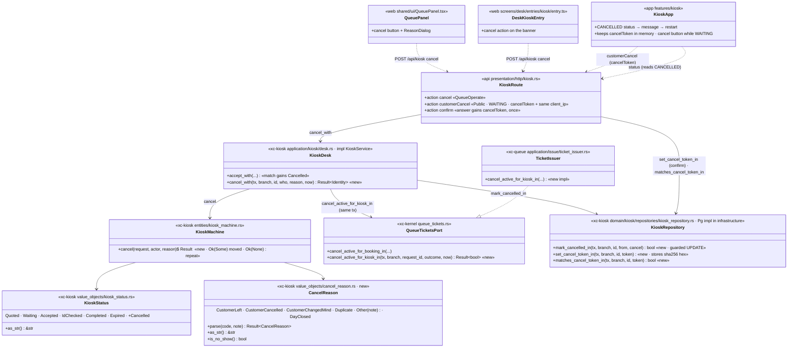

# Kiosk request cancel: staff (or the customer) cancel a kiosk queue booking

> designed-by: claude/e92db6 (FE lane controller) · measured on `main` `8fb176eb`; revised after review on `main` `b26fd986` (every file:line below)
> amended by claude/studio-claude-10 (AG controller KC) on `main` `f22f02f4`: the owner's day-close ruling (KC-5, `DAY_CLOSED`), and the server shapes and file lists measured while cutting KC-M/D/Q/S (§3.3, §3.4, §5)

## 0. Decided (owner, 2026-10-21)

| # | Rule | Owner's words |
|---|---|---|
| KC-1 | The kiosk is where a customer keys in a queue booking. A kiosk request reserves a queue place, **never a rate**. The desk prices it at the current published line (that half is #4113). | *"kiosk คือ ลูกค้า คีย์ จองคิว นะ"* · *"การจอง มันแค่ได้ คิว"* · *"ต้องใช้ ราคา ปัจจุบัน"* |
| KC-2 | **Staff** cancel a kiosk request, and a **reason is required**. | *"พนักงานยกเลิกได้ ใส่เหตุผลด้วย"* |
| KC-2a | The **customer may** cancel their own request at the kiosk, or may simply walk away. Both must work. | *"ลูกค้า อาจยกเลิก เอง หรือไม่ก็ได้"* |
| KC-2b | The **cashier (desk) screen** must have a cancel too, not only the kiosk queue panel. | *"แต่ หน้า แคชเชียร์ ต้องมี ที่ยกเลิก ด้วย"* |
| KC-3 | The case to serve: a customer keys in a queue at the kiosk and walks away without doing the exchange. | *"เพราะ บางที ลูกค้า อาจไม่ ทำรายการเดินหนีไป"* |
| KC-4 | The migration this needs is approved. | *"อนุมัติ migration ทำเลย"* |
| KC-5 | A kiosk-linked ticket still waiting at **day close** is a cancellation **with a reason**, recorded like a staff cancel (`CANCELLED`, stored reason, `KIOSK_CANCELLED` line), never `NO_SHOW`/`CUSTOMER_LEFT`. Relayed by claude/553782 on #4136, owner 2026-10-21 ~03:52Z. | *"เป็นรายการ ยกเลิก พร้อม เหตุผลไง"* |

## 1. What is missing today (measured)

- `KioskStatus` has `Quoted, Waiting, Accepted, IdChecked, Completed, Expired` (`api/crates/xc-kiosk/src/domain/kiosk/value_objects/kiosk_status.rs:2-9`). `EXPIRED` is only computed when the row is read.
- The stored status is checked by `CHECK (status IN ('QUOTED','WAITING','ACCEPTED','ID_CHECKED','COMPLETED'))` and `CHECK (staff IS NOT NULL OR status IN ('QUOTED','WAITING'))` (`api/migrations/20261007170000_kiosk.sql:7-8,24`). No cancel state exists anywhere. `docs/design/xchange-v3.md:83` says so: *"no way back, nothing cancels a request"*.
- Confirm issues a walk-in queue ticket in the same transaction (`api/crates/xc-kiosk/src/application/kiosk/customer.rs:276-290`). The ticket is linked by `queue_tickets.kiosk_request_id`, unique per branch (`api/migrations/20261101100000_queue.sql:17,25-26`).
- A request whose customer left stays `WAITING` (or `ACCEPTED`) forever, and so does its ticket. Call-next serves WAITING tickets branch-wide, from any day (`api/crates/xc-queue/src/infrastructure/repository.rs:355-364`), so the counter keeps calling a customer who is gone.
- Only a `QUOTED` row older than 10 min is purged, and only by the next quote at the same branch (`kiosk_machine.rs:388-391`, `customer.rs:141-145`). It has no ticket.
- Cancelling the ticket alone through the queue route leaves the request `WAITING`. Accept is then refused (`StaleVersion`), so the row is stuck (`ticket_issuer.rs:89-129`).

## 2. Behaviour

| From (request) | Who may cancel | Request becomes | Linked ticket | Audit |
|---|---|---|---|---|
| `QUOTED` | nobody (not listed to staff; it already ages out, and has no ticket) | — refused `NotCancellable` | — | — |
| `WAITING` | staff with `QueueOperate` at the branch; **or the customer at the kiosk** (§3.4, reason set to `CUSTOMER_CANCELLED` automatically) | `CANCELLED` | `WAITING`/`CALLED` → `NO_SHOW` when the reason is `CUSTOMER_LEFT`, else `CANCELLED` with the reason | `KIOSK_CANCELLED` |
| `ACCEPTED`, `ID_CHECKED` | the teller holding it, or a `BRANCH_MANAGER` (as `check_ticket_owner`) | `CANCELLED` | `SERVING` → `CANCELLED` with the reason (§3.2) | `KIOSK_CANCELLED` |
| `COMPLETED` | nobody: a finished exchange is undone by a **reversal**, never a cancel | — refused `NotCancellable` | — | — |
| `CANCELLED` | anyone allowed above | unchanged, no event (repeat-safe) | unchanged | none |

**Reason** (required). A code from a fixed list, plus free text:

| Code | Thai label | Text |
|---|---|---|
| `CUSTOMER_LEFT` | ลูกค้าไม่อยู่ / เดินออกไปแล้ว | optional |
| `CUSTOMER_CANCELLED` | ลูกค้ายกเลิกเองที่ตู้ | — (set only by the kiosk's own cancel; not offered to staff) |
| `DAY_CLOSED` | ปิดวันทำการ | — (set only by the day-close path, §3.7; not offered to staff) |
| `CUSTOMER_CHANGED_MIND` | ลูกค้าเปลี่ยนใจ | optional |
| `DUPLICATE` | คำขอซ้ำ | optional |
| `OTHER` | อื่น ๆ | **required**, 1–200 chars |

The default selection is `CUSTOMER_LEFT` (KC-3). An empty reason, an unknown code (`CUSTOMER_CANCELLED` and `DAY_CLOSED` count as unknown when staff send them), or `OTHER` with no text is refused, and the refusal names the field (§3.4 lists the sentences).

## 3. Design

### 3.1 State and data

- `KioskStatus::Cancelled`, `as_str` `"CANCELLED"`, parsed in `status_from` (`infrastructure/kiosk/kiosk_repository.rs:145-156`). `CANCELLED` is stored, unlike `EXPIRED`.
- **Migration** (KC-4), one file, the next slot from `scripts/migration-slot.sh next`. The four data-migration items:
  1. **Schema.**
     - Both CHECKs being replaced are **unnamed** in `20261007170000_kiosk.sql:7-8,24`, and no later migration renames them. Their generated names, measured by applying that `CREATE TABLE` to a scratch database and running `SELECT conname, pg_get_constraintdef(oid) FROM pg_constraint WHERE conrelid = 'kiosk_requests'::regclass AND contype = 'c'`:
       - `kiosk_requests_status_check`: the status list;
       - `kiosk_requests_check1`: `staff IS NOT NULL OR status IN ('QUOTED','WAITING')`. `kiosk_requests_check` is the submission/document pair, and it is left alone.
     - The migration drops those two names (`DROP CONSTRAINT`, no `IF EXISTS`, so a name that differs fails loudly) and adds named replacements:
       - `kiosk_requests_status_check`: `status IN ('QUOTED','WAITING','ACCEPTED','ID_CHECKED','COMPLETED','CANCELLED')`;
       - `kiosk_requests_staff_check`: `staff IS NOT NULL OR status IN ('QUOTED','WAITING','CANCELLED')`. A request cancelled from `WAITING` has no holder; `staff` keeps meaning "who held it", never "who cancelled".
     - New nullable columns:
       - `cancelled_at timestamptz`;
       - `cancelled_by text`;
       - `cancel_reason text`, with the named CHECK `kiosk_requests_cancel_reason_check`: `cancel_reason IN ('CUSTOMER_LEFT','CUSTOMER_CANCELLED','CUSTOMER_CHANGED_MIND','DUPLICATE','OTHER','DAY_CLOSED')`;
       - `cancel_note text`;
       - `cancel_token_hash text`, the customer's cancel token (§3.4). It is the hex SHA-256 of the token, written at confirm, and never read back to any client.
     - `kiosk_requests_cancelled_check`: `(status = 'CANCELLED') = (cancelled_at IS NOT NULL AND cancelled_by IS NOT NULL AND cancel_reason IS NOT NULL)`.
     - `kiosk_requests_cancel_note_check`: `cancel_reason IS DISTINCT FROM 'OTHER' OR (cancel_note IS NOT NULL AND length(btrim(cancel_note)) BETWEEN 1 AND 200)`. The `IS NOT NULL` is needed: without it, `OTHER` with a NULL note makes the expression NULL, and a NULL CHECK passes.
  2. **Backfill:** none. No row is cancelled today, and requests confirmed before the deploy have no token, so the customer can't cancel those at the kiosk. Staff still can.
  3. **Deploy order.**
     - The file runs at boot with the binary that carries KC-S (`sqlx::migrate!`), so schema and code arrive together.
     - An **older binary on the new schema works**: it never writes `CANCELLED` or the new columns, and both CHECKs only widen.
     - It breaks only once a row is `CANCELLED`: an old binary's `status_from` has no arm for it, so reading that row errors.
     - So a binary rollback after the first cancel must run the down step's data part first.
  4. **Down** (a commented `-- down:` block, as `20261010100000_rate_units.sql:60` does). It is **lossy**:
     - it refuses (`RAISE EXCEPTION`) while any row is `CANCELLED`, because no older state means "cancelled". Such rows are settled by hand first, an owner decision at that time;
     - it then drops the five columns and the three new CHECKs, and restores the two original CHECKs under their old names;
     - it loses every cancel record (when, who, reason, note) and every cancel token. A customer waiting at the kiosk then can't cancel there.
- `CancelReason` value object in `xc-kiosk` (the six codes; `parse`/`as_str`; `OTHER` requires a note; `CUSTOMER_CANCELLED` and `DAY_CLOSED` are refused when a staff member sends them, and only their own paths build them). `cancelled_by` is the username, or `CUSTOMER-KIOSK` (the actor the kiosk's audit lines already use, `audit_line.rs:7`).

### 3.2 Queue ticket

- A new port method next to the booking one (`api/crates/xc-kernel/src/queue_tickets.rs:59-67`): `cancel_active_for_kiosk_in(tx, branch, request_id, outcome, now)`, where `outcome` is `NoShow` or `Cancelled { reason }`.
  - It is implemented in `xc-queue` `ticket_issuer.rs` **the way `cancel_active_for_booking_in` (:311-356) is**: find the active ticket in the caller's transaction, then one **guarded `UPDATE` per outcome**, then one `QueueEvent`, then `status.refresh_in`. All of it runs in the **caller's** transaction.

  | Ticket now | Outcome | `UPDATE … WHERE id = $1 AND status IN (…)` | Event kind |
  |---|---|---|---|
  | `WAITING`, `CALLED` | `NoShow` | `status = 'NO_SHOW', ended_reason = 'kioskCancelled:CUSTOMER_LEFT'`, guard `('WAITING','CALLED')` | `SKIP` |
  | `WAITING`, `CALLED` | `Cancelled` | `status = 'CANCELLED', ended_reason = 'kioskCancelled:<code>'`, guard `('WAITING','CALLED')` | `CANCEL` |
  | `SERVING` | either | `status = 'CANCELLED', ended_reason = 'kioskCancelled:<code>'`, guard `('SERVING')`. `NO_SHOW` means "never came to the counter", which is false once served | `CANCEL` |
  | `COMPLETED`, `CANCELLED`, `NO_SHOW`, or no ticket | — | nothing written | — |

  - `0` rows affected (a race) ⇒ `Ok(false)` and no event, as the booking port does.
  - Event kinds are limited to `ISSUE, CALL, RECALL, START, FINISH, SKIP, CANCEL` (`20261101100000_queue.sql:37`), so `NO_SHOW` is recorded as `SKIP` (as `queue_ticket.rs:111` does) and `CANCELLED` as `CANCEL`.
  - The event's actor is the issuer's actor (`self.actor`), as the booking port has it. The route builds the issuer for the cancelling user.
- **`QueueTicket::apply` is unchanged.** It has no production caller (`git grep '\.apply(' -- api/crates/xc-queue/src api/src` hits only its definition, `queue_ticket.rs:101`), and both existing cancel paths write their own guarded SQL: `QueueDesk::cancel_in` and the booking port. Adding arms would document transitions that nothing applies.
  - `ticketCancel` (`v3/commands/queue.rs:361-397`) keeps refusing `SERVING` through `QueueDesk::cancel_in`'s own `WAITING`/`CALLED` guard.
  - The `SERVING → CANCELLED` and `WAITING → NO_SHOW` moves exist only in this port's `UPDATE`s.

### 3.3 Domain transition and service

- `KioskMachine::cancel(request: Option<&KioskRequest>, actor: &KioskActor, reason: &CancelReason) -> Result<Option<KioskRequest>, KioskError>` follows §2's table. `KioskMachine` is a unit struct of associated functions (`kiosk_machine.rs:20-21`), like `next`.
  - `Some(request)` is the request moved to `CANCELLED`. `staff` is unchanged.
  - `None` means it was already `CANCELLED`: a repeat, nothing to write.
  - `RequestNotFound` when there is no request.
  - `NotCancellable` for `QUOTED`, `EXPIRED` and `COMPLETED`; for the customer outside `WAITING`; for a staff actor sending `CUSTOMER_CANCELLED`; for the customer sending any reason but `CUSTOMER_CANCELLED`; and for `DAY_CLOSED` outside `WAITING`.
  - `NotYourRequest` for an `ACCEPTED`/`ID_CHECKED` request held by another teller when the caller's `KioskRole` is not `Manager`.
- **The audit line** is `AuditLine { actor, subject: id, what: KioskAudit::Cancelled { from, reason } }`, built in `cancel_with`. Its `kind()` is `"KIOSK_CANCELLED"`, and `detail_of` (`api/src/infrastructure/kiosk/kiosk_ports.rs:75-91`) writes `{from, reason, note}`.
  - It does not go through `line_for` (`service.rs:63-89`). `line_for` builds a line from `(event, request)`, but a cancel's line needs the status it left and the reason, which `KioskRequest` does not hold. That is also why `cancel` answers an `Option`, not a `Transition`, and why `KioskEventKind` gains no variant.
  - `KioskAudit::CurrencyConfigured` already works this way: it has no `KioskEventKind` and is built directly (`currencies.rs:49`, `audit_line.rs:40`).
- **Persistence** is a new `KioskRepository` method (`domain/kiosk/repositories/kiosk_repository.rs`, beside `mark_started_in`/`mark_completed_in`) with its Pg impl (`infrastructure/kiosk/kiosk_repository.rs`):
  - `mark_cancelled_in(tx, branch, id, from: KioskStatus, cancel: &Cancellation) -> AppResult<bool>`, where `Cancellation { at: DateTime<Utc>, by: String, reason: CancelReason }` lives in `cancel_reason.rs`;
  - one `UPDATE kiosk_requests SET status = 'CANCELLED', cancelled_at, cancelled_by, cancel_reason, cancel_note WHERE branch_id = $1 AND id = $2 AND status = $from`;
  - `0` rows ⇒ `Ok(false)`, and `cancel_with` refuses `KioskError::StaleVersion` (the kiosk has no stale-version error today).
  - `update_in` is untouched.
  - **`KioskRequest` gains no fields**: nothing in this design reads the cancel columns back (views answer `identity`, which is the status), so struct literals across the five test files stay as they are.
  - There are **no repository fakes** to update: `git grep 'impl .*KioskRepository' -- api` finds only `PgKioskRepository`.
- `set_cancel_token_in(tx, branch, id, token: &str)` on the same trait stores `encode(sha256(convert_to($token, 'UTF8')), 'hex')` (not `$token::bytea`, which reads backslash escapes and would error on a client-sent token with a `\`, a 500 instead of the same refused answer), and `matches_cancel_token_in(tx, branch, id, token) -> bool` compares that hash in SQL. Both are KC-D's.
- `cancel_with` in `application/kiosk/desk.rs`, in **one** transaction. The desk's methods are `impl KioskService` blocks (`desk.rs:1-2`); "KioskDesk" in §4 names that file, not a type.
  - load the request with `find_in` → `KioskMachine::cancel` → `mark_cancelled_in` guarded on the status it read (that guard is the lock: a second writer gets `Ok(false)`) → `cancel_active_for_kiosk_in` → the audit line;
  - it sits next to `accept_with`;
  - `accept_with`'s exhaustive match (`desk.rs:164-207`) gains `Cancelled ⇒ AcceptOutcome::Unavailable`. It is KC-D's, because adding the status breaks that match.

### 3.4 API and policy

- `POST /api/kiosk {action: "cancel", payload: {id, branchId, reason, note?}}`, the same entry as `accept` and `identityChecked` (`api/src/presentation/http/kiosk.rs:329-344`).
- Policy row `cancel ⇒ QueueOperate` (`api/crates/xc-auth/src/domain/policy/entities/policy.rs:123-131`), with a row in `xc-auth/tests/policy_kiosk_test.rs`.
- **The customer's cancel** (KC-2a) is `POST /api/kiosk {action: "customerCancel", payload: {id, branchId, cancelToken}}`. It is a **Public** row, like `status`/`confirm` (policy.rs:124).
  - **The token is what binds the cancel to the kiosk that confirmed the request.**
    - The request id is on screen (`ORD-<id>`, `kiosk_machine.rs:265`).
    - `client_ip` is the proxy's `X-Real-IP`, written once at **quote** insert (`customer.rs:154`).
    - So an IP check alone would let any device behind the branch's NAT address cancel another customer's request by posting the id: a second kiosk, or a phone on the shop Wi-Fi.
  - **Issuing the token.** On the `confirm` that moves a request to `WAITING`, the route mints a random token (`uuid::Uuid::new_v4()`, 122 random bits) and passes it into the confirm transaction.
    - `set_cancel_token_in` stores only its hash.
    - The token is returned **only in that confirm answer**, as `cancelToken`.
    - It is never shown on screen, and never in `status`, `customerReceipt` or any staff view.
    - A repeated confirm (no event) returns no token.
    - If that first answer is lost, the customer can't cancel at the kiosk and walks away instead, which KC-2a allows. Staff cancel it.
  - **Refusals, all with the same refused answer so nothing leaks:**
    - token missing;
    - hash mismatch;
    - a request that is not `WAITING`.
  - **The IP check stays as a second guard:** the caller's IP must equal the stored `client_ip`, the address that quoted.
  - It is rate-limited like `quote`.
  - The reason is `CUSTOMER_CANCELLED`, and the linked ticket becomes `CANCELLED`, not `NO_SHOW`, because the customer is present.
- **Wire shape** (FE tickets cite these). `/api/kiosk` answers are hand-built `V2Json` in `api/src/presentation/dto/kiosk.rs`. They are **not** ts-rs types, so nothing is generated under `web/src/shared/api/generated/`.
  - `cancel` and `customerCancel` answer `dto_kiosk::identity_json` (`dto/kiosk.rs:203-216`): `{"id", "queue", "orderNo", "transactionNo", "status": "CANCELLED"}`. A repeat answers the same.
  - `confirm` answers the new `dto_kiosk::confirm_json(identity, cancel_token: Option<&str>)`: the same five keys plus `"cancelToken": "<uuid v4>"`, present **only** on the confirm that moved the request to `WAITING`. A repeated confirm has no `cancelToken` key at all, not a `null` one.
  - Refusals are `400 {"error": "<sentence>"}` (`refuse`, `extractors/actor.rs:56-58`). The sentences are `KioskError` and `CancelReasonError`:

  | Variant | Sentence | When |
  |---|---|---|
  | `CancelReasonError::ReasonRequired` | `กรุณาเลือกเหตุผลการยกเลิก (reason)` | `reason` missing or empty |
  | `CancelReasonError::ReasonUnknown` | `เหตุผลการยกเลิกไม่ถูกต้อง (reason)` | not a staff code |
  | `CancelReasonError::NoteRequired` | `กรุณาระบุรายละเอียดเหตุผล (note)` | `OTHER` with no text |
  | `CancelReasonError::NoteTooLong` | `รายละเอียดเหตุผลต้องไม่เกิน 200 ตัวอักษร (note)` | note over 200 characters, any code |
  | `KioskError::NotCancellable` | `คำขอนี้ยกเลิกไม่ได้` | §2's refused rows |
  | `KioskError::NotYourRequest` | `คำขอนี้มีพนักงานคนอื่นรับเรื่องอยู่` | another teller holds it |
  | `KioskError::StaleVersion` | `คำขอนี้เปลี่ยนสถานะแล้ว กรุณาโหลดล่าสุด` | it moved while being cancelled |
  | `KioskError::KioskCancelled` | `คำขอนี้ถูกยกเลิกแล้ว` | the desk `get` of a cancelled request |
  | `KioskError::CustomerCancelRefused` | `ยกเลิกคิวที่ตู้ไม่ได้ กรุณาติดต่อพนักงาน` | every `customerCancel` refusal (missing or wrong token, other address, not `WAITING`, unknown id) |

  - The note is trimmed, and an empty note is none.
- Views:
  - `kiosk_queue` (`api/src/presentation/http/v3/views/kiosk_queue.rs:61-65`) does **not** list cancelled requests; they leave the panel. That needs no change: it reads only the `Waiting`/`Working`/`Completed` filters, and none of them names `CANCELLED`;
  - the v2 `list` action's `All` filter is "every status but QUOTED" (`kiosk_repository.rs:99-108`), so it lists `CANCELLED` too, and `queue_statuses(All)` gains it;
  - `status` and `customerReceipt` pass `CANCELLED` through `identity`, as they do every other status;
  - the desk `get` on a cancelled request refuses `KioskCancelled`, which the desk words. `get` (`desk.rs:270-279`) already refuses through `KioskMachine::check_get`, so the new arm goes there (KC-D, `kiosk_machine.rs`); `get` itself is unchanged.

### 3.5 Staff UI (`/kiosk-queue.html`, `web/src/shared/ui/QueuePanel.tsx`)

- On every `waiting` and `working` row: a **ยกเลิก** button (`[data-action="cancel-request"]`) opens a reason dialog. Reuse `web/src/screens/staff/parts/ReasonDialog.tsx`, extended with a code select whose default is `CUSTOMER_LEFT`, plus the free-text box. `OTHER` requires text before confirm.
- On success the row leaves the panel. On a refusal the server's worded message shows in the row.
- **The cashier screen** (KC-2b). On the desk with a kiosk request open (`/desk?branch=…&kiosk=<id>`, `web/src/screens/desk/entries/kiosk/entry.ts`), the kiosk banner gets a **ยกเลิกคำขอ** action with the same reason dialog. It is available until the save completes. On success the desk clears the entry and returns to an empty desk, the same as the existing clear (`desk-store.ts:448`).
- The desk `?kiosk=` entry words `KioskCancelled` ("คำขอนี้ถูกยกเลิกแล้ว") when it opens a request that is already cancelled.

### 3.6 Kiosk app (`app/lib/features/kiosk/`)

- `KioskStatus.parse` learns `CANCELLED` (`domain/entities/kiosk_models.dart:17-30`). It gets the highest `_statusRank`, so `_nextStatus` accepts it (`presentation/controllers/kiosk_controller.dart:558-572`).
- The waiting page shows *"คำขอของคุณถูกยกเลิก กรุณาติดต่อพนักงาน"*. The kiosk then returns to the start screen after 10 s, like COMPLETED's restart (`:641-648`). Poll and idle timers stop on it.
- **A cancel button on the waiting page** (KC-2a): **ยกเลิกคิว**, with one confirm ("ยืนยันยกเลิกคิวนี้?"). It calls `customerCancel` and then shows the same cancelled message. It shows only while the request is `WAITING`; once staff accept it, the button goes.

### 3.7 Not in this design (follow-ups, each its own ticket later)

- A staff `ticketCancel` / skip on a kiosk-linked ticket should also cancel the request. Today it leaves it stuck (§1 last bullet). This needs a queue → kiosk hook, so it comes after this lands.
- Day close cancelling leftovers. `QueueDayHook::on_day_closed` (`xc-queue/src/application/day/queue_day_hook.rs:44-146`) has no production caller, and it notifies bookings only. The day closes on the last CLOSE-count verify (`count_service.rs:1252-1261` → `ShiftService::close_on_verified`). The handover path calls the same function (`handover_service.rs:586`), so the trigger can't simply be "0 open shifts". Once that is wired, it calls this design's `cancel_with` path for a kiosk-linked ticket whose request is still `WAITING`, with reason **`DAY_CLOSED`** (KC-5):
  - the request becomes `CANCELLED` with `cancel_reason = 'DAY_CLOSED'` and a `KIOSK_CANCELLED` line, exactly as a staff cancel is recorded;
  - its ticket becomes `CANCELLED` with `ended_reason = 'kioskCancelled:DAY_CLOSED'` and a `CANCEL` event, never `NO_SHOW` (`is_no_show` is true only for `CUSTOMER_LEFT`). This matches `queue-tickets.md` Q8, which already says `CANCELLED` at day close;
  - `cancelled_by` and the line's actor are the user whose action closed the day;
  - the code is in this design's migration (§3.1), so the follow-up needs no second migration. The follow-up itself is #4147's.
- F13 (the kiosk journey in `qa/e2e`) is cut once this and #4113 merge; its cleanup step is this cancel.

## 4. Class diagram

## 5. Tickets → files (disjoint; Gemini workers; released in the order shown)

| # | Ticket | Files | Class | After |
|---|---|---|---|---|
| KC-M | migration (§3.1) | `api/migrations/<slot>_kiosk_cancel.sql` | guarded | — |
| KC-D | domain + persistence: `Cancelled`, `CancelReason`, `Cancellation`, `KioskMachine::cancel`, the errors, `KioskAudit::Cancelled`, and the three repository methods (§3.3) | `kiosk_status.rs` · `cancel_reason.rs` (new) · `value_objects/mod.rs` · `kiosk_machine.rs` · `kiosk_error.rs` · `audit_line.rs` · `application/kiosk/desk.rs::accept_with` (the new match arm) · `api/src/infrastructure/kiosk/kiosk_ports.rs::detail_of` · `domain/kiosk/repositories/kiosk_repository.rs::{mark_cancelled_in, set_cancel_token_in, matches_cancel_token_in}` · `infrastructure/kiosk/kiosk_repository.rs::{status_from, queue_statuses, mark_cancelled_in, set_cancel_token_in, matches_cancel_token_in}` (`queue_statuses(All)` gains `CANCELLED`, §3.4; `queue_predicate(All)` is `status <> 'QUOTED'` and needs no change) (the Pg impl; no fakes exist) · `tests/kiosk_cancel_repository_test.rs` (new, `_test` DB) · `tests/kiosk_cancel_machine_test.rs` (new) · the two name-list tests (`kiosk_machine_test.rs:1123`, `kiosk_repository.rs` `ALL_DB_STATUSES`) | logic | KC-M |
| KC-Q | queue port + impl (guarded `UPDATE`s, `SKIP`/`CANCEL` events; `apply` unchanged) | `xc-kernel/src/queue_tickets.rs` · `xc-queue/src/application/issue/ticket_issuer.rs` · `xc-queue/tests/kiosk_ticket_cancel_test.rs` (new) · the port's fakes | logic | — |
| KC-S | service + routes (`cancel`, `customerCancel`, `confirm`'s token) + policy | `xc-kiosk/src/application/kiosk/desk.rs::cancel_with` · `xc-kiosk/src/application/kiosk/customer.rs` (confirm stores the token; `customer_cancel`) · `xc-kiosk/src/domain/kiosk/value_objects/kiosk_action.rs` (`Cancel`, `CustomerCancel`; the route's matches are exhaustive) · `api/src/presentation/http/kiosk.rs` · `api/src/presentation/dto/kiosk.rs` (`confirm_json`) · `xc-auth/.../policy.rs` · `xc-auth/tests/policy_kiosk_test.rs` · `api/tests/kiosk_cancel_route_test.rs` (new). `kiosk_queue.rs` needs no change (§3.4) | logic | KC-D, KC-Q |
| KC-W | kiosk queue panel cancel | `web/src/shared/ui/QueuePanel.tsx` · `web/src/screens/staff/parts/ReasonDialog.tsx` · the panel's i18n · new `QueuePanel.cancel.test.tsx` | logic | KC-S |
| KC-C | cashier (desk) cancel + wording | `web/src/screens/desk/entries/kiosk/entry.ts` · `web/src/screens/desk/entries/kiosk/i18n.ts` · the desk banner that renders an entry's actions · new `entries/kiosk/cancel.test.tsx` | logic | KC-S, KC-W (reuses its dialog) |
| KC-A | kiosk app: cancelled status + the customer's cancel button (sends the `cancelToken` kept from confirm) | `kiosk_models.dart` · `kiosk_controller.dart` · `waiting_page.dart` · `kiosk_api.dart` · the kiosk l10n · new `app/test/features/kiosk/kiosk_cancelled_test.dart` | logic | KC-S |

Each ticket's up-front tests come from §2's table. The ticket author writes them before release (🧪).
