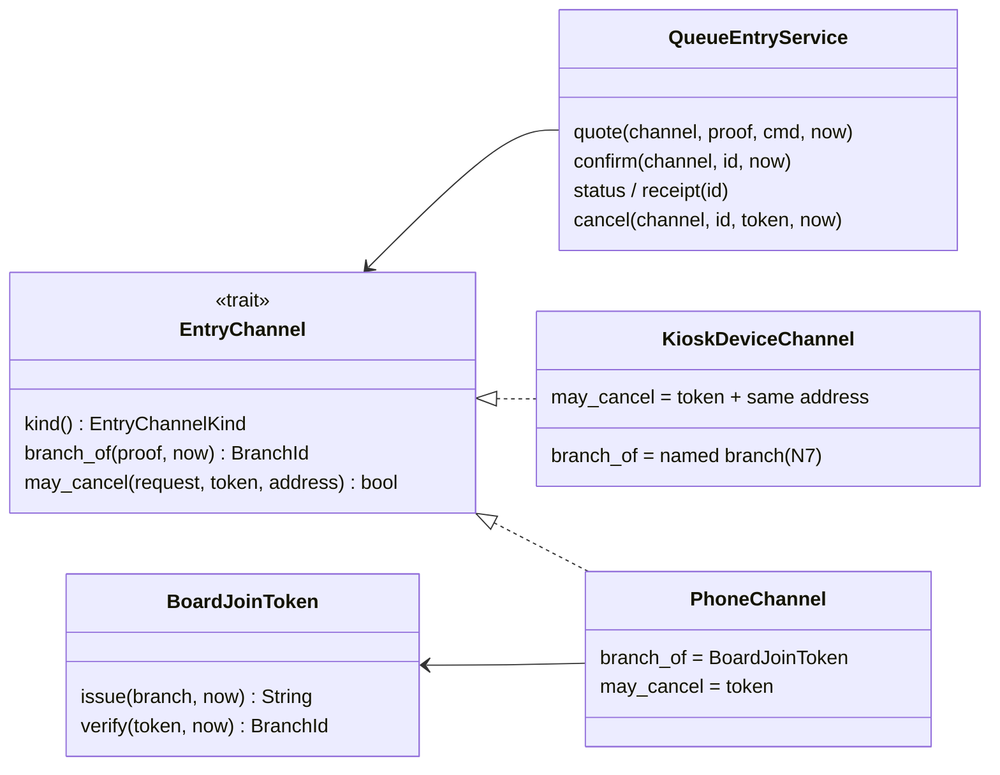

# Kiosk: one customer at a time, a branch kiosk settings page, and a verified phone number

> designed-by: claude/e92db6 (XC FE lane controller), with the BE lane (claude/553782) to complete §4's server half before
> any ticket is cut · measured on `main` `ced3a2d6` · builds on `kiosk-cancel.md` (KC-1..KC-5) and
> `customer-identity-consent.md` (phone-first customers, `PhoneVerificationService`)

## 0. Decided (owner, 2026-10-21)

| # | Rule | Owner's words |
|---|---|---|
| KS-1 | A kiosk is **shared**: it serves **one customer at a time**, and starts over when that customer is done. A request someone leaves half-done must not stay on screen for the next person. | *"ระบบ kiosk มัน จะเริ่มใหม่ เมื่อ ทำจบ"* · *"แต่ มันใช้ ร่วมกัน"* · *"ถ้าอีกคนทำค้างไว้"* · *"กรณี ใข้ รวมกัน หลาย คน"* · *"มัน ควรทำที่ละคน ในเครื่อง นั้น"* |
| KS-2 | The customer's cancel at the kiosk is **one press**. The customer never types a code. | *"ต้องมาใส่ รหัส มันไม่รู้รหัส อะดิ"* · *"มันควร กดยกเลิกได้ เลย"* |
| KS-3 | How long the queue-number screen stays is **configurable**, on a **per-branch kiosk settings page in admin**. | *"ให้ตั้งค่าได้เอง"* · *"ควรมีหน้า คอนฟิก สำหรับ kiosk"* (chose "the admin page, per branch") |
| KS-4 | To book a queue at the kiosk the customer **must enter a phone number**, used to tell who is who, **verified by an SMS OTP** so a mistyped number is caught. | *"ลูกค้า มาควร มีการใส่ เบอร์ โทร เพื่อ จองคิว"* · chose "required" · *"ใช้ในการแยกแยะ ว่าใครเป็นใคร"* · *"ส่ง sms เพื่อ ยืนยัน ตัว ตน"* · *"ควร มี otpเพื่อกัน การ ใส่เบอร์ ผิด"* |
| KS-4a | **Login first, always.** The phone + OTP login comes **before** the first exchange screen (currency/amount), on the kiosk and on the phone (KS-7). No anonymous path exists, and **no switch bypasses it**. So the Identity → Notify SMS setup (§6 Q2) is a **prerequisite of shipping this**: until it is done, the feature waits, and nothing runs without login. | *"ใช้ otp"* · *"มันต้อง ผ่าน login ก่อน มาหน้านี้"* (shown the reference kiosk's step 1) |
| KS-4b | **The OTP works the way 108heros does it:** the code is sent and checked by the central **Identity** platform (`POST {identity}/auth/otp/request {destination, channel: "sms"}`, then verify; `108-Plaza/108heros-flutter` `lib/features/auth/infrastructure/data_sources/identity_otp_api.dart:17-29`). Identity sends the SMS through the 108 Plaza Notify. | *"เหมือน 108 heros"* |
| KS-6 | The customer gets a **queue ticket** from booking. **How it is delivered is a branch setting** on the kiosk settings page (KS-3), with three choices: **print + SMS**, **print only**, or **SMS only**. **The default is SMS only** (*"ให้default ที่ sms ก่อน"* · *"เพราะเครื่องพิพม์ ยัง ไม่แน่ชัด"*: the kiosk printer is not settled yet, so printing is built only once a printer is chosen). The printed slip carries the queue number, the time and the currency. The SMS carries the queue number and a link to see the status and cancel. | *"น่าจะมี บัตร คิว"* · *"ที่ได้ จาก การจองคิว"* · *"ให้ คอนฟิก ได้ ว่า จะใช้ แบบ ไหน ตามตัวเลือกที่เสนอมา"* |
| KS-4c | **Taking a queue at the kiosk is a normal customer login.** Phone + OTP signs the customer in exactly as the customer sign-in does (Identity OTP, KS-4b). The request belongs to that signed-in customer: found by phone, or created as a new customer. On a shared kiosk the session **ends at the kiosk's reset** (KS-1), so the next person starts signed out. | *"การ ใช้ คิว ก็เหมือนการ login ปกติ"* · *"เพื่อให้สามารถ แยกแยะ orders ได้ จำเป็นต้องใข้ เบอร์ โทรใน login"*: the phone number is the login, so every order can be told apart by its customer |
| KS-7 | **The rate board's QR joins the queue now, on the customer's own phone.** Scanning opens the same queue flow as the kiosk, on the phone: sign in by phone + OTP (KS-4c), choose currency and amount, get a walk-in queue number, and be called by SMS or the ticket page. It opens **the customer web pages** (`/app/…`, owner: *"มันจะไปหน้่าลูกค้า ใช่ไหม"* — yes): a new customer page, e.g. `/app/queue?branch=<code>`, behind the existing customer sign-in (`/app/sign-in`, phone + OTP). After joining, the customer sees the queue among their own pages. It replaces the board QR's current target, `/app/book` (`web/src/screens/customer/rate-display/BookingQr.tsx:16`, `rate-display.md` D9a). Booking a time stays in the app. On a personal phone the session does not have to end at once, but every request still belongs to one signed-in customer. | Shown a reference board (`rate.xc-th.work`, *Scan to join the queue · Get called on your phone*), the owner asked *"สแกน QR Code จองคิวได้ไหม"* · *"มันแยก แยะได้ได้ไหม"*, then chose "join the queue now on the phone" · *"มันต้องต้อง แยก แยะ ใครเป็นใครได้นะ"* |
| KS-5 | The system calls the queue in order, and **a calling display shows it, like a bank's**: a public screen at the branch with the number being called and the counter it goes to. Call order stays today's rule (BOOKING before WALK_IN, then the lowest number, `xc-queue/src/infrastructure/repository.rs:355-364`). | *"ระบบ ป็นคนเรียก คิว ที่รัน ตาม คิวการจอง"* · *"มีหน้า จอ เรียก เหมือน ธนาคาร"* · *"ว่า คิวไหน จะเข้าใช้บริการ"* |

## 1. What exists today (measured)

- **The kiosk never lets go of a finished customer.**
  - `KioskController._onIdle` (`app/lib/features/kiosk/presentation/controllers/kiosk_controller.dart:396-400`) exempts the waiting and receipt screens from the 2-minute idle reset (`idle_timer.dart:5`).
  - The only other reset is 30 s after `COMPLETED` (`:641-646`).
  - So a request stays on screen until staff finish it, and KC-A's cancel button (#4208) sits on that screen. **#4243** fixes this (KS-1, KS-2) with a 30-second constant.
- **Kiosk settings:** `/kiosk-currencies.html` (admin, per branch) holds the currency switches only (`kiosk_currencies`, `api/migrations/20261007170000_kiosk.sql:32-37`). There is no row for timings.
- **Phone on a kiosk request:** none. `kiosk_requests` has no phone or customer column (`20261007170000_kiosk.sql:4-24`).
- **Phone OTP today:**
  - `PhoneVerificationService` (`api/crates/xc-customer/src/application/customer/phone_verification_service.rs`) sends an SMS code through `SmsSender`. Its rate limits are in `PhoneOtpPolicy`.
  - It is **staff-initiated, for an existing customer**: `phone_verifications.customer_id` and `requested_by` (a user) are `NOT NULL` (`api/migrations/20261205141000_phone_verifications.sql`).
  - The phone is stored **encrypted**, with a lookup hash (`phone_encrypted`, `phone_lookup_hash`).
  - A kiosk customer is anonymous, with no user and maybe no customer yet, so this service cannot be called as it is.
- **SMS on the test host: none today.** claude/553782 measured it at ~07:25Z by grepping key names only.
  - xc-v3's `NotifySmsSender` (`api/src/infrastructure/notify/notify_sms_sender.rs`) needs `NOTIFY_BASE_URL` and `NOTIFY_API_KEY`, and neither is in `/etc/xc-v3/env` or `/etc/xc-v3/*.env`. So every send answers `smsUnavailable`.
  - Identity's OTP is `AUTH_OTP_DELIVERY_MODE=noop`.
  - `deploy/HOST-do-sgp1.md` I-3 leaves the sender choice to the owner.
  - **A required SMS OTP would therefore block every kiosk booking until a sender is set.**

## 2. Behaviour

**Kiosk flow (KS-1, KS-2, KS-4):** start → currency and amount → **phone** → **OTP** → review → confirm → **queue number + ยกเลิกคิว + เสร็จ** for *N* seconds → start.

| Step | Rule |
|---|---|
| phone | Required. Normalised and validated as the server does for customers. A wrong shape is refused on the screen. |
| OTP | An SMS code to that number. The confirm is refused until the code is verified. The rate limits are the customer OTP's (`PhoneOtpPolicy`), per phone and per kiosk address. A resend is allowed after the policy's wait. Idle on this screen resets the kiosk (KS-1). |
| confirm | The request carries the **verified customer**: an existing customer found by phone (lookup hash), or a new customer with a verified PHONE identity. The kiosk never shows any customer data back. |
| done screen | *N* = the branch's `resultSeconds` (KS-3), default 30. ยกเลิกคิว is one press (`customerCancel` with the hidden token). เสร็จ resets at once. |
| idle | Every screen resets after the branch's `idleSeconds`, default 120 (today's constant). |

**Staff side:** the queue panel and the desk show the customer for a kiosk request, so the desk need not ask for the phone again. Exactly what is shown is the BE lane's call with `customer-identity-consent.md` (masked phone, name if known).

**Calling display (KS-5).**
- Measured: there is **no public calling screen** on `main`. The desk's `Board.tsx` (`web/src/screens/desk/queue/board/Board.tsx`) and `queue_board` are staff-only, behind `QueueOperate` (`docs/design/blueprint/queue-tickets.md:162`). The `qa-e2e.md` F8 row says so too.
- The new page is a full-screen, signed-out page, opened on a TV at the branch, e.g. `/queue-display?branch=MAIN`.
  - It shows the **number being called** and **its counter**, large, plus the last few called numbers.
  - A chime plays on each new call (proposed; a spoken Thai announcement can come later).
  - It never shows a name, a phone number or an amount.
- It is fed by a **public, numbers-only view** that follows the poll seam's `since` → `{changed:false}` (🔁).

**Queue ticket (KS-6).**
- **Print:** a small slip from a printer at the kiosk.
  - Not measured yet: whether the kiosk device has a printer, and how the Flutter app (and the web build) would reach it. The desk prints receipts through the device agent (`/devices`, `DeviceQueue`). The BE lane checks whether a kiosk can use the same agent.
- **SMS:** sent through Identity/Notify like the OTP (KS-4b), to the verified phone.
  - It carries a link to a **public, signed-out ticket page**: the number, the status, and **ยกเลิกคิว**.
  - The page is opened by a per-ticket secret in the link, never by the request id. That lets a customer who has walked away cancel later, without breaking KS-1.
- **The branch setting decides** which of the three ticket modes runs. With SMS off, the cancel after the done screen is staff-only, as today.

## 3. Data (migration **approved** by the owner 2026-10-21: *"อนุมัติ migration"*)

- `kiosk_settings` per branch: `result_seconds`, `idle_seconds`, `ticket_mode` (`PRINT_SMS` | `PRINT` | `SMS`, default `SMS`), CHECKed ranges, `updated_by`, `updated_at`, and a version for the poll seam. Or columns on an existing per-branch table: the BE lane chooses.
- `kiosk_requests.customer_id` (nullable for rows before the migration; required for new ones by the service, not by the schema, so old rows stay valid).
- A kiosk OTP challenge store: either `phone_verifications` with `customer_id`/`requested_by` made nullable plus a `source` column, or its own table. The phone is always stored encrypted like `phone_verifications`.
- No backfill: existing requests have no phone.

## 4. Server half (BE lane)

> designed-by: claude/c4be83 for the BE lane controller claude/553782 · measured on xchange `main` `f62cbf6c` ·
> reworked 2026-10-21 for the owner's decision **"เลขคิว ไม่ต้อง login"** (a queue number, no customer login;
> PR 4249 issuecomment-6311397809), which supersedes the login design (KS-4/4a/4c and the login half of KS-7). The
> login design is in this file's git history (`bf7efba8`) if the owner revisits it.

### 4.1 What the server does today (measured)

- **The kiosk already gives a queue number with no login.**
  - `quote`, `confirm`, `status`, `customerReceipt` and `customerCancel` are `Need::Public`
    (`api/crates/xc-auth/src/domain/policy/entities/policy.rs:123-126`).
  - `confirm` issues the walk-in ticket (`IssueSource::Kiosk {request_id}`, `api/src/presentation/http/kiosk.rs`, the
    `Confirm` arm).
  - The request is told apart by its queue number and order number.
- **The kiosk names its branch, unproven.** `branchId` comes from the payload (`kiosk.rs:291-301`). The kiosk app's
  setup stores only server + branch (`app/lib/core/endpoint/kiosk_endpoint.dart:17-21`).
- **The limits are per address.**
  - Quotes: at most `QuoteLimit::MAX` = 20 per 60 s per client address per branch
    (`api/crates/xc-kiosk/src/domain/kiosk/value_objects/quote_limit.rs:9-10`, applied at
    `application/kiosk/customer.rs:149-153`).
  - The customer's cancel needs the request's cancel token **and the same client address** (`customer.rs:327-333`,
    `kiosk-cancel.md` §3.4).
- **The board QR points at booking, with a public branch code.** It encodes `<origin>/app/book?branch=<code>`
  (`web/src/screens/customer/rate-display/BookingQr.tsx:16`). Anyone who knows the code can name the branch from
  anywhere.
- **A second, signed-in way to take a number exists:** `queueTicketTake` (`POST /api/app/queue/tickets`,
  `api/src/presentation/http/v3/commands/queue_ticket_take.rs:58-80`). It needs `CustomerSelf`, issues
  `IssueSource::App`, takes `{branch}` unproven, and carries no currency or amount.
- **No public calling screen** exists (§2, KS-5).

### 4.2 Decisions (BE lane)

| # | Decision | Why |
|---|---|---|
| N1 | **No customer login on the queue path.** `quote`/`confirm` stay `Need::Public`. No customer is written on the request. **No migration** (the `kiosk_requests.customer_id` one is withdrawn). No Identity or Notify prerequisite. The person is identified at the desk by the passport, when money changes hands. | owner, *"เลขคิว ไม่ต้อง login"* |
| N2 | **One entry core, two channels** (♻️). The kiosk's existing `quote` → `confirm` (`impl KioskService` in `xc-kiosk/src/application/kiosk/customer.rs`: `quote` `:58`, `confirm_with_token` `:219`, `customer_cancel` `:328`, `status` `:394`, `customer_receipt` `:406`) is **the** queue entry, for the kiosk device and for a phone that scanned the board (KS-7). Every rule lives in the core: rates, the request, the ticket issue, the cancel token, the purge of old QUOTED rows. A channel is one small `EntryChannel` implementation. | owner 553782: *"ONE core entry for kiosk and phone stays"*; the global ♻️ rule |
| N3 | **What differs per channel, and nothing else.**  • **Branch proof:** the kiosk names it (today); the phone presents the board token (N4).  • **Who may cancel:** the kiosk needs the cancel token + the same address (today's rule); the phone needs the cancel token only, because a phone's address changes when it moves between Wi-Fi and mobile data (a random UUID v4 minted at `confirm`, `kiosk.rs` `Confirm` arm, which only that page holds).  • **After the number:** the kiosk resets to the start after the result screen (KS-1); the phone keeps its ticket page.  • **Print** (KS-6, later): kiosk only. | owner 553782 names device binding, reset and print as the per-channel part |
| N4 | **How a phone proves its branch: a rotating board token.**  • The board's public poll (`/api/public/orgs/{org}/branches/{code}/rates`, `api/src/presentation/http/public/branch_rates.rs:16`) answers a `joinToken`.  • The token is `branchId ‖ window ‖ HMAC-SHA256(XC_BOARD_JOIN_KEY, branchId ‖ window)`, base64url, with a 10-minute window.  • The QR encodes `<origin>/app/queue?t=<joinToken>` and changes each window.  • The server accepts the current or the previous window, and the branch comes **only from the token**.  • No table, no state. A wrong, old or other-branch token answers `403 boardTokenInvalid`.  • No key set ⇒ the board shows no QR, and a phone entry answers `503 boardJoinUnavailable` (fail closed). | today's QR names the branch with a public code (`BookingQr.tsx:16`) |
| N5 | **Limits.** Both channels keep today's per-address quote limit (20/min/branch). The phone's real bound is the board token: it must have been read off the board in the last 20 minutes. A per-phone "one open number" limit would need a stored browser id (a migration), so it is **Q6**, not built. | no customer = nothing to key a per-person limit on without new data |
| N6 | **Calling is by number on the calling display** (KS-5, later work). No SMS calling and no SMS ticket mode: there is no phone number. | owner 553782 |
| N7 | **The kiosk device's branch proof stays today's named branch** in this pass. A device secret issued at kiosk setup is the kiosk channel's later change, and touches no core rule. | not needed for deploy 10 |

### 4.3 Class diagram

`QueueEntryService` is the customer half of `KioskService` (`customer.rs`), not a new type. Renaming it would touch
every caller, so the diagram only names that half.

| Class | File | New / changed | Provides | Used by |
|---|---|---|---|---|
| the entry core (`impl KioskService` in `customer.rs`) | `api/crates/xc-kiosk/src/application/kiosk/customer.rs` | changed: `quote`/`confirm_with_token`/`customer_cancel` take `&dyn EntryChannel`; the branch comes from `branch_of`, the cancel check from `may_cancel` | the one entry | `kiosk.rs` for both channels |
| `EntryChannel` (trait), `EntryChannelKind` (`Kiosk` / `Phone`) | `api/crates/xc-kiosk/src/domain/kiosk/value_objects/entry_channel.rs` | new | N3's differences, nothing else | the core |
| `KioskDeviceChannel`, `PhoneChannel` | `api/crates/xc-kiosk/src/application/kiosk/channels/kiosk_device.rs`, `…/channels/phone.rs` | new, one file each | adding a channel = one file | `kiosk.rs` picks one per request |
| `BoardJoinToken` | `api/crates/xc-kiosk/src/domain/kiosk/value_objects/board_join_token.rs` | new; HMAC with `ring` (added to `xc-kiosk/Cargo.toml` at `0.17`, the version `xc-auth/Cargo.toml:24` pins) | N4 | `PhoneChannel`; `public/branch_rates.rs` issues it |
| `branch_rates` answer | `api/src/presentation/http/public/branch_rates.rs` | changed: `joinToken` (absent when no key) | | the board (`BookingQr.tsx`, FE) |
| `kiosk.rs` | `api/src/presentation/http/kiosk.rs` | changed: picks the channel from the proof (below) | | |

### 4.4 Behaviour

**The channel is picked by the proof, once, in `kiosk.rs`:** a payload with `joinToken` ⇒ `PhoneChannel`; without one
⇒ `KioskDeviceChannel` (named `branchId`, as today). Both run the same actions on the same route, `POST /api/kiosk`. A
payload with both is `400 invalidRequest`.

| # | Given | Answer |
|---|---|---|
| E1 | kiosk `quote` / `confirm`, as today | unchanged (no regression: today's kiosk tests stay green as they are) |
| E2 | phone `quote`, valid `joinToken` | as the kiosk's; branch = the token's |
| E3 | phone `quote`, a token from the previous window | accepted |
| E4 | phone `quote`, an older, forged or other-branch token | `403 boardTokenInvalid` |
| E5 | phone `quote`, no key on the server | `503 boardJoinUnavailable` |
| E6 | phone `quote` with `branchId` too | `400 invalidRequest` (the branch comes only from the token) |
| E7 | phone `confirm` | the ticket is issued exactly as the kiosk's (`IssueSource::Kiosk {request_id}`, WALK_IN) |
| E8 | phone `customerCancel`, right token, a different address from the quote | cancelled (N3) |
| E9 | kiosk `customerCancel`, right token, a different address | refused, as today |
| E10 | either channel, more than 20 quotes in 60 s from one address at a branch | refused, as today (`TooManyQuotes`) |
| E11 | the board poll with the key set / not set | `joinToken` present and rotating every 10 min / absent |

### 4.5 Rules the tests pin first (up-front, `class:logic`)

- E2–E10 as one table-driven test over both `EntryChannel`s, with the rows that differ (E8/E9) asserted per channel.
- E1: today's kiosk HTTP tests unchanged and green; this proves the core moved and no rule changed.
- `BoardJoinToken`: issue → verify round trip; the previous window accepted; two windows back refused; another
  branch's token refused; a flipped byte refused; no key ⇒ unavailable.
- Guard: only `channels/*.rs` implement `EntryChannel`, and only the core calls the ticket issuer for
  `IssueSource::Kiosk` (one entry core).

### 4.6 Later work (not in this pass)

- **KS-3**, the per-branch kiosk settings page: `result_seconds`, `idle_seconds`, a public read and an admin write behind
  the currency switches' permission. It needs a table (a migration), so it waits for its own approval.
- **KS-5**, the public calling display: a numbers-only signed-out view on the poll seam (🔁).
- **KS-6**, the print and screen ticket modes; whether the kiosk can reach the device agent's printer.
- **The kiosk device secret** (N7).

### 4.7 Open owner questions (batched by claude/e92db6)

- **Q6 (N5).** Should a phone be held to one open number at a time? Proposed: not now. Today's per-address limit plus
  the board token are enough for deploy 10. A per-browser limit needs a stored browser id on the request (a migration).
- **Q4 (still open, smaller).** `queueTicketTake` (signed-in, no amount, unproven branch) is a second way to take a
  number. With no login on the queue path, the board QR does not use it. Proposed: leave it for now, and decide its
  future with the customer app's next round. Q1–Q3 and Q5 were about the login and no longer apply.

### 4.8 Release order

1. This design merges, doc-only.
2. **No tickets are cut before deploy 10** (owner 553782).
3. After deploy 10, the BE tickets follow §4.3 (no migration).
4. **The owner sets `XC_BOARD_JOIN_KEY`** on xc-v3 before the phone channel is released (a secret). The kiosk channel
   does not need it.
5. Deploy is a separate owner order.

## 5. Front ends (this lane)

- **Admin:** `/kiosk-currencies.html` becomes **ตั้งค่าตู้**: the currency switches plus `resultSeconds` and `idleSeconds`.
- **Kiosk app:** the phone and OTP steps; `resultSeconds` and `idleSeconds` from the settings read, replacing #4243's constant; all 16 kiosk languages for the new texts (`app/assets/l10n/kiosk.json`).
- **Queue panel and desk:** show the kiosk request's customer.

## 6. Open questions for the owner (one batch)

1. ✅ **KS-5 answered:** a calling display like a bank's (§2). Still open: whether to add a spoken announcement. Earlier wording of this question: Today a teller presses call-next, which picks BOOKING tickets before WALK_IN and then the lowest number (`xc-queue/src/infrastructure/repository.rs:355-364`). Does the owner mean (a) call-next is already right; (b) the **system** should call the next number by itself when a counter frees up; or (c) kiosk requests should be ordered with bookings?
2. ✅ **Decided 2026-10-21: the 108 Plaza Notify platform** (*"ใช่ Notify ชอง 108 plaza"*). With KS-4b the setting lives on **Identity**, not on xc-v3: set Identity's `AUTH_OTP_DELIVERY_MODE=http`, plus `AUTH_OTP_HTTP_ENDPOINT` (Notify's `/api/v1/otp`) and `AUTH_OTP_HTTP_API_KEY`, the same as 108heros's Identity. Today the instance xc-v3 uses runs `noop`. **The owner creates and sets the key**, because secrets are the owner's. Background: which SMS sender xc-v3 uses was an owner prerequisite of KS-4, per I-3. The fleet already has one: the Notify platform (`108-platform-services`). It sends SMS through ThaiBulkSMS with the approved sender `108-Pos`, per the memory store's notify record of 2026-07-31; that is **not re-measured today**. Pointing xc-v3's `NOTIFY_BASE_URL` / `NOTIFY_API_KEY` at it needs no new provider. **Proposed:** use Notify. The owner sets the key (secrets are the owner's). There is no bridge: KS-4a requires login first, so this setup must be done before the feature ships.
3. ✅ **Migration approved** for §3 (*"อนุมัติ migration"*, 2026-10-21). Deploy remains a separate owner order.
