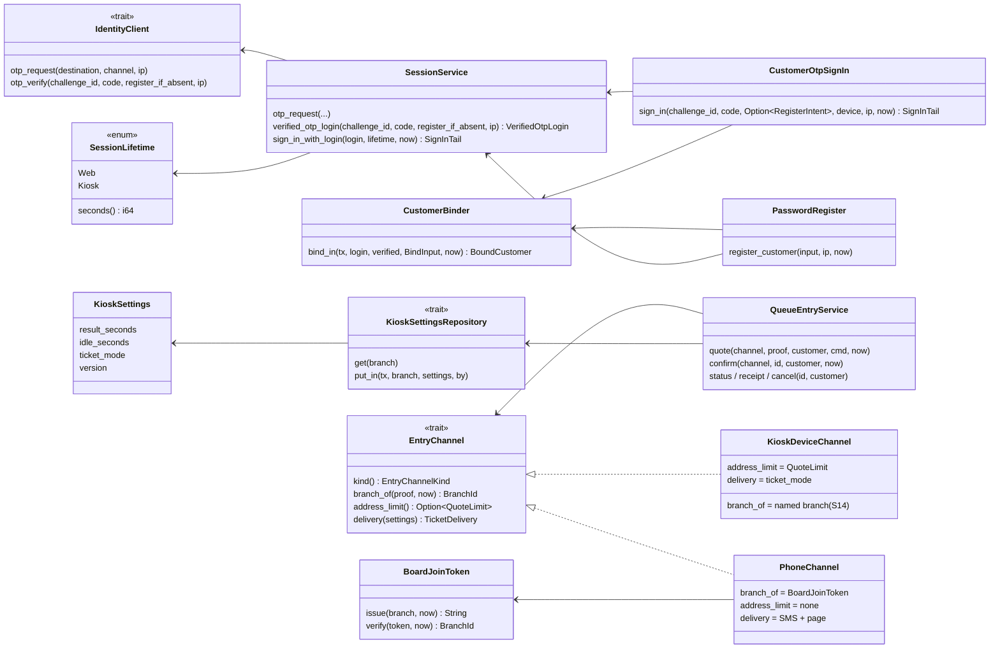

# Kiosk: one customer at a time, a branch kiosk settings page, and a verified phone number

> designed-by: claude/e92db6 (XC FE lane controller), with the BE lane (claude/553782) to complete §4's server half before
> any ticket is cut · measured on `main` `ced3a2d6` · builds on `kiosk-cancel.md` (KC-1..KC-5) and
> `customer-identity-consent.md` (phone-first customers, `PhoneVerificationService`)

## 0. Decided (owner, 2026-10-21)

| # | Rule | Owner's words |
|---|---|---|
| KS-1 | A kiosk is **shared**: it serves **one customer at a time**, and starts over when that customer is done. A request someone leaves half-done must not stay on screen for the next person. | *"ระบบ kiosk มัน จะเริ่มใหม่ เมื่อ ทำจบ"* · *"แต่ มันใช้ ร่วมกัน"* · *"ถ้าอีกคนทำค้างไว้"* · *"กรณี ใข้ รวมกัน หลาย คน"* · *"มัน ควรทำที่ละคน ในเครื่อง นั้น"* |
| KS-2 | The customer's cancel at the kiosk is **one press**. The customer never types a code. | *"ต้องมาใส่ รหัส มันไม่รู้รหัส อะดิ"* · *"มันควร กดยกเลิกได้ เลย"* |
| KS-3 | How long the queue-number screen stays is **configurable**, on a **per-branch kiosk settings page in admin**. | *"ให้ตั้งค่าได้เอง"* · *"ควรมีหน้า คอนฟิก สำหรับ kiosk"* (chose "the admin page, per branch") |
| KS-4 | To book a queue at the kiosk the customer **must enter a phone number**, used to tell who is who, **verified by an SMS OTP** so a mistyped number is caught. | *"ลูกค้า มาควร มีการใส่ เบอร์ โทร เพื่อ จองคิว"* · chose "required" · *"ใช้ในการแยกแยะ ว่าใครเป็นใคร"* · *"ส่ง sms เพื่อ ยืนยัน ตัว ตน"* · *"ควร มี otpเพื่อกัน การ ใส่เบอร์ ผิด"* |
| KS-4a | **OTP is used**, always. The branch switch exists only to cover the time before the Notify key is set. It is turned on as soon as a test send to the owner's phone succeeds, and is never an optional mode for a branch. | *"ใช้ otp"* |
| KS-4b | **The OTP works the way 108heros does it:** the code is sent and checked by the central **Identity** platform (`POST {identity}/auth/otp/request {destination, channel: "sms"}`, then verify; `108-Plaza/108heros-flutter` `lib/features/auth/infrastructure/data_sources/identity_otp_api.dart:17-29`). Identity sends the SMS through the 108 Plaza Notify. | *"เหมือน 108 heros"* |
| KS-6 | The customer gets a **queue ticket** from booking. **How it is delivered is a branch setting** on the kiosk settings page (KS-3), with three choices: **print + SMS**, **print only**, or **SMS only**. **The default is SMS only** (*"ให้default ที่ sms ก่อน"* · *"เพราะเครื่องพิพม์ ยัง ไม่แน่ชัด"*: the kiosk printer is not settled yet, so printing is built only once a printer is chosen). The printed slip carries the queue number, the time and the currency. The SMS carries the queue number and a link to see the status and cancel. | *"น่าจะมี บัตร คิว"* · *"ที่ได้ จาก การจองคิว"* · *"ให้ คอนฟิก ได้ ว่า จะใช้ แบบ ไหน ตามตัวเลือกที่เสนอมา"* |
| KS-4c | **Taking a queue at the kiosk is a normal customer login.** Phone + OTP signs the customer in exactly as the customer sign-in does (Identity OTP, KS-4b). The request belongs to that signed-in customer: found by phone, or created as a new customer. On a shared kiosk the session **ends at the kiosk's reset** (KS-1), so the next person starts signed out. | *"การ ใช้ คิว ก็เหมือนการ login ปกติ"* · *"เพื่อให้สามารถ แยกแยะ orders ได้ จำเป็นต้องใข้ เบอร์ โทรใน login"*: the phone number is the login, so every order can be told apart by its customer |
| KS-7 | **The rate board's QR joins the queue now, on the customer's own phone.** Scanning opens the same queue flow as the kiosk, on the phone: sign in by phone + OTP (KS-4c), choose currency and amount, get a walk-in queue number, and be called by SMS or the ticket page. It opens **the customer web pages** (`/app/…`, owner: *"มันจะไปหน้่าลูกค้า ใช่ไหม"* — yes): a new customer page, e.g. `/app/queue?branch=<code>`, behind the existing customer sign-in (`/app/sign-in`, phone + OTP). After joining, the customer sees the queue among their own pages. It replaces the board QR's current target, `/app/book` (`web/src/screens/customer/rate-display/BookingQr.tsx:16`, `rate-display.md` D9a). Booking a time stays in the app. On a personal phone the session does not have to end at once, but every request still belongs to one signed-in customer. | Shown a reference board (`rate.xc-th.work`, *Scan to join the queue · Get called on your phone*), the owner asked *"สแกน QR Code จองคิวได้ไหม"* · *"มันแยก แยะได้ได้ไหม"*, then chose "join the queue now on the phone" · *"มันต้องต้อง แยก แยะ ใครเป็นใครได้นะ"* |
| KS-5 | The system calls the queue in order, and **a calling display shows it, like a bank's**: a public screen at the branch with the number being called and the counter it goes to. Call order stays today's rule (BOOKING before WALK_IN, then the lowest number, `xc-queue/src/infrastructure/repository.rs:355-364`). | *"ระบบ ป็นคนเรียก คิว ที่รัน ตาม คิวการจอง"* · *"มีหน้า จอ เรียก เหมือน ธนาคาร"* · *"ว่า คิวไหน จะเข้าใช้บริการ"* |

## 1. What exists today (measured)

- **The kiosk never lets go of a finished customer.**
  - `KioskController._onIdle` (`app/lib/features/kiosk/presentation/controllers/kiosk_controller.dart:396-400`) exempts the waiting and receipt screens from the 2-minute idle reset (`idle_timer.dart:5`).
  - The only other reset is 30 s after `COMPLETED` (`:641-646`).
  - So a request stays on screen until staff finish it, and KC-A's cancel button (#4208) sits on that screen. **#4243** fixes this (KS-1, KS-2) with a 30-second constant.
- **Kiosk settings:** `/kiosk-currencies.html` (admin, per branch) holds the currency switches only (`kiosk_currencies`, `api/migrations/20261007170000_kiosk.sql:32-37`). There is no row for timings.
- **Phone on a kiosk request:** none. `kiosk_requests` has no phone or customer column (`20261007170000_kiosk.sql:4-24`).
- **Phone OTP today:**
  - `PhoneVerificationService` (`api/crates/xc-customer/src/application/customer/phone_verification_service.rs`) sends an SMS code through `SmsSender`. Its rate limits are in `PhoneOtpPolicy`.
  - It is **staff-initiated, for an existing customer**: `phone_verifications.customer_id` and `requested_by` (a user) are `NOT NULL` (`api/migrations/20261205141000_phone_verifications.sql`).
  - The phone is stored **encrypted**, with a lookup hash (`phone_encrypted`, `phone_lookup_hash`).
  - A kiosk customer is anonymous, with no user and maybe no customer yet, so this service cannot be called as it is.
- **SMS on the test host: none today.** claude/553782 measured it at ~07:25Z by grepping key names only.
  - xc-v3's `NotifySmsSender` (`api/src/infrastructure/notify/notify_sms_sender.rs`) needs `NOTIFY_BASE_URL` and `NOTIFY_API_KEY`, and neither is in `/etc/xc-v3/env` or `/etc/xc-v3/*.env`. So every send answers `smsUnavailable`.
  - Identity's OTP is `AUTH_OTP_DELIVERY_MODE=noop`.
  - `deploy/HOST-do-sgp1.md` I-3 leaves the sender choice to the owner.
  - **A required SMS OTP would therefore block every kiosk booking until a sender is set.**

## 2. Behaviour

**Kiosk flow (KS-1, KS-2, KS-4):** start → currency and amount → **phone** → **OTP** → review → confirm → **queue number + ยกเลิกคิว + เสร็จ** for *N* seconds → start.

| Step | Rule |
|---|---|
| phone | Required. Normalised and validated as the server does for customers. A wrong shape is refused on the screen. |
| OTP | An SMS code to that number. The confirm is refused until the code is verified. The rate limits are the customer OTP's (`PhoneOtpPolicy`), per phone and per kiosk address. A resend is allowed after the policy's wait. Idle on this screen resets the kiosk (KS-1). |
| confirm | The request carries the **verified customer**: an existing customer found by phone (lookup hash), or a new customer with a verified PHONE identity. The kiosk never shows any customer data back. |
| done screen | *N* = the branch's `resultSeconds` (KS-3), default 30. ยกเลิกคิว is one press (`customerCancel` with the hidden token). เสร็จ resets at once. |
| idle | Every screen resets after the branch's `idleSeconds`, default 120 (today's constant). |

**Staff side:** the queue panel and the desk show the customer for a kiosk request, so the desk need not ask for the phone again. Exactly what is shown is the BE lane's call with `customer-identity-consent.md` (masked phone, name if known).

**Calling display (KS-5).**
- Measured: there is **no public calling screen** on `main`. The desk's `Board.tsx` (`web/src/screens/desk/queue/board/Board.tsx`) and `queue_board` are staff-only, behind `QueueOperate` (`docs/design/blueprint/queue-tickets.md:162`). The `qa-e2e.md` F8 row says so too.
- The new page is a full-screen, signed-out page, opened on a TV at the branch, e.g. `/queue-display?branch=MAIN`.
  - It shows the **number being called** and **its counter**, large, plus the last few called numbers.
  - A chime plays on each new call (proposed; a spoken Thai announcement can come later).
  - It never shows a name, a phone number or an amount.
- It is fed by a **public, numbers-only view** that follows the poll seam's `since` → `{changed:false}` (🔁).

**Queue ticket (KS-6).**
- **Print:** a small slip from a printer at the kiosk.
  - Not measured yet: whether the kiosk device has a printer, and how the Flutter app (and the web build) would reach it. The desk prints receipts through the device agent (`/devices`, `DeviceQueue`). The BE lane checks whether a kiosk can use the same agent.
- **SMS:** sent through Identity/Notify like the OTP (KS-4b), to the verified phone.
  - It carries a link to a **public, signed-out ticket page**: the number, the status, and **ยกเลิกคิว**.
  - The page is opened by a per-ticket secret in the link, never by the request id. That lets a customer who has walked away cancel later, without breaking KS-1.
- **The branch setting decides** which of the three ticket modes runs. With SMS off, the cancel after the done screen is staff-only, as today.

## 3. Data (migration **approved** by the owner 2026-10-21: *"อนุมัติ migration"*)

- `kiosk_settings` per branch: `result_seconds`, `idle_seconds`, `ticket_mode` (`PRINT_SMS` | `PRINT` | `SMS`, default `SMS`), CHECKed ranges, `updated_by`, `updated_at`, and a version for the poll seam. Or columns on an existing per-branch table: the BE lane chooses.
- `kiosk_requests.customer_id` (nullable for rows before the migration; required for new ones by the service, not by the schema, so old rows stay valid).
- A kiosk OTP challenge store: either `phone_verifications` with `customer_id`/`requested_by` made nullable plus a `source` column, or its own table. The phone is always stored encrypted like `phone_verifications`.
- No backfill: existing requests have no phone.

## 4. Server half (BE lane)

> designed-by: claude/c4be83 for the BE lane controller claude/553782 · measured on xchange `main` `f62cbf6c` and
> `108-Plaza/Identity-Platform` `ffe908d` · §4.7 holds the questions that go to the owner through claude/553782

### 4.1 What the server does today (measured)

- **The OTP sign-in already exists, and the kiosk can call it as it is.**
  - `POST /api/auth/otp/request` and `/api/auth/otp/verify` (`api/src/presentation/http/auth.rs:73-82`) forward to
    Identity (`SessionService::otp_request`/`otp_verify`, `xc-auth/src/application/session/session_service.rs:886-917`).
  - A `200` from verify sets `__Host-xc_session` (`auth.rs:131-140`, `Max-Age=43200`; `SESSION_SECONDS`,
    `session_service.rs:28`). This is what `/app/sign-in` uses (`web/src/screens/customer/sign-in/SignIn.tsx:40,68`).
  - Both routes check only `same_origin`. The kiosk app already sends `Origin` + `X-Xchange-Request`
    (`app/lib/core/network/dio_provider.dart:18-31`).
- **An unknown phone cannot sign in today.** This is the gap KS-4c hits.
  - xchange always sends `"registerIfAbsent": false` (`xc-auth/src/infrastructure/identity/http_identity_client.rs:299`).
  - For an unknown phone, Identity then answers `200 {verified: true}` with no `login`
    (Identity `crates/auth/src/api/otp.rs:85-90`, test at `:325-341`).
  - xchange turns "no `login`" into `401 invalidCode` (`session_service.rs:912-916`). The customer typed the right code
    and is told it is wrong.
  - A known Identity account with no `users` row gets `401 signIn` instead, *"ask the shop owner to create an account"*
    (`UserNotBound`, `session_service.rs:451-453`, `:79-83`).
- **Identity can register on first sight.** `registerIfAbsent: true` creates a verified, password-less account and
  logs it in from the same code: `registered: true` plus `login` (Identity `contract/mod.rs:299-308`, test
  `otp.rs:220-258`). xchange already parses `registered` (`identity_client.rs:36-42`) but never asks for it.
- **The OTP limits are Identity's.**
  - Identity limits requests per destination and verifies per challenge (Identity `otp.rs:36-39`). It does not limit
    per address, so one shared kiosk address is not throttled.
  - §2's OTP row ("`PhoneOtpPolicy`, per phone and per kiosk address") therefore reads as **Identity's limits**: with
    S1 the kiosk never reaches `PhoneOtpPolicy`.
- **The customer core exists, but only for a password login.**
  - `register_customer` (`api/src/application/customer_signup.rs:82-158`) writes, in one transaction:
    - the `users` row with the CUSTOMER role;
    - the customer and its TERMS (and MARKETING) consents (`ConsentService::register_in`);
    - one ACTIVE PHONE identity (`write_verified_phone`, `:161-208`).
  - It takes its login only from `verified_login(identifier, password)`.
  - It refuses with `PhoneInUse` when the verified phone is ACTIVE on **another** customer (`:180-190`), including a
    desk-made customer with no user (K7: duplicates are never merged automatically).
- **A kiosk request belongs to nobody.**
  - The kiosk's `quote`/`confirm`/`status`/`customerReceipt`/`customerCancel` are `Need::Public`
    (`xc-auth/src/domain/policy/entities/policy.rs:123-126`).
  - A non-staff caller becomes `KioskActor::Customer`, which carries no id (`api/src/presentation/http/kiosk.rs:91-110`).
  - The kiosk's quote is written with `customer_id: None` (`api/src/infrastructure/kiosk/kiosk_ports.rs:443`).
- **Where the trace already runs.** `quotes.customer_id` exists (`api/migrations/20261014100000_quotes.sql:8`).
  `kiosk_requests.quote_id` points at the quote (`20261031100000_kiosk_quote_id.sql`). The quote's
  `accepted_by_transaction_id` points at the exchange. The exchange's `transactions.customer_id` is `NOT NULL`
  (`20261007190000_transactions.sql:11`).
  - So once the kiosk writes the customer on the quote and the request, the chain *kiosk request → quote → exchange*
    already exists. Only the customer at its start is missing.
- **The board QR and the app's queue (KS-7).**
  - The board's QR encodes `<origin>/app/book?branch=<code>` (`web/src/screens/customer/rate-display/BookingQr.tsx:16`).
    The branch code is public, so the QR proves nothing about where the phone is.
  - A signed-in customer can already take a walk-in ticket: `queueTicketTake` (`POST /api/app/queue/tickets`,
    `api/src/presentation/http/v3/commands/queue_ticket_take.rs:58-80`, `IssueSource::App`, at most one active walk-in
    per branch and day, `xc-queue/src/domain/ticket/issue_source.rs:16-17`). It takes no currency, amount or quote.
  - The kiosk names its branch in the payload, unproven (`kiosk.rs:291-301`). The kiosk app's setup stores only
    server + branch (`app/lib/core/endpoint/kiosk_endpoint.dart:17-21`).
- **The kiosk app keeps no cookie.** `buildKioskDio` has no cookie store (`dio_provider.dart:18-31`). The web build gets
  one from the browser; the native build needs a cookie jar (§5, FE lane).

### 4.2 Decisions (BE lane, from KS-4b, KS-4c and KS-7)

| # | Decision | Why |
|---|---|---|
| S1 | **No kiosk phone route.** The kiosk calls `/api/auth/otp/request` and `/api/auth/otp/verify`, the same routes as `/app/sign-in`. No `phoneStart`/`phoneConfirm`, no kiosk OTP table, and `PhoneVerificationService` is not used. | KS-4b, KS-4c (*"การ ใช้ คิว ก็เหมือนการ login ปกติ"*) |
| S2 | **One customer sign-in core** (♻️). `register_customer` is split: the *login* part (where the Identity login comes from: a password, or an OTP) is separate from the *bind* part (`users` row + CUSTOMER role + customer + consents + PHONE identity). The password register and the OTP sign-in call the same bind. | ♻️; today's core takes a password only |
| S3 | **Verify opts into first sight only when asked.** `otp/verify` takes an optional `register: {lang, marketing}`. With it, xchange sends `registerIfAbsent: true`, and an Identity account with no `users` row is bound as a new customer in one transaction. Without it, verify behaves as today, except that "no `login`" answers `401 notRegistered` instead of the false `invalidCode`. | the kiosk can't know in advance whether the phone is new; the Identity challenge is single-use, so a second try is impossible |
| S4 | **A verified phone finds its customer before a new one is made.** When the phone's lookup hash is ACTIVE on a customer with `user_id IS NULL` (a desk-made customer), the new user is **linked to that customer** instead of creating a second one, and the PHONE identity gets `verified_at = now`. When that customer already has a user, the answer is `409 phoneInUse`, as today. | KS-4c *"found by phone, or created as a new customer"*; the OTP proves the person holds the number. **Owner question Q1** (it changes K7's "no automatic merge" reading) |
| S5 | **Only customers sign in at the kiosk.** A subject bound to a staff or owner user (no CUSTOMER role) gets `403 notACustomer` on a kiosk verify, and no session is made. | a staff session on a shared device would carry `QueueOperate` to the next person |
| S6 | **A kiosk session is short.** A verify that carries `device: "kiosk"` makes the same `user_sessions` row with `expires = now + 15 min`, and a cookie `Max-Age` to match. The kiosk's reset calls `/api/auth/logout`, as today's sign-out does, and that also revokes the Identity refresh token. The 15 minutes only covers a reset that never runs (power cut, crash). | KS-1, KS-4c; the 12-hour web session is wrong for a shared screen |
| S7 | **The request and its quote carry the signed-in customer.** `quote` writes `kiosk_requests.customer_id` and `quotes.customer_id` from `Actor.customer_id`. `confirm`, `status`, `customerReceipt` and `customerCancel` on a request with a customer need **that** customer's session, else `403 notThisCustomer` (the booking rule, `xc-booking/src/application/lifecycle.rs:84-88`). | KS-4c reason: every order can be told apart by its customer |
| S8 | **No anonymous entry.** `quote` and `confirm` need `CustomerSelf` (`policy.rs:123-126` moves them out of `Need::Public`). Without a customer session the answer is `401 signIn`. `rates` and `settings` stay public. `status`/`customerReceipt`/`customerCancel` stay reachable for rows from before the migration (no customer), as S7 allows. **No branch switch is built on the server:** "off" would be an anonymous path. So the queue cannot be taken until the Notify key is set (§6.2). **Owner question Q5** (it replaces KS-4a's switch). | KS-7 (*"มันต้องต้อง แยก แยะ ใครเป็นใครได้นะ"*): every queue entry belongs to one signed-in customer |
| S9 | **Consent at the kiosk is the register's own rule.** A new customer's TERMS consent is recorded with `evidence_ref = "kiosk:<branchId>"` in the kiosk's language. If no TERMS text exists in that language, the answer is `409 consentTextMissing` (`field: lang`, no fallback, §4.3 of `customer-identity-consent.md`). The kiosk then offers the languages `consent_texts` lists. An existing customer's consents are not touched. | `customer-identity-consent.md` K5 and §4.3; the kiosk has 16 languages, register accepts th/en/zh (`customer_register.rs:37`) |
| S10 | **One entry core, two channels** (♻️). The kiosk's `quote` → `confirm` (currency, amount, quote, request, walk-in ticket; `xc-kiosk/src/application/kiosk/customer.rs`) is **the** queue entry core, for the kiosk device and for a customer's phone (KS-7). The core holds every safety rule: the customer (S7), the rate and quote, the per-customer limit (S12), the ticket issue and the cancel token. A channel is one small `EntryChannel` implementation holding only what differs (§4.3). | KS-7 *"the same flow as the kiosk"*; the global ♻️ rule |
| S11 | **What differs per channel, and nothing else.**  • **Branch proof:** the kiosk device names its branch (as today); the phone presents the board's join token (S13).  • **Session:** kiosk 15 min, and the reset signs out (S6); phone = the normal web session (KS-7: it need not end at once).  • **Ticket delivery:** kiosk = the branch's `ticket_mode` (KS-6); phone = SMS + the ticket page, never print.  • **Address limit:** kiosk keeps today's per-address quote limit (`customer.rs:149-153`, `QuoteLimit`); phone has none (a phone's address says nothing).  • **Request channel:** `kiosk_requests.channel` = `KIOSK` / `PHONE`, and `quotes.channel` = `KIOSK` / `APP` (already allowed, `quotes.sql:10`). | KS-7 names device binding, reset/sign-out and print |
| S12 | **One open entry per customer per branch**, on both channels. A second `quote` while the customer has a QUOTED or WAITING request at that branch answers `409 alreadyQueued` with the open request's id. This is the core's rule, the same as the app ticket's (`issue_source.rs:16-17`). It bounds a shared or photographed QR. | KS-7; a remote phone could otherwise hold many places |
| S13 | **How a phone proves its branch: a rotating board token.**  • The board's public poll (`/api/public/orgs/{org}/branches/{code}/rates`, `public/branch_rates.rs:16`) answers a `joinToken`.  • The token is `branchId ‖ window ‖ HMAC-SHA256(XC_BOARD_JOIN_KEY, branchId ‖ window)`, base64url, with a 10-minute window.  • The QR encodes `<origin>/app/queue?t=<joinToken>` and changes each window.  • The server accepts the current or the previous window, and the branch comes **from the token**, never from a parameter.  • No table, no state. A wrong, old or other-branch token answers `403 boardTokenInvalid`.  • No key set ⇒ the board shows no QR, and a phone entry answers `503 boardJoinUnavailable` (fail closed). The owner sets the key (secrets are the owner's). | the branch code in today's QR (`BookingQr.tsx:16`) is public and guessable: anyone anywhere could queue at any branch |
| S14 | **The kiosk device's branch proof stays today's named branch** (`kiosk.rs:291-301`: `branchId` in the payload, unproven) in this pass. A device secret issued at kiosk setup is the kiosk's `EntryChannel` change and touches no core rule; it is designed with §4.6. | measured: the kiosk app's setup stores only server + branch (`app/lib/core/endpoint/kiosk_endpoint.dart:17-21`) |

### 4.3 Class diagram

| Class | File | New / changed | Provides | Used by |
|---|---|---|---|---|
| `IdentityClient::otp_verify` | `api/crates/xc-auth/src/domain/identity/identity_client.rs:138` | changed: takes `register_if_absent` | the Identity call | `SessionService` |
| `HttpIdentityClient::otp_verify` | `…/infrastructure/identity/http_identity_client.rs:289-301` | changed: sends the flag instead of `false` | | |
| `SessionService::verified_otp_login` | `…/application/session/session_service.rs` | new, next to `verified_login` (`:495`) | `VerifiedOtpLogin {login, verified, registered}`, or `notRegistered` | `CustomerOtpSignIn` |
| `SessionLifetime` | `…/application/session/session_lifetime.rs` | new | `Web` = 43 200 s, `Kiosk` = 900 s | `create_session_for_user` (`:345`), `attach_signin_cookies` |
| `CustomerBinder` | `api/src/application/customer_binder.rs` | new: the bind half of `register_customer`, moved, plus S4's link | `BoundCustomer {user_id, customer_id, created}` | both entries |
| `PasswordRegister` | `api/src/application/customer_signup.rs` | changed: `verified_login` + `CustomerBinder` | `/api/app/register`, unchanged on the wire | `customer_register.rs` |
| `CustomerOtpSignIn` | `api/src/application/customer_otp_sign_in.rs` | new | S3, S5, S6 | `auth.rs` `v3_otp_verify` |
| `KioskSettings`, `KioskSettingsRepository` (+ `PgKioskSettingsRepository`) | `api/crates/xc-kiosk/src/domain/kiosk/entities/kiosk_settings.rs`, `…/repositories/kiosk_settings_repository.rs`, `api/src/infrastructure/kiosk/pg_kiosk_settings_repository.rs` | new (§3 table) | the settings, with defaults when a branch has no row | `KioskService`, the settings view |
| the entry core: `impl KioskService` in `customer.rs` (`quote` `:58`, `confirm_with_token` `:219`, `customer_cancel` `:328`, `status` `:394`, `customer_receipt` `:406`) | `api/crates/xc-kiosk/src/application/kiosk/customer.rs` | changed: each takes `&dyn EntryChannel` + the customer; S7, S8, S10, S12. No type rename (it would touch every caller); the diagram calls this half `QueueEntryService` | the one entry core | `kiosk.rs` for both channels |
| `EntryChannel` (trait), `EntryChannelKind` (`Kiosk` / `Phone`) | `api/crates/xc-kiosk/src/domain/kiosk/value_objects/entry_channel.rs` | new | S11's four differences, nothing else | `QueueEntryService` |
| `KioskDeviceChannel`, `PhoneChannel` | `api/crates/xc-kiosk/src/application/kiosk/channels/kiosk_device.rs`, `…/channels/phone.rs` | new, one file each | adding a channel = one file | `kiosk.rs` picks one per request (below) |
| `BoardJoinToken` | `api/crates/xc-kiosk/src/domain/kiosk/value_objects/board_join_token.rs` | new; HMAC through `ring` (added to `xc-kiosk/Cargo.toml` at `0.17`, the version `xc-auth/Cargo.toml:24` pins) | S13 | `PhoneChannel`; `public/branch_rates.rs` issues it |
| `branch_rates` answer | `api/src/presentation/http/public/branch_rates.rs` | changed: `joinToken` (absent when no key) | | the board, `BookingQr.tsx` (FE) |
| `kiosk_requests.channel` | §3 migration (one column, `KIOSK` default, CHECK `KIOSK`/`PHONE`) | new | S11 | `QueueEntryService`, the queue panel |
| `KioskActor::Customer` | `…/value_objects/kiosk_actor.rs` | changed: `Customer { customer_id: Option<String> }` | | `kiosk_actor_from_callers` (`kiosk.rs:91-110`) |
| `PgKioskPorts::quote_in` | `api/src/infrastructure/kiosk/kiosk_ports.rs:429-460` | changed: `customer_id` from the request instead of `None` | | |

### 4.4 Behaviour

**`POST /api/auth/otp/verify` `{challengeId, code, register?: {lang, marketing}, device?: "kiosk"}`**

| # | Given | Answer | Writes |
|---|---|---|---|
| V1 | known phone, bound CUSTOMER user | `200 {user}` + session cookie (kiosk: `Max-Age=900`) | session row |
| V2 | unknown phone, `register` absent | `401 notRegistered` (was `invalidCode`) | nothing |
| V3 | unknown phone, `register` present, TERMS text in `lang` | `200 {user, customerId, registered: true}` + cookie | Identity account, user, CUSTOMER role, customer, TERMS (+MARKETING), PHONE identity verified, session |
| V4 | as V3, phone ACTIVE on a customer with `user_id IS NULL` | `200 {…, registered: true}`; the **existing** customer id | user, CUSTOMER role, `customers.user_id` set, PHONE `verified_at`, TERMS consent if that customer has none, session |
| V5 | as V3, phone ACTIVE on a customer that has a user | `409 phoneInUse` | nothing in xchange. Identity's account is already made; the next sign-in finds it (V1 or V6) |
| V6 | Identity account exists, no `users` row, `register` present | as V3/V4 (the subject is bound now) | as V3/V4 |
| V7 | subject bound to a staff/owner user, `device: "kiosk"` | `403 notACustomer` | nothing |
| V8 | `register` present, no TERMS text in `lang` | `409 consentTextMissing` (`field: lang`) | nothing in xchange |
| V9 | wrong code / expired / replay / rate limit | Identity's own refusal, unchanged | nothing |
| V10 | two verifies of the same new subject at once | one binds; the other finds the bound user and signs in (`users.auth_subject UNIQUE`, as R13) | one user |

**`POST /api/kiosk`**

| # | Given | Answer |
|---|---|---|
**The channel is picked by the proof, once, in `kiosk.rs`:** a payload with `joinToken` ⇒ `PhoneChannel`; otherwise
`KioskDeviceChannel` (named `branchId`). Both run the same actions on the same route. A payload with both is
`400 invalidRequest`.

| # | Given | Answer |
|---|---|---|
| P1 | phone `quote`, customer session, valid `joinToken` | as K2; branch = the token's; `channel = PHONE`; no address limit |
| P2 | phone `quote`, token from the previous window | accepted |
| P3 | phone `quote`, older, forged or no-key token | `403 boardTokenInvalid` / `503 boardJoinUnavailable` |
| P4 | phone `quote`, `branchId` also sent | `400 invalidRequest` (the branch comes only from the token) |
| P5 | either channel, the customer already has a QUOTED/WAITING request at the branch | `409 alreadyQueued` + its id (S12) |
| P6 | phone `confirm` | the ticket is issued as the kiosk's (`IssueSource::Kiosk {request_id}`, WALK_IN); delivery = SMS + page whatever `ticket_mode` says |
| P7 | the board poll, key set / not set | `joinToken` present, rotating every 10 min / absent |

| # | Given | Answer |
|---|---|---|
| K1 | `quote` or `confirm`, no customer session | `401 signIn` (S8) |
| K2 | `quote` with a customer session | as today; `kiosk_requests.customer_id` and `quotes.customer_id` = the session's customer |
| K3 | `confirm`/`status`/`customerReceipt`/`customerCancel` on a request with a customer, another customer's session or none | `403 notThisCustomer` |
| K4 | the same on a request with no customer (rows from before the migration) | as today |
| K5 | `settings` (Public, new) | `{resultSeconds, idleSeconds, ticketMode, version}`; defaults 30 / 120 / `SMS` when the branch has no row; `since` = version → `{changed: false}` (🔁) |
| K6 | `configureSettings` (new, `RatesDraft`, the same permission as `configure`) | writes the row, `updated_by`, bumps `version`; ranges refused with `400 validationFailed` naming the field |

The desk's queue panel and `get` gain the request's customer as `customerNo` plus the masked phone (last 4, K8). The
desk can then pick the same customer at the save. The save's own customer rule is Q2.

### 4.5 Rules the tests pin first (up-front, `class:logic`)

- V2, V3, V4, V5, V7, V8 and V10 on `CustomerOtpSignIn` with a fake `IdentityClient`. The test checks the flag
  xchange sends, not only the answer.
- `PasswordRegister` answers exactly as before (the `/api/app/register` tests stay green unchanged). This proves the
  split moved code and changed no rule.
- K1–K6 and P1–P7 on the entry core / the route, run **once per channel** with the same rows where they apply (a
  table-driven test over both `EntryChannel`s), and `KioskActor::Customer` read from the session's `customer_id`.
- `BoardJoinToken`: issue → verify round trip, the previous window accepted, two windows back refused, another
  branch's token refused, a flipped byte refused, no key ⇒ unavailable.
- Guard: only `channels/*.rs` implement `EntryChannel`, and no file outside the core calls the ticket issuer for
  `IssueSource::Kiosk` (one entry core).
- `SessionLifetime::Kiosk` sets both the row's `expires` and the cookie's `Max-Age`; a `Web` sign-in is unchanged.
- Guard: no route outside `auth.rs` calls `IdentityClient::otp_verify` (one OTP core).

### 4.6 Not in this pass (designed next, on this doc)

- **The public calling display (KS-5):** a numbers-only view, signed out, on the poll seam.
- **The public ticket page and the ticket SMS (KS-6):** the per-ticket secret, the page, the send through
  Identity/Notify, and whether the kiosk can reach the device agent's printer.

Neither changes S1–S9.

### 4.7 Questions for the owner (sent through claude/553782)

- **Q1 (S4).** A verified phone matches a desk-made customer that has no app account. Should the sign-in **join that
  customer**, or make a new one? Proposed: join. The OTP proves the number, and a second customer would split the same
  person's orders, against KS-4c's reason. It is not a merge of two existing customers, which stays O-1.
- **Q2 (the save).** The desk's passport finds customer A, but the kiosk request belongs to customer B (B signed in
  with a phone that A never recorded). Proposed: the save goes ahead on A, because the passport is the exchange's legal
  identity. The request and its quote keep B, and the save writes one `KIOSK_CUSTOMER_DIFFERS` audit row naming both,
  for the O-1 merge work. The desk is never blocked.
- **Q3 (a new kiosk customer's name).** `customers.display_name` is `NOT NULL`, and `/api/app/register` asks for a
  name. Proposed: the kiosk asks for no name. The name starts as the masked phone (`•••1234`, K8), and the desk's
  passport fills it in at the first exchange.
- **Q4 (the app's take-a-number, S10).** `queueTicketTake` (`POST /api/app/queue/tickets`, S7 #3410,
  `api/src/presentation/http/v3/commands/queue_ticket_take.rs`) already issues a walk-in ticket to a signed-in
  customer, but with no currency, amount or quote, and with any branch named in the body. KS-7's phone entry does the
  same job through the entry core. Two ways in for one thing break the ♻️ rule. Proposed: retire `queueTicketTake`
  once the phone channel lands; its FE caller moves to the phone flow. Keeping it would also keep an unproven branch.
- **Q5 (KS-4a's branch switch, S8).** KS-7 says no anonymous path. KS-4a's switch, "off" until the Notify key is set,
  *is* an anonymous path. Proposed: build no switch. Until the owner sets Identity's Notify key (§6.2), no queue can
  be taken at the kiosk or by phone; the desk still serves walk-ins. The key is the owner's action in any case.

## 5. Front ends (this lane)

- **Admin:** `/kiosk-currencies.html` becomes **ตั้งค่าตู้**: the currency switches plus `resultSeconds` and `idleSeconds`.
- **Kiosk app:** the phone and OTP steps; `resultSeconds` and `idleSeconds` from the settings read, replacing #4243's constant; all 16 kiosk languages for the new texts (`app/assets/l10n/kiosk.json`).
- **Queue panel and desk:** show the kiosk request's customer.

## 6. Open questions for the owner (one batch)

1. ✅ **KS-5 answered:** a calling display like a bank's (§2). Still open: whether to add a spoken announcement. Earlier wording of this question: Today a teller presses call-next, which picks BOOKING tickets before WALK_IN and then the lowest number (`xc-queue/src/infrastructure/repository.rs:355-364`). Does the owner mean (a) call-next is already right; (b) the **system** should call the next number by itself when a counter frees up; or (c) kiosk requests should be ordered with bookings?
2. ✅ **Decided 2026-10-21: the 108 Plaza Notify platform** (*"ใช่ Notify ชอง 108 plaza"*). With KS-4b the setting lives on **Identity**, not on xc-v3: set Identity's `AUTH_OTP_DELIVERY_MODE=http`, plus `AUTH_OTP_HTTP_ENDPOINT` (Notify's `/api/v1/otp`) and `AUTH_OTP_HTTP_API_KEY`, the same as 108heros's Identity. Today the instance xc-v3 uses runs `noop`. **The owner creates and sets the key**, because secrets are the owner's. Background: which SMS sender xc-v3 uses was an owner prerequisite of KS-4, per I-3. The fleet already has one: the Notify platform (`108-platform-services`). It sends SMS through ThaiBulkSMS with the approved sender `108-Pos`, per the memory store's notify record of 2026-07-31; that is **not re-measured today**. Pointing xc-v3's `NOTIFY_BASE_URL` / `NOTIFY_API_KEY` at it needs no new provider. **Proposed:** use Notify. The owner sets the key (secrets are the owner's). Until then, KS-4 ships behind a branch switch that stays off, so bookings aren't blocked.
3. ✅ **Migration approved** for §3 (*"อนุมัติ migration"*, 2026-10-21). Deploy remains a separate owner order.
