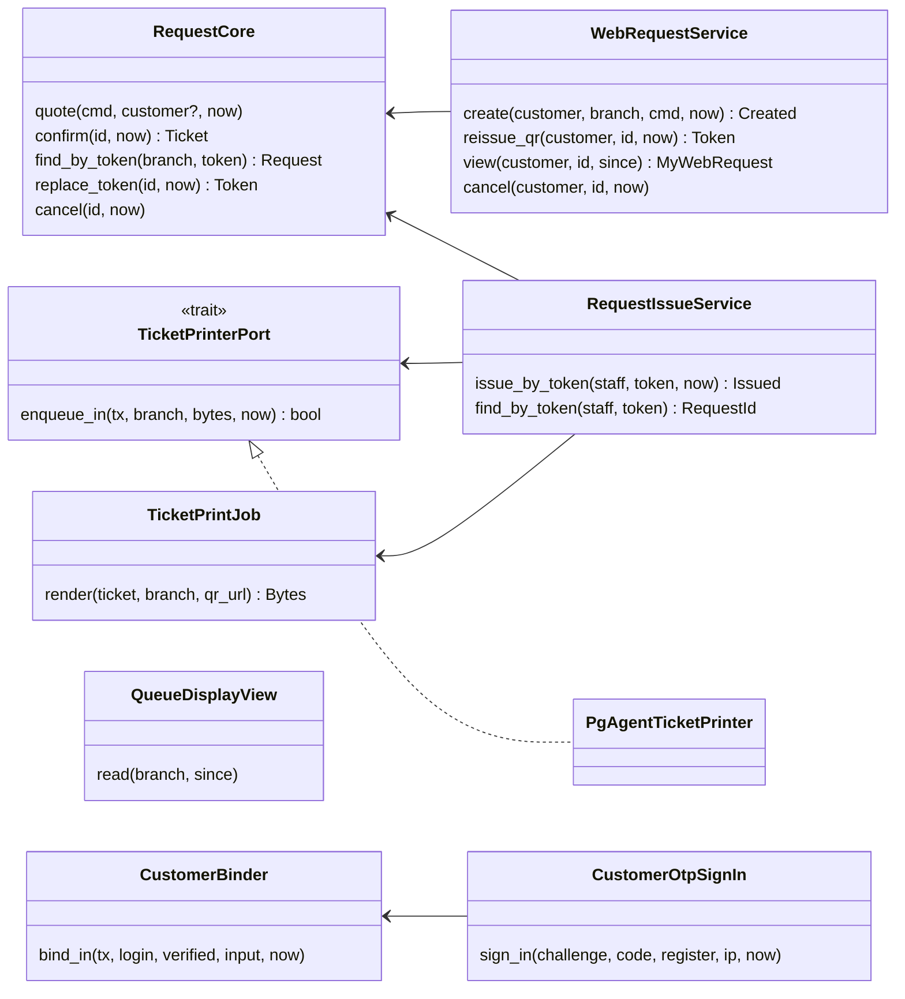

# Kiosk: one customer at a time, a branch kiosk settings page, and a verified phone number

> designed-by: claude/e92db6 (XC FE lane controller), with the BE lane (claude/553782) to complete §4's server half before
> any ticket is cut · measured on `main` `ced3a2d6` · builds on `kiosk-cancel.md` (KC-1..KC-5) and
> `customer-identity-consent.md` (phone-first customers, `PhoneVerificationService`)

## 0. Decided (owner, 2026-10-21)

| # | Rule | Owner's words |
|---|---|---|
| KS-1 | A kiosk is **shared**: it serves **one customer at a time**, and starts over when that customer is done. A request someone leaves half-done must not stay on screen for the next person. | *"ระบบ kiosk มัน จะเริ่มใหม่ เมื่อ ทำจบ"* · *"แต่ มันใช้ ร่วมกัน"* · *"ถ้าอีกคนทำค้างไว้"* · *"กรณี ใข้ รวมกัน หลาย คน"* · *"มัน ควรทำที่ละคน ในเครื่อง นั้น"* |
| KS-2 | The customer's cancel at the kiosk is **one press**. The customer never types a code. | *"ต้องมาใส่ รหัส มันไม่รู้รหัส อะดิ"* · *"มันควร กดยกเลิกได้ เลย"* |
| KS-3 | How long the queue-number screen stays is **configurable**, on a **per-branch kiosk settings page in admin**. | *"ให้ตั้งค่าได้เอง"* · *"ควรมีหน้า คอนฟิก สำหรับ kiosk"* (chose "the admin page, per branch") |
| KS-4 | To book a queue at the kiosk the customer **must enter a phone number**, used to tell who is who, **verified by an SMS OTP** so a mistyped number is caught. | *"ลูกค้า มาควร มีการใส่ เบอร์ โทร เพื่อ จองคิว"* · chose "required" · *"ใช้ในการแยกแยะ ว่าใครเป็นใคร"* · *"ส่ง sms เพื่อ ยืนยัน ตัว ตน"* · *"ควร มี otpเพื่อกัน การ ใส่เบอร์ ผิด"* |
| KS-4a | **Login first, always.** The phone + OTP login comes **before** the first exchange screen (currency/amount), on the kiosk and on the phone (KS-7). No anonymous path exists, and **no switch bypasses it**. So the Identity → Notify SMS setup (§6 Q2) is a **prerequisite of shipping this**: until it is done, the feature waits, and nothing runs without login. | *"ใช้ otp"* · *"มันต้อง ผ่าน login ก่อน มาหน้านี้"* (shown the reference kiosk's step 1) |
| KS-4b | **The OTP works the way 108heros does it:** the code is sent and checked by the central **Identity** platform (`POST {identity}/auth/otp/request {destination, channel: "sms"}`, then verify; `108-Plaza/108heros-flutter` `lib/features/auth/infrastructure/data_sources/identity_otp_api.dart:17-29`). Identity sends the SMS through the 108 Plaza Notify. | *"เหมือน 108 heros"* |
| KS-6 | The customer gets a **queue ticket** from booking. **How it is delivered is a branch setting** on the kiosk settings page (KS-3), with three choices: **print + SMS**, **print only**, or **SMS only**. **The default is SMS only** (*"ให้default ที่ sms ก่อน"* · *"เพราะเครื่องพิพม์ ยัง ไม่แน่ชัด"*: the kiosk printer is not settled yet, so printing is built only once a printer is chosen). The printed slip carries the queue number, the time and the currency. The SMS carries the queue number and a link to see the status and cancel. | *"น่าจะมี บัตร คิว"* · *"ที่ได้ จาก การจองคิว"* · *"ให้ คอนฟิก ได้ ว่า จะใช้ แบบ ไหน ตามตัวเลือกที่เสนอมา"* |
| KS-4c | **Taking a queue at the kiosk is a normal customer login.** Phone + OTP signs the customer in exactly as the customer sign-in does (Identity OTP, KS-4b). The request belongs to that signed-in customer: found by phone, or created as a new customer. On a shared kiosk the session **ends at the kiosk's reset** (KS-1), so the next person starts signed out. | *"การ ใช้ คิว ก็เหมือนการ login ปกติ"* · *"เพื่อให้สามารถ แยกแยะ orders ได้ จำเป็นต้องใข้ เบอร์ โทรใน login"*: the phone number is the login, so every order can be told apart by its customer |
| KS-7 | **The rate board's QR joins the queue now, on the customer's own phone.** Scanning opens the same queue flow as the kiosk, on the phone: sign in by phone + OTP (KS-4c), choose currency and amount, get a walk-in queue number, and be called by SMS or the ticket page. It opens **the customer web pages** (`/app/…`, owner: *"มันจะไปหน้่าลูกค้า ใช่ไหม"* — yes): a new customer page, e.g. `/app/queue?branch=<code>`, behind the existing customer sign-in (`/app/sign-in`, phone + OTP). After joining, the customer sees the queue among their own pages. It replaces the board QR's current target, `/app/book` (`web/src/screens/customer/rate-display/BookingQr.tsx:16`, `rate-display.md` D9a). Booking a time stays in the app. On a personal phone the session does not have to end at once, but every request still belongs to one signed-in customer. | Shown a reference board (`rate.xc-th.work`, *Scan to join the queue · Get called on your phone*), the owner asked *"สแกน QR Code จองคิวได้ไหม"* · *"มันแยก แยะได้ได้ไหม"*, then chose "join the queue now on the phone" · *"มันต้องต้อง แยก แยะ ใครเป็นใครได้นะ"* |
| KS-5 | The system calls the queue in order, and **a calling display shows it, like a bank's**: a public screen at the branch with the number being called and the counter it goes to. Call order stays today's rule (BOOKING before WALK_IN, then the lowest number, `xc-queue/src/infrastructure/repository.rs:355-364`). | *"ระบบ ป็นคนเรียก คิว ที่รัน ตาม คิวการจอง"* · *"มีหน้า จอ เรียก เหมือน ธนาคาร"* · *"ว่า คิวไหน จะเข้าใช้บริการ"* |

## 1. What exists today (measured)

- **The kiosk never lets go of a finished customer.**
  - `KioskController._onIdle` (`app/lib/features/kiosk/presentation/controllers/kiosk_controller.dart:396-400`) exempts the waiting and receipt screens from the 2-minute idle reset (`idle_timer.dart:5`).
  - The only other reset is 30 s after `COMPLETED` (`:641-646`).
  - So a request stays on screen until staff finish it, and KC-A's cancel button (#4208) sits on that screen. **#4243** fixes this (KS-1, KS-2) with a 30-second constant.
- **Kiosk settings:** `/kiosk-currencies.html` (admin, per branch) holds the currency switches only (`kiosk_currencies`, `api/migrations/20261007170000_kiosk.sql:32-37`). There is no row for timings.
- **Phone on a kiosk request:** none. `kiosk_requests` has no phone or customer column (`20261007170000_kiosk.sql:4-24`).
- **Phone OTP today:**
  - `PhoneVerificationService` (`api/crates/xc-customer/src/application/customer/phone_verification_service.rs`) sends an SMS code through `SmsSender`. Its rate limits are in `PhoneOtpPolicy`.
  - It is **staff-initiated, for an existing customer**: `phone_verifications.customer_id` and `requested_by` (a user) are `NOT NULL` (`api/migrations/20261205141000_phone_verifications.sql`).
  - The phone is stored **encrypted**, with a lookup hash (`phone_encrypted`, `phone_lookup_hash`).
  - A kiosk customer is anonymous, with no user and maybe no customer yet, so this service cannot be called as it is.
- **SMS on the test host: none today.** claude/553782 measured it at ~07:25Z by grepping key names only.
  - xc-v3's `NotifySmsSender` (`api/src/infrastructure/notify/notify_sms_sender.rs`) needs `NOTIFY_BASE_URL` and `NOTIFY_API_KEY`, and neither is in `/etc/xc-v3/env` or `/etc/xc-v3/*.env`. So every send answers `smsUnavailable`.
  - Identity's OTP is `AUTH_OTP_DELIVERY_MODE=noop`.
  - `deploy/HOST-do-sgp1.md` I-3 leaves the sender choice to the owner.
  - **A required SMS OTP would therefore block every kiosk booking until a sender is set.**

## 2. Behaviour

**Kiosk flow (KS-1, KS-2, KS-4):** start → currency and amount → **phone** → **OTP** → review → confirm → **queue number + ยกเลิกคิว + เสร็จ** for *N* seconds → start.

| Step | Rule |
|---|---|
| phone | Required. Normalised and validated as the server does for customers. A wrong shape is refused on the screen. |
| OTP | An SMS code to that number. The confirm is refused until the code is verified. The rate limits are the customer OTP's (`PhoneOtpPolicy`), per phone and per kiosk address. A resend is allowed after the policy's wait. Idle on this screen resets the kiosk (KS-1). |
| confirm | The request carries the **verified customer**: an existing customer found by phone (lookup hash), or a new customer with a verified PHONE identity. The kiosk never shows any customer data back. |
| done screen | *N* = the branch's `resultSeconds` (KS-3), default 30. ยกเลิกคิว is one press (`customerCancel` with the hidden token). เสร็จ resets at once. |
| idle | Every screen resets after the branch's `idleSeconds`, default 120 (today's constant). |

**Staff side:** the queue panel and the desk show the customer for a kiosk request, so the desk need not ask for the phone again. Exactly what is shown is the BE lane's call with `customer-identity-consent.md` (masked phone, name if known).

**Calling display (KS-5).**
- Measured: there is **no public calling screen** on `main`. The desk's `Board.tsx` (`web/src/screens/desk/queue/board/Board.tsx`) and `queue_board` are staff-only, behind `QueueOperate` (`docs/design/blueprint/queue-tickets.md:162`). The `qa-e2e.md` F8 row says so too.
- The new page is a full-screen, signed-out page, opened on a TV at the branch, e.g. `/queue-display?branch=MAIN`.
  - It shows the **number being called** and **its counter**, large, plus the last few called numbers.
  - A chime plays on each new call (proposed; a spoken Thai announcement can come later).
  - It never shows a name, a phone number or an amount.
- It is fed by a **public, numbers-only view** that follows the poll seam's `since` → `{changed:false}` (🔁).

**Queue ticket (KS-6).**
- **Print:** a small slip from a printer at the kiosk.
  - **The printer is the one already given** (owner, 2026-10-21: *"เครื่อง พิมพ์ เหมือนเคยให้ มาแล้วนะ"* · *"กับลิ้นชัก"*): the **POS80** 80 mm ESC/POS receipt printer, with the cash drawer on it.
    - In v2 it sat on the counter Mac's USB as CUPS queue `POS80_` (`docs/design/xchange-v3-known-differences.md:52`).
    - v3 reaches it through the **device agent** (`deploy/agent/README.md` §A CUPS raw / §B TCP 9100), which already drives the drawer kick.
    - So the kiosk ticket is a print job the server builds as ESC/POS and the branch's device agent sends. The kiosk app does not print by itself, and it works from both the Flutter and the web build.
    - Open for the BE lane: whether the kiosk's printer is the counter POS80 or a second POS80 at the kiosk. The owner names the target when the agent is paired.
- **SMS:** sent through Identity/Notify like the OTP (KS-4b), to the verified phone.
  - It carries a link to a **public, signed-out ticket page**: the number, the status, and **ยกเลิกคิว**.
  - The page is opened by a per-ticket secret in the link, never by the request id. That lets a customer who has walked away cancel later, without breaking KS-1.
- **The branch setting decides** which of the three ticket modes runs. With SMS off, the cancel after the done screen is staff-only, as today.

## 3. Data (migration **approved** by the owner 2026-10-21: *"อนุมัติ migration"*)

- `kiosk_settings` per branch: `result_seconds`, `idle_seconds`, `ticket_mode` (`PRINT_SMS` | `PRINT` | `SMS`, default `SMS`), CHECKed ranges, `updated_by`, `updated_at`, and a version for the poll seam. Or columns on an existing per-branch table: the BE lane chooses.
- `kiosk_requests.customer_id` (nullable for rows before the migration; required for new ones by the service, not by the schema, so old rows stay valid).
- A kiosk OTP challenge store: either `phone_verifications` with `customer_id`/`requested_by` made nullable plus a `source` column, or its own table. The phone is always stored encrypted like `phone_verifications`.
- No backfill: existing requests have no phone.

## 4. Server half (BE lane)

> designed-by: claude/c4be83 for the BE lane controller claude/553782 · measured on xchange `main` `4c3fc5a`,
> `108-platform-services` (`681bea2` = the deployed xc-identity, `8b53cee` = xchange's pinned `pos-printer`), do-sgp1
> and Dell, 2026-10-21 · written for the owner's final flow (PR 4249 issuecomment-6312118645):
> *"จาก kiosk เป็นเครือง พิพม์ คิว แทน"* · *"ให้ พนักงาน สแกน qr code ทีลูกค้า ทำรายการ ไว้แล้ว"* ·
> *"พอได้ qr code ลูกค้่าต้องเอา มาให้ พนักงาน สแกน เพื่อรับ คิว"*.
> 1. The customer scans the board QR, signs in and fills the request on the phone, which shows the **request QR** and
>    **no queue number**.
> 2. **Staff scan that QR in the Flutter queue machine**, which **issues the queue number and prints the ticket**.
> 3. The customer waits for the call on the calling display.
> 4. The desk checks the passport.
>
> There is no customer self-service device at the branch. Earlier §4 versions are in git (`bf7efba8`, `1dde5b6c`,
> `1e5e84e1`, `919f33c8`).

### 4.1 What the server does today (measured)

- **The request core is the kiosk's.** The customer half of `KioskService` (`api/crates/xc-kiosk/src/application/kiosk/customer.rs`:
  `quote` `:58`, `confirm_with_token` `:219`, `customer_cancel` `:328`, `status` `:394`):
  - `quote` writes a `QUOTED` request;
  - `confirm` moves it to `WAITING` and issues the walk-in ticket in its own transaction (`IssueSource::Kiosk {request_id}`).
  - All of it is reached through `POST /api/kiosk`, and every customer action there is `Need::Public`
    (`api/crates/xc-auth/src/domain/policy/entities/policy.rs:123-126`). The kiosk's quote is written with
    `customer_id: None` (`api/src/infrastructure/kiosk/kiosk_ports.rs:443`).
- **An unissued request lives 10 minutes.** A `QUOTED` request older than 600 s is purged on the next quote at the
  branch (`api/crates/xc-kiosk/src/domain/kiosk/entities/kiosk_machine.rs:443-446`, called from `customer.rs:143-146`).
- **A per-request secret exists, but it is minted at `confirm`:** the cancel token (UUID v4, returned once, stored as
  `kiosk_requests.cancel_token_hash`, `api/migrations/20261219190000_kiosk_cancel.sql:15`;
  `xc-kiosk/src/infrastructure/kiosk/kiosk_repository.rs:635,654`).
- **The booking QR is the pattern to reuse.**
  - The token is minted at create; only its hash is kept (`bookings.qr_token_hash bytea UNIQUE`,
    `api/migrations/20261205131000_booking_slots.sql:97`).
  - The desk looks it up (`desk_bookings` filter `qr`, `api/src/presentation/http/v3/views/desk_bookings.rs:72,104`;
    scanner in `web/src/screens/desk/bookings/DeskBookingsScreen.tsx:224`).
  - Check-in compares the hash (`api/src/presentation/http/v3/commands/bookings/check_in.rs:142-144`).
  - The customer gets a fresh QR by reissue (`bookingQrReissue`, `api/src/presentation/http/v3/commands/bookings/qr.rs`).
- **The desk opens a request by id:** `/desk?branch=<b>&kiosk=<id>` (`web/src/shared/ui/QueuePanel.tsx:437`;
  `web/src/screens/desk/entries/kiosk/entry.ts` → `/api/kiosk get`).
- **A member's ticket shows in the account** when `queue_tickets.customer_id` is set
  (`api/src/presentation/http/v3/views/my_queue_ticket.rs:3,128`).
- **The Flutter app has no staff sign-in.** Its setup holds only server + branch
  (`app/lib/core/endpoint/kiosk_endpoint.dart:17-21`). It calls only `POST /api/kiosk` (`app/lib/features/kiosk/infrastructure/data_sources/kiosk_api.dart`),
  and its HTTP client keeps no cookie (`app/lib/core/network/dio_provider.dart:18-31`).
- **Web sign-in: an unknown phone cannot sign up.** xchange sends `"registerIfAbsent": false`
  (`api/crates/xc-auth/src/infrastructure/identity/http_identity_client.rs:299`) and answers a correct code with
  `401 invalidCode` when Identity returns no login (`session_service.rs:912-916`). The deployed Identity supports
  first-sight registration (`crates/auth/src/application/verify_otp.rs:218`). xc-identity runs `noop` delivery (§4.9).
- **Printing.**
  - The device agent writes any bytes to CUPS raw or TCP 9100 (`api/crates/xc-device-agent/src/runner.rs:268-301`).
  - The server serves agents only `DRAWER_REQUEST` (`api/src/infrastructure/device_agents/pg_agent_repository.rs:296,315,342,449`).
  - There is one active agent per branch (`api/migrations/20261008120000_device_agents.sql:29-31`).
  - `device_jobs.kind` is CHECKed to `PRINT_RECEIPT`/`DRAWER_REQUEST` (`20261007180000_devices.sql:7`).
  - `pos-printer` at xchange's pin draws QR codes (`crates/pos-printer/src/escpos.rs:305,316`).
- **Calling data.** A counter is a teller with no number or label (`queue_counters`, `api/migrations/20261101100000_queue.sql:41-47`).
  `branch_service_status.queue_version` is the poll seam (`:53`). The only board is staff-only (`queue_board`).

### 4.2 Decisions (BE lane)

| # | Decision | Why |
|---|---|---|
| D1 | **One request core, unchanged in shape.** The web request is a `kiosk_requests` row made by the same `quote` path. `POST /api/kiosk` and its anonymous `quote`/`confirm` stay as they are; the queue machine may reuse them, so nothing there is removed. | owner 553782: *"do NOT plan their removal"*; ♻️ |
| D2 | **Web submit = a request with no number.**  • A new command `webRequestCreate` runs the core's `quote`. From a phone it needs a customer session, and `customer_id` = the member's. From a branch tablet it needs the tablet credential, and `customer_id` is NULL (D16, D17).  • It mints the **request token** (UUID v4; only its SHA-256 is stored, in `cancel_token_hash`; no second column).  • It answers `{requestId, requestQrUrl, expiresAt}`. The request stays `QUOTED`: **no `confirm`, no ticket, no number.** | owner: the number is issued at the staff scan |
| D3 | **The request QR** encodes `<origin>/q#<token>` (the fragment keeps it out of request lines, logs and referrers). The member re-shows it by `webRequestQrReissue` (`CustomerSelf`, own request), which mints a new token and replaces the hash, as `bookingQrReissue` does. | the booking QR pattern |
| D4 | **A web request waits 60 minutes for its scan**, not the kiosk's 10. `is_purgeable` keeps 600 s for a request with no customer and uses 3 600 s for one with a customer. The phone shows `expiresAt`. After that, the member fills the request again. | the 10-minute purge (`kiosk_machine.rs:443-446`) would drop a request while its owner waits in line at the queue machine |
| D5 | **The staff scan issues the number: `issueByToken`.**  • A new staff action on `POST /api/kiosk`, needing `QueueOperate`.  • It finds the request by token **in the staff session's branch**, runs the core's `confirm` (QUOTED → WAITING, the ticket, `IssueSource::Kiosk {request_id}`), and sets `queue_tickets.customer_id` from the request.  • It answers `{displayNumber, ticketId, printed}`.  • Scanning twice answers the same ticket (repeat-safe), never a second number.  • A token of another branch, an unknown or expired one ⇒ `404 notFound`, one answer for all. | owner: *"สแกน เพื่อรับ คิว"*; the scan at the branch proves where the customer is, so no board token is needed |
| D6 | **The queue machine is a staff device.** It signs in as staff, through the same Identity sign-in as the desk, and holds `QueueOperate` at its branch. It is not a public kiosk any more. The kiosk's anonymous actions still answer, for the machine to reuse (e.g. a staff-entered walk-in, if e92db6's open assumption lands there). | owner: *"no customer self-service device"* |
| D7 | **The desk scan reuses the same lookup.** `findByToken` (`QueueOperate`, branch-scoped) answers the request id, and the desk opens today's `?kiosk=<id>` entry. It is the same token and the same `404` rule as D5, with the scanner `DeskBookingsScreen` uses. | reuse |
| D8 | **The customer's view.** `myWebRequest` (`CustomerSelf`, own request) answers `{status, expiresAt, displayNumber?, ticketsAhead?, counter?}` on the poll seam (`queue_version`, `since` → `{changed: false}`). Before the scan: `QUOTED` and no number. After the scan: the number, place in line, and the counter once called. Cancel: `webRequestCancel` (own session), the `customerCancel` transition. | 🔁; owner: the display and the desk follow the issued number |
| D9 | **Printing: the counter POS80 through today's agent (proposed; Q7).**  • The machine is staff-operated at the counter, so the ticket can come out of the counter POS80.  • `requestIssue` queues one `PRINT_QUEUE_TICKET` job in its transaction. The bytes are rendered server-side with `pos-printer`: number, time, branch, and the request QR for the desk.  • The branch's one agent claims `DRAWER_REQUEST` **and** `PRINT_QUEUE_TICKET`. No role and no second agent.  • A ticket job older than 60 s is `EXPIRED`. No agent ⇒ `printed: false`, and the machine shows the number large for staff to write or read out.  • The other option, a printer attached to the machine, is in Q7. | one renderer, works from the Flutter and the web build, and the agent already reaches the POS80 |
| D10 | **The calling display** (KS-5): the public, numbers-only `GET /api/public/orgs/{org}/branches/{code}/queue-display?since=` on `queue_version`. It answers today's `CALLED`/`SERVING` with counter labels (Q8), and the last 5 called. It never carries a name, phone, amount or teller. | KS-5; route style of `public/branch_rates.rs:16` |
| D11 | **Web sign-in = the customer OTP login, with first-sight sign-up.**  • `/api/auth/otp/verify` takes an optional `register: {displayName, lang, marketing}`, which sends `registerIfAbsent: true`.  • `register_customer` splits into a login half and a shared `CustomerBinder` (♻️).  • A verified phone ACTIVE on a desk-made customer with `user_id IS NULL` joins that customer (owner Q1); one with a user ⇒ `409 phoneInUse`.  • Without `register`, "no login" ⇒ `401 notRegistered`. | KS-4c; §4.1 |
| D12 | **One open web request per member per branch** (`QUOTED` or `WAITING`) ⇒ `409 alreadyQueued` + its id. | one person, one place |
| D13 | **At the desk save** (owner Q2): passport customer A ≠ the request's member B ⇒ save on A, keep B on the request and quote, and write one `KIOSK_CUSTOMER_DIFFERS` audit row. | owner Q2 |
| D14 | **KS-3 settings** shrink to what the queue machine needs: `kiosk_settings.result_seconds` (how long the issued number stays on the machine, default 10) with a public read on the poll seam and a `RatesDraft` write. | KS-3 |
| D15 | `queueTicketTake` and `/app/book` stay unchanged (owner Q4). | owner Q4 |
| D16 | **The branch tablet is a borrowed phone on the same page** (owner: *"ก็เหมือน มือถือ ลูกค้าปกติ"* · *"แค่ ยืมที่สาขาใช้งานชั่วคราว"*). It runs the same `webRequestCreate`, with two differences only.  • **No login:** the request is made without a customer session, and `customer_id` stays NULL until the desk save attaches the passport's customer (D18).  • **It starts over:** after showing the request QR it resets for the next person. That is FE behaviour, as #4243 does for one customer at a time, idle reset and one-press cancel.  No new source, app or route. | owner: *"ลูกค้าไม่มี มือถือ ที่ สาขา มี tablat ให้ ใช้ทำรายการ"* |
| D17 | **Abuse guard for the no-login request (proposed; Q11).** A `webRequestCreate` without a customer session is accepted only from a **branch tablet**.  • **Credential:** a staff member with `QueueOperate` at the branch opens the page on the tablet and pairs it (`branchTabletPair`). The server mints a random token bound to that branch and stores only its SHA-256 in `branch_tablets` (revocable). The tablet keeps it in an `HttpOnly; Secure; SameSite=Strict` cookie. No credential, a revoked one, or another branch ⇒ `401 tabletRequired`. The branch comes from the credential, never from the body.  • **One open request per tablet:** a new request from a tablet cancels that tablet's earlier unscanned `QUOTED` request. A half-done request never waits for the next person, and one tablet can never hold more than one place.  • **Short life:** a tablet request is purged after 10 minutes unscanned (today's 600 s rule; a phone request has 60, D4).  • **Rate:** today's `QuoteLimit` (20 per 60 s), keyed by the tablet instead of the address.  • **Nothing to steal:** a tablet request carries no customer, and a number exists only after a staff scan (D5), so a forged request costs one queue slot that staff never issue. | a no-login path needs something other than a login to stop strangers |
| D18 | **The desk attaches the passport's customer.** At the save of an exchange opened from a request with `customer_id` NULL (a tablet request), the save hook writes the passport's customer onto `kiosk_requests.customer_id`, `quotes.customer_id` and `queue_tickets.customer_id`, in the save's transaction. From then on, the request traces to one customer. | owner: the passport at the desk identifies the customer |
| D19 | **The kiosk's public `confirm` should stop issuing numbers on its own (proposed; Q12).** `confirm` is `Need::Public` today (`policy.rs:123-126`), so anyone who can call `/api/kiosk` can get a queue number without a staff scan. That breaks the owner's rule that the number is issued at the scan. Proposed: `confirm` needs `QueueOperate`, so the queue machine can still call it, and nothing is removed. `quote`/`status`/`customerReceipt`/`customerCancel` stay public. | owner: the number is issued when staff scan |

### 4.3 Class diagram

`RequestCore` is the customer half of `KioskService` in `customer.rs`, not a new type. Both services call it; neither
copies its rules.

| Class | File | New / changed |
|---|---|---|
| the request core | `api/crates/xc-kiosk/src/application/kiosk/customer.rs` | changed: `quote` takes `Option<CustomerId>` and mints the token for a customer request; `find_by_token`, `replace_token`; `confirm` sets `queue_tickets.customer_id` |
| `KioskMachine::is_purgeable` | `api/crates/xc-kiosk/src/domain/kiosk/entities/kiosk_machine.rs:443` | changed: 600 s / 3 600 s (D4) |
| `WebRequestService` | `api/crates/xc-kiosk/src/application/kiosk/web_request.rs` | new |
| `RequestIssueService` | `api/crates/xc-kiosk/src/application/kiosk/request_issue.rs` | new |
| `TicketPrinterPort`, `TicketPrintJob`, `PgAgentTicketPrinter` | `…/domain/kiosk/repositories/ticket_printer_port.rs`, `…/domain/kiosk/value_objects/ticket_print_job.rs`, `api/src/infrastructure/kiosk/pg_agent_ticket_printer.rs` | new |
| the agent claim + job kind | `api/src/infrastructure/device_agents/pg_agent_repository.rs` (`:296,315,342,449` serve both kinds), `api/src/infrastructure/devices/device_job.rs` | changed; the agent binary unchanged |
| `KioskRepository::find_by_token_in`, `replace_token_in` | `api/crates/xc-kiosk/src/infrastructure/kiosk/kiosk_repository.rs` | new |
| web commands `webRequestCreate`, `webRequestQrReissue`, `webRequestCancel`; view `myWebRequest` | `api/src/presentation/http/v3/commands/web_request/{create.rs,qr.rs,cancel.rs}`, `api/src/presentation/http/v3/views/my_web_request.rs` | new; `CustomerSelf`, except `webRequestCreate`, which also takes the tablet credential (D17) |
| `issueByToken`, `findByToken`, `settings`, `configureSettings` on `POST /api/kiosk` | `api/src/presentation/http/kiosk.rs`, `policy.rs:123-133` | changed (`QueueOperate`; `settings` public; `configureSettings` `RatesDraft`) |
| `CustomerBinder`, `CustomerOtpSignIn` | `api/src/application/customer_binder.rs`, `api/src/application/customer_otp_sign_in.rs`; `customer_signup.rs` calls the binder | new / changed |
| `IdentityClient::otp_verify(…, register_if_absent)` | `api/crates/xc-auth/src/domain/identity/identity_client.rs:138`, `…/infrastructure/identity/http_identity_client.rs:289-301` | changed |
| `QueueDisplayView` | `api/src/presentation/http/public/queue_display.rs` | new |
| `KioskSettings` (+ repository, Pg) | `…/domain/kiosk/entities/kiosk_settings.rs`, `…/repositories/kiosk_settings_repository.rs`, `api/src/infrastructure/kiosk/pg_kiosk_settings_repository.rs` | new |
| the save's audit (D13) and customer attach (D18) | `api/crates/xc-kiosk/src/application/kiosk/save_hooks.rs` | changed |
| `BranchTablet` + `BranchTabletRepository` (+ Pg), command `branchTabletPair` / `branchTabletRevoke` | `api/crates/xc-kiosk/src/domain/kiosk/entities/branch_tablet.rs`, `…/repositories/branch_tablet_repository.rs`, `api/src/infrastructure/kiosk/pg_branch_tablet_repository.rs`, `api/src/presentation/http/v3/commands/branch_tablet.rs` | new (D17) |

### 4.4 Behaviour

| # | Given | Answer |
|---|---|---|
| B1 | today's kiosk `quote` / `confirm` / `customerCancel` | unchanged; today's kiosk tests stay green as they are |
| B2 | `webRequestCreate` with neither a customer session nor a tablet credential | `401 signIn` |
| B3 | `webRequestCreate`, signed in | a `QUOTED` request with `customer_id`; `{requestId, requestQrUrl, expiresAt}`; **no ticket, no number** |
| B4 | `webRequestCreate` with an open `QUOTED`/`WAITING` request at the branch | `409 alreadyQueued` + its id |
| B5 | a web request 59 min old / 61 min old at the next purge | kept / purged; a kiosk request still purged after 10 min |
| B6 | `issueByToken` by staff with `QueueOperate` at the request's branch | `WAITING`, one ticket with `customer_id` set, one `PRINT_QUEUE_TICKET` job when an agent is active; `{displayNumber, ticketId, printed}` |
| B7 | `issueByToken` twice for the same request | the same ticket both times; one print job |
| B8 | `issueByToken`: another branch's token / unknown / expired / reissued-away | `404 notFound` |
| B9 | `issueByToken` without `QueueOperate` | `403`, as the policy's other `QueueOperate` actions |
| B10 | the agent claims; a ticket job older than 60 s | `DRAWER_REQUEST` and `PRINT_QUEUE_TICKET`; `EXPIRED`, never sent |
| B11 | `myWebRequest` before / after the scan / after the call; `since` = the current version | no number / number + place in line / + counter; `{changed: false}` |
| B12 | `webRequestQrReissue` | a new token; the old one answers `404` everywhere |
| B13 | desk `findByToken` | as B8's rule; the request id for this branch |
| B14 | `otp/verify` with `register`: known / new phone / phone on a desk customer without a user / with a user | `200` / `200 registered` / `200` joined (Q1) / `409 phoneInUse` |
| B15 | `otp/verify` without `register`, unknown phone | `401 notRegistered` |
| B16 | desk save, passport customer ≠ the request's member | saved on the passport's customer; one `KIOSK_CUSTOMER_DIFFERS` audit row |
| B17 | `queue-display` unchanged / changed | `{changed: false}` / called numbers + labels; no name, phone, amount or teller |
| B18 | `settings` / `configureSettings` out of range | the row or defaults / `400 validationFailed` naming the field |
| B19 | `webRequestCreate`, no session, a valid tablet credential | a `QUOTED` request with `customer_id` NULL and the tablet's id; the QR; the tablet's earlier unscanned request cancelled |
| B20 | `webRequestCreate`, no session, a revoked or other-branch tablet credential | `401 tabletRequired` |
| B21 | a tablet request unscanned for 11 min | purged (600 s); a phone request kept until 60 min |
| B22 | desk save of a request with `customer_id` NULL | the passport's customer is written on the request, its quote and its ticket in the save's transaction |
| B23 | `/api/kiosk confirm` without `QueueOperate` (after Q12) | `403`; the queue machine's call answers as today |

### 4.5 Rules the tests pin first (up-front, `class:logic`)

- B1: today's kiosk HTTP tests unchanged and green (the core moved no rule).
- B3–B8 and B12–B13 on the core with a real Postgres. A web submit never issues a ticket, and the scan issues exactly
  one. The token is the only key, and a wrong one cannot tell "never existed" from "another branch".
- B5 on `is_purgeable` (both windows). B10 on the agent repository. B11 on the view and its poll seam.
- B14–B15 on `CustomerOtpSignIn` with a fake `IdentityClient`, asserting the flag sent. `/api/app/register` answers
  exactly as before.
- B16 on the save hook; B17 with a guard that the view's JSON has no field outside D10's list; B18.
- `TicketPrintJob`: the slip carries the number and the request QR, and nothing else from the request.
- B19–B23 on the web source, the tablet repository and the save hook.
- Guard: only `customer.rs` issues `IssueSource::Kiosk`.

### 4.6 Data (one migration)

- `kiosk_requests.customer_id text NULL` (no FK, as `queue_tickets.customer_id`). **Owner-approved** (553782).
- `kiosk_settings (branch_id, result_seconds, updated_by, updated_at, version)`. Covered by the §3 approval.
- `device_jobs.kind` CHECK + `PRINT_QUEUE_TICKET`, and a partial index for queued ticket jobs (D9). **Q7.**
- `queue_counters.label` (D10). **Q8.**
- `branch_tablets (id, branch_id, token_hash UNIQUE, paired_by, paired_at, revoked_at, revoked_by)` and
  `kiosk_requests.tablet_id uuid NULL` (D17). **Q11.**
- No backfill. Renumbered with `scripts/migration-slot.sh next` right before `pr_open`.

### 4.7 Open owner questions (batched by claude/e92db6)

- **Q7 (D9), the open design point: where the ticket prints.**
  - **A.** The counter POS80 through the branch's existing agent. Server-rendered ESC/POS; works from the Flutter and
    the web build. Needs one CHECK change on `device_jobs.kind` and no second agent.
  - **B.** A printer attached to the queue machine (USB, Bluetooth or LAN), written by the app itself. No server
    migration, but the Flutter **native** build only (a browser cannot open a raw printer socket). It needs a second
    printer per machine and an ESC/POS writer in Dart beside `pos-printer` (two renderers).
  - **Proposed: A**, because the machine is staff-operated at the counter, where the POS80 already is, and one renderer
    serves every build.
- **Q8 (D10).** Approve `queue_counters.label`, so the display and the member's phone can say which counter.
  Proposed: yes; without it both show only the number.
- **Q10 (foreign customers).** A tourist without a Thai SIM cannot receive the SMS code.
  - Measured: the deployed Identity signs up and in by **e-mail** OTP (`crates/auth/src/application/verify_otp.rs:593`),
    and staging Notify has SMTP set (names only). Non-Thai delivery on our ThaiBulkSMS account is **not** measured
    (the vendor states 200 countries).
  - Proposed: offer e-mail OTP on the web; the binder then writes an EMAIL identity as well as PHONE (today PHONE only,
    `customer_signup.rs:161-208`).
  - A walk-in without a phone at all: e92db6's open assumption, entered at the desk.
- **Q11 (D17), the abuse guard for the tablet's no-login request.** Proposed: a staff-paired branch tablet credential
  (a hash in `branch_tablets`, revocable). Each tablet holds at most one unscanned request, which lives 10 minutes,
  under today's quote rate keyed by tablet. The other option is a signed cookie with no table: no migration, but a
  tablet can be cut off only by rotating the key for every tablet. Proposed: the table, because a lost tablet must be
  revocable on its own.
- **Q12 (D19).** The kiosk's public `confirm` can issue a number with no staff scan. Proposed: it needs `QueueOperate`
  from now on (the queue machine keeps it; nothing is removed).
- Q9 (board token) no longer applies: the staff scan at the branch proves where the customer is.

### 4.8 Release order

1. This design merges, doc-only. **No tickets are cut before deploy 10** (owner 553782).
2. After deploy 10, the BE tickets in four slices that share no files:
   - (a) the request core changes + `RequestIssueService` + desk `findByToken`;
   - (b) printing (after Q7);
   - (c) display + settings (label after Q8);
   - (d) the web source + sign-in (`WebRequestService`, `CustomerBinder`, `CustomerOtpSignIn`);
   - (e) the branch tablet credential (after Q11) and the desk's customer attach (D18).
3. **The web path ships only after the owner's setup in §4.9** (Identity → Notify, a test code to the owner's phone, a
   TERMS text in th/en/zh). Slices (a)–(c) need none of it.
4. The FE half: the Flutter app becomes the staff queue machine (staff sign-in, a cookie jar for the native build, the
   scanner), plus the web request page and the calling display page (§5).
5. Deploy is a separate owner order.

### 4.9 Owner setup for the web path: Identity OTP → 108 Plaza Notify

> measured 2026-10-21 by claude/c4be83 from the Mac Studio. Only names were read from env files and secrets, never
> values. It gates the web path only; the kiosk path needs none of it.

**What is there now.**
- **xc-identity** on do-sgp1 (`152.42.247.83`):
  - `active`, build `681bea2` (`/opt/xc-identity/BUILD`).
  - `/etc/xc-identity/env` has `AUTH_OTP_DELIVERY_MODE=noop`, and no `AUTH_OTP_HTTP_*` lines.
  - `681bea2` already has the HTTP sender and `registerIfAbsent` (`108-platform-services`
    `crates/auth/src/contract/mod.rs:536`, `crates/auth/src/infrastructure/config.rs:414`). **No rebuild is needed.**
- **Notify** runs on Dell k3s, `staging/notify`, NodePort 30710.
  - Its secret `staging/notify-secrets` holds `ADMIN_API_KEY` and `THAIBULKSMS_API_KEY`/`_SECRET`/`_SENDER` (names
    only; whether the SMS keys are filled was not checked).
  - Prod (`prod/notify`, 31710) has the same names.
- **Reach.**
  - do-sgp1 **cannot** reach Dell's NodePorts (`http://103.27.202.40:30710` and `:31710` both time out).
  - It **does** reach the public name `https://notify.staging.108plaza.net`: `/health` = `200`, and `POST /api/v1/otp`
    with no key = `401`. That name is Dell's nginx vhost to NodePort 30710, with a Let's Encrypt certificate.
- **The contract** (`108-platform-services` `crates/notification-api/src/routes/otp.rs`, `middleware.rs:84-113`):
  - Identity POSTs `{channel, to, code, purpose}` with `Authorization: Bearer <tenant API key>`.
  - Notify answers `202 {id}`, which means queued, not yet delivered.
  - A tenant may define an `otp_code` template for its own SMS text; without one, the built-in text is used.

**The tenant and key.** One new Notify tenant `xchange` on **staging** Notify. It is the xchange test host's own
tenant, so its rate limit, audit and SMS text are separate from other users of Notify.

| # | Step | Where | Command (the owner runs it; nothing here prints a secret) |
|---|---|---|---|
| 1 | Create the tenant. The answer shows the API key **once** | Dell | `ADMIN=$(kubectl -n staging get secret notify-secrets -o jsonpath='{.data.ADMIN_API_KEY}' \| base64 -d)`, then `curl -s -X POST http://127.0.0.1:30710/api/v1/admin/tenants -H "X-Admin-Key: $ADMIN" -H 'X-Admin-Actor: owner' -H 'Content-Type: application/json' -d '{"name":"xchange","rate_limit_per_minute":60}'`. Keep `api_key` from the answer and paste it only into step 2 |
| 2 | Point Identity at Notify: **all three lines together** | do-sgp1, `/etc/xc-identity/env` (root:xc-identity 640) | `AUTH_OTP_DELIVERY_MODE=http`, `AUTH_OTP_HTTP_ENDPOINT=https://notify.staging.108plaza.net/api/v1/otp`, `AUTH_OTP_HTTP_API_KEY=<the key from step 1>` |
| 3 | Restart and check | do-sgp1 | `systemctl restart xc-identity && systemctl is-active xc-identity && journalctl -u xc-identity -n 30 \| grep otp_delivery`. The log must say `otp_delivery="http"` |
| 4 | Test Notify alone, to the owner's phone | do-sgp1 | `KEY=$(grep '^AUTH_OTP_HTTP_API_KEY=' /etc/xc-identity/env \| cut -d= -f2-)`, then `curl -s -w ' %{http_code}\n' -X POST https://notify.staging.108plaza.net/api/v1/otp -H "Authorization: Bearer $KEY" -H 'Content-Type: application/json' -d '{"channel":"sms","to":"+66XXXXXXXXX","code":"123456","purpose":"login_phone_otp"}'`. Expect `202` and an SMS with `123456` |
| 5 | Test the whole path, the way the kiosk will call it | anywhere | `curl -s -X POST https://xc-v3.spacing.cloud/api/auth/otp/request -H 'Origin: https://xc-v3.spacing.cloud' -H 'X-Xchange-Request: 1' -H 'Content-Type: application/json' -d '{"destination":"+66XXXXXXXXX","channel":"sms"}'`. Expect `200 {challengeId, expiresAt}` and a real code on the phone. Both headers are required (`same_origin`, `api/src/presentation/extractors/origin.rs:33-55`) |

- 🔴 **Step 2 is all-or-nothing.** With `http` mode and a missing endpoint or key, Identity **refuses to boot**
  (`crates/identity-api/src/main.rs:381-394` at `681bea2`), and then **every** sign-in fails, staff included. If step 3
  does not show `active`, put `AUTH_OTP_DELIVERY_MODE=noop` back and restart.
- **Step 4 `202` but no SMS** ⇒ the fault is in Notify or the provider, not Identity. Check the notification's delivery
  attempts, and whether the `THAIBULKSMS_*` values are filled. A tenant `otp_code` template made for e-mail falls back
  to the built-in SMS text (`otp.rs`, the 2026-08-12 fix), so a template is not the cause.
- **Step 4 `401`** ⇒ wrong or inactive key. Rotate it with `POST /api/v1/admin/tenants/{id}/rotate-key`.
- **Step 5 `503 identityUnavailable`** ⇒ step 3 failed, or xc-v3 lost its Identity drop-in (`HOST-do-sgp1.md` §2).
- **Real production** (when the owner says so) gets its own tenant on `prod/notify`, which needs a public name like the
  staging one. No such name was found on Dell's nginx (only `notify.staging.108plaza.net` points at Notify).

## 5. Front ends (this lane)

- **Admin:** `/kiosk-currencies.html` becomes **ตั้งค่าตู้**: the currency switches plus `resultSeconds` and `idleSeconds`.
- **Kiosk app:** the phone and OTP steps; `resultSeconds` and `idleSeconds` from the settings read, replacing #4243's constant; all 16 kiosk languages for the new texts (`app/assets/l10n/kiosk.json`).
- **Queue panel and desk:** show the kiosk request's customer.

## 6. Open questions for the owner (one batch)

1. ✅ **KS-5 answered:** a calling display like a bank's (§2). Still open: whether to add a spoken announcement. Earlier wording of this question: Today a teller presses call-next, which picks BOOKING tickets before WALK_IN and then the lowest number (`xc-queue/src/infrastructure/repository.rs:355-364`). Does the owner mean (a) call-next is already right; (b) the **system** should call the next number by itself when a counter frees up; or (c) kiosk requests should be ordered with bookings?
2. ✅ **Decided 2026-10-21: the 108 Plaza Notify platform** (*"ใช่ Notify ชอง 108 plaza"*). With KS-4b the setting lives on **Identity**, not on xc-v3: set Identity's `AUTH_OTP_DELIVERY_MODE=http`, plus `AUTH_OTP_HTTP_ENDPOINT` (Notify's `/api/v1/otp`) and `AUTH_OTP_HTTP_API_KEY`, the same as 108heros's Identity. Today the instance xc-v3 uses runs `noop`. **The owner creates and sets the key**, because secrets are the owner's. Background: which SMS sender xc-v3 uses was an owner prerequisite of KS-4, per I-3. The fleet already has one: the Notify platform (`108-platform-services`). It sends SMS through ThaiBulkSMS with the approved sender `108-Pos`, per the memory store's notify record of 2026-07-31; that is **not re-measured today**. Pointing xc-v3's `NOTIFY_BASE_URL` / `NOTIFY_API_KEY` at it needs no new provider. **Proposed:** use Notify. The owner sets the key (secrets are the owner's). There is no bridge: KS-4a requires login first, so this setup must be done before the feature ships.
3. ✅ **Migration approved** for §3 (*"อนุมัติ migration"*, 2026-10-21). Deploy remains a separate owner order.
