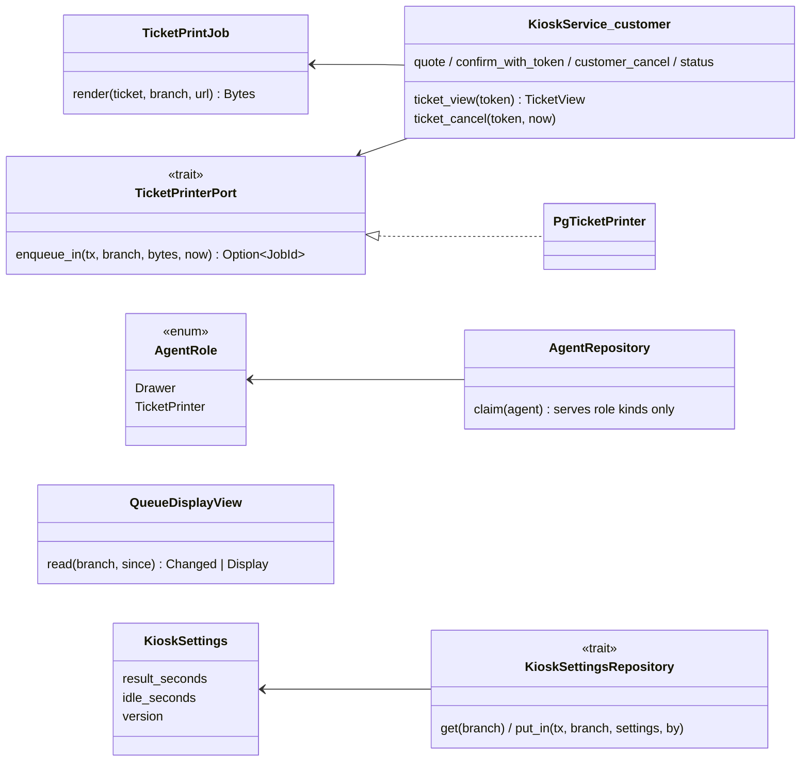

# Kiosk: one customer at a time, a branch kiosk settings page, and a verified phone number

> designed-by: claude/e92db6 (XC FE lane controller), with the BE lane (claude/553782) to complete §4's server half before
> any ticket is cut · measured on `main` `ced3a2d6` · builds on `kiosk-cancel.md` (KC-1..KC-5) and
> `customer-identity-consent.md` (phone-first customers, `PhoneVerificationService`)

## 0. Decided (owner, 2026-10-21)

| # | Rule | Owner's words |
|---|---|---|
| KS-1 | A kiosk is **shared**: it serves **one customer at a time**, and starts over when that customer is done. A request someone leaves half-done must not stay on screen for the next person. | *"ระบบ kiosk มัน จะเริ่มใหม่ เมื่อ ทำจบ"* · *"แต่ มันใช้ ร่วมกัน"* · *"ถ้าอีกคนทำค้างไว้"* · *"กรณี ใข้ รวมกัน หลาย คน"* · *"มัน ควรทำที่ละคน ในเครื่อง นั้น"* |
| KS-2 | The customer's cancel at the kiosk is **one press**. The customer never types a code. | *"ต้องมาใส่ รหัส มันไม่รู้รหัส อะดิ"* · *"มันควร กดยกเลิกได้ เลย"* |
| KS-3 | How long the queue-number screen stays is **configurable**, on a **per-branch kiosk settings page in admin**. | *"ให้ตั้งค่าได้เอง"* · *"ควรมีหน้า คอนฟิก สำหรับ kiosk"* (chose "the admin page, per branch") |
| KS-4 | To book a queue at the kiosk the customer **must enter a phone number**, used to tell who is who, **verified by an SMS OTP** so a mistyped number is caught. | *"ลูกค้า มาควร มีการใส่ เบอร์ โทร เพื่อ จองคิว"* · chose "required" · *"ใช้ในการแยกแยะ ว่าใครเป็นใคร"* · *"ส่ง sms เพื่อ ยืนยัน ตัว ตน"* · *"ควร มี otpเพื่อกัน การ ใส่เบอร์ ผิด"* |
| KS-4a | **Login first, always.** The phone + OTP login comes **before** the first exchange screen (currency/amount), on the kiosk and on the phone (KS-7). No anonymous path exists, and **no switch bypasses it**. So the Identity → Notify SMS setup (§6 Q2) is a **prerequisite of shipping this**: until it is done, the feature waits, and nothing runs without login. | *"ใช้ otp"* · *"มันต้อง ผ่าน login ก่อน มาหน้านี้"* (shown the reference kiosk's step 1) |
| KS-4b | **The OTP works the way 108heros does it:** the code is sent and checked by the central **Identity** platform (`POST {identity}/auth/otp/request {destination, channel: "sms"}`, then verify; `108-Plaza/108heros-flutter` `lib/features/auth/infrastructure/data_sources/identity_otp_api.dart:17-29`). Identity sends the SMS through the 108 Plaza Notify. | *"เหมือน 108 heros"* |
| KS-6 | The customer gets a **queue ticket** from booking. **How it is delivered is a branch setting** on the kiosk settings page (KS-3), with three choices: **print + SMS**, **print only**, or **SMS only**. **The default is SMS only** (*"ให้default ที่ sms ก่อน"* · *"เพราะเครื่องพิพม์ ยัง ไม่แน่ชัด"*: the kiosk printer is not settled yet, so printing is built only once a printer is chosen). The printed slip carries the queue number, the time and the currency. The SMS carries the queue number and a link to see the status and cancel. | *"น่าจะมี บัตร คิว"* · *"ที่ได้ จาก การจองคิว"* · *"ให้ คอนฟิก ได้ ว่า จะใช้ แบบ ไหน ตามตัวเลือกที่เสนอมา"* |
| KS-4c | **Taking a queue at the kiosk is a normal customer login.** Phone + OTP signs the customer in exactly as the customer sign-in does (Identity OTP, KS-4b). The request belongs to that signed-in customer: found by phone, or created as a new customer. On a shared kiosk the session **ends at the kiosk's reset** (KS-1), so the next person starts signed out. | *"การ ใช้ คิว ก็เหมือนการ login ปกติ"* · *"เพื่อให้สามารถ แยกแยะ orders ได้ จำเป็นต้องใข้ เบอร์ โทรใน login"*: the phone number is the login, so every order can be told apart by its customer |
| KS-7 | **The rate board's QR joins the queue now, on the customer's own phone.** Scanning opens the same queue flow as the kiosk, on the phone: sign in by phone + OTP (KS-4c), choose currency and amount, get a walk-in queue number, and be called by SMS or the ticket page. It opens **the customer web pages** (`/app/…`, owner: *"มันจะไปหน้่าลูกค้า ใช่ไหม"* — yes): a new customer page, e.g. `/app/queue?branch=<code>`, behind the existing customer sign-in (`/app/sign-in`, phone + OTP). After joining, the customer sees the queue among their own pages. It replaces the board QR's current target, `/app/book` (`web/src/screens/customer/rate-display/BookingQr.tsx:16`, `rate-display.md` D9a). Booking a time stays in the app. On a personal phone the session does not have to end at once, but every request still belongs to one signed-in customer. | Shown a reference board (`rate.xc-th.work`, *Scan to join the queue · Get called on your phone*), the owner asked *"สแกน QR Code จองคิวได้ไหม"* · *"มันแยก แยะได้ได้ไหม"*, then chose "join the queue now on the phone" · *"มันต้องต้อง แยก แยะ ใครเป็นใครได้นะ"* |
| KS-5 | The system calls the queue in order, and **a calling display shows it, like a bank's**: a public screen at the branch with the number being called and the counter it goes to. Call order stays today's rule (BOOKING before WALK_IN, then the lowest number, `xc-queue/src/infrastructure/repository.rs:355-364`). | *"ระบบ ป็นคนเรียก คิว ที่รัน ตาม คิวการจอง"* · *"มีหน้า จอ เรียก เหมือน ธนาคาร"* · *"ว่า คิวไหน จะเข้าใช้บริการ"* |

## 1. What exists today (measured)

- **The kiosk never lets go of a finished customer.**
  - `KioskController._onIdle` (`app/lib/features/kiosk/presentation/controllers/kiosk_controller.dart:396-400`) exempts the waiting and receipt screens from the 2-minute idle reset (`idle_timer.dart:5`).
  - The only other reset is 30 s after `COMPLETED` (`:641-646`).
  - So a request stays on screen until staff finish it, and KC-A's cancel button (#4208) sits on that screen. **#4243** fixes this (KS-1, KS-2) with a 30-second constant.
- **Kiosk settings:** `/kiosk-currencies.html` (admin, per branch) holds the currency switches only (`kiosk_currencies`, `api/migrations/20261007170000_kiosk.sql:32-37`). There is no row for timings.
- **Phone on a kiosk request:** none. `kiosk_requests` has no phone or customer column (`20261007170000_kiosk.sql:4-24`).
- **Phone OTP today:**
  - `PhoneVerificationService` (`api/crates/xc-customer/src/application/customer/phone_verification_service.rs`) sends an SMS code through `SmsSender`. Its rate limits are in `PhoneOtpPolicy`.
  - It is **staff-initiated, for an existing customer**: `phone_verifications.customer_id` and `requested_by` (a user) are `NOT NULL` (`api/migrations/20261205141000_phone_verifications.sql`).
  - The phone is stored **encrypted**, with a lookup hash (`phone_encrypted`, `phone_lookup_hash`).
  - A kiosk customer is anonymous, with no user and maybe no customer yet, so this service cannot be called as it is.
- **SMS on the test host: none today.** claude/553782 measured it at ~07:25Z by grepping key names only.
  - xc-v3's `NotifySmsSender` (`api/src/infrastructure/notify/notify_sms_sender.rs`) needs `NOTIFY_BASE_URL` and `NOTIFY_API_KEY`, and neither is in `/etc/xc-v3/env` or `/etc/xc-v3/*.env`. So every send answers `smsUnavailable`.
  - Identity's OTP is `AUTH_OTP_DELIVERY_MODE=noop`.
  - `deploy/HOST-do-sgp1.md` I-3 leaves the sender choice to the owner.
  - **A required SMS OTP would therefore block every kiosk booking until a sender is set.**

## 2. Behaviour

**Kiosk flow (KS-1, KS-2, KS-4):** start → currency and amount → **phone** → **OTP** → review → confirm → **queue number + ยกเลิกคิว + เสร็จ** for *N* seconds → start.

| Step | Rule |
|---|---|
| phone | Required. Normalised and validated as the server does for customers. A wrong shape is refused on the screen. |
| OTP | An SMS code to that number. The confirm is refused until the code is verified. The rate limits are the customer OTP's (`PhoneOtpPolicy`), per phone and per kiosk address. A resend is allowed after the policy's wait. Idle on this screen resets the kiosk (KS-1). |
| confirm | The request carries the **verified customer**: an existing customer found by phone (lookup hash), or a new customer with a verified PHONE identity. The kiosk never shows any customer data back. |
| done screen | *N* = the branch's `resultSeconds` (KS-3), default 30. ยกเลิกคิว is one press (`customerCancel` with the hidden token). เสร็จ resets at once. |
| idle | Every screen resets after the branch's `idleSeconds`, default 120 (today's constant). |

**Staff side:** the queue panel and the desk show the customer for a kiosk request, so the desk need not ask for the phone again. Exactly what is shown is the BE lane's call with `customer-identity-consent.md` (masked phone, name if known).

**Calling display (KS-5).**
- Measured: there is **no public calling screen** on `main`. The desk's `Board.tsx` (`web/src/screens/desk/queue/board/Board.tsx`) and `queue_board` are staff-only, behind `QueueOperate` (`docs/design/blueprint/queue-tickets.md:162`). The `qa-e2e.md` F8 row says so too.
- The new page is a full-screen, signed-out page, opened on a TV at the branch, e.g. `/queue-display?branch=MAIN`.
  - It shows the **number being called** and **its counter**, large, plus the last few called numbers.
  - A chime plays on each new call (proposed; a spoken Thai announcement can come later).
  - It never shows a name, a phone number or an amount.
- It is fed by a **public, numbers-only view** that follows the poll seam's `since` → `{changed:false}` (🔁).

**Queue ticket (KS-6).**
- **Print:** a small slip from a printer at the kiosk.
  - **The printer is the one already given** (owner, 2026-10-21: *"เครื่อง พิมพ์ เหมือนเคยให้ มาแล้วนะ"* · *"กับลิ้นชัก"*): the **POS80** 80 mm ESC/POS receipt printer, with the cash drawer on it.
    - In v2 it sat on the counter Mac's USB as CUPS queue `POS80_` (`docs/design/xchange-v3-known-differences.md:52`).
    - v3 reaches it through the **device agent** (`deploy/agent/README.md` §A CUPS raw / §B TCP 9100), which already drives the drawer kick.
    - So the kiosk ticket is a print job the server builds as ESC/POS and the branch's device agent sends. The kiosk app does not print by itself, and it works from both the Flutter and the web build.
    - Open for the BE lane: whether the kiosk's printer is the counter POS80 or a second POS80 at the kiosk. The owner names the target when the agent is paired.
- **SMS:** sent through Identity/Notify like the OTP (KS-4b), to the verified phone.
  - It carries a link to a **public, signed-out ticket page**: the number, the status, and **ยกเลิกคิว**.
  - The page is opened by a per-ticket secret in the link, never by the request id. That lets a customer who has walked away cancel later, without breaking KS-1.
- **The branch setting decides** which of the three ticket modes runs. With SMS off, the cancel after the done screen is staff-only, as today.

## 3. Data (migration **approved** by the owner 2026-10-21: *"อนุมัติ migration"*)

- `kiosk_settings` per branch: `result_seconds`, `idle_seconds`, `ticket_mode` (`PRINT_SMS` | `PRINT` | `SMS`, default `SMS`), CHECKed ranges, `updated_by`, `updated_at`, and a version for the poll seam. Or columns on an existing per-branch table: the BE lane chooses.
- `kiosk_requests.customer_id` (nullable for rows before the migration; required for new ones by the service, not by the schema, so old rows stay valid).
- A kiosk OTP challenge store: either `phone_verifications` with `customer_id`/`requested_by` made nullable plus a `source` column, or its own table. The phone is always stored encrypted like `phone_verifications`.
- No backfill: existing requests have no phone.

## 4. Server half (BE lane)

> designed-by: claude/c4be83 for the BE lane controller claude/553782 · measured on xchange `main` `f62cbf6c` and
> `108-platform-services` `8b53cee` (xchange's pinned `pos-printer`) · written for the owner's final model of
> 2026-10-21 (PR 4249, claude/553782): **the kiosk issues queue tickets only, with no login** (*"บัตรคิวอย่างเดียว"*);
> the rate-board QR stays the web booking page with login (*"หน้าจองทางเว็บ (login) เหมือนเดิม"*). Earlier §4 versions
> (phone + OTP login, board-QR phone queue, Identity → Notify setup) are in this file's git history at `bf7efba8` and
> `1dde5b6c`.

### 4.1 What the server does today (measured)

- **The kiosk already gives a queue number with no login.**
  - `quote`, `confirm`, `status`, `customerReceipt` and `customerCancel` are `Need::Public`
    (`api/crates/xc-auth/src/domain/policy/entities/policy.rs:123-126`).
  - `confirm` issues the walk-in ticket in its own transaction (`IssueSource::Kiosk {request_id}`,
    `api/src/presentation/http/kiosk.rs`, the `Confirm` arm).
  - The core is the customer half of `KioskService`: `quote` `:58`, `confirm_with_token` `:219`,
    `customer_cancel` `:328`, `status` `:394`, `customer_receipt` `:406`, in
    `api/crates/xc-kiosk/src/application/kiosk/customer.rs`.
- **The cancel token is already a per-ticket secret.**
  - `confirm` mints a UUID v4 and returns it once.
  - Only its SHA-256 is stored, as `kiosk_requests.cancel_token_hash` (`api/migrations/20261219190000_kiosk_cancel.sql:15`;
    written and compared in `xc-kiosk/src/infrastructure/kiosk/kiosk_repository.rs:635,654`).
  - Today the customer cancel also needs the same client address as the quote (`customer.rs:327-333`,
    `kiosk-cancel.md` §3.4).
- **Printing: the device agent can print, but the server never sends it a print job.**
  - The agent writes whatever bytes it is given to CUPS raw or TCP 9100 (`api/crates/xc-device-agent/src/runner.rs:268-301`;
    `Claimed.bytes` is base64, `client.rs:38-44`).
  - Every claim query serves **only `DRAWER_REQUEST`** jobs (`api/src/infrastructure/device_agents/pg_agent_repository.rs:296,315,342,449`).
    `PRINT_RECEIPT` jobs are run by the server's own simulated driver (`api/src/infrastructure/devices/escpos_driver.rs:52-76`).
  - `device_jobs.kind` is CHECKed to `PRINT_RECEIPT`/`DRAWER_REQUEST` (`api/migrations/20261007180000_devices.sql:7`).
  - **One active agent per branch** (`api/migrations/20261008120000_device_agents.sql:29-31`, the unique index
    `device_agents_one_active_per_branch_idx`). An agent has one target (`drawer_transport`/`drawer_target`, `:24`).
  - The agent runs on macOS or Linux only (`deploy/agent/README.md` §1).
  - `pos-printer` at xchange's pin draws QR codes on paper (`crates/pos-printer/src/escpos.rs:305` `qr_native`,
    `:316` `qr_raster`).
- **Calling data.**
  - `queue_tickets` has `status` (… `CALLED`, `SERVING` …), `called_at` and `counter_teller_id`
    (`api/migrations/20261101100000_queue.sql:14-19`).
  - A counter is a teller (`queue_counters`, primary key `(branch_id, teller_id)`, `:41-47`); **there is no counter
    number or label.**
  - `branch_service_status.queue_version` rises on every queue change (`:53`; `queue_board.rs:4-6`). That is the poll
    seam's version.
  - The only board is staff-only (`queue_board`, `QueueOperate`).
- **No kiosk settings row:** the idle reset is a constant (`app/lib/features/kiosk/presentation/controllers/idle_timer.dart:5`).
- **Member booking stays as it is:** `/app/book` on the board QR (`web/src/screens/customer/rate-display/BookingQr.tsx:16`),
  and `queueTicketTake` for a signed-in customer (`api/src/presentation/http/v3/commands/queue_ticket_take.rs`; owner
  Q4: keep both).

### 4.2 Decisions (BE lane)

| # | Decision | Why |
|---|---|---|
| T1 | **One anonymous ticket core: the kiosk's.** No login, no customer on the request, no `CustomerSelf` on `quote`/`confirm`. The withdrawn `kiosk_requests.customer_id` and `/app/queue` are not built. The person is identified at the desk by the passport. | owner: *"บัตรคิวอย่างเดียว"* |
| T2 | **The ticket secret is the cancel token.** No new secret and no new column. The printed QR, and the QR on the done screen, encode `<origin>/q#<token>`. The token is in the fragment, so it is never sent in a request line, a server log or a referrer. | KS-6: the per-ticket secret, never the request id |
| T3 | **Public ticket page = two new public kiosk actions**, with the token in the body:  • `ticketView` → `{displayNumber, status, ticketsAhead, branchName, issuedAt}`, the wait from the queue's `ticket_wait_in`, as `queueTicketTake` reads it.  • `ticketCancel` → the same transition as `customerCancel` (`KIOSK_CANCELLED`, `CUSTOMER_CANCELLED`).  Found by `cancel_token_hash`. A wrong or unknown token answers `404 notFound`, the same for both, so it reveals nothing. | KS-6 |
| T4 | **`ticketCancel` needs the token only.** The kiosk screen's one-press cancel keeps today's same-address rule (`customer.rs:327-333`). A printed ticket leaves the kiosk; whoever holds it can cancel from any network. | KS-2, KS-6 |
| T5 | **The printer: a second POS80 at the kiosk, not the counter's.**  • The ticket must come out where the customer stands. The counter POS80 is behind the desk, also kicks the cash drawer, and prints receipts. A shared printer would put tickets in the teller's hands and interleave them with receipts.  • Same model (POS80, 80 mm ESC/POS, owner: *"เครื่อง พิมพ์ เหมือนเคยให้ มาแล้วนะ"*); its drawer port is unused.  • It is driven by **its own paired agent**: on the kiosk computer with the POS80 on USB (CUPS raw), when the kiosk runs macOS or Linux; or on any branch macOS/Linux machine, with the POS80 on the LAN (TCP 9100). | KS-6 |
| T6 | **Agents get a role.** `device_agents.role` (`DRAWER` default, `TICKET_PRINTER`). The one-active rule becomes one active agent **per branch per role**. Claim queries serve `DRAWER_REQUEST` to `DRAWER` agents and `PRINT_QUEUE_TICKET` to `TICKET_PRINTER` agents. Pairing names the role. | today's index allows one agent per branch (`device_agents.sql:29-31`) |
| T7 | **`confirm` queues the ticket print in the same transaction as the ticket.**  • The job kind is `PRINT_QUEUE_TICKET`.  • Its bytes are rendered server-side with `pos-printer`: branch name, the number large, date and time, currency and side, the QR (T2), and *"ยกเลิกคิวได้ที่ QR นี้"*.  • No active `TICKET_PRINTER` agent at the branch ⇒ no job is queued; the done screen still shows the number and the QR, which can be photographed.  • A ticket job older than 60 s is `EXPIRED` and never printed (a late slip would reach the next customer). The same rule shape as the drawer's 10 s. | KS-1, KS-6 |
| T8 | **The calling display is a public, numbers-only view** on the poll seam (🔁). `GET /api/public/orgs/{org}/branches/{code}/queue-display?since=<version>` answers:  • `{changed: false}` while `queue_version` is unchanged (O(1));  • otherwise `{version, calling: [{displayNumber, counter}], recent: [displayNumber ×5]}`, for today, `CALLED`/`SERVING` by `called_at`.  It never carries a name, phone, amount or teller. | KS-5; same route style as `public/branch_rates.rs:16` |
| T9 | **A counter label for the display.** `queue_counters.label` (short text, e.g. *"ช่อง 2"*), set by the teller or manager when opening a counter. Without a label the display shows the number only. | KS-5 *"the counter it goes to"*; no counter label exists today |
| T10 | **KS-3 kiosk settings.**  • `kiosk_settings` per branch: `result_seconds` (default 30, 10–300) and `idle_seconds` (default 120, 30–600), plus `updated_by`, `updated_at`, `version`.  • Public read: kiosk action `settings`, with defaults when the branch has no row, `since` → `{changed: false}`.  • Write: `configureSettings` behind `RatesDraft`, the currency switches' permission.  • No ticket mode: every kiosk customer gets the printed ticket. | KS-3; §3 |

### 4.3 Class diagram

| Class | File | New / changed | Provides | Used by |
|---|---|---|---|---|
| `KioskService` customer half | `api/crates/xc-kiosk/src/application/kiosk/customer.rs` | changed: `ticket_view`, `ticket_cancel`; `confirm_with_token` calls the printer port in its transaction | the one ticket core | `kiosk.rs` |
| `TicketView` | `api/crates/xc-kiosk/src/domain/kiosk/value_objects/ticket_view.rs` | new | T3's answer | `kiosk.rs`, the ticket page |
| `KioskRepository::find_by_token_in` | `api/crates/xc-kiosk/src/infrastructure/kiosk/kiosk_repository.rs` | new: by `cancel_token_hash` | | the core |
| `TicketPrintJob` | `api/crates/xc-kiosk/src/domain/kiosk/value_objects/ticket_print_job.rs` | new: ESC/POS bytes with `pos-printer` (QR) | T7's slip | the core |
| `TicketPrinterPort` (trait) + `PgTicketPrinter` | `…/domain/kiosk/repositories/ticket_printer_port.rs`, `api/src/infrastructure/kiosk/pg_ticket_printer.rs` | new | queues `PRINT_QUEUE_TICKET` when a `TICKET_PRINTER` agent is active; `None` otherwise | the core |
| `JobKind::PrintQueueTicket` | `api/src/infrastructure/devices/device_job.rs` | changed | | the agent repository |
| `AgentRole` + the claim queries | `api/src/infrastructure/device_agents/` (`agent_repository.rs`, `claim.rs`, `pg_agent_repository.rs:296,315,342,449`) | changed: role on pair; claim by the role's kinds; 60 s freshness for ticket jobs | T6 | `device_agent.rs` |
| `QueueDisplayView` | `api/src/presentation/http/public/queue_display.rs` | new | T8 | the display page (FE) |
| `KioskSettings`, `KioskSettingsRepository`, `PgKioskSettingsRepository` | `…/domain/kiosk/entities/kiosk_settings.rs`, `…/repositories/kiosk_settings_repository.rs`, `api/src/infrastructure/kiosk/pg_kiosk_settings_repository.rs` | new | T10 | `kiosk.rs`, the admin page |

The agent binary does not change: it already sends any bytes it is given (`runner.rs:268-301`). Pairing passes the
role: `xc-device-agent install --code … --role ticket` (one new CLI flag, in `main.rs`).

### 4.4 Behaviour

| # | Given | Answer |
|---|---|---|
| B1 | kiosk `quote` / `confirm` | as today (today's kiosk tests stay green unchanged) |
| B2 | `confirm`, a `TICKET_PRINTER` agent is active | the ticket plus one `PRINT_QUEUE_TICKET` job in the same transaction; `confirm` answers as today plus `ticketUrl` |
| B3 | `confirm`, no ticket agent | the ticket, no job; `ticketUrl` still answered (shown as a QR on the done screen) |
| B4 | the ticket agent claims | gets only `PRINT_QUEUE_TICKET`; the drawer agent gets only `DRAWER_REQUEST` |
| B5 | a ticket job older than 60 s at claim | `EXPIRED`, never sent |
| B6 | pairing a second `TICKET_PRINTER` agent at a branch that has one | refused, as the drawer rule today |
| B7 | `ticketView`, right token | `{displayNumber, status, ticketsAhead, branchName, issuedAt}`; never an amount or a name |
| B8 | `ticketView` / `ticketCancel`, wrong or unknown token | `404 notFound`, the same answer |
| B9 | `ticketCancel`, right token, from any address, ticket `WAITING` | cancelled (`KIOSK_CANCELLED`, `CUSTOMER_CANCELLED`) |
| B10 | `ticketCancel` on `CALLED`/`SERVING`/`COMPLETED`/`CANCELLED` | as `kiosk-cancel.md` §3: not the customer's after `WAITING`; repeat-safe on `CANCELLED` |
| B11 | the kiosk screen's `customerCancel`, another address | refused, as today |
| B12 | `queue-display`, `since` = the current version | `{changed: false}` |
| B13 | `queue-display`, a change | today's `CALLED`/`SERVING` with their counter labels (number only when no label) and the last 5 called; no name, phone, amount or teller |
| B14 | `settings` with no row / with a row | defaults 30 / 120 / the row; `since` → `{changed: false}` |
| B15 | `configureSettings` with values out of range, or without `RatesDraft` | `400 validationFailed` naming the field / `403` |

### 4.5 Rules the tests pin first (up-front, `class:logic`)

- B2–B6 on the core and the agent repository with a real Postgres: the job and the ticket commit or roll back
  together; the role routing; 60 s freshness.
- B7–B11 on the core: the token is the only key; a wrong token cannot tell "never existed" from "another branch".
- B12–B13 on the view; a guard that its JSON has no field outside the list in T8.
- B14–B15 on the settings.
- `TicketPrintJob`: the bytes contain the number and a QR of `ticketUrl`; the token appears nowhere else in the slip.
- B1: today's kiosk and drawer-agent tests unchanged and green.

### 4.6 Data (one migration; needs the owner's approval for the device and counter parts)

- `kiosk_settings` (T10). Covered by the §3 approval (*"อนุมัติ migration"*).
- `device_jobs.kind` CHECK + `PRINT_QUEUE_TICKET`. `device_agents.role` (`DRAWER` default, CHECK `DRAWER`/`TICKET_PRINTER`).
  The one-active index becomes `(branch_id, role) WHERE revoked_at IS NULL`. A partial index for queued ticket jobs.
  **Not in §3: owner question Q7.**
- `queue_counters.label` (T9, nullable). **Not in §3: owner question Q8.**
- No backfill: existing agents become `DRAWER`; existing counters have no label.

### 4.7 Open owner questions (batched by claude/e92db6)

- **Q7 (T5/T6).** Approve the device migration: a role on agents and a ticket job kind, so a second POS80 at the kiosk
  prints the queue ticket. Proposed: yes. The alternative, printing on the counter POS80, needs no migration, but the
  ticket comes out behind the desk.
- **Q8 (T9).** Approve `queue_counters.label`, so the calling display can say which counter. Proposed: yes. Without
  it, the display shows only the number being called.

### 4.8 Release order

1. This design merges, doc-only.
2. **No tickets are cut before deploy 10** (owner 553782).
3. After deploy 10, the BE tickets follow §4.3 in three slices that share no files: the ticket core + page (T2–T4),
   printing (T5–T7, after Q7), and display + settings (T8–T10, the label after Q8). The migration is renumbered with
   `scripts/migration-slot.sh next` right before `pr_open`.
4. **Hardware, by the owner:** a second POS80 at each kiosk, paired as `--role ticket`. Until one is paired, the ticket
   QR shows on screen only (B3).
5. Deploy is a separate owner order.

## 5. Front ends (this lane)

- **Admin:** `/kiosk-currencies.html` becomes **ตั้งค่าตู้**: the currency switches plus `resultSeconds` and `idleSeconds`.
- **Kiosk app:** the phone and OTP steps; `resultSeconds` and `idleSeconds` from the settings read, replacing #4243's constant; all 16 kiosk languages for the new texts (`app/assets/l10n/kiosk.json`).
- **Queue panel and desk:** show the kiosk request's customer.

## 6. Open questions for the owner (one batch)

1. ✅ **KS-5 answered:** a calling display like a bank's (§2). Still open: whether to add a spoken announcement. Earlier wording of this question: Today a teller presses call-next, which picks BOOKING tickets before WALK_IN and then the lowest number (`xc-queue/src/infrastructure/repository.rs:355-364`). Does the owner mean (a) call-next is already right; (b) the **system** should call the next number by itself when a counter frees up; or (c) kiosk requests should be ordered with bookings?
2. ✅ **Decided 2026-10-21: the 108 Plaza Notify platform** (*"ใช่ Notify ชอง 108 plaza"*). With KS-4b the setting lives on **Identity**, not on xc-v3: set Identity's `AUTH_OTP_DELIVERY_MODE=http`, plus `AUTH_OTP_HTTP_ENDPOINT` (Notify's `/api/v1/otp`) and `AUTH_OTP_HTTP_API_KEY`, the same as 108heros's Identity. Today the instance xc-v3 uses runs `noop`. **The owner creates and sets the key**, because secrets are the owner's. Background: which SMS sender xc-v3 uses was an owner prerequisite of KS-4, per I-3. The fleet already has one: the Notify platform (`108-platform-services`). It sends SMS through ThaiBulkSMS with the approved sender `108-Pos`, per the memory store's notify record of 2026-07-31; that is **not re-measured today**. Pointing xc-v3's `NOTIFY_BASE_URL` / `NOTIFY_API_KEY` at it needs no new provider. **Proposed:** use Notify. The owner sets the key (secrets are the owner's). There is no bridge: KS-4a requires login first, so this setup must be done before the feature ships.
3. ✅ **Migration approved** for §3 (*"อนุมัติ migration"*, 2026-10-21). Deploy remains a separate owner order.
