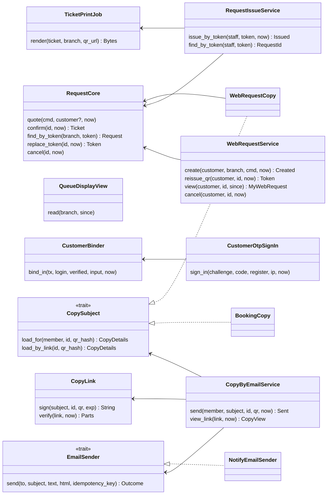
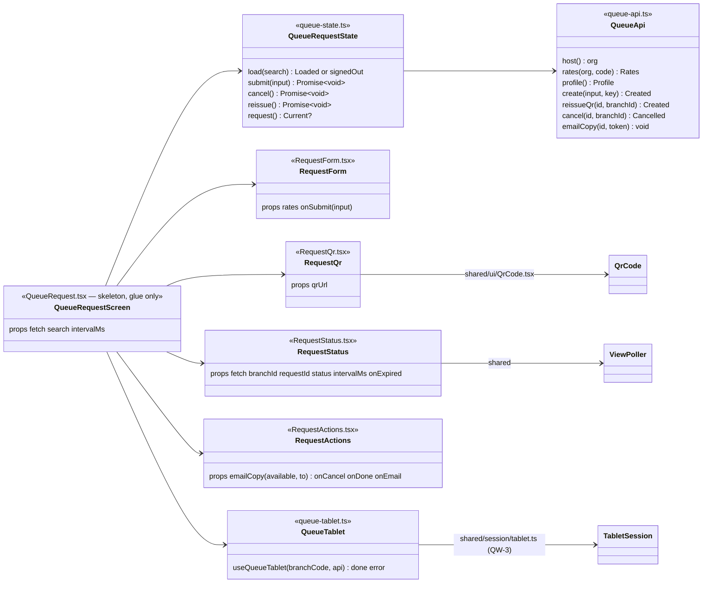
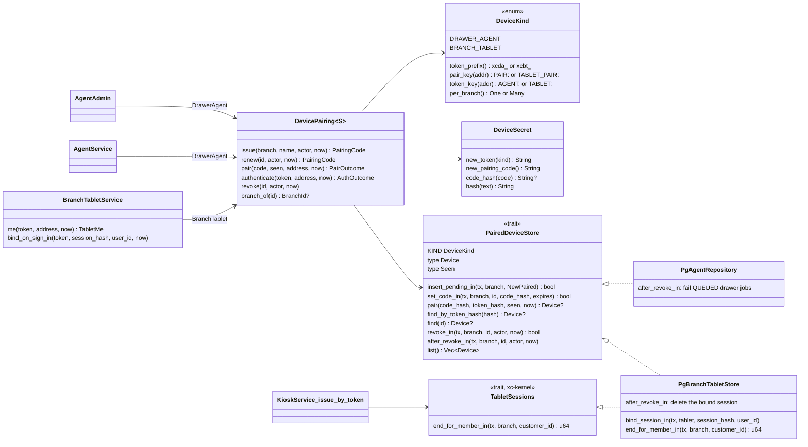
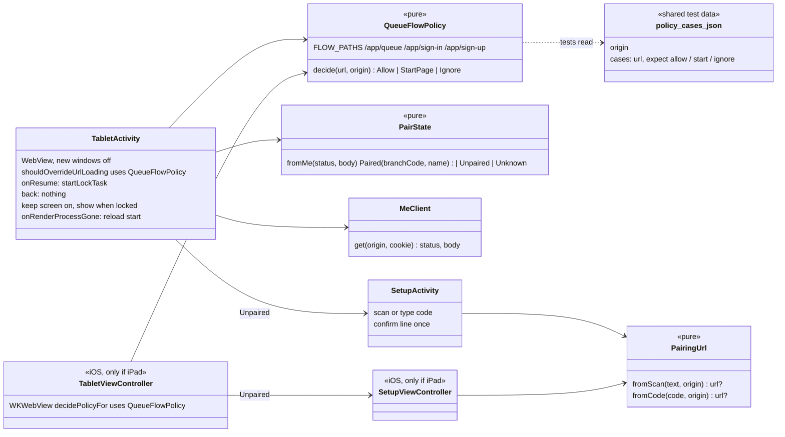

# Kiosk: one customer at a time, a branch kiosk settings page, and a verified phone number

> designed-by: claude/e92db6 (XC FE lane controller), with the BE lane (claude/553782) to complete §4's server half before
> any ticket is cut · measured on `main` `ced3a2d6` · builds on `kiosk-cancel.md` (KC-1..KC-5) and
> `customer-identity-consent.md` (phone-first customers, `PhoneVerificationService`)

> 🔴 **Superseded in part (claude/e92db6, 2026-10-21).** The owner's later rulings changed the kiosk model. **§4 is the
> current design for the server, and §0a below is the current set of rules.** §0–§3, §5 and §6 are kept as history. Where
> they differ from §0a or §4, they are superseded and must not be built. Every changed row is marked ~~superseded~~ inline.
>
> 🔴 **Branch tablet (2026-10-22):** §7 is the current design for the branch tablet. It replaces D16's "no tablet
> credential", F9, U6–U8, QW-3 and QW-2g.
>
> 🔴 **Wrapper app (2026-10-22):** §7.11 adds the wrapper app the branch tablet runs the page inside. It amends R-T5's
> "no tablet app"; the page itself stays one page.

## 0a. Current rules (owner, 2026-10-21; supersede §0–§3, §5, §6 where they differ)

Recorded on PR 4249: issuecomment-6312118645 (R-1..R-3, R-9), issuecomment-6321559434 (R-4, R-6, R-10's e-mail, Q11) and **issuecomment-6322707249** (R-5's tablet quotes, R-7 Q8, R-8 Q12). R-10's download quote is on **#4327**.

| # | Current rule | Owner's words |
|---|---|---|
| R-1 | **There is no customer kiosk at the branch.** Customers order through the web. | *"kiosk ที่ สาชา ไม่มีแล้ว"* · *"สั่ง ผ่าน เว็บ"* · *"ไม่มี ระบบ kiosk ที่สาขา"* · *"เพราะมันซ้ำซ้อนกกัน"* |
| R-2 | **The Flutter app becomes the staff queue machine.** Staff scan the customer's request QR, and the scan issues the queue number and prints the ticket. | *"flutter ยกเลิกได้ไม่หมดเพราะ ยกต้องมี ระบบ พิมพ์ คิว"* · *"จาก kiosk เป็นเครือง พิพม์ คิว แทน"* · *"ให้ พนักงาน สแกน qr code ทีลูกค้า ทำรายการ ไว้แล้ว"* · *"เครื่อง เพิ่ม คิว ยังต้องใช้"* · *"พอได้ qr code ลูกค้่าต้องเอา มาให้ พนักงาน สแกน เพื่อรับ คิว"* |
| R-3 | **Web flow:** scan the board QR, sign in, fill the request, and get a **request QR with no number**. Staff scan it at the queue machine, which issues the number and prints. The customer waits for the call, and the desk opens the request. | as R-2 |
| R-4 | **The printer is attached to the queue machine** (Q7 B), so the queue machine is a Flutter native build. | *"เครื่องพิมพ์ต่อกับเครื่องเพิ่มคิว"* |
| R-5 | **A customer without a phone borrows a branch tablet**, which signs in exactly like the customer's own phone (Q11). The session ends when the request is done. | *"ลูกค้าไม่มี มือถือ ที่ สาขา มี tablat ให้ ใช้ทำรายการ"* · *"ก็เหมือน มือถือ ลูกค้าปกติ"* · *"แค่ ยืมที่สาขาใช้งานชั่วคราว"* · *"ก็ทำเหมือน ที่ลูกค้า ใช้ เครื่องตัว เอง ไง"* |
| R-6 | **Sign-in by SMS OTP, or e-mail OTP for customers without a Thai SIM** (Q10). | chose *"เพิ่ม OTP ทางอีเมล (แนะนำ)"* |
| R-7 | **The calling display shows the queue number only**, with no counter label (Q8). | chose *"แสดงแค่เลขคิว"* |
| R-8 | **Only staff issue numbers.** The public `confirm` needs `QueueOperate` (Q12). | chose *"เฉพาะพนักงาน (แนะนำ)"* |
| R-9 | **The desk passport check stays skippable.** | *"ตรวจ พาสปอร์ท ให้ กดข้ามได้"* |
| R-10 | **The booking QR can be downloaded.** On request, the customer can also have it e-mailed, with a link valid 1 day. | *"มันควรให้ ดาวน์โหลดได้ด้วยเดียวมันหาย"* · *"ให้ ส่งเมล์ได้ เป็น option"* · *"ข้อมูล จะได้ไปเก็บที่เมล์ ด้วย ถ้า ลูกค้า ต้องการ"* |
| R-11 | **Cancels stay one press and need no approval.** | KS-2; `cancels-need-no-approval-or-limit` |

**Superseded rows from §0:**
- KS-1 and KS-2 now apply to the borrowed tablet's web session, not to a kiosk.
- KS-3: there is no kiosk settings page. §4 D14 keeps only what the queue machine needs.
- KS-4/4a/4b/4c: sign-in is the customer web sign-in (R-5, R-6). There is no kiosk sign-in.
- KS-6: the ticket prints at the queue machine (R-4). The SMS ticket and its ticket-mode setting are dropped.
- KS-7: the board QR opens the web request flow (R-3). The number comes at the staff scan, not on submit.
- KS-5 stands, but shows the number only (R-7).

## 0. Decided (owner, 2026-10-21)

> ~~superseded~~ in part: see §0a for each row's current rule.

| # | Rule | Owner's words |
|---|---|---|
| KS-1 | A kiosk is **shared**: it serves **one customer at a time**, and starts over when that customer is done. A request someone leaves half-done must not stay on screen for the next person. | *"ระบบ kiosk มัน จะเริ่มใหม่ เมื่อ ทำจบ"* · *"แต่ มันใช้ ร่วมกัน"* · *"ถ้าอีกคนทำค้างไว้"* · *"กรณี ใข้ รวมกัน หลาย คน"* · *"มัน ควรทำที่ละคน ในเครื่อง นั้น"* |
| KS-2 | The customer's cancel at the kiosk is **one press**. The customer never types a code. | *"ต้องมาใส่ รหัส มันไม่รู้รหัส อะดิ"* · *"มันควร กดยกเลิกได้ เลย"* |
| KS-3 | How long the queue-number screen stays is **configurable**, on a **per-branch kiosk settings page in admin**. | *"ให้ตั้งค่าได้เอง"* · *"ควรมีหน้า คอนฟิก สำหรับ kiosk"* (chose "the admin page, per branch") |
| KS-4 | To book a queue at the kiosk the customer **must enter a phone number**, used to tell who is who, **verified by an SMS OTP** so a mistyped number is caught. | *"ลูกค้า มาควร มีการใส่ เบอร์ โทร เพื่อ จองคิว"* · chose "required" · *"ใช้ในการแยกแยะ ว่าใครเป็นใคร"* · *"ส่ง sms เพื่อ ยืนยัน ตัว ตน"* · *"ควร มี otpเพื่อกัน การ ใส่เบอร์ ผิด"* |
| KS-4a | **Login first, always.** The phone + OTP login comes **before** the first exchange screen (currency/amount), on the kiosk and on the phone (KS-7). No anonymous path exists, and **no switch bypasses it**. So the Identity → Notify SMS setup (§6 Q2) is a **prerequisite of shipping this**: until it is done, the feature waits, and nothing runs without login. | *"ใช้ otp"* · *"มันต้อง ผ่าน login ก่อน มาหน้านี้"* (shown the reference kiosk's step 1) |
| KS-4b | **The OTP works the way 108heros does it:** the code is sent and checked by the central **Identity** platform (`POST {identity}/auth/otp/request {destination, channel: "sms"}`, then verify; `108-Plaza/108heros-flutter` `lib/features/auth/infrastructure/data_sources/identity_otp_api.dart:17-29`). Identity sends the SMS through the 108 Plaza Notify. | *"เหมือน 108 heros"* |
| KS-6 | The customer gets a **queue ticket** from booking. **How it is delivered is a branch setting** on the kiosk settings page (KS-3), with three choices: **print + SMS**, **print only**, or **SMS only**. **The default is SMS only** (*"ให้default ที่ sms ก่อน"* · *"เพราะเครื่องพิพม์ ยัง ไม่แน่ชัด"*: the kiosk printer is not settled yet, so printing is built only once a printer is chosen). The printed slip carries the queue number, the time and the currency. The SMS carries the queue number and a link to see the status and cancel. | *"น่าจะมี บัตร คิว"* · *"ที่ได้ จาก การจองคิว"* · *"ให้ คอนฟิก ได้ ว่า จะใช้ แบบ ไหน ตามตัวเลือกที่เสนอมา"* |
| KS-4c | **Taking a queue at the kiosk is a normal customer login.** Phone + OTP signs the customer in exactly as the customer sign-in does (Identity OTP, KS-4b). The request belongs to that signed-in customer: found by phone, or created as a new customer. On a shared kiosk the session **ends at the kiosk's reset** (KS-1), so the next person starts signed out. | *"การ ใช้ คิว ก็เหมือนการ login ปกติ"* · *"เพื่อให้สามารถ แยกแยะ orders ได้ จำเป็นต้องใข้ เบอร์ โทรใน login"*: the phone number is the login, so every order can be told apart by its customer |
| KS-7 | **The rate board's QR joins the queue now, on the customer's own phone.** Scanning opens the same queue flow as the kiosk, on the phone: sign in by phone + OTP (KS-4c), choose currency and amount, get a walk-in queue number, and be called by SMS or the ticket page. It opens **the customer web pages** (`/app/…`, owner: *"มันจะไปหน้่าลูกค้า ใช่ไหม"* — yes): a new customer page, e.g. `/app/queue?branch=<code>`, behind the existing customer sign-in (`/app/sign-in`, phone + OTP). After joining, the customer sees the queue among their own pages. It replaces the board QR's current target, `/app/book` (`web/src/screens/customer/rate-display/BookingQr.tsx:16`, `rate-display.md` D9a). Booking a time stays in the app. On a personal phone the session does not have to end at once, but every request still belongs to one signed-in customer. | Shown a reference board (`rate.xc-th.work`, *Scan to join the queue · Get called on your phone*), the owner asked *"สแกน QR Code จองคิวได้ไหม"* · *"มันแยก แยะได้ได้ไหม"*, then chose "join the queue now on the phone" · *"มันต้องต้อง แยก แยะ ใครเป็นใครได้นะ"* |
| KS-5 | The system calls the queue in order, and **a calling display shows it, like a bank's**: a public screen at the branch with the number being called and the counter it goes to. Call order stays today's rule (BOOKING before WALK_IN, then the lowest number, `xc-queue/src/infrastructure/repository.rs:355-364`). | *"ระบบ ป็นคนเรียก คิว ที่รัน ตาม คิวการจอง"* · *"มีหน้า จอ เรียก เหมือน ธนาคาร"* · *"ว่า คิวไหน จะเข้าใช้บริการ"* |

## 1. What exists today (measured)

- **The kiosk never lets go of a finished customer.**
  - `KioskController._onIdle` (`app/lib/features/kiosk/presentation/controllers/kiosk_controller.dart:396-400`) exempts the waiting and receipt screens from the 2-minute idle reset (`idle_timer.dart:5`).
  - The only other reset is 30 s after `COMPLETED` (`:641-646`).
  - So a request stays on screen until staff finish it, and KC-A's cancel button (#4208) sits on that screen. **#4243** fixes this (KS-1, KS-2) with a 30-second constant.
- **Kiosk settings:** `/kiosk-currencies.html` (admin, per branch) holds the currency switches only (`kiosk_currencies`, `api/migrations/20261007170000_kiosk.sql:32-37`). There is no row for timings.
- **Phone on a kiosk request:** none. `kiosk_requests` has no phone or customer column (`20261007170000_kiosk.sql:4-24`).
- **Phone OTP today:**
  - `PhoneVerificationService` (`api/crates/xc-customer/src/application/customer/phone_verification_service.rs`) sends an SMS code through `SmsSender`. Its rate limits are in `PhoneOtpPolicy`.
  - It is **staff-initiated, for an existing customer**: `phone_verifications.customer_id` and `requested_by` (a user) are `NOT NULL` (`api/migrations/20261205141000_phone_verifications.sql`).
  - The phone is stored **encrypted**, with a lookup hash (`phone_encrypted`, `phone_lookup_hash`).
  - A kiosk customer is anonymous, with no user and maybe no customer yet, so this service cannot be called as it is.
- **SMS on the test host: none today.** claude/553782 measured it at ~07:25Z by grepping key names only.
  - xc-v3's `NotifySmsSender` (`api/src/infrastructure/notify/notify_sms_sender.rs`) needs `NOTIFY_BASE_URL` and `NOTIFY_API_KEY`, and neither is in `/etc/xc-v3/env` or `/etc/xc-v3/*.env`. So every send answers `smsUnavailable`.
  - Identity's OTP is `AUTH_OTP_DELIVERY_MODE=noop`.
  - `deploy/HOST-do-sgp1.md` I-3 leaves the sender choice to the owner.
  - **A required SMS OTP would therefore block every kiosk booking until a sender is set.**

## 2. Behaviour

> ~~superseded~~: the kiosk flow, kiosk OTP, kiosk settings and SMS ticket below are replaced by §0a R-1..R-8 and §4. The calling display stands, but shows the number only (R-7).

**Kiosk flow (KS-1, KS-2, KS-4):** start → currency and amount → **phone** → **OTP** → review → confirm → **queue number + ยกเลิกคิว + เสร็จ** for *N* seconds → start.

| Step | Rule |
|---|---|
| phone | Required. Normalised and validated as the server does for customers. A wrong shape is refused on the screen. |
| OTP | An SMS code to that number. The confirm is refused until the code is verified. The rate limits are the customer OTP's (`PhoneOtpPolicy`), per phone and per kiosk address. A resend is allowed after the policy's wait. Idle on this screen resets the kiosk (KS-1). |
| confirm | The request carries the **verified customer**: an existing customer found by phone (lookup hash), or a new customer with a verified PHONE identity. The kiosk never shows any customer data back. |
| done screen | *N* = the branch's `resultSeconds` (KS-3), default 30. ยกเลิกคิว is one press (`customerCancel` with the hidden token). เสร็จ resets at once. |
| idle | Every screen resets after the branch's `idleSeconds`, default 120 (today's constant). |

**Staff side:** the queue panel and the desk show the customer for a kiosk request, so the desk need not ask for the phone again. Exactly what is shown is the BE lane's call with `customer-identity-consent.md` (masked phone, name if known).

**Calling display (KS-5).**
- Measured: there is **no public calling screen** on `main`. The desk's `Board.tsx` (`web/src/screens/desk/queue/board/Board.tsx`) and `queue_board` are staff-only, behind `QueueOperate` (`docs/design/blueprint/queue-tickets.md:162`). The `qa-e2e.md` F8 row says so too.
- The new page is a full-screen, signed-out page, opened on a TV at the branch, e.g. `/queue-display?branch=MAIN`.
  - It shows the **number being called** and **its counter**, large, plus the last few called numbers.
  - A chime plays on each new call (proposed; a spoken Thai announcement can come later).
  - It never shows a name, a phone number or an amount.
- It is fed by a **public, numbers-only view** that follows the poll seam's `since` → `{changed:false}` (🔁).

**Queue ticket (KS-6).**
- **Print:** a small slip from a printer at the kiosk.
  - **The printer is the one already given** (owner, 2026-10-21: *"เครื่อง พิมพ์ เหมือนเคยให้ มาแล้วนะ"* · *"กับลิ้นชัก"*): the **POS80** 80 mm ESC/POS receipt printer, with the cash drawer on it.
    - In v2 it sat on the counter Mac's USB as CUPS queue `POS80_` (`docs/design/xchange-v3-known-differences.md:52`).
    - v3 reaches it through the **device agent** (`deploy/agent/README.md` §A CUPS raw / §B TCP 9100), which already drives the drawer kick.
    - So the kiosk ticket is a print job the server builds as ESC/POS and the branch's device agent sends. The kiosk app does not print by itself, and it works from both the Flutter and the web build.
    - Open for the BE lane: whether the kiosk's printer is the counter POS80 or a second POS80 at the kiosk. The owner names the target when the agent is paired.
- **SMS:** sent through Identity/Notify like the OTP (KS-4b), to the verified phone.
  - It carries a link to a **public, signed-out ticket page**: the number, the status, and **ยกเลิกคิว**.
  - The page is opened by a per-ticket secret in the link, never by the request id. That lets a customer who has walked away cancel later, without breaking KS-1.
- **The branch setting decides** which of the three ticket modes runs. With SMS off, the cancel after the done screen is staff-only, as today.

## 3. Data (migration **approved** by the owner: `kiosk_requests.customer_id` in issuecomment-6311349162, `kiosk_settings` in issuecomment-6322650645, *"อนุมัติ"*)

> ~~superseded~~: the current data list is §4.6. Only `kiosk_requests.customer_id` and `kiosk_settings.result_seconds` remain; `idle_seconds`, `ticket_mode` and the kiosk OTP store are dropped.

- `kiosk_settings` per branch: `result_seconds`, `idle_seconds`, `ticket_mode` (`PRINT_SMS` | `PRINT` | `SMS`, default `SMS`), CHECKed ranges, `updated_by`, `updated_at`, and a version for the poll seam. Or columns on an existing per-branch table: the BE lane chooses.
- `kiosk_requests.customer_id` (nullable for rows before the migration; required for new ones by the service, not by the schema, so old rows stay valid).
- A kiosk OTP challenge store: either `phone_verifications` with `customer_id`/`requested_by` made nullable plus a `source` column, or its own table. The phone is always stored encrypted like `phone_verifications`.
- No backfill: existing requests have no phone.

## 4. Server half (BE lane)

> designed-by: claude/c4be83 for the BE lane controller claude/553782 · measured on xchange `main` `4c3fc5a`,
> `108-platform-services` (`681bea2` = the deployed xc-identity, `8b53cee` = xchange's pinned `pos-printer`), do-sgp1
> and Dell, 2026-10-21 · written for the owner's final flow (PR 4249 issuecomment-6312118645):
> *"จาก kiosk เป็นเครือง พิพม์ คิว แทน"* · *"ให้ พนักงาน สแกน qr code ทีลูกค้า ทำรายการ ไว้แล้ว"* ·
> *"พอได้ qr code ลูกค้่าต้องเอา มาให้ พนักงาน สแกน เพื่อรับ คิว"*.
> 1. The customer scans the board QR, signs in and fills the request on the phone, which shows the **request QR** and
>    **no queue number**.
> 2. **Staff scan that QR in the Flutter queue machine**, which **issues the queue number and prints the ticket**.
> 3. The customer waits for the call on the calling display.
> 4. The desk checks the passport.
>
> There is no customer self-service device at the branch. Earlier §4 versions are in git (`bf7efba8`, `1dde5b6c`,
> `1e5e84e1`, `919f33c8`, `514505aa`).
>
> **Revised for the owner's answers of 2026-10-21 ~17:05Z** (PR 4249 issuecomment-6321559434, XC FE session):
> - Q7: *"เครื่องพิมพ์ต่อกับเครื่องเพิ่มคิว"*: the printer is attached to the queue machine (D9).
> - Q10: *"เพิ่ม OTP ทางอีเมล"*: e-mail OTP next to SMS (D11).
> - Q11: *"ก็ทำเหมือน ที่ลูกค้า ใช้ เครื่องตัว เอง ไง"*: the branch tablet signs the customer in like their own phone. The
>   no-login tablet path is gone (D16).
> - New: *"ให้ ส่งเมล์ได้ เป็น option"* · *"ข้อมูล จะได้ไปเก็บที่เมล์ ด้วย ถ้า ลูกค้า ต้องการ"* · *"หรือ ลิงค์ ชั่ว คราว
>   1วัน"*: an optional e-mail with the details, the QR and a signed 1-day link (D21, D22).
>
> **Migrations (553782's order): only `kiosk_requests.customer_id` and `kiosk_settings`.** Anything else this design
> would want goes to 553782 first (§4.6).

### 4.1 What the server does today (measured)

- **The request core is the kiosk's.** The customer half of `KioskService` (`api/crates/xc-kiosk/src/application/kiosk/customer.rs`:
  `quote` `:58`, `confirm_with_token` `:219`, `customer_cancel` `:328`, `status` `:394`):
  - `quote` writes a `QUOTED` request;
  - `confirm` moves it to `WAITING` and issues the walk-in ticket in its own transaction (`IssueSource::Kiosk {request_id}`).
  - All of it is reached through `POST /api/kiosk`, and every customer action there is `Need::Public`
    (`api/crates/xc-auth/src/domain/policy/entities/policy.rs:123-126`). The kiosk's quote is written with
    `customer_id: None` (`api/src/infrastructure/kiosk/kiosk_ports.rs:443`).
- **An unissued request lives 10 minutes.** A `QUOTED` request older than 600 s is purged on the next quote at the
  branch (`api/crates/xc-kiosk/src/domain/kiosk/entities/kiosk_machine.rs:440-442`, called from `customer.rs:143-146`).
- **A per-request secret exists, but it is minted at `confirm`:** the cancel token (UUID v4, returned once, stored as
  `kiosk_requests.cancel_token_hash`, `api/migrations/20261219190000_kiosk_cancel.sql:15`;
  `xc-kiosk/src/infrastructure/kiosk/kiosk_repository.rs:635,654`).
- **The booking QR is the pattern to reuse.**
  - The token is minted at create; only its hash is kept (`bookings.qr_token_hash bytea UNIQUE`,
    `api/migrations/20261205131000_booking_slots.sql:97`).
  - The desk looks it up (`desk_bookings` filter `qr`, `api/src/presentation/http/v3/views/desk_bookings.rs:72,104`;
    scanner in `web/src/screens/desk/bookings/DeskBookingsScreen.tsx:224`).
  - Check-in compares the hash (`api/src/presentation/http/v3/commands/bookings/check_in.rs:153-154`).
  - The customer gets a fresh QR by reissue (`bookingQrReissue`, `api/src/presentation/http/v3/commands/bookings/qr.rs`).
- **The desk opens a request by id:** `/desk?branch=<b>&kiosk=<id>` (`web/src/shared/ui/QueuePanel.tsx:437`;
  `web/src/screens/desk/entries/kiosk/entry.ts` → `/api/kiosk get`).
- **A member's ticket shows in the account** when `queue_tickets.customer_id` is set
  (`api/src/presentation/http/v3/views/my_queue_ticket.rs:3,128`).
- **The Flutter app has no staff sign-in.** Its setup holds only server + branch
  (`app/lib/core/endpoint/kiosk_endpoint.dart:17-21`). It calls only `POST /api/kiosk` (`app/lib/features/kiosk/infrastructure/data_sources/kiosk_api.dart`),
  and its HTTP client keeps no cookie (`app/lib/core/network/dio_provider.dart:18-31`).
- **Web sign-in: an unknown phone cannot sign up.** xchange sends `"registerIfAbsent": false`
  (`api/crates/xc-auth/src/infrastructure/identity/http_identity_client.rs:299`) and answers a correct code with
  `401 invalidCode` when Identity returns no login (`session_service.rs:912-916`). The deployed Identity supports
  first-sight registration (`crates/auth/src/application/verify_otp.rs:218`). xc-identity runs `noop` delivery (§4.9).
- **Printing.**
  - The device agent writes any bytes to CUPS raw or TCP 9100 (`api/crates/xc-device-agent/src/runner.rs:268-301`).
  - The server serves agents only `DRAWER_REQUEST` (`api/src/infrastructure/device_agents/pg_agent_repository.rs:296,315,342,449`).
  - There is one active agent per branch (`api/migrations/20261008120000_device_agents.sql:29-31`).
  - `device_jobs.kind` is CHECKed to `PRINT_RECEIPT`/`DRAWER_REQUEST` (`20261007180000_devices.sql:7`).
  - `pos-printer` at xchange's pin draws QR codes (`crates/pos-printer/src/escpos.rs:305,316`).
- **Calling data.** A counter is a teller with no number or label (`queue_counters`, `api/migrations/20261101100000_queue.sql:41-47`).
  `branch_service_status.queue_version` is the poll seam (`:53`). The only board is staff-only (`queue_board`).
- **E-mail** (measured on xchange `main` `b03a328` and `108-platform-services` `main` `d19249f`):
  - xchange has **no e-mail sender**. Its only Notify client is `NotifySmsSender`
    (`api/src/infrastructure/notify/notify_sms_sender.rs`), behind the `SmsSender` trait
    (`api/crates/xc-customer/src/domain/sms_sender.rs:8`).
  - The notification seam keeps an `EMAIL` channel (`notification_deliveries.channel`,
    `api/migrations/20261106100000_customer_app.sql:62`), but only `IN_APP` is written (owner C3,
    `customer-app.md:25`; `api/crates/xc-notify/src/domain/channel.rs:1`). The owner's e-mail option is the first other
    channel.
  - Notify's `POST /api/v1/notifications` takes `{channel, recipient: {address, display_name?}, subject?, body?,
    html_body?, idempotency_key?, …}` with `X-API-Key` (`crates/notification-api/src/dto.rs:17-51`,
    `middleware.rs:17-25`). It answers `201` when created and `200` when the idempotency key matched
    (`routes/notifications.rs:46-62`). It has **no attachment field**.
  - Fact for the BE lane, outside this design: `NotifySmsSender` posts `{"channel","phone","text"}`
    (`notify_sms_sender.rs:57-61`). Notify's DTO has no `phone` or `text` and requires `recipient`, so that SMS call
    cannot be accepted as written. The e-mail sender below uses the DTO's shape.
  - A customer can already hold a verified e-mail: `customer_identities.type` allows `EMAIL`, encrypted with a lookup
    hash (`api/migrations/20261019100000_customers_org.sql:54-70`).
- **Signed tokens without a stored secret** already exist: the booking QR is
  `HMAC-SHA256(derive_subkey(pii_keys, "xc-booking-qr-v1"), id ‖ version)`
  (`api/crates/xc-booking/src/domain/booking/qr_token.rs:15-27`, `xc-kernel/src/pii/derive.rs:9`). No new env secret
  is needed for a signed link.

### 4.2 Decisions (BE lane)

| # | Decision | Why |
|---|---|---|
| D1 | **One request core, unchanged in shape.** The web request is a `kiosk_requests` row made by the same `quote` path. `POST /api/kiosk` and its anonymous `quote`/`confirm` stay as they are; the queue machine may reuse them, so nothing there is removed. | owner 553782: *"do NOT plan their removal"*; ♻️ |
| D2 | **Web submit = a request with no number.** <br>• A new command `webRequestCreate` (`CustomerSelf`) runs the core's `quote`, with `customer_id` = the signed-in member's, on the customer's phone and on the branch tablet alike (D16). <br>• It mints the **request token** (UUID v4; only its SHA-256 is stored, in `cancel_token_hash`; no second column). <br>• It answers `{requestId, requestQrUrl, expiresAt}`. The request stays `QUOTED`: **no `confirm`, no ticket, no number.** | owner: the number is issued at the staff scan |
| D3 | **The request QR** encodes `<origin>/q#<token>` (the fragment keeps it out of request lines, logs and referrers). The member re-shows it by `webRequestQrReissue` (`CustomerSelf`, own request), which mints a new token and replaces the hash, as `bookingQrReissue` does. | the booking QR pattern |
| D4 | **A web request waits 60 minutes for its scan**, not the kiosk's 10. `is_purgeable` keeps 600 s for a request with no customer and uses 3 600 s for one with a customer. The phone shows `expiresAt`. After that, the member fills the request again. | the 10-minute purge (`kiosk_machine.rs:440-442`) would drop a request while its owner waits in line at the queue machine |
| D5 | **The staff scan issues the number: `issueByToken`.** <br>• A new staff action on `POST /api/kiosk`, needing `QueueOperate`. <br>• It finds the request by token **in the staff session's branch**, runs the core's `confirm` (QUOTED → WAITING, the ticket, `IssueSource::Kiosk {request_id}`), and sets `queue_tickets.customer_id` from the request. <br>• It answers `{displayNumber, ticketId, ticketEscpos}` (D9). <br>• Scanning twice answers the same ticket (repeat-safe), never a second number. <br>• A token of another branch, an unknown or expired one ⇒ `404 notFound`, one answer for all. | owner: *"สแกน เพื่อรับ คิว"*; the scan at the branch proves where the customer is, so no board token is needed |
| D6 | **The queue machine is a staff device.** It signs in as staff, through the same Identity sign-in as the desk, and holds `QueueOperate` at its branch. It is not a public kiosk any more. The kiosk's anonymous actions still answer, for the machine to reuse (e.g. a staff-entered walk-in, if e92db6's open assumption lands there). | owner: *"no customer self-service device"* |
| D7 | **The desk scan reuses the same lookup.** `findByToken` (`QueueOperate`, branch-scoped) answers the request id, and the desk opens today's `?kiosk=<id>` entry. It is the same token and the same `404` rule as D5, with the scanner `DeskBookingsScreen` uses. | reuse |
| D8 | **The customer's view.** `myWebRequest` (`CustomerSelf`, own request) answers the shape in W4 on its own version (W4a), so `since` → `{changed: false}` only while nothing about the request or the branch queue moved. Before the scan: `QUOTED` and no number. After the scan: the number and place in line. **No counter** (R-7, Q8: number only). Cancel: `webRequestCancel` (own session), the `customerCancel` transition. | 🔁; owner: the display and the desk follow the issued number |
| D9 | **Printing: a printer attached to the queue machine, with the bytes rendered once on the server** (owner Q7: *"เครื่องพิมพ์ต่อกับเครื่องเพิ่มคิว"*). <br>• `issueByToken` answers the ticket as ESC/POS bytes (`ticketEscpos`, base64), rendered by `TicketPrintJob` with `pos-printer`: number, time, branch, and the request QR for the desk. <br>• The Flutter **native** build writes those bytes unchanged to its own printer (USB, Bluetooth or LAN). The app has **no ESC/POS writer of its own**, so there is one renderer (♻️), and a browser build simply cannot print. <br>• A repeat scan (D5) answers the same bytes, so a jammed print is reprinted by scanning again. The app reports nothing back; `printed` is the app's own state. <br>• **No device job, no agent change, no `device_jobs.kind` change.** The device agent and the counter POS80 are untouched. | owner Q7; one renderer |
| D10 | **The calling display** (KS-5): the public, numbers-only `GET /api/public/orgs/{org}/branches/{code}/queue-display?since=` on `queue_version`. It answers today's `CALLED`/`SERVING` numbers and the last 5 called. It never carries a name, phone, amount, teller or counter. **Number only, by rule** (R-7, Q8: *"แสดงแค่เลขคิว"*), so `queue_counters.label` is not wanted. | KS-5; route style of `public/branch_rates.rs:16` |
| D11 | **Web sign-in = the customer OTP login, with first-sight sign-up, by SMS or e-mail** (owner Q10: *"เพิ่ม OTP ทางอีเมล"*). <br>• `/api/auth/otp/request` takes `channel: "sms" \| "email"` with a phone or an e-mail `destination`; the deployed Identity already signs in by e-mail OTP (`crates/auth/src/application/verify_otp.rs:593`). <br>• `/api/auth/otp/verify` takes an optional `register: {displayName, lang, marketing}`, which sends `registerIfAbsent: true`. <br>• `register_customer` splits into a login half and a shared `CustomerBinder` (♻️). The binder writes a verified **PHONE or EMAIL** identity, whichever was proven (today PHONE only, `customer_signup.rs:161-208`). The `EMAIL` type already exists, so no migration. <br>• A verified phone or e-mail ACTIVE on a desk-made customer with `user_id IS NULL` joins that customer (owner Q1); one with a user ⇒ `409 phoneInUse` / `409 emailInUse`. <br>• Without `register`, "no login" ⇒ `401 notRegistered`. | KS-4c; Q10; §4.1 |
| D12 | **One open web request per member per branch** (`QUOTED` or `WAITING`) ⇒ `409 alreadyQueued` + its id. | one person, one place |
| D13 | **At the desk save** (owner Q2): passport customer A ≠ the request's member B ⇒ save on A, keep B on the request and quote, and write one `KIOSK_CUSTOMER_DIFFERS` audit row. | owner Q2 |
| D14 | **KS-3 settings** shrink to what the queue machine needs: `kiosk_settings.result_seconds` (how long the issued number stays on the machine, default 10) with a public read on the poll seam and a `RatesDraft` write. | KS-3 |
| D15 | `queueTicketTake` and `/app/book` stay unchanged (owner Q4). | owner Q4 |
| D16 | *(§7 supersedes the tablet credential, the table and the sign-out on เสร็จ/idle; the sign-in stands)* **The branch tablet is a borrowed phone: the customer signs in on it** (owner Q11: *"ก็ทำเหมือน ที่ลูกค้า ใช้ เครื่องตัว เอง ไง"* · *"แค่ ยืมที่สาขาใช้งานชั่วคราว"*). <br>• Same page, same sign-in (D11, SMS or e-mail OTP), same `webRequestCreate`, so every request has a member. There is **no no-login path**, no tablet credential and no new table. <br>• Because the device is borrowed, the page **signs out and starts over** when the request QR has been shown and the customer presses เสร็จ, or after the idle timeout. That is FE behaviour (as #4243 does for one customer at a time). The server's part is today's sign-out, which revokes the session. | owner Q11 |
| D17 | *(dropped by owner Q11: the no-login tablet guard, `branch_tablets`, `kiosk_requests.tablet_id`)* · `branch_tablets` comes back, as a paired device, in §7 (owner 2026-10-22, *"อนุมัติ"*); the no-login guard and `kiosk_requests.tablet_id` stay dropped | |
| D18 | *(dropped with D17: every web request now carries its member, so the desk has nothing to attach)* | |
| D19 | **The kiosk's public `confirm` no longer issues numbers on its own** (R-8, Q12: *"เฉพาะพนักงาน (แนะนำ)"*). `confirm` is `Need::Public` today (`policy.rs:123-126`), so anyone who can call `/api/kiosk` can get a queue number without a staff scan. That broke the owner's rule that the number is issued at the scan. `confirm` needs `QueueOperate`, so the queue machine can still call it, and nothing is removed. `quote`/`status`/`customerReceipt`/`customerCancel` stay public. | owner: the number is issued when staff scan |
| D20 | **The desk's passport skip stays, and nothing here gets in front of it** (owner: *"ตรวจ พาสปอร์ท ให้ กดข้ามได้"*). <br>• Measured on `main` `7834507`: `onSkip` (`web/src/screens/desk/steps/customer/step.tsx:159-177`, #539) sends a placeholder passport image with `WALK-IN` / `WALKIN` / `XXX`, then runs the normal `reserve`. The server's passport step only requires a passport file (`api/crates/xc-exchange/src/domain/exchange/value_objects/transaction_form.rs:246-249`). So a skipped save lands on the one placeholder customer that `reserve` finds or creates for `WALKIN`/`XXX`. <br>• A request opened from the QR (`findByToken` → `?kiosk=<id>`), or issued by the queue machine, adds **no** passport check and **no** "customer required" rule to the desk save. `issueByToken` checks nothing about the customer. <br>• **The skip placeholder never counts as a different customer.** D13 (the `KIOSK_CUSTOMER_DIFFERS` audit) skips a save whose passport is the placeholder. It is recognised in one place, `WalkInPlaceholder::is(passport_no, nationality)`, with the desk's values (`WALKIN`, `XXX`). <br>• So a skipped save keeps the request's member, with no audit row. | owner; #539 |
| D21 | **"E-mail it to me": an optional copy of a booking or a web request** (owner: *"ให้ ส่งเมล์ได้ เป็น option"* · *"ข้อมูล จะได้ไปเก็บที่เมล์ ด้วย ถ้า ลูกค้า ต้องการ"*). <br>• **One core, two subjects (♻️).** `CopyByEmailService` holds the rules. A `CopySubject` trait has one small implementation per subject: `BookingCopy` (xc-booking) and `WebRequestCopy` (xc-kiosk). Each loads its own row for the member, checks the QR, and fills the details. A third subject later is one file. <br>• **Command:** `copyByEmail {subject: "booking" \| "webRequest", id, qr}`, `CustomerSelf`, own subject only. Another member's id or an unknown one ⇒ `404 notFound`. <br>• **Only the current QR can be sent.** `SHA-256(qr)` must equal the stored hash (`bookings.qr_token_hash`; `kiosk_requests.cancel_token_hash`, D2). After a reissue the old QR ⇒ `404 notFound`. The server never stores the QR in plain text, so it takes it from the customer's own page, which holds it. <br>• **To:** the member's verified, ACTIVE `EMAIL` identity, never a typed address. So a typo cannot send someone's amount to a stranger, for the same reason the phone is OTP-checked (KS-4). A member with none ⇒ `409 noVerifiedEmail`; the FE offers the e-mail only when `my_profile` shows one (W11). A member gets one by signing in by e-mail OTP (D11). <br>• **Contents:** the details (booking: number, branch, date and slot, currency, amount; web request: branch, currency, amount, rate, expiry), the QR as an inline PNG in `html_body`, and the 1-day link (D22). Text in the member's `lang` (th/en/zh). No passport, no phone, no customer number. <br>• **Send:** straight to Notify `POST /api/v1/notifications`, `channel: "email"`, through an `EmailSender` port (`NotifyEmailSender`, beside `NotifySmsSender`). `idempotency_key` = `copy:<subject>:<id>:<hex of the QR hash>`, so pressing it twice sends **one** e-mail per QR (Notify answers `200` ⇒ `{sent: true, again: true}`). Notify queues and retries; xchange keeps no outbox row, so the QR is never written to a table. <br>• **Off when unset:** without `NOTIFY_BASE_URL` / `NOTIFY_API_KEY` ⇒ `503 emailUnavailable`, and `my_profile` reports e-mail as unavailable (W11) so the FE hides the button. <br>• **No migration, no new secret.** The FE button is the FE lane's; QR download alone is #4327. | owner; D2's hash-only token; ♻️ |
| D22 | **The 1-day link** (owner: *"หรือ ลิงค์ ชั่ว คราว 1วัน"*). <br>• **Signed, not stored:** `<origin>/c#v1.<subject>.<id>.<exp>.<qr>.<mac>`, with `exp` = sent + 24 h and `mac` = `HMAC-SHA256(derive_subkey(pii_keys, "xc-copy-link-v1"), subject ‖ id ‖ exp ‖ qr)`, the booking QR's key pattern (§4.1). No table and no env secret. <br>• It sits in the **fragment**, so it never reaches a request line, an access log or a referrer. The page posts it to `copyLinkView` (public, `POST /api/public/copy-link`). <br>• **`copyLinkView`** checks, in order: the MAC (constant time), `exp` > now, and `SHA-256(qr)` = the subject's current hash. Any failure ⇒ `410 linkExpired`, one answer for all, so a forged, expired or reissued-away link cannot be told apart. On success it answers the same details as the e-mail plus the live status (a web request: W5's set; a booking: its own status). A purged web request has no row, so its link answers `410 linkExpired` like any other failure; the page draws the QR from its own fragment. <br>• The link is a **read-only copy**: it cannot cancel, reissue or sign in. The QR inside it works at the queue machine and the desk exactly as on the phone, because it is that QR. <br>• Rate: today's `QuoteLimit` shape, keyed by address, so the public route cannot be used to guess. | owner; 🔁 not needed (opened by a person) |

### 4.3 Class diagram



`RequestCore` is the customer half of `KioskService` in `customer.rs`, not a new type. Both services call it; neither
copies its rules.

| Class | File | New / changed |
|---|---|---|
| the request core | `api/crates/xc-kiosk/src/application/kiosk/customer.rs` | changed: `quote` takes `Option<CustomerId>` and mints the token for a customer request; `find_by_token`, `replace_token`; `confirm` sets `queue_tickets.customer_id` |
| `KioskMachine::is_purgeable` | `api/crates/xc-kiosk/src/domain/kiosk/entities/kiosk_machine.rs:440` | changed: 600 s / 3 600 s (D4) |
| `WebRequestService` | `api/crates/xc-kiosk/src/application/kiosk/web_request.rs` | new |
| `RequestIssueService` | `api/crates/xc-kiosk/src/application/kiosk/request_issue.rs` | new |
| `TicketPrintJob` | `…/domain/kiosk/value_objects/ticket_print_job.rs` | new: the one ESC/POS renderer (`pos-printer`); `issueByToken` answers its bytes (D9) |
| `KioskRepository::find_by_token_in`, `replace_token_in` | `api/crates/xc-kiosk/src/infrastructure/kiosk/kiosk_repository.rs` | new |
| web commands `webRequestCreate`, `webRequestQrReissue`, `webRequestCancel`; view `myWebRequest` | `api/src/presentation/http/v3/commands/web_request/{create.rs,qr.rs,cancel.rs}`, `api/src/presentation/http/v3/views/my_web_request.rs` | new; `CustomerSelf` |
| `issueByToken`, `findByToken`, `settings`, `configureSettings` on `POST /api/kiosk` | `api/src/presentation/http/kiosk.rs`, `policy.rs:123-133` | changed (`QueueOperate`; `settings` public; `configureSettings` `RatesDraft`) |
| `CustomerBinder`, `CustomerOtpSignIn` | `api/src/application/customer_binder.rs`, `api/src/application/customer_otp_sign_in.rs`; `customer_signup.rs` calls the binder | new / changed |
| `IdentityClient::otp_verify(…, register_if_absent)` | `api/crates/xc-auth/src/domain/identity/identity_client.rs:138`, `…/infrastructure/identity/http_identity_client.rs:289-301` | changed |
| `QueueDisplayView` | `api/src/presentation/http/public/queue_display.rs` | new |
| `KioskSettings` (+ repository, Pg) | `…/domain/kiosk/entities/kiosk_settings.rs`, `…/repositories/kiosk_settings_repository.rs`, `api/src/infrastructure/kiosk/pg_kiosk_settings_repository.rs` | new |
| the save's audit (D13) | `api/crates/xc-kiosk/src/application/kiosk/save_hooks.rs` | changed |
| `WalkInPlaceholder` | `api/crates/xc-kiosk/src/domain/kiosk/value_objects/walk_in_placeholder.rs` | new: the one place that knows the desk's skip values (D20) |
| `CopyByEmailService`, `CopySubject`, `CopyLink`, `CopyDetails` | `api/src/application/copy_by_email/{service.rs,subject.rs,link.rs}` | new: the shared core (D21, D22) |
| `BookingCopy` / `WebRequestCopy` | `api/crates/xc-booking/src/application/booking_copy.rs` / `api/crates/xc-kiosk/src/application/kiosk/web_request_copy.rs` | new: one per subject; each reads its own row by member + QR hash |
| `EmailSender` + `NotifyEmailSender` | `api/crates/xc-customer/src/domain/email_sender.rs` (beside `sms_sender.rs`), `api/src/infrastructure/notify/notify_email_sender.rs` | new; Notify's DTO shape (§4.1); off when the env is unset |
| the e-mail's QR PNG | inside `CopyByEmailService`, one function | new; needs a QR encoder crate (e.g. `qrcode`), a dependency, not a migration. Some web mail hides inline images, so the link page draws the QR as well |
| command `copyByEmail`; public `POST /api/public/copy-link` | `api/src/presentation/http/v3/commands/copy_by_email.rs`, `api/src/presentation/http/public/copy_link.rs` | new; `CustomerSelf` / public with the address rate limit |
| `my_profile` reports `emailCopy: {available, to}` (W11) | `api/src/presentation/dto/v3/my_profile.rs`, `api/src/presentation/http/v3/views/my_profile.rs` | changed |
| `webRequestRates` (W2) | `api/src/presentation/http/public/queue_rates.rs`, calling `KioskService::public_rates` | new |

#### 4.3 amendment: slice a seams (AG controller XC-KS, claude/mbp-xc-ks, 2026-10-22)

Measured on `main` `1e96d4c5`. The table above names the files; slice a's skeleton fixes these seams it left open:

| Seam | Where | Why |
|---|---|---|
| `QueueTickets::link_kiosk_customer_in(tx, branch, request_id, customer_id) -> bool` (default refuses) | `api/crates/xc-kernel/src/queue_tickets.rs`; `TicketIssuer` in `xc-queue/.../ticket_issuer.rs` | D5 sets `queue_tickets.customer_id`, but `QueueTicketSource::Kiosk` carries only the request id and three `xc-queue` tests build it; a port method changes no existing test |
| `IssuedTicket.issued_at` | `xc-kernel/src/queue_tickets.rs` | B7: a reprint must print the first issue time, byte for byte |
| `KioskRepository::{find_by_token_in, set_customer_in, customer_in, branch_timezone_in}` | `xc-kiosk/.../repositories/kiosk_repository.rs` (Pg in `infrastructure/kiosk/kiosk_repository.rs`) | D2/D5 lookups; the ticket's local time (D9). `replace_token` stays `set_cancel_token_in` |
| `KioskService::{quote_for, issue_by_token, find_by_token}`; `token_not_found()` | `xc-kiosk/.../application/kiosk/customer.rs` | `quote` delegates to `quote_for(.., None, ..)` (B1); tokens are minted by the caller, as `confirm_with_token` does today |
| `CustomerQuote`, `IssuedRequest` | `xc-kiosk/.../value_objects/{customer_quote,issued_request}.rs` | the core's inputs and answer |
| `RequestIssueService::new(KioskService, Arc<dyn QueueTickets>)`, `Issued` | `xc-kiosk/.../application/kiosk/request_issue.rs` | W8's answer |

**D19 (`confirm` needs `QueueOperate`) is its own ticket after slice a**, not part of it: about 30 existing API tests drive the anonymous kiosk `confirm` to build their data (`git grep -l '"confirm"' api/tests` at `1e96d4c5`), so the flip needs those setups moved first.

### 4.3a Wire contract (the FE half, §5, cites these rows)

> answered for claude/36d9dc6a's six questions · measured on xchange `main` `de6d1b6` · **open** = not decided here

| # | Contract | Measured basis |
|---|---|---|
| W1 | **`webRequestCreate` input** = the kiosk quote's input plus the branch: `{branch: <branch code>, type: "BUY" \| "SELL", currency, amount, paymentMethod?}`. The org is the request host's (as `/api/public/host`). The core parses the four quote fields exactly as the kiosk `quote` does. | `api/src/presentation/http/kiosk.rs:382-406` (`type`, `currency`, `amount` number or string, `paymentMethod`); `QuoteInput` `xc-kiosk/src/domain/kiosk/commands/quote_input.rs:4-9` |
| W2 | **Rates for the web page: the kiosk core's `rates`, not the public `branch_rates`.** The kiosk `rates` applies the branch's kiosk currency switches and payment rules (`KioskService::public_rates`), which are what the core's `quote` enforces; `branch_rates` does not. It is exposed by branch code as the public view `webRequestRates` (`GET /api/public/orgs/{org}/branches/{code}/queue-rates`), which calls the same `public_rates`. The answer is today's kiosk `rates` JSON (`dto_kiosk::rates_json`). | `xc-kiosk/src/application/kiosk/customer.rs:38-53`; `kiosk.rs:369-376`; the public view would otherwise offer currencies the quote refuses |
| W3 | **`webRequestCreate` answer:** `{requestId, requestQrUrl, expiresAt}`, with `requestQrUrl` = `<origin>/q#<token>`. **The token is in the clear only in this answer and in `webRequestQrReissue`'s.** The FE keeps it in memory; after a reload it calls `webRequestQrReissue {id}` for a fresh one (the old one stops working, B12). `copyByEmail`'s `qr` is that token, the part after `#`. | D2, D3, D21 |
| W4 | **`myWebRequest`:** `GET` view, filter `{id}` + `since`; the envelope `{version, changed, data}` with the version of W4a. `data` = `{requestId, status, expiresAt, branch: {code, name}, type, currency, amount, displayNumber: string \| null, ticketsAhead: number \| null}`. **No `counter` field** (R-7). | 🔁; R-7 |
| W4a | **`myWebRequest`'s version moves with the request, not only with the queue.** `queue_version` moves only when a queue ticket changes (`api/crates/xc-queue/src/application/status/status_service.rs:195`), and a `QUOTED` request changes with no ticket (cancel, reissue, purge). So `version` is an opaque string `<queue_version>.<f>`, where `f` = the first 8 bytes (hex) of `SHA-256(status ‖ cancel_token_hash ‖ cancelled_at)` of the request row. One PK read plus the branch row, O(1), with no new column. The unchanged exit is taken only when the row exists **and** both parts equal `since`. **A missing row answers `404 notFound` whatever `since` says** (purge, W5). The view registers its own `GET`, as `my_queue_ticket` does, because its version is not the seam's integer. | `kiosk_requests` has no `updated_at` (`20261007170000_kiosk.sql:4-24`; later columns in `*_kiosk_*.sql`); no migration (§4.6) |
| W5 | **`myWebRequest.status`**, derived from the request and its ticket: `QUOTED` (no ticket) · `WAITING` · `CALLED` · `SERVING` (ticket `SERVING`, or request `ACCEPTED`/`ID_CHECKED`) · `COMPLETED` · `CANCELLED` · `NO_SHOW`. **There is no `EXPIRED` status:** a purged `QUOTED` request is deleted, so the view answers `404 notFound`; the FE shows "expired" when that follows `expiresAt`. | request statuses `20261219190000_kiosk_cancel.sql:8`; ticket statuses `20261101100000_queue.sql:14`; purge `kiosk_machine.rs:440-442` |
| W6 | **Staff sign-in on the Flutter queue machine = today's desk sign-in.** `POST /api/auth/login {identifier, password}` answers `Set-Cookie: __Host-xc_session=…; HttpOnly; Secure; SameSite=Strict; Max-Age=43200` (12 h). The native app keeps it in a cookie jar and sends it back; every call also sends `Origin: <server origin>` and `X-Xchange-Request: 1`, which `same_origin` requires. `POST /api/auth/refresh` renews it. | `api/src/presentation/http/auth.rs:69,136,174-184`; `extractors/origin.rs:33-55`; no cookie jar today (`app/lib/core/network/dio_provider.dart:18-31`) |
| W7 | **No device or non-interactive staff sign-in exists:** a staff member types their own credentials on the machine at the start of the shift. A device credential would need its own table (a migration outside 553782's list) and is **open**, not designed here. | swept `api/src/presentation/http/auth.rs` routes: `login`, `logout`, `otp/request`, `otp/verify`, `password`, `refresh`, `session`, `session/branch` |
| W8 | **`issueByToken`:** `POST /api/kiosk {action: "issueByToken", payload: {branchId, token}}`. `branchId` is the machine's branch, authorised against the staff session by the same `authorize` step as every kiosk action; a token of any other branch answers `404 notFound` (D5). Answer `{displayNumber, ticketId, ticketEscpos}`. `findByToken` takes the same payload and answers `{requestId}`. | `kiosk.rs:290-320` (named `branchId`, authorised for a session) |
| W9 | **Calling display:** `GET /api/public/orgs/{org}/branches/{code}/queue-display?since=<version>`. Answer: the seam's envelope `{version, changed, data}`; `data` = `{called: [{displayNumber, status: "CALLED" \| "SERVING", calledAt}], recent: [{displayNumber, calledAt}]}`, `recent` = the last 5 called, newest first. Unchanged ⇒ `{version, changed: false}`. No counter, by rule (R-7). | D10 |
| W10 | **How the display page learns `{org}`:** from `GET /api/public/host` (`{org}` for the request's host), as the customer home does; `?branch=` is the branch code. | `api/src/presentation/http/public/host.rs:1-25`; `web/src/screens/customer/home/HomeScreen.tsx:91,155` |
| W11 | **`emailCopy` is on `my_profile`** (`GET /api/v3/views/my_profile`), the signed-in customer's own profile: `emailCopy: {available: boolean, to: string \| null}`. `available` = a verified, ACTIVE `EMAIL` identity exists **and** the Notify client is configured; `to` = that address masked (`j***@example.com`), `null` when none. camelCase as the rest of the DTO. | `api/src/presentation/dto/v3/my_profile.rs:12-22` (`rename_all = "camelCase"`) |
| W12 | **Tablet sign-out = today's sign-out for everyone:** `POST /api/auth/logout`. It revokes the session and clears `__Host-xc_session`. The customer's OTP sign-in sets that same cookie (`otp/verify`). Nothing new on the server. | `auth.rs:99-101,143-149,282-284` |


### 4.4 Behaviour

| # | Given | Answer |
|---|---|---|
| B1 | today's kiosk `quote` / `confirm` / `customerCancel` | unchanged; today's kiosk tests stay green as they are |
| B2 | `webRequestCreate` without a customer session | `401 signIn` |
| B3 | `webRequestCreate`, signed in | a `QUOTED` request with `customer_id`; `{requestId, requestQrUrl, expiresAt}`; **no ticket, no number** |
| B4 | `webRequestCreate` with an open `QUOTED`/`WAITING` request at the branch | `409 alreadyQueued` + its id |
| B5 | a web request 59 min old / 61 min old at the next purge | kept / purged; a kiosk request still purged after 10 min |
| B6 | `issueByToken` by staff with `QueueOperate` at the request's branch | `WAITING`, one ticket with `customer_id` set; `{displayNumber, ticketId, ticketEscpos}` |
| B7 | `issueByToken` twice for the same request | the same ticket and the same bytes both times |
| B8 | `issueByToken`: another branch's token / unknown / expired / reissued-away | `404 notFound` |
| B9 | `issueByToken` without `QueueOperate` | `403`, as the policy's other `QueueOperate` actions |
| B10 | `ticketEscpos` decoded | the number, time, branch and the request QR; nothing else from the request (no amount, no name) |
| B11 | `myWebRequest` before / after the scan / after the call; `since` = the current version | no number / number + place in line / called; `{changed: false}` |
| B11a | `myWebRequest` with `since` = the version read just before a `webRequestCancel` / a `webRequestQrReissue` of a `QUOTED` request (no ticket moved) | `changed: true` with `CANCELLED` / `changed: true` (the QR changed); never `{changed: false}` |
| B11b | `myWebRequest` with any `since` after the request was purged | `404 notFound`, never `{changed: false}` |
| B12 | `webRequestQrReissue` | a new token; the old one answers `404` everywhere, including `copyByEmail` and old links |
| B13 | desk `findByToken` | as B8's rule; the request id for this branch |
| B14 | `otp/verify` with `register`, SMS or e-mail: known / new / on a desk customer without a user / with a user | `200` / `200 registered` with a verified PHONE or EMAIL identity / `200` joined (Q1) / `409 phoneInUse` or `409 emailInUse` |
| B15 | `otp/verify` without `register`, unknown phone or e-mail | `401 notRegistered` |
| B16 | desk save, passport customer ≠ the request's member | saved on the passport's customer; one `KIOSK_CUSTOMER_DIFFERS` audit row |
| B17 | `queue-display` unchanged / changed | `{changed: false}` / called numbers; no name, phone, amount, teller or counter (R-7) |
| B18 | `settings` / `configureSettings` out of range | the row or defaults / `400 validationFailed` naming the field |
| B19 | `copyByEmail` for the member's own booking / web request with the current QR, member has a verified e-mail | one Notify e-mail call, `channel: "email"`, to that address, with the details, the QR PNG and a link; `{sent: true}` |
| B20 | `copyByEmail` twice with the same QR | the same `idempotency_key`; `{sent: true, again: true}`; Notify sends once |
| B21 | `copyByEmail`: another member's id / unknown id / a reissued-away QR | `404 notFound`, one answer |
| B22 | `copyByEmail`, the member has no verified, ACTIVE e-mail | `409 noVerifiedEmail`; nothing sent |
| B23 | `copyByEmail` with `NOTIFY_*` unset; Notify answers 5xx | `503 emailUnavailable`; nothing stored either way |
| B24 | `copyLinkView` with a good link 23 h old | the details + live status; no phone, passport or customer number |
| B25 | `copyLinkView`: 25 h old / one changed character / the QR reissued since | `410 linkExpired`, one answer |
| B26 | a request opened from the QR or issued by the queue machine, desk save with the skip | accepted exactly as a save with no request: no new refusal, no `customer_id`-required rule; the member kept; no audit row |
| B27 | `/api/kiosk confirm` without `QueueOperate` (R-8) | `403`; the queue machine's call answers as today |

### 4.5 Rules the tests pin first (up-front, `class:logic`)

- B1: today's kiosk HTTP tests unchanged and green (the core moved no rule).
- B3–B8 and B12–B13 on the core with a real Postgres. A web submit never issues a ticket, and the scan issues exactly
  one. The token is the only key, and a wrong one cannot tell "never existed" from "another branch".
- B5 on `is_purgeable` (both windows). B10 on `TicketPrintJob`. B11–B11b on the view and its version (W4a), including the cancel, reissue and purge cases with no ticket move.
- B14–B15 on `CustomerOtpSignIn` with a fake `IdentityClient`, asserting the flag and channel sent. `/api/app/register`
  answers exactly as before.
- B16 on the save hook; B17 with a guard that the view's JSON has no field outside D10's list; B18.
- **B19–B23 on `CopyByEmailService` with a fake `EmailSender`**, for **both** subjects through the same test table, so a
  rule that holds for one and not the other fails. They assert the recipient is the stored identity (never a field of
  the command), the idempotency key, and that no table gains a row holding the QR.
- **B24–B25 on `CopyLink`** (sign → verify round trip; each field changed by one character; the clock at 23 h and 25 h)
  and on `copyLinkView` with a real Postgres for the reissue case.
- **B26 up front, through the save with the desk's real skip values** (`WALKIN`, `XXX`, the placeholder image). It fails
  if anyone adds a passport or `customer_id` requirement to the request path.
- Guard: only `customer.rs` issues `IssueSource::Kiosk`. Guard: `NotifyEmailSender`'s JSON matches Notify's
  `CreateNotificationRequest` field names (`recipient.address`, `body`, `html_body`, `idempotency_key`).

### 4.6 Data

**Migrations: only these two** (553782's order, owner-approved):
- `kiosk_requests.customer_id text NULL` (no FK, as `queue_tickets.customer_id`).
- `kiosk_settings (branch_id, result_seconds, updated_by, updated_at, version)` (D14). Owner-approved: *"อนุมัติ"* (claude/553782, issuecomment-6322650645).

Renumbered with `scripts/migration-slot.sh next` right before `pr_open`. No backfill.

**Needs no migration:** the request token (D2, the existing `cancel_token_hash`); printing (D9, bytes in the answer);
e-mail OTP (D11, the existing `EMAIL` identity type); the e-mail copy and its link (D21, D22, signed, nothing stored).

**Dropped with the owner's answers:** `device_jobs.kind` + `PRINT_QUEUE_TICKET` (Q7 B), `branch_tablets` and
`kiosk_requests.tablet_id` (Q11). ~~superseded~~ for `branch_tablets`: §7.6 adds it (owner 2026-10-22).

**Not wanted:** `queue_counters.label`. The display and the phone show the number only (R-7, Q8). The version of W4a
needs no column either.

### 4.7 Owner questions

**Answered 2026-10-21 ~17:05Z** (issuecomment-6321559434): Q7 = B (D9) · Q10 = e-mail OTP (D11) · Q11 = sign in on the
tablet (D16). Q9 no longer applies: the staff scan at the branch proves where the customer is.

**Answered after that** (§0a R-7, R-8): Q8 = number only, no counter label (D10, W4, W9) · Q12 = only staff issue
numbers; `confirm` needs `QueueOperate` (D19, B27).

**Still open:** a device staff credential for the queue machine (W7). It would need a table, so it goes to 553782 first.

**Settled here, not asked:** the e-mail copy goes only to a verified e-mail (D21), because a typed address would send a
customer's amount to whoever the typo names. A phone-only member who wants the e-mail signs in by e-mail OTP once.

### 4.8 Release order

1. This design merges, doc-only. **No tickets are cut until 553782 says so.**
2. Then the BE tickets in slices that share no files:
   - (a) the request core changes + `RequestIssueService` + desk `findByToken` + `TicketPrintJob` (D9);
   - (b) display + settings (number only, R-7);
   - (c) the web source + sign-in (`WebRequestService`, `CustomerBinder`, `CustomerOtpSignIn`, SMS and e-mail);
   - (d) the e-mail copy: `EmailSender` + `NotifyEmailSender`, the `CopyByEmailService` core with `CopyLink`, then
     `BookingCopy` and `WebRequestCopy` as two tickets that can run together.
3. **The web path ships only after the owner's setup in §4.9** (Identity → Notify, a test code to the owner's phone, a
   TERMS text in th/en/zh). **The e-mail copy also needs xc-v3's own `NOTIFY_*`** (§4.9, step 6). Slices (a)–(b) need
   none of it.
4. The FE half: the Flutter native app becomes the staff queue machine (staff sign-in, a cookie jar, the scanner, and
   writing `ticketEscpos` to its printer), plus the web request page with sign-out on เสร็จ for the tablet, the
   calling display page, the "e-mail it to me" button and the `/c` link page (§5).
5. Deploy is a separate owner order.

### 4.9 Owner setup for the web path: Identity OTP → 108 Plaza Notify

> measured 2026-10-21 by claude/c4be83 from the Mac Studio. Only names were read from env files and secrets, never
> values. It gates the web path only; slices (a)–(b) need none of it.

**What is there now.**
- **xc-identity** on do-sgp1 (`152.42.247.83`):
  - `active`, build `681bea2` (`/opt/xc-identity/BUILD`).
  - `/etc/xc-identity/env` has `AUTH_OTP_DELIVERY_MODE=noop`, and no `AUTH_OTP_HTTP_*` lines.
  - `681bea2` already has the HTTP sender and `registerIfAbsent` (`108-platform-services`
    `crates/auth/src/contract/mod.rs:536`, `crates/auth/src/infrastructure/config.rs:414`). **No rebuild is needed.**
- **Notify** runs on Dell k3s, `staging/notify`, NodePort 30710.
  - Its secret `staging/notify-secrets` holds `ADMIN_API_KEY` and `THAIBULKSMS_API_KEY`/`_SECRET`/`_SENDER` (names
    only; whether the SMS keys are filled was not checked).
  - Prod (`prod/notify`, 31710) has the same names.
- **Reach.**
  - do-sgp1 **cannot** reach Dell's NodePorts (`http://103.27.202.40:30710` and `:31710` both time out).
  - It **does** reach the public name `https://notify.staging.108plaza.net`: `/health` = `200`, and `POST /api/v1/otp`
    with no key = `401`. That name is Dell's nginx vhost to NodePort 30710, with a Let's Encrypt certificate.
- **The contract** (`108-platform-services` `crates/notification-api/src/routes/otp.rs`, `middleware.rs:84-113`):
  - Identity POSTs `{channel, to, code, purpose}` with `Authorization: Bearer <tenant API key>`.
  - Notify answers `202 {id}`, which means queued, not yet delivered.
  - A tenant may define an `otp_code` template for its own SMS text; without one, the built-in text is used.

**The tenant and key.** One new Notify tenant `xchange` on **staging** Notify. It is the xchange test host's own
tenant, so its rate limit, audit and SMS text are separate from other users of Notify.

| # | Step | Where | Command (the owner runs it; nothing here prints a secret) |
|---|---|---|---|
| 1 | Create the tenant. The answer shows the API key **once** | Dell | `ADMIN=$(kubectl -n staging get secret notify-secrets -o jsonpath='{.data.ADMIN_API_KEY}' \| base64 -d)`, then `curl -s -X POST http://127.0.0.1:30710/api/v1/admin/tenants -H "X-Admin-Key: $ADMIN" -H 'X-Admin-Actor: owner' -H 'Content-Type: application/json' -d '{"name":"xchange","rate_limit_per_minute":60}'`. Keep `api_key` from the answer and paste it only into step 2 |
| 2 | Point Identity at Notify: **all three lines together** | do-sgp1, `/etc/xc-identity/env` (root:xc-identity 640) | `AUTH_OTP_DELIVERY_MODE=http`, `AUTH_OTP_HTTP_ENDPOINT=https://notify.staging.108plaza.net/api/v1/otp`, `AUTH_OTP_HTTP_API_KEY=<the key from step 1>` |
| 3 | Restart and check | do-sgp1 | `systemctl restart xc-identity && systemctl is-active xc-identity && journalctl -u xc-identity -n 30 \| grep otp_delivery`. The log must say `otp_delivery="http"` |
| 4 | Test Notify alone, to the owner's phone | do-sgp1 | `KEY=$(grep '^AUTH_OTP_HTTP_API_KEY=' /etc/xc-identity/env \| cut -d= -f2-)`, then `curl -s -w ' %{http_code}\n' -X POST https://notify.staging.108plaza.net/api/v1/otp -H "Authorization: Bearer $KEY" -H 'Content-Type: application/json' -d '{"channel":"sms","to":"+66XXXXXXXXX","code":"123456","purpose":"login_phone_otp"}'`. Expect `202` and an SMS with `123456` |
| 5 | Test the whole path, the way the web page will call it | anywhere | `curl -s -X POST https://xc-v3.spacing.cloud/api/auth/otp/request -H 'Origin: https://xc-v3.spacing.cloud' -H 'X-Xchange-Request: 1' -H 'Content-Type: application/json' -d '{"destination":"+66XXXXXXXXX","channel":"sms"}'`. Expect `200 {challengeId, expiresAt}` and a real code on the phone. Both headers are required (`same_origin`, `api/src/presentation/extractors/origin.rs:33-55`) |
| 6 | **For the e-mail copy only (D21):** give xc-v3 its own Notify client settings. Measured by claude/553782 ~07:25Z (names only): neither is in `/etc/xc-v3/env` or `/etc/xc-v3/*.env` | do-sgp1, `/etc/xc-v3/env` | `NOTIFY_BASE_URL=https://notify.staging.108plaza.net` and `NOTIFY_API_KEY=<the step-1 key, or a second key of the same tenant>`, then restart xc-v3. Without them the copy answers `503 emailUnavailable` and the button stays hidden; nothing else changes |

- 🔴 **Step 2 is all-or-nothing.** With `http` mode and a missing endpoint or key, Identity **refuses to boot**
  (`crates/identity-api/src/main.rs:381-394` at `681bea2`), and then **every** sign-in fails, staff included. If step 3
  does not show `active`, put `AUTH_OTP_DELIVERY_MODE=noop` back and restart.
- **Step 4 `202` but no SMS** ⇒ the fault is in Notify or the provider, not Identity. Check the notification's delivery
  attempts, and whether the `THAIBULKSMS_*` values are filled. A tenant `otp_code` template made for e-mail falls back
  to the built-in SMS text (`otp.rs`, the 2026-08-12 fix), so a template is not the cause.
- **Step 4 `401`** ⇒ wrong or inactive key. Rotate it with `POST /api/v1/admin/tenants/{id}/rotate-key`.
- **Step 5 `503 identityUnavailable`** ⇒ step 3 failed, or xc-v3 lost its Identity drop-in (`HOST-do-sgp1.md` §2).
- **E-mail OTP (D11) and the e-mail copy** go out through Notify's e-mail channel. Staging Notify has SMTP settings
  (names only, measured earlier today); a real e-mail to the owner's address is the check, as step 4 is for SMS.
- **Real production** (when the owner says so) gets its own tenant on `prod/notify`, which needs a public name like the
  staging one. No such name was found on Dell's nginx (only `notify.staging.108plaza.net` points at Notify).

## 5. Front ends (this lane)

> ~~superseded~~: the FE half is re-designed as the queue machine (Flutter), the web request and status pages, the desk scan and the calling display, by AG FE queue (claude/36d9dc6a) in a §5 revision. The bullets below are history.

- **Admin:** `/kiosk-currencies.html` becomes **ตั้งค่าตู้**: the currency switches plus `resultSeconds` and `idleSeconds`.
- **Kiosk app:** the phone and OTP steps; `resultSeconds` and `idleSeconds` from the settings read, replacing #4243's constant; all 16 kiosk languages for the new texts (`app/assets/l10n/kiosk.json`).
- **Queue panel and desk:** show the kiosk request's customer.

## 5r. Front ends, revised (AG FE queue)

> designed-by: claude/36d9dc6a (AG FE queue) for the FE lane controller claude/e92db6. Measured on xchange `main` `de6d1b69` (2026-10-21). Written to §0a and §4. Every contract point cites §4.3a's wire contract (W1–W12, answered by claude-11 / claude/c4be83 at PR 4249 `6e801f13`). The only point still open on the server side is a device sign-in for the machine (W7).

### 5r.0 What exists today (measured)

**Flutter `app/`**
- **Platforms:** only `android/` and `web/` exist.
- **Network:** dio with `X-Xchange-Request: 1` and `Origin` (`core/network/dio_provider.dart:18-32`).
- **Auth:** no sign-in, no cookie jar and no session; grep for `auth|login|cookie|session` finds none.
- **Plugins:** none for a camera, QR or printer (`pubspec.yaml:9-26`, `pubspec.lock` searched).
- **`dart:io` in `lib/`:** none. `browser_seam_is_gone_test.dart:177-198` allows `dart:io` only in `*_io.dart` and requires exactly 3 `*_web.dart` files.
- **The customer kiosk flow:**
  - `kiosk_controller.dart` (758 lines, `KioskScreen {select, quote, waiting, receipt}` `:16`);
  - the pages `select`, `quote`, `waiting`, `receipt` and `kiosk_page`;
  - `kiosk_widgets`, `idle_timer`, `status_poller`;
  - the booking check-in pieces (`kiosk_booking_*`, `kiosk_providers.dart:57-66`).
- **Setup and endpoint:**
  - `core/endpoint/*`;
  - `features/setup/*`, whose probe calls the kiosk `rates` action (`setup_providers.dart:35-47`);
  - `main.dart:15-45`; the router `app/router/app_router.dart:14-43`.
- **Texts:** `assets/l10n/kiosk.json` holds 16 languages. `kiosk_l10n_matches_v2_test` requires every key change in the fixture as well. `bundled_fonts_cover_the_texts_test` requires the CJK subset to cover the texts (`tool/subset_fonts.py`).
- **🔴 App CI runs `flutter test` only on pushes to `main`, never on a PR** (`.github/workflows/app.yml:139-141`; a PR runs format, analyze and the web build). KC-A turned `main` red twice this way (#4250, #4254).

**Web**
- **Pages:** one `web/pages/<name>.html` per route, declaring `xc-path` and `xc-gate` (`app-bookings.html:7-8`, read by `api/build_support/screens.rs:52-81`).
- **Customer pages** gate `anyone` and enforce sign-in on the client: `my_profile` 401 ⇒ link to `/app/sign-in` (`customer/_shell/Shell.tsx:57-63,79`). `CustomerRoute` is a union at `Shell.tsx:15-26`.
- **QR:** the shared `web/src/shared/ui/QrCode.tsx` (`qrcode-generator` 2.0.4, PNG download). The board QR targets `/app/book?branch=` (`customer/rate-display/BookingQr.tsx:16`).
- **Polls:**
  - `ViewPoller(client, name, {params, intervalMs})` (`shared/live/view-poller.ts:4-80`);
  - `PublicPoller(url, …)` with ETag/304 (`shared/live/public-poller.ts:15-35`).
- **Sign-in:** `SignIn.tsx:36-69` calls `/api/auth/otp/request {destination, channel:'sms'}` then `/otp/verify`.
- **Sign-out:** **no customer sign-out exists**. `POST /api/auth/logout` is called only from the staff session (`shared/session/session.ts:157-158`). No idle timer exists in `web/src`.
- **Desk:** the QR is a typed or keyboard-wedge `input[name=qrToken][data-action=scan-qr]` with `lookup-qr` (`desk/bookings/DeskBookingsScreen.tsx:620-637`); **there is no camera**. `?kiosk=<id>` opens the kiosk entry (`desk/entries.ts:36-52`, `entries/kiosk/entry.ts:24-38`).
- **TV page template:** `web/pages/rates.html` → `customer/rate-display/main.tsx`, using `/api/public/host`, then `PublicPoller` on `/api/public/orgs/{org}/branches/{code}/…` (`RateDisplay.tsx:94-112`).
- **i18n:** customer screens need th/en/zh, staff screens th/en (`shared/i18n/languages.ts:1-9`). `SHARED_PREFIXES` is `index.ts:19` (and `i18n.test.ts:70`).
- **Guards:** `no-inline-dto.guard`, `fixtures.guard` (types are ts-rs output; new DTO ⇒ regenerate + `npm run gen:fixtures`), and `screen-look` (every static class has a rule).

### 5r.1 Decisions (FE)

| # | Decision | Why |
|---|---|---|
| F1 | **`app/` keeps** setup, endpoint, router, theme, l10n machinery and `core/platform`. **It removes** the whole customer kiosk flow listed in 5r.0, its 33 `test/features/kiosk` tests, and every kiosk text that is no longer used (from `kiosk.json` **and** the v2 fixture). The setup probe stops calling `rates` and probes `GET /health/ready`. | R-1, R-2 |
| F2 | **New `features/queue_machine/`, four screens:** staff sign-in → scanner → issued number (*N* s, then the scanner) → printer settings. One `QueueMachineController` (Riverpod `Notifier`). | R-2, §4 D5/D6 |
| F3 | **Staff sign-in on the machine = today's desk sign-in (W6, W7).** <br>• A staff member types their own identifier and password at the start of the shift: `POST /api/auth/login {identifier, password}`. <br>• The `__Host-xc_session` cookie (12 h) is kept in a persisted cookie jar (`dio_cookie_manager` + `cookie_jar`) and renewed with `POST /api/auth/refresh`. Every call sends `Origin` and `X-Xchange-Request: 1`. <br>• A device credential does not exist and is not designed (W7, open). <br>• The machine signs out from its own menu (`POST /api/auth/logout`), not on idle: it is a staff device. | §4 D6, W6, W7 |
| F4 | **Scanner:** `mobile_scanner` 7.4.2 (pub.dev, measured: 160/160 points, Android/iOS/macOS/web). It reads `<origin>/q#<token>`, keeps only the token, and calls `POST /api/kiosk {action:"issueByToken", payload:{branchId, token}}`; the branch is the machine's endpoint branch (W8). | §4 D3, D5, W8 |
| F5 | **Printing: the server's bytes, unchanged.** <br>• `TicketPrinter` interface: `write(Uint8List bytes)`. One implementation per connection (♻️): `LanTicketPrinter` (`dart:io` `Socket` to `host:9100`, in a new `*_io.dart` seam file), `BluetoothTicketPrinter` (`print_bluetooth_thermal` 1.2.5, `writeBytes`; measured 160/160, Android/iOS/Windows/macOS), `UsbTicketPrinter` (`flutter_thermal_printer` 2.3.0; measured 150/160, the one plugin that also does Android USB). <br>• The app decodes `ticketEscpos` (base64) and writes it. It has no ESC/POS writer of its own (§4 D9: one renderer). <br>• **Build USB first, and only USB** (Q-F1 answered, 5r.6). The printer is the POS80 (80 mm ESC/POS, with the drawer) on the machine's USB through Android OTG. `UsbTicketPrinter` asks for the Android USB permission on first use and keeps the chosen device. LAN and Bluetooth stay as later implementations of the same interface; they are not built now. <br>• **No printer, or permission refused:** the issued number shows large with "no printer — note the number", and nothing else changes. A failed write shows "print failed — scan again"; a repeat scan answers the same bytes (§4 D5, D9). The web build has no printer and always takes the no-printer path. | R-4, §4 D9 |
| F6 | **Issued screen:** the number, large, for `result_seconds` (the `kiosk_settings` read, §4 D14; default 10), then the scanner again. | §4 D14 |
| F7 | **Web request page `/app/queue?branch=<code>`** (customer, th/en/zh), behind sign-in like `/app/bookings`. <br>• It reads the branch's currencies and rates from the public `queue-rates` view (`GET /api/public/orgs/{org}/branches/{code}/queue-rates`, today's kiosk `rates` JSON, W2; `{org}` from `/api/public/host`). It then sends `{branch, type, currency, amount, paymentMethod?}` to `webRequestCreate` (W1). <br>• `409 alreadyQueued` opens that request instead (§4 D12). | R-3, §4 D2 |
| F8 | **Status on the same page, after submit.** <br>• `ViewPoller` on `myWebRequest {id}` (W4). It shows the request QR (`QrCode` of `requestQrUrl`, with its download, R-10), the expiry, and then the number, place in line and status (W5: `QUOTED`, `WAITING`, `CALLED`, `SERVING`, `COMPLETED`, `CANCELLED`, `NO_SHOW`). <br>• **The token is held in memory only** (W3). After a reload the page calls `webRequestQrReissue {id}` and draws the new QR. <br>• **Expired:** `404 notFound` after `expiresAt` shows *expired, please fill the request again* (W5: there is no `EXPIRED` status). <br>• **ยกเลิกคิว** is one press, `webRequestCancel` (R-11). **ส่งเข้าอีเมล** shows only when `my_profile.emailCopy.available`, with the masked `to` (W11). It posts `copyByEmail {subject:"webRequest", id, qr}`, where `qr` is the in-memory token (W3). **เสร็จ** leaves the page. | §4 D8, D21, W3–W5, W11 |
| F9 | ~~superseded~~ by §7 (T-D6..T-D8, BT-F1, BT-F2). **The borrowed tablet (R-5):** the page signs out on **เสร็จ** and after an idle timeout, but only on a tablet. The tablet is told apart by a **`?shared=1` on its home URL**, stored in `sessionStorage` for that tab; there is no server flag. Sign-out is today's `POST /api/auth/logout`, which revokes the customer's session too (W12; the customer app has no sign-out call today, so this is its first), then `location.assign('/app/queue?branch=<code>&shared=1')`. The idle timeout is 120 s, one constant `TABLET_IDLE_MS`, in a new `shared/session/idle.ts`. On a personal phone nothing signs out. | R-5, §4 D16 |
| F10 | **The board QR** (`BookingQr.tsx:16`) targets `/app/queue?branch=<code>` instead of `/app/book` (R-3; §0a KS-7). `/app/book` itself stays (§4 D15). | R-3 |
| F11 | **`/q` page:** the request QR's URL must open something on a phone. It is a signed-out page that says *"show this QR to staff"* and never sends the fragment anywhere. | §4 D3 |
| F12 | **`/c` page** (§4 D22): signed-out. It posts the fragment to `copyLinkView` and shows the details and the live status, drawing the QR from the fragment with `QrCode`. It is read-only. | §4 D22 |
| F13 | **Desk scan (c):** the existing `qrToken` input on `/desk/bookings` (keyboard wedge; no camera exists) learns one more shape. Input of the form `…/q#<token>` calls `findByToken` (`POST /api/kiosk {action:"findByToken", payload:{branchId, token}}` → `{requestId}`, W8) and then `location.assign('/desk?branch=<b>&kiosk=<id>')`. Anything else is a booking QR, as today. `404 notFound` shows the worded refusal. | §4 D7 |
| F14 | **Calling display (d) `/queue-display?branch=<code>`** (signed-out, TV), from `rates.html`'s template. `/api/public/host` for `{org}` (W10), then `PublicPoller` on `/api/public/orgs/{org}/branches/{code}/queue-display` (W9: `called[{displayNumber, status, calledAt}]`, `recent[…]` = the last 5). It shows the number(s) being called and the last 5, **numbers only** (R-7), with a chime on a new call (an `<audio>` element). It never shows a name, phone, amount, teller or counter. | R-7, §4 D10 |
| F15 | **Admin:** one field, `result_seconds`, on `/kiosk-currencies.html`, written by `configureSettings` (`RatesDraft`, §4 D14). | §4 D14 |

### 5r.2 Class diagram (FE)

```mermaid
classDiagram
  direction LR
  class QueueMachineController {
    signIn(user, secret)
    onScan(raw)
    onIssued(issued)
    reset()
  }
  class QueueMachineApi {
    issueByToken(token) Issued
    settings() KioskSettings
  }
  class TicketPrinter {
    <<interface>>
    write(bytes)
  }
  class UsbTicketPrinter
  class LanTicketPrinter:::later
  class BluetoothTicketPrinter:::later
  classDef later stroke-dasharray: 5 5
  class StaffSession {
    signIn(...)
    signOut()
  }
  QueueMachineController --> QueueMachineApi
  QueueMachineController --> TicketPrinter
  QueueMachineController --> StaffSession
  TicketPrinter <|.. LanTicketPrinter
  TicketPrinter <|.. BluetoothTicketPrinter
  TicketPrinter <|.. UsbTicketPrinter
  class QueueRequestScreen {
    form
    status(ViewPoller myWebRequest)
  }
  class TabletSession {
    isShared()
    armIdle(ms, onIdle, onFailed)
    signOutAndRestart(branch)
  }
  class RequestQrToken {
    parse(raw) token?
  }
  QueueRequestScreen --> TabletSession
  QueueRequestScreen --> RequestQrToken
  class DeskBookingsScreen
  DeskBookingsScreen --> RequestQrToken
  class QueueDisplay {
    PublicPoller display
  }
```

| Unit | File | New / changed |
|---|---|---|
| `QueueMachineController`, pages | `app/lib/features/queue_machine/presentation/{controllers/queue_machine_controller.dart, pages/{sign_in,scanner,issued}_page.dart}` (QM-2) and `pages/printer_page.dart` (QM-3, with the printing code)` | new |
| `QueueMachineApi`, `StaffSession` | `app/lib/features/queue_machine/infrastructure/{queue_machine_api.dart, staff_session.dart}` | new (dio + cookie jar) |
| `TicketPrinter` + `UsbTicketPrinter` | `app/lib/features/queue_machine/printing/{ticket_printer.dart, usb_ticket_printer.dart}` | new (QM-3); LAN (`lan_ticket_printer_io.dart`, a `*_io.dart` seam) and Bluetooth are **later**, not built now (F5) |
| customer kiosk flow | `app/lib/features/kiosk/**`, `app/test/features/kiosk/**` | removed (F1) |
| `RequestQrToken.parse` | `web/src/shared/queue/request-qr.ts` | new: the one place that reads `/q#<token>` (♻️: queue page, desk, `/q`) |
| `/app/queue` | `web/pages/app-queue.html`, `web/src/screens/customer/queue/{main.tsx, QueueRequest.tsx, i18n.ts, queue.css}` | new |
| `TabletSession` | `web/src/shared/session/tablet.ts` (+ `idle.ts`) | new · ~~superseded~~ by §7 BT-F1 (`readTabletMode`, no idle) |
| `/q`, `/c` | `web/pages/{q,c}.html`, `web/src/screens/public/{request-qr,copy-link}/…` | new |
| `/queue-display` | `web/pages/queue-display.html`, `web/src/screens/public/queue-display/{main.tsx, QueueDisplay.tsx, i18n.ts, queue-display.css}` | new |
| desk scan | `web/src/screens/desk/bookings/DeskBookingsScreen.tsx` (`handleQrLookup`) | changed |
| board QR | `web/src/screens/customer/rate-display/BookingQr.tsx:16` | changed |
| admin `result_seconds` | the `/kiosk-currencies.html` screen | changed |

### 5r.3 Behaviour (up-front rows; `class:logic` tickets get them as failing tests first)

Row ids: A = the app, **U = the web UI** (not §4.3a's wire contract W1–W12), D = the desk, P = the public pages, R = the parser.

| # | Given | Expected |
|---|---|---|
| A1 | the machine, no staff session | the sign-in screen; nothing else is reachable |
| A2 | scan `https://h/q#tok` | `issueByToken {token:"tok"}` sent once; the issued screen shows `displayNumber` |
| A3 | the answer carries `ticketEscpos` | the decoded bytes go to `TicketPrinter.write` unchanged (byte-equal) |
| A4 | the printer throws | "print failed" shown; a re-scan sends the same call and writes the same bytes |
| A5 | `404 notFound` | one worded refusal; back to the scanner |
| A6 | issued screen | back to the scanner after `result_seconds` (fake time) |
| A7 | a scan of anything not `/q#…` | refused on the device, with nothing sent |
| A8 | no USB printer attached, or the Android permission refused | the issued number shows large, with the no-printer text; no write is attempted; the scanner comes back after `result_seconds` |
| A9 | the USB permission granted once | kept: the next issue writes without asking again |
| U1 | `/app/queue`, signed out | the sign-in link (as `/app/bookings`) |
| U2 | submit | `webRequestCreate` with the form; the QR of `requestQrUrl`; no number shown |
| U3 | `myWebRequest` moves `QUOTED` → `WAITING` | the number and place in line appear; one `ViewPoller` with `since` |
| U4 | ยกเลิกคิว | one `webRequestCancel`, no dialog; status `CANCELLED` |
| U5 | `me.emailCopy.available` false / true | no e-mail button / a button that posts `copyByEmail` once |
| U6 | ~~superseded~~ by §7 T15. `?shared=1` and เสร็จ | `POST /api/auth/logout`, then `/app/queue?branch=…&shared=1` |
| U7 | ~~superseded~~ by §7 T21. `?shared=1`, no input for `TABLET_IDLE_MS` | as U6 (fake time) |
| U7a | ~~superseded~~ by §7 T21 (no idle sign-out is left to fail). `?shared=1`, no input for `TABLET_IDLE_MS`, and `POST /api/auth/logout` fails | no restart; the page shows the worded `signOutFailed` alert (as a failed เสร็จ does); the idle wait starts again, so the sign-out is tried again after another `TABLET_IDLE_MS` with no input, and an input restarts that wait. The rejection is never dropped (#4562) |
| U7b | ~~superseded~~ by §7 T15 (the server ends the session at the scan; the page makes no sign-out call). `?shared=1`, a request shown, and its status leaves `QUOTED` (the staff scan issued the number) | at once, as U6: `POST /api/auth/logout`, then `/app/queue?branch=…&shared=1`; a failed sign-out is handled as U7a. On a phone the page stays and shows the number (owner, #4562) |
| U8 | ~~superseded~~ by §7 T12. no `shared` and เสร็จ | no sign-out |
| U8a | no `shared` (a personal phone), a request shown, and เสร็จ | `location.assign('/app/bookings')` once, the customer's own pages (KS-7); no `/api/auth/logout` (#4477 review, PR 4574) |
| U9 | `409 alreadyQueued` | opens the existing request's status |
| D1 | desk `qrToken` = `…/q#tok` | `findByToken`, then `location.assign('/desk?branch=B&kiosk=<id>')` |
| D2 | desk `qrToken` = a booking token | today's booking lookup, unchanged (today's tests stay green) |
| P1 | `/queue-display` unchanged poll | no re-render (`PublicPoller` 304) |
| P2 | the view's JSON | only numbers rendered; a guard row fails if any name, phone or amount field is rendered |
| P3 | `/q#tok` | the "show this to staff" text; **no request sent** |
| P4 | `/c#link` expired | the worded `linkExpired` text |
| R1 | `RequestQrToken.parse` | `…/q#tok` → `tok`; a missing or empty fragment, another path, or a booking token → `null` |

### 5r.4 Tickets (cut only after §4 merges; released together)

The File scopes are disjoint, so the tickets run in parallel.

**Every web done line** names its tests, plus the three guards:
```
cd web && npx vitest run <the ticket's tests> src/shared/testing/fixtures/no-inline-dto.guard.test.ts src/shared/testing/fixtures/fixtures.guard.test.ts src/shared/ui/screen-look.test.ts
npx tsc --noEmit
```

**Every app done line**, because app PR CI does not run `flutter test`:
```
cd app && flutter test
dart format --set-exit-if-changed lib test
flutter analyze
```
It runs the **whole** app suite: `test/l10n/` covers `kiosk_l10n_matches_v2`, and `test/shared/` covers `bundled_fonts_cover_the_texts`. A changed `kiosk.json` also changes the v2 fixture, and re-runs `tool/subset_fonts.py` when a CJK text changes.

| Ticket | Scope | Class | Needs |
|---|---|---|---|
| QM-1 | `app/`: remove the customer kiosk flow and its tests and texts (F1), make the setup probe `/health/ready`, **and add every new dependency and Android permission up front**: `mobile_scanner`, `dio_cookie_manager`, `cookie_jar`, `flutter_thermal_printer` in `pubspec.yaml`/`pubspec.lock`, and CAMERA + USB host in `android/app/src/main/AndroidManifest.xml`. QM-2 and QM-3 then touch neither file, so their scopes stay disjoint | mechanical | — |
| QM-2 | `app/`: `features/queue_machine` controller + sign-in + scanner + issued pages, `QueueMachineApi`, `StaffSession` (cookie jar) (F2–F4, F6; A1, A2, A5–A7) | logic | QM-1 merged; BE `issueByToken` (§4.8 slice a) |
| QM-3 | `app/`: the `TicketPrinter` interface + `UsbTicketPrinter` (`flutter_thermal_printer`, Android OTG) + the printer settings page (pick the USB device) (F5; A3, A4, A8, A9) | logic | QM-1 |
| QW-1 | web: `shared/queue/request-qr.ts` (R1) + desk scan (F13; D1, D2) | logic | BE `findByToken` (§4.8 a) |
| QW-2 | web: `/app/queue` request + status + cancel + e-mail button (F7, F8; rows U1–U5, U9 of 5r.3) | logic | QW-1 (`request-qr.ts`); BE web source (§4.8 c), e-mail copy (§4.8 d) |
| QW-3 | web: `TabletSession` + idle + sign-out (F9; rows U6–U8 of 5r.3) | logic | none (W12 is today's route) |
| QW-4 | web: `/queue-display` (F14; P1, P2) | logic | BE display (§4.8 b) |
| QW-5 | web: `/q` and `/c` pages (F11, F12; P3, P4) | mechanical | QW-1 |
| QW-6 | web: board QR target (F10) + admin `result_seconds` (F15) | mechanical | §4 D14 |

QW-2 and QW-3 both touch the `/app/queue` screen, so QW-3 owns only `shared/session/tablet.ts`, `idle.ts` and their tests. QW-2 wires it in with one call that QW-3's test pins.

### 5r.4a QW-2 as a team (XC FE controller claude/e8020026, 2026-10-22)

Owner, 2026-10-22: *"ต้องทำงานเป็น ทีม"*, then *"เริ่มเลย"*. QW-2 (#4477) is one screen in seven files, so it runs on one worker at a time. It is split here along the screen's parts. Each part lives in its own file, so the parts run in parallel on a feature branch `feat/qw2-queue-page`, and the branch lands on `main` in one PR.



**Who provides, who uses.** Every file is in `web/src/screens/customer/queue/`.

| Unit | File | Provides | Used by | Ticket | Class |
|---|---|---|---|---|---|
| skeleton | `QueueRequest.tsx`, `main.tsx`, `i18n.ts`, `queue.css`, `web/pages/app-queue.html`, the `'/app/queue'` line in `customer/_shell/Shell.tsx`, and `QueueRequest.test.tsx` (brought from `test/qw2-queue-page` 85a09750 unchanged; the branch starts from it) | the glue that renders the parts, plus the signed-out branch: `load()` gives `signedOut` ⇒ the `a[href^="/app/sign-in"]` link instead of the form (U1). Also every i18n key (th/en/zh), every CSS class the parts use, and stub files for the seven units below, with the exact signatures above | everyone | QW-2.0 (the controller writes it) | — |
| `QueueApi` | `queue-api.ts` | the wire calls of §4.3a: `Idempotency-Key` on create; `409 alreadyQueued` gives the open id from `error.message`; a replayed create (`requestQrUrl: null`) is followed by `reissueQr` | `QueueRequestState` | QW-2a | logic |
| `QueueRequestState` | `queue-state.ts` | the screen's state: `my_profile` 401 ⇒ `signedOut` (U1); branch code → `branchId`; submit → QR; reload or 409 → the existing request with a fresh token; cancel → status `CANCELLED`, passed to `RequestStatus` (U4); expired → back to the form | `QueueRequestScreen` | QW-2b | logic |
| `RequestForm` | `RequestForm.tsx` | `select[name=type]`, `select[name=currency]` (from `rates`), `input[name=amount]`, `button[data-action=submit-request]` | screen | QW-2c | mechanical |
| `RequestQr` | `RequestQr.tsx` | `[data-request-qr][data-qr-url="<origin>/q#<token>"]`, drawn with `QrCode`, with its download (R-10) | screen | QW-2d | mechanical |
| `RequestStatus` | `RequestStatus.tsx` | one `ViewPoller` on `my_web_request` with `since`; `[data-request-status]` shows the newest of the state's `status` prop and the poll's status, so `CANCELLED` shows right after the cancel answer (U4); `[data-display-number]` once there is a number; `404` after `expiresAt` ⇒ `onExpired` | screen | QW-2e | logic |
| `RequestActions` | `RequestActions.tsx` | `cancel-web-request` (one press, no dialog, R-11), `done`, `email-copy` only when `emailCopy.available`, shown with the masked `emailCopy.to` (U5, W11); each posts once | screen | QW-2f | logic |
| `QueueTablet` | `queue-tablet.ts` | on a shared tablet, `armTabletIdle` while mounted; **เสร็จ** ⇒ `signOutAndRestart`; a failed sign-out ⇒ a worded `role="alert"` error, and no restart | screen | QW-2g | logic |

**Rules for the team:**
- A function ticket touches **only its own file and its own new test file**. Never `i18n.ts` or `queue.css`: the skeleton defines every key and class first. A missing key is reported on the ticket, not added.
- Function level: each ticket runs only its own tests. Logic level: the up-front `QueueRequest.test.tsx` (branch `test/qw2-queue-page`, 85a09750) is the whole-screen test. It runs on `feat/qw2-queue-page` as soon as the skeleton lands, and again after each merge into the branch.
- **Main-only web gates apply** (#564 issuecomment-6329735131):
  - `queue-api.ts` writes through `ApiClient`'s keyed writes or commands, never a raw `fetch` with `method: 'POST'` (`src/shared/api/raw-write.gate.test.ts`, `KNOWN = []`);
  - `app-queue.html`'s module renders `AppShell` or `AuthLayout`, as the other customer pages do, or the skeleton lists it in `CHILD_MODULE_ENTRIES` (`src/shared/ui/shell-look.test.ts`);
  - every QW-2 done line runs `src/shared/api/raw-write.gate.test.ts src/shared/ui/shell-look.test.ts` beside the three guards of §5r.4.
- `logic` tickets get failing tests first, written from the 5r.3 rows they name. `mechanical` tickets carry a behaviour table, and the implementer writes the tests.
- Workers: Argon for the five logic tickets, Flash for the two mechanical ones. All seven are released together, once the skeleton is on the branch and BE slices c (PR 4481) and d (PR 4488) are on `main`.
- QW-2 (#4477) becomes this team's umbrella. It closes with the feat → main merge.

**QW-2h: เสร็จ on a personal phone (found by the branch review of PR 4574, 2026-10-22).** Each unit is right alone: `useQueueTablet().done()` does nothing on a phone (U8, QW-2g). But the glue (`QueueRequest.tsx`) wires เสร็จ only to `tablet.done()`, so on a phone the button does nothing, and F8 says เสร็จ leaves the page. The fix is in the glue: on a shared tablet keep `tablet.done()`, on a phone `location.assign('/app/bookings')` (row U8a). One ticket, `logic` (it also carries U7b, §5r.4b), files `QueueRequest.tsx` and `RequestStatus.tsx` (the `onStatus` prop), with up-front tests in a new file `QueueRequest.done.test.tsx` (branch `test/qw2h-done-and-scan`). It merges into `feat/qw2-queue-page` before PR 4574.

### 5r.4b The branch tablet's loop: back to the first page after the scan, and a failed sign-out (#4562; XC FE controller claude/e8020026, 2026-10-22)

The owner, on #4562 (relayed verbatim by claude/7ca80c, issuecomment-6330750137 … 6330800215):
- *"ผมว่า แค่ทำรายการ ก็ไป สแกน รับคิว ก็จบ นะ"* · *"คือใคร มาใหม่ ต้องไปเริ่ม เมนู เริ่มต้นการจอง"* · *"มันจะวนลูป การจองไปเรื่อย ๆ"*;
- *"คือไป สแกน มันก็ จะไปหน้าแรก ทันที่ ที่สแกน เสร็จ"* · *"ทำรายการ  เสร็จ สแกน วิ่งไป หน้า แรก เริ่มการจองใหม่"* · *"tablet ที่สาขา นะ"*;
- *"จะต้อง ทำเครื่องหมาย ว่า เป็นtable ที่สาขา ให้ มันมีพฤติกรรม แบบนี้"*.

What this changes:
- **A new trigger, U7b.** On the branch tablet the page starts over **as soon as the scan is done**: the request's status leaves `QUOTED`. เสร็จ (U6) and idle (U7, KS-1's "a request someone leaves half-done must not stay on screen") stay as the other two ways back.
- **Start over still signs out.** Q11/D16 (*"ก็ทำเหมือน ที่ลูกค้า ใช้ เครื่องตัว เอง ไง"*) has the customer signed in on the tablet, so going back to the first page must end that session, or the next person starts inside it. The new lines do not drop the sign-in. If the owner means to drop it, that reverses Q11 and is the owner's call.
- **A failed sign-out (U7a)** is handled the same on all three triggers: no restart, the worded `signOutFailed` alert, and a retry on the next idle wait. Today `armTabletIdle` (`web/src/shared/session/tablet.ts:30-32`) drops the rejection with `void`.
- **The mark: a pairing, designed by the BE lane** (owner on #4562: *"จะต้อง ทำเครื่องหมาย ว่า เป็นtable ที่สาขา ให้ มันมีพฤติกรรม แบบนี้"*; claude/7ca80c reports the pairing approved). Today a tablet is marked only by `?shared=1`, copied into `sessionStorage` (`tablet.ts:6-21`). Anyone can type it, and it is lost when the tab closes. The pairing (a `device_agents`-style revocable token, with a migration) replaces it. The FE reads the mark only in `isSharedTablet()`, so the switch is one function plus the tests' way of setting the mark. Until then `?shared=1` stays. *"แต่มันคือหน้า เดียวกัน นะ …"*: the mark only switches what happens after the scan, with no separate tablet screens.

| Unit | File | Change | Ticket | Class |
|---|---|---|---|---|
| `TabletSession` | `web/src/shared/session/tablet.ts` | `armTabletIdle(branch, api, onFailed?: () => void)`. When the idle sign-out rejects: call `onFailed()`, do not restart, and start the idle wait again (`timer.touch()`), so it is retried after another `TABLET_IDLE_MS` with no input. The disposer still stops everything. The signature stays compatible: a caller without `onFailed` still gets the retry. | #4562 | logic |
| `QueueTablet` | `web/src/screens/customer/queue/queue-tablet.ts` | passes `onFailed = () => setError(tr('signOutFailed'))`, the same text a failed เสร็จ shows. No new i18n key. | #4562 | logic |
| glue | `web/src/screens/customer/queue/QueueRequest.tsx` | on a shared tablet, when the open request's status first leaves `QUOTED`, calls `tablet.done()` once per mount (U7b). Same file as QW-2h, so the two are one ticket. | QW-2h | logic |
| `RequestStatus` | `web/src/screens/customer/queue/RequestStatus.tsx` | a new optional prop `onStatus?: (s: WebRequestStatus) => void`, called whenever the shown status changes. Today the polled status stays inside `RequestStatus`, so the glue cannot see the scan without it. | QW-2h (#4577) | logic |

U7a is one ticket, QW-2i (#4578, the fix for #4562): `tablet.ts` and its only caller `queue-tablet.ts`. QW-2h (#4577: U8a, U7b) is a second ticket on the glue, with no shared file, so the two run in parallel. Both go into `feat/qw2-queue-page` before that branch's PR 4574. The provided tests `tablet.test.ts` and `queue-tablet.test.ts` stay unchanged. The up-front tests are in new files on `test/4562-idle-signout` and `test/qw2h-done-and-scan`.

### 5r.5 Data

None on the FE side. New DTO types arrive with the BE tickets (ts-rs), and each FE ticket that reads one runs `npm run gen:fixtures`.

### 5r.6 Owner fact (answered)

- **Q-F1 ✅** (owner, 2026-10-21, relayed by claude/e92db6: *"ผมเคยให้ สเปคไปแล้ว"*, the spec on record): the **POS80**, 80 mm ESC/POS with the cash drawer, **on USB**. In v2 it was CUPS `POS80_` on the counter Mac, and the drawer pulse was confirmed on the hardware (`docs/design/xchange-v3-known-differences.md:51-52`). QM-3 builds `UsbTicketPrinter` only (F5).

## 6. Open questions for the owner (one batch)

> ~~superseded~~: every open question is answered. See §0a and §4.7.

1. ✅ **KS-5 answered:** a calling display like a bank's (§2). Still open: whether to add a spoken announcement. Earlier wording of this question: Today a teller presses call-next, which picks BOOKING tickets before WALK_IN and then the lowest number (`xc-queue/src/infrastructure/repository.rs:355-364`). Does the owner mean (a) call-next is already right; (b) the **system** should call the next number by itself when a counter frees up; or (c) kiosk requests should be ordered with bookings?
2. ✅ **Decided 2026-10-21: the 108 Plaza Notify platform** (*"ใช่ Notify ชอง 108 plaza"*). With KS-4b the setting lives on **Identity**, not on xc-v3: set Identity's `AUTH_OTP_DELIVERY_MODE=http`, plus `AUTH_OTP_HTTP_ENDPOINT` (Notify's `/api/v1/otp`) and `AUTH_OTP_HTTP_API_KEY`, the same as 108heros's Identity. Today the instance xc-v3 uses runs `noop`. **The owner creates and sets the key**, because secrets are the owner's. Background: which SMS sender xc-v3 uses was an owner prerequisite of KS-4, per I-3. The fleet already has one: the Notify platform (`108-platform-services`). It sends SMS through ThaiBulkSMS with the approved sender `108-Pos`, per the memory store's notify record of 2026-07-31; that is **not re-measured today**. Pointing xc-v3's `NOTIFY_BASE_URL` / `NOTIFY_API_KEY` at it needs no new provider. **Proposed:** use Notify. The owner sets the key (secrets are the owner's). There is no bridge: KS-4a requires login first, so this setup must be done before the feature ships.
3. ✅ **Migration approved** for §3 (*"อนุมัติ migration"*, 2026-10-21). Deploy remains a separate owner order.

## 7. Branch tablet: pairing and the booking loop (owner, 2026-10-22)

> designed-by: claude/7ca80c's design session (BE lane), for the BE lane and the XC FE controller · measured on xchange
> `main` `6d57fcc0`, plus `feat/qw2-queue-page` `1494f35d` (the `/app/queue` page, PR 4574) and `feat/kwq-c` `0463269a`
> (the web request commands, PR 4481), neither on `main` yet · every `file:line` below is at those shas.
>
> 🔴 **Supersedes in part:** D16's *"no tablet credential and no new table"*, D17, §4.6's *"Dropped: `branch_tablets`"*,
> F9, the `TabletSession` row of §5r.2, rows U6–U8 and U7a/U7b of §5r.3, §5r.4b's U7a/U7b units, QW-3, QW-2g and
> QW-2i (#4578). U8a (เสร็จ on a personal phone) stays. D16's sign-in stays (§7.1 R-T6).

### 7.1 Owner requirement

Recorded on #4562 (relayed by claude/7ca80c) and by the design coordinator, 2026-10-22. The approval is
issuecomment-6330800215.

| # | Rule | Owner's words |
|---|---|---|
| R-T1 | **The flow is: make the request, go and scan, take the queue ticket. That is all.** | *"แค่ทำรายการ ก็ไป สแกน รับคิว ก็จบ"* |
| R-T2 | **Each new person starts from the first page, "start booking".** The device loops, one booking after another. | *"ใคร มาใหม่ ต้องไปเริ่ม เมนู เริ่มต้นการจอง"* · *"มันจะวนลูป การจองไปเรื่อย ๆ"* |
| R-T3 | **Right after the scan, the device goes straight to the first page.** There is no idle timer and no sign-out step. | *"คือไป สแกน มันก็ จะไปหน้าแรก ทันที่ ที่สแกน เสร็จ"* |
| R-T4 | **The device is the branch's own tablet, and it must be marked as one.** Only a marked tablet loops. | *"tablet ที่สาขา นะ"* · *"จะต้อง ทำเครื่องหมาย ว่า เป็นtable ที่สาขา ให้ มันมีพฤติกรรม แบบนี้"* |
| R-T5 | **The tablet runs the same page the customer uses on their own phone or computer.** There is no second set of screens. Pairing switches only what happens after the scan. **Amended by §7.11:** the branch tablet hosts that page inside a wrapper app; a customer's own phone or computer uses a normal browser and installs nothing. | *"แต่มันคือหน้า เดียวกัน นะ กับที่ลูกค้า ใช้ งาน จาก มือถือ ส่วนตัวหรือ อุปกรณ์ ตอมส่วนตัว"* |
| R-T6 | **The scan is mandatory, and it is the last step on every device.** The customer takes the queue ticket at the queue point, so they are never confused. | *"ที่ต้องไปสแกน เพื่อให้ ลูกค้า ไปรับ คิว"* · *"มันจะได้ไม่งง"* · *"จำเป็นต้องให้ไปสแกน เพื่อรับคิว ก่อน"* |
| R-T7 | **The page never issues or prints a queue ticket**, on the tablet or on any other device. | *"ถ้าให้ พิมพ์ คิว เลย เดี๋ยวไม่รู้ว่าต้องไปรับ คิวที่ไหน"* |
| R-T8 | **Approved:** pairing with a short-lived code, a revocable token per tablet, a new table (additive migration), and one pairing core shared with `device_agents`. | *"อนุมัติ"* |

Read with R-T5, D16's sign-in stands: the page signs the customer in on the customer's own phone (U1), so it does on
the tablet too. What changes is that no customer session outlives the scan (R-T3).

### 7.2 What exists today (measured)

- **The drawer agent's pairing is the only paired-device model.** I swept `api/migrations` for kiosk, device, tablet and
  machine tables.
  - Table: `api/migrations/20261008120000_device_agents.sql:7-28`. One active agent per branch, by
    `device_agents_one_active_per_branch_idx` (`:29-31`). `device_jobs.leased_by` references it (`:35`).
  - Code: `AgentAdmin::add` (`api/src/infrastructure/device_agents/agent_admin.rs:140-202`) stores a new agent with a
    10-minute code (`:162`). `new_code` re-pairs (`:204-257`, expiry `:226`). `revoke` (`:259-319`) also fails the
    branch's queued drawer jobs (`:288-308`).
  - Secrets: `AgentToken` (`agent_token.rs:17-24`) makes the token `xcda_` + 64 hex. It makes the code as 10 Crockford
    characters (`:28-40`). Only SHA-256 is stored (`:43-48`, `:53-62`).
  - `AgentService::pair` (`agent_service.rs:125-166`) limits attempts to 10 per 15 min per address (`PAIR:` key,
    `:131-136`). The single-use statement is `pg_agent_repository.rs:230-237`. `authenticate` (`agent_service.rs:82-107`)
    checks the `xcda_` prefix (`:93`) and limits failures to 30 per 15 min (`AGENT:` key, `:114-117`).
  - Routes: `POST /api/device-agent/pair` (`api/src/presentation/http/device_agent.rs:40-46`). Agent routes refuse
    browsers (`check_browser`, `api/src/presentation/extractors/agent_auth.rs:42-51`).
  - Staff side: `POST /api/device-setup {action: list|add|newCode|revoke}`
    (`api/src/presentation/http/device_setup.rs:30-45`). It names the branch (`:97-115`), authorises
    `EntryPath::DeviceSetup` (`:117-127`), then requires same-origin (`:129-131`). The UI is the owner-only static page
    `/_xc/device-agents` (`:64-79`, `api/static/xc-device-agents.html`).
- **The permission is `SystemSettings`.** `EntryPath::DeviceSetup` needs it for every action
  (`api/crates/xc-auth/src/domain/policy/entities/policy.rs:152`), and a refusal answers `OwnerOnly` (`:318`). Only the
  EXECUTIVE and ADMIN seeds hold it (`api/crates/xc-auth/src/domain/access/role_grants.rs:153,159`). The admin branches
  screen needs `BranchesManage` (`web/src/screens/admin/branches/menu.ts:12`), which the same two seeds hold.
- **Other readers assume every `device_agents` row is a drawer agent:** `has_active_agent_in`
  (`pg_agent_repository.rs:141-154`), `find_by_token_hash` (`:156-164`), `list` (`:460-466`), and the devices view
  (`api/src/presentation/http/v3/views/devices.rs:100-102`).
- **Today's tablet mark is `?shared=1`** (`web/src/shared/session/tablet.ts:6-21`). It is copied into
  `sessionStorage`, so anyone can type it, it is lost when the tab closes, and the server never sees it.
  - The tablet signs out on เสร็จ (`signOutAndRestart`, `:23-26`) and after 120 s idle (`armTabletIdle`, `:28-34`;
    `idle.ts:1`).
  - The page's one call into it is `useQueueTablet` (`web/src/screens/customer/queue/queue-tablet.ts:25-46` on
    `feat/qw2-queue-page`).
  - #4562 is that design's open hole: a failed idle sign-out leaves the last customer signed in. The cause is that
    ending the session depends on one browser call succeeding.
- **Customer sessions are `user_sessions` rows** keyed by `hash` (`api/migrations/20261011110000_users_roles.sql:74-81`;
  insert `api/crates/xc-auth/src/application/session/session_service.rs:392`). The cookie is `__Host-xc_session`, 12 h
  (`api/src/presentation/http/auth.rs:139`). `otp/verify` sets it (`auth.rs:319-340`).
- **The scan** is `KioskService::issue_by_token` (`api/crates/xc-kiosk/src/application/kiosk/customer.rs:224-280`). It
  runs one branch transaction that confirms the request, issues the ticket and links the member
  (`link_kiosk_customer_in`, `:262-266`).
- **A v3 command sees no cookie and no session hash:** `CommandAction::run` gets `(tx, branch, who: &Actor, input,
  key)` (`api/src/presentation/http/v3/commands/web_request_create.rs:124-131` on `feat/kwq-c`). `Actor` has no session
  field (`api/crates/xc-auth/src/domain/access/actor.rs:7-17`).

### 7.3 Decisions

| # | Decision | Why |
|---|---|---|
| T-D1 | **A new table `branch_tablets`, beside `device_agents`, and one pairing core in code for both** (option B, §7.4). | ♻️; `device_agents` is untouched |
| T-D2 | **Pairing = the drawer agent's, unchanged in its rules.** A 10-character Crockford code, valid 10 minutes and single use, stored as SHA-256. One answer (`PAIRING_CODE_INVALID`) for unknown, expired and used codes. 10 attempts per 15 min per address. A new code re-pairs the tablet and voids the old token. Revoke voids the token. | approved proposal; the core is shared |
| T-D3 | **The tablet token is a cookie, never readable by page script:** `__Host-xc_tablet=xcbt_<64 hex>; Path=/; HttpOnly; Secure; SameSite=Strict; Max-Age=34560000` (400 days, the browser cap). Only its SHA-256 is stored (`token_hash UNIQUE`). After 400 days the tablet is paired again. | the tablet is a browser; agent routes refuse browsers (`agent_auth.rs:42-51`), so it cannot use a bearer header from a script |
| T-D4 | **Many tablets per branch.** No one-per-branch index. | a branch may have several tablets; the drawer stays one per branch |
| T-D5 | **Who pairs, lists and revokes: `SystemSettings`, branch-scoped**, through `EntryPath::DeviceSetup` exactly as the drawer agent (`policy.rs:152`). No new permission and no policy change. | the same act as pairing a drawer; Q-T2 |
| T-D6 | **The page reads one flag:** `GET /api/branch-tablet/me` once at load ⇒ `{paired: false}` or `{paired: true, tabletId, branchCode, name}`. It is read by a person's page load, not polled, so it needs no version (🔁 does not apply). | R-T5: one page, one flag |
| T-D7 | **No customer session outlives the scan, and the server ends it, not the page.** <br>• At `otp/verify` on a paired tablet, the new session's hash is bound to the tablet row, and the session bound before it is deleted. So the tablet holds one customer at a time. <br>• The scan (`issue_by_token`) and `webRequestCancel` delete the member's session bound to a tablet of that branch, on their own transaction. <br>• The page's next poll then answers `401`, which the paired page reads as "done". | R-T3; fixes #4562 at its cause; the page cannot fail to sign out, because it never has to |
| T-D8 | **On a paired tablet the first page always starts at sign-in**, even if a session cookie is still there. The first page is `/app/queue?branch=<the tablet's branch>`. The next person's sign-in replaces the bound session (T-D7). | R-T2: whoever comes next starts at "start booking" |
| T-D9 | **The page has no issue and no print path, on any device.** The number comes only from the staff scan (D5). `confirm` needs `QueueOperate` (D19, B27). | R-T6, R-T7 |
| T-D10 | **Pairing on the tablet uses the same page.** The admin panel shows the code and a QR of `<origin>/app/queue?branch=<code>#pair=<CODE>`. The page reads `#pair=`, posts it, strips the fragment and reloads. A code typed into the same URL works too. The fragment keeps the code out of request lines and logs. | R-T5; no new screen |
| T-D11 | **A paired tablet always uses its own branch.** `?branch=` naming another branch is replaced by the tablet's branch. | the binding and the end in T-D7 are per branch |

### 7.4 Options for the data, and the choice

| Option | What it takes | Verdict |
|---|---|---|
| A. Widen `device_agents` with `kind` | <br>• Rebuild `device_agents_one_active_per_branch_idx` as `… WHERE revoked_at IS NULL AND kind = 'DRAWER_AGENT'`. That is an index rewrite, not a pure addition. <br>• Every statement in §7.2's reader list must add `kind = 'DRAWER_AGENT'`. Miss one and a tablet passes for the branch's drawer agent: `has_active_agent_in` would route drawer jobs to an agent that does not exist, the devices view would show a drawer, and a tablet token could claim drawer jobs. <br>• `device_jobs.leased_by` would accept a tablet. <br>• 8 drawer-only columns (`agent_version` … `claim_count`) stay `NULL` for every tablet. | **no**: one missed filter breaks the cash drawer, and only review would catch it |
| **B. New table `branch_tablets`; the shared part is code** | One `CREATE TABLE`, with no existing row or index touched. The drawer code moves onto the shared core with its behaviour pinned by its existing tests. | **chosen** |
| C. One generic `paired_devices` table for both | Moves drawer rows into it, and moves `device_jobs.leased_by`'s foreign key. That is a backfill and a destructive change. | **no**: outside the approval |

♻️ asks for one copy of the *job* (code → token → revoke), and that job lives in code. The two tables hold different
facts: a drawer agent has a lease, a claim window and a drawer target, and a tablet holds a customer session.

### 7.5 Class diagram



| Unit | File | New / changed |
|---|---|---|
| `DeviceKind`, `DeviceSecret`, `PairedDeviceStore`, `DevicePairing`, `PairingCode`, `PairOutcome`, `AuthOutcome` | `api/src/infrastructure/paired_devices/{mod.rs, kind.rs, secret.rs, store.rs, pairing.rs}` | new: the one core. `DeviceSecret` is `AgentToken` generalised; `agent_token.rs` keeps its names as thin calls into it, so its callers and tests do not change |
| drawer agent on the core | `api/src/infrastructure/device_agents/{agent_admin.rs, agent_service.rs, agent_token.rs, pg_agent_repository.rs}` | changed: `add`/`new_code`/`pair`/`authenticate`/`revoke` delegate to `DevicePairing<PgAgentRepository>`; claim and report untouched |
| `PgBranchTabletStore`, `BranchTabletService` | `api/src/infrastructure/branch_tablets/{mod.rs, pg_tablet_store.rs, tablet_service.rs}` | new |
| `TabletSessions` port | `api/crates/xc-kernel/src/tablet_sessions.rs` | new; the default ends nothing, so code with no tablet store behaves as today (as `link_kiosk_customer_in` in the §4.3 amendment) |
| HTTP | `api/src/presentation/http/branch_tablets.rs`; one line in `api/src/presentation/http/mod.rs` | new |
| tablet cookie reader | `api/src/presentation/extractors/tablet_cookie.rs` | new |
| sign-in binding | `api/src/presentation/http/auth.rs` (`v3_otp_verify_inner`, `:328`) | changed |
| scan / cancel end | `api/crates/xc-kiosk/src/application/kiosk/customer.rs` (`issue_by_token`, `:262-266`), `api/crates/xc-kiosk/src/application/kiosk/request_issue.rs` and `api/src/presentation/http/kiosk.rs` (the port's wiring, BT-6), `api/src/presentation/http/v3/commands/web_request_cancel.rs` (on `feat/kwq-c`) | changed |

### 7.6 Data migration

Owner-approved (R-T8). It is additive: one new table, no existing table, row or index changed, and no backfill. Take the
slot with `scripts/migration-slot.sh next` right before `pr_open`.

```sql
-- Branch tablets (kiosk-shared-phone §7). Additive: a new table; device_agents and every existing row are untouched.
CREATE TABLE branch_tablets (
    id                    uuid        PRIMARY KEY,
    branch_id             text        NOT NULL REFERENCES branches (id),
    name                  text        NOT NULL,
    created_at            timestamptz NOT NULL,
    created_by            text        NOT NULL,
    pair_code_hash        text        UNIQUE,
    pair_code_expires_at  timestamptz,
    token_hash            text        UNIQUE,
    paired_at             timestamptz,
    revoked_at            timestamptz,
    revoked_by            text,
    last_seen_at          timestamptz,
    user_agent            text,
    -- The customer session open on this tablet (user_sessions.hash), and its user. No FK: sign-out deletes the session row.
    customer_session_hash text        UNIQUE,
    customer_user_id      uuid
);
CREATE INDEX branch_tablets_branch_idx ON branch_tablets (branch_id, created_at, id);
```

- No one-per-branch index (T-D4).
- A tablet's code is looked up only in `branch_tablets`. So a drawer code typed on a tablet answers
  `PAIRING_CODE_INVALID`, and a tablet code given to the agent answers the same.
- Revoke keeps the row and its hashes for the audit trail, as `device_agents` does.

### 7.7 Endpoints

| Route | Who | Body / answer |
|---|---|---|
| `POST /api/branch-tablets` | staff with `SystemSettings` at the named branch (`EntryPath::DeviceSetup`, `policy.rs:152`), same-origin; authorised like `device_setup.rs:97-131` | `{action: "list"}` ⇒ the tablets of the branches the caller may see, with `state`: `PENDING` (never paired) · `PAIRED` · `REVOKED`, plus `lastSeenAt`. `{action: "add", payload: {branchId, name}}` ⇒ `{tabletId, code, codeExpiresAt}`, shown once. `{action: "newCode", payload: {tabletId}}` ⇒ the same shape. `{action: "revoke", payload: {tabletId}}` ⇒ `{saved: true}`. A tablet of a branch the caller is not scoped to is refused before anything is read, as `device_setup_branch_scope_test.rs` pins for agents |
| `POST /api/branch-tablet/pair` | public, same-origin (it is a browser route; add it to `write_routes_same_origin_guard_test.rs`) | `{code}` ⇒ `200 {tabletId, branchCode, name}` + `Set-Cookie: __Host-xc_tablet=…` (T-D3). The token is **never** in the body. `400 PAIRING_CODE_INVALID` · `429 RATE_LIMITED` (key `TABLET_PAIR:<address>`, 10 per 15 min) |
| `GET /api/branch-tablet/me` | public; reads the cookie | `{paired: false}` or `{paired: true, tabletId, branchCode, name}`, with `Cache-Control: no-store`. A revoked or unknown cookie ⇒ `{paired: false}` + a clearing `Set-Cookie`. Failed checks are limited (key `TABLET:<address>`, 30 per 15 min); past the limit it answers `{paired: false}` without a lookup. A good cookie sets `last_seen_at` and `user_agent` in one statement |
| `POST /api/auth/otp/verify` | as today | unchanged answer. If the request carries a valid tablet cookie, the new session is bound to the tablet in the same handler (T-D7) |
| the scan (`issueByToken`) and `webRequestCancel` | as today | unchanged answer. On their transaction, `TabletSessions::end_for_member_in(tx, branch, customer_id)` (`customer_id` = `kiosk_requests.customer_id`, a `customers.id`) finds the member's user through `customers.user_id`, which is what `otp/verify` binds as `customer_user_id`, and deletes the member's session bound to a tablet of that branch, and clears the tablet's two `customer_*` columns |

**How the tablet proves itself on later requests:** the browser sends `__Host-xc_tablet` on every same-origin request.
The server hashes it and looks it up by `token_hash`. Only `me`, the sign-in binding and nothing else read it. The tablet
cookie is not an `Actor`, so `Policy` never sees it and it opens no staff or customer route. `POST /api/auth/logout`
clears only `__Host-xc_session`, so a customer sign-out never unpairs the tablet.

### 7.8 Behaviour (up-front rows; `class:logic` tickets get them as failing tests first)

| # | Given | When | Then |
|---|---|---|---|
| T1 | staff with `SystemSettings` at branch A | `add {branchId: A, name}` | a `PENDING` tablet; a code `XXXXX-XXXXX`, valid 10 min, shown once; only its hash is stored |
| T2 | a code 9 min old | `pair {code}` | `200 {tabletId, branchCode: A, name}`; `Set-Cookie __Host-xc_tablet` (HttpOnly, Secure, SameSite=Strict); no token in the body; the row is `PAIRED`, both code columns `NULL` |
| T3 | a code 11 min old | `pair` | `400 PAIRING_CODE_INVALID`; no cookie |
| T4 | a code already used by T2 | `pair` again | `400 PAIRING_CODE_INVALID`, the same answer as T3 and as an unknown code |
| T5 | 10 failed pairs from one address in 15 min | the 11th | `429 RATE_LIMITED` |
| T6 | a paired tablet | staff `revoke` | `me` ⇒ `{paired: false}` + a clearing cookie; the row keeps its hashes; the bound customer session, if any, is deleted |
| T7 | a paired tablet | staff `newCode`, then `pair` with it | the new cookie works; the old token ⇒ `me {paired: false}` |
| T8 | staff scoped to branch B only | `newCode` or `revoke` of a tablet of branch A | refused (`OwnerOnly` / out of scope), nothing read or changed; `list` does not show A's tablets |
| T9 | branch A with an active drawer agent | `add` three tablets | all three stored (T-D4); `has_active_agent_in`, the devices view and drawer routing answer exactly as before |
| T10 | a drawer agent's code | `POST /api/branch-tablet/pair` | `400 PAIRING_CODE_INVALID`; and a tablet's code on `/api/device-agent/pair` ⇒ the same |
| T11 | a tablet token sent as `Authorization: Bearer` to `/api/device-agent/claim` | — | `401`, as any unknown token |
| T12 | a browser with no tablet cookie (a phone, a home computer, or a tablet never paired), even with `?shared=1` | opens `/app/queue?branch=A` | the normal customer flow (U1–U5, U9); `?shared=1` does nothing; after the scan the page stays on the status (no loop) |
| T13 | a paired tablet of branch A | opens `/app/queue?branch=B` | the page uses branch A (T-D11) |
| T14 | a paired tablet, a customer signed in on it by OTP | `otp/verify` succeeds | the session's hash is on the tablet row; the session bound before it, if any, is deleted |
| T15 | a paired tablet, the customer's request `QUOTED`, its QR on screen | staff scan it at the queue machine (`issueByToken`) | the same transaction deletes the tablet-bound session; the page's next poll answers `401` or `WAITING`; the page goes **straight** to `/app/queue?branch=A` with no button, no timer and no sign-out call |
| T16 | the same member signed in on their own phone too | T15's scan | only the tablet-bound session is deleted; the phone session stays |
| T17 | a paired tablet back on the first page, an old session cookie still present | the next person opens the page | the start, with sign-in first (T-D8); nothing of the last customer is shown |
| T18 | a paired tablet | the customer presses ยกเลิกคิว (`webRequestCancel`) | the bound session is deleted on the cancel's transaction; the page goes to the first page |
| T19 | any device, paired or not | the request is submitted | the page shows the request QR and **no number**; it never calls `confirm` or `issueByToken` and has no print path; the number comes only from the staff scan (R-T6, R-T7; B27) |
| T20 | any device | the customer never goes to scan | no ticket exists and no number is shown; the request expires (D4) |
| T21 | a paired tablet | no input for any length of time | nothing happens: no idle timer, no sign-out (R-T3) |
| T22 | the drawer agent's flow (pair, claim, report, re-pair, revoke) | after the drawer moves onto the core | every existing agent test answers as before, unchanged (§7.9 BT-2) |
| T23 | a paired tablet, a customer signed in on it (T14) | 30 min pass, or the page calls `POST /api/auth/refresh` | `bind_session_in` set the session's `user_sessions.expires` to at most sign-in + 30 min, so the next request answers `401`; the refresh route refuses a tablet-bound session (`401`) and never extends it. A session not bound to a tablet refreshes as today (Q-T1 A) |

### 7.9 Tickets

Every File scope below is disjoint from every other. BE tickets wait for this design to merge. BT-6 also waits for
slice c (PR 4481) and slice a. FE tickets wait for PR 4574 to land on `main`.

| Ticket | Side | Scope (File scope = these paths) | Class | Up-front tests (written by the ticket author, failing first) | Needs |
|---|---|---|---|---|---|
| BT-0 | BE | the migration of §7.6; `api/src/infrastructure/paired_devices/{mod.rs,kind.rs,store.rs}` and `api/src/infrastructure/branch_tablets/mod.rs` with the exact signatures of §7.5 and `todo!()` bodies; the `TabletSessions` trait in `api/crates/xc-kernel/src/tablet_sessions.rs` with its no-op default; the module lines in `api/src/infrastructure/mod.rs` and `api/crates/xc-kernel/src/lib.rs`; the up-front test files of BT-1 and BT-3 to BT-6 | skeleton (controller) | — | design merged |
| BT-1 | BE | `api/src/infrastructure/paired_devices/{secret.rs, pairing.rs}` | logic | `api/tests/paired_device_core_test.rs`: T1–T5 and T7 run **for both kinds through one table**, with a fake `PairedDeviceStore`, so a rule that holds for one kind and not the other fails. It also checks: `xcda_`/`xcbt_` prefixes, the attempt keys per kind, and the code shape | BT-0 |
| BT-2 | BE | `api/src/infrastructure/device_agents/{agent_admin.rs, agent_service.rs, agent_token.rs, pg_agent_repository.rs}` | guarded | no new test. **Must stay green, unedited:** `agent_claim_test`, `agent_repository_test`, `device_agent_http_test`, `device_setup_http_test`, `device_setup_branch_scope_test`, `device_drawer_job_test`, `passport_drawer_device_test`, `passport_drawer_read_window_test`, `r_device_claim_transport_test`, `v3_devices_view_test`, `configured_printer_models_test` (T22) | BT-1 |
| BT-3 | BE | `api/src/infrastructure/branch_tablets/{pg_tablet_store.rs, tablet_service.rs}` | logic | `api/tests/branch_tablet_store_test.rs`, real Postgres: T6, T9, T10, T14, T16, T23's expiry cap, and `end_for_member_in` clearing only that branch's tablet | BT-1 |
| BT-4 | BE | `api/src/presentation/http/branch_tablets.rs`, `api/src/presentation/extractors/tablet_cookie.rs`, one line each in `api/src/presentation/http/mod.rs` and `api/src/presentation/extractors/mod.rs`, `api/tests/write_routes_same_origin_guard_test.rs` | logic | `api/tests/branch_tablet_http_test.rs`: T1–T8 and T11 over HTTP. It checks the cookie attributes, that no token is in any body, `no-store`, and a cross-origin pair ⇒ `400 ORIGIN_REJECTED` | BT-3 |
| BT-5 | BE | `api/src/presentation/http/auth.rs` | guarded | `api/tests/branch_tablet_sign_in_test.rs`: T14 through `otp/verify` with a fake Identity, and T23's refresh refusal (`auth.rs:517`). A sign-in with no tablet cookie answers byte-for-byte as before | BT-3 |
| BT-6 | BE | `api/crates/xc-kiosk/src/application/kiosk/customer.rs`, `api/crates/xc-kiosk/src/application/kiosk/request_issue.rs` (a `with_tablet_sessions(..)` builder, defaulting to the no-op, so `RequestIssueService::new` and `kwq_a4_request_issue_test.rs` stay unchanged), `api/src/presentation/http/kiosk.rs` (its two `RequestIssueService::new` calls, `:798`, `:822`, add `.with_tablet_sessions(..)`), `api/src/presentation/http/v3/commands/web_request_cancel.rs` | guarded | `api/tests/branch_tablet_scan_end_test.rs`, real Postgres: T15, T16, T18. B6–B8 stay green unedited | BT-3; PR 4481 merged |
| BT-F1 | FE | `web/src/shared/session/tablet.ts`, `tablet.test.ts`; delete `web/src/shared/session/idle.ts` | logic | rewritten from T6, T7, T10, T12 (FE side): `readTabletMode(api)` reads `me` once, and `pairFromFragment()` posts `#pair=` and strips it. No `sessionStorage`, no `?shared=1`, no idle | BT-4 |
| BT-F2 | FE | `web/src/screens/customer/queue/{queue-tablet.ts, queue-tablet.test.ts, QueueRequest.tsx, i18n.ts}` | logic | T12, T13, T15, T17, T18, T21 with a fake API: on `paired`, the end of the request (`WAITING`, or `401` after submit, cancel, expiry) ⇒ `location.assign('/app/queue?branch=<tablet branch>')`. On a phone nothing changes. Drop `signOutFailed` | BT-F1 |
| BT-F3 | FE | `web/src/screens/admin/branches/{BranchTablets.tsx, BranchTablets.test.tsx, i18n.ts, BranchesScreen.tsx}` | mechanical | behaviour table T1, T6–T8 on the panel. The panel shows only for a caller with `SystemSettings`. The code is shown as text plus a `QrCode` of `<origin>/app/queue?branch=<code>#pair=<CODE>` (T-D10) | BT-4 |

**Done lines:**
- BE tickets: the ticket's tests by name, plus `cargo fmt --all --check` and
  `cargo clippy -p xchange --all-targets -- -D warnings`.
- FE tickets: §5r.4's web done line, plus §5r.4a's two gates.

**Becomes obsolete, close or rework when BT-F2 merges:**
- QW-3 (#4367): `isSharedTablet` / `signOutAndRestart` / `armTabletIdle`, and `idle.ts`'s `TABLET_IDLE_MS`.
- QW-2g (#4548): the idle and sign-out body of `queue-tablet.ts`, and `signOutFailed`.
- #4562: there is no idle sign-out left to fail. Close it `not planned`, citing BT-6 + BT-F2.
- QW-2i (#4578, U7a) and QW-2h's U7b half (§5r.4b): the sign-out-after-scan and the idle retry. QW-2h's U8a half stays.

### 7.10 Owner questions

**Answered by the owner, 2026-10-22 (verbatim: *"ทำตามที่เสนอ ทั้งสองข้อ"*):** Q-T1 is **A**, so a tablet-bound customer session expires 30 minutes after sign-in, cannot be refreshed, and the page runs no timer; BT-3 sets the cap at the bind and BT-5 refuses the refresh (row T23). Q-T2 keeps **`SystemSettings`** for pairing.

1. **Q-T1, a tablet left mid-flow.** Root cause: R-T3 removes the idle timer, so a customer who signs in and walks away
   *before* submitting leaves their session on screen. T-D7 ends a session at the scan or the cancel, and T-D8 makes the
   next person who starts at the first page sign in afresh. What remains is a passer-by using the page exactly as it
   was left.
   - A. Accept it: staff can see the tablet. Add a server cap only: a tablet-bound session expires 30 min after
     sign-in and cannot be refreshed. No page timer. Reversible; one line in BT-5.
   - B. Bring back a return-to-start timer, but only on the screens before submit.

   **I propose A.** It keeps R-T3 as worded, and the cap is enforced by the server, not the browser. **If no answer:**
   build without the cap. It can be added later in one statement.
2. **Q-T2, who pairs a tablet.** Today it is `SystemSettings` (EXECUTIVE, ADMIN), the same as the drawer. A
   BRANCH_MANAGER cannot do it. Changing that means a new permission in the RBAC seed. **I propose: keep
   `SystemSettings`.** **If no answer:** that is what is built.

Not asked, settled by R-T5: the customer signs in on the tablet as on their own phone (D16, Q11). The tablet changes only
what happens after the scan.

Not asked, recorded: §4.7's W7 (a device credential for the queue machine) could later be a third `DeviceKind` on the
same core, as one store file. It is not designed here.

### 7.11 The wrapper app (owner, 2026-10-22)

> designed-by: a design session for the XC FE controller (claude/e8020026) · measured on xchange `main` `01c5ff79` ·
> every `file:line` below is at that sha · owner's words recorded on #4562, relayed by the design coordinator.

#### 7.11.1 Owner requirement

| # | Rule | Owner's words |
|---|---|---|
| R-W1 | **Build a wrapper, so a customer cannot close the screen.** | *"เราทำตัวครอบ เอา น่าจะดี เพราะ เจ้าของไม่อยกให้ ลูกค้าปิด หน้าจอได้"* |
| R-W2 | **The wrapper hosts the page in a WebView.** The branch has a tablet; its OS is not known yet (iPad or Android). | *"ครอบ เว็บวิว เอาจะได้ ง่าย"* · *"สาขามี เท็บเล็ต"* |
| R-W3 | **Not Flutter.** | *"ถ้าทำ flutter มัน มีงานเพิ่ม มาก"* |
| R-W4 | **The main requirement: people cannot leave the app or go to another page.** | *"เราเอาแค่ ครอบ ไม่ให้ คนออกจากแอฟ ไปหน้า อื่น อันนี้คือที่ต้องการหลัก"* |
| R-W5 | **Everything else follows the web already being built** (§7, BT-0..BT-5, BT-F1..BT-F3). | *"ส่วนอย่างอื่นก็ ตาม เว็บ ที่ทำอยู่"* |
| R-W6 | **The only difference between devices: the branch tablet runs inside the wrapper.** A customer's own phone or computer uses a normal browser and installs nothing. | *"ต่างแค่ ถ้าที่สาขา ต้องมี แอฟ ครอบไว้"* |
| R-W7 | **Setting up the wrapper is the branch pairing.** | *"เป็นการจับคู่ สาขาไปในตัวด้วย"* |
| R-W8 | **The pairing says which branch and which terminal.** | *"สาขา อะไร  terminal อะไร"* |

**The two must-haves.** The wrapper adds these and nothing else:
- **M1.** The customer cannot leave the app: no home, no back, no app switch, no closing it.
- **M2.** The customer cannot reach any page outside the queue flow: no other site, and no other path on our origin.

**What stays in the web (R-W5).** Pairing, the `__Host-xc_tablet` cookie, the return to the first page after the scan,
the sign-in, the 30-minute cap and "no print" are §7's, unchanged (T-D2..T-D11, T12–T23). The wrapper only hosts the
page, plus one setup screen (R-W7). The one-page rule (R-T5) holds: one page everywhere; only the branch tablet runs it
inside the wrapper (R-W6).

#### 7.11.2 What exists today (measured)

- **No wrapper and no web app manifest.** I swept `web/`, `api/static` and `api/src` for `webmanifest`,
  `rel="manifest"`, `apple-mobile-web-app` and `display-mode`: 0 hits. `web/vite.config.ts:32` `manifest: true` is
  Vite's build manifest, not a web app manifest.
- **`app/` is the staff queue machine, in Flutter** (R-2, R-4): `xchange_kiosk` (`app/pubspec.yaml:1-2`), Android id
  `com.spacing.xchange` (`app/android/app/build.gradle.kts:23,33`). It has no kiosk code: a sweep of `app/` for
  `wakelock`, `SystemUiMode`, `immersive`, `setPreferredOrientations`, `startLockTask`, `lockTask`, `webview_flutter`
  and `flutter_inappwebview` found 0 hits. Its Android build runs by hand or on `release/**`
  (`.github/workflows/app-android.yml:1-16`), on `[self-hosted, macOS, ARM64, mac-studio]` (`:28`), and signs with
  four `XCHANGE_ANDROID_*` secrets or falls back to the debug key (`:3-7`; `build.gradle.kts:53-57`).
- **No fleet app has a WebView or lock-task pattern to borrow.** Swept `heros/mobile` (`e1a929eb`) and `parking/app`
  (`3d89a48`) for `webview_flutter`, `flutter_inappwebview`, `wakelock`, `startLockTask`, `setLockTaskPackages` and
  `DeviceAdminReceiver`, outside build folders: 0 hits.
- **The queue flow is all on our origin.** The page is `/app/queue` (`web/pages/app-queue.html:7`). Sign-in posts to
  `/api/auth/otp/request` and `/api/auth/otp/verify` on the same origin (`web/src/screens/customer/sign-in/SignIn.tsx:59,87`).
  A sweep of `web/src/screens/customer` (tests and flag SVGs excluded) for `http://`, `https://`, `tel:`, `mailto:`,
  `target="_blank"` and `window.open` found no link to another site.
- **But the page links to our other paths.** It sits inside `CustomerShell` (`queue/main.tsx:14`), whose bar and nav
  link to `/app/sign-in`, `/app/profile`, `/app/member`, `/app/rate-alerts`, `/app/notifications` (`_shell/Shell.tsx:81-116`)
  and `/app`, `/app/branches`, `/app/bookings`, `/app/history`, `/app/assistant` (`Shell.tsx:32-38`, `:124-128`).
  `/app/history` opens receipts with `target="_blank"` (`history/HistoryScreen.tsx:122-126`). Sign-in links to
  `/app/sign-up` (`SignIn.tsx:144`), and sign-up ends with `navigate('/app')` (`SignUp.tsx:47`). So M2 needs a path
  rule, not only a host rule.
- **The page never uses a camera.** It shows the request QR (`queue/RequestQr.tsx:35-43`); staff scan it at the queue
  machine (R-3). No `getUserMedia` or `BarcodeDetector` in `web/src` outside tests.
- **The web half of pairing is on `main`:** `pairFromFragment` posts `#pair=` and strips it (`shared/session/tablet.ts:56-70`);
  `readTabletMode` reads `me` once and fails open to `{paired: false}` (`:42-54`); the page uses the tablet's branch
  (`queue/queue-tablet.ts:64-67`) and loops to `/app/queue?branch=<tablet branch>` (`:83`).
- **The admin half is on `main`:** `BranchTablets` lists each tablet of the branch with its `name`, state and
  `lastSeenAt` (`admin/branches/BranchTablets.tsx:29-35`, `:238-245`), with a new code and a revoke on each row
  (`:246-265`). Its pairing QR is `<location.origin>/app/queue?branch=<branchCode>#pair=<CODE>` (`:14-15`).
- **The server half is not on `main`:** `branch_tablet` has 0 hits under `api/`. BT-0..BT-5 must merge and deploy
  before a wrapper can pair.

#### 7.11.3 Options, judged only on M1, M2 and work

| Option | M1 on Android | M2 on Android | iPad | Work | Verdict |
|---|---|---|---|---|---|
| Chrome tab + screen pinning (zero code) | partly: pinning blocks home and recents, but the tab can be closed | **no**: address bar, new tabs | — | none | no |
| A kiosk-browser app (third party), set to our URL with an exit PIN | yes | yes, if its URL list matches paths (vendor feature, not checked) | a paid iPad kiosk browser | a per-device licence (price not checked); a closed third-party app holds the customer's session cookie and OTP screens; its setup is not our pairing (R-W7) | no |
| A web app manifest (`display: fullscreen`) + pinning | unknown: back at the root may close the app (device test) | **no**: no address bar, but the shell's links still reach `/app/history` and the rest | home-screen app + Guided Access; same path gap | a manifest plus a web change to hide the links | no |
| Capacitor | needs native lock-task lines or a plugin | **not alone**: `server.allowNavigation` is a host list, and other hosts open in the system browser (that leaves the app, M1); the path rule needs a native hook on each OS | Guided Access, plus its iOS project | npm + `@capacitor/*`, generated Gradle and Xcode projects, and still native lines on both OSes | no: the native parts are the same as below, with a build system on top |
| **A single-file native WebView app per OS** | `startLockTask()` + back does nothing | `shouldOverrideUrlLoading` (Android) / `decidePolicyFor` (iOS) with the path rule | Guided Access for M1 | about 200 lines of Kotlin (or Swift) plus build files | **chosen** |

🔴 **On iPad, M1 needs Guided Access whichever wrapper we pick.** iOS lets an app lock itself only on a supervised iPad
under MDM (autonomous Single App Mode). Single App Mode without MDM needs Apple Configurator on a Mac, which erases the
iPad to supervise it. The wrapper app on iPad gives M2; Guided Access gives M1.

#### 7.11.4 Decisions

| # | Decision | Why |
|---|---|---|
| W-D1 | **Android: one Kotlin WebView app in a new `tablet/android/`, id `com.spacing.xchange.tablet`.** Not in `app/`, not Flutter. | R-W3; a separate id never replaces the queue machine app (`com.spacing.xchange`) |
| W-D2 | **M1 on Android = screen pinning, started by the app.** `startLockTask()` on start: Android asks staff once to pin. With *Settings → Security → App pinning → Ask for PIN before unpinning* on, leaving needs the device's screen-lock PIN. Back does nothing. The window keeps the screen on and shows over the lock screen, because a lock screen PIN is now set and the next customer must not meet it. A crashed WebView renderer reloads the start page instead of closing the app. | the least code that meets M1; the staff exit and its PIN are the system's, so the app has no exit code |
| W-D3 | **Device-owner mode is not built.** It removes the pin prompt and the unpin gesture, but needs a factory reset and `adb shell dm set-device-owner` on a device with no accounts (or QR provisioning at first boot), plus an admin receiver and an exit of our own. | M1 as worded is met by pinning; later only if pinning proves too weak |
| W-D4 | **iPad: one Swift `WKWebView` app in `tablet/ios/`, built only if the tablet is an iPad** (Q-W1), with Guided Access for M1. | 🔴 above |
| W-D5 | **M2 is one rule for every top-level navigation, in both apps:** `https`, our origin (built in, per build), and a path in the flow ⇒ load it. Our origin, other path ⇒ load the start page instead. Anything else (another host, `http`, `intent:`, `tel:`, `mailto:`, `blob:`, `data:`, `file:`) ⇒ ignore, and never hand it to another app. New windows are off, so `target="_blank"` runs through the same rule. No download, file-chooser or share handler is set. | M2; the shell's links land on the first page, which is where R-T2 sends a new person anyway. Sign-up's `/app` is a web bug, not a flow exit: #4648 |
| W-D6 | **The flow paths are `/app/queue`, `/app/sign-in`, `/app/sign-up`**, any query or fragment. Subresources (`/ui/…`, `/api/…`) are not navigations and are not filtered. The start page is `<origin>/app/queue`; the page picks the tablet's branch itself (`queue-tablet.ts:64-67`). | the queue flow as built (`QueueRequest.tsx:72`, `SignIn.tsx:144`) |
| W-D7 | **The rule's cases live once, in `tablet/policy-cases.json`**, and both apps' unit tests read that file. | ♻️: two languages cannot share code, so they share the cases |
| W-D8 | **Setup is the §7 pairing (R-W7), with no new server work.** At launch the app reads `GET /api/branch-tablet/me` with the WebView's own cookie. `paired: false` ⇒ the setup screen. Staff scan the admin QR (Google code scanner on Android, which needs no camera permission; VisionKit on iPad) or type the code. A scanned URL is used only if it passes W-D5 and carries `#pair=`; a typed code becomes `<origin>/app/queue#pair=<CODE>`. The WebView loads it, the page pairs (T-D10) and the cookie lands in the WebView's persistent store. The app then reads `me` once and shows **"Branch MAIN · Tablet Front-1"** (`branchCode` · `name`) once, to confirm. A revoked tablet answers `paired: false` and goes back to setup. Any other answer (network failure, non-2xx) opens the page as is, as `readTabletMode` does. | R-W7, R-W8; setup is the only other screen, so M2 holds |
| W-D9 | **The page shows a small label "MAIN · Front-1" on a paired tablet**, from the `me` it already reads (T-D6). Nothing shows on a phone. | R-W8; web, so it follows the web (R-W5) |
| W-D10 | **Admin needs nothing new.** `BranchTablets` already lists each terminal by name with its last-seen time and revokes each on its own (§7.11.2). | R-W8 |
| W-D11 | **Android ships as a signed APK, installed by hand (sideload)**, built by a hand-run workflow. No Play listing. | one or a few tablets; no store review |

**What `me` lacks:** nothing for the code and the terminal. `me` returns `branchCode` and the tablet's `name` (§7.7).
It has no branch **display name**. If the owner wants "สาขาสีลม" rather than "MAIN", BT-4 adds one field, `branchName`,
to `me`; until then the label uses the code (Q-W4).

#### 7.11.5 Class diagram



The three pure parts exist once per language (Kotlin, and Swift only if iPad), each tested against
`policy-cases.json` and its own small tests. The activities are glue and hold no rule.

| Unit | File | New |
|---|---|---|
| shared cases | `tablet/policy-cases.json` | new |
| pure parts (Android) | `tablet/android/app/src/main/kotlin/com/spacing/xchange/tablet/{QueueFlowPolicy.kt, PairingUrl.kt, PairState.kt}` | new |
| glue (Android) | `…/tablet/{TabletActivity.kt, SetupActivity.kt, MeClient.kt}`, `tablet/android/app/src/main/AndroidManifest.xml`, `tablet/android/app/src/main/res/layout/setup.xml` | new |
| build (Android) | `tablet/android/{settings.gradle.kts, build.gradle.kts, gradle.properties, gradle/wrapper/*, gradlew}`, `tablet/android/app/build.gradle.kts` (the origin as a Gradle property ⇒ `BuildConfig.XC_ORIGIN`) | new |
| CI | `.github/workflows/tablet-android.yml` | new |
| page label | `web/src/screens/customer/queue/{TabletLabel.tsx, TabletLabel.test.tsx}`, one line in `QueueRequest.tsx`, `queue.css`, `i18n.ts` | new / changed |
| iOS (only if iPad) | `tablet/ios/…` | new |

#### 7.11.6 Behaviour

Only M1, M2, setup and the label. Everything else is §7.8's rows, unchanged (R-W5).

| # | Given | When | Then |
|---|---|---|---|
| W1 | a paired wrapper | it starts | the page `<origin>/app/queue` fills the screen with no address bar; Android asks staff to pin the first time after each start; the screen stays on |
| W2 | a pinned wrapper (Android) or Guided Access on (iPad) | the customer presses home, recents or app switch | nothing; the page stays |
| W3 | the page on any screen | the customer presses back | nothing: the app does not close and the WebView does not go back |
| W4 | a pinned wrapper with *Ask for PIN before unpinning* | someone does the unpin gesture | the device asks for its screen-lock PIN; a wrong PIN keeps it pinned. iPad: triple-click asks the Guided Access passcode |
| W5 | the page | a navigation to `https://<origin>` with path `/app/queue`, `/app/sign-in` or `/app/sign-up` (any query or fragment) | it loads |
| W6 | the page | a navigation to `<origin>` on any other path (the shell's `/app/history`, sign-up's `/app`, a receipt with `target="_blank"`) | the start page loads instead |
| W7 | the page | a navigation to another host, to `http://<origin>`, or to `intent:`, `tel:`, `mailto:`, `blob:`, `data:`, `file:` | ignored; no other app opens; the QR download button does nothing in the wrapper |
| W8 | the page | the customer long-presses text | the selection menu offers no item that opens another app (share, web search, translate) |
| W9 | the page | the WebView's renderer crashes | the start page reloads; the app does not close |
| W10 | a wrapper that is new, or whose tablet was revoked (`me` ⇒ `paired: false`) | it starts | the setup screen. Staff scan the admin QR or type the code ⇒ the WebView loads `/app/queue…#pair=<CODE>`, the page pairs (T-D10), the app shows "Branch MAIN · Tablet Front-1" once, then the start page. A QR for another origin, or with no `#pair=`, is refused on the setup screen. A refused code (`me` still `paired: false`) returns to setup with a worded line. Every later start opens the start page |
| W11 | `me` cannot be read (no network, non-2xx) | the wrapper starts | the page opens as is; setup appears only on an explicit `paired: false` |
| W12 | a paired tablet, in the wrapper or not | the page loads | a small "MAIN · Front-1" label from `me`; a phone shows none |

**Tests:**
- W5–W7 and W10's URL checks are JVM unit tests (`./gradlew test`) over `policy-cases.json`, with no device.
- `PairState` has unit tests for `paired: true`, `paired: false`, a missing field, non-JSON, 404 and 5xx.
- W12 is a vitest test with a fake `me`.
- **W1–W4, W8 and W9 need the real tablet**: lock task, back, recents and the selection menu cannot be tested in CI.
  They are a written checklist in `tablet/android/DEVICE_CHECKLIST.md`, run on the branch tablet before each release.
  The same goes for one more row to measure on the device: the notification shade while pinned.

#### 7.11.7 Tickets

The design must merge first. TW-0 to TW-3 wait for Q-W1 = Android, or for no answer (default below). TW-F1 runs on any
answer. iOS tickets are cut only if Q-W1 = iPad. File scopes are disjoint.

| Ticket | Side | Scope (File scope = these paths) | Class | Up-front tests | Needs |
|---|---|---|---|---|---|
| TW-0 | app | `tablet/android/` build files (§7.11.5 build row), `tablet/policy-cases.json` with every W5–W7 case, and the up-front test files of TW-1, written against §7.11.5's signatures (they fail until TW-1). `tablet/android/app/build.gradle.kts` carries the release `signingConfig` from the four `XCHANGE_ANDROID_*` values with the debug-key fallback, as `app/android/app/build.gradle.kts:53-57`, so TW-3 touches only its workflow | skeleton (controller) | — | design merged |
| TW-1 | app | `tablet/android/app/src/main/kotlin/com/spacing/xchange/tablet/{QueueFlowPolicy.kt, PairingUrl.kt, PairState.kt}` | logic | `tablet/android/app/src/test/kotlin/com/spacing/xchange/tablet/{PolicyCasesTest.kt, PairingUrlTest.kt, PairStateTest.kt}`: every case of `policy-cases.json`, W10's scan/code rules, and `PairState` as in §7.11.6 | TW-0 |
| TW-2 | app | `…/tablet/{TabletActivity.kt, SetupActivity.kt, MeClient.kt}`, `AndroidManifest.xml`, `res/layout/setup.xml`, `tablet/android/DEVICE_CHECKLIST.md` | logic | no CI test for the lock; the checklist covers W1–W4 and W8–W11 and is run on a device, with the result posted on the PR | TW-1 |
| TW-3 | CI | `.github/workflows/tablet-android.yml`: `workflow_dispatch` plus PRs touching `tablet/android/**`; `./gradlew test` on PRs; a signed APK as an artifact on hand runs; `runs-on` as `app-android.yml:28`; release signing with the existing four `XCHANGE_ANDROID_*` secrets, else the debug key, as `app-android.yml:3-7` | mechanical | the workflow's own run is the test | TW-1 (so its first PR run is green) |
| TW-F1 | FE | `web/src/screens/customer/queue/{TabletLabel.tsx, TabletLabel.test.tsx, QueueRequest.tsx, queue.css, i18n.ts}` | mechanical | W12 with a fake `me`: paired ⇒ "MAIN · Front-1"; unpaired ⇒ nothing | design merged |
| TW-i1, TW-i2 | app (iOS) | `tablet/ios/…`: the pure parts tested on `policy-cases.json` (i1), then the view controllers and the checklist (i2) | logic | as TW-1 / TW-2 | Q-W1 = iPad; an Apple Developer account |

**Done lines:** TW-1 and TW-2: `./gradlew test` green, plus the checklist for TW-2. TW-F1: §5r.4's web done line.

**Found while measuring, for the web lane (not wrapper work, R-W5):** on a paired tablet a shell link or sign-up's
`/app` now lands on the first page (W6), so a customer who opens `/app/history` mid-request leaves that request's
screen. The page could hide the shell's links on a paired tablet; that is the web lane's call.
Separately, sign-up drops `?next=` (`SignUp.tsx:47` navigates to `/app`; `:93` links a bare `/app/sign-in`), so on a
paired tablet a customer who has just signed up lands on the start page without `from=sign-in` and is asked to sign in
again; on a phone they land on home. The fix is in the web, not in the wrapper's rule: #4648.

#### 7.11.8 Owner questions

1. **Q-W1, the tablet's OS.** Android gives M1 from inside the app (pinning). iPad needs Guided Access for M1 whichever
   wrapper, plus an Apple Developer account to install the app.
   **I propose: an Android tablet.** **If no answer:** build the Android app (TW-0..TW-3) and TW-F1; no iOS ticket.
2. **Q-W2, who holds the exit PIN.** On Android it is the tablet's screen-lock PIN (pinning asks for it). On iPad it is
   the Guided Access passcode. Either is set in the tablet's Settings at setup, not in our code.
   **I propose: the branch manager sets it and keeps it.** **If no answer:** the person who sets up the tablet sets
   it and hands it to the branch manager.
3. **Q-W3, how the Android app is installed.** A signed APK installed by hand (no store, no review), or a Play Store
   listing (review, listing and policy pages, for a handful of tablets). **I propose: install by hand.**
   **If no answer:** install by hand.
4. **Q-W4, the label's branch.** `me` gives the branch code ("MAIN"), not its display name. **I propose: the code**,
   which needs no server change. **If no answer:** the code; adding `branchName` to `me` later is one field in BT-4.
