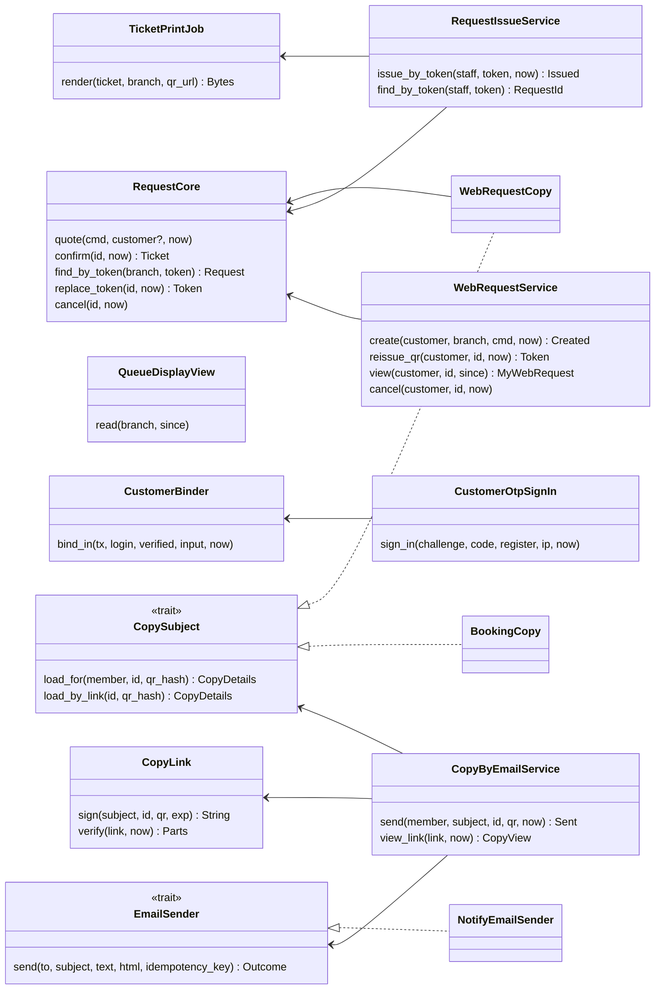

# Kiosk: one customer at a time, a branch kiosk settings page, and a verified phone number

> designed-by: claude/e92db6 (XC FE lane controller), with the BE lane (claude/553782) to complete §4's server half before
> any ticket is cut · measured on `main` `ced3a2d6` · builds on `kiosk-cancel.md` (KC-1..KC-5) and
> `customer-identity-consent.md` (phone-first customers, `PhoneVerificationService`)

> 🔴 **Superseded in part (claude/e92db6, 2026-10-21).** The owner's later rulings changed the kiosk model. **§4 is the
> current design for the server, and §0a below is the current set of rules.** §0–§3, §5 and §6 are kept as history. Where
> they differ from §0a or §4, they are superseded and must not be built. Every changed row is marked ~~superseded~~ inline.

## 0a. Current rules (owner, 2026-10-21; supersede §0–§3, §5, §6 where they differ)

Recorded on PR 4249 (issuecomment-6312118645, issuecomment-6321559434 and the Q8/Q12 comment after it).

| # | Current rule | Owner's words |
|---|---|---|
| R-1 | **There is no customer kiosk at the branch.** Customers order through the web. | *"kiosk ที่ สาชา ไม่มีแล้ว"* · *"สั่ง ผ่าน เว็บ"* · *"ไม่มี ระบบ kiosk ที่สาขา"* · *"เพราะมันซ้ำซ้อนกกัน"* |
| R-2 | **The Flutter app becomes the staff queue machine.** Staff scan the customer's request QR, and the scan issues the queue number and prints the ticket. | *"flutter ยกเลิกได้ไม่หมดเพราะ ยกต้องมี ระบบ พิมพ์ คิว"* · *"จาก kiosk เป็นเครือง พิพม์ คิว แทน"* · *"ให้ พนักงาน สแกน qr code ทีลูกค้า ทำรายการ ไว้แล้ว"* · *"เครื่อง เพิ่ม คิว ยังต้องใช้"* · *"พอได้ qr code ลูกค้่าต้องเอา มาให้ พนักงาน สแกน เพื่อรับ คิว"* |
| R-3 | **Web flow:** scan the board QR, sign in, fill the request, and get a **request QR with no number**. Staff scan it at the queue machine, which issues the number and prints. The customer waits for the call, and the desk opens the request. | as R-2 |
| R-4 | **The printer is attached to the queue machine** (Q7 B), so the queue machine is a Flutter native build. | *"เครื่องพิมพ์ต่อกับเครื่องเพิ่มคิว"* |
| R-5 | **A customer without a phone borrows a branch tablet**, which signs in exactly like the customer's own phone (Q11). The session ends when the request is done. | *"ลูกค้าไม่มี มือถือ ที่ สาขา มี tablat ให้ ใช้ทำรายการ"* · *"ก็เหมือน มือถือ ลูกค้าปกติ"* · *"แค่ ยืมที่สาขาใช้งานชั่วคราว"* · *"ก็ทำเหมือน ที่ลูกค้า ใช้ เครื่องตัว เอง ไง"* |
| R-6 | **Sign-in by SMS OTP, or e-mail OTP for customers without a Thai SIM** (Q10). | chose *"เพิ่ม OTP ทางอีเมล (แนะนำ)"* |
| R-7 | **The calling display shows the queue number only**, with no counter label (Q8). | chose *"แสดงแค่เลขคิว"* |
| R-8 | **Only staff issue numbers.** The public `confirm` needs `QueueOperate` (Q12). | chose *"เฉพาะพนักงาน (แนะนำ)"* |
| R-9 | **The desk passport check stays skippable.** | *"ตรวจ พาสปอร์ท ให้ กดข้ามได้"* |
| R-10 | **The booking QR can be downloaded.** On request, the customer can also have it e-mailed, with a link valid 1 day. | *"มันควรให้ ดาวน์โหลดได้ด้วยเดียวมันหาย"* · *"ให้ ส่งเมล์ได้ เป็น option"* · *"ข้อมูล จะได้ไปเก็บที่เมล์ ด้วย ถ้า ลูกค้า ต้องการ"* |
| R-11 | **Cancels stay one press and need no approval.** | KS-2; `cancels-need-no-approval-or-limit` |

**Superseded rows from §0:**
- KS-1 and KS-2 now apply to the borrowed tablet's web session, not to a kiosk.
- KS-3: there is no kiosk settings page. §4 D14 keeps only what the queue machine needs.
- KS-4/4a/4b/4c: sign-in is the customer web sign-in (R-5, R-6). There is no kiosk sign-in.
- KS-6: the ticket prints at the queue machine (R-4). The SMS ticket and its ticket-mode setting are dropped.
- KS-7: the board QR opens the web request flow (R-3). The number comes at the staff scan, not on submit.
- KS-5 stands, but shows the number only (R-7).

## 0. Decided (owner, 2026-10-21)

> ~~superseded~~ in part: see §0a for each row's current rule.

| # | Rule | Owner's words |
|---|---|---|
| KS-1 | A kiosk is **shared**: it serves **one customer at a time**, and starts over when that customer is done. A request someone leaves half-done must not stay on screen for the next person. | *"ระบบ kiosk มัน จะเริ่มใหม่ เมื่อ ทำจบ"* · *"แต่ มันใช้ ร่วมกัน"* · *"ถ้าอีกคนทำค้างไว้"* · *"กรณี ใข้ รวมกัน หลาย คน"* · *"มัน ควรทำที่ละคน ในเครื่อง นั้น"* |
| KS-2 | The customer's cancel at the kiosk is **one press**. The customer never types a code. | *"ต้องมาใส่ รหัส มันไม่รู้รหัส อะดิ"* · *"มันควร กดยกเลิกได้ เลย"* |
| KS-3 | How long the queue-number screen stays is **configurable**, on a **per-branch kiosk settings page in admin**. | *"ให้ตั้งค่าได้เอง"* · *"ควรมีหน้า คอนฟิก สำหรับ kiosk"* (chose "the admin page, per branch") |
| KS-4 | To book a queue at the kiosk the customer **must enter a phone number**, used to tell who is who, **verified by an SMS OTP** so a mistyped number is caught. | *"ลูกค้า มาควร มีการใส่ เบอร์ โทร เพื่อ จองคิว"* · chose "required" · *"ใช้ในการแยกแยะ ว่าใครเป็นใคร"* · *"ส่ง sms เพื่อ ยืนยัน ตัว ตน"* · *"ควร มี otpเพื่อกัน การ ใส่เบอร์ ผิด"* |
| KS-4a | **Login first, always.** The phone + OTP login comes **before** the first exchange screen (currency/amount), on the kiosk and on the phone (KS-7). No anonymous path exists, and **no switch bypasses it**. So the Identity → Notify SMS setup (§6 Q2) is a **prerequisite of shipping this**: until it is done, the feature waits, and nothing runs without login. | *"ใช้ otp"* · *"มันต้อง ผ่าน login ก่อน มาหน้านี้"* (shown the reference kiosk's step 1) |
| KS-4b | **The OTP works the way 108heros does it:** the code is sent and checked by the central **Identity** platform (`POST {identity}/auth/otp/request {destination, channel: "sms"}`, then verify; `108-Plaza/108heros-flutter` `lib/features/auth/infrastructure/data_sources/identity_otp_api.dart:17-29`). Identity sends the SMS through the 108 Plaza Notify. | *"เหมือน 108 heros"* |
| KS-6 | The customer gets a **queue ticket** from booking. **How it is delivered is a branch setting** on the kiosk settings page (KS-3), with three choices: **print + SMS**, **print only**, or **SMS only**. **The default is SMS only** (*"ให้default ที่ sms ก่อน"* · *"เพราะเครื่องพิพม์ ยัง ไม่แน่ชัด"*: the kiosk printer is not settled yet, so printing is built only once a printer is chosen). The printed slip carries the queue number, the time and the currency. The SMS carries the queue number and a link to see the status and cancel. | *"น่าจะมี บัตร คิว"* · *"ที่ได้ จาก การจองคิว"* · *"ให้ คอนฟิก ได้ ว่า จะใช้ แบบ ไหน ตามตัวเลือกที่เสนอมา"* |
| KS-4c | **Taking a queue at the kiosk is a normal customer login.** Phone + OTP signs the customer in exactly as the customer sign-in does (Identity OTP, KS-4b). The request belongs to that signed-in customer: found by phone, or created as a new customer. On a shared kiosk the session **ends at the kiosk's reset** (KS-1), so the next person starts signed out. | *"การ ใช้ คิว ก็เหมือนการ login ปกติ"* · *"เพื่อให้สามารถ แยกแยะ orders ได้ จำเป็นต้องใข้ เบอร์ โทรใน login"*: the phone number is the login, so every order can be told apart by its customer |
| KS-7 | **The rate board's QR joins the queue now, on the customer's own phone.** Scanning opens the same queue flow as the kiosk, on the phone: sign in by phone + OTP (KS-4c), choose currency and amount, get a walk-in queue number, and be called by SMS or the ticket page. It opens **the customer web pages** (`/app/…`, owner: *"มันจะไปหน้่าลูกค้า ใช่ไหม"* — yes): a new customer page, e.g. `/app/queue?branch=<code>`, behind the existing customer sign-in (`/app/sign-in`, phone + OTP). After joining, the customer sees the queue among their own pages. It replaces the board QR's current target, `/app/book` (`web/src/screens/customer/rate-display/BookingQr.tsx:16`, `rate-display.md` D9a). Booking a time stays in the app. On a personal phone the session does not have to end at once, but every request still belongs to one signed-in customer. | Shown a reference board (`rate.xc-th.work`, *Scan to join the queue · Get called on your phone*), the owner asked *"สแกน QR Code จองคิวได้ไหม"* · *"มันแยก แยะได้ได้ไหม"*, then chose "join the queue now on the phone" · *"มันต้องต้อง แยก แยะ ใครเป็นใครได้นะ"* |
| KS-5 | The system calls the queue in order, and **a calling display shows it, like a bank's**: a public screen at the branch with the number being called and the counter it goes to. Call order stays today's rule (BOOKING before WALK_IN, then the lowest number, `xc-queue/src/infrastructure/repository.rs:355-364`). | *"ระบบ ป็นคนเรียก คิว ที่รัน ตาม คิวการจอง"* · *"มีหน้า จอ เรียก เหมือน ธนาคาร"* · *"ว่า คิวไหน จะเข้าใช้บริการ"* |

## 1. What exists today (measured)

- **The kiosk never lets go of a finished customer.**
  - `KioskController._onIdle` (`app/lib/features/kiosk/presentation/controllers/kiosk_controller.dart:396-400`) exempts the waiting and receipt screens from the 2-minute idle reset (`idle_timer.dart:5`).
  - The only other reset is 30 s after `COMPLETED` (`:641-646`).
  - So a request stays on screen until staff finish it, and KC-A's cancel button (#4208) sits on that screen. **#4243** fixes this (KS-1, KS-2) with a 30-second constant.
- **Kiosk settings:** `/kiosk-currencies.html` (admin, per branch) holds the currency switches only (`kiosk_currencies`, `api/migrations/20261007170000_kiosk.sql:32-37`). There is no row for timings.
- **Phone on a kiosk request:** none. `kiosk_requests` has no phone or customer column (`20261007170000_kiosk.sql:4-24`).
- **Phone OTP today:**
  - `PhoneVerificationService` (`api/crates/xc-customer/src/application/customer/phone_verification_service.rs`) sends an SMS code through `SmsSender`. Its rate limits are in `PhoneOtpPolicy`.
  - It is **staff-initiated, for an existing customer**: `phone_verifications.customer_id` and `requested_by` (a user) are `NOT NULL` (`api/migrations/20261205141000_phone_verifications.sql`).
  - The phone is stored **encrypted**, with a lookup hash (`phone_encrypted`, `phone_lookup_hash`).
  - A kiosk customer is anonymous, with no user and maybe no customer yet, so this service cannot be called as it is.
- **SMS on the test host: none today.** claude/553782 measured it at ~07:25Z by grepping key names only.
  - xc-v3's `NotifySmsSender` (`api/src/infrastructure/notify/notify_sms_sender.rs`) needs `NOTIFY_BASE_URL` and `NOTIFY_API_KEY`, and neither is in `/etc/xc-v3/env` or `/etc/xc-v3/*.env`. So every send answers `smsUnavailable`.
  - Identity's OTP is `AUTH_OTP_DELIVERY_MODE=noop`.
  - `deploy/HOST-do-sgp1.md` I-3 leaves the sender choice to the owner.
  - **A required SMS OTP would therefore block every kiosk booking until a sender is set.**

## 2. Behaviour

> ~~superseded~~: the kiosk flow, kiosk OTP, kiosk settings and SMS ticket below are replaced by §0a R-1..R-8 and §4. The calling display stands, but shows the number only (R-7).

**Kiosk flow (KS-1, KS-2, KS-4):** start → currency and amount → **phone** → **OTP** → review → confirm → **queue number + ยกเลิกคิว + เสร็จ** for *N* seconds → start.

| Step | Rule |
|---|---|
| phone | Required. Normalised and validated as the server does for customers. A wrong shape is refused on the screen. |
| OTP | An SMS code to that number. The confirm is refused until the code is verified. The rate limits are the customer OTP's (`PhoneOtpPolicy`), per phone and per kiosk address. A resend is allowed after the policy's wait. Idle on this screen resets the kiosk (KS-1). |
| confirm | The request carries the **verified customer**: an existing customer found by phone (lookup hash), or a new customer with a verified PHONE identity. The kiosk never shows any customer data back. |
| done screen | *N* = the branch's `resultSeconds` (KS-3), default 30. ยกเลิกคิว is one press (`customerCancel` with the hidden token). เสร็จ resets at once. |
| idle | Every screen resets after the branch's `idleSeconds`, default 120 (today's constant). |

**Staff side:** the queue panel and the desk show the customer for a kiosk request, so the desk need not ask for the phone again. Exactly what is shown is the BE lane's call with `customer-identity-consent.md` (masked phone, name if known).

**Calling display (KS-5).**
- Measured: there is **no public calling screen** on `main`. The desk's `Board.tsx` (`web/src/screens/desk/queue/board/Board.tsx`) and `queue_board` are staff-only, behind `QueueOperate` (`docs/design/blueprint/queue-tickets.md:162`). The `qa-e2e.md` F8 row says so too.
- The new page is a full-screen, signed-out page, opened on a TV at the branch, e.g. `/queue-display?branch=MAIN`.
  - It shows the **number being called** and **its counter**, large, plus the last few called numbers.
  - A chime plays on each new call (proposed; a spoken Thai announcement can come later).
  - It never shows a name, a phone number or an amount.
- It is fed by a **public, numbers-only view** that follows the poll seam's `since` → `{changed:false}` (🔁).

**Queue ticket (KS-6).**
- **Print:** a small slip from a printer at the kiosk.
  - **The printer is the one already given** (owner, 2026-10-21: *"เครื่อง พิมพ์ เหมือนเคยให้ มาแล้วนะ"* · *"กับลิ้นชัก"*): the **POS80** 80 mm ESC/POS receipt printer, with the cash drawer on it.
    - In v2 it sat on the counter Mac's USB as CUPS queue `POS80_` (`docs/design/xchange-v3-known-differences.md:52`).
    - v3 reaches it through the **device agent** (`deploy/agent/README.md` §A CUPS raw / §B TCP 9100), which already drives the drawer kick.
    - So the kiosk ticket is a print job the server builds as ESC/POS and the branch's device agent sends. The kiosk app does not print by itself, and it works from both the Flutter and the web build.
    - Open for the BE lane: whether the kiosk's printer is the counter POS80 or a second POS80 at the kiosk. The owner names the target when the agent is paired.
- **SMS:** sent through Identity/Notify like the OTP (KS-4b), to the verified phone.
  - It carries a link to a **public, signed-out ticket page**: the number, the status, and **ยกเลิกคิว**.
  - The page is opened by a per-ticket secret in the link, never by the request id. That lets a customer who has walked away cancel later, without breaking KS-1.
- **The branch setting decides** which of the three ticket modes runs. With SMS off, the cancel after the done screen is staff-only, as today.

## 3. Data (migration **approved** by the owner 2026-10-21: *"อนุมัติ migration"*)

> ~~superseded~~: the current data list is §4.6. Only `kiosk_requests.customer_id` and `kiosk_settings.result_seconds` remain; `idle_seconds`, `ticket_mode` and the kiosk OTP store are dropped.

- `kiosk_settings` per branch: `result_seconds`, `idle_seconds`, `ticket_mode` (`PRINT_SMS` | `PRINT` | `SMS`, default `SMS`), CHECKed ranges, `updated_by`, `updated_at`, and a version for the poll seam. Or columns on an existing per-branch table: the BE lane chooses.
- `kiosk_requests.customer_id` (nullable for rows before the migration; required for new ones by the service, not by the schema, so old rows stay valid).
- A kiosk OTP challenge store: either `phone_verifications` with `customer_id`/`requested_by` made nullable plus a `source` column, or its own table. The phone is always stored encrypted like `phone_verifications`.
- No backfill: existing requests have no phone.

## 4. Server half (BE lane)

> designed-by: claude/c4be83 for the BE lane controller claude/553782 · measured on xchange `main` `4c3fc5a`,
> `108-platform-services` (`681bea2` = the deployed xc-identity, `8b53cee` = xchange's pinned `pos-printer`), do-sgp1
> and Dell, 2026-10-21 · written for the owner's final flow (PR 4249 issuecomment-6312118645):
> *"จาก kiosk เป็นเครือง พิพม์ คิว แทน"* · *"ให้ พนักงาน สแกน qr code ทีลูกค้า ทำรายการ ไว้แล้ว"* ·
> *"พอได้ qr code ลูกค้่าต้องเอา มาให้ พนักงาน สแกน เพื่อรับ คิว"*.
> 1. The customer scans the board QR, signs in and fills the request on the phone, which shows the **request QR** and
>    **no queue number**.
> 2. **Staff scan that QR in the Flutter queue machine**, which **issues the queue number and prints the ticket**.
> 3. The customer waits for the call on the calling display.
> 4. The desk checks the passport.
>
> There is no customer self-service device at the branch. Earlier §4 versions are in git (`bf7efba8`, `1dde5b6c`,
> `1e5e84e1`, `919f33c8`, `514505aa`).
>
> **Revised for the owner's answers of 2026-10-21 ~17:05Z** (PR 4249 issuecomment-6321559434, XC FE session):
> - Q7: *"เครื่องพิมพ์ต่อกับเครื่องเพิ่มคิว"*: the printer is attached to the queue machine (D9).
> - Q10: *"เพิ่ม OTP ทางอีเมล"*: e-mail OTP next to SMS (D11).
> - Q11: *"ก็ทำเหมือน ที่ลูกค้า ใช้ เครื่องตัว เอง ไง"*: the branch tablet signs the customer in like their own phone. The
>   no-login tablet path is gone (D16).
> - New: *"ให้ ส่งเมล์ได้ เป็น option"* · *"ข้อมูล จะได้ไปเก็บที่เมล์ ด้วย ถ้า ลูกค้า ต้องการ"* · *"หรือ ลิงค์ ชั่ว คราว
>   1วัน"*: an optional e-mail with the details, the QR and a signed 1-day link (D21, D22).
>
> **Migrations (553782's order): only `kiosk_requests.customer_id` and `kiosk_settings`.** Anything else this design
> would want goes to 553782 first (§4.6).

### 4.1 What the server does today (measured)

- **The request core is the kiosk's.** The customer half of `KioskService` (`api/crates/xc-kiosk/src/application/kiosk/customer.rs`:
  `quote` `:58`, `confirm_with_token` `:219`, `customer_cancel` `:328`, `status` `:394`):
  - `quote` writes a `QUOTED` request;
  - `confirm` moves it to `WAITING` and issues the walk-in ticket in its own transaction (`IssueSource::Kiosk {request_id}`).
  - All of it is reached through `POST /api/kiosk`, and every customer action there is `Need::Public`
    (`api/crates/xc-auth/src/domain/policy/entities/policy.rs:123-126`). The kiosk's quote is written with
    `customer_id: None` (`api/src/infrastructure/kiosk/kiosk_ports.rs:443`).
- **An unissued request lives 10 minutes.** A `QUOTED` request older than 600 s is purged on the next quote at the
  branch (`api/crates/xc-kiosk/src/domain/kiosk/entities/kiosk_machine.rs:443-446`, called from `customer.rs:143-146`).
- **A per-request secret exists, but it is minted at `confirm`:** the cancel token (UUID v4, returned once, stored as
  `kiosk_requests.cancel_token_hash`, `api/migrations/20261219190000_kiosk_cancel.sql:15`;
  `xc-kiosk/src/infrastructure/kiosk/kiosk_repository.rs:635,654`).
- **The booking QR is the pattern to reuse.**
  - The token is minted at create; only its hash is kept (`bookings.qr_token_hash bytea UNIQUE`,
    `api/migrations/20261205131000_booking_slots.sql:97`).
  - The desk looks it up (`desk_bookings` filter `qr`, `api/src/presentation/http/v3/views/desk_bookings.rs:72,104`;
    scanner in `web/src/screens/desk/bookings/DeskBookingsScreen.tsx:224`).
  - Check-in compares the hash (`api/src/presentation/http/v3/commands/bookings/check_in.rs:142-144`).
  - The customer gets a fresh QR by reissue (`bookingQrReissue`, `api/src/presentation/http/v3/commands/bookings/qr.rs`).
- **The desk opens a request by id:** `/desk?branch=<b>&kiosk=<id>` (`web/src/shared/ui/QueuePanel.tsx:437`;
  `web/src/screens/desk/entries/kiosk/entry.ts` → `/api/kiosk get`).
- **A member's ticket shows in the account** when `queue_tickets.customer_id` is set
  (`api/src/presentation/http/v3/views/my_queue_ticket.rs:3,128`).
- **The Flutter app has no staff sign-in.** Its setup holds only server + branch
  (`app/lib/core/endpoint/kiosk_endpoint.dart:17-21`). It calls only `POST /api/kiosk` (`app/lib/features/kiosk/infrastructure/data_sources/kiosk_api.dart`),
  and its HTTP client keeps no cookie (`app/lib/core/network/dio_provider.dart:18-31`).
- **Web sign-in: an unknown phone cannot sign up.** xchange sends `"registerIfAbsent": false`
  (`api/crates/xc-auth/src/infrastructure/identity/http_identity_client.rs:299`) and answers a correct code with
  `401 invalidCode` when Identity returns no login (`session_service.rs:912-916`). The deployed Identity supports
  first-sight registration (`crates/auth/src/application/verify_otp.rs:218`). xc-identity runs `noop` delivery (§4.9).
- **Printing.**
  - The device agent writes any bytes to CUPS raw or TCP 9100 (`api/crates/xc-device-agent/src/runner.rs:268-301`).
  - The server serves agents only `DRAWER_REQUEST` (`api/src/infrastructure/device_agents/pg_agent_repository.rs:296,315,342,449`).
  - There is one active agent per branch (`api/migrations/20261008120000_device_agents.sql:29-31`).
  - `device_jobs.kind` is CHECKed to `PRINT_RECEIPT`/`DRAWER_REQUEST` (`20261007180000_devices.sql:7`).
  - `pos-printer` at xchange's pin draws QR codes (`crates/pos-printer/src/escpos.rs:305,316`).
- **Calling data.** A counter is a teller with no number or label (`queue_counters`, `api/migrations/20261101100000_queue.sql:41-47`).
  `branch_service_status.queue_version` is the poll seam (`:53`). The only board is staff-only (`queue_board`).
- **E-mail** (measured on xchange `main` `b03a328` and `108-platform-services` `main` `d19249f`):
  - xchange has **no e-mail sender**. Its only Notify client is `NotifySmsSender`
    (`api/src/infrastructure/notify/notify_sms_sender.rs`), behind the `SmsSender` trait
    (`api/crates/xc-customer/src/domain/sms_sender.rs:8`).
  - The notification seam keeps an `EMAIL` channel (`notification_deliveries.channel`,
    `api/migrations/20261106100000_customer_app.sql:62`), but only `IN_APP` is written (owner C3,
    `customer-app.md:25`; `api/crates/xc-notify/src/domain/channel.rs:1`). The owner's e-mail option is the first other
    channel.
  - Notify's `POST /api/v1/notifications` takes `{channel, recipient: {address, display_name?}, subject?, body?,
    html_body?, idempotency_key?, …}` with `X-API-Key` (`crates/notification-api/src/dto.rs:17-51`,
    `middleware.rs:17-25`). It answers `201` when created and `200` when the idempotency key matched
    (`routes/notifications.rs:46-62`). It has **no attachment field**.
  - Fact for the BE lane, outside this design: `NotifySmsSender` posts `{"channel","phone","text"}`
    (`notify_sms_sender.rs:57-61`). Notify's DTO has no `phone` or `text` and requires `recipient`, so that SMS call
    cannot be accepted as written. The e-mail sender below uses the DTO's shape.
  - A customer can already hold a verified e-mail: `customer_identities.type` allows `EMAIL`, encrypted with a lookup
    hash (`api/migrations/20261019100000_customers_org.sql:54-70`).
- **Signed tokens without a stored secret** already exist: the booking QR is
  `HMAC-SHA256(derive_subkey(pii_keys, "xc-booking-qr-v1"), id ‖ version)`
  (`api/crates/xc-booking/src/domain/booking/qr_token.rs:15-27`, `xc-kernel/src/pii/derive.rs:9`). No new env secret
  is needed for a signed link.

### 4.2 Decisions (BE lane)

| # | Decision | Why |
|---|---|---|
| D1 | **One request core, unchanged in shape.** The web request is a `kiosk_requests` row made by the same `quote` path. `POST /api/kiosk` and its anonymous `quote`/`confirm` stay as they are; the queue machine may reuse them, so nothing there is removed. | owner 553782: *"do NOT plan their removal"*; ♻️ |
| D2 | **Web submit = a request with no number.**  • A new command `webRequestCreate` (`CustomerSelf`) runs the core's `quote`, with `customer_id` = the signed-in member's, on the customer's phone and on the branch tablet alike (D16).  • It mints the **request token** (UUID v4; only its SHA-256 is stored, in `cancel_token_hash`; no second column).  • It answers `{requestId, requestQrUrl, expiresAt}`. The request stays `QUOTED`: **no `confirm`, no ticket, no number.** | owner: the number is issued at the staff scan |
| D3 | **The request QR** encodes `<origin>/q#<token>` (the fragment keeps it out of request lines, logs and referrers). The member re-shows it by `webRequestQrReissue` (`CustomerSelf`, own request), which mints a new token and replaces the hash, as `bookingQrReissue` does. | the booking QR pattern |
| D4 | **A web request waits 60 minutes for its scan**, not the kiosk's 10. `is_purgeable` keeps 600 s for a request with no customer and uses 3 600 s for one with a customer. The phone shows `expiresAt`. After that, the member fills the request again. | the 10-minute purge (`kiosk_machine.rs:443-446`) would drop a request while its owner waits in line at the queue machine |
| D5 | **The staff scan issues the number: `issueByToken`.**  • A new staff action on `POST /api/kiosk`, needing `QueueOperate`.  • It finds the request by token **in the staff session's branch**, runs the core's `confirm` (QUOTED → WAITING, the ticket, `IssueSource::Kiosk {request_id}`), and sets `queue_tickets.customer_id` from the request.  • It answers `{displayNumber, ticketId, ticketEscpos}` (D9).  • Scanning twice answers the same ticket (repeat-safe), never a second number.  • A token of another branch, an unknown or expired one ⇒ `404 notFound`, one answer for all. | owner: *"สแกน เพื่อรับ คิว"*; the scan at the branch proves where the customer is, so no board token is needed |
| D6 | **The queue machine is a staff device.** It signs in as staff, through the same Identity sign-in as the desk, and holds `QueueOperate` at its branch. It is not a public kiosk any more. The kiosk's anonymous actions still answer, for the machine to reuse (e.g. a staff-entered walk-in, if e92db6's open assumption lands there). | owner: *"no customer self-service device"* |
| D7 | **The desk scan reuses the same lookup.** `findByToken` (`QueueOperate`, branch-scoped) answers the request id, and the desk opens today's `?kiosk=<id>` entry. It is the same token and the same `404` rule as D5, with the scanner `DeskBookingsScreen` uses. | reuse |
| D8 | **The customer's view.** `myWebRequest` (`CustomerSelf`, own request) answers `{status, expiresAt, displayNumber?, ticketsAhead?, counter?}` on the poll seam (`queue_version`, `since` → `{changed: false}`). Before the scan: `QUOTED` and no number. After the scan: the number, place in line, and the counter once called. Cancel: `webRequestCancel` (own session), the `customerCancel` transition. | 🔁; owner: the display and the desk follow the issued number |
| D9 | **Printing: a printer attached to the queue machine, with the bytes rendered once on the server** (owner Q7: *"เครื่องพิมพ์ต่อกับเครื่องเพิ่มคิว"*).  • `issueByToken` answers the ticket as ESC/POS bytes (`ticketEscpos`, base64), rendered by `TicketPrintJob` with `pos-printer`: number, time, branch, and the request QR for the desk.  • The Flutter **native** build writes those bytes unchanged to its own printer (USB, Bluetooth or LAN). The app has **no ESC/POS writer of its own**, so there is one renderer (♻️), and a browser build simply cannot print.  • A repeat scan (D5) answers the same bytes, so a jammed print is reprinted by scanning again. The app reports nothing back; `printed` is the app's own state.  • **No device job, no agent change, no `device_jobs.kind` change.** The device agent and the counter POS80 are untouched. | owner Q7; one renderer |
| D10 | **The calling display** (KS-5): the public, numbers-only `GET /api/public/orgs/{org}/branches/{code}/queue-display?since=` on `queue_version`. It answers today's `CALLED`/`SERVING` numbers and the last 5 called. It never carries a name, phone, amount or teller. **Which counter** needs `queue_counters.label`, a migration outside 553782's list: it is sent to 553782 (§4.6, Q8), and until it is approved the display and the phone show the number only. | KS-5; route style of `public/branch_rates.rs:16` |
| D11 | **Web sign-in = the customer OTP login, with first-sight sign-up, by SMS or e-mail** (owner Q10: *"เพิ่ม OTP ทางอีเมล"*).  • `/api/auth/otp/request` takes `channel: "sms" \| "email"` with a phone or an e-mail `destination`; the deployed Identity already signs in by e-mail OTP (`crates/auth/src/application/verify_otp.rs:593`).  • `/api/auth/otp/verify` takes an optional `register: {displayName, lang, marketing}`, which sends `registerIfAbsent: true`.  • `register_customer` splits into a login half and a shared `CustomerBinder` (♻️). The binder writes a verified **PHONE or EMAIL** identity, whichever was proven (today PHONE only, `customer_signup.rs:161-208`). The `EMAIL` type already exists, so no migration.  • A verified phone or e-mail ACTIVE on a desk-made customer with `user_id IS NULL` joins that customer (owner Q1); one with a user ⇒ `409 phoneInUse` / `409 emailInUse`.  • Without `register`, "no login" ⇒ `401 notRegistered`. | KS-4c; Q10; §4.1 |
| D12 | **One open web request per member per branch** (`QUOTED` or `WAITING`) ⇒ `409 alreadyQueued` + its id. | one person, one place |
| D13 | **At the desk save** (owner Q2): passport customer A ≠ the request's member B ⇒ save on A, keep B on the request and quote, and write one `KIOSK_CUSTOMER_DIFFERS` audit row. | owner Q2 |
| D14 | **KS-3 settings** shrink to what the queue machine needs: `kiosk_settings.result_seconds` (how long the issued number stays on the machine, default 10) with a public read on the poll seam and a `RatesDraft` write. | KS-3 |
| D15 | `queueTicketTake` and `/app/book` stay unchanged (owner Q4). | owner Q4 |
| D16 | **The branch tablet is a borrowed phone: the customer signs in on it** (owner Q11: *"ก็ทำเหมือน ที่ลูกค้า ใช้ เครื่องตัว เอง ไง"* · *"แค่ ยืมที่สาขาใช้งานชั่วคราว"*).  • Same page, same sign-in (D11, SMS or e-mail OTP), same `webRequestCreate`, so every request has a member. There is **no no-login path**, no tablet credential and no new table.  • Because the device is borrowed, the page **signs out and starts over** when the request QR has been shown and the customer presses เสร็จ, or after the idle timeout. That is FE behaviour (as #4243 does for one customer at a time). The server's part is today's sign-out, which revokes the session. | owner Q11 |
| D17 | *(dropped by owner Q11: the no-login tablet guard, `branch_tablets`, `kiosk_requests.tablet_id`)* | |
| D18 | *(dropped with D17: every web request now carries its member, so the desk has nothing to attach)* | |
| D19 | **The kiosk's public `confirm` should stop issuing numbers on its own (proposed; Q12).** `confirm` is `Need::Public` today (`policy.rs:123-126`), so anyone who can call `/api/kiosk` can get a queue number without a staff scan. That breaks the owner's rule that the number is issued at the scan. Proposed: `confirm` needs `QueueOperate`, so the queue machine can still call it, and nothing is removed. `quote`/`status`/`customerReceipt`/`customerCancel` stay public. | owner: the number is issued when staff scan |
| D20 | **The desk's passport skip stays, and nothing here gets in front of it** (owner: *"ตรวจ พาสปอร์ท ให้ กดข้ามได้"*).  • Measured on `main` `7834507`: `onSkip` (`web/src/screens/desk/steps/customer/step.tsx:159-177`, #539) sends a placeholder passport image with `WALK-IN` / `WALKIN` / `XXX`, then runs the normal `reserve`. The server's passport step only requires a passport file (`api/crates/xc-exchange/src/domain/exchange/value_objects/transaction_form.rs:246-249`). So a skipped save lands on the one placeholder customer that `reserve` finds or creates for `WALKIN`/`XXX`.  • A request opened from the QR (`findByToken` → `?kiosk=<id>`), or issued by the queue machine, adds **no** passport check and **no** "customer required" rule to the desk save. `issueByToken` checks nothing about the customer.  • **The skip placeholder never counts as a different customer.** D13 (the `KIOSK_CUSTOMER_DIFFERS` audit) skips a save whose passport is the placeholder. It is recognised in one place, `WalkInPlaceholder::is(passport_no, nationality)`, with the desk's values (`WALKIN`, `XXX`).  • So a skipped save keeps the request's member, with no audit row. | owner; #539 |
| D21 | **"E-mail it to me": an optional copy of a booking or a web request** (owner: *"ให้ ส่งเมล์ได้ เป็น option"* · *"ข้อมูล จะได้ไปเก็บที่เมล์ ด้วย ถ้า ลูกค้า ต้องการ"*).  • **One core, two subjects (♻️).** `CopyByEmailService` holds the rules. A `CopySubject` trait has one small implementation per subject: `BookingCopy` (xc-booking) and `WebRequestCopy` (xc-kiosk). Each loads its own row for the member, checks the QR, and fills the details. A third subject later is one file.  • **Command:** `copyByEmail {subject: "booking" \| "webRequest", id, qr}`, `CustomerSelf`, own subject only. Another member's id or an unknown one ⇒ `404 notFound`.  • **Only the current QR can be sent.** `SHA-256(qr)` must equal the stored hash (`bookings.qr_token_hash`; `kiosk_requests.cancel_token_hash`, D2). After a reissue the old QR ⇒ `404 notFound`. The server never stores the QR in plain text, so it takes it from the customer's own page, which holds it.  • **To:** the member's verified, ACTIVE `EMAIL` identity, never a typed address. So a typo cannot send someone's amount to a stranger, for the same reason the phone is OTP-checked (KS-4). A member with none ⇒ `409 noVerifiedEmail`; the FE offers the e-mail only when `my_profile` shows one (W11). A member gets one by signing in by e-mail OTP (D11).  • **Contents:** the details (booking: number, branch, date and slot, currency, amount; web request: branch, currency, amount, rate, expiry), the QR as an inline PNG in `html_body`, and the 1-day link (D22). Text in the member's `lang` (th/en/zh). No passport, no phone, no customer number.  • **Send:** straight to Notify `POST /api/v1/notifications`, `channel: "email"`, through an `EmailSender` port (`NotifyEmailSender`, beside `NotifySmsSender`). `idempotency_key` = `copy:<subject>:<id>:<hex of the QR hash>`, so pressing it twice sends **one** e-mail per QR (Notify answers `200` ⇒ `{sent: true, again: true}`). Notify queues and retries; xchange keeps no outbox row, so the QR is never written to a table.  • **Off when unset:** without `NOTIFY_BASE_URL` / `NOTIFY_API_KEY` ⇒ `503 emailUnavailable`, and `my_profile` reports e-mail as unavailable (W11) so the FE hides the button.  • **No migration, no new secret.** The FE button is the FE lane's; QR download alone is #4327. | owner; D2's hash-only token; ♻️ |
| D22 | **The 1-day link** (owner: *"หรือ ลิงค์ ชั่ว คราว 1วัน"*).  • **Signed, not stored:** `<origin>/c#v1.<subject>.<id>.<exp>.<qr>.<mac>`, with `exp` = sent + 24 h and `mac` = `HMAC-SHA256(derive_subkey(pii_keys, "xc-copy-link-v1"), subject ‖ id ‖ exp ‖ qr)`, the booking QR's key pattern (§4.1). No table and no env secret.  • It sits in the **fragment**, so it never reaches a request line, an access log or a referrer. The page posts it to `copyLinkView` (public, `POST /api/public/copy-link`).  • **`copyLinkView`** checks, in order: the MAC (constant time), `exp` > now, and `SHA-256(qr)` = the subject's current hash. Any failure ⇒ `410 linkExpired`, one answer for all, so a forged, expired or reissued-away link cannot be told apart. On success it answers the same details as the e-mail plus the live status (`QUOTED` / `WAITING` with number / `DONE` / `CANCELLED` / `EXPIRED`); the page draws the QR from its own fragment.  • The link is a **read-only copy**: it cannot cancel, reissue or sign in. The QR inside it works at the queue machine and the desk exactly as on the phone, because it is that QR.  • Rate: today's `QuoteLimit` shape, keyed by address, so the public route cannot be used to guess. | owner; 🔁 not needed (opened by a person) |

### 4.3 Class diagram

`RequestCore` is the customer half of `KioskService` in `customer.rs`, not a new type. Both services call it; neither
copies its rules.

| Class | File | New / changed |
|---|---|---|
| the request core | `api/crates/xc-kiosk/src/application/kiosk/customer.rs` | changed: `quote` takes `Option<CustomerId>` and mints the token for a customer request; `find_by_token`, `replace_token`; `confirm` sets `queue_tickets.customer_id` |
| `KioskMachine::is_purgeable` | `api/crates/xc-kiosk/src/domain/kiosk/entities/kiosk_machine.rs:443` | changed: 600 s / 3 600 s (D4) |
| `WebRequestService` | `api/crates/xc-kiosk/src/application/kiosk/web_request.rs` | new |
| `RequestIssueService` | `api/crates/xc-kiosk/src/application/kiosk/request_issue.rs` | new |
| `TicketPrintJob` | `…/domain/kiosk/value_objects/ticket_print_job.rs` | new: the one ESC/POS renderer (`pos-printer`); `issueByToken` answers its bytes (D9) |
| `KioskRepository::find_by_token_in`, `replace_token_in` | `api/crates/xc-kiosk/src/infrastructure/kiosk/kiosk_repository.rs` | new |
| web commands `webRequestCreate`, `webRequestQrReissue`, `webRequestCancel`; view `myWebRequest` | `api/src/presentation/http/v3/commands/web_request/{create.rs,qr.rs,cancel.rs}`, `api/src/presentation/http/v3/views/my_web_request.rs` | new; `CustomerSelf` |
| `issueByToken`, `findByToken`, `settings`, `configureSettings` on `POST /api/kiosk` | `api/src/presentation/http/kiosk.rs`, `policy.rs:123-133` | changed (`QueueOperate`; `settings` public; `configureSettings` `RatesDraft`) |
| `CustomerBinder`, `CustomerOtpSignIn` | `api/src/application/customer_binder.rs`, `api/src/application/customer_otp_sign_in.rs`; `customer_signup.rs` calls the binder | new / changed |
| `IdentityClient::otp_verify(…, register_if_absent)` | `api/crates/xc-auth/src/domain/identity/identity_client.rs:138`, `…/infrastructure/identity/http_identity_client.rs:289-301` | changed |
| `QueueDisplayView` | `api/src/presentation/http/public/queue_display.rs` | new |
| `KioskSettings` (+ repository, Pg) | `…/domain/kiosk/entities/kiosk_settings.rs`, `…/repositories/kiosk_settings_repository.rs`, `api/src/infrastructure/kiosk/pg_kiosk_settings_repository.rs` | new |
| the save's audit (D13) | `api/crates/xc-kiosk/src/application/kiosk/save_hooks.rs` | changed |
| `WalkInPlaceholder` | `api/crates/xc-kiosk/src/domain/kiosk/value_objects/walk_in_placeholder.rs` | new: the one place that knows the desk's skip values (D20) |
| `CopyByEmailService`, `CopySubject`, `CopyLink`, `CopyDetails` | `api/src/application/copy_by_email/{service.rs,subject.rs,link.rs}` | new: the shared core (D21, D22) |
| `BookingCopy` / `WebRequestCopy` | `api/crates/xc-booking/src/application/booking_copy.rs` / `api/crates/xc-kiosk/src/application/kiosk/web_request_copy.rs` | new: one per subject; each reads its own row by member + QR hash |
| `EmailSender` + `NotifyEmailSender` | `api/crates/xc-customer/src/domain/email_sender.rs` (beside `sms_sender.rs`), `api/src/infrastructure/notify/notify_email_sender.rs` | new; Notify's DTO shape (§4.1); off when the env is unset |
| the e-mail's QR PNG | inside `CopyByEmailService`, one function | new; needs a QR encoder crate (e.g. `qrcode`), a dependency, not a migration. Some web mail hides inline images, so the link page draws the QR as well |
| command `copyByEmail`; public `POST /api/public/copy-link` | `api/src/presentation/http/v3/commands/copy_by_email.rs`, `api/src/presentation/http/public/copy_link.rs` | new; `CustomerSelf` / public with the address rate limit |
| `my_profile` reports `emailCopy: {available, to}` (W11) | `api/src/presentation/dto/v3/my_profile.rs`, `api/src/presentation/http/v3/views/my_profile.rs` | changed |
| `webRequestRates` (W2) | `api/src/presentation/http/public/queue_rates.rs`, calling `KioskService::public_rates` | new |

### 4.3a Wire contract (the FE half, §5, cites these rows)

> answered for claude/36d9dc6a's six questions · measured on xchange `main` `de6d1b6` · **open** = not decided here

| # | Contract | Measured basis |
|---|---|---|
| W1 | **`webRequestCreate` input** = the kiosk quote's input plus the branch: `{branch: <branch code>, type: "BUY" \| "SELL", currency, amount, paymentMethod?}`. The org is the request host's (as `/api/public/host`). The core parses the four quote fields exactly as the kiosk `quote` does. | `api/src/presentation/http/kiosk.rs:382-406` (`type`, `currency`, `amount` number or string, `paymentMethod`); `QuoteInput` `xc-kiosk/src/domain/kiosk/commands/quote_input.rs:4-9` |
| W2 | **Rates for the web page: the kiosk core's `rates`, not the public `branch_rates`.** The kiosk `rates` applies the branch's kiosk currency switches and payment rules (`KioskService::public_rates`), which are what the core's `quote` enforces; `branch_rates` does not. It is exposed by branch code as the public view `webRequestRates` (`GET /api/public/orgs/{org}/branches/{code}/queue-rates`), which calls the same `public_rates`. The answer is today's kiosk `rates` JSON (`dto_kiosk::rates_json`). | `xc-kiosk/src/application/kiosk/customer.rs:38-53`; `kiosk.rs:369-376`; the public view would otherwise offer currencies the quote refuses |
| W3 | **`webRequestCreate` answer:** `{requestId, requestQrUrl, expiresAt}`, with `requestQrUrl` = `<origin>/q#<token>`. **The token is in the clear only in this answer and in `webRequestQrReissue`'s.** The FE keeps it in memory; after a reload it calls `webRequestQrReissue {id}` for a fresh one (the old one stops working, B12). `copyByEmail`'s `qr` is that token, the part after `#`. | D2, D3, D21 |
| W4 | **`myWebRequest`:** `GET` view, filter `{id}` + `since`; the seam's envelope `{version, changed, data}` on the request branch's `queue_version`. `data` = `{requestId, status, expiresAt, branch: {code, name}, type, currency, amount, displayNumber: string \| null, ticketsAhead: number \| null, counter: null}`. `counter` stays `null` until Q8. | 🔁; `branch_service_status.queue_version` (`20261101100000_queue.sql:49-53`) |
| W5 | **`myWebRequest.status`**, derived from the request and its ticket: `QUOTED` (no ticket) · `WAITING` · `CALLED` · `SERVING` (ticket `SERVING`, or request `ACCEPTED`/`ID_CHECKED`) · `COMPLETED` · `CANCELLED` · `NO_SHOW`. **There is no `EXPIRED` status:** a purged `QUOTED` request is deleted, so the view answers `404 notFound`; the FE shows "expired" when that follows `expiresAt`. | request statuses `20261219190000_kiosk_cancel.sql:8`; ticket statuses `20261101100000_queue.sql:14`; purge `kiosk_machine.rs:443-446` |
| W6 | **Staff sign-in on the Flutter queue machine = today's desk sign-in.** `POST /api/auth/login {identifier, password}` answers `Set-Cookie: __Host-xc_session=…; HttpOnly; Secure; SameSite=Strict; Max-Age=43200` (12 h). The native app keeps it in a cookie jar and sends it back; every call also sends `Origin: <server origin>` and `X-Xchange-Request: 1`, which `same_origin` requires. `POST /api/auth/refresh` renews it. | `api/src/presentation/http/auth.rs:69,136,174-184`; `extractors/origin.rs:33-55`; no cookie jar today (`app/lib/core/network/dio_provider.dart:18-31`) |
| W7 | **No device or non-interactive staff sign-in exists:** a staff member types their own credentials on the machine at the start of the shift. A device credential would need its own table (a migration outside 553782's list) and is **open**, not designed here. | swept `api/src/presentation/http/auth.rs` routes: `login`, `logout`, `otp/request`, `otp/verify`, `password`, `refresh`, `session`, `session/branch` |
| W8 | **`issueByToken`:** `POST /api/kiosk {action: "issueByToken", payload: {branchId, token}}`. `branchId` is the machine's branch, authorised against the staff session by the same `authorize` step as every kiosk action; a token of any other branch answers `404 notFound` (D5). Answer `{displayNumber, ticketId, ticketEscpos}`. `findByToken` takes the same payload and answers `{requestId}`. | `kiosk.rs:290-320` (named `branchId`, authorised for a session) |
| W9 | **Calling display:** `GET /api/public/orgs/{org}/branches/{code}/queue-display?since=<version>`. Answer: the seam's envelope `{version, changed, data}`; `data` = `{called: [{displayNumber, status: "CALLED" \| "SERVING", calledAt}], recent: [{displayNumber, calledAt}]}`, `recent` = the last 5 called, newest first. Unchanged ⇒ `{version, changed: false}`. No counter until Q8. | D10 |
| W10 | **How the display page learns `{org}`:** from `GET /api/public/host` (`{org}` for the request's host), as the customer home does; `?branch=` is the branch code. | `api/src/presentation/http/public/host.rs:1-25`; `web/src/screens/customer/home/HomeScreen.tsx:91,155` |
| W11 | **`emailCopy` is on `my_profile`** (`GET /api/v3/views/my_profile`), the signed-in customer's own profile: `emailCopy: {available: boolean, to: string \| null}`. `available` = a verified, ACTIVE `EMAIL` identity exists **and** the Notify client is configured; `to` = that address masked (`j***@example.com`), `null` when none. camelCase as the rest of the DTO. | `api/src/presentation/dto/v3/my_profile.rs:12-22` (`rename_all = "camelCase"`) |
| W12 | **Tablet sign-out = today's sign-out for everyone:** `POST /api/auth/logout`. It revokes the session and clears `__Host-xc_session`. The customer's OTP sign-in sets that same cookie (`otp/verify`). Nothing new on the server. | `auth.rs:99-101,143-149,282-284` |

### 4.4 Behaviour

| # | Given | Answer |
|---|---|---|
| B1 | today's kiosk `quote` / `confirm` / `customerCancel` | unchanged; today's kiosk tests stay green as they are |
| B2 | `webRequestCreate` without a customer session | `401 signIn` |
| B3 | `webRequestCreate`, signed in | a `QUOTED` request with `customer_id`; `{requestId, requestQrUrl, expiresAt}`; **no ticket, no number** |
| B4 | `webRequestCreate` with an open `QUOTED`/`WAITING` request at the branch | `409 alreadyQueued` + its id |
| B5 | a web request 59 min old / 61 min old at the next purge | kept / purged; a kiosk request still purged after 10 min |
| B6 | `issueByToken` by staff with `QueueOperate` at the request's branch | `WAITING`, one ticket with `customer_id` set; `{displayNumber, ticketId, ticketEscpos}` |
| B7 | `issueByToken` twice for the same request | the same ticket and the same bytes both times |
| B8 | `issueByToken`: another branch's token / unknown / expired / reissued-away | `404 notFound` |
| B9 | `issueByToken` without `QueueOperate` | `403`, as the policy's other `QueueOperate` actions |
| B10 | `ticketEscpos` decoded | the number, time, branch and the request QR; nothing else from the request (no amount, no name) |
| B11 | `myWebRequest` before / after the scan / after the call; `since` = the current version | no number / number + place in line / called; `{changed: false}` |
| B12 | `webRequestQrReissue` | a new token; the old one answers `404` everywhere, including `copyByEmail` and old links |
| B13 | desk `findByToken` | as B8's rule; the request id for this branch |
| B14 | `otp/verify` with `register`, SMS or e-mail: known / new / on a desk customer without a user / with a user | `200` / `200 registered` with a verified PHONE or EMAIL identity / `200` joined (Q1) / `409 phoneInUse` or `409 emailInUse` |
| B15 | `otp/verify` without `register`, unknown phone or e-mail | `401 notRegistered` |
| B16 | desk save, passport customer ≠ the request's member | saved on the passport's customer; one `KIOSK_CUSTOMER_DIFFERS` audit row |
| B17 | `queue-display` unchanged / changed | `{changed: false}` / called numbers; no name, phone, amount, teller or counter until Q8 |
| B18 | `settings` / `configureSettings` out of range | the row or defaults / `400 validationFailed` naming the field |
| B19 | `copyByEmail` for the member's own booking / web request with the current QR, member has a verified e-mail | one Notify e-mail call, `channel: "email"`, to that address, with the details, the QR PNG and a link; `{sent: true}` |
| B20 | `copyByEmail` twice with the same QR | the same `idempotency_key`; `{sent: true, again: true}`; Notify sends once |
| B21 | `copyByEmail`: another member's id / unknown id / a reissued-away QR | `404 notFound`, one answer |
| B22 | `copyByEmail`, the member has no verified, ACTIVE e-mail | `409 noVerifiedEmail`; nothing sent |
| B23 | `copyByEmail` with `NOTIFY_*` unset; Notify answers 5xx | `503 emailUnavailable`; nothing stored either way |
| B24 | `copyLinkView` with a good link 23 h old | the details + live status; no phone, passport or customer number |
| B25 | `copyLinkView`: 25 h old / one changed character / the QR reissued since | `410 linkExpired`, one answer |
| B26 | a request opened from the QR or issued by the queue machine, desk save with the skip | accepted exactly as a save with no request: no new refusal, no `customer_id`-required rule; the member kept; no audit row |
| B27 | `/api/kiosk confirm` without `QueueOperate` (after Q12) | `403`; the queue machine's call answers as today |

### 4.5 Rules the tests pin first (up-front, `class:logic`)

- B1: today's kiosk HTTP tests unchanged and green (the core moved no rule).
- B3–B8 and B12–B13 on the core with a real Postgres. A web submit never issues a ticket, and the scan issues exactly
  one. The token is the only key, and a wrong one cannot tell "never existed" from "another branch".
- B5 on `is_purgeable` (both windows). B10 on `TicketPrintJob`. B11 on the view and its poll seam.
- B14–B15 on `CustomerOtpSignIn` with a fake `IdentityClient`, asserting the flag and channel sent. `/api/app/register`
  answers exactly as before.
- B16 on the save hook; B17 with a guard that the view's JSON has no field outside D10's list; B18.
- **B19–B23 on `CopyByEmailService` with a fake `EmailSender`**, for **both** subjects through the same test table, so a
  rule that holds for one and not the other fails. They assert the recipient is the stored identity (never a field of
  the command), the idempotency key, and that no table gains a row holding the QR.
- **B24–B25 on `CopyLink`** (sign → verify round trip; each field changed by one character; the clock at 23 h and 25 h)
  and on `copyLinkView` with a real Postgres for the reissue case.
- **B26 up front, through the save with the desk's real skip values** (`WALKIN`, `XXX`, the placeholder image). It fails
  if anyone adds a passport or `customer_id` requirement to the request path.
- Guard: only `customer.rs` issues `IssueSource::Kiosk`. Guard: `NotifyEmailSender`'s JSON matches Notify's
  `CreateNotificationRequest` field names (`recipient.address`, `body`, `html_body`, `idempotency_key`).

### 4.6 Data

**Migrations: only these two** (553782's order, owner-approved):
- `kiosk_requests.customer_id text NULL` (no FK, as `queue_tickets.customer_id`).
- `kiosk_settings (branch_id, result_seconds, updated_by, updated_at, version)` (D14). Covered by the §3 approval.

Renumbered with `scripts/migration-slot.sh next` right before `pr_open`. No backfill.

**Needs no migration:** the request token (D2, the existing `cancel_token_hash`); printing (D9, bytes in the answer);
e-mail OTP (D11, the existing `EMAIL` identity type); the e-mail copy and its link (D21, D22, signed, nothing stored).

**Dropped with the owner's answers:** `device_jobs.kind` + `PRINT_QUEUE_TICKET` (Q7 B), `branch_tablets` and
`kiosk_requests.tablet_id` (Q11).

**Sent to 553782, not in this design's data:** `queue_counters.label` (D10, Q8). It is the only further migration this
design would want. Until it is approved, the display shows numbers only.

### 4.7 Owner questions

**Answered 2026-10-21 ~17:05Z** (issuecomment-6321559434): Q7 = B (D9) · Q10 = e-mail OTP (D11) · Q11 = sign in on the
tablet (D16). Q9 no longer applies: the staff scan at the branch proves where the customer is.

**Still open** (claude/e92db6 asks them in one round):
- **Q8 (D10).** `queue_counters.label`, so the display and the phone can say which counter. It is a migration, so it goes
  through 553782 first. Proposed: yes; without it both show only the number.
- **Q12 (D19).** The kiosk's public `confirm` can issue a number with no staff scan. Proposed: it needs `QueueOperate`
  from now on (the queue machine keeps it; nothing is removed).

**Settled here, not asked:** the e-mail copy goes only to a verified e-mail (D21), because a typed address would send a
customer's amount to whoever the typo names. A phone-only member who wants the e-mail signs in by e-mail OTP once.

### 4.8 Release order

1. This design merges, doc-only. **No tickets are cut until 553782 says so.**
2. Then the BE tickets in slices that share no files:
   - (a) the request core changes + `RequestIssueService` + desk `findByToken` + `TicketPrintJob` (D9);
   - (b) display + settings (counter label only after Q8);
   - (c) the web source + sign-in (`WebRequestService`, `CustomerBinder`, `CustomerOtpSignIn`, SMS and e-mail);
   - (d) the e-mail copy: `EmailSender` + `NotifyEmailSender`, the `CopyByEmailService` core with `CopyLink`, then
     `BookingCopy` and `WebRequestCopy` as two tickets that can run together.
3. **The web path ships only after the owner's setup in §4.9** (Identity → Notify, a test code to the owner's phone, a
   TERMS text in th/en/zh). **The e-mail copy also needs xc-v3's own `NOTIFY_*`** (§4.9, step 6). Slices (a)–(b) need
   none of it.
4. The FE half: the Flutter native app becomes the staff queue machine (staff sign-in, a cookie jar, the scanner, and
   writing `ticketEscpos` to its printer), plus the web request page with sign-out on เสร็จ for the tablet, the
   calling display page, the "e-mail it to me" button and the `/c` link page (§5).
5. Deploy is a separate owner order.

### 4.9 Owner setup for the web path: Identity OTP → 108 Plaza Notify

> measured 2026-10-21 by claude/c4be83 from the Mac Studio. Only names were read from env files and secrets, never
> values. It gates the web path only; the kiosk path needs none of it.

**What is there now.**
- **xc-identity** on do-sgp1 (`152.42.247.83`):
  - `active`, build `681bea2` (`/opt/xc-identity/BUILD`).
  - `/etc/xc-identity/env` has `AUTH_OTP_DELIVERY_MODE=noop`, and no `AUTH_OTP_HTTP_*` lines.
  - `681bea2` already has the HTTP sender and `registerIfAbsent` (`108-platform-services`
    `crates/auth/src/contract/mod.rs:536`, `crates/auth/src/infrastructure/config.rs:414`). **No rebuild is needed.**
- **Notify** runs on Dell k3s, `staging/notify`, NodePort 30710.
  - Its secret `staging/notify-secrets` holds `ADMIN_API_KEY` and `THAIBULKSMS_API_KEY`/`_SECRET`/`_SENDER` (names
    only; whether the SMS keys are filled was not checked).
  - Prod (`prod/notify`, 31710) has the same names.
- **Reach.**
  - do-sgp1 **cannot** reach Dell's NodePorts (`http://103.27.202.40:30710` and `:31710` both time out).
  - It **does** reach the public name `https://notify.staging.108plaza.net`: `/health` = `200`, and `POST /api/v1/otp`
    with no key = `401`. That name is Dell's nginx vhost to NodePort 30710, with a Let's Encrypt certificate.
- **The contract** (`108-platform-services` `crates/notification-api/src/routes/otp.rs`, `middleware.rs:84-113`):
  - Identity POSTs `{channel, to, code, purpose}` with `Authorization: Bearer <tenant API key>`.
  - Notify answers `202 {id}`, which means queued, not yet delivered.
  - A tenant may define an `otp_code` template for its own SMS text; without one, the built-in text is used.

**The tenant and key.** One new Notify tenant `xchange` on **staging** Notify. It is the xchange test host's own
tenant, so its rate limit, audit and SMS text are separate from other users of Notify.

| # | Step | Where | Command (the owner runs it; nothing here prints a secret) |
|---|---|---|---|
| 1 | Create the tenant. The answer shows the API key **once** | Dell | `ADMIN=$(kubectl -n staging get secret notify-secrets -o jsonpath='{.data.ADMIN_API_KEY}' \| base64 -d)`, then `curl -s -X POST http://127.0.0.1:30710/api/v1/admin/tenants -H "X-Admin-Key: $ADMIN" -H 'X-Admin-Actor: owner' -H 'Content-Type: application/json' -d '{"name":"xchange","rate_limit_per_minute":60}'`. Keep `api_key` from the answer and paste it only into step 2 |
| 2 | Point Identity at Notify: **all three lines together** | do-sgp1, `/etc/xc-identity/env` (root:xc-identity 640) | `AUTH_OTP_DELIVERY_MODE=http`, `AUTH_OTP_HTTP_ENDPOINT=https://notify.staging.108plaza.net/api/v1/otp`, `AUTH_OTP_HTTP_API_KEY=<the key from step 1>` |
| 3 | Restart and check | do-sgp1 | `systemctl restart xc-identity && systemctl is-active xc-identity && journalctl -u xc-identity -n 30 \| grep otp_delivery`. The log must say `otp_delivery="http"` |
| 4 | Test Notify alone, to the owner's phone | do-sgp1 | `KEY=$(grep '^AUTH_OTP_HTTP_API_KEY=' /etc/xc-identity/env \| cut -d= -f2-)`, then `curl -s -w ' %{http_code}\n' -X POST https://notify.staging.108plaza.net/api/v1/otp -H "Authorization: Bearer $KEY" -H 'Content-Type: application/json' -d '{"channel":"sms","to":"+66XXXXXXXXX","code":"123456","purpose":"login_phone_otp"}'`. Expect `202` and an SMS with `123456` |
| 5 | Test the whole path, the way the kiosk will call it | anywhere | `curl -s -X POST https://xc-v3.spacing.cloud/api/auth/otp/request -H 'Origin: https://xc-v3.spacing.cloud' -H 'X-Xchange-Request: 1' -H 'Content-Type: application/json' -d '{"destination":"+66XXXXXXXXX","channel":"sms"}'`. Expect `200 {challengeId, expiresAt}` and a real code on the phone. Both headers are required (`same_origin`, `api/src/presentation/extractors/origin.rs:33-55`) |
| 6 | **For the e-mail copy only (D21):** give xc-v3 its own Notify client settings. Measured by claude/553782 ~07:25Z (names only): neither is in `/etc/xc-v3/env` or `/etc/xc-v3/*.env` | do-sgp1, `/etc/xc-v3/env` | `NOTIFY_BASE_URL=https://notify.staging.108plaza.net` and `NOTIFY_API_KEY=<the step-1 key, or a second key of the same tenant>`, then restart xc-v3. Without them the copy answers `503 emailUnavailable` and the button stays hidden; nothing else changes |

- 🔴 **Step 2 is all-or-nothing.** With `http` mode and a missing endpoint or key, Identity **refuses to boot**
  (`crates/identity-api/src/main.rs:381-394` at `681bea2`), and then **every** sign-in fails, staff included. If step 3
  does not show `active`, put `AUTH_OTP_DELIVERY_MODE=noop` back and restart.
- **Step 4 `202` but no SMS** ⇒ the fault is in Notify or the provider, not Identity. Check the notification's delivery
  attempts, and whether the `THAIBULKSMS_*` values are filled. A tenant `otp_code` template made for e-mail falls back
  to the built-in SMS text (`otp.rs`, the 2026-08-12 fix), so a template is not the cause.
- **Step 4 `401`** ⇒ wrong or inactive key. Rotate it with `POST /api/v1/admin/tenants/{id}/rotate-key`.
- **Step 5 `503 identityUnavailable`** ⇒ step 3 failed, or xc-v3 lost its Identity drop-in (`HOST-do-sgp1.md` §2).
- **E-mail OTP (D11) and the e-mail copy** go out through Notify's e-mail channel. Staging Notify has SMTP settings
  (names only, measured earlier today); a real e-mail to the owner's address is the check, as step 4 is for SMS.
- **Real production** (when the owner says so) gets its own tenant on `prod/notify`, which needs a public name like the
  staging one. No such name was found on Dell's nginx (only `notify.staging.108plaza.net` points at Notify).

## 5. Front ends (this lane)

> ~~superseded~~: the FE half is re-designed as the queue machine (Flutter), the web request and status pages, the desk scan and the calling display, by AG FE queue (claude/36d9dc6a) in a §5 revision. The bullets below are history.

- **Admin:** `/kiosk-currencies.html` becomes **ตั้งค่าตู้**: the currency switches plus `resultSeconds` and `idleSeconds`.
- **Kiosk app:** the phone and OTP steps; `resultSeconds` and `idleSeconds` from the settings read, replacing #4243's constant; all 16 kiosk languages for the new texts (`app/assets/l10n/kiosk.json`).
- **Queue panel and desk:** show the kiosk request's customer.

## 6. Open questions for the owner (one batch)

> ~~superseded~~: every open question is answered. See §0a and §4.7.

1. ✅ **KS-5 answered:** a calling display like a bank's (§2). Still open: whether to add a spoken announcement. Earlier wording of this question: Today a teller presses call-next, which picks BOOKING tickets before WALK_IN and then the lowest number (`xc-queue/src/infrastructure/repository.rs:355-364`). Does the owner mean (a) call-next is already right; (b) the **system** should call the next number by itself when a counter frees up; or (c) kiosk requests should be ordered with bookings?
2. ✅ **Decided 2026-10-21: the 108 Plaza Notify platform** (*"ใช่ Notify ชอง 108 plaza"*). With KS-4b the setting lives on **Identity**, not on xc-v3: set Identity's `AUTH_OTP_DELIVERY_MODE=http`, plus `AUTH_OTP_HTTP_ENDPOINT` (Notify's `/api/v1/otp`) and `AUTH_OTP_HTTP_API_KEY`, the same as 108heros's Identity. Today the instance xc-v3 uses runs `noop`. **The owner creates and sets the key**, because secrets are the owner's. Background: which SMS sender xc-v3 uses was an owner prerequisite of KS-4, per I-3. The fleet already has one: the Notify platform (`108-platform-services`). It sends SMS through ThaiBulkSMS with the approved sender `108-Pos`, per the memory store's notify record of 2026-07-31; that is **not re-measured today**. Pointing xc-v3's `NOTIFY_BASE_URL` / `NOTIFY_API_KEY` at it needs no new provider. **Proposed:** use Notify. The owner sets the key (secrets are the owner's). There is no bridge: KS-4a requires login first, so this setup must be done before the feature ships.
3. ✅ **Migration approved** for §3 (*"อนุมัติ migration"*, 2026-10-21). Deploy remains a separate owner order.
