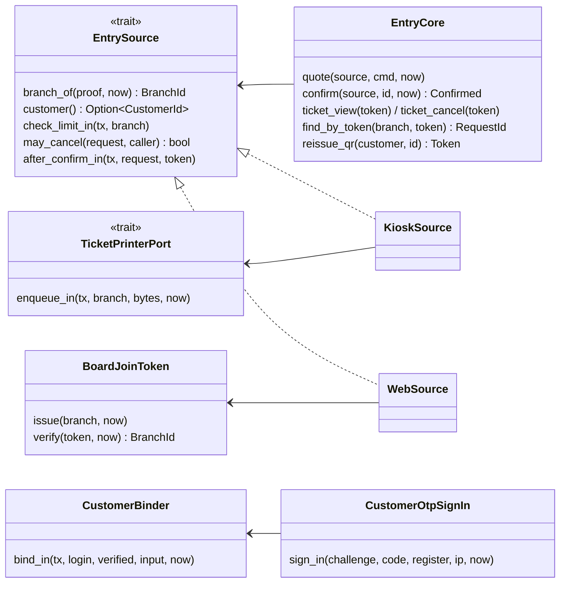

# Kiosk: one customer at a time, a branch kiosk settings page, and a verified phone number

> designed-by: claude/e92db6 (XC FE lane controller), with the BE lane (claude/553782) to complete §4's server half before
> any ticket is cut · measured on `main` `ced3a2d6` · builds on `kiosk-cancel.md` (KC-1..KC-5) and
> `customer-identity-consent.md` (phone-first customers, `PhoneVerificationService`)

## 0. Decided (owner, 2026-10-21)

| # | Rule | Owner's words |
|---|---|---|
| KS-1 | A kiosk is **shared**: it serves **one customer at a time**, and starts over when that customer is done. A request someone leaves half-done must not stay on screen for the next person. | *"ระบบ kiosk มัน จะเริ่มใหม่ เมื่อ ทำจบ"* · *"แต่ มันใช้ ร่วมกัน"* · *"ถ้าอีกคนทำค้างไว้"* · *"กรณี ใข้ รวมกัน หลาย คน"* · *"มัน ควรทำที่ละคน ในเครื่อง นั้น"* |
| KS-2 | The customer's cancel at the kiosk is **one press**. The customer never types a code. | *"ต้องมาใส่ รหัส มันไม่รู้รหัส อะดิ"* · *"มันควร กดยกเลิกได้ เลย"* |
| KS-3 | How long the queue-number screen stays is **configurable**, on a **per-branch kiosk settings page in admin**. | *"ให้ตั้งค่าได้เอง"* · *"ควรมีหน้า คอนฟิก สำหรับ kiosk"* (chose "the admin page, per branch") |
| KS-4 | To book a queue at the kiosk the customer **must enter a phone number**, used to tell who is who, **verified by an SMS OTP** so a mistyped number is caught. | *"ลูกค้า มาควร มีการใส่ เบอร์ โทร เพื่อ จองคิว"* · chose "required" · *"ใช้ในการแยกแยะ ว่าใครเป็นใคร"* · *"ส่ง sms เพื่อ ยืนยัน ตัว ตน"* · *"ควร มี otpเพื่อกัน การ ใส่เบอร์ ผิด"* |
| KS-4a | **Login first, always.** The phone + OTP login comes **before** the first exchange screen (currency/amount), on the kiosk and on the phone (KS-7). No anonymous path exists, and **no switch bypasses it**. So the Identity → Notify SMS setup (§6 Q2) is a **prerequisite of shipping this**: until it is done, the feature waits, and nothing runs without login. | *"ใช้ otp"* · *"มันต้อง ผ่าน login ก่อน มาหน้านี้"* (shown the reference kiosk's step 1) |
| KS-4b | **The OTP works the way 108heros does it:** the code is sent and checked by the central **Identity** platform (`POST {identity}/auth/otp/request {destination, channel: "sms"}`, then verify; `108-Plaza/108heros-flutter` `lib/features/auth/infrastructure/data_sources/identity_otp_api.dart:17-29`). Identity sends the SMS through the 108 Plaza Notify. | *"เหมือน 108 heros"* |
| KS-6 | The customer gets a **queue ticket** from booking. **How it is delivered is a branch setting** on the kiosk settings page (KS-3), with three choices: **print + SMS**, **print only**, or **SMS only**. **The default is SMS only** (*"ให้default ที่ sms ก่อน"* · *"เพราะเครื่องพิพม์ ยัง ไม่แน่ชัด"*: the kiosk printer is not settled yet, so printing is built only once a printer is chosen). The printed slip carries the queue number, the time and the currency. The SMS carries the queue number and a link to see the status and cancel. | *"น่าจะมี บัตร คิว"* · *"ที่ได้ จาก การจองคิว"* · *"ให้ คอนฟิก ได้ ว่า จะใช้ แบบ ไหน ตามตัวเลือกที่เสนอมา"* |
| KS-4c | **Taking a queue at the kiosk is a normal customer login.** Phone + OTP signs the customer in exactly as the customer sign-in does (Identity OTP, KS-4b). The request belongs to that signed-in customer: found by phone, or created as a new customer. On a shared kiosk the session **ends at the kiosk's reset** (KS-1), so the next person starts signed out. | *"การ ใช้ คิว ก็เหมือนการ login ปกติ"* · *"เพื่อให้สามารถ แยกแยะ orders ได้ จำเป็นต้องใข้ เบอร์ โทรใน login"*: the phone number is the login, so every order can be told apart by its customer |
| KS-7 | **The rate board's QR joins the queue now, on the customer's own phone.** Scanning opens the same queue flow as the kiosk, on the phone: sign in by phone + OTP (KS-4c), choose currency and amount, get a walk-in queue number, and be called by SMS or the ticket page. It opens **the customer web pages** (`/app/…`, owner: *"มันจะไปหน้่าลูกค้า ใช่ไหม"* — yes): a new customer page, e.g. `/app/queue?branch=<code>`, behind the existing customer sign-in (`/app/sign-in`, phone + OTP). After joining, the customer sees the queue among their own pages. It replaces the board QR's current target, `/app/book` (`web/src/screens/customer/rate-display/BookingQr.tsx:16`, `rate-display.md` D9a). Booking a time stays in the app. On a personal phone the session does not have to end at once, but every request still belongs to one signed-in customer. | Shown a reference board (`rate.xc-th.work`, *Scan to join the queue · Get called on your phone*), the owner asked *"สแกน QR Code จองคิวได้ไหม"* · *"มันแยก แยะได้ได้ไหม"*, then chose "join the queue now on the phone" · *"มันต้องต้อง แยก แยะ ใครเป็นใครได้นะ"* |
| KS-5 | The system calls the queue in order, and **a calling display shows it, like a bank's**: a public screen at the branch with the number being called and the counter it goes to. Call order stays today's rule (BOOKING before WALK_IN, then the lowest number, `xc-queue/src/infrastructure/repository.rs:355-364`). | *"ระบบ ป็นคนเรียก คิว ที่รัน ตาม คิวการจอง"* · *"มีหน้า จอ เรียก เหมือน ธนาคาร"* · *"ว่า คิวไหน จะเข้าใช้บริการ"* |

## 1. What exists today (measured)

- **The kiosk never lets go of a finished customer.**
  - `KioskController._onIdle` (`app/lib/features/kiosk/presentation/controllers/kiosk_controller.dart:396-400`) exempts the waiting and receipt screens from the 2-minute idle reset (`idle_timer.dart:5`).
  - The only other reset is 30 s after `COMPLETED` (`:641-646`).
  - So a request stays on screen until staff finish it, and KC-A's cancel button (#4208) sits on that screen. **#4243** fixes this (KS-1, KS-2) with a 30-second constant.
- **Kiosk settings:** `/kiosk-currencies.html` (admin, per branch) holds the currency switches only (`kiosk_currencies`, `api/migrations/20261007170000_kiosk.sql:32-37`). There is no row for timings.
- **Phone on a kiosk request:** none. `kiosk_requests` has no phone or customer column (`20261007170000_kiosk.sql:4-24`).
- **Phone OTP today:**
  - `PhoneVerificationService` (`api/crates/xc-customer/src/application/customer/phone_verification_service.rs`) sends an SMS code through `SmsSender`. Its rate limits are in `PhoneOtpPolicy`.
  - It is **staff-initiated, for an existing customer**: `phone_verifications.customer_id` and `requested_by` (a user) are `NOT NULL` (`api/migrations/20261205141000_phone_verifications.sql`).
  - The phone is stored **encrypted**, with a lookup hash (`phone_encrypted`, `phone_lookup_hash`).
  - A kiosk customer is anonymous, with no user and maybe no customer yet, so this service cannot be called as it is.
- **SMS on the test host: none today.** claude/553782 measured it at ~07:25Z by grepping key names only.
  - xc-v3's `NotifySmsSender` (`api/src/infrastructure/notify/notify_sms_sender.rs`) needs `NOTIFY_BASE_URL` and `NOTIFY_API_KEY`, and neither is in `/etc/xc-v3/env` or `/etc/xc-v3/*.env`. So every send answers `smsUnavailable`.
  - Identity's OTP is `AUTH_OTP_DELIVERY_MODE=noop`.
  - `deploy/HOST-do-sgp1.md` I-3 leaves the sender choice to the owner.
  - **A required SMS OTP would therefore block every kiosk booking until a sender is set.**

## 2. Behaviour

**Kiosk flow (KS-1, KS-2, KS-4):** start → currency and amount → **phone** → **OTP** → review → confirm → **queue number + ยกเลิกคิว + เสร็จ** for *N* seconds → start.

| Step | Rule |
|---|---|
| phone | Required. Normalised and validated as the server does for customers. A wrong shape is refused on the screen. |
| OTP | An SMS code to that number. The confirm is refused until the code is verified. The rate limits are the customer OTP's (`PhoneOtpPolicy`), per phone and per kiosk address. A resend is allowed after the policy's wait. Idle on this screen resets the kiosk (KS-1). |
| confirm | The request carries the **verified customer**: an existing customer found by phone (lookup hash), or a new customer with a verified PHONE identity. The kiosk never shows any customer data back. |
| done screen | *N* = the branch's `resultSeconds` (KS-3), default 30. ยกเลิกคิว is one press (`customerCancel` with the hidden token). เสร็จ resets at once. |
| idle | Every screen resets after the branch's `idleSeconds`, default 120 (today's constant). |

**Staff side:** the queue panel and the desk show the customer for a kiosk request, so the desk need not ask for the phone again. Exactly what is shown is the BE lane's call with `customer-identity-consent.md` (masked phone, name if known).

**Calling display (KS-5).**
- Measured: there is **no public calling screen** on `main`. The desk's `Board.tsx` (`web/src/screens/desk/queue/board/Board.tsx`) and `queue_board` are staff-only, behind `QueueOperate` (`docs/design/blueprint/queue-tickets.md:162`). The `qa-e2e.md` F8 row says so too.
- The new page is a full-screen, signed-out page, opened on a TV at the branch, e.g. `/queue-display?branch=MAIN`.
  - It shows the **number being called** and **its counter**, large, plus the last few called numbers.
  - A chime plays on each new call (proposed; a spoken Thai announcement can come later).
  - It never shows a name, a phone number or an amount.
- It is fed by a **public, numbers-only view** that follows the poll seam's `since` → `{changed:false}` (🔁).

**Queue ticket (KS-6).**
- **Print:** a small slip from a printer at the kiosk.
  - **The printer is the one already given** (owner, 2026-10-21: *"เครื่อง พิมพ์ เหมือนเคยให้ มาแล้วนะ"* · *"กับลิ้นชัก"*): the **POS80** 80 mm ESC/POS receipt printer, with the cash drawer on it.
    - In v2 it sat on the counter Mac's USB as CUPS queue `POS80_` (`docs/design/xchange-v3-known-differences.md:52`).
    - v3 reaches it through the **device agent** (`deploy/agent/README.md` §A CUPS raw / §B TCP 9100), which already drives the drawer kick.
    - So the kiosk ticket is a print job the server builds as ESC/POS and the branch's device agent sends. The kiosk app does not print by itself, and it works from both the Flutter and the web build.
    - Open for the BE lane: whether the kiosk's printer is the counter POS80 or a second POS80 at the kiosk. The owner names the target when the agent is paired.
- **SMS:** sent through Identity/Notify like the OTP (KS-4b), to the verified phone.
  - It carries a link to a **public, signed-out ticket page**: the number, the status, and **ยกเลิกคิว**.
  - The page is opened by a per-ticket secret in the link, never by the request id. That lets a customer who has walked away cancel later, without breaking KS-1.
- **The branch setting decides** which of the three ticket modes runs. With SMS off, the cancel after the done screen is staff-only, as today.

## 3. Data (migration **approved** by the owner 2026-10-21: *"อนุมัติ migration"*)

- `kiosk_settings` per branch: `result_seconds`, `idle_seconds`, `ticket_mode` (`PRINT_SMS` | `PRINT` | `SMS`, default `SMS`), CHECKed ranges, `updated_by`, `updated_at`, and a version for the poll seam. Or columns on an existing per-branch table: the BE lane chooses.
- `kiosk_requests.customer_id` (nullable for rows before the migration; required for new ones by the service, not by the schema, so old rows stay valid).
- A kiosk OTP challenge store: either `phone_verifications` with `customer_id`/`requested_by` made nullable plus a `source` column, or its own table. The phone is always stored encrypted like `phone_verifications`.
- No backfill: existing requests have no phone.

## 4. Server half (BE lane)

> designed-by: claude/c4be83 for the BE lane controller claude/553782 · measured on xchange `main` `4c3fc5a`,
> `108-platform-services` (`681bea2` = the deployed xc-identity, `8b53cee` = xchange's pinned `pos-printer`), do-sgp1
> and Dell, 2026-10-21 · written for the owner's final rule (PR 4249, claude/553782): **two sources, one entry core**.
> (1) the kiosk issues printed queue tickets with no login; (2) the web page behind the rate-board QR needs a login,
> then joins the queue now, waits for the call on the phone, and the desk scans the request QR. `/app/book` stays the
> separate time-booking page. The owner's Q1, Q2 and Q4 answers (§6, `10c702b`) are applied. Earlier versions of §4:
> git `bf7efba8`, `1dde5b6c`, `1e5e84e1`.

### 4.1 What the server does today (measured)

- **The kiosk entry exists and needs no login.**
  - `quote`, `confirm`, `status`, `customerReceipt` and `customerCancel` are `Need::Public`
    (`api/crates/xc-auth/src/domain/policy/entities/policy.rs:123-126`).
  - The core is the customer half of `KioskService`: `quote` `:58`, `confirm_with_token` `:219`,
    `customer_cancel` `:328`, `status` `:394` (`api/crates/xc-kiosk/src/application/kiosk/customer.rs`).
  - `confirm` issues the walk-in ticket in its own transaction (`IssueSource::Kiosk {request_id}`).
  - The quote is written with `customer_id: None` (`api/src/infrastructure/kiosk/kiosk_ports.rs:443`).
- **A per-request secret already exists: the cancel token.** `confirm` mints a UUID v4 and returns it once. Only its
  SHA-256 is stored (`kiosk_requests.cancel_token_hash`, `api/migrations/20261219190000_kiosk_cancel.sql:15`;
  `xc-kiosk/src/infrastructure/kiosk/kiosk_repository.rs:635,654`). The kiosk's customer cancel also needs the same
  client address (`customer.rs:327-333`).
- **The booking QR is the pattern to reuse.**
  - The token is minted at create; only its hash is kept (`bookings.qr_token_hash bytea UNIQUE`,
    `api/migrations/20261205131000_booking_slots.sql:97`).
  - The desk finds a booking by it (`desk_bookings` view, filter `qr`, `api/src/presentation/http/v3/views/desk_bookings.rs:72,104`;
    the scan / lookup in `web/src/screens/desk/bookings/DeskBookingsScreen.tsx:224`).
  - Check-in compares the hash (`api/src/presentation/http/v3/commands/bookings/check_in.rs:142-144`).
  - The customer gets a fresh QR by reissue (`bookingQrReissue`, `POST /api/bookings/{id}/qr`, `commands/bookings/qr.rs`),
    because a stored hash cannot be shown again.
- **The desk already opens a kiosk request by id:** `/desk?branch=<b>&kiosk=<id>`
  (`web/src/shared/ui/QueuePanel.tsx:437`; `web/src/screens/desk/entries/kiosk/entry.ts`, which calls `/api/kiosk get`).
- **A member's ticket already shows in the account** when `queue_tickets.customer_id` is set
  (`api/src/presentation/http/v3/views/my_queue_ticket.rs:3,128`; column `api/migrations/20261101100000_queue.sql:15`).
- **Web sign-in: an unknown phone cannot sign up today.**
  - xchange sends `"registerIfAbsent": false` (`api/crates/xc-auth/src/infrastructure/identity/http_identity_client.rs:299`).
  - It answers a correct code with `401 invalidCode` when Identity returns no login (`session_service.rs:912-916`).
  - The deployed Identity `681bea2` supports first-sight registration (`crates/auth/src/application/verify_otp.rs:218`).
  - The bind core `register_customer` takes a password login only (`api/src/application/customer_signup.rs:82-158`).
  - xc-identity on do-sgp1 runs `AUTH_OTP_DELIVERY_MODE=noop`, so no code reaches a phone (§4.9).
- **Printing: the agent can print, but the server never sends it a print job.**
  - The agent writes any bytes to CUPS raw or TCP 9100 (`api/crates/xc-device-agent/src/runner.rs:268-301`).
  - Every claim serves only `DRAWER_REQUEST` (`api/src/infrastructure/device_agents/pg_agent_repository.rs:296,315,342,449`).
  - The schema allows one active agent per branch (`api/migrations/20261008120000_device_agents.sql:29-31`).
  - `device_jobs.kind` is CHECKed to `PRINT_RECEIPT`/`DRAWER_REQUEST` (`20261007180000_devices.sql:7`).
  - `pos-printer` at xchange's pin draws QR codes (`crates/pos-printer/src/escpos.rs:305,316`).
- **Calling data.** `queue_tickets.status`/`called_at`/`counter_teller_id` exist (`queue.sql:14-19`). A counter is a
  teller with **no number or label** (`queue_counters`, `:41-47`). `branch_service_status.queue_version` is the poll
  seam (`:53`). The only board is staff-only (`queue_board`).

### 4.2 Decisions (BE lane)

**One core, two sources.** `Source` is `Kiosk` or `Web { customer_id }`. It is read from how the request arrived, never
from the body: `/api/kiosk` with no customer session = `Kiosk`; the web queue command with a customer session = `Web`.
The core is the kiosk's `quote` → `confirm` (`customer.rs`). Each source is one small file holding only what differs (♻️).

| | Kiosk | Web (rate-board QR → login) |
|---|---|---|
| who | anyone, no login | a signed-in customer (`CustomerSelf`) |
| `kiosk_requests.customer_id`, `quotes.customer_id`, `queue_tickets.customer_id` | NULL | the member's |
| branch proof | the kiosk names it (as today) | the rotating board token from the QR (D5) |
| the request QR | printed on the ticket + shown on the done screen | shown on the phone; reissued from the account (D3) |
| limit | today's per-address quote limit | one open request per member per branch (`409 alreadyQueued`) |
| cancel | the screen's one press (token + same address), or the ticket page (token) | the member's session, or the token |
| after the number | the kiosk resets (KS-1) | the phone page waits for the call (D7) |
| print | the kiosk's POS80 (D8) | none |

| # | Decision | Why |
|---|---|---|
| D1 | **One entry core.** Both sources run `quote` → `confirm` in `customer.rs`; `KioskSource` and `WebSource` (one file each) answer the table's rows. Rates, the request, the ticket issue, the token and the purge stay in the core. | owner: *"ONE entry core"*; ♻️ |
| D2 | **The request QR token = the cancel token.** It is one per-request secret, minted at `confirm`, with only its hash stored (`cancel_token_hash`). No second secret and no new column. The QR encodes `<origin>/q#<token>`; the fragment keeps it out of request lines, logs and referrers. | the booking QR pattern; KS-6 |
| D3 | **A member re-shows the QR by reissue**, as bookings do: `kioskRequestQrReissue` (`CustomerSelf`, own request only) mints a new token and replaces the hash, so the old QR stops working. A kiosk ticket is never reissued. | a stored hash cannot be shown again |
| D4 | **The desk scans the QR to open the request.**  • A new staff action `findByToken` (`QueueOperate`, the desk's branch only) answers the request id.  • The desk then opens today's `?kiosk=<id>` entry.  • It works for a printed kiosk ticket and for a member's phone alike.  • A token of another branch, or an unknown one, answers `404`.  • The scanner is the one `DeskBookingsScreen` uses. | owner: *"STAFF SCAN the request QR"*; reuse |
| D5 | **The web source proves its branch with the rotating board token.**  • The board's public poll (`api/src/presentation/http/public/branch_rates.rs:16`) answers a `joinToken` = `branchId ‖ window ‖ HMAC-SHA256(XC_BOARD_JOIN_KEY, branchId ‖ window)`, with a 10-minute window.  • The QR encodes `<origin>/app/queue?t=<joinToken>`. The branch comes only from the token; the current or previous window is accepted.  • No key ⇒ the board shows no queue QR, and a web join answers `503 boardJoinUnavailable` (fail closed).  • The member must be at the board, as the owner's flow reads ("join the queue now"); today's QR names the branch with a public code (`BookingQr.tsx:16`). | a login proves who, not where |
| D6 | **Web sign-in = the customer OTP login, with first-sight sign-up.**  • `/api/auth/otp/verify` takes an optional `register: {displayName, lang, marketing}`. With it, xchange sends `registerIfAbsent: true`.  • `register_customer` splits into the login half and a shared `CustomerBinder` (♻️): user + CUSTOMER role + customer + TERMS consent + PHONE identity.  • A verified phone ACTIVE on a desk-made customer with `user_id IS NULL` **joins that customer** (owner Q1, *"ผูกกับลูกค้าเดิม"*); one with a user ⇒ `409 phoneInUse`.  • Without `register`, "no login" answers `401 notRegistered`, not the false `invalidCode`.  • The web page is not shared, so the name is asked at sign-up, as `/api/app/register` does. | KS-4c; the gap in §4.1 |
| D7 | **Waiting for the call on the phone.** `myKioskRequest` (`CustomerSelf`, own request) answers `{displayNumber, status, ticketsAhead, counter}` on the poll seam (`queue_version`, `since` → `{changed: false}`). When the number is called, `status = CALLED` and `counter` = the counter label (D10). There is no SMS for the call. | owner: *"wait for the call on the phone"*; 🔁 |
| D8 | **The kiosk ticket prints on a second POS80 at the kiosk** through its own paired agent:  • `device_agents.role` (`DRAWER` / `TICKET_PRINTER`), with one active agent per branch per role.  • Job kind `PRINT_QUEUE_TICKET`, queued in `confirm`'s transaction, `EXPIRED` after 60 s.  • The bytes are rendered with `pos-printer`: number, time, currency, QR.  • No ticket agent ⇒ no job, and the QR shows on the done screen only.  • The counter POS80 stays the drawer's: it is behind the desk and prints receipts. | KS-6; the one-agent index (§4.1) |
| D9 | **The public ticket page** (the printed QR) answers `ticketView` / `ticketCancel` by token:  • number, status, place in line, branch;  • the cancel runs the `customerCancel` transition.  • A wrong token gets one uniform `404`.  • The page needs no session and works from any network. A member's QR opens the same page. | KS-6 |
| D10 | **The calling display** (KS-5) is the public, numbers-only `GET /api/public/orgs/{org}/branches/{code}/queue-display?since=` on `queue_version`. It answers today's `CALLED`/`SERVING` with counter labels, and the last 5 called; never a name, phone, amount or teller. A counter label needs `queue_counters.label` (Q8). | KS-5 |
| D11 | **KS-3 settings:** `kiosk_settings` (`result_seconds` default 30, 10–300; `idle_seconds` default 120, 30–600) with a public `settings` read (poll seam) and a `configureSettings` write behind `RatesDraft`. | KS-3 |
| D12 | **At the desk save** (owner Q2, *"บันทึกที่ A ตามพาสปอร์ต"*): when the passport's customer A differs from the web request's member B, the exchange saves on A. The request and its quote keep B, and one `KIOSK_CUSTOMER_DIFFERS` audit row names both. The desk is never blocked. | owner Q2 |
| D13 | `queueTicketTake` and `/app/book` stay unchanged (owner Q4, *"เก็บไว้ทั้งสอง"*). | owner Q4 |

### 4.3 Class diagram

`EntryCore` is the customer half of `KioskService` in `customer.rs`, not a new type (a rename would touch every caller).

| Class | File | New / changed |
|---|---|---|
| the entry core | `api/crates/xc-kiosk/src/application/kiosk/customer.rs` | changed: takes `&dyn EntrySource`; `ticket_view`, `ticket_cancel`, `find_by_token`, `reissue_qr` |
| `EntrySource` | `api/crates/xc-kiosk/src/domain/kiosk/value_objects/entry_source.rs` | new trait |
| `KioskSource`, `WebSource` | `api/crates/xc-kiosk/src/application/kiosk/sources/kiosk.rs`, `…/sources/web.rs` | new, one file each |
| `BoardJoinToken` | `api/crates/xc-kiosk/src/domain/kiosk/value_objects/board_join_token.rs` | new (HMAC with `ring` `0.17`, as `xc-auth/Cargo.toml:24`) |
| `TicketPrinterPort` + `PgTicketPrinter`, `TicketPrintJob` | `…/domain/kiosk/repositories/ticket_printer_port.rs`, `api/src/infrastructure/kiosk/pg_ticket_printer.rs`, `…/value_objects/ticket_print_job.rs` | new |
| agent role + claims | `api/src/infrastructure/device_agents/` (`agent_repository.rs`, `claim.rs`, `pg_agent_repository.rs`), `api/src/infrastructure/devices/device_job.rs`; the agent's `--role` flag in `api/crates/xc-device-agent/src/main.rs` | changed |
| `KioskRepository::find_by_token_in`, `replace_token_in` | `api/crates/xc-kiosk/src/infrastructure/kiosk/kiosk_repository.rs` | new |
| web queue commands `kioskRequestJoin` (quote + confirm for the web source), `kioskRequestQrReissue`, view `myKioskRequest` | `api/src/presentation/http/v3/commands/kiosk_web/{join.rs,qr.rs}`, `api/src/presentation/http/v3/views/my_kiosk_request.rs` | new, `CustomerSelf` |
| `findByToken`, `ticketView`, `ticketCancel`, `settings`, `configureSettings` | `api/src/presentation/http/kiosk.rs` + `policy.rs:123-133` | changed |
| `CustomerBinder`, `CustomerOtpSignIn` | `api/src/application/customer_binder.rs`, `api/src/application/customer_otp_sign_in.rs`; `customer_signup.rs` calls the binder | new / changed |
| `IdentityClient::otp_verify(…, register_if_absent)` | `api/crates/xc-auth/src/domain/identity/identity_client.rs:138`, `…/infrastructure/identity/http_identity_client.rs:289-301` | changed |
| `QueueDisplayView` | `api/src/presentation/http/public/queue_display.rs` | new |
| `KioskSettings` (+ repository, Pg) | `…/domain/kiosk/entities/kiosk_settings.rs`, `…/repositories/kiosk_settings_repository.rs`, `api/src/infrastructure/kiosk/pg_kiosk_settings_repository.rs` | new |
| the save's audit (D12) | `api/crates/xc-kiosk/src/application/kiosk/save_hooks.rs` | changed |

### 4.4 Behaviour

| # | Given | Answer |
|---|---|---|
| B1 | kiosk `quote` / `confirm` | as today; `confirm` also answers `ticketUrl`; today's kiosk tests stay green unchanged |
| B2 | kiosk `confirm` with a `TICKET_PRINTER` agent / without | ticket + one `PRINT_QUEUE_TICKET` job in one transaction / ticket only |
| B3 | ticket agent claims; a ticket job older than 60 s | only `PRINT_QUEUE_TICKET`; `EXPIRED`, never sent |
| B4 | `kioskRequestJoin` without a customer session | `401 signIn` |
| B5 | `kioskRequestJoin`, valid `joinToken` | request + ticket with `customer_id` = the member; answers `{displayNumber, qrUrl}` |
| B6 | `kioskRequestJoin`, old / forged / other-branch token; no key | `403 boardTokenInvalid`; `503 boardJoinUnavailable` |
| B7 | `kioskRequestJoin` while the member has a QUOTED/WAITING request at that branch | `409 alreadyQueued` + its id |
| B8 | `myKioskRequest`, `since` = the current `queue_version` / another member's id | `{changed: false}` / `404` |
| B9 | `kioskRequestQrReissue` | a new token; the old QR no longer opens anything (`findByToken`/`ticketView` → `404`) |
| B10 | desk `findByToken`, a token of this branch / another branch / unknown | the request id / `404` / `404` |
| B11 | `ticketView` / `ticketCancel`, right token, any network | the ticket / cancelled (`KIOSK_CANCELLED`, `CUSTOMER_CANCELLED`); wrong token `404` |
| B12 | the kiosk screen's `customerCancel` from another address | refused, as today |
| B13 | `otp/verify` with `register`: known member / new phone / phone on a desk customer without a user / with a user | `200` / `200 registered` / `200`, joined to that customer (Q1) / `409 phoneInUse` |
| B14 | `otp/verify` without `register`, unknown phone | `401 notRegistered` |
| B15 | desk save of a web request, passport customer ≠ member | saved on the passport's customer; one `KIOSK_CUSTOMER_DIFFERS` audit row |
| B16 | `queue-display` unchanged / changed | `{changed: false}` / today's called numbers + counter labels, never a name, phone, amount or teller |
| B17 | `settings` / `configureSettings` out of range | defaults or the row / `400 validationFailed` naming the field |

### 4.5 Rules the tests pin first (up-front, `class:logic`)

- B1–B12 as one table-driven test over both `EntrySource`s, with the rows that differ asserted per source.
- B13–B14 on `CustomerOtpSignIn` with a fake `IdentityClient`; the flag xchange sends is asserted, not only the answer.
  `/api/app/register` answers exactly as before (the binder moved code, no rule).
- B15 on the save hook; B16 with a guard that the view's JSON has no field outside D10's list; B17.
- `BoardJoinToken` and `TicketPrintJob` unit tests (round trip, previous window, flipped byte; the slip carries the
  number and a QR of `ticketUrl` and the token nowhere else).
- Guard: only `sources/*.rs` implement `EntrySource`, and only the core issues `IssueSource::Kiosk`.

### 4.6 Data (one migration)

- `kiosk_requests.customer_id text NULL` (no FK, as `queue_tickets.customer_id`): set for web members, NULL for kiosk
  tickets. **Owner-approved** (553782, 2026-10-21).
- `kiosk_settings` (D11). Covered by the §3 approval.
- `device_agents.role` + the one-active index on `(branch_id, role)`, and `device_jobs.kind` + `PRINT_QUEUE_TICKET` (D8).
  **Owner question Q7.**
- `queue_counters.label` (D10). **Owner question Q8.**
- No backfill: existing requests have no customer, existing agents become `DRAWER`, existing counters have no label.
  Renumbered with `scripts/migration-slot.sh next` right before `pr_open`.

### 4.7 Open owner questions (batched by claude/e92db6)

- **Q7 (D8).** Approve the agent role and the ticket job kind, so a second POS80 at the kiosk prints the ticket.
  Proposed: yes. Printing on the counter POS80 needs no migration, but the ticket comes out behind the desk.
- **Q8 (D10).** Approve `queue_counters.label`, so the display and the member's phone can say which counter.
  Proposed: yes. Without it, both show only the number.
- **Q9 (D5).** Must a web member be at the board to join (the rotating board token), or may they join from anywhere
  once signed in? Proposed: at the board, as "join the queue now" reads. One open request per member bounds the
  "from anywhere" case either way.
- **Q10 (foreign customers on the web path).** A tourist without a Thai SIM cannot receive the SMS code.
  - Measured: the deployed Identity can sign up and sign in by **e-mail** OTP (`verify_otp.rs:593`, test
    `register_if_absent_creates_a_verified_active_identity_from_an_email`). Staging Notify has its SMTP settings set
    (names only checked).
  - Not measured: whether our ThaiBulkSMS account sends to non-Thai numbers. The vendor states 200 countries, prices on
    request (thaibulksms.com/faq, read 2026-10-21); one test send to a non-Thai number settles it (§4.9 step 4).
  - Proposed: a foreigner takes a kiosk ticket (no login needed); on the web, offer e-mail OTP. That needs the binder
    to write an EMAIL identity as well as PHONE (today it writes only PHONE, `customer_signup.rs:161-208`).

### 4.8 Release order

1. This design merges, doc-only. **No tickets are cut before deploy 10** (owner 553782).
2. After deploy 10, the BE tickets in four slices that share no files:
   - (a) the entry core + `KioskSource` + ticket page + desk `findByToken`;
   - (b) printing (after Q7);
   - (c) display + settings (label after Q8);
   - (d) the web source + sign-in (`WebSource`, `BoardJoinToken`, `CustomerBinder`, `CustomerOtpSignIn`).
3. **The web path ships only after the owner's setup in §4.9** (Identity → Notify, a test code reaching the owner's
   phone, a TERMS text in th/en/zh, `XC_BOARD_JOIN_KEY`). The kiosk path needs none of it.
4. Hardware: a second POS80 at each kiosk, paired `--role ticket`. Until then the QR shows on screen only.
5. Deploy is a separate owner order.

### 4.9 Owner setup for the web path: Identity OTP → 108 Plaza Notify

> measured 2026-10-21 by claude/c4be83 from the Mac Studio. Only names were read from env files and secrets, never
> values. It gates the web path only; the kiosk path needs none of it.

**What is there now.**
- **xc-identity** on do-sgp1 (`152.42.247.83`):
  - `active`, build `681bea2` (`/opt/xc-identity/BUILD`).
  - `/etc/xc-identity/env` has `AUTH_OTP_DELIVERY_MODE=noop`, and no `AUTH_OTP_HTTP_*` lines.
  - `681bea2` already has the HTTP sender and `registerIfAbsent` (`108-platform-services`
    `crates/auth/src/contract/mod.rs:536`, `crates/auth/src/infrastructure/config.rs:414`). **No rebuild is needed.**
- **Notify** runs on Dell k3s, `staging/notify`, NodePort 30710.
  - Its secret `staging/notify-secrets` holds `ADMIN_API_KEY` and `THAIBULKSMS_API_KEY`/`_SECRET`/`_SENDER` (names
    only; whether the SMS keys are filled was not checked).
  - Prod (`prod/notify`, 31710) has the same names.
- **Reach.**
  - do-sgp1 **cannot** reach Dell's NodePorts (`http://103.27.202.40:30710` and `:31710` both time out).
  - It **does** reach the public name `https://notify.staging.108plaza.net`: `/health` = `200`, and `POST /api/v1/otp`
    with no key = `401`. That name is Dell's nginx vhost to NodePort 30710, with a Let's Encrypt certificate.
- **The contract** (`108-platform-services` `crates/notification-api/src/routes/otp.rs`, `middleware.rs:84-113`):
  - Identity POSTs `{channel, to, code, purpose}` with `Authorization: Bearer <tenant API key>`.
  - Notify answers `202 {id}`, which means queued, not yet delivered.
  - A tenant may define an `otp_code` template for its own SMS text; without one, the built-in text is used.

**The tenant and key.** One new Notify tenant `xchange` on **staging** Notify. It is the xchange test host's own
tenant, so its rate limit, audit and SMS text are separate from other users of Notify.

| # | Step | Where | Command (the owner runs it; nothing here prints a secret) |
|---|---|---|---|
| 1 | Create the tenant. The answer shows the API key **once** | Dell | `ADMIN=$(kubectl -n staging get secret notify-secrets -o jsonpath='{.data.ADMIN_API_KEY}' \| base64 -d)`, then `curl -s -X POST http://127.0.0.1:30710/api/v1/admin/tenants -H "X-Admin-Key: $ADMIN" -H 'X-Admin-Actor: owner' -H 'Content-Type: application/json' -d '{"name":"xchange","rate_limit_per_minute":60}'`. Keep `api_key` from the answer and paste it only into step 2 |
| 2 | Point Identity at Notify: **all three lines together** | do-sgp1, `/etc/xc-identity/env` (root:xc-identity 640) | `AUTH_OTP_DELIVERY_MODE=http`, `AUTH_OTP_HTTP_ENDPOINT=https://notify.staging.108plaza.net/api/v1/otp`, `AUTH_OTP_HTTP_API_KEY=<the key from step 1>` |
| 3 | Restart and check | do-sgp1 | `systemctl restart xc-identity && systemctl is-active xc-identity && journalctl -u xc-identity -n 30 \| grep otp_delivery`. The log must say `otp_delivery="http"` |
| 4 | Test Notify alone, to the owner's phone | do-sgp1 | `KEY=$(grep '^AUTH_OTP_HTTP_API_KEY=' /etc/xc-identity/env \| cut -d= -f2-)`, then `curl -s -w ' %{http_code}\n' -X POST https://notify.staging.108plaza.net/api/v1/otp -H "Authorization: Bearer $KEY" -H 'Content-Type: application/json' -d '{"channel":"sms","to":"+66XXXXXXXXX","code":"123456","purpose":"login_phone_otp"}'`. Expect `202` and an SMS with `123456` |
| 5 | Test the whole path, the way the kiosk will call it | anywhere | `curl -s -X POST https://xc-v3.spacing.cloud/api/auth/otp/request -H 'Origin: https://xc-v3.spacing.cloud' -H 'X-Xchange-Request: 1' -H 'Content-Type: application/json' -d '{"destination":"+66XXXXXXXXX","channel":"sms"}'`. Expect `200 {challengeId, expiresAt}` and a real code on the phone. Both headers are required (`same_origin`, `api/src/presentation/extractors/origin.rs:33-55`) |

- 🔴 **Step 2 is all-or-nothing.** With `http` mode and a missing endpoint or key, Identity **refuses to boot**
  (`crates/identity-api/src/main.rs:381-394` at `681bea2`), and then **every** sign-in fails, staff included. If step 3
  does not show `active`, put `AUTH_OTP_DELIVERY_MODE=noop` back and restart.
- **Step 4 `202` but no SMS** ⇒ the fault is in Notify or the provider, not Identity. Check the notification's delivery
  attempts, and whether the `THAIBULKSMS_*` values are filled. A tenant `otp_code` template made for e-mail falls back
  to the built-in SMS text (`otp.rs`, the 2026-08-12 fix), so a template is not the cause.
- **Step 4 `401`** ⇒ wrong or inactive key. Rotate it with `POST /api/v1/admin/tenants/{id}/rotate-key`.
- **Step 5 `503 identityUnavailable`** ⇒ step 3 failed, or xc-v3 lost its Identity drop-in (`HOST-do-sgp1.md` §2).
- **Real production** (when the owner says so) gets its own tenant on `prod/notify`, which needs a public name like the
  staging one. No such name was found on Dell's nginx (only `notify.staging.108plaza.net` points at Notify).

## 5. Front ends (this lane)

- **Admin:** `/kiosk-currencies.html` becomes **ตั้งค่าตู้**: the currency switches plus `resultSeconds` and `idleSeconds`.
- **Kiosk app:** the phone and OTP steps; `resultSeconds` and `idleSeconds` from the settings read, replacing #4243's constant; all 16 kiosk languages for the new texts (`app/assets/l10n/kiosk.json`).
- **Queue panel and desk:** show the kiosk request's customer.

## 6. Open questions for the owner (one batch)

1. ✅ **KS-5 answered:** a calling display like a bank's (§2). Still open: whether to add a spoken announcement. Earlier wording of this question: Today a teller presses call-next, which picks BOOKING tickets before WALK_IN and then the lowest number (`xc-queue/src/infrastructure/repository.rs:355-364`). Does the owner mean (a) call-next is already right; (b) the **system** should call the next number by itself when a counter frees up; or (c) kiosk requests should be ordered with bookings?
2. ✅ **Decided 2026-10-21: the 108 Plaza Notify platform** (*"ใช่ Notify ชอง 108 plaza"*). With KS-4b the setting lives on **Identity**, not on xc-v3: set Identity's `AUTH_OTP_DELIVERY_MODE=http`, plus `AUTH_OTP_HTTP_ENDPOINT` (Notify's `/api/v1/otp`) and `AUTH_OTP_HTTP_API_KEY`, the same as 108heros's Identity. Today the instance xc-v3 uses runs `noop`. **The owner creates and sets the key**, because secrets are the owner's. Background: which SMS sender xc-v3 uses was an owner prerequisite of KS-4, per I-3. The fleet already has one: the Notify platform (`108-platform-services`). It sends SMS through ThaiBulkSMS with the approved sender `108-Pos`, per the memory store's notify record of 2026-07-31; that is **not re-measured today**. Pointing xc-v3's `NOTIFY_BASE_URL` / `NOTIFY_API_KEY` at it needs no new provider. **Proposed:** use Notify. The owner sets the key (secrets are the owner's). There is no bridge: KS-4a requires login first, so this setup must be done before the feature ships.
3. ✅ **Migration approved** for §3 (*"อนุมัติ migration"*, 2026-10-21). Deploy remains a separate owner order.
