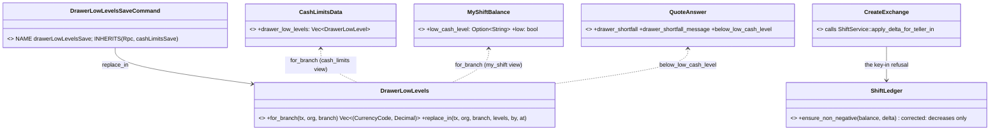

# Blueprint ledger, inventory and cost (#553)

> Design only. No code, no migration, no `ready`. Written by claude/e5ab6c on the lane controller's assignment
> (#564 issuecomment-6074257078). The code tickets are cut by the lane controller after a `Verdict: PASS`.

**Source of the logic.** *XC Desk — Blueprint & Data Model v2* (`docs/blueprint/XC-Desk-Blueprint-Data-Model-v2.html`,
#565). The owner's rule (#564, 2026-10-09): **the Blueprint's logic is fixed, and only the look may change**.

| What | Blueprint |
|---|---|
| Entities | §07 `CashAccount(id, org_id, branch_id nullable, currency, kind)`, `LedgerPosting(id, source_type, source_id, status, posted_at)`, `LedgerEntry(id, posting_id, account_id, quantity_signed DECIMAL(20,4), valuation_thb DECIMAL(20,2))` — *"posting สมดุลต่อ currency รวม clearing accounts; valuation balanced ตาม accounting policy"*; `InventoryLot(id, branch_id, currency, denomination_id nullable, acquired_at, unit_cost_thb DECIMAL(20,8))`, `InventoryMovement(id, lot_id, posting_id, transaction_line_id nullable, quantity_signed, movement_type)` — *"ต้นทุนเสนอ weighted average ต่อสาขา/สกุล; freeze cost allocation ที่ transaction; อย่ารวม FIFO กับ weighted average"* |
| Relations | §08 *"Posting → Entry → Account 1:N → N:1; posting เชื่อม transaction/transfer/payout/reversal"* |
| Atomicity | §09 complete exchange: *"… post ledger/inventory … ใน DB transaction เดียว"*; reversal: *"posting ตรงข้าม … ไม่ลบ original"* |
| Numbers | §11 ส่วนต่างรับรู้ (realized margin): *"สำหรับขาย: เงิน THB รับ − allocated FX cost; สำหรับซื้อเงินต่างประเทศไม่รับรู้กำไร"*; *"inventory ยังไม่ขายแสดง valuation แยก"*; เงินพร้อมใช้งาน = *"on_hand − active reservations; เงิน in-transit แยก; cash variance = counted − expected"* |
| Open values | §12 Cash & cost: *"weighted average เป็นข้อเสนอ … method ตามระบบเดิมและการบัญชี; วงเงิน; ผู้รับรอง; negative stock policy"* |

**Measured on** `108-Plaza/xchange` `main` at `af865a3`. It stands on:
- `rates.md` (units, `ForeignAmount`, AP-1 approvals);
- the cash design `cash-shift-transfer.md` (#582, merged `af865a3`), whose posting port §4.6 this design owns the final
  shape of;
- the quote/transaction design (#551, PR 608), whose completion calls the port;
- the outbox OB-1 (`broker-seam.md`, merged `e6c7fd0`).

---

## 0. The owner's answers (2026-10-09, in session claude/e5ab6c, AskUserQuestion)

Recorded on #553 (issuecomment-6074305056, issuecomment-6074772982).

| # | Question | Answer (verbatim) | What this design does |
|---|---|---|---|
| B-1 | Where the books live | *"แยกสองชั้น"* | v3 holds the operational sub-ledger (quantities, lots, cost, margin) in the same DB transaction as the business change; AccountZing receives a THB GL summary through the outbox (§7) |
| Q10 | Cost method | *"Weighted average"* | a running weighted average per (branch, currency), frozen on each transaction line (§4) |
| N-1 | Negative stock | *"ผู้จัดการอนุมัติให้ติดลบได้"* | a move that would take a balance below zero is refused `stockInsufficient`. **Since 2026-11-02 no approval allows it** (owner: *"ต้องเติมเงินก่อน ห้ามติดลบ"*, §5.1.2); the drawer is topped up first |
| V-1 | Who signs off a count difference | *"FINANCE เมื่อเกินวงเงิน"* | a difference above a THB limit needs FINANCE through AP-1; at or below, #582's verifier is enough (§5.2) |

**Still the owner's** (§11): the AccountZing event and account mapping (AccountZing `docs/DO_NOT_TOUCH.md`: *"Chart
of accounts / account codes"* and the posting contract need the owner's approval), the two limits' values.

---

## 1. v3 today (measured)

| Fact | Where |
|---|---|
| **No ledger.** Stock is one number per (shift, currency): `shift_balances(opening, expected, counted, difference)` | `api/migrations/20261007110000_shifts.sql:18-26` |
| **An exchange moves `expected` directly**: foreign `+amount` on BUY, `−amount` on SELL; THB only when the method is cash (`−paid` BUY, `+received` SELL) | `xc-shift/src/domain/shift/value_objects/stock_delta.rs:55-87`; `xc-shift/src/application/shift/service.rs:384-415` |
| **Never negative.** `ensure_non_negative` refuses (`ShiftError::Insufficient`) | `service.rs:384-415` |
| **Manual moves** write `stock_movements(direction IN/OUT, amount, reason)`; exchanges write none | `20261007110000_shifts.sql:28-42`; `service.rs:305` |
| **The safe** is a JSON blob, `ops_state.safe` | `api/migrations/20261007140000_custody.sql:8` |
| **No cost.** Nothing stores what foreign currency cost. `profit_summary` is a calculator over figures the user types (`foreignCost`, `realized`) | `api/src/presentation/http/v3/actions/profit_summary.rs:20-60` |
| **The cash design's seam.** `CashPostings::post_in` / `expected_in` with `CashPlace { Drawer(ShiftId), Safe(BranchId), InTransit(TransferId), Outside }`, implemented for now by `InterimCashPostings` on the tables above; *"#553 replaces it with ledger postings without touching any caller"* | `docs/design/blueprint/cash-shift-transfer.md` §4.6 (main `af865a3`) |
| **AccountZing** is a THB-only double-entry GL (`journal_entry_lines.amount numeric(18,4)`, no currency or quantity), an async consumer of events (`POST /v1/events`, idempotent on `(tenant_id, event_id)`) | `108-Plaza/AccountZing-Platform` `migrations/20260615000003_ledger.sql`, `README.md` |

---

## 2. Decisions

| # | Decision | Why |
|---|---|---|
| L-1 | **The ledger is v3's operational sub-ledger in quantities**, one currency per entry, balanced per currency per posting (§07). THB valuation is carried on every entry. It is not a GL: no revenue or expense accounts beyond what §11 needs. | B-1; AccountZing is the GL |
| L-2 | **`CashPostings` keeps its two methods and callers**; its `PostingRequest` gains the source line and a `ForeignAmount` instead of `Money` (3-place currencies, `rates.md` D-2). `LedgerCashPostings` replaces `InterimCashPostings`. | the cash design §4.6 leaves the final shape to #553 |
| L-3 | **Weighted average is a running position per (branch, currency)**: `inventory_positions(quantity, cost_thb)`. Each acquisition is an `InventoryLot` (its unit cost is the evidence); each change is an `InventoryMovement` carrying the cost it applied. The average is `cost_thb ÷ quantity`, never a per-lot pick. | Q10 and §07 *"อย่ารวม FIFO กับ weighted average"* |
| L-4 | **Shift balances are derived, not stored.** A drawer's expected balance is the sum of its account's entries. `shift_balances` and `stock_movements` stop being written once the cutover lands, and are dropped in the cleanup block. | the ticket's §4: *"Show how today's shift balances are derived from postings"* |
| L-5 | **Locking order, a total order**: a posting that touches **one** branch runs inside that branch's `BranchTx`; a posting that touches **two** branches (a BRANCH transfer's receipt, §4.4) runs inside `BranchTx::run_pair(a, b, f)`, which locks both `branch_versions` rows in the one order `MAIN` first, then ascending `branch_id` (compatible with `lock_also`'s "MAIN first", `branch_tx.rs`; found while writing LG-0's tests, #661) and moves **both** versions (LG-0). A v3 command that writes two branches gets the same lock: it declares `Locks::Pair`, and `CommandEndpoint` opens `run_pair` for it (`rates.md` §6 R-TX and Locks, #701); it never calls `lock_also`. Inside either, `inventory_positions` rows are locked `FOR UPDATE` in `(branch_id, currency)` order. No other lock is taken. | one total order ⇒ two opposite receipts (A→B under B, B→A under A) lock `(A,…)` before `(B,…)` in both and cannot deadlock; and every branch whose figures change moves its version, so a view answering `changed: false` from a branch's version (web design §4.2) never hides a receipt |
| L-6 | **No row is updated or deleted** in `ledger_postings`, `ledger_entries`, `inventory_lots`, `inventory_movements`. A correction is a new posting (`source_type = 'REVERSAL'`, #552). `inventory_positions` is the only mutable row, a cache of the movements' sums, checked by a reconciliation query. | §07 *"ประวัติ immutable"*; §09 reversal *"ไม่ลบ original"* |

---

## 3. Tables (Blueprint §07 names kept; `organization_id`, composite FKs and timestamps per #550)

### 3.1 Accounts and postings (migration 1)

```
cash_accounts(
  id               uuid PK,
  organization_id  uuid NOT NULL,
  branch_id        text NULL,                 -- NULL for an organisation-wide account (§07 "branch_id nullable")
  currency         char(3) NOT NULL,          -- FK currencies
  kind             text NOT NULL CHECK (kind IN ('DRAWER','SAFE','IN_TRANSIT','CUSTOMER','BANK','VARIANCE')),
  shift_id         text NULL,                 -- set for DRAWER only (#582 C1: a drawer is a teller's shift)
  created_at       timestamptz NOT NULL,
  CHECK ((kind = 'DRAWER') = (shift_id IS NOT NULL)),
  UNIQUE NULLS NOT DISTINCT (organization_id, branch_id, currency, kind, shift_id)   -- PostgreSQL ≥ 15; CI runs 16
)
ledger_postings(
  id               uuid PK,
  organization_id  uuid NOT NULL,
  branch_id        text NOT NULL,
  source_type      text NOT NULL CHECK (source_type IN ('EXCHANGE','TRANSFER','COUNT','OPENING','REVERSAL','ADJUSTMENT')),
  source_id        text NOT NULL,
  source_key       text NOT NULL,             -- e.g. 'complete', 'dispatch', 'receive'; one posting per (source, key)
  status           text NOT NULL CHECK (status IN ('POSTED')),   -- §07 has status; only POSTED exists (L-6)
  posted_at        timestamptz NOT NULL,
  posted_by        text NOT NULL,
  UNIQUE (organization_id, source_type, source_id, source_key)
)
ledger_entries(
  id               bigint GENERATED ALWAYS AS IDENTITY PK,
  posting_id       uuid NOT NULL REFERENCES ledger_postings(id),
  account_id       uuid NOT NULL REFERENCES cash_accounts(id),
  currency         char(3) NOT NULL,          -- = the account's; repeated so the balance check is one GROUP BY
  quantity_signed  numeric(20,4) NOT NULL CHECK (quantity_signed <> 0),
  valuation_thb    numeric(20,2) NOT NULL,
  created_at       timestamptz NOT NULL
)
CREATE INDEX ledger_entries_account ON ledger_entries (account_id, id);
```

- **Balanced per currency** (§07): for every posting and every currency, `Σ quantity_signed = 0`. A deferred
  constraint trigger checks it at commit (`ledger_posting_balanced`), so a posting written in several statements is
  checked once, at the end.
- **Valuation balanced per accounting policy**: every entry pair is valued alike on both sides (a foreign pair at the
  cost it moves, a THB pair at face value), so **for every posting `Σ valuation_thb = 0`**. The margin is not in the
  valuations; it lives on #551's transaction line (`realized_margin_thb`, §4.3). The trigger checks quantities;
  valuations are checked by §6 check 5.
- **Accounts are found or created** by `(org, branch, currency, kind, shift)` inside the posting's transaction
  (`INSERT … ON CONFLICT DO NOTHING RETURNING`, then `SELECT`).

### 3.2 Inventory (migration 1)

```
inventory_positions(
  organization_id  uuid NOT NULL,
  branch_id        text NOT NULL,
  currency         char(3) NOT NULL,
  quantity         numeric(20,4) NOT NULL,    -- may be negative only after an approved negative move (N-1)
  cost_thb         numeric(20,2) NOT NULL,    -- total cost of `quantity` at weighted average
  version          bigint NOT NULL,
  PRIMARY KEY (organization_id, branch_id, currency)
)
inventory_lots(
  id               uuid PK,
  organization_id  uuid NOT NULL,
  branch_id        text NOT NULL,
  currency         char(3) NOT NULL,
  denomination_id  bigint NULL,               -- NULL = group ALL (rates A4; #551 T4)
  acquired_at      timestamptz NOT NULL,
  quantity         numeric(20,4) NOT NULL CHECK (quantity > 0),
  unit_cost_thb    numeric(20,8) NOT NULL CHECK (unit_cost_thb >= 0),
  source_posting_id uuid NOT NULL REFERENCES ledger_postings(id)
)
inventory_movements(
  id               bigint GENERATED ALWAYS AS IDENTITY PK,
  organization_id  uuid NOT NULL,
  branch_id        text NOT NULL,
  currency         char(3) NOT NULL,
  lot_id           uuid NULL REFERENCES inventory_lots(id),   -- set for an acquisition; NULL for a disposal at average
  posting_id       uuid NOT NULL REFERENCES ledger_postings(id),
  transaction_line_id uuid NULL,                              -- #551's transaction_lines(id)
  movement_type    text NOT NULL CHECK (movement_type IN ('ACQUIRE','DISPOSE','TRANSFER_OUT','TRANSFER_IN','ADJUST')),
  quantity_signed  numeric(20,4) NOT NULL CHECK (quantity_signed <> 0 OR movement_type = 'ADJUST'),  -- a cost-only ADJUST (Q-4 correction, #924) carries 0
  cost_thb_signed  numeric(20,2) NOT NULL,                    -- the cost this movement applied, frozen (§07)
  average_after    numeric(20,8) NULL,                        -- the position's average after it; NULL when quantity ≤ 0
  created_at       timestamptz NOT NULL
)
```

- **THB is not inventory.** Positions exist for foreign currencies only, as `StockDelta` treats THB today
  (`stock_delta.rs:71-73`).
- **Where inventory lives vs where cash lies.** Inventory and cost are per **branch** (Q10: *"ต่อสาขา/สกุล"*). The
  ledger says which **place** in the branch holds it (drawer, safe, in transit). A move between places inside a branch
  changes no position and no cost.

### 3.3 Limits (migration 1; N-1, V-1)

```
cash_limits(
  organization_id  uuid NOT NULL,
  branch_id        text NOT NULL,
  count_difference_limit_thb numeric(20,2) NULL CHECK (count_difference_limit_thb IS NULL OR count_difference_limit_thb >= 0),
  updated_by text NOT NULL, updated_at timestamptz NOT NULL,
  PRIMARY KEY (organization_id, branch_id)
)
```

`NULL` (or no row) = **every** non-zero difference goes to FINANCE: a missing limit must not let a large difference
pass on the verifier alone. `[proposed]`, the opposite default of #551's approval limit, because there the safe
default is "nothing waits" and here it is "someone checks".

---

## 4. Postings

### 4.1 The port (final shape of the cash design's §4.6)

```rust
// api/crates/xc-cash/src/domain/posting.rs  (CA-3 creates it; LG-2 changes it to this shape)
pub enum CashPlace { Drawer(ShiftId), Safe(BranchId), InTransit(TransferId), Customer, Bank }
pub struct PostingRequest {
    pub from: CashPlace, pub to: CashPlace,
    pub currency: CurrencyCode, pub quantity: ForeignAmount,   // THB as ForeignAmount with minor unit 2
    pub source: SourceRef,                                      // (source_type, source_id, source_key)
    pub line: Option<TransactionLineId>,                       // #551's line, for cost freezing
    pub reverses: Option<TransactionLineId>,                   // #552: value this leg at that line's frozen cost (§4.6)
}
pub trait CashPostings: Send + Sync {
    fn post_in<'a>(&'a self, tx: &'a mut Transaction<'_, Postgres>, req: &'a [PostingRequest],
                   allow_negative: Option<ApprovalRequestId>) -> BoxFuture<'a, AppResult<PostingResult>>;
    fn expected_in<'a>(&'a self, tx: &'a mut Transaction<'_, Postgres>, place: &'a CashPlace)
                   -> BoxFuture<'a, AppResult<Balances>>;
}
pub struct PostingResult { pub posting_id: PostingId, pub costs: Vec<LineCost>,    // per request with a `line`
                          pub reversed: Vec<ReversedCost> }                         // per request with `reverses` (§4.6)
pub struct LineCost { pub line: TransactionLineId, pub cost_basis_thb: Money, pub realized_margin_thb: Option<Money> }
pub struct ReversedCost { pub reverses: TransactionLineId, pub cost_thb: Money, pub difference_thb: Money }
```

- `Outside` of the cash design becomes `Customer` (an exchange's counterparty) or `Bank` (non-cash payments and
  external moves). The cash design's `EXTERNAL_IN/OUT` kinds map to `Bank`.
- `allow_negative` names the approved AP-1 request that lets this posting take a balance below zero (§5.1); `None`
  refuses with `stockInsufficient`.
- `LedgerCashPostings` (`xc-cash/src/infrastructure/ledger_postings.rs`) is the implementation. `InterimCashPostings`
  is removed in the cutover ticket (LG-4).

### 4.2 Shift balances, derived (L-4)

| Today (`shift_balances`) | From the ledger |
|---|---|
| `opening` | the shift's OPEN count posting (`SAFE → DRAWER(shift)`, or the hand-over's `DRAWER(previous) → DRAWER(shift)`) |
| `expected` | `Σ quantity_signed` of the entries on `DRAWER(shift)` for that currency (`expected_in`) |
| `counted` / `difference` | #582's `cash_count_totals` (already its own table); a non-zero difference posts `DRAWER ↔ VARIANCE` (§5.2) |

`v2_shift_cases.json` and `v2_stock_cases.json` (the cash design §5.1 keeps them) must give the same answers through
`expected_in`: the cutover ticket runs them against `LedgerCashPostings`.

### 4.2.1 Reading balances back: `ShiftBalances` (LG-6, added 2026-10-10)

**Why.** §4.2 says how a shift's figures derive from the ledger, but nothing in §4.1 reads them back. `CashPostings::expected_in` returns one place's balance only.
- Measured on `main` `875f7e8d`, four readers need the same four figures per (shift, currency):
  - `views/admin_cash.rs:174`, `:251`, `:317`, `:335`;
  - `views/admin_shifts.rs:142`;
  - `views/devices.rs:109`, `:133`;
  - `xc-shift/src/infrastructure/shift/shift_repository.rs:118-180` (`load_shift_balances`).
- Without a shared reader, each LG-6 child would copy §4.2's derivation into its own SQL. By ♻️ that is a copy, and the four copies would drift.

```rust
// api/crates/xc-shift/src/domain/shift/repositories/shift_balances.rs   (new, LG-6.0)
pub struct ShiftBalance {
    pub currency: CurrencyCode,
    pub opening: Money,               // the OPENING posting, or the hand-over's, into DRAWER(shift)
    pub expected: MoneyDelta,         // Σ quantity_signed on DRAWER(shift), SIGNED: negative after an approved NEGATIVE_STOCK sale
    pub moved_in: Money,              // Σ positive entries on DRAWER(shift) from postings whose source_type ∉ {EXCHANGE, OPENING}
    pub moved_out: Money,             // Σ |negative| entries on the same set
    pub counted: Option<Money>,       // the shift's verified CLOSE (or HANDOVER_OUT) count: cash_count_totals.counted
    pub difference: Option<MoneyDelta>, // the same row's difference
}
pub trait ShiftBalances: Send + Sync {
    /// One row per currency with a DRAWER(shift) account or a count line; ordered THB first, then A–Z.
    fn shift_balances<'a>(&'a self, shift: &'a ShiftId) -> BoxFuture<'a, AppResult<Vec<ShiftBalance>>>;
    /// Many shifts at once (added 2026-10-15 for the admin shifts list's N+1): every requested id is a key, an
    /// empty list when the shift has no rows; each value equals `shift_balances` for that shift. The default loops
    /// over `shift_balances`, so test doubles need no change; `PgLedgerShiftBalances` overrides it with one read.
    fn shift_balances_many<'a>(&'a self, shifts: &'a [ShiftId])
        -> BoxFuture<'a, AppResult<BTreeMap<ShiftId, Vec<ShiftBalance>>>>;
}
// api/crates/xc-cash/src/infrastructure/ledger/shift_balances.rs   (new, LG-6.0): PgLedgerShiftBalances implements it
```

**`shift_balances_many` (2026-10-15).** `views/admin_shifts.rs:134` called `shift_balances` once per listed shift. It reads the page's shifts in one call. Ticket: admin shifts batched balances (BE controller claude/7ca80c).

- **Why the trait is in `xc-shift`.** `xc-cash` depends on `xc-shift` (`xc-cash/Cargo.toml` on PR 871), so `xc-shift`'s `PgShiftRepository` cannot name an `xc-cash` type. The port sits beside `ShiftRepository` and `xc-cash` implements it. `PgShiftRepository` takes an `Arc<dyn ShiftBalances>`, and `api`'s views take the same `Arc` from `AppState` (one bootstrap line each, not reserved).
- **The one source.** `expected` is the same sum as `LedgerCashPostings::expected_in(Drawer(shift))`; the two must not drift. LG-6.0's up-front tests compare them on the `v2_shift_cases.json` cases, where every drawer is ≥ 0.
- **`expected` is signed (amended 2026-10-12, lane controller, #1039).** The 2026-10-10 ruling on #924 kept `expected_in` returning `Balances` (non-negative, a negative place reads as 0) **until LG-6**, and gave LG-6.0 the job of carrying the sign. `expected` is therefore `MoneyDelta` (`xc-kernel/src/money/money_delta.rs:9`): after an approved `NEGATIVE_STOCK` sale a drawer reads its negative value here, while `expected_in` still reads 0 for it. The equality above holds for every drawer ≥ 0; for a negative drawer `ShiftBalance.expected` is the signed sum and `expected_in` is 0. Readers r1–r4 display the signed value. `opening`, `moved_in`, `moved_out` and `counted` stay `Money` (each is non-negative by construction).
- **A shift with no posting yet** answers its count rows only. A shift with neither answers `[]`, which today's readers already treat as "no balances".
- **No new table.** It reads `cash_accounts`, `ledger_postings`, `ledger_entries` (§3.1), `cash_counts` and `cash_count_totals` (`20261012100000_cash.sql:120-161`).
- **Fallback if LG-6.0 lands late (📐).** A consumer (r1–r4) may start before #1039 merges by declaring, in its own file, the exact `ShiftBalance` struct and `ShiftBalances` trait of the block above, with the comment `// stub: moves to xc-shift/src/domain/shift/repositories/shift_balances.rs (LG-6.0 #1039)`. Its tests use a test double of the trait. It never declares `PgLedgerShiftBalances` or any SQL on the ledger tables, and never touches LG-6.0's files. When #1039 merges, the consumer's PR (or its rebase) deletes the stub and imports the real path. The tickets keep `Blocked by #1039` until the lane controller chooses to lift it on this fallback.
- **The safe** is read through `CashPostings`, not `ShiftBalances`. Two cases must print differently (lane controller claude/7ca80c's ruling of 2026-10-15 on #1044): a safe that was **never** posted to prints `null` (v2's "never counted in", `snapshot/custody.json:175`), and a safe that was posted to and now nets to zero prints zeros. `expected_in` cannot tell these apart, because it drops sums ≤ 0 (`ledger_postings.rs:1178-1180`), so a third port method answers it:

  ```rust
  // api/crates/xc-cash/src/domain/posting.rs, on `CashPostings` (added 2026-10-15 for LG-6.r5 #1044)
  fn activity_in<'a>(&'a self, tx: &'a mut Transaction<'_, Postgres>, place: &'a CashPlace)
      -> BoxFuture<'a, AppResult<Option<Vec<(CurrencyCode, MoneyDelta)>>>>;
  ```

  - **Read-only.** It never creates an account. `LedgerRepository::account_in` finds **or creates** an account, so it must not be used here: an account it created would turn "never posted" into "has an account". A missing account is `None`, and that is the whole point of the method.
  - **`None`** means the place has no account entry at all, in any currency. **`Some(vec)`** holds one entry per currency that has ever had an entry on that place, each the signed net (`Σ quantity_signed`, the same sum as `expected_in` before its clamp), **zeros included**, sorted by currency code so the output is stable.
  - **Not clamped.** A negative net is returned as it is. The caller decides what a negative means. This is consistent with LG-6.r4's rule that a negative drawer is an error at the shift reader (§4.2.1, "How production builds a `PgShiftRepository`").
  - **One caller:** the snapshot's SAFE output (`compat/v2_json.rs` / `snapshot.rs`, LG-6.r5). It prints `null` for `None` and the per-currency map otherwise, and never reads the ledger tables itself.
  - **Default body for test doubles.** The trait gives `activity_in` a default that answers `AppError::Internal("activity_in is not implemented by this CashPostings")`, so the existing test double (`api/tests/tx5_common/mod.rs:94`) compiles unchanged. `LedgerCashPostings` (`ledger_postings.rs`) overrides it with one read of `cash_accounts` ⨝ `ledger_entries` for the place's account kind and owner.

**Not covered by `ShiftBalances`: the `stock_movements` readers.** `views/admin_cash_movements.rs` (`:64-92`) lists `stock_movements` rows with a free-text `reason`. So do `ShiftRepository::movements`/`shift_movements`/`find_movement_by_request_id` (`shift_repository.rs:397`, `:444`, `:631`), called by `compat/snapshot.rs:101`, `v3/actions/shift_valuation.rs:85`, `compat/abandon_request.rs:198` and `service.rs:253`, `:434`. `ledger_postings` has no reason (§3.1), and after CA-10 the manual moves it lists are `cash_transfers` (#582).
- **Ruled A by the lane controller (2026-10-10, #553 issuecomment after 6095872028):** after CA-10 #626, these readers list `cash_transfers` with their dispatch/receive state. `adminMoveStock` (`ShiftService::insert_movement`) retires with CA-10. The reason stays on the row where it is written, and `ledger_postings` gets no copied column.
- LG-6.r6 does this. LG-6.m waits for it.

**The shift writers.** `xc-shift`'s `ShiftService` still writes `shift_balances` through `ShiftRepository` (`insert_shift` `service.rs:229`, `update_expected` `:307`, `:411`, `close_shift` `:360`), separately from the posting port. Its `stock_movements` write (`insert_movement` `:305`) retires with CA-10 (the ruling above). The cash design keeps `ShiftService` (`cash-shift-transfer.md:364`).
- After LG-4 those writes feed tables nothing reads. LG-6.r4 removes the `shift_balances` writes and points `ShiftRepository`'s balance read (`load_shift_balances`) at `ShiftBalances`.
- Each removed write must already be posted through `CashPostings` (LG-2/LG-4). A write with no ledger counterpart stops the child; it does not get a new posting there.

**How production builds a `PgShiftRepository` (LG-6.r4, lane controller claude/7ca80c's ruling of 2026-10-15 on #1043).**
- `PgShiftRepository::new(pool)` stays unchanged. A second constructor, `PgShiftRepository::with_balances(pool: PgPool, balances: Arc<dyn ShiftBalances>) -> Self`, takes the port. A repository built by `new` has no port, so its balance reads answer an error and never a stale copy. Tests and harnesses keep `new`.
- **One factory builds the ledger-backed repository:**
  ```rust
  // api/crates/xc-cash/src/infrastructure/ledger/ledger_shift_repository.rs   (new, LG-6.r4)
  pub fn ledger_shift_repository(pool: PgPool) -> PgShiftRepository  // = with_balances(pool.clone(), Arc::new(PgLedgerShiftBalances::new(pool)))
  ```
  - It lives in `xc-cash`, not in `api`. `xc-cash` is the only crate that can name both `PgShiftRepository` (`xc-shift`) and `PgLedgerShiftBalances`, and one of the 13 production callers is in `xc-cash` itself (`application/count/count_service.rs`), which cannot call into `api`.
  - It is registered by one `pub mod ledger_shift_repository;` line in `xc-cash/src/infrastructure/ledger/mod.rs`.
- **Every production site that builds a `PgShiftRepository` calls the factory**, a one-line change each. There are 13, measured on main `2282023c` (claude/32ef39's review of PR 1998):
  - `api/src/application/compat/abandon_request.rs:96`
  - `api/src/application/workflows/exchange/create.rs:114`
  - `api/src/application/workflows/exchange/reversal_post.rs:238`
  - `api/src/infrastructure/custody/employee_custody.rs:56`
  - `api/src/presentation/http/rpc.rs:350`
  - `api/src/presentation/http/v3/actions/shift_valuation.rs:225`
  - `api/src/presentation/http/v3/commands/branch_day.rs:487`
  - `api/src/presentation/http/v3/commands/transactions.rs:242`
  - `api/src/presentation/http/v3/desk/config.rs:54`
  - `api/src/presentation/http/v3/views/admin_operations.rs:69`
  - `api/src/presentation/http/v3/views/admin_overview.rs:328`
  - `api/src/presentation/http/v3/views/admin_shift_state.rs:64`
  - `api/crates/xc-cash/src/application/count/count_service.rs:84` (`CashCountService::pg`)

  Two more calls are test code and keep `new`:
  - `api/src/application/workflows/booking_save_step.rs:295`, inside the inline `#[cfg(test)] mod tests` that runs from `:125` to the end of the file;
  - `api/crates/xc-shift/src/application/branch_day/tests.rs:198`, a file module declared `#[cfg(test)] mod tests;` at `branch_day/mod.rs:6-7`.

  CA-10 (#626) may delete some of the 13 sites. LG-6.r4's ticket re-measures them at release.
- **Guard:** `api/tests/lg6_r4_no_portless_shift_repository_test.rs` fails on any production `PgShiftRepository::new(` outside `ledger_shift_repository.rs`, so a new caller cannot silently get a repository with no port.
  - **The mechanism is a Rust file scan with a small tokenizer, not grep and not a `mod`-declaration walker.** A walker misses 6 of the 13 sites: v3 views, actions and commands are compiled through `build.rs`-generated `#[path] pub mod` lines plus `include!` (`api/src/presentation/http/v3/mod.rs:24-26`), and so are `bootstrap`, `dto/v3`, `screens`, `xc-auth`, `xc-cash` and `xc-notify` (claude/32ef39's review of PR 1998). It needs no new dependency (`api/Cargo.toml` has no `syn`, and adding one would touch a shared manifest).
    - **Roots, found by globbing, not from a list:** `api/src` and every `api/crates/*/src` (listed with `std::fs::read_dir`), bin crates included (e.g. `xc-device-agent/src/main.rs`). Every `.rs` file under every root is scanned.
  - **Exclusion rule. A file is production by default.**
    - **(a)** A file is skipped only when a source `mod name;` declaration of it in its parent (`name.rs` or `name/mod.rs` beside the parent) carries `#[cfg(test)]` among the attribute lines directly above it.
    - **(b)** Within any scanned file, the brace span of an inline `#[cfg(test)]` item (`mod name { … }`, `fn`, `impl`) is skipped, from its `{` to the matching `}`.
    - A file that no source `mod` declares (generated `#[path]` lists, `include!`d files) counts as production.
    - Code after an inline test item is scanned. Nothing is skipped by "everything after a `#[cfg(test)]` line".
  - **The tokenizer** that finds braces and the call skips:
    - `//` comments, and nested `/* /* */ */` comments;
    - string literals with escapes, byte strings `b"…"`, and raw strings with any number of hashes (`r"…"`, `r#"{"#`, `br##"…"##`);
    - char and byte literals (`'{'`, `'}'`, `b'{'`), told apart from lifetimes (`'a`).
  - **The guard proves itself on fixtures**, each with its own case that turns red if the rule is wrong:
    - a file reached only by a generated `#[path]` list or `include!`, which calls `PgShiftRepository::new(`, **is caught**;
    - a call preceded in the same file by `'{'` and by `r#"{"#` **is still caught**;
    - a call after an inline `#[cfg(test)] mod t { … }` **is caught**;
    - a call inside that inline module is not caught;
    - a call inside a file declared `#[cfg(test)] mod t;` by its parent is not caught, and the same file declared without the attribute is caught;
    - a call under an `api/crates/<crate>/src` root is caught, which proves the roots are globbed. A `git grep -- 'api/crates/*/src'` pathspec matches nothing.
- **Negative drawer:** `PgShiftRepository`'s balance read maps `ShiftBalance.expected` into `Shift.expected` (`Balances`, non-negative). A negative `expected` answers `AppError::Internal` naming the shift and the currency. It is never clamped to 0 (the lane controller's ruling, 2026-10-15). Every expected value in the v2 recordings is ≥ 0 (1,510 values in `v2_shift_cases.json`), so a negative figure here is an inconsistency, not a v2 behaviour.

### 4.3 An exchange (§09, called by #551's `CompleteExchange`)

One posting, `source_type EXCHANGE`, `source_key complete`, per currency balanced:

| Side | Foreign entries | THB entries (cash) | THB entries (non-cash) |
|---|---|---|---|
| **BUY** (shop buys `q` foreign, pays `paid` THB) | `DRAWER +q`, `CUSTOMER −q` | `DRAWER −paid`, `CUSTOMER +paid` | `BANK −paid`, `CUSTOMER +paid` |
| **SELL** (shop sells `q` foreign, receives `received` THB) | `DRAWER −q`, `CUSTOMER +q` | `DRAWER +received`, `CUSTOMER −received` | `BANK +received`, `CUSTOMER −received` |

**Cost** (Q10, weighted average, per branch and currency, under the position's row lock):
- **BUY** acquires: a new `inventory_lots` row with `unit_cost_thb = thb_amount ÷ q` (the principal before fee, 8
  places HALF_UP); the position becomes `quantity + q`, `cost_thb + thb_amount`. The line's `cost_basis_thb =
  thb_amount`, and `realized_margin_thb` is NULL (§11 *"สำหรับซื้อ … ไม่รับรู้กำไร"*).
- **SELL** disposes at average: `cost = round_half_up(q × cost_thb ÷ quantity, 2)`; the position becomes
  `quantity − q`, `cost_thb − cost`. The line's `cost_basis_thb = cost`, and `realized_margin_thb = thb_amount − cost`
  (§11 *"เงิน THB รับ − allocated FX cost"*). The fee is income of its own (`fee_thb`) and is not in the margin, so
  §11's Contribution does not count it twice.
- **Valuation**: both foreign entries carry the cost moved (`DRAWER −cost`, `CUSTOMER +cost` on a SELL; `±thb_amount`
  on a BUY); both THB entries carry their face value. The posting's valuations sum to 0 (§6 check 5). The margin is
  recorded on the line and reconciled by §6 check 4.
- **Who sends which leg.** #551's `CompleteExchange` sends both requests: the foreign leg, and the THB leg with the
  place its payment method gives (`Drawer` for Cash, `Bank` otherwise). `LedgerCashPostings` derives nothing.
  (PR 608 §4.5 is aligned to this at its next revision.)
- **The last unit**: when a SELL takes the position to exactly zero, `cost` is the whole remaining `cost_thb`, so no
  rounding crumb is left behind.

### 4.4 Transfers, counts, opening (#582's flows, re-pointed)

| Flow (#582) | Posting |
|---|---|
| OPEN count verified | `SAFE → DRAWER(shift)` per currency counted (`source_type OPENING`) |
| hand-over accepted | `DRAWER(from) → DRAWER(to)` |
| drawer ↔ safe | `DRAWER ↔ SAFE` |
| BRANCH transfer **dispatched** | ledger: `SAFE(from) → IN_TRANSIT` (§07 *"ledger ย้ายเข้าสู่ in-transit account ตอน dispatch"*). The `IN_TRANSIT` account belongs to the **sender** (`cash_accounts.branch_id = from_branch_id`, one per currency). Inventory: **nothing** — the money in transit is still the sender's, inside the sender's position |
| BRANCH transfer **received** (`qty_received`) | runs in `BranchTx::run_pair(from, to, …)` (L-5). Ledger: `IN_TRANSIT(from) → SAFE(to)` for `qty_received`. Inventory: `TRANSFER_OUT` on the sender for `qty_received` at the sender's average at that moment, and `TRANSFER_IN` on the receiver as a lot at that same unit cost (cost travels with the money) |
| a received quantity **short** of the sent one | the shortfall stays on the sender's `IN_TRANSIT`, and in the sender's position, until FINANCE reconciles (§06 *"difference เป็น exception"*). Reconcile posts `IN_TRANSIT(from) → VARIANCE(from)` and an inventory `ADJUST` on the sender for `−shortfall` at its average |
| EXTERNAL_IN **dispatched** | ledger: `BANK → IN_TRANSIT` (`xc-cash/src/domain/transfer/kinds/external.rs:62-91`, `source_type TRANSFER`, no line). Inventory, foreign currency: an `ACQUIRE` on the branch, `cost = round2(quantity × unit)` where `unit` is the branch's current published **BUY ÷ unit_size of group `ALL` at its first tier**, the read of §4.5 "Cost with no history" (`published_buy_unit_cost`). No such line, or no BUY on it: refused `validationFailed` naming the currency, nothing written; never 0.00. THB: no inventory, as every THB leg. Amendment 2026-10-31, owner *"ทำตามเสนอ"* (#564 issuecomment-6543033385). The rule keys on the leg `BANK → IN_TRANSIT` with no line, which only this dispatch posts |
| EXTERNAL_IN **received** | ledger: `IN_TRANSIT → SAFE` (`external.rs:93-130`). Inventory: nothing — the position already holds it |
| EXTERNAL_OUT **dispatched** | ledger: `SAFE → IN_TRANSIT`. Inventory: nothing |
| EXTERNAL_OUT **received** | ledger: `IN_TRANSIT → BANK`. Inventory: a `DISPOSE` at the position's average |
| count difference verified | `DRAWER ↔ VARIANCE` for `counted − expected`; inventory `ADJUST` at average |

### 4.5 Negative stock (N-1)

> **Superseded 2026-11-02 by §5.1.2:** nothing goes below zero, approved or not.

- Any posting that would take `DRAWER` or `SAFE` below zero for a currency, or a foreign position below zero, is
  refused `stockInsufficient` unless `allow_negative` names an APPROVED request of type `NEGATIVE_STOCK` for this
  source (§5.1).
- **Cost below zero.** The part sold beyond the position is costed at the position's current average (or, if the
  position is exactly zero, at the last movement's `average_after`). When a later acquisition brings the position back
  above zero, the difference between that provisional cost and the acquisition's unit cost on the negative quantity
  is posted as an `ADJUST` movement (and a `realized_margin_thb` correction line on the adjustment posting), so the
  average restarts from real cost. `[proposed]`; the Blueprint leaves it to *"negative stock policy"* (§12).
- **Cost with no history** (amendment 2026-10-31; owner *"ทำ T1"*, #564 issuecomment-6542441849). When a position has no
  cost history (`last_average` is `None`) and must be costed, by a count overage into it (`adjust_in`) or a short sale
  out of it (`dispose`), the unit cost is the branch's current published **BUY ÷ unit_size of group `ALL` at its first
  tier**: `tier_lower_exclusive_thb IS NULL`, the `'ALL'` line first when one exists
  (`ledger_postings.rs:459-484`, `published_buy_unit_cost`). On an untiered publication that is today's line; on a
  tier-only one (MANUAL approve, `pricing-tiers.md` §15.3) it is T1's BUY, never another tier's. No BUY on that line, or
  no line, is still refused `validationFailed` naming the currency. Ticket R2.

### 4.6 A reversal (#552, `reversal.md` V-6)

A reversal values its foreign leg at the **original line's frozen cost**, not at today's average. The caller says so
with `reverses`; `LedgerCashPostings` reads that line's `cost_basis_thb` (call it `C`) and its `shop_side`, inside
the posting's transaction:

- **Reversing a BUY** (the shop gives back the `q` it bought): `DISPOSE` of `q` at `C`, not at the average. The position
  becomes `quantity − q`, `cost_thb − C`. The foreign entries carry `±C`.
- **Reversing a SELL** (the shop takes back the `q` it sold): `ACQUIRE` a lot of `q` with `unit_cost_thb = C ÷ q`
  (8 places HALF_UP) and `cost_thb_signed = +C` exactly. The position becomes `quantity + q`, `cost_thb + C`.
- **The last unit:** when a reversed BUY takes the position to exactly zero, the whole remaining `cost_thb` is moved,
  as §4.3's last-unit rule, so no crumb is left. `difference_thb = moved − C`; it is `0` in every other case.
- **Negative stock:** with an approved `NEGATIVE_STOCK` request (§5.1) the dispose is still at `C`; no average is
  needed.
- **What it returns:** one `ReversedCost` per request with `reverses`, and **no `LineCost`**. `LedgerCashPostings`
  writes nothing on `transaction_lines`, so the original's figures are never rewritten (`reversal.md` V-2). The caller
  records `difference_thb` on its own row.
- **Refusals** (`validationFailed`): `line` and `reverses` both set; `reverses` on a THB request; `reverses` with a
  `source_type` other than `REVERSAL`; a referenced line whose `cost_basis_thb` is NULL (not completed through the
  ledger).
- THB requests carry neither field and move at face value, as in §4.3.

Owned by **LG-2**, with the rest of the port's final shape (§10).

---

## 5. Approvals (AP-1's traits, `rates.md` §5.2)

### 5.1 `NEGATIVE_STOCK` (N-1)

`NegativeStockSubject` + `NegativeStockPolicy` (`xc-cash/src/application/ledger_approval/negative_stock.rs`):
- requested by the caller that got `stockInsufficient` (the completion of #551, a reversal's post of #552, a transfer
  dispatch of #582) with the shortfall per currency in `proposed_payload`;
- `may_decide` ⇔ BRANCH_MANAGER of the branch; `allows_self_decision` = false;
- `version_hash` = the source's state (the transaction's lines and status, or the transfer's lines and status);
- `on_decided`: APPROVED does nothing by itself; the caller retries with `allow_negative = Some(request)` (an
  exchange: `complete` again with the same key's new attempt; the desk shows "waiting for approval").

**The shortfall and the gate (XC-BE-GAPS-A rows 1–3, claude/491239fc, 2026-10-27; owner R1 the same day: a transfer
dispatch follows N-1).** Measured on `main` `1998f955`: the gate sent `{"shortfall": []}`, a reversal posted with
`None`, and a transfer dispatch refused on its own pre-check before the port.

- **`StockShortfall`** (`xc-cash/src/domain/shortfall.rs`). `LedgerCashPostings` refuses with
  `StockShortfall::refusal()`: the §4.5 sentence, then `; shortfall=` and a JSON array, in the one message `AppError`
  carries. `StockShortfall::from_refusal(message)` reads it back; a message without it reads as empty. One line per
  place the posting takes below zero:
  - each drawer or safe account: `short_by` = −(balance + the posting's change);
  - each position the posting leaves below zero: `short_by` = −the final quantity, place `POSITION`;
  - sorted by currency code, then `DRAWER`, `SAFE`, `POSITION`; `short_by` normalized.
- **`proposed_payload`** = `StockShortfall::payload()`:
  `{"shortfall": [{"currency": "USD", "place": "DRAWER", "shortBy": "1000"}, …]}`; `shortBy` is a decimal string, as
  every amount on the wire. With nothing to read it stays `{"shortfall": []}`.
- **`NegativeStockGate`** (`api/src/application/workflows/exchange/negative_stock_gate.rs`) is keyed on
  `NegativeStockObject::{Transaction, Reversal, Transfer}`, whose `object_id()` is the posting's `source_id`, which
  `allows_negative` compares. `approved_for_in(tx, &object)` finds the APPROVED request to pass as `allow_negative`.
  `open_after_refusal(pool, approvals, &object, refusal, actor, key)` opens or re-reads the request in its own
  transaction. Every command answers through one helper, `presentation/http/v3/negative_stock.rs`
  `stock_refusal_answer`: `409 approvalRequired`, or `409 stockInsufficient` after a rejection.
- **Callers:**
  - the exchange completion (#3405);
  - the reversal post (`PostReversal::run_in` + `ReversalPostCommand`, row 2);
  - the transfer dispatch (`TransferFlow::dispatch_approved_in` + `TransferDispatch`, row 3). The dispatch's own
    pre-check against `expected_in` is removed, so the port is the one check and its refusal carries the shortfall.
    `post_in` runs **before** `mark_dispatched`: the request was opened while the transfer was APPROVED, and the
    transfer's `version_hash` covers its status, so posting after the status moves to DISPATCHED would never match an
    approval. `mark_dispatched` keeps its `status = 'APPROVED'` guard, and the source branch's lock still orders two
    dispatches.
- **`version_hash`** of a reversal: `source_hash` gains a `reversal:` arm (the reversal's status and original
  transaction), beside the exchange's and the transfer's.

#### 5.1.1 A rejected `NEGATIVE_STOCK` request on an exchange cancels the exchange (amendment, 2026-11-02, G5 option A)

**Owner's decision** (relayed by the lane controller claude/608dff, 06:1x ICT 2026-11-02): *"A ตามเสนอ"*. A rejected
NEGATIVE_STOCK request cancels the sale.

*Today (main `43b78b72`).* `NegativeStockSubject::on_decided` does nothing for either outcome
(`xc-cash/src/application/ledger_approval/negative_stock.rs:53-61`). After a REJECTED decision the exchange stays
CONFIRMED. The desk's next `complete` answers `409 stockInsufficient … rejected`
(`api/src/application/workflows/exchange/negative_stock_gate.rs:98`), and the sale hangs: claude-4's d1d1a02c on xc-v3
(#564 issuecomment-6565188185). The EXCHANGE_TRANSACTION type already cancels on REJECTED with the decision's reason
(`quote-transaction.md:629`, `api/src/application/workflows/exchange/approval.rs:110-162`). NEGATIVE_STOCK now does the
same for an exchange.

*The rule.*
- **REJECTED, on an exchange that is CONFIRMED:** in the decision's own transaction, the exchange moves to CANCELLED
  through the existing cancel path, `CancelTransaction::run_in` (`exchange/cancel.rs:44-121`):
  - `cancel_reason` = the decision's reason, verbatim. It is required at decide, 1–500 characters
    (`commands/approval_decide.rs:77-89`), so it satisfies `transactions_cancelled_check`.
  - `cancelled_at` = the decision's time.
  - the audit row `transaction.cancelled` is written, with `after.reason` = that reason. Its actor is the deciding
    BRANCH_MANAGER, so the audit trail shows the decision's `approval.rejected` and then the cancel, both by the same
    person.
  - the quote is cancelled and its reservations released, as a teller's cancel does today.
  - nothing is posted or reversed. An exchange posts nothing before COMPLETED (`cancel.rs:1-3`).
- **APPROVED is unchanged:** no write. The desk's next `complete` passes `allow_negative`.
- **A reversal's or a transfer's request** (same type, `NegativeStockObject::{Reversal, Transfer}`,
  `negative_stock_gate.rs:30-45`): REJECTED stays a no-op, as today. The rejected reversal or transfer keeps its own
  state, and its retry answers `stockInsufficient`. The rule above applies only when `object_id` names a `transactions`
  row.
- **The exchange is no longer CONFIRMED at decision time** (for example the teller cancelled it while it waited, S5):
  `decide` is refused before any hook runs. The request's version hash covers `transactions.status`
  (`xc-cash/src/infrastructure/ledger_postings.rs:1243-1260`), and `ApprovalService::decide` checks it first
  (`xc-approval/src/application/approval_service.rs:257-263`): `409 staleVersion`, nothing written. If the hook does
  see a status other than CONFIRMED, it writes nothing and returns `Ok` (no error, no second cancel).
- **The desk after a rejection.** The waiting desk's next `POST /api/transactions/:id/complete` answers
  `409 staleVersion`, message `staleVersion: a CANCELLED exchange is not completed` (`exchange/complete.rs:215-220`). The
  same Idempotency-Key does not replay a refusal (`presentation/http/v3/command.rs:646-648`).
  `GET /api/v3/views/transaction?id=` shows `status: "CANCELLED"` and `cancelReason` = the reason
  (`views/transaction.rs:181`, `:193`).

*Where it lives (classes and files).* `xc-cash` must not depend on the exchange crates
(`xc-cash/Cargo.toml:16-19`), so the exchange side is reached through the port the subject already takes.
- `NegativeStockSource` (`negative_stock.rs:20-27`) gains one method with a no-op default, so the two test fakes and
  `LedgerCashPostings` compile unchanged:
  `fn on_rejected<'a>(&'a self, tx: &'a mut Transaction<'_, Postgres>, object_id: &'a str, reason: &'a str, approver_id: &'a str) -> BoxFuture<'a, AppResult<()>>`.
- `NegativeStockSubject` overrides `on_decided_or_unavailable`, which receives the request (`xc-approval/src/domain/subject.rs:50-61`):
  - on REJECTED it reads the decision's `reason` and `approver_id` from `approval_decisions` by `request.id`. They were
    inserted before the hook runs (`approval_service.rs:273`, `:277`).
  - it then calls `source.on_rejected`.
  - on APPROVED it does nothing.
- A new `NegativeStockExchangeSource` in `api/src/application/workflows/exchange/negative_stock_source.rs` wraps
  `LedgerCashPostings`: it delegates `version_hash`, and `on_rejected` does the rule above with `CancelTransaction`.
  `api/src/bootstrap/approval_subjects/negative_stock.rs:14-21` registers it in place of the bare
  `LedgerCashPostings`. This is the only registration on the live path (`bootstrap/approval_subjects/mod.rs:41`).

*Provided tests that pin today's no-op, to be restated with this section cited.*
- `api/tests/s2_completion_negative_stock_test.rs::s2_after_a_rejection_the_teller_gets_stock_insufficient_noting_it_and_no_new_request`
  (`:358-391`) expects `409 stockInsufficient` and a CONFIRMED exchange (`:371-388`, `assert_not_completed` `:226-232`).
  It becomes: `409 staleVersion`, the exchange CANCELLED with the decision's reason, still no new request, and the
  drawer unchanged.
- Unchanged, and kept as the guard that the reversal and transfer sources stay no-ops:
  `gapsa2_reversal_negative_stock_test.rs::gapsa2_after_a_rejection_…` (`:672-700`) and
  `gapsa3_transfer_dispatch_negative_stock_test.rs::gapsa3_after_a_rejection_…` (`:703-732`).

| Case | Required result |
|---|---|
| exchange CONFIRMED, request REJECTED with reason R | exchange CANCELLED, `cancel_reason` = R, one `transaction.cancelled` audit row by the approver, quote cancelled; no posting |
| the desk's next `complete` (same or new key) | `409 staleVersion`, `staleVersion: a CANCELLED exchange is not completed`; no new NEGATIVE_STOCK request |
| exchange CONFIRMED, request APPROVED | no write; the next `complete` completes with `allow_negative` (as today) |
| teller cancelled while PENDING, then the manager decides either way | `409 staleVersion`, nothing written (as today) |
| reversal or transfer request REJECTED | no write to the reversal or transfer (as today) |
| the cancel fails inside the hook | the decision rolls back with it; the request stays PENDING (one transaction) |

*Data migration.* No schema change. Existing rows: read-only on xc-v3 at 06:3x ICT 2026-11-02, exactly one exchange is
CONFIRMED with a REJECTED NEGATIVE_STOCK request: `d1d1a02c`. **No backfill.** The owner has ordered xc-v3 wiped at the
next deploy (claude/608dff 06:3x ICT), so no such row survives. Deploy order does not matter. `down` loses nothing.

#### 5.1.2 Cash never goes below zero; no approval allows it (amendment, 2026-11-02; supersedes N-1's approval, §4.5's exception and §5.1.1)

**Owner's decision** (relayed by the lane controller claude/608dff, 15:5x ICT 2026-11-02): *"ต้องเติมเงินก่อน ห้ามติดลบ"* (top up first; it must never go negative). No approval lets cash go below zero. A short drawer is topped up through the app with a recorded cash transfer, and only then does the payout post. The ledger always matches real cash.

**Why.** An approved `NEGATIVE_STOCK` request let `complete` post the drawer below zero (§5.1, `NegativeStockGate::approved_for_in`). Every later command that loads the shift then answered 500: the shift loader refuses a negative expected balance (`xc-shift/src/infrastructure/shift/shift_repository.rs:153-158`). claude-4 hit this on xc-v3, shift `SH-0b765d57` at −1,711.50 THB (#564 issuecomment-6572802282). The loader was right; the approval was the defect.

**The invariant.** No `DRAWER` or `SAFE` balance, and no position, is ever below zero. The ledger port refuses every posting that would take one there, with no exception (`ledger_postings.rs:891-916`: `allows_negative` is never satisfied). `fold_ledger` **keeps** refusing a negative expected value as `Internal`: after this section, such a value can only come from a defect, never from a decision.

**Each source that used the gate.** None of them has a business reason to go negative; the remedy is always a top-up:

| Source | Where it passed `allow_negative` | After this section |
|---|---|---|
| exchange `complete` | `api/src/application/workflows/exchange/complete.rs:279-286` | posts with `None`. On the port's refusal it answers the refusal below and opens no request |
| reversal post | `exchange/reversal_post.rs:306-313` | same. A reversal that would take the drawer below zero waits for a top-up |
| transfer dispatch | `presentation/http/v3/commands/cash/transfers.rs:217` → `transfer_flow.rs:698` | same: a dispatch beyond its drawer or safe is refused. This reverses the R1 ruling of 2026-10-27, which applied N-1 to dispatches |
| every other `post_in` caller (counts, hand-over, receive, adjustment, AD-7) | already `None` | unchanged |

**Removed.**
- `NegativeStockGate::approved_for_in` and `open_after_refusal`, and `stock_refusal_answer`'s opening of a request (`presentation/http/v3/negative_stock.rs:28-60`). `stock_insufficient()`, which recognises the port's refusal, stays.
- The `allow_negative` parameter of `CashPostings::post_in` / `LedgerCashPostings::allows_negative`, `[proposed]`. The parameter may stay with every caller passing `None`, if removing it touches too many files; the port then ignores it.

**Existing `NEGATIVE_STOCK` requests.**
- The type stays registered (`bootstrap/approval_subjects/negative_stock.rs`), so old rows still read and list.
- Deciding a PENDING one still works. APPROVED no longer lets anything post; REJECTED still cancels a CONFIRMED exchange (§5.1.1, kept only for such old rows).
- No new request of this type is ever opened. On xc-v3 at 15:41 ICT there were 0 PENDING (claude-4).

**What the desk sees** (for claude/01TxaRJG's FE), `[required]`. Every source answers the port's refusal with the same body:
- `409`, `{"error": {"code": "stockInsufficient", "message": "<message>"}}`, with no `field`;
- `<message>` = `ยอดเงินสดไม่พอ ต้องโอนเงินเข้าก่อน: ` followed by one item per short place, joined by `, `;
- each item = `<CURRENCY> <ลิ้นชัก|ตู้เซฟ|สต็อก> ขาด <shortBy>`, in `StockShortfall`'s order (currency code, then DRAWER, SAFE, POSITION), with `shortBy` the normalized decimal;
- example: `ยอดเงินสดไม่พอ ต้องโอนเงินเข้าก่อน: THB ลิ้นชัก ขาด 1711.46`.

The exchange stays CONFIRMED and the reversal or transfer keeps its state. After the top-up, the **same** `complete` (same Idempotency-Key) posts: a refused command releases its Idempotency-Key and is never replayed (`presentation/http/v3/command.rs:647-649`, `store.release`).

**Unchanged for the FE.**
- The `NEGATIVE_STOCK` approval type and `Permission::ApproveNegativeStock` (`xc-auth/src/domain/access/permission.rs:80`) stay, so the generated types do not change. They only serve old rows.
- The top-up's own steps are never refused by this rule:
  - a `SAFE_TO_DRAWER` **receive** posts `IN_TRANSIT → DRAWER`: the drawer only goes up, and `IN_TRANSIT` is not a place the port checks (`ledger_postings.rs:893-896` checks `Drawer | Safe` only);
  - the **dispatch** posts `SAFE → IN_TRANSIT`, so it is refused only when the safe itself is short, with the same `stockInsufficient` body naming `ตู้เซฟ`.
- The top-up lands when the drawer's teller receives it (`cash-shift-transfer.md:93-95`), as today.

**The create-time pre-check.** `ShiftService::apply_delta_for_teller_in` → `ShiftLedger::ensure_non_negative` (`xc-shift/src/application/shift/service.rs:105-140`, called from `save_transaction.rs:495,508`) stays. It is the same rule, applied earlier.

**Data.** The one negative shift on xc-v3, `SH-0b765d57` (THB −1,711.50):
- **The owner's 10,000 THB top-up can run today; it never loads the shift through `fold_ledger`.** Read on main `db9077f0`, not run:
  - **create** checks the shift is OPEN with plain SQL (`xc-cash/src/application/transfer/transfer_flow.rs:458-472`);
  - **dispatch** posts `SAFE → IN_TRANSIT` (`xc-cash/src/domain/transfer/kinds/safe.rs:98-130`), which touches the safe only;
  - **receive** (`TransferReceive::run`, `presentation/http/v3/commands/cash/transfers.rs:265-284` → `receive_on`, `transfer_flow.rs:709-760`):
    - reads the transfer and checks its status and the receiver;
    - checks the shift's teller with plain SQL (`:737-750`);
    - posts `IN_TRANSIT → DRAWER(SH-0b765d57)` (`safe.rs:133-160`). That raises the drawer, and the port only checks places whose change is negative (`ledger_postings.rs:899`);
    - writes any cash exception with plain inserts (`xc-shift/src/infrastructure/custody/custody_repository.rs:182-202`).
  - None of these calls `PgShiftRepository`, `ShiftService` or `fold_ledger`. There is no read of the shift before the posting.
  - After the receive, the drawer's expected THB = −1,711.50 + 10,000.00 = **8,288.50**, so the shift loads again and the close count works.
  - **Not covered by this reading:** the transfer limits and approvals that apply to any 10,000 THB `SAFE_TO_DRAWER`, and whether the safe holds 10,000 (claude-4 measured ≈ 35,400). Those are ordinary refusals, not this 500.
- No schema change and no backfill. Existing APPROVED requests stay as history.

**Provided tests restated, citing this section.** Each approve-to-negative case becomes "refused `stockInsufficient`, no request; after a top-up the same call posts":
- `api/tests/s2_completion_negative_stock_test.rs`;
- `gapsa1_negative_stock_shortfall_test.rs`, `gapsa2_reversal_negative_stock_test.rs`, `gapsa3_transfer_dispatch_negative_stock_test.rs`;
- the §5.1.1 tests of #5938.

The ticket lists each test by name.

#### 5.1.3 The teller learns of a short drawer at key-in, and is warned when cash runs low (amendment, 2026-11-02)

**Owner's requirement** (relayed by the lane controller claude/608dff, 16:0x ICT 2026-11-02, on #5956's review): *"พนักงานเค้าต้องทราบ ตอน คีย์ แล้ว ต้องเตือนให้ เติม เงิน หากพบเงินเหลือน้อย"* (staff must know at key-in, and be warned to top up when cash runs low).

**Measured on main (2026-11-02, `ed9b6929` and later).**
- **Why claude-4's short BUY passed create.** The v3 `POST /api/transactions` (`TransactionCreateCommand` → `CreateExchange::run_with_ticket_in`, `api/src/application/workflows/exchange/create.rs:348-397`) only looks up the saver's open shift; it checks no stock. The pre-check `ShiftService::apply_delta_for_teller_in` → `ShiftLedger::ensure_non_negative` runs only on the compat `saveTransaction` path (`api/src/application/workflows/save_transaction.rs:495`, `:508`), which the desk does not use.
  - Re-run in a throwaway test: a cash BUY of USD 5 (THB 160.50) against a drawer of THB 40.00 answered quote `200`, create `200` and confirm `200`; only complete refused.
- **The EX-5 alert floors.**
  - `branch_stock_floors(branch, currency, min_quantity)` (`api/migrations/20261031130000_executive_finance.sql:17-26`), written by `branchAlertSettingsSave` (`floors[].minQuantity`), behind `Permission::AlertSettingsSave` (`executive-finance.md:310`: EXECUTIVE, ADMIN; module Dashboard/Full, `permission_module.rs:101`).
  - It is compared with the **branch total**, not a drawer: THB = all the branch's `DRAWER` + `SAFE` balances; foreign = the inventory position (drawer, safe and in transit), less active reservations (`api/src/infrastructure/executive/alert_facts.rs:147-209`, `ledger_cash_facts.rs:194-215`).
  - **Who sees it:** only the executive overview's `lowStock` alert (`views/executive_overview.rs`). No desk or teller view reads it.

**1. Key-in check: the quote warns, and create refuses.**
- `[required]` A DESK quote whose caller has an open shift answers `drawerShortfall: [{currency, place: "DRAWER", shortBy}]`. It lists each currency the quote would take out of the caller's drawer beyond its expected balance, computed the way §5.1.2's refusal does: the THB `settleThb` for a cash BUY, the foreign quantity for a SELL. The list is empty when the drawer can pay. It is advisory: the quote is still issued, because the teller may tell the customer the price, then top up.
- `[required]` `drawerShortfallMessage: string | null` is the same text the refusal carries (§5.1.2), or `null`, so the FE shows exactly one wording and computes nothing.
- `[required]` Create (`POST /api/transactions`) refuses a cash exchange the drawer cannot pay, with §5.1.2's body (`409 stockInsufficient`, the same message), and writes nothing. It is the first write. `ShiftLedger::ensure_non_negative` is reused, in the corrected form below, through `ShiftService::apply_delta_for_teller_in` as `saveTransaction` already does, so the desk's and the compat paths share one check (♻️).
  - **Correction:** today `ensure_non_negative` judges only the end balance. It must refuse only a currency whose change is negative and whose end is below zero, as the port does (`ledger_postings.rs:899-903`), so a SELL that adds THB is never refused.
- `complete`'s refusal stays, for a drawer that changed between create and complete.

**1a. Before the payment method is chosen, the quote checks a cash payout (F1, eb2849a5 on-screen report, #564 issuecomment-6596339013).** `[required]`

> designed-by: claude/b091f5e0 (BE sub-controller under claude/608dff), 2026-11-03, measured on `main` `eb2849a5`.

- **The gap.** The desk quotes at the rate step (step 02), but the payment method is chosen only at step 04, so the rate step's quote carries no `paymentMethod` (`web/src/screens/desk/desk-store.ts:324`). The chain runs as follows:
  1. The quote resolves `cash_settlement = req.payment_method.is_some_and(|m| m.is_cash())` to `false` (`api/src/application/workflows/exchange/quote.rs:361`).
  2. `drawer_check::needs` gives a BUY that is not cash no need (`api/src/application/workflows/exchange/drawer_check.rs:25-26`).
  3. The quote therefore answers an empty `drawerShortfall` and `belowLowCashLevel` (`api/src/presentation/http/v3/commands/quotes.rs:337-350`, `:380-410`).
  4. As a result, the teller learns of a THB shortfall only when create refuses (2.3g on the eb2849a5 run).
- **The rule.** For the drawer check, a DESK quote's payout has three states, not two:

  | Payout | When | A BUY line needs from the drawer |
  |---|---|---|
  | `Cash` | `paymentMethod` is cash | `settleThb` (the cash-rounded settle, as today) |
  | `NonCash` | `paymentMethod` is given and is not cash | nothing (as today, K6) |
  | `Undecided` | no `paymentMethod` | **the THB a cash payout would take**: `Settlement::of(Buy, thbAmount, feeThb, cash = true).settle()` |

  - A SELL line needs its foreign quantity in every state, as today.
  - The quote itself does not change: its `settleThb`, `roundingThb` and `cashSettlement` are still those of the method given (none, so non-cash). Only the drawer check assumes cash.
- **The answer says which basis it used.** `QuoteDto` gains `[required]` `drawerCheckIfCash: boolean`. It is `true` when the payout is `Undecided` and the quote has a BUY line. In that case `drawerShortfall`, `drawerShortfallMessage` and `belowLowCashLevel` describe a cash payout, and the FE words them as "if paid in cash". Otherwise it is `false`, and the three fields mean what they mean today.
- **Create is unchanged.** `POST /api/transactions` still refuses a short cash exchange (item 1, 2.3g). The re-quote at step 04 (`web/src/screens/desk/save.ts:338` re-quotes when `cashSettlement` differs from the chosen method) answers with the chosen payout and `drawerCheckIfCash = false`.
- **One owner of the need.** `drawer_check.rs` gains `Payout` and `quote_needs(lines, payout)`. The quote command calls it instead of building the needs inline. `needs()` stays for `transactions.rs:412`, which always knows the method.
- **With GA-4.** GA-4 (`owner-set-values.md` §7) gives `Settlement::of` a `CashStep` argument. Whichever of the two lands second adapts the one call in `quote_needs`. Where the step is "not set" (GA-4), an `Undecided` BUY has no cash need to compute. The quote then answers `drawerCheckIfCash = false` with no cash advice, as a quote that names no method does today.

| Class / function | File | Change |
|---|---|---|
| `Payout`, `quote_needs` | `api/src/application/workflows/exchange/drawer_check.rs` | new; `Undecided` BUY ⇒ cash-rounded settle |
| quote command | `api/src/presentation/http/v3/commands/quotes.rs` | `Payout` from the input's `paymentMethod`; sets `drawerCheckIfCash` |
| `QuoteDto` | `api/src/presentation/dto/v3/quote.rs` | `+drawer_check_if_cash: bool` |
| generated TS and fixtures | `web/src/shared/api/generated/quote.ts`, `web/src/shared/testing/fixtures/quote.ts`, `web/src/shared/testing/fixtures/index.ts` | regenerated |

**Behaviour (up-front tests, `class:logic`).** The drawer starts with THB 1,000 unless a row says otherwise.

| # | Case | Required result |
|---|---|---|
| K-8 | DESK BUY USD worth THB 3,000, **no** `paymentMethod` | `drawerShortfall = [{THB, DRAWER, 2000}]` (cash-rounded), `drawerShortfallMessage` set, `drawerCheckIfCash = true`, `cashSettlement = false` |
| K-9 | The same BUY with a settle that is not a multiple of 0.25 | `shortBy` uses the cash-rounded settle, not `settleThb` |
| K-10 | A BUY the drawer can pay, no method, leaving THB at or below the drawer low level | `drawerShortfall = []`, `belowLowCashLevel = ["THB"]`, `drawerCheckIfCash = true` |
| K-11 | A BUY with no method that the drawer can pay with room to spare | everything empty, `drawerCheckIfCash = true` |
| K-12 | SELL with no method, short of USD | `drawerShortfall = [{USD, …}]` as today, `drawerCheckIfCash = false` (no BUY line) |
| K-13 | BUY with `paymentMethod: Cash` (K1) or PromptPay (K6) | as today, `drawerCheckIfCash = false` |
| K-14 | The K-8 quote, then create with Cash | `409 stockInsufficient`, as K3 |
| K-15 | KIOSK or another non-DESK channel, no method | no drawer advice, `drawerCheckIfCash = false` |

`api/tests/keyin_drawer_check_test.rs` (K1–K7) and `api/tests/drawer_low_levels_test.rs` (L7) pass a method in every quote, so they stay green unchanged. The ticket's flip table comes from running `api`'s `keyin_*`, `drawer_*` and `quote*` modules against a throwaway of the change.

**FE half (claude/01TxaRJG).** At the rate step, when `drawerCheckIfCash` is set, the shortfall and low-level warnings show with an "if paid in cash" lead. The wording goes to the owner. Nothing else changes.

**Data migration.** None: no table, column, constraint or default changes. The DTO gains one field.

**2. Low-cash warning: a separate drawer level (owner's rulings, 17:3x ICT 2026-11-02, on #5971).**
- **(a) A level of its own.** The EX-5 floor (`branch_stock_floors`) stays as it is: the branch total, for the executive alert. The desk warning compares a **separate per-branch, per-currency drawer level** with **one drawer's** expected balance.
- **(b) Finance sets it on `#cash-limits`**, beside the count-difference limit, under the cash-limits permission (`Permission::CashLimitsManage`, `xc-auth/src/domain/policy/areas/cash_limits.rs:15-22`). `AlertSettingsSave` is not granted to FINANCE.
- `[required]` **Storage.** A new table `cash_drawer_low_levels (organization_id uuid, branch_id text, currency char(3) REFERENCES currencies, low_level numeric(20,4) NOT NULL CHECK (low_level > 0), updated_by uuid NOT NULL, updated_at timestamptz NOT NULL, PRIMARY KEY (organization_id, branch_id, currency), FOREIGN KEY (organization_id, branch_id) REFERENCES branches (organization_id, id))`. A missing row means "no warning" for that currency. There is no NULL row; clearing a level deletes its row.
- `[required]` **Read.** The `cash_limits` view's `CashLimitsData` gains `drawerLowLevels: [{currency, lowLevel}]`, ordered by currency, with `lowLevel` a decimal string. It is `[]` when none. No new view and no new policy row: `cashLimitsRead` covers it.
- `[required]` **Write.** A new command `drawerLowLevelsSave`, `PUT /api/cash-limits/drawer-low-levels`, body `{branch, levels: [{currency, lowLevel}]}`. It replaces the branch's whole set in one transaction (rows not listed are deleted) and answers `CashLimitsData` like `cashLimitsSave`. It inherits `(EntryPath::Rpc, "cashLimitsSave")`, so it needs no new policy row: the same permission and the same people as the count-difference limit.
  - `400 validationFailed`, naming the field: a currency not in `currencies`, a duplicate currency, `lowLevel` ≤ 0, not a decimal, or beyond `numeric(20,4)`.
- `[required]` **The desk.** `MyShiftBalance` (the `my_shift` view) gains `lowCashLevel: string | null` (this drawer's level for the currency, `null` when none) and `low: boolean` (`expected <= lowCashLevel`).
  - The desk shows a standing warning, "เงินในลิ้นชักเหลือน้อย ให้ผู้จัดการโอนเงินจากตู้เซฟ", while any currency is `low`.
  - The DESK quote answers `belowLowCashLevel: string[]`: the currencies the quote would leave at or below the level while the drawer can still pay.
  - The desk re-reads `my_shift` when its shift gate opens, after each completed exchange or `stockInsufficient` answer, and when the page becomes visible again; it has no timer and none is added (corrected by claude/01TxaRJG: the desk has no 60-second poll; `xchange-v3-wave3-desk.md` §5.4c).

**Classes and files (the changed part).**



`DrawerLowLevels` is the table's one reader and writer, used by the `cash_limits` view, the `my_shift` view, the quote and the save (♻️: one owner, no copies of the SQL).

**Order with other work.** The `cash_limits` DTO, view and save are being changed by #5968 (`updatedByName`). The level ticket's scope overlaps them, so it is released after #5968 merges.

**Data migration** (`<slot>_cash_drawer_low_levels.sql`; slot from `scripts/migration-slot.sh next` at `pr_open`).
1. **Existing rows.** None are touched. The migration only creates `cash_drawer_low_levels`, so every branch starts with no level, `drawerLowLevels: []` and `low: false` everywhere. `branch_stock_floors` and `cash_limits` are unchanged.
2. **Backfill.** None: there is no earlier drawer level to copy, and the owner's ruling keeps the EX-5 floor separate, so floors are not copied in.
3. **Deploy order.** Migration first, then the new binary. The old binary never reads the table, so it keeps working against the new schema.
4. **What `down` loses.** The levels finance entered. Nothing else reads them.

### 5.2 `COUNT_DIFFERENCE` (V-1)

`CountDifferenceSubject` + `CountDifferencePolicy` (`xc-cash/src/application/ledger_approval/count_difference.rs`):
- requested when #582's `CashCountService::verify` finds `|Σ difference valued at average| > count_difference_limit_thb`
  (or any non-zero difference when the limit is NULL, §3.3);
- `may_decide` ⇔ FINANCE (organisation-wide or of the branch); `allows_self_decision` = false;
- until APPROVED, the count stays unverified, and the `DRAWER ↔ VARIANCE` posting is not written;
- **the hook is in #582's file** (`CashCountService::verify`, CA-3): it calls `CountDifferenceGate::check_in(tx, count)`
  from this design. That one call is LG-5's edit to a CA-3 file, after CA-3 has merged.

---

## 6. Reconciliation (the checks the design promises)

`api/crates/xc-cash/src/application/reconcile/` (§6.1), run by a test and by F01's integrity row:
1. every posting balances per currency (`GROUP BY posting_id, currency HAVING sum(quantity_signed) <> 0` is empty);
2. every `inventory_positions` row equals the sum of its movements (quantity and cost);
3. per branch and foreign currency: Σ of the balances of that branch's own `DRAWER`, `SAFE` and `IN_TRANSIT` accounts
   (`cash_accounts.branch_id` = the branch) = the branch's position quantity. It holds during transit (the money is on
   the sender's `IN_TRANSIT` and in the sender's position) and after a short receipt until reconcile (the shortfall
   is on both until the `VARIANCE` posting and the `ADJUST` take it off both);
4. Σ `realized_margin_thb` of the period's lines = Σ `thb_amount` of SELL lines − Σ their `cost_basis_thb`;
5. every posting's `Σ valuation_thb` = 0 (§3.1).

A failure is a defect, never corrected by an update or by a posting: it is reported, the writer that made it is fixed,
and any repair of stored rows is a Data Risk ticket for the owner. An `ADJUSTMENT` posting (§13) corrects a difference
between the books and the real cash or its real cost; it never repairs a broken invariant (AD-0, §13.1).

### 6.1 Shape: one core, one file per check (LG-7, added 2026-10-10)

The five checks are five variants of one job, so they share one core and each lives in its own file (♻️). The
first two lines of this section's old text named a single `reconcile.rs`; the module path `application::reconcile`
is unchanged.

```rust
// api/crates/xc-cash/src/application/reconcile/mod.rs   (LG-7.0)
pub struct ReconcileScope { pub organization_id: String, pub branch: Option<BranchId>, pub period: Option<(NaiveDate, NaiveDate)> }
pub struct Offender { pub key: String, pub detail: String }     // key: posting id, or "<branch>:<currency>", …
pub struct CheckResult { pub id: u8, pub ok: bool, pub offenders: Vec<Offender> }
pub struct Report { pub checks: Vec<CheckResult> }            // in id order
pub trait ReconcileCheck: Send + Sync {
    fn id(&self) -> u8;                                          // 1..=5, the numbers of §6
    fn run_in<'a>(&'a self, tx: &'a mut Transaction<'_, Postgres>, scope: &'a ReconcileScope)
        -> BoxFuture<'a, AppResult<Vec<Offender>>>;
}
pub struct Reconcile { /* Vec<Arc<dyn ReconcileCheck>> */ }
impl Reconcile {
    pub fn new(checks: Vec<Arc<dyn ReconcileCheck>>) -> Self;
    pub fn standard() -> Self;                                   // the five, one line each
    pub async fn run(&self, pool: &PgPool, scope: &ReconcileScope) -> AppResult<Report>;
}
// api/crates/xc-cash/src/application/reconcile/{balanced, positions, places, margin, valuation}.rs   (LG-7.1–7.5)
```

- **One snapshot.** `run` opens one `REPEATABLE READ READ ONLY` transaction and runs every check in it, so check 3
  cannot see a posting without its position movement. It writes nothing.
- **Each check is one SQL statement**, a `pub const QUERY: &str` in its file, that returns the offender rows (empty =
  passed). LG-6.m's migration precheck runs the same five statements; a migration cannot import Rust, so it carries a
  copy, frozen at the version it ships.
- **What ties the copy to the constants (LG-6.m #1047).** The precheck runs the five copies as five separate
  statements, and on the first one that returns a row it `RAISE`s `'reconcile check <id> failed'`. LG-6.m's test seeds
  six databases: one clean, and one per check with a single hand-broken row that only that check catches (the same
  cases as LG-7.1–7.5's tests). On each, it runs both the migration precheck and `Reconcile::standard().run`, and it
  asserts the same outcome per check: the clean seed passes both, and seed *k* fails the precheck naming check *k*
  while `run` reports check *k*, and only check *k*, as failed. A copy that drifts from its `QUERY` disagrees on at
  least one seed, so the test goes red.
- **Registration.** Each check's ticket adds its `pub mod` line and its one line in `standard()`. Those one-line
  registrations are not reserved (lane controller's rule on #564), so the five check tickets touch disjoint files.
- **Ordering and errors.** `Report.checks` is in id order whatever order `standard()` lists them. A check whose query
  fails fails `run` with `AppError::Database`; a failed check is `ok: false` with its offenders, never an error.
- **Who shows it.** No separate admin view: F01's integrity row (`executive-finance.md` §5, FN-2) reads
  `Reconcile::run` for the branch behind `FinanceReconcile`. The old `views/cash_reconcile.rs` line of §10 is dropped.
- **The org-wide run** (`branch: None`) has no screen of its own: it is the reconcile job's own output and LG-6.m's
  precheck (lane controller's ruling on PR 1053, 2026-10-10: only this design and #927 had asked for a separate view;
  no Blueprint item or owner decision did). An org-wide screen, if the owner asks for one, is a new ticket.

---

## 7. The GL summary to AccountZing (B-1) — a proposal for the owner, not decided

AccountZing ingests events through `POST /v1/events` with the envelope of its SPEC-001 §4.1 (`event_id`,
`event_type`, `schema_version`, `source_system`, `occurred_at`, `payload`). It has no FX event type today
(SPEC-001 §4.2), and its chart of accounts (§9.1) has no FX accounts. Both are on its `DO_NOT_TOUCH.md`.

**Proposed** (needs the owner's approval before any ticket):
- one event per branch per business day (branch timezone, #550), `event_type = "XCHANGE_DAY_SUMMARY"`,
  `source_system = "XCHANGE"`, `event_id` = uuid v5 of `(org, branch, date)`;
- payload, all THB, from §4's postings of that day: FX bought at cost, FX sold at cost, THB received on SELL, THB paid
  on BUY, fee income, bank fees (#551 `TransactionPayment.bank_fee_thb`), realized margin, cash variance, closing FX
  inventory at cost per currency;
- AccountZing accounts it would need (codes for the owner and AccountZing's maintainer to choose): FX inventory
  (asset), FX gain (revenue), fee income, bank-fee expense, cash over/short;
- delivered by an OB-1 handler (`accountzing.day_summary`), written in the transaction that closes the branch day
  (#582's `BranchDay` cut-off).

Until the owner approves, **no** AccountZing ticket is cut; the v3 side (LG-1…LG-5) does not depend on it.

---

## 8. Class diagram

The ledger adjustment's classes (`LedgerAdjustment`, its subject, policy, service and `revalue_in`) are in §13.8.

```mermaid
classDiagram
  class CashPostings { <<trait xc-cash domain/posting.rs (CA-3; shape LG-2)>> +post_in() +expected_in() +activity_in(place) Option~Vec~(CurrencyCode, MoneyDelta)~~ }
  class LedgerCashPostings { <<xc-cash infrastructure/ledger_postings.rs>> }
  class InterimCashPostings { <<xc-cash infrastructure/interim_postings.rs (CA-3; removed LG-4)>> }
  class LedgerRepository { <<trait xc-cash domain/ledger/repository.rs>> +account_in() +insert_posting_in() +balance_in() }
  class PgLedgerRepository { <<xc-cash infrastructure/ledger/repository.rs>> }
  class Posting { <<xc-cash domain/ledger/posting.rs>> +entries +is_balanced() }
  class CashAccount { <<xc-cash domain/ledger/account.rs>> +kind +shift }
  class WeightedAverage { <<xc-cash domain/inventory/weighted_average.rs>> +acquire(q, cost) +dispose(q) LineCost }
  class InventoryRepository { <<trait xc-cash domain/inventory/repository.rs>> +position_for_update_in() +record_in() }
  class PgInventoryRepository { <<xc-cash infrastructure/inventory/repository.rs>> }
  class NegativeStockSubject { <<xc-cash application/ledger_approval/negative_stock.rs>> }
  class StockShortfall { <<xc-cash domain/shortfall.rs (XC-BE-GAPS-A)>> +lines Shortfall[] +refusal() AppError +from_refusal(msg)$ StockShortfall +payload() Value }
  class NegativeStockGate { <<api application/workflows/exchange/negative_stock_gate.rs>> +approved_for_in(tx, object)$ Option~ApprovalRequestId~ +open_after_refusal(pool, approvals, object, refusal, actor, key)$ NegativeStockOutcome }
  class NegativeStockObject { <<api negative_stock_gate.rs>> Transaction · Reversal · Transfer +object_id() String }
  class StockRefusalAnswer { <<api presentation/http/v3/negative_stock.rs>> +stock_refusal_answer(...)$ V3Error }
  class CountDifferenceSubject { <<xc-cash application/ledger_approval/count_difference.rs>> }
  class CountDifferenceGate { <<xc-cash application/ledger_approval/count_difference.rs>> +check_in() }
  class Reconcile { <<xc-cash application/reconcile/mod.rs (LG-7.0)>> +run(pool, scope) Report +standard() }
  class ReconcileCheck { <<trait xc-cash application/reconcile/mod.rs>> +id() +run_in(tx, scope) Offender[] }
  class ReconcileChecks { <<reconcile/balanced, positions, places, margin, valuation (LG-7.1-7.5)>> +QUERY }
  class Report { <<xc-cash application/reconcile/mod.rs>> +checks CheckResult[] }
  class CheckResult { <<xc-cash application/reconcile/mod.rs>> +id u8 +ok bool +offenders Offender[] }
  class CompleteExchange { <<xc-exchange application/transaction/complete.rs (#551 TX-5)>> }
  class CashCountService { <<xc-cash application/count (#582 CA-3)>> }
  class ApprovalService { <<xc-approval AP-1>> }
  class ShiftBalances { <<trait xc-shift domain/shift/repositories/shift_balances.rs (LG-6.0)>> +shift_balances(shift) ShiftBalance[] }
  class PgLedgerShiftBalances { <<xc-cash infrastructure/ledger/shift_balances.rs (LG-6.0)>> }
  class LedgerShiftRepositoryFactory { <<xc-cash infrastructure/ledger/ledger_shift_repository.rs (LG-6.r4)>> +ledger_shift_repository(pool) PgShiftRepository }
  class ShiftBalancesReaders { <<views admin_cash, admin_shifts, devices; xc-shift ShiftRepository (LG-6.r1-r4)>> }

  LedgerCashPostings ..|> CashPostings
  InterimCashPostings ..|> CashPostings
  LedgerCashPostings --> LedgerRepository
  LedgerCashPostings --> InventoryRepository
  LedgerCashPostings --> WeightedAverage
  PgLedgerRepository ..|> LedgerRepository
  PgInventoryRepository ..|> InventoryRepository
  LedgerRepository --> Posting
  Posting --> CashAccount
  CompleteExchange --> CashPostings : post_in
  CashCountService --> CountDifferenceGate : check_in
  CountDifferenceGate --> ApprovalService
  NegativeStockSubject ..|> ApprovalSubject
  LedgerCashPostings --> StockShortfall : refusal()
  NegativeStockGate --> StockShortfall : from_refusal(..).payload()
  NegativeStockGate --> NegativeStockObject
  NegativeStockGate --> ApprovalService : request
  StockRefusalAnswer --> NegativeStockGate : open_after_refusal
  CountDifferenceSubject ..|> ApprovalSubject
  Reconcile --> ReconcileCheck
  Reconcile --> Report : run
  Report --> CheckResult
  ReconcileChecks ..|> ReconcileCheck
  PgLedgerShiftBalances ..|> ShiftBalances
  LedgerShiftRepositoryFactory --> PgLedgerShiftBalances : with_balances
  ShiftBalancesReaders --> ShiftBalances : shift_balances
```

### 8.1 Who provides, who uses

| Provided by | Used here | If it has not landed |
|---|---|---|
| #582 CA-2/CA-3: the `xc-cash` crate, `CashPostings`, `InterimCashPostings`, counts | §4.1, §4.4, §5.2 | LG-1 starts after CA-3 |
| LG-1: `cash_accounts`, `ledger_postings`, `ledger_entries`; #582 CA-1: `cash_counts`, `cash_count_totals` | `PgLedgerShiftBalances` (§4.2.1) | LG-6.0 starts after LG-4 |
| LG-6.r4: `ledger_shift_repository` (§4.2.1) | every production builder of `PgShiftRepository` (12 in `api/src`, `xc-cash` `count_service.rs`; listed in §4.2.1) | none — the sites switch in LG-6.r4's own PR |
| #582 CA-5 (#621): `TransferFlow::receive` | calls `post_in` for a receipt, which touches two branches | CA-5 stays as written (lane controller's ruling, 2026-10-09): until LG-4, `InterimCashPostings` writes only the receiver's tables, so its single-branch `BranchTx` is correct. **LG-4 switches `receive` to `BranchTx::run_pair(from, to, …)`** (LG-0, L-5) in the same PR that switches the postings |
| `rates.md` RU-1: `ForeignAmount`, `MinorUnit` | `PostingRequest.quantity` | merged before CA-3 |
| AP-1 (#596) | §5 | LG-3 starts after AP-1 |
| #551 TX-2/TX-5: `transaction_lines`, `CompleteExchange` | `LineCost` written on the line | LG-4 (cutover) starts after TX-5 |
| #550 OR-1: `organization_id`, branch timezone | every table; the business day of §7 | merged before CA-1 |

---

## 9. Data migration (block `20261015*`, #564 issuecomment-6074369626; drops in the cleanup block)

v3 holds test data (D6); v3 migrations are approved until the first install. The migrations still run correctly on a
database with rows.

**1. `api/migrations/20261015100000_ledger.sql`** (LG-1)
- *Changes:* creates `cash_accounts`, `ledger_postings`, `ledger_entries` (+ the balance trigger),
  `inventory_positions`, `inventory_lots`, `inventory_movements`, `cash_limits`.
- *Existing rows:* none touched.
- *Deploy:* with LG-1's binary; an older binary never reads these tables.
- *`down`:* drops them; nothing has been posted yet (postings start at LG-4).

**2. `api/migrations/<a timestamp after main's newest>_ledger_opening_balances.sql`** (LG-4, the cutover)
- *Backfill:* for every OPEN shift, one `OPENING` posting per currency moving its current `shift_balances.expected`
  from a `SAFE` account into its `DRAWER` account; for every branch, one `OPENING` posting per currency moving
  `ops_state.safe`'s amounts into `SAFE`; for every foreign currency with a positive balance, an `inventory_lots` row
  whose unit cost is **the branch's current published BUY rate ÷ unit_size** (`rates.md` §4.8) and the matching
  position. `[proposed]`: v3 has no cost history (§1); test data only (D6); the alternative is a cost the owner types.
- *Count first:*

  ```sql
  SELECT count(*) FROM shifts WHERE status = 'OPEN';
  SELECT branch_id, code, sum(expected) FROM shift_balances b JOIN shifts s ON s.id = b.shift_id
   WHERE s.status = 'OPEN' GROUP BY 1, 2;
  SELECT branch_id, safe FROM ops_state;
  ```
- *Deploy:* with LG-4's binary, which switches `CashPostings` to `LedgerCashPostings`. The previous binary must not run
  after it (it would write `shift_balances` that nothing reads any more).
- *`down`:* refused (`RAISE`) once any posting other than `OPENING` exists, because a later SELL has disposed against
  the opening lots. Otherwise it deletes, in this order: the `OPENING` postings' `inventory_movements` and
  `ledger_entries`, then their `inventory_lots`, then the postings, then every `inventory_positions` row (all of them
  came from the backfill).

**3. `api/migrations/20261030150000_drop_shift_balances.sql`** (LG-6) — cleanup block, slot assigned on #564
(issuecomment-6074943261).
- *Changes:* drops `shift_balances`, `stock_movements` and `ops_state.safe`, after every reader reads the ledger.
- *Precheck* (must be 0, else `RAISE`): the reconciliation of §6 run as SQL.
- *`down`:* re-creates them empty.

---

## 10. Tickets

| # | Ticket | Owns | Starts after |
|---|---|---|---|
| LG-0 | `BranchTx::run_pair(a, b, f)`: one transaction, both `branch_versions` rows created if absent and locked `FOR UPDATE` in the same order (`MAIN` first, then ascending `branch_id`), both versions bumped on commit; `a == b` behaves as `run` | `api/crates/xc-kernel/src/branch_tx.rs` (one new method beside `run`) and its tests | this design |
| LG-1 | tables and domain: accounts, postings, entries, the balance trigger; positions, lots, movements; `WeightedAverage` | `xc-cash/src/domain/{ledger,inventory}/**`, `xc-cash/src/infrastructure/{ledger,inventory}/**` (new); migration 1 | #582 CA-3 |
| LG-2 | `LedgerCashPostings` and the port's final shape (§4.1), including the reversal rule (§4.6) | `xc-cash/src/domain/posting.rs` (shape), `xc-cash/src/infrastructure/ledger_postings.rs` (new) | LG-0, LG-1 |
| LG-3 | the two approval subjects and `CountDifferenceGate`; `cash_limits` commands | `xc-cash/src/application/ledger_approval/{negative_stock,count_difference}.rs`, `http/v3/commands/ledger/limits.rs` (outside CA-8's `commands/cash/**`) | LG-1, AP-1 |
| LG-4 | cutover, in three ordered commits (lane controller's rulings on #929). **1:** build `LedgerCashPostings` wherever the port is built, remove `InterimCashPostings`, `TransferFlow::receive` onto `run_pair`, migration 2. **2:** the OPEN count's OPENING `SAFE → DRAWER` and the hand-over's `DRAWER → DRAWER` (§4.4 rows 1, 2), a count's expected read from the ledger, `adminOpenShift` (refused when the safe cannot cover it) and `adminMoveStock` post. **3:** `CashPlace::Variance(branch)`; a count's difference and `adminCloseShift`'s post `DRAWER ↔ VARIANCE`, and a short transfer's reconcile (`reconcile_on`) posts `IN_TRANSIT → VARIANCE(sender)`, each an `ADJUST` at average, never a `DISPOSE`/`ACQUIRE` (§4.4 rows 6, 7) | `xc-cash/src/infrastructure/interim_postings.rs` (deleted), `xc-cash/src/infrastructure/{mod.rs, ledger_postings.rs}`, `xc-cash/src/domain/posting.rs`, `xc-cash/src/application/count/count_service.rs`, `xc-cash/src/application/handover/handover_service.rs`, `xc-cash/src/application/transfer/transfer_flow.rs`, `api/src/presentation/http/v3/commands/complete.rs`, `api/src/application/workflows/exchange/complete.rs` (a comment), `api/src/application/compat/rpc.rs` (`shift_action`); migration 2 | LG-0, LG-2, #551 TX-5, #582 CA-5, #582 CA-7 |
| LG-5 | the count-difference hook in `CashCountService::verify` | `xc-cash/src/application/count/count_service.rs` (cash design §5, `CashCountService`; the one call only) | LG-3, CA-3 |
| LG-6.0 | `ShiftBalances` (§4.2.1) | `xc-shift/src/domain/shift/repositories/shift_balances.rs`, `xc-cash/src/infrastructure/ledger/shift_balances.rs` (both new) | LG-4 |
| LG-6.r1–r3 | `admin_cash`, `admin_shifts`, `devices` read `ShiftBalances` | one view file each | LG-6.0 |
| LG-6.r4 | `ShiftRepository`'s balances read `ShiftBalances`; `ShiftService`'s `shift_balances` writes removed; production builds the repository through `ledger_shift_repository` (§4.2.1) | `xc-shift/src/infrastructure/shift/shift_repository.rs`, `xc-shift/src/application/shift/service.rs`, `xc-shift/src/domain/shift/repositories/shift_repository.rs`, `xc-cash/src/infrastructure/ledger/{ledger_shift_repository,mod}.rs`, the 13 production call sites of §4.2.1 (one line each), `api/tests/lg6_r4_no_portless_shift_repository_test.rs` | LG-6.0, CA-1's opener lookup (#1025) |
| LG-6.r5 | `ops_state.safe` neither read nor written; whoever still shows the safe after CA-10 (today `compat/v2_json.rs:493` and `CustodyPages`' floor facts) reads `CashPostings::activity_in(Safe(branch))` from `api` (`null` when `None`, the map otherwise; §4.2.1), because `xc-shift` cannot call `xc-cash` | `xc-shift/src/infrastructure/custody/{custody_pages.rs, custody_repository.rs}`, `xc-shift/src/domain/custody/{state.rs, repositories/custody_pages.rs}`, `api/src/application/compat/v2_json.rs`, `xc-cash/src/domain/posting.rs` (`activity_in` with its default), `xc-cash/src/infrastructure/ledger_postings.rs` (its override) | LG-4, CA-10 (re-measured after it) |
| LG-6.r6 | the `stock_movements` readers (`admin_cash_movements`, `ShiftRepository`'s movement methods and their callers) list `cash_transfers` (ruling A, §4.2.1) | `views/admin_cash_movements.rs`, `xc-shift` shift repository's movement methods, `compat/snapshot.rs`, `v3/actions/shift_valuation.rs`, `compat/abandon_request.rs` | LG-4, CA-10, CA-5 |
| LG-6.m | migration 3 (§9); its precheck is tied to LG-7's `QUERY` constants (§6.1) | the migration only | every LG-6.r child; LG-7.1–7.5; `git grep` finds no reader |
| LG-7.0 | the reconcile core (§6.1): `ReconcileCheck`, `Reconcile`, `Report` | `xc-cash/src/application/reconcile/mod.rs` | CA-3 (the crate) |
| LG-7.1 | check 1, balanced postings | `reconcile/balanced.rs` | LG-7.0, LG-1 |
| LG-7.2 | check 2, positions = movements | `reconcile/positions.rs` | LG-7.0, LG-1 |
| LG-7.3 | check 3, cash places = positions | `reconcile/places.rs` | LG-7.0, LG-2 (its transfer cases post through the port) |
| LG-7.4 | check 4, margin = sales − cost | `reconcile/margin.rs` | LG-7.0, TX-2 (`transaction_lines`) |
| LG-7.5 | check 5, valuations sum to zero | `reconcile/valuation.rs` | LG-7.0, LG-1 |
| LA-0 … LA-10 | the FINANCE ledger adjustment (`ADJUSTMENT` postings) | §13.11 | §13.11 |

### 10.1 Up-front tests (🧪)

| Ticket | Behaviour locked |
|---|---|
| LG-0 | `run_pair(A, B)` and `run_pair(B, A)` started at once both commit (no deadlock, measured with a barrier, repeated); both versions move by one on commit and neither on rollback; `run_pair(A, A)` = `run(A)` |
| LG-1 | an unbalanced posting (per currency) is refused at commit; the same `(source, key)` twice is one posting; `WeightedAverage`: buy 100 USD at 3,200 then 100 at 3,300 ⇒ average 32.50; selling 50 costs 1,625.00; selling the last unit takes the whole remaining cost |
| LG-2 | `v2_shift_cases.json` and `v2_stock_cases.json` give the same `expected` through `LedgerCashPostings` as through `InterimCashPostings`; a BUY posts a lot and NULL margin; a SELL freezes `cost_basis_thb` and `realized_margin_thb = thb_amount − cost`; non-cash THB goes to `BANK`, not the drawer; a move inside a branch changes no position; **§4.6 after the average has moved**: buy 100 USD at 32.00, buy 100 at 34.00, then a `reverses` request on the first buy disposes 3,200.00 (not the average 3,300.00) and leaves 100 at 3,400.00; a reversed SELL acquires a lot at the original `cost_basis_thb` whatever the average is; buy 100 at 32.00, sell 50, buy 50 at 34.00, reverse the first buy ⇒ the position ends at 0 / 0.00 and `difference_thb = 100.00`; `line` and `reverses` together ⇒ `validationFailed`; the original line is unchanged |
| LG-3 | a shortfall without approval ⇒ `stockInsufficient`; with an APPROVED `NEGATIVE_STOCK` request ⇒ posted and the position goes negative; a teller cannot approve; a difference above the limit waits for FINANCE; a NULL limit sends every non-zero difference to FINANCE |
| LG-4 | migration 2 on a seeded DB: every OPEN shift's expected equals its drawer balance after the backfill; reconciliation (§6) is clean; a BRANCH transfer received through `TransferFlow::receive` moves both branches' versions, and two opposite receipts at once both complete |
| LG-7 | each of the five checks fails on a hand-broken row and passes on a clean ledger; check 3 holds for a BRANCH transfer DISPATCHED and not received (sender's `IN_TRANSIT` and position both carry it), after a short receipt before reconcile, and after reconcile (`VARIANCE` + `ADJUST`); check 5 holds for a SELL with a margin; **a receipt moves the sender's and the receiver's `branch_versions`**; two opposite receipts (A→B and B→A, both USD) run at once both complete |

---


### Tickets as opened (reconciled 2026-10-11)

> Owner's order 2026-10-11: every opened ticket must appear in its design's ticket list; a split is either listed here (this PR, lane controller claude/5edf7bb5) or folded back into its parent. Measured on `origin/main` `5a2b0d19` against all 605 issues. No new ticket may be opened outside this list.

| Code | Issue | State 2026-10-11 | Listed because |
|---|---|---|---|
| LG-3b | #926 | open | the `cash_limits` commands half of the LG-3 row, split at cutting (LG-3 #925 closed) |
| LG-6 (parent) | #930 | open | holder only for LG-6.0 … LG-6.m |
| LG-7 (parent) | #927 | open | holder only for LG-7.0 … LG-7.5 |
| COUNT_DIFFERENCE follow-up (org-wide FINANCE) | #1920 | open (2026-10-15) | `may_decide` ⇔ "FINANCE (organisation-wide or of the branch)": `CountDifferencePolicy` refused an organisation-wide FINANCE. Shared with the reversal policy (`reversal.md` §8) |

## 11. Must ask the owner (not decided here)

| # | Question | Blocks |
|---|---|---|
| Q-1 | The AccountZing event and accounts of §7 (AccountZing `DO_NOT_TOUCH.md`) | only the AccountZing ticket, which is not cut until answered |
| Q-2 | `count_difference_limit_thb` per branch (unset = every difference goes to FINANCE) | nothing; ADMIN/FINANCE sets it |
| Q-3 | The opening cost of today's stock at cutover (§9 migration 2): the published BUY rate, or a cost the owner types | LG-4's backfill only. For stock with no history the owner ruled 2026-10-31 *"ทำ T1"*: the first tier's BUY (§4.5 "Cost with no history") |
| Q-4 | §4.5's provisional-cost rule for negative stock | LG-2 |

---

## 12. Blueprint conformance

| Blueprint | Here | Status |
|---|---|---|
| §07 CashAccount, LedgerPosting, LedgerEntry fields | §3.1 (+`shift_id` on DRAWER accounts, `source_key`) | kept + additions for #582's drawer-per-teller |
| §07 *"posting สมดุลต่อ currency รวม clearing accounts"* | the `CUSTOMER`/`BANK` clearing kinds; the deferred trigger | kept |
| §07 InventoryLot/Movement; weighted average per branch/currency; frozen at the transaction | §3.2, §4.3 | kept (Q10) |
| §07 *"อย่ารวม FIFO กับ weighted average"* | the average is never a per-lot pick (L-3) | kept |
| §09 post ledger/inventory in the completion's DB transaction | `post_in(tx, …)` inside `CompleteExchange` | kept |
| §09 reversal: opposite posting, no delete | L-6 | kept (#552 writes it) |
| §11 realized margin, separate valuation, in-transit separate, variance | §4.3, §4.4, §6 | kept |
| §12 negative stock policy, certifier | N-1, V-1 | owner-decided |
| §06 *"แก้ผ่าน reversal/adjustment เอกสารใหม่เท่านั้น"* | the `ADJUSTMENT` posting, FINANCE-created and FINANCE-approved (§13, §13.12) | kept |
| — | AccountZing summary | proposal, owner-gated (§7) |

## 13. FINANCE ledger adjustment (`ADJUSTMENT` postings)

> Facts about the code before this § are measured on `108-Plaza/xchange` `origin/main` **`8fc3507bd`** (2026-10-27
> 22:31 ICT). Where the build (`feat/ledger-adjustment`, LA-0 … LA-10) settled a detail differently from the first
> draft, the text below states the built behaviour (LA-9). Places marked **"Owner decides:"** were decided on the
> recommended default (§13.10).

### 13.0 The gap

| Fact | Where |
|---|---|
| §6 promises the fix for a reconcile failure: *"an `ADJUSTMENT` posting is the only fix, by FINANCE"* | `ledger-inventory.md:484-485` |
| The source type exists in code and schema | `xc-cash/src/domain/ledger/posting.rs:24`, `:36`; `api/migrations/20261110120000_ledger.sql:20` |
| **Nothing writes one.** Every use of `SourceType::Adjustment` / `'ADJUSTMENT'` outside the enum is a test seed | `git grep -n -i adjustment origin/main -- api` at `8fc3507bd`: `xc-cash/tests/{ledger_tables,reconcile_balanced,reconcile_places,reconcile_positions,reconcile_valuation}_test.rs`, `api/tests/executive_ledger_cash_facts_test.rs:528`, `api/tests/ledger_drop_old_tables_test.rs:370`; nothing under `src/` |
| No command, service, approval type or permission names an adjustment | the same sweep; `api/src/bootstrap/approval_subjects/` holds 9 subjects, none for it |

The Blueprint names the act but not its shape: §06 Transaction *"แก้ผ่าน reversal/adjustment เอกสารใหม่เท่านั้น"*;
§02 FINANCE *"กระทบยอด ต้นทุน ค่าคอม และจ่าย แยกผู้จัดทำ/อนุมัติ/จ่าย"*; §10 *"ทุก mutation ใช้ authenticated actor
และ audit"* (`docs/blueprint/XC-Desk-Blueprint-Data-Model-v2.html`). Its only `ADJUST` entity is the loyalty points
ledger, which is not this one.

### 13.1 What §6's sentence can and cannot mean (amends `ledger-inventory.md:484-485`)

Read against the five checks as built, an adjustment posting can repair **none** of them:

| Check | Its query groups by | Why a new posting cannot clear it |
|---|---|---|
| 1 balanced | `posting_id, currency` (`reconcile/checks/balanced.rs` `QUERY`) | an unbalanced posting stays unbalanced; a new posting is a different `posting_id`. The deferred trigger already refuses one at commit (`20261110120000_ledger.sql:42-76`) |
| 2 positions = movements | `inventory_positions` row vs Σ its movements (`checks/positions.rs`) | every movement the port writes also moves the position by the same amount (`ledger_postings.rs:1120-1154`), so the gap stays. `inventory_positions` is the one mutable cache (L-6); its repair is a recompute, not a posting |
| 3 places = positions | `branch_id, currency` over DRAWER/SAFE/IN_TRANSIT vs position (`checks/places.rs`) | a posting through the port moves the place and the position together (VARIANCE legs: `ledger_postings.rs:694-711`), so it cannot close a gap between them |
| 4 margin | `transaction_lines` per branch-day (`checks/margin.rs`) | it reads lines; no posting writes a line's margin except an exchange's |
| 5 valuation | `posting_id` (`checks/valuation.rs`) | per posting, as check 1 |

**Decision AD-0 (amendment, applied to §6).** §6's last paragraph reads: *"A failure is a defect, never corrected by an update or by
a posting: it is reported, the writer that made it is fixed, and any repair of stored rows is a Data Risk ticket for
the owner. An `ADJUSTMENT` posting (§13) corrects a difference between the books and the real cash or its real cost;
it never repairs a broken invariant."* This is the 🌱 reading: a posting that hid a broken invariant would make the
check green while the writer keeps writing.

### 13.2 Decisions

| # | Decision | Why |
|---|---|---|
| AD-1 | **Two kinds.** `QUANTITY`: a place in the branch holds more or less than the books say, and no flow of its own records it. `COST`: a position's cost is wrong and its quantity is right. | QUANTITY is the shape of every existing difference (`posting.rs:74-86`). COST is the only way to correct a cost basis, because L-6 forbids updating a movement or lot (`ledger-inventory.md:66`). COST is **Owner decides OA-2** |
| AD-2 | **QUANTITY posts `place ↔ VARIANCE(branch)` through the existing port, unchanged.** A shortfall moves `place → VARIANCE`, an overage `VARIANCE → place`, built by `differences()` (`posting.rs:74-86`). Foreign legs are an `ADJUST` at the position's average, out through `dispose(.., MovementType::Adjust)` and in through `adjust_in` (no lot) (`ledger_postings.rs:694-711`, `:357-399`); THB moves at face (`:691-693`). This is exactly how a count difference posts (§4.4 row 7). | no port change; one valuation rule for every difference |
| AD-3 | **The place is `SAFE` only.** | **Owner decides OA-1** |
| AD-4 | **Always approved by a second FINANCE person; the creator never decides.** AP-1 already refuses the proposer (`approval_service.rs:288-293`); the policy also returns `allows_self_decision = false`. No THB limit lets one person post. | Blueprint §02 *"แยกผู้จัดทำ/อนุมัติ"*; **Owner decides OA-3, OA-4** |
| AD-5 | **Three steps: create (REQUESTED) → decide (APPROVED/REJECTED) → post (POSTED).** The decide is AP-1's generic `approvalDecide`; the post is a separate command. | `approvalDecide` takes no branch (`approval_decide.rs:29-33`) and runs under the seam's lock on the *caller's* branch (`command.rs:89-93`, `:342-412`), not the adjustment's. L-5 says a one-branch posting runs inside that branch's `BranchTx` (`ledger-inventory.md:65`), so `on_decided` must not post. The NEGATIVE_STOCK retry (§5.1) and the reversal's counter step (`reversal.md` V-3) take the same way out |
| AD-6 | **No new table: the adjustment is its AP-1 request.** `approval_requests.type = 'LEDGER_ADJUSTMENT'` (free text, `20261010110000_approvals.sql:3`), `object_id = 'ADJ-<uuid>'`, and `proposed_payload` (jsonb, `:8`) holds the whole adjustment (§13.4). Its posting is `ledger_postings(source_type 'ADJUSTMENT', source_id = object_id, source_key 'post')`, so the two join on `object_id = source_id`. Status POSTED is derived: an APPROVED request whose posting exists. | the payload is never updated after insert (AP-1 writes only `status`, `approval_service.rs:322`, `:402`, `:484`); every column the posting needs already exists (`20261110120000_ledger.sql:9`, `:20`, `:109`) |
| AD-7 | **An adjustment never goes below zero.** The post always passes `allow_negative = None`, so a SAFE or position taken below zero is refused `stockInsufficient` (`ledger_postings.rs:891-911`), and **no `NEGATIVE_STOCK` request is opened** for it. | nobody can find less than nothing in a safe; N-1 covers a sale beyond stock, not a book entry |
| AD-8 | **Reservations are not checked** on a down-adjustment: `dispose` checks them only for `MovementType::Dispose` (`ledger_postings.rs:297-304`), and an adjustment is an `ADJUST`. | the same as a count difference; the money is gone whether or not a quote reserved it |
| AD-9 | **Dated when posted, never back-dated.** The posting's `posted_at` is the port's `now` (`ledger_postings.rs:1062`); its business date is that instant in the branch timezone. | **Owner decides OA-5** |
| AD-10 | **Every step writes one `audit_events` row** in its transaction: `LEDGER_ADJUSTMENT_CREATE`, `LEDGER_ADJUSTMENT_POST`, `object_ref = 'ledger_adjustment:<id>'`, as `reconciliation_certify.rs:116-140` does. AP-1 audits the decision itself. | Blueprint §10; `ledger_postings.posted_by` is the constant `"system"` (`ledger_postings.rs:36-37`), so the audit row is where the poster's identity lives |

### 13.3 Who

| Step | Permission | Holders today (seed) | Change |
|---|---|---|---|
| create, post, read | **`FinanceReconcile`** (exists) | Finance module FULL (`permission_module.rs:106-109`): FINANCE (`role_grants.rs:190-197`) and EXECUTIVE (`:162-173`) | none. Same choice as `transferReconcile` (`areas/cash.rs:67-71`) and F01 (`areas/finance_reconciliation.rs`) |
| decide | **`Permission::ApproveLedgerAdjustment`** (new): a no-module approval kind (`permission_module.rs:75-89`, `:149-162`) | FINANCE only, in its no-module list (`role_grants.rs:283-295`) | `APPROVAL_KINDS` 9 → 10; `(8, ApproveLedgerAdjustment)` in `RoleGrants::SEED_ADDITIONS` (`role_grants.rs:115-131`); `SEED_VERSION` 6 → **8** (`role_grants.rs:112`; 6 is `BindingQuoteIssue`'s, 7 is staff corrections', lane controller 2026-10-28) |

- **Why a new approval kind, not `ApproveCountDifference`.** RBAC §11.9 is *"one permission per decision"*
  (`user-management-rbac.md:831`), and the kinds are edited one by one on the matrix screen. Reusing count difference
  would make "may approve a count over the limit" silently mean "may approve any book entry".
- **The policy reads the branch from the payload, not from `request.branch_id`.** AP-1 stores the *requester's* role
  branch there (`requester_branch`, `approval_service.rs:9-49`): an organisation-wide FINANCE's request is stored as
  `MAIN`. `CountDifferencePolicy` uses `request.branch_id` (`count_difference.rs:115-129`), which is right only because
  its requester is at the branch. So `LedgerAdjustmentPolicy::may_decide` ⇔
  `ApprovalDecider::holds_on(who, ApproveLedgerAdjustment, Some(payload.branch))` (`approval_decider.rs:35-39`).
- **Custom groups.** The boot step `seed_additions` gives a no-module seed addition to the built-in group of its base
  **and to every custom group of that base** (`role_grant_store.rs` `seed_additions`, since BQ-7). So a FINANCE-based
  custom group gains it at the version-8 boot as well; other bases gain nothing, and a grant the owner later removes is
  not given back (LA-T3).
- **Matrix guardrail rule 6** keeps it off any ADMIN-based group (`matrix_guardrails.rs:87-88`), with no change there.
- **Rollback**, as `binding-quote.md` D-18: an older binary refuses an unknown stored permission, so a rollback first
  deletes the `ApproveLedgerAdjustment` grant rows and puts FINANCE's `seed_version` back.

### 13.4 What it records (the payload)

```json
{
  "branch": "B01",
  "kind": "QUANTITY",
  "place": "SAFE",
  "lines": [ { "currency": "USD", "quantity": "-100" }, { "currency": "THB", "quantity": "250.00" } ],
  "reason": "Bank deposit of 2026-10-26 keyed as 1,100 USD; the bank slip says 1,000",
  "evidence": { "files": ["<files.key>"], "reference": "slip 004512" },
  "exceptionId": "EX-…"
}
```

| Field | Rule | Refusal |
|---|---|---|
| `branch` | the command's branch (the seam's grant) | `outOfScope` |
| `kind` | `QUANTITY` or `COST` | `validationFailed` |
| `place` | QUANTITY only; `SAFE` (AD-3) | `validationFailed` |
| `lines` | 1–20, one per currency, no repeat; QUANTITY: `quantity` a signed decimal string, ≠ 0, at most the currency's minor unit (`rates.md` D-2; the caller reads each line's minor unit and passes them to `LedgerAdjustment::validate(minor_units)`, and a currency with none is refused on `lines[<i>].currency`) and 4 places (`ledger_entries.quantity_signed numeric(20,4)`); THB allowed. COST: `costDeltaThb` signed, 2 places, ≠ 0; THB refused (THB is not inventory, `ledger-inventory.md:159-160`) | `validationFailed` naming the line |
| `reason` | 1–500 characters, trimmed (as `reversals.reason`, `reversal.md` §3.1) | `validationFailed` |
| `evidence.files` | 0–10 keys, each a `files` row of **this branch** (`20261007160000_files.sql`; uploaded at `/api/staff/upload`, `presentation/http/files.rs:37`) | `validationFailed` |
| `evidence.reference` | 0–200 characters | `validationFailed` |
| evidence as a whole | at least one file or a non-blank reference | `validationFailed` — **Owner decides OA-6** |
| `exceptionId` | optional; an existing `cash_exceptions` id of this branch (S1, `section-b-gaps.md:93-116`). The post does **not** review it: review stays S1's own act with its own note | `validationFailed` |

Amounts are decimal strings, as every amount on the wire (`ledger-inventory.md:440-441`). The Redactor masks none of
these keys (`xc-approval/src/domain/redactor.rs`), so the approver sees the payload as written in the approvals view,
which already returns `proposed_payload` (`views/approval_requests.rs:60-61`).

### 13.5 The three steps

**Create** — `POST /api/v3/commands/ledger_adjustment_create`, `ledgerAdjustmentCreate`, `Locks::One(branch)`.
1. Validate the payload (§13.4). Read nothing of the ledger: the request binds what FINANCE asks for, not a balance.
2. `id = 'ADJ-' || uuid v4`. `ApprovalService::request(tx, "LEDGER_ADJUSTMENT", id, payload, who, "ledger-adjustment:" || id)`
   (`approval_service.rs:185-255`; the key shape is `count_difference.rs:235`'s).
3. Audit `LEDGER_ADJUSTMENT_CREATE`. Answer `{id, approvalRequestId, status: "REQUESTED"}`.

**Decide** — the existing `approvalDecide` (`approval_decide.rs:52-127`). `LedgerAdjustmentSubject`:
- `version_hash(id)` = the plain string `ledger-adjustment:<id>|posted:<true|false>`, `posted` being whether a
  `ledger_postings` row with `('ADJUSTMENT', id)` exists, read in the decide's transaction. No sha (no new dependency).
  It reads no balance, so a busy branch's other postings never make the approval stale; the content cannot change (AD-6).
- `on_decided` does nothing (AD-5).
- `LedgerAdjustmentPolicy`: §13.3; `policy_version` `"1"`.

**Post** — `POST /api/v3/commands/ledger_adjustment_post` `{branch, id}`, `ledgerAdjustmentPost`, `Locks::One(branch)`,
in one transaction:
1. Read the request `FOR UPDATE` (`ApprovalRepository::find_by_id_for_update`, as `approval_service.rs:274-279`) by
   `type = 'LEDGER_ADJUSTMENT' AND object_id = id` in the caller's organisation. Missing or another branch's payload ⇒
   `notFound`. `PENDING` ⇒ `409 approvalRequired`; `REJECTED` ⇒ `409 staleVersion`.
2. QUANTITY: `differences(&Safe(branch), &Variance(branch), lines, &SourceRef{Adjustment, id, "post"})` →
   `CashPostings::post_in(tx, &reqs, None)`. COST: **one** `revalue_in(tx, &revalue_requests())` call carrying every line, which writes one posting with one
   `ADJUST` movement per line (§13.6).
3. A repeat finds the posting by its source and writes nothing (`ledger_postings.rs:642-655`; `UNIQUE (organization_id,
   source_type, source_id, source_key)`, `20261110120000_ledger.sql:26`), so a second post answers the same `postingId`.
   The same `Idempotency-Key` replays the stored answer; a new key reaches the command, which writes nothing to the
   ledger but does write a second `LEDGER_ADJUSTMENT_POST` audit row (each accepted command is audited).
4. Audit `LEDGER_ADJUSTMENT_POST` with the posted figures. Answer `{id, postingId, lines: [{currency, quantity,
   valuationThb}]}`, the valuations read back from the posting's entries on the place's account.
5. The branch's `branch_versions` row moves with the seam's lock (L-5), so every view answering `changed: false` from it
   sees the post.

**Who posts:** any `FinanceReconcile` holder covering the branch, the creator included. An APPROVED adjustment does not
expire, and it is valued when posted (the same as a count difference, valued at the average at its post). **Owner
decides OA-7.**

**Read** — `GET` view `ledgerAdjustments` `{branch, status?}`: the branch's `LEDGER_ADJUSTMENT` requests whose
`payload.branch` is the branch (not `approval_requests.branch_id`, §13.3), each with its decision and, when posted,
`postingId`, `postedAt` and the valuations. One read joining `approval_requests`, `approval_decisions` and
`ledger_postings` on `object_id = source_id`.

### 13.6 COST: the one port change (only if OA-2 keeps it)

A cost-only change has no ledger entry: `ledger_entries.quantity_signed <> 0` (`20261110120000_ledger.sql:34`), and
`PostingRequest.quantity` must be positive (`ledger_postings.rs:571-573`). The movement table already allows it: a
cost-only `ADJUST` carries quantity 0 (`20261110120000_ledger.sql:109`), as §4.5's Q-4 correction does
(`ledger_postings.rs:250-275`).

```rust
// api/crates/xc-cash/src/domain/posting.rs, on `CashPostings` (LA-8)
pub struct RevalueRequest { pub branch: BranchId, pub currency: CurrencyCode, pub cost_delta_thb: MoneyDelta, pub source: SourceRef }
fn revalue_in<'a>(&'a self, tx: &'a mut Transaction<'_, Postgres>, reqs: &'a [RevalueRequest])
    -> BoxFuture<'a, AppResult<PostingId>>;   // default body: AppError::Internal, as `activity_in` (`posting.rs:136-146`)
```

`LedgerCashPostings` overrides it, reusing `Plan` and `write`:
- `source.source_type` must be `Adjustment`, `currency` not THB, else `validationFailed`;
- a posting with the same source ⇒ its id, nothing written;
- lock the position `FOR UPDATE` (`Plan::position`, `ledger_postings.rs:150-207`); `quantity ≤ 0` ⇒ `validationFailed`
  (no average to revalue; a negative position is corrected by §4.5's rule at its next acquisition); `cost_thb + delta < 0`
  ⇒ `validationFailed`;
- write one `ledger_postings` row with **no entries** for the whole slice, and per request one `ADJUST` movement
  `(quantity 0, cost_thb_signed = delta, average_after = round8((cost_thb + delta) ÷ quantity), line NULL)` and its
  position update; one refused request refuses the slice (`write`, `:1057-1173`).

The five checks hold: 1 and 5 see no entries; 2 sums the movement; 3 sees no quantity change; 4 reads no line. The next
SELL disposes at the new average (`WeightedAverage::dispose`).

### 13.7 Interactions

| With | What happens |
|---|---|
| **Negative stock (N-1, §5.1)** | never: AD-7 |
| **Count differences (V-1, §5.2)** | separate flows. A SAFE count (`CountKind::Safe`, `xc-cash/src/domain/count/cash_count.rs:13`) still records its own difference through `COUNT_DIFFERENCE`; an adjustment is for a difference no count records (a mis-keyed EXTERNAL move, the cutover's opening backfill, §9 migration 2). Both land on the same `VARIANCE(branch)` account |
| **Period close** | v3 has no ledger period lock. F01 certifications are per branch-day, append-only (`20261031130000_executive_finance.sql:28-53`) and do not lock anything; a certification turns stale only when its hashed parts change (`application/finance/reconciliation.rs:123-156`). An adjustment posts into the business day it is posted (AD-9), so an already-certified earlier day keeps its counts and transfers. Its integrity part is branch-wide reconcile (`reconciliation.rs:99`, FN-2), which an adjustment keeps clean (§13.6, §13.1), so the hash does not move either |
| **Branch day phase** | allowed in every phase: it moves the safe, not a shift |
| **Reconciliation (§6)** | all five checks stay clean after every adjustment (tests LA-T10, LA-T17); §13.1 amends what §6 promises |
| **Reservations (SR)** | AD-8 |
| **AccountZing summary (§7, proposal)** | QUANTITY lands in `VARIANCE`, so it is in the day's "cash variance" line. COST needs a line of its own ("inventory revaluation"), which joins Q-1's question to the owner |

### 13.8 Class diagram

```mermaid
classDiagram
  class LedgerAdjustment { <<xc-cash domain/adjustment.rs (LA-2)>> +id +branch +kind AdjustmentKind +reason +evidence Evidence +exception_id Option +from_payload(Value)$ Result +to_payload() Value +validate() Result +quantity_requests(source) PostingRequest[] +revalue_requests(source) RevalueRequest[] }
  class AdjustmentKind { <<enum>> Quantity(place, QuantityLine[]) · Cost(CostLine[]) }
  class Evidence { +files String[] +reference String }
  class QuantityLine { +currency CurrencyCode +quantity QuantityDelta (signed, ≠ 0) }
  class CostLine { +currency CurrencyCode +cost_delta_thb MoneyDelta (signed, ≠ 0) }
  class RevalueRequest { <<xc-cash domain/posting.rs (LA-0 shape, LA-8 body)>> +branch BranchId +currency CurrencyCode +cost_delta_thb MoneyDelta +source SourceRef }
  class Created { <<LA-4>> +id +approval_request_id +status "REQUESTED" }
  class Posted { <<LA-4>> +id +posting_id +lines (currency, quantity or cost_delta_thb, valuation) }
  class LedgerAdjustmentSubject { <<xc-cash application/ledger_approval/ledger_adjustment.rs (LA-3)>> +type_name() "LEDGER_ADJUSTMENT" +version_hash(id) +on_decided() noop }
  class LedgerAdjustmentPolicy { <<same file>> +may_decide(who, request) holds_on(ApproveLedgerAdjustment, payload.branch) +allows_self_decision() false }
  class LedgerAdjustmentService { <<xc-cash application/adjustment/adjustment_service.rs (LA-4)>> +create_in(tx, branch, payload, who) Created +post_in(tx, branch, id, who) Posted }
  class CashPostings { <<trait xc-cash domain/posting.rs>> +post_in() +revalue_in(tx, &[RevalueRequest]) PostingId (LA-8, default Internal) }
  class LedgerCashPostings { <<xc-cash infrastructure/ledger_postings.rs>> +revalue_in() override (LA-8) }
  class ApprovalService { <<xc-approval>> +request() +decide() }
  class ApprovalSubjectRegistration { <<api bootstrap/approval_subjects/ledger_adjustment.rs (LA-3)>> TYPE +register() }
  class LedgerAdjustmentCreateCommand { <<api http/v3/commands/ledger_adjustment_create.rs (LA-5)>> }
  class LedgerAdjustmentCreateDto { <<api dto/v3/ledger_adjustment_create.rs (LA-5)>> input: branch, kind, place?, lines, reason, evidence, exceptionId? · output: id, approvalRequestId, status }
  class LedgerAdjustmentPostCommand { <<api http/v3/commands/ledger_adjustment_post.rs (LA-6)>> }
  class LedgerAdjustmentPostDto { <<api dto/v3/ledger_adjustment_post.rs (LA-6)>> input: branch, id · output: id, postingId, lines[] }
  class LedgerAdjustmentsView { <<api http/v3/views/ledger_adjustments.rs (LA-7)>> }
  class LedgerAdjustmentsDto { <<api dto/v3/ledger_adjustments.rs (LA-7)>> rows: id, kind, lines, reason, status, decision, postingId?, postedAt?, valuations? · row types owned by the view: LedgerAdjustmentRowLine, LedgerAdjustmentRowEvidence, LedgerAdjustmentValuation (LA-10) }
  class ApproveLedgerAdjustment { <<xc-auth access/permission.rs + permission_module.rs + role_grants.rs (LA-1)>> no module · FINANCE · seed 8 }
  class LedgerAdjustmentArea { <<xc-auth policy/areas/ledger_adjustment.rs (LA-0)>> create · post · view need FinanceReconcile }
  class AuditLog { <<xc-approval PgAuditLog>> }

  LedgerAdjustment *-- AdjustmentKind
  LedgerAdjustment *-- Evidence
  LedgerAdjustmentSubject ..|> ApprovalSubject
  LedgerAdjustmentPolicy ..|> ApprovalPolicy
  LedgerAdjustmentPolicy --> ApproveLedgerAdjustment : holds_on
  LedgerAdjustmentPolicy --> LedgerAdjustment : from_payload(branch)
  ApprovalSubjectRegistration --> LedgerAdjustmentSubject
  LedgerAdjustmentService --> LedgerAdjustment
  LedgerAdjustmentService --> ApprovalService : request
  LedgerAdjustmentService --> CashPostings : post_in(differences, None) / revalue_in
  LedgerCashPostings ..|> CashPostings
  LedgerAdjustmentCreateCommand ..|> CommandAction
  LedgerAdjustmentPostCommand ..|> CommandAction
  LedgerAdjustmentCreateCommand --> LedgerAdjustmentService : create_in
  LedgerAdjustmentPostCommand --> LedgerAdjustmentService : post_in
  LedgerAdjustmentCreateCommand --> AuditLog
  LedgerAdjustmentPostCommand --> AuditLog
  LedgerAdjustmentCreateCommand --> LedgerAdjustmentArea : INHERITS
  LedgerAdjustmentPostCommand --> LedgerAdjustmentArea : INHERITS
  LedgerAdjustmentsView --> LedgerAdjustmentArea : INHERITS
  AdjustmentKind --> QuantityLine
  AdjustmentKind --> CostLine
  LedgerAdjustment ..> RevalueRequest : revalue_requests
  LedgerAdjustmentService --> Created
  LedgerAdjustmentService --> Posted
  LedgerAdjustmentCreateCommand --> LedgerAdjustmentCreateDto
  LedgerAdjustmentPostCommand --> LedgerAdjustmentPostDto
  LedgerAdjustmentsView --> LedgerAdjustmentsDto
```

`xc-cash` already depends on `xc-approval` and `xc-auth` (`count_difference.rs:9-14`), so no manifest changes. The new
module lines (`domain/mod.rs`, `application/mod.rs`, `application/ledger_approval/mod.rs`) are registrations and are not
reserved (lane rule, #564 issuecomment-6076309062). Commands and views are found by `api/build.rs` (`:167-203`,
`:247-…`), approval subjects by `build_support/approval_subjects.rs` (`api/build.rs:78-79`), area rows by
`xc-auth/build.rs` (`areas/mod.rs:3-5`).

**Data migration: none.** Every table, column and CHECK it writes exists (AD-6). The grant reaches FINANCE through the
boot step `seed_additions` (§13.3), not SQL. After deploy, count it:
`SELECT role_code FROM role_permission_grants WHERE permission = 'ApproveLedgerAdjustment';` lists FINANCE.

### 13.9 Behaviour table (one test per row)

Fixture unless a row says otherwise: branch `B01`; position USD `1000 / 32,500.00` (average 32.50); SAFE USD 1000,
SAFE THB 10,000; users `fin-a` (FINANCE of B01), `fin-b` (FINANCE of B01), `fin-org` (FINANCE organisation-wide),
`fin-c` (FINANCE of B02), `mgr` (BRANCH_MANAGER of B01), `exec` (EXECUTIVE).

| # | Ticket | Given / when | Then |
|---|---|---|---|
| LA-T1 | LA-1 | `Permission::ApproveLedgerAdjustment` | in `Permission::ALL`; `PermissionModule::module` = `None`; in `APPROVAL_KINDS` (10 kinds) |
| LA-T2 | LA-1 | `RoleGrants::seed` of each built-in role | only FINANCE holds it; FINANCE still holds `ApprovalsDecide` |
| LA-T3 | LA-1 | built-in groups at `seed_version` 7, an EXECUTIVE-based and a FINANCE-based custom group, then boot | FINANCE and the FINANCE-based custom group gain exactly it; no other group gains anything; every built-in group ends at 8; a second boot inserts nothing; a grant removed after the boot is not given back; a fresh DB's FINANCE holds it at 8 |
| LA-T4 | LA-1 | an ADMIN-based group saved holding it | `AdminBaseHoldsApproval` (`matrix_guardrails.rs:87-88`) |
| LA-T5 | LA-2 | `from_payload(to_payload(a)) == a` for a QUANTITY and a COST adjustment; `quantity_requests` of USD −100, THB +250 | round trip equal; USD `SAFE → VARIANCE` 100, THB `VARIANCE → SAFE` 250, all under `(ADJUSTMENT, id, "post")` |
| LA-T6 | LA-2 | `validate`: empty lines; 21 lines; a repeated currency; quantity 0; USD `0.00001`; JPY with a fraction beyond its minor unit; COST on THB; COST delta 0; place `DRAWER`; blank reason; 501-char reason; no file and blank reference | each `validationFailed` naming its field |
| LA-T7 | LA-3 | `fin-a`'s request; `fin-a` decides | `outOfScope` (proposer) |
| LA-T8 | LA-3 | `fin-a`'s request; `fin-b` approves / `fin-org` approves / `fin-c` / `mgr` / `exec` decide | APPROVED / APPROVED / `outOfScope` / `outOfScope` / `outOfScope` |
| LA-T9 | LA-3 | `fin-org` creates for B01 (stored `branch_id` = `MAIN`); `fin-b` approves | APPROVED: the policy read `payload.branch` |
| LA-T10 | LA-3 | request; then an exchange posts on B01; then `fin-b` approves | APPROVED, not `staleVersion` (the hash reads no balance) |
| LA-T11 | LA-5 | `fin-a` creates QUANTITY SAFE USD −100 with a file of B01 | 200 `{id: ADJ-…, status: REQUESTED}`; one PENDING `LEDGER_ADJUSTMENT` request; no `ledger_postings` row with `source_id = id`; one `LEDGER_ADJUSTMENT_CREATE` audit row |
| LA-T12 | LA-5 | `mgr` or a TELLER creates | `400 roleNotAllowedHere` by the policy row (the seam refuses before `run`, #4551); nothing written |
| LA-T13 | LA-5 | evidence file key of B02 / unknown | `validationFailed` on `evidence.files` |
| LA-T14 | LA-5 | the same `Idempotency-Key` and body twice; then the same key with another body | one request, same answer; then `idempotencyConflict` |
| LA-T15 | LA-6 | approved USD −100; `fin-a` posts | one posting `(ADJUSTMENT, id, post)`: SAFE USD −100 / −3,250.00, VARIANCE +100 / +3,250.00; one `ADJUST` movement −100 / −3,250.00; position `900 / 29,250.00`, average 32.50; answer `valuationThb "3250.00"`; one `LEDGER_ADJUSTMENT_POST` audit row; B01's `branch_versions` moved |
| LA-T16 | LA-6 | approved USD +50 and THB +250 | VARIANCE → SAFE at average: USD +50 / +1,625.00, **no `inventory_lots` row**; THB +250 / +250.00, no position row for THB |
| LA-T17 | LA-6 | after LA-T15 and LA-T16 | `Reconcile::standard().run` for B01: all five checks `ok` |
| LA-T18 | LA-6 | post the same id twice (same key, and a new key) | one posting; both answers carry the same `postingId`; the new key writes a second `LEDGER_ADJUSTMENT_POST` audit row |
| LA-T19 | LA-6 | post a PENDING / a REJECTED adjustment | `409 approvalRequired` / `409 staleVersion`; nothing written |
| LA-T20 | LA-6 | approved USD −1,200 with SAFE 1,000 | `409 stockInsufficient` with the shortfall; nothing written; **no `NEGATIVE_STOCK` request exists** afterwards |
| LA-T21 | LA-6 | post with `branch: B02` an adjustment of B01 | `notFound`; nothing written |
| LA-T22 | LA-6 | an active reservation of 950 USD; approved USD −100 | posted (AD-8); position 900 |
| LA-T23 | LA-6 | position USD empty with no movement and no published BUY rate; approved USD +10 | `validationFailed` (`ledger_postings.rs:404-422`); nothing written |
| LA-T24 | LA-7 | `ledgerAdjustments` for B01 after one of each status | four rows, statuses PENDING / APPROVED / REJECTED / POSTED, reason, evidence, `postingId` on POSTED only; B02's not listed; a TELLER is refused |
| LA-T25 | LA-8 | `revalue_in` USD +450.00 on `900 / 29,250.00` | a posting with no entries; one `ADJUST` movement (0, +450.00, average_after 33.00000000); position `900 / 29,700.00`; a following SELL of 100 costs 3,300.00 |
| LA-T26 | LA-8 | `revalue_in` with delta −30,000.00; on a position at 0; on a negative position; on THB; with `source_type` EXCHANGE | each `validationFailed`; nothing written |
| LA-T27 | LA-8 | `revalue_in` twice with the same source | one posting, one movement |
| LA-T28 | LA-8 | after LA-T25 | `Reconcile::standard().run`: all five checks `ok` |
| LA-T29 | LA-4 | `post_in` of a COST adjustment against a `CashPostings` test double | one `revalue_in` call carrying every line in line order, each with `(ADJUSTMENT, id, "post")`; `post_in` not called |

### 13.10 Owner decides

**Decided (owner, 2026-10-27 ~23:1x ICT, typed in claude/bc8fd29a's session):** *"Take the recommended default on every owner question in the three designs (RPC refusal field Q1-3, booking estimate OD-1 to OD-3, ledger adjustment OA-1 to OA-7)."* Every recommended default below is the decision.

| # | Question | Recommended default | Why |
|---|---|---|---|
| OA-1 | Which places may be adjusted: none (counts only), **SAFE**, or SAFE and an open shift's DRAWER? | **SAFE only** | a drawer has its own count and V-1 path, and changing it mid-shift would move the teller's `expected` under them (`ShiftBalance.expected` is derived from the ledger, §4.2.1). The safe has errors no count explains (a mis-keyed EXTERNAL move, the cutover backfill); a SAFE count would book them as a cash loss. IN_TRANSIT stays the transfer reconcile's (`transferReconcile`) |
| OA-2 | Is a COST (revaluation) adjustment in scope? | **Yes, positive positions only, as its own ticket LA-8** | §9's opening cost is `[proposed]` at the published BUY rate (Q-3), and a position with no history is costed the same way (`ledger_postings.rs:401-422`). L-6 forbids updating either, so without COST a wrong cost stays in every later margin. Dropping LA-8 leaves QUANTITY whole |
| OA-3 | Who approves? | **FINANCE of the branch or organisation-wide, never the creator; not EXECUTIVE** | Blueprint §02 *"แยกผู้จัดทำ/อนุมัติ"*; the same deciders as `COUNT_DIFFERENCE` and `TRANSACTION_REVERSAL` (`role_grants.rs:273-277`). The kind is editable per group on the matrix screen later |
| OA-4 | Is there a THB limit under which one person posts without approval? | **No: always approved** | V-1's limit works because a count already has a verifier; an adjustment has no second person unless approval is one |
| OA-5 | May an adjustment be back-dated? | **No** | a back-dated posting would change a certified day's figures after FINANCE signed them |
| OA-6 | Is evidence mandatory? | **Reason always; and at least one file or a reference** | an approver should see what the number rests on; a reference covers evidence that is not a file (a bank's slip number) |
| OA-7 | Who posts, and does an approval expire? | **Any FinanceReconcile holder of the branch, creator included; no expiry** | the post is the mechanical consequence of an immutable, approved payload; its valuation follows the ADJUST-at-average rule every difference follows |

**Open for the controller (technical, not the owner's):**
- **The approvals queue cannot see an organisation-wide FINANCE's request at its branch.** AP-1 stores the requester's
  row branch (`approval_service.rs:9-49`), and `views/approval_requests.rs:66` filters on it. The policy here reads the
  payload (§13.3), so deciding works; listing does not. The root cause is shared by every kind:
  `ApprovalService::request` gains an explicit `branch` (an `xc-approval` ticket). Until then `ledgerAdjustments`
  (LA-7) is the list FINANCE uses.
- **Seed versions are taken in landing order.** BQ-7 took 6, staff corrections 7, this § 8. Whichever lands later
  restates the exact-version assertions of the others' tests (`approval_kinds_test.rs`, `rbac_4155_seed_removals_test.rs`,
  `shift_close_certify_seed_v5_test.rs`, `binding_quote_permission_test.rs`); LA-0 restated them for 8.
- **`approval_kinds_test.rs` asserts ten kinds and `Permission::ALL.len()` = 63** (BQ-7's permission and this one).
- **The matrix screen lists the kinds by hand.** `web/src/screens/admin/users/ApprovalsSection.tsx:46-56` names nine;
  the tenth row is the FE ticket of §13.11's last paragraph.

### 13.11 Tickets

Every ticket's File scope is disjoint. LA-0 is the sub-controller's skeleton on the feature branch (signatures,
`todo!()` bodies and the up-front tests of §13.9), after which LA-1 … LA-8 run at once.

| # | Ticket | File scope | Class | Starts after |
|---|---|---|---|---|
| LA-0 | skeleton: `LedgerAdjustment` types and signatures, `RevalueRequest` + `revalue_in` signature, subject/policy/service signatures, the area rows file in full (three rows, `FinanceReconcile`), every up-front test of §13.9 | the files below with `todo!()` bodies; `api/crates/xc-auth/src/domain/policy/areas/ledger_adjustment.rs` (complete); `api/crates/xc-auth/tests/approval_kinds_test.rs` (the three assertions restated up front, §13.10) | — (controller) | this design `Verdict: PASS` |
| LA-1 | `Permission::ApproveLedgerAdjustment` (§13.3): no module, FINANCE's seed, `APPROVAL_KINDS` 10, `(8, …)` in `SEED_ADDITIONS`, `SEED_VERSION` 8; LA-T1–T4. Must stay green: `rbac_seed_version_test.rs`, `approval_decider_test.rs` | `api/crates/xc-auth/src/domain/access/permission.rs`, `api/crates/xc-auth/src/domain/access/permission_module.rs`, `api/crates/xc-auth/src/domain/access/role_grants.rs`, `api/crates/xc-auth/tests/ledger_adjustment_permission_test.rs` | guarded | LA-0; BQ-7 on main (`SEED_VERSION` 6) |
| LA-2 | the domain: payload codec, `validate`, `quantity_requests` (via `differences`), `revalue_requests`; LA-T5, T6 | `api/crates/xc-cash/src/domain/adjustment.rs` | logic | LA-0 |
| LA-3 | `LEDGER_ADJUSTMENT` subject and policy (§13.5 Decide) and its bootstrap registration; LA-T7–T10 | `api/crates/xc-cash/src/application/ledger_approval/ledger_adjustment.rs`, `api/src/bootstrap/approval_subjects/ledger_adjustment.rs` | logic | LA-0, LA-1 |
| LA-4 | `LedgerAdjustmentService::{create_in, post_in}` (§13.5 steps 1–4, AD-7): reads and locks the request, posts QUANTITY through `post_in(.., None)`, COST through `revalue_in`, reads back the valuations; LA-T29 | `api/crates/xc-cash/src/application/adjustment/adjustment_service.rs`, `api/crates/xc-cash/src/application/adjustment/mod.rs` (new; the `pub mod adjustment;` line in `application/mod.rs` is an unreserved registration, §13.8) | guarded | LA-0, LA-2 |
| LA-5 | the create command and its DTO, with the audit row; LA-T11–T14 | `api/src/presentation/http/v3/commands/ledger_adjustment_create.rs`, `api/src/presentation/dto/v3/ledger_adjustment_create.rs` | logic | LA-0, LA-4 |
| LA-6 | the post command and its DTO, with the audit row; LA-T15–T23. It maps a `StockShortfall` refusal to `409 stockInsufficient` itself and never calls `stock_refusal_answer` (`presentation/http/v3/negative_stock.rs`), which would open a `NEGATIVE_STOCK` request (AD-7) | `api/src/presentation/http/v3/commands/ledger_adjustment_post.rs`, `api/src/presentation/dto/v3/ledger_adjustment_post.rs` | guarded | LA-0, LA-3, LA-4 |
| LA-7 | the `ledgerAdjustments` view and its DTO; LA-T24 | `api/src/presentation/http/v3/views/ledger_adjustments.rs`, `api/src/presentation/dto/v3/ledger_adjustments.rs` | mechanical | LA-0 |
| LA-8 | COST: `revalue_in` with its default on the port and `LedgerCashPostings`'s override (§13.6); LA-T25–T28. Only if OA-2 keeps COST | `api/crates/xc-cash/src/domain/posting.rs`, `api/crates/xc-cash/src/infrastructure/ledger_postings.rs` | guarded | LA-0; re-measure `feat/v3-cash-branch-day`'s `posting.rs` change at release |
| LA-9 | docs: fold §13 into `ledger-inventory.md`, apply AD-0 to §6, add the `ADJUSTMENT` rows to §8/§10/§12, and "nine" → "ten" kinds in `user-management-rbac.md` §11.9 | `docs/design/blueprint/ledger-inventory.md`, `docs/design/blueprint/user-management-rbac.md` | — (doc, controller) | this design `Verdict: PASS` |
| LA-10 | the view owns its row types, so its TypeScript export writes only `ledger_adjustments.ts` (`v3_types_test`); a skeleton defect found by the early full suite | `api/src/presentation/dto/v3/ledger_adjustments.rs`, `api/src/presentation/http/v3/views/ledger_adjustments.rs`, the generated `ledger_adjustments.ts` and its fixtures | mechanical | LA-7 |

Tests live in one new file per ticket beside the crate's other tests (`api/crates/xc-cash/tests/ledger_adjustment_*_test.rs`,
`api/tests/ledger_adjustment_*_test.rs`), each listed in its ticket's File scope at release. Generated TypeScript under
`web/src/shared/api/generated/` follows each DTO and is not locked.

**Not in this design (FE, its own tickets):** the F01 entry form and list on `/finance/reconciliation`; the tenth
"Approvals" row and its Thai label on the matrix screen (`user-management-rbac.md:906`).

### 13.12 Blueprint conformance

| Blueprint | Here | Status |
|---|---|---|
| §06 *"แก้ผ่าน reversal/adjustment เอกสารใหม่เท่านั้น"* | a new posting; nothing updated (AD-2, L-6) | kept |
| §02 FINANCE *"แยกผู้จัดทำ/อนุมัติ/จ่าย"* | creator ≠ approver (AD-4) | kept |
| §10 *"ทุก mutation ใช้ authenticated actor และ audit"* | AD-10 | kept |
| §07 *"posting สมดุลต่อ currency … valuation balanced"* | QUANTITY balances through `VARIANCE`; COST has no entries (§13.6) | kept |
| §07 weighted average, *"อย่ารวม FIFO กับ weighted average"* | ADJUST at average; COST revalues the position, never a lot | kept |
| §12 *"negative stock policy"* | an adjustment never goes negative (AD-7) | design decision, inside N-1 |
| — | places, COST, approver, limit, back-dating, evidence, posting and expiry | owner (§13.10) |
