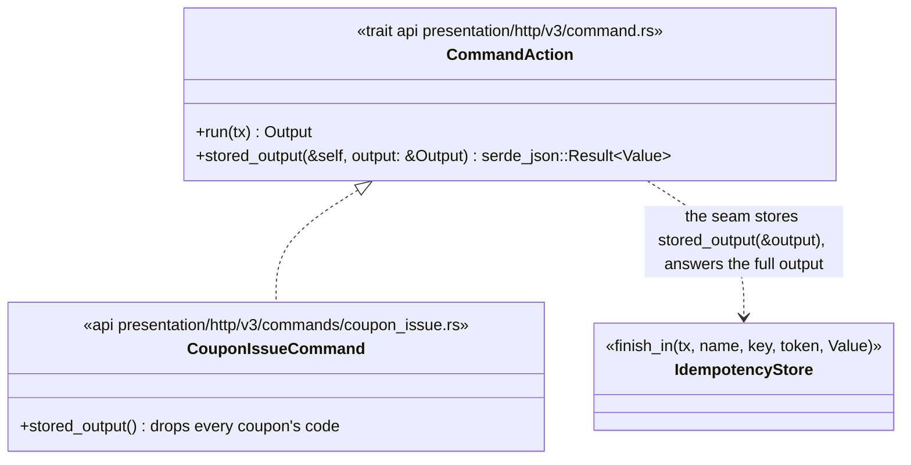

# Blueprint marketing: campaigns, benefit rules, coupons, budgets, segments and performance (#560)

> Design only. No code, no migration, no `ready`. Written by claude/5edf7bb5-subagent for the xchange lane controller
> claude/5edf7bb5. The code tickets are cut by the lane controller after a `Verdict: PASS`.

**Source of the logic.** *XC Desk — Blueprint & Data Model v2*, committed at
`docs/blueprint/XC-Desk-Blueprint-Data-Model-v2.html`. Line numbers `bp:N` are in its tag-stripped text
(`sed 's/<[^>]*>/\n/g' | grep -v '^\s*$'`). The owner's rule (#564): **the Blueprint's logic is fixed, and only the
look may change**.

| What | Blueprint |
|---|---|
| Entities | §07 `Campaign(id, org_id, name, status)`; `CampaignVersion(id, campaign_id, version, dates, budget_thb, approval_id, stack_group, priority)`; `CampaignBranch(campaign_version_id, branch_id)` — *"กติกาและ scope เก็บ version"* (bp:482-484); `BenefitRule(id, campaign_version_id, benefit_type, eligibility JSON, calculation JSON, caps JSON)`; `Coupon(id, rule_id, code_hash, customer_id?, expires_at, status)`; `BenefitRedemption(id, rule_id, coupon_id?, transaction_id, amount_thb, status)` — *"ค่าลดเรทกับ reward ต้องแยก; budget reserve ก่อน posting"* (bp:485-487); `SegmentDefinition(id, name, rule JSON, version)`, `SegmentSnapshot(id, definition_id, as_of, customer_id, metrics JSON)`, `ReferralReward(id, attribution_id, qualifying_transaction_id, benefit_rule_id, beneficiary_customer_id, status, value)` — *"รางวัลเพื่อนห้ามซ้ำ qualifying transaction + rule + beneficiary"* (bp:497-499) |
| States | §06 Campaign *"DRAFT → SIMULATED → PENDING_APPROVAL → APPROVED → SCHEDULED → ACTIVE → PAUSED \| EXPIRED"*, *"แก้ rule ต้องสร้าง version ใหม่; งบ/จำนวนสิทธิ check และ reserve แบบ atomic"* (bp:393-395) |
| Relations | §08 *"Campaign → Version → Rule → Redemption; redemption เชื่อม transaction"* (bp:528-530) |
| Concurrency | §09 Coupon / campaign budget: *"conditional increment หรือ row lock; ห้ามสอง request ใช้สิทธิสุดท้ายพร้อมกัน; transaction failed ต้อง release reserve"* (bp:555-556); Complete exchange *"… post ledger/inventory → redeem benefit → mark COMPLETED …"* (bp:550); Reversal *"… benefit adjustment …"* (bp:560) |
| Route | §10 `POST /api/campaigns/:id/simulate` (M02): *"scenario cost, commission, benefits, contribution; input cost data ต้องระบุ"* (bp:593-595); errors include `BENEFIT_LIMIT_REACHED` (bp:602) |
| Numbers | §11 Contribution *"ส่วนต่างรับรู้ − commission expense − promo/reward expense ที่ไม่รวมอยู่ในเรทแล้ว; ห้ามหัก rate discount ซ้ำ"* (bp:610-611); Campaign effect *"observed attributed contribution; incremental lift ต้องมี baseline/กลุ่มเปรียบเทียบ ห้ามเรียกยอด attributed ว่ากำไรเพิ่มทั้งหมด"* (bp:622-623) |
| Open values | §12 Promotion stacking: proposal *"จำลองก่อนอนุมัติ; ใช้ explicit priority และ budget"*, still open *"สิทธิที่ซ้อนได้; min margin guard; refund/reward rules"* (bp:644-646) |
| Acceptance | §13 phase 5 *"งบและสิทธิสุดท้ายไม่ใช้เกิน; simulate ตรง quote จริง; rule version ย้อนตรวจได้; reversal ไม่ค้างสิทธิ; ถอน consent หยุด marketing eligibility"* (bp:667-668) |
| Roles | §02 MARKETING *"ร่างโปร กลุ่มลูกค้า วัดผล"*, never identity documents; EXECUTIVE *"อนุมัติกรอบเรท/งบ/ข้อยกเว้น"* (bp:27-30, bp:50-53) |
| Screens | M01 `/marketing/campaigns`, M02 `/marketing/campaigns/:id` (*"target/branch/time; benefits; stack; caps; budget"*, *"simulate → submit → approve → activate"*), M03 `/marketing/members`, M04 `/marketing/performance` (bp:233-259); M02 wireframe (bp:334-346) |

**Measured on** `108-Plaza/xchange` `main` at `978d94b1`. Every `file:line` is at that sha.

**Designs this one stands on:**
- `membership-points.md` (#559, PR beside this one): `MembershipMirror::tier_of` for tier eligibility; tiers live in
  Loyalty.
- `customer-identity-consent.md` (#554): one customer per organisation; `ConsentService::marketing_allowed`.
- `quote-transaction.md` (#551): `quotes.benefit_snapshot`, `quote_lines.base_rate/final_rate`, §4.5's *"redeem
  benefit — none until #560; its port is #560's"*, `ExchangeArithmetic`.
- `reversal.md` (#552) §4.3: *"benefit adjustment — none until #560; its port is #560's"*.
- `ledger-inventory.md` (#553): `realized_margin_thb` per line (cost and contribution).
- `rates.md` §5 (AP-1, `xc-approval`), §6 (`CommandAction`).
- `broker-seam.md` (#563): `referral_attributions` (the customer was referred).
- `org-roles-branches.md` (#550): `MarketingCampaigns`, `MarketingMembers`, `MarketingPerformance`.
- `executive-finance.md`: `contribution_thb` waits on promo/reward expense (`MetricUnavailable::AwaitsCampaigns`,
  `executive-finance.md:103-108`).

---

## 0. The owner's answers

| # | Question | Answer (verbatim) | Where | What this design does |
|---|---|---|---|---|
| M-A1 | Who pays referral rewards | *"แยกตามผู้รับ"*: money to the referrer is Broker-Platform's payout; a benefit to the **referred customer** (discount, better rate, points, coupon) is v3 marketing, redeemed at the desk; `ReferralReward` splits accordingly | 2026-10-09, the Broker-Platform controller's session (claude/eb72d565, AskUserQuestion), #560 issuecomment-6073228123 (proposal issuecomment-6073136856) | D-12: the customer side is a `BenefitRule` with a `referred` condition; no referrer money in v3 |
| B-3 | Points | *"ขยาย Loyalty กลาง"* | 2026-10-09, claude/e5ab6c (#559) | points are not a benefit type here (`membership-points.md` D-12) |
| M1–M5 | stacking, minimum margin guard, a used benefit on reversal, first benefit types, who approves (§11) | *"ใช้คำแนะนำทั้งหมด"* (2026-10-10, session claude/5edf7bb5, the xchange lane controller): every recommendation accepted | 2026-10-10, session claude/5edf7bb5 | §11 records each; D-5, D-6, D-10, D-11 and §4.2 apply them; the guard's N stays data |

---

## 1. v3 today (measured)

| Fact | Evidence |
|---|---|
| No campaign, coupon, benefit or segment table or model | `git grep -il -E "campaign\|coupon\|segment" 978d94b -- api/migrations api/crates api/src` = 6 files: the permission names `MarketingCampaigns` (`permission.rs`, `role_permissions.rs`, `authorizer_test.rs`) and URL path "segments" (`v3/action.rs`, `v3/view.rs`, `pages.rs`); no table, migration or domain type |
| A quote stores `benefit_snapshot jsonb DEFAULT '{}'` and writes `{}` | `api/migrations/20261014100000_quotes.sql:14`; `api/src/application/workflows/exchange/quote.rs:206` |
| Each quote line has `base_rate` and `final_rate`, equal today | `quote.rs:186-187` |
| The quote DTO answers `benefits: []` | `api/src/presentation/dto/v3/quote.rs:45`, `:79`; test `api/tests/v3_quotes_route_test.rs:308` |
| `QuoteService::quote_in(tx, req, who, now)` builds the quote inside the caller's transaction | `quote.rs:55-61` |
| The one THB arithmetic is `ExchangeArithmetic` | `api/crates/xc-kernel/src/money/mod.rs:23`; used by `money/quote.rs:80` |
| The approval core exists: `ApprovalSubject`, `ApprovalPolicy`, `ApprovalService::request` | `api/crates/xc-approval/src/domain/subject.rs:10`, `domain/policy.rs:32`, `application/approval_service.rs:82` |
| v3 commands are `CommandAction`s served by `CommandEndpoint` | `api/src/presentation/http/v3/command.rs:32`, `:85-88` |
| MARKETING and its three permissions exist | `xc-auth/src/domain/access/permission.rs:34-36`; `role_permissions.rs:102-105` |
| Idempotency records are keyed `(organization_id, operation, key)` | `api/migrations/20261030160000_idempotency_organization.sql:19-20` |

## 2. Decisions

| # | Decision | Why |
|---|---|---|
| D-1 | **One crate, `xc-marketing`**, holds campaigns, rules, coupons, budgets, redemptions and segments. `xc-exchange` never depends on it; the `api` crate wires the ports. | the exchange crate stays the exchange's; same split as `xc-loyalty` and `xc-referral` |
| D-2 | **The lifecycle lives on the version.** Stored: `DRAFT`, `SIMULATED`, `PENDING_APPROVAL`, `APPROVED`, `REJECTED`, `PAUSED`, `SUPERSEDED`. **Derived from the clock** for an `APPROVED` version: `SCHEDULED` (now < `starts_at`), `ACTIVE` (inside), `EXPIRED` (now ≥ `ends_at`). `campaigns.status` is not a second machine: it is the status of `current_version_id`, read through a view. | the same rule as quotes (`quote-transaction.md` D-5) and rates' `SUPERSEDED`: no sweeper writes |
| D-3 | **Any change is a new version.** A `DRAFT` is edited in place; anything after `SIMULATED` is frozen. Editing an approved campaign copies it into a new `DRAFT` version. Approval binds `version_hash` (rules, branches, dates, budget, caps, stack group, priority, segment snapshot); a change after `submit` makes the request stale (AP-1). Approving version *n+1* sets `campaigns.current_version_id` and marks *n* `SUPERSEDED` in one transaction. | bp:395; rates §5 |
| D-4 | **`SIMULATED` is earned, not typed.** `submit` refuses a version whose newest simulation is older than its last edit (`simulationRequired`). | §06 order; §12 *"จำลองก่อนอนุมัติ"* |
| D-5 | **MARKETING drafts and submits; EXECUTIVE always decides** (owner M5, 2026-10-10: the Blueprint's EXECUTIVE, no branch-level approver) through AP-1 (`CAMPAIGN_VERSION`). The proposer never decides (`allows_self_decision = false`). Pause and resume: MARKETING or EXECUTIVE; resume returns to `APPROVED` with no new approval (nothing changed). | §02 bp:27-30, bp:50-53 |
| D-6 | **Benefit types are one trait, one file per type** (♻️): `BenefitCalculator { kind(); class(); apply(line, params) -> BenefitEffect }`. Classes: `PRICE` (changes `final_rate` or `fee_thb` — the "rate discount") and `REWARD` (a separate value handed over, the rate unchanged). The first types (owner M4, 2026-10-10): `RATE_IMPROVEMENT` (PRICE, signed satang per unit or a percentage toward the customer) and `FEE_WAIVER` (PRICE). The `REWARD` class stays in the model (the Blueprint separates it), but no REWARD calculator is built until a hand-over process exists; adding one later is one file. | bp:487 *"ค่าลดเรทกับ reward ต้องแยก"*; ♻️ |
| D-6a | **A calculator refuses params it cannot read; it never reads them as 0** (amended 2026-10-16 for #2119, BE controller rulings R2–R4). [required] In `xc-marketing/src/domain/benefit/calculator.rs`: `pub struct ParamError { pub field: &'static str, pub reason: String }` (+ `Display`); one shared `pub fn decimal_param(params: &serde_json::Value, key: &str, field: &'static str) -> Result<Option<Decimal>, ParamError>` (absent ⇒ `Ok(None)`; a JSON string `Decimal` reads ⇒ `Ok(Some)`; anything else, **including a JSON number**, ⇒ `Err`: decimals are strings, `calculation` row below); the trait gains `fn validate_params(&self, params: &Value) -> Result<(), ParamError>`, and `apply` returns `Result<BenefitEffect, ParamError>`. Each kind parses its params once, in one private function both methods call; params with none of the kind's keys ⇒ `Err`. `BenefitEngine` maps a `ParamError` **and a stored `benefit_type` the registry does not hold** to `AppError::Internal` naming the rule, kind and key (500 `serverError`, no quote, no reservation), the same as an undecodable stored `eligibility`/`caps` (`pg_campaign_repository.rs:331-341`). Value ranges are not checked here (owner question on #2108). The save path (`campaignVersionSave`'s `rules`, a later feature) calls `validate_params`, so save and quote share one rule. | ♻️ safety logic in the core; the silent-zero sweep #2108 |
| D-7 | **One engine for quote and simulation.** `BenefitEngine::evaluate(ctx, lines)` is pure; `QuoteService::quote_in` and `CampaignSimulator` both call it with the same `ExchangeArithmetic`. A simulated scenario and a real quote of the same inputs give byte-equal lines (test). | §13 *"simulate ตรง quote จริง"* |
| D-8 | **Reserve at quote, consume at completion, release by expiry.** A quote that carries a benefit inserts a `benefit_reservations` row (`RESERVED`, `expires_at` = the quote's) under the budget row lock (`SELECT … FOR UPDATE`), only if `budget − consumed − active reserved ≥ amount` and every cap holds; else that benefit is not offered (the quote proceeds without it). `CompleteExchange`'s *redeem benefit* step turns it `CONSUMED` and inserts the `benefit_redemptions` row; a reservation that expired is re-reserved in the same step or refused `benefitLimitReached`. A cancelled or expired quote releases by the clock: "active" = `RESERVED AND expires_at > now()`; an expired row is set `RELEASED` lazily, under the same lock, by the next reserve. **For a coupon, the reserve first releases that coupon's expired `RESERVED` row (under the coupon's row lock) and only then inserts**, so `one_live_reservation_per_coupon` never blocks a coupon whose quote expired. The *redeem benefit* step is reached through the shared exchange-effect seam (D-16), not by a call in `complete.rs`. | §09 bp:555-556 *"transaction failed ต้อง release reserve"*; §07 *"budget reserve ก่อน posting"*; no sweeper |
| D-9 | **A coupon is one row, locked.** `coupons.code_hash` is HMAC-SHA256 of the normalised code (upper-case, no spaces), key derived from the **oldest** key of the PII key file (`xc_kernel::pii::derive_subkey`, rotation-stable, as `lookup_hash`) — no second key file. One live reservation per coupon (partial unique index). A personal coupon (`customer_id` set) applies only to that customer. Codes are generated by the server and shown once. | §07 `code_hash`; §09 *"ห้ามสอง request ใช้สิทธิสุดท้าย"*; #554 K3 (safety logic in one core) |
| D-10 | **Stacking: explicit groups and priority.** Within one `stack_group`, only the eligible rule of the highest `priority` applies (ties: the older version id). Across groups (owner M1, 2026-10-10): **at most one PRICE and one REWARD benefit per quote line** — the highest-priority eligible PRICE rule and the highest-priority eligible REWARD rule; two PRICE benefits never combine. | §12 *"ใช้ explicit priority"*; M1 |
| D-11 | **A floor no benefit can cross, plus the owner's margin guard.** After benefits, a BUY line's `final_rate` stays ≤ the publication's SELL rate of that currency, and a SELL line's ≥ its BUY rate; `fee_thb ≥ 0`. A rule that would cross is capped at the floor and the snapshot says so. **Margin guard** (owner M2, 2026-10-10): the PRICE benefits of a line may give away at most `max_spread_share` of that line's published spread (`(sell − buy) × quantity ÷ unit_size`, through `ExchangeArithmetic`); the share is a data value per organisation in `margin_guards`, set by EXECUTIVE; NULL = only the floor. A rule over it is capped and marked `guardCapped`. | the shop never pays a customer through a rate inversion; M2 |
| D-12 | **Referral, customer side** (M-A1): eligibility condition `referred` = the customer has an `ACTIVE` `referral_attributions` row (`broker-seam.md` §4.1) captured at or before this exchange. The redemption records `referral_attribution_id`. Blueprint's `ReferralReward` uniqueness *(qualifying transaction + rule + beneficiary)* is `UQ(rule_id, transaction_id)` on `benefit_redemptions` (the beneficiary is the transaction's customer); "once per customer" is the cap `per_customer_uses = 1`. | bp:497-499; M-A1 |
| D-13 | **Consent gates marketing eligibility.** A rule targeting a **segment** applies only to customers in its frozen snapshot, and a snapshot includes only customers whose newest `MARKETING` consent is granted on at least one channel (`ConsentService::marketing_allowed`). A withdrawal therefore removes the customer from the next snapshot; a version approved on an older snapshot is re-checked live at quote time. Open rules (tier, branch, currency, coupon, referral) are not marketing and need no consent. `[proposed]` | §13 *"ถอน consent หยุด marketing eligibility"*; #554 K5 *"transactional … not marketing"* |
| D-14 | **Segments are versioned rules, snapshots are frozen.** `SegmentDefinition.rule` is a fixed, typed set of conditions (tier, recency days, frequency, THB value over a lookback, home branch), never free SQL. A snapshot is a command (MARKETING) that writes one row per member with its metrics; a campaign version names the snapshot it targets, so a review can see exactly who was eligible. Lookback default 12 months (`executive-finance.md` E-4). | §07 bp:497-498; §13 *"rule version ย้อนตรวจได้"* |
| D-15 | **Performance is attributed, never "lift".** M04 shows, per version and period: redemptions, PRICE cost, REWARD expense, the THB volume and realized margin of the exchanges that redeemed, and **attributed contribution = realized margin − REWARD expense − commission** (PRICE cost is already inside the margin and is never subtracted again). No field is named profit or lift. Source → booking → completion attribution is Broker-Platform's (O-1). | §11 bp:610-611, bp:622-623 |
| D-16 | **Completion and reversal reach #560 only through the shared exchange-effect seam** (`membership-points.md` §6.2, XS-0): `MarketingEffect` (phase `Redeem`) is registered in `api/src/bootstrap/exchange_effects/marketing.rs`; its `on_completed_in` calls `BenefitRedeemer::redeem_in` (refusal ⇒ `benefitLimitReached`, the completion rolls back) and its `on_reversed_in` calls `adjust_in`. TX-5 and RV-3 own the `run_*_in` calls in their own files (no-op until XS-0 / a registration exists); **#560 edits neither `complete.rs` nor `reversal_post.rs`**. | `quote-transaction.md` §4.5 and `reversal.md:152` (*"its port is #560's"*); reviewer claude/709ec749 on PR 967 |

## 3. Who does what

| Step | Who | Permission |
|---|---|---|
| Create / edit a campaign draft, its rules, branches, budget, caps | MARKETING | `MarketingCampaigns` |
| Simulate a version | MARKETING, EXECUTIVE | `MarketingCampaigns` or `MarketingPerformance` |
| Submit for approval | MARKETING | `MarketingCampaigns` |
| Approve / reject | EXECUTIVE | `ApprovalsDecide` through the `CAMPAIGN_VERSION` policy (D-5) |
| Pause / resume | MARKETING, EXECUTIVE | `MarketingCampaigns` |
| Issue coupons (generate N codes, or one personal code) | MARKETING | `MarketingCampaigns` |
| Define a segment, take a snapshot, preview (M03) | MARKETING | `MarketingMembers` (no identity values: masked names only, #554 K8) |
| Read performance (M04) | MARKETING, EXECUTIVE | `MarketingPerformance` |
| Get a benefit on a quote, use a coupon | TELLER at the desk | `ExchangeTransact` (desk) |
| See my usable coupons and the benefits I qualify for (C05, read-only, §6.3) | CUSTOMER in the app (#558) | `CustomerSelf` |

## 4. Model

### 4.1 Tables

```
campaigns(
  id                 uuid PK,
  organization_id    uuid NOT NULL REFERENCES organizations(id),
  name               text NOT NULL,
  current_version_id uuid NULL,                     -- FK campaign_versions, set when a version is APPROVED (D-3)
  created_by         uuid NOT NULL REFERENCES users(id), created_at timestamptz NOT NULL,
  UNIQUE (organization_id, id)
)
campaign_versions(
  id                 uuid PK,
  organization_id    uuid NOT NULL,
  campaign_id        uuid NOT NULL,                 -- FK (organization_id, campaign_id) → campaigns
  version            int  NOT NULL CHECK (version > 0),
  status             text NOT NULL CHECK (status IN ('DRAFT','SIMULATED','PENDING_APPROVAL','APPROVED',
                                                     'REJECTED','PAUSED','SUPERSEDED')),
  starts_at          timestamptz NOT NULL,
  ends_at            timestamptz NOT NULL CHECK (ends_at > starts_at),
  budget_thb         numeric(20,2) NOT NULL CHECK (budget_thb >= 0),
  max_uses           int NULL CHECK (max_uses > 0),           -- total redemptions, NULL = budget only
  stack_group        text NOT NULL,
  priority           int  NOT NULL,
  segment_snapshot_id uuid NULL,                    -- FK segment_snapshots (D-14); NULL = no segment target
  version_hash       text NULL,                     -- sha256, set at submit
  approval_id        uuid NULL,                     -- FK approval_requests (AP-1)
  simulated_at       timestamptz NULL, edited_at timestamptz NOT NULL,
  created_by         uuid NOT NULL, created_at timestamptz NOT NULL,
  UNIQUE (campaign_id, version),
  CHECK ((status IN ('PENDING_APPROVAL','APPROVED','PAUSED','SUPERSEDED','REJECTED')) = (version_hash IS NOT NULL))
)
CREATE UNIQUE INDEX one_draft_per_campaign ON campaign_versions (campaign_id) WHERE status IN ('DRAFT','SIMULATED');
campaign_branches(
  campaign_version_id uuid NOT NULL REFERENCES campaign_versions(id),
  branch_id           text NOT NULL REFERENCES branches(id),
  PRIMARY KEY (campaign_version_id, branch_id)
)
benefit_rules(
  id                  uuid PK,
  campaign_version_id uuid NOT NULL REFERENCES campaign_versions(id),
  benefit_type        text NOT NULL,                -- a BenefitCalculator kind (D-6); validated against the registry
  benefit_class       text NOT NULL CHECK (benefit_class IN ('PRICE','REWARD')),
  eligibility         jsonb NOT NULL,               -- typed Eligibility (§4.3), stored as JSON
  calculation         jsonb NOT NULL,               -- the calculator's params, decimals as strings
  caps                jsonb NOT NULL,               -- {perTransactionMaxThb?, perCustomerUses?, perCustomerPeriodDays?}
  requires_coupon     boolean NOT NULL DEFAULT false,
  rule_no             int NOT NULL, UNIQUE (campaign_version_id, rule_no)
)
coupons(
  id              uuid PK,
  organization_id uuid NOT NULL,
  rule_id         uuid NOT NULL REFERENCES benefit_rules(id),
  code_hash       bytea NOT NULL,                   -- D-9
  customer_id     text NULL REFERENCES customers(id),
  expires_at      timestamptz NOT NULL,
  status          text NOT NULL CHECK (status IN ('ISSUED','REDEEMED','VOID')),
  issued_by       uuid NOT NULL, issued_at timestamptz NOT NULL,
  UNIQUE (organization_id, code_hash)
)
campaign_budgets(                                   -- the one row every reserve locks (D-8)
  campaign_version_id uuid PRIMARY KEY REFERENCES campaign_versions(id),
  consumed_thb        numeric(20,2) NOT NULL DEFAULT 0 CHECK (consumed_thb >= 0),
  used_count          int NOT NULL DEFAULT 0 CHECK (used_count >= 0)
)
benefit_reservations(
  id              uuid PK,
  organization_id uuid NOT NULL,
  rule_id         uuid NOT NULL REFERENCES benefit_rules(id),
  campaign_version_id uuid NOT NULL,
  quote_id        uuid NOT NULL REFERENCES quotes(id),
  coupon_id       uuid NULL REFERENCES coupons(id),
  customer_id     text NULL REFERENCES customers(id),
  amount_thb      numeric(20,2) NOT NULL CHECK (amount_thb >= 0),
  status          text NOT NULL CHECK (status IN ('RESERVED','CONSUMED','RELEASED')),
  expires_at      timestamptz NOT NULL,             -- = the quote's expires_at
  created_at      timestamptz NOT NULL,
  UNIQUE (quote_id, rule_id)
)
CREATE UNIQUE INDEX one_live_reservation_per_coupon ON benefit_reservations (coupon_id)
  WHERE status = 'RESERVED' AND coupon_id IS NOT NULL;
benefit_redemptions(
  id                 uuid PK,
  organization_id    uuid NOT NULL,
  rule_id            uuid NOT NULL REFERENCES benefit_rules(id),
  campaign_version_id uuid NOT NULL,
  reservation_id     uuid NOT NULL UNIQUE REFERENCES benefit_reservations(id),
  coupon_id          uuid NULL REFERENCES coupons(id),
  transaction_id     uuid NOT NULL REFERENCES transactions(id),
  customer_id        text NULL REFERENCES customers(id),
  referral_attribution_id uuid NULL REFERENCES referral_attributions(id),   -- D-12
  benefit_class      text NOT NULL CHECK (benefit_class IN ('PRICE','REWARD')),
  amount_thb         numeric(20,2) NOT NULL CHECK (amount_thb >= 0),
  status             text NOT NULL CHECK (status IN ('REDEEMED','REVERSED')),
  reversal_id        uuid NULL,                                              -- FK reversals (#552), set when REVERSED
  redeemed_at        timestamptz NOT NULL,
  UNIQUE (rule_id, transaction_id),                                          -- §07 ReferralReward uniqueness (D-12)
  CHECK ((status = 'REVERSED') = (reversal_id IS NOT NULL))
)
segment_definitions(
  id uuid PK, organization_id uuid NOT NULL, name text NOT NULL, version int NOT NULL CHECK (version > 0),
  rule jsonb NOT NULL,                              -- typed SegmentRule (D-14)
  created_by uuid NOT NULL, created_at timestamptz NOT NULL,
  UNIQUE (organization_id, name, version)           -- immutable: a change is a new version
)
segment_snapshots(
  id uuid PK, organization_id uuid NOT NULL, definition_id uuid NOT NULL REFERENCES segment_definitions(id),
  as_of timestamptz NOT NULL, member_count int NOT NULL, taken_by uuid NOT NULL
)
segment_snapshot_members(                           -- Blueprint SegmentSnapshot(customer_id, metrics), one row per member
  snapshot_id uuid NOT NULL REFERENCES segment_snapshots(id),
  customer_id text NOT NULL REFERENCES customers(id),
  metrics     jsonb NOT NULL,                       -- {recencyDays, frequency, valueThb, tierCode}; decimals as strings
  PRIMARY KEY (snapshot_id, customer_id)
)
campaign_simulations(
  id uuid PK, campaign_version_id uuid NOT NULL REFERENCES campaign_versions(id),
  input jsonb NOT NULL, result jsonb NOT NULL,      -- the scenario and its answer, kept as evidence for approval
  cost_source text NOT NULL CHECK (cost_source IN ('LEDGER','UNAVAILABLE')),   -- §10 "input cost data ต้องระบุ"
  simulated_by uuid NOT NULL, simulated_at timestamptz NOT NULL
)
margin_guards(organization_id uuid PRIMARY KEY, max_spread_share numeric(5,4) NULL CHECK (max_spread_share BETWEEN 0 AND 1), set_by uuid, set_at timestamptz)   -- D-11, M2
```

- **Money** is `numeric(20,2)` THB in tables and a decimal **string** on the wire; never a float. Rates stay at the rate
  engine's scale (`numeric(20,8)`, `quote_lines.final_rate`).
- **The budget's "available"** = `budget_thb − consumed_thb − Σ amount_thb of RESERVED rows with expires_at > now()`,
  computed under `campaign_budgets … FOR UPDATE`. `consumed_thb` and `used_count` move only at consume (+) and at a reversal (−, owner M3).
- **`quotes.benefit_snapshot`** (existing column) becomes `{"engineVersion": 1, "applied": [{ruleId, versionId,
  benefitType, benefitClass, couponId?, reservationId, amountThb, rateBefore, rateAfter, feeBefore, feeAfter,
  floorCapped}], "skipped": [{ruleId, reason}], "tierCode", "segmentSnapshotIds"}`. `quote_lines.final_rate` and
  `fee_thb` carry the result; `base_rate` stays the published rate (`quote-transaction.md` §3.1).

### 4.2 States

```
campaign_versions.status (stored):
  DRAFT --simulate--> SIMULATED --edit--> DRAFT
  SIMULATED --submit (fresh simulation, D-4)--> PENDING_APPROVAL
  PENDING_APPROVAL --EXECUTIVE approves--> APPROVED     (campaigns.current_version_id := it; the previous APPROVED/PAUSED → SUPERSEDED)
  PENDING_APPROVAL --rejects--> REJECTED               (a new DRAFT copies it)
  APPROVED --pause--> PAUSED --resume--> APPROVED
derived for APPROVED: SCHEDULED (now < starts_at) · ACTIVE (starts_at ≤ now < ends_at) · EXPIRED (now ≥ ends_at)
only an ACTIVE version is evaluated by the engine; PAUSED, SCHEDULED, EXPIRED, SUPERSEDED never are

benefit_reservations: RESERVED --complete--> CONSUMED · RESERVED --(expired, lazily) | quote cancelled--> RELEASED
coupons:              ISSUED --consumed--> REDEEMED · ISSUED --void--> VOID · REDEEMED --reversal--> ISSUED if its version is still ACTIVE and the coupon unexpired, else stays REDEEMED (M3)
benefit_redemptions:  REDEEMED --reversal posted--> REVERSED   (never deleted)
```

### 4.3 Eligibility (typed, stored as JSON)

`Eligibility { branches: from campaign_branches; channels: [DESK, KIOSK, APP]?; currencies?; shop_side?;
min_thb?; tiers?: [tier_code] (via MembershipMirror::tier_of, #559); segment: bool (the version's snapshot);
referred: bool (D-12); requires_coupon }`. Every condition is AND; an absent condition is "any". A customer-less quote
(anonymous kiosk) is eligible only for rules with no customer condition. Each unmet condition yields a `skipped`
reason in the snapshot (`notInSegment`, `tierMismatch`, `budgetExhausted`, `capReached`, `couponInvalid`, …), so the
desk and the simulator can say why.

### 4.4 Rules the machines enforce

| Rule | Where |
|---|---|
| a version is edited only in `DRAFT`; any later change is a new version | `CampaignVersion::edit` (domain) |
| `submit` needs a simulation newer than the last edit and writes `version_hash` | `CampaignService::submit` |
| approval binds the hash; a version changed after submit is stale | AP-1 `CampaignVersionSubject::version_hash` |
| the proposer never decides; only EXECUTIVE decides | `CampaignApprovalPolicy` |
| only ACTIVE versions are evaluated | `BenefitEngine` reads `ActiveRules` |
| two requests never take the last budget or the last coupon | `campaign_budgets` / `coupons` row locks + the partial unique index |
| a failed or abandoned exchange keeps no budget | reservations expire with the quote; completion rollback keeps nothing |
| the same quote cannot reserve the same rule twice; the same transaction cannot redeem a rule twice | `UNIQUE (quote_id, rule_id)`, `UNIQUE (rule_id, transaction_id)` |
| no benefit crosses the rate floor (D-11) | `RateFloor` in `BenefitEngine` |
| simulation and quote use one engine and one arithmetic | `BenefitEngine`, `ExchangeArithmetic` |
| segment targeting requires granted MARKETING consent (D-13) | `SegmentSnapshotService` (at snapshot) and `ConsentGate` (at quote) |
| MARKETING never sees an identity value | views return masked names (#554 K8) |
| every command is idempotent (`Idempotency-Key`); same key, other payload ⇒ `idempotencyConflict` | `CommandEndpoint` (rates §6) |
| every branch a campaign names belongs to the caller's organisation: a version's `branches` (create, draft save) and a simulation scenario's `branchId`; an unknown id is refused the same way (#2031, #1992) | `CampaignBranchScope::first_outside_org_in`, the **one** check called by `campaignCreate`, `campaignVersionSave` and `campaignSimulate` |
| a version's terms are refused before any write when `endsAt ≤ startsAt` (field `endsAt`) or `budgetThb < 0` (field `budgetThb`), the same bounds as the table's `CHECK`s (`20261205101000_campaigns.sql:23-24`), so the database never answers for them (#2031) | `campaignCreate`, `campaignVersionSave` |

### 4.5 Routes

All writes are `CommandAction`s with an `Idempotency-Key`. Route names follow the Blueprint's §10 where it names one,
and v3's command seam otherwise (mapping K1).

| Command / view | Route | Permission |
|---|---|---|
| `campaignCreate` (name → campaign + version 1 DRAFT + budget row) | `POST /api/campaigns` | `MarketingCampaigns` |
| `campaignVersionSave` (DRAFT only: dates, branches, budget, caps, stack, priority, rules, snapshot) | `PUT /api/campaigns/:id/draft` | `MarketingCampaigns` |
| `campaignVersionNew` (copy the current version into a new DRAFT) | `POST /api/campaigns/:id/versions` | `MarketingCampaigns` |
| `campaignSimulate` (§10) | `POST /api/campaigns/:id/simulate` | `MarketingCampaigns` or `MarketingPerformance` |
| `campaignSubmit` | `POST /api/campaigns/:id/submit` | `MarketingCampaigns` |
| decide | the existing `approvalDecide` (`http/v3/commands/approval_decide.rs`) | `ApprovalsDecide` + `CampaignApprovalPolicy` |
| `campaignPause` / `campaignResume` | `POST /api/campaigns/:id/pause`, `…/resume` | `MarketingCampaigns` |
| `couponIssue` (N anonymous codes, or one for a customer; codes returned once) | `POST /api/campaigns/:id/coupons` | `MarketingCampaigns` |
| `segmentDefine` / `segmentSnapshot` | `POST /api/segments`, `POST /api/segments/:id/snapshots` | `MarketingMembers` |
| `marginGuardSet` | `PUT /api/margin-guard` | EXECUTIVE (`RatePolicySave`, the rate-frame permission) |
| view `margin_guard` (added 2026-10-19, FE gap section B): `{ maxSpreadShare, setBy, setAt }` of the caller's organisation, every field `null` when no `margin_guards` row exists; file `v3/views/margin_guard.rs`, DTO `dto/v3/margin_guard.rs` | `/api/v3/views/margin_guard` | EXECUTIVE (`RatePolicySave`, as `marginGuardSet`) |
| view `campaigns` (M01: status incl. derived, budget used/left, uses, period totals) | `/api/v3/views/campaigns` | `MarketingCampaigns` |
| view `campaign` (M02: versions, rules, simulations, approval) | `/api/v3/views/campaign?id=` | `MarketingCampaigns` |
| view `segment_preview` (M03: count, metric distribution, masked sample; tiers from #559's mirror) | `/api/v3/views/segment_preview` | `MarketingMembers` |
| view `campaign_performance` (M04, D-15) | `/api/v3/views/campaign_performance` | `MarketingPerformance` |
| view `my_benefits` (C05 "สิทธิ/คูปอง", O-3 decided: the customer's own usable coupons, never their code, and the open benefits they qualify for on APP; read-only, §6.3) | `/api/v3/views/my_benefits` | `CustomerSelf` |
| `POST /api/quotes` (#551) gains optional `couponCode`; its DTO's `benefits` lists the snapshot's `applied` | unchanged route | `ExchangeTransact` |

Errors: `benefitLimitReached` (Blueprint `BENEFIT_LIMIT_REACHED`; at completion only — at quote an exhausted benefit is
skipped, not an error), `simulationRequired`, `staleVersion`, `approvalRequired`, `validationFailed`, `outOfScope`,
`idempotencyConflict`, `couponInvalid` (unknown, expired, used, another customer's — one code, so a guesser learns
nothing).

## 5. Flows

```mermaid
sequenceDiagram
  participant Q as QuoteService::quote_in (#551)
  participant E as BenefitEngine
  participant B as BudgetLedger
  participant C as CompleteExchange (#551)
  participant X as ExchangeEffects (XS-0, membership-points §6.2)
  participant R as BenefitRedeemer (via MarketingEffect)
  participant V as PostReversal (#552)
  Q->>E: evaluate(ctx: branch, channel, customer, tier, coupon?, lines at base_rate)
  E-->>Q: applied effects (final_rate, fee), skipped reasons
  Q->>B: reserve_in(tx, quote, effects)  [FOR UPDATE budget row, coupon row]
  B-->>Q: reserved, or "budgetExhausted" → that effect dropped, lines recomputed
  Q->>Q: write quote + benefit_snapshot (same tx)
  C->>X: run_completed_in(tx, Redeem, facts)   [§09 "redeem benefit", after posting, before COMPLETED]
  X->>R: MarketingEffect → redeem_in(tx, transaction, quote)
  R->>B: consume (or re-reserve if expired, else benefitLimitReached)
  R->>R: insert benefit_redemptions; coupon REDEEMED
  V->>X: run_reversed_in(tx, Redeem, facts)  [§09 "benefit adjustment"]
  X->>R: MarketingEffect → adjust_in(tx, reversal)
  R->>R: redemptions REVERSED; budget and use count returned; single-use coupon re-issued if still ACTIVE (M3)
```

## 6. Class diagram

```mermaid
classDiagram
  class Campaign { <<xc-marketing domain/campaign/campaign.rs>> id; organization_id; name; current_version_id }
  class CampaignVersion { <<xc-marketing domain/campaign/version.rs>> status; dates; budget_thb; stack_group; priority; +edit() +submit() +derived_status(now) }
  class VersionHash { <<xc-marketing domain/campaign/version_hash.rs>> +of(version, rules, branches) }
  class CampaignRepository { <<trait xc-marketing domain/campaign/repository.rs>> }
  class PgCampaignRepository { <<xc-marketing infrastructure/pg_campaign_repository.rs>> }
  class BenefitRule { <<xc-marketing domain/benefit/rule.rs>> benefit_type; class; eligibility; calculation; caps }
  class Eligibility { <<xc-marketing domain/benefit/eligibility.rs>> +check(ctx) Result~(), SkipReason~ }
  class BenefitCalculator { <<trait xc-marketing domain/benefit/calculator.rs>> +kind() +class() +validate_params(params) Result~(), ParamError~ +apply(line, params) Result~BenefitEffect, ParamError~ }
  class RateImprovement { <<xc-marketing domain/benefit/kinds/rate_improvement.rs>> }
  class FeeWaiver { <<xc-marketing domain/benefit/kinds/fee_waiver.rs>> }
  class CalculatorRegistry { <<xc-marketing domain/benefit/registry.rs>> }
  class BenefitEngine { <<xc-marketing domain/engine/engine.rs>> +evaluate(ctx, lines) Evaluation }
  class Stacking { <<xc-marketing domain/engine/stacking.rs>> stack_group + priority (D-10) }
  class RateFloor { <<xc-marketing domain/engine/rate_floor.rs>> D-11 + MarginGuard }
  class BenefitSnapshot { <<xc-marketing domain/engine/snapshot.rs>> }
  class ActiveRules { <<trait xc-marketing domain/engine/active_rules.rs>> +active_for(org, branch, now) }
  class TierSource { <<trait xc-marketing domain/engine/tier_source.rs>> +tier_of(org, customer) }
  class ConsentGate { <<trait xc-marketing domain/engine/consent_gate.rs>> +marketing_allowed(customer) }
  class ReferralSource { <<trait xc-marketing domain/engine/referral_source.rs>> +referred(customer, at) }
  class Coupon { <<xc-marketing domain/coupon/coupon.rs>> }
  class CouponCodeHasher { <<xc-marketing domain/coupon/code_hasher.rs  uses xc-kernel pii keys>> }
  class BudgetLedger { <<xc-marketing infrastructure/pg_budget_ledger.rs>> +reserve_in() +consume_in() +release_expired_in() }
  class BenefitRedeemer { <<xc-marketing application/redeemer.rs>> +redeem_in(tx, txn, quote) +adjust_in(tx, reversal) }
  class CampaignService { <<xc-marketing application/campaign_service.rs>> +create +save_draft +new_version +submit +pause +resume }
  class CampaignVersionSubject { <<xc-marketing application/approval.rs>> }
  class CampaignApprovalPolicy { <<xc-marketing application/approval.rs>> }
  class CampaignSimulator { <<xc-marketing application/simulator.rs>> +simulate(version, scenarios) }
  class CouponService { <<xc-marketing application/coupon_service.rs>> +issue() }
  class SegmentRule { <<xc-marketing domain/segment/rule.rs>> }
  class SegmentSnapshotService { <<xc-marketing application/segment_service.rs>> +define() +snapshot() }
  class CustomerMetricsSource { <<trait xc-marketing domain/segment/metrics_source.rs>> }
  class PgCustomerMetrics { <<api infrastructure/marketing/pg_customer_metrics.rs>> }
  class PerformanceReader { <<xc-marketing infrastructure/pg_performance.rs>> D-15 }
  class PromoExpenseFacts { <<trait xc-marketing domain/performance/promo_expense.rs>> for executive contribution }
  class MarketingTierSource { <<api infrastructure/marketing/tier_source.rs  wraps #559 MembershipMirror>> }
  class MarketingConsentGate { <<api infrastructure/marketing/consent_gate.rs  wraps #554 ConsentService>> }
  class MarketingReferralSource { <<api infrastructure/marketing/referral_source.rs  reads referral_attributions>> }
  class CampaignBranchScope { <<api infrastructure/marketing/branch_scope.rs  reads branches>> +first_outside_org_in(tx, organization_id, branch_ids) Option~String~ }
  class QuoteService { <<api workflows/exchange/quote.rs (#551 TX-1)>> }
  class CompleteExchange { <<api workflows/exchange/complete.rs (#551 TX-5)>> }
  class PostReversal { <<api workflows/exchange/reversal_post.rs (#552 RV-3)>> }
  class ExchangeEffects { <<api workflows/exchange/effects.rs (XS-0, membership-points §6.2)>> }
  class ExchangeEffect { <<trait api workflows/exchange/effects.rs (XS-0)>> }
  class MarketingEffect { <<api bootstrap/exchange_effects/marketing.rs (MK-5)>> phase Redeem }
  class ApprovalSubject { <<trait xc-approval domain/subject.rs>> }
  class ApprovalPolicy { <<trait xc-approval domain/policy.rs>> }
  class ExchangeArithmetic { <<xc-kernel money/exchange_arithmetic.rs>> }
  class CustomerBenefitListing { <<xc-marketing domain/benefit/listing.rs (C05, §6.3)>> +shown_on_app(rule, segment_snapshot_id, facts) bool +line_conditions(eligibility) LineConditions +summary(rule, registry) Result~BenefitSummary, ParamError~ }
  class PgCustomerBenefits { <<xc-marketing infrastructure/pg_customer_benefits.rs (C05, §6.3)>> +personal_coupons_in(tx, org, customer, now) +open_rules_in(tx, org, now) }
  class MyBenefitsView { <<api presentation/http/v3/views/my_benefits.rs (C05, §6.3)>> CustomerSelf, read-only }
  class MyBenefitsData { <<api presentation/dto/v3/my_benefits.rs → web/src/shared/api/generated/my_benefits.ts>> coupons; benefits }
  class MembershipMirror { <<trait xc-loyalty domain/membership_mirror.rs (#559)>> +tier_of(org, customer) }

  Campaign *-- CampaignVersion
  CampaignVersion *-- BenefitRule
  CampaignVersion --> VersionHash
  BenefitRule --> Eligibility
  BenefitCalculator <|.. RateImprovement
  BenefitCalculator <|.. FeeWaiver
  CalculatorRegistry --> BenefitCalculator
  BenefitEngine --> ActiveRules
  BenefitEngine --> CalculatorRegistry
  BenefitEngine --> Stacking
  BenefitEngine --> RateFloor
  BenefitEngine --> TierSource
  BenefitEngine --> ConsentGate
  BenefitEngine --> ReferralSource
  BenefitEngine --> ExchangeArithmetic
  BenefitEngine --> BenefitSnapshot
  TierSource <|.. MarketingTierSource
  ConsentGate <|.. MarketingConsentGate
  ReferralSource <|.. MarketingReferralSource
  CampaignRepository <|.. PgCampaignRepository
  ActiveRules <|.. PgCampaignRepository
  QuoteService --> BenefitEngine : evaluate
  QuoteService --> BudgetLedger : reserve_in
  CompleteExchange --> ExchangeEffects : run_completed_in (TX-5 owns the call)
  PostReversal --> ExchangeEffects : run_reversed_in (RV-3 owns the call)
  ExchangeEffects --> ExchangeEffect
  MarketingEffect ..|> ExchangeEffect
  MarketingEffect --> BenefitRedeemer : redeem_in / adjust_in
  BenefitRedeemer --> BudgetLedger
  BudgetLedger --> Coupon
  CouponService --> CouponCodeHasher
  CampaignSimulator --> BenefitEngine
  CampaignService --> CampaignRepository
  CampaignVersionSubject ..|> ApprovalSubject
  CampaignApprovalPolicy ..|> ApprovalPolicy
  SegmentSnapshotService --> SegmentRule
  SegmentSnapshotService --> CustomerMetricsSource
  SegmentSnapshotService --> ConsentGate
  CustomerMetricsSource <|.. PgCustomerMetrics
  PerformanceReader ..|> PromoExpenseFacts
  MyBenefitsView --> PgCustomerBenefits : personal_coupons_in / open_rules_in
  MyBenefitsView --> CustomerBenefitListing : shown_on_app / line_conditions / summary
  MyBenefitsView --> MembershipMirror : tier_of
  MyBenefitsView --> MarketingConsentGate : prefetch_in
  MyBenefitsView --> MarketingReferralSource : prefetch_in
  MyBenefitsView --> MyBenefitsData : answers
  CustomerBenefitListing --> Eligibility : check (customer conditions only)
  CustomerBenefitListing --> CalculatorRegistry : validate_params
```

**Files.** Every class above has its own file except two pairs written by one ticket each: `CampaignVersionSubject` +
`CampaignApprovalPolicy` (`application/approval.rs`, MK-4) and `PgCampaignRepository` implementing two traits (MK-1).
The `api` adapters live in `api/src/infrastructure/marketing/`, one file each, because they read other areas' tables
(#554, #559, #563, #551) that `xc-marketing` must not depend on.

**`CampaignBranchScope` (#2031).** It lives in `api`, not in `xc-marketing`, because it reads `branches`. It is a
unit struct in its own file, `api/src/infrastructure/marketing/branch_scope.rs`, registered by one line in that
directory's `mod.rs`:

```rust
pub struct CampaignBranchScope;

impl CampaignBranchScope {
    /// The first id of `branch_ids`, in input order, that is not a branch of `organization_id`
    /// (an unknown id and another organisation's branch alike). `None` when every id is the organisation's,
    /// including an empty slice.
    pub async fn first_outside_org_in(
        tx: &mut sqlx::Transaction<'_, sqlx::Postgres>,
        organization_id: Uuid,
        branch_ids: &[String],
    ) -> Result<Option<String>, sqlx::Error>;
}
```

Each caller keeps its own answers: `Some(_)` ⇒ 400 `validationFailed` on its field (`branches` for create and draft
save, `branchId` for simulate); `Err` ⇒ its existing 500 `database`. The check runs before the command's first write.

### 6.1 Who provides, who uses

| Provider | Used by | Fallback if not merged |
|---|---|---|
| #551 TX-1 `QuoteService::quote_in` (merged), `quotes.benefit_snapshot`, `quote_lines.final_rate` | MK-5 adds the evaluate + reserve call | — |
| XS-0 `ExchangeEffect` / `ExchangeEffects` (`membership-points.md` §6.2, the port *"#560's"* of `quote-transaction.md` §4.5 and `reversal.md:152`) | `MarketingEffect` registers into it | TX-5 / RV-3 run a no-op `ExchangeEffects` in their own file until XS-0 merges (📐 fallback); with no registration no benefit is redeemed or adjusted |
| #551 TX-5 `CompleteExchange`, #552 RV-3 `PostReversal` | call the seam at *redeem benefit* / *benefit adjustment* in their own tickets | #560 edits neither file |
| #559 `MembershipMirror::tier_of` | `MarketingTierSource` | before LY-4: `tier_of` answers `None`, so tier rules never match (no guessing) |
| #554 CI-6 `ConsentService::marketing_allowed` (PR 876 in flight) | `MarketingConsentGate` | before CI-6: answers `false`, so segment-targeted rules never match and snapshots are empty |
| #563 RF-1 `referral_attributions` | `MarketingReferralSource` | before RF-1: answers `false` |
| #553 `transaction_lines.realized_margin_thb` | simulator cost, M04 contribution | `cost_source = UNAVAILABLE`, contribution shown as unavailable, never as zero |
| Broker-Platform commission | M04 contribution's commission term | `awaitsBroker`, as `executive-finance.md` does |
| AP-1 `ApprovalService`, `approvalDecide` (merged) | MK-4 | — |
| this design `PromoExpenseFacts` | `executive-finance.md`'s `contribution_thb` (clears `AwaitsCampaigns`) | executive keeps `AwaitsCampaigns` until a one-line follow-up in its `ports.rs` |
| this design `BenefitEngine`, `benefit_snapshot` | #555 bookings: an INDICATIVE quote shows an estimated benefit with no reservation (O-3 decided, §10) | — |
| this design `CustomerBenefitListing` (`xc-marketing/src/domain/benefit/listing.rs`), `PgCustomerBenefits` (`xc-marketing/src/infrastructure/pg_customer_benefits.rs`) | `MyBenefitsView` (`api/src/presentation/http/v3/views/my_benefits.rs`), §6.3 | — (one ticket writes all four files) |
| `MyBenefitsData` (`api/src/presentation/dto/v3/my_benefits.rs`, generated `web/src/shared/api/generated/my_benefits.ts`) | #558 C05 screen "สิทธิ/คูปอง" (`web/src/screens/customer/member/**`, the FE controller's ticket) | before it merges, the screen shows nothing for this block and makes no call (no guessed shape) |
| #559 `MembershipMirror::tier_of` (`xc-loyalty/src/domain/membership_mirror.rs:21`, `PgMembershipMirror` `infrastructure/pg_membership_mirror.rs:35`) | `MyBenefitsView` (tier conditions) | — (merged) |
| #2031 `CampaignBranchScope::first_outside_org_in` (`api/src/infrastructure/marketing/branch_scope.rs`) | `campaign_create.rs`, `campaign_version_save.rs`, `campaign_simulate.rs` (replaces #1992's inline query there) | — (one ticket writes it and moves all three callers) |

### 6.2 What a coupon replay keeps (#1622)

Added by claude/e92db6 (lane controller), 2026-10-14, measured on `main` `e62eabcd`.

**The rule:** a coupon's code is shown on the first `couponIssue` answer only (§7). A replay with the same `Idempotency-Key` returns the same coupon ids, without codes.

**Where the rule lives:** in the command seam, not in the database. Before this, `coupon_issue.rs:130-183` (on `e62eabcd`) created a function and a `BEFORE UPDATE` trigger on `idempotency_records` inside every request. The trigger check matched `pg_trigger` by name only, so a second schema in the same database skipped it (#1622 §2).



- **`stored_output` is a default method:** `serde_json::to_value(output)`. Every other command's stored response stays byte-for-byte the same.
  - It returns `serde_json::Result`, so the seam maps an error the way it maps a failed `to_value` today (`command.rs:596-603`, `Internal`).
  - This is #1622 §3's signature with the `Result` added.
- **The seam serializes twice:** once for the answer (`to_value(&output)`, as today) and once through `stored_output` for the record.
- **Only `coupon_issue.rs` overrides it.** It serializes the output, then **removes the `code` key** from every coupon object in that `Value`, leaving the coupon ids. It does not set `code: None` and re-serialize: `IssuedCouponDto.code` has no `skip_serializing_if`, so that would store `"code": null`, and #1622's behaviour row 2 says the replay has no `code` field.

**Data migration (the #1622 migration, `api/migrations/<slot>_drop_coupon_strip_trigger.sql`; the implementer takes `<slot>` from `scripts/migration-slot.sh next` at push time, `docs/design/migration-slots.md` §2):**

```sql
DROP TRIGGER IF EXISTS trg_strip_coupon_codes ON idempotency_records;
DROP FUNCTION IF EXISTS strip_coupon_codes_on_finish();
```

1. *Existing rows.*
   - `idempotency_records` rows are not changed.
   - A row stored with codes stripped stays stripped.
   - A row stored with codes, in a schema that missed the trigger, keeps its codes. **FINISHED `idempotency_records` rows never expire** (the only `DELETE` in `pg_store.rs` removes `PENDING` rows on release; there is no TTL or cleanup job), so that row's replay keeps showing its codes for good. This is accepted: such rows exist only in test schemas, since no shop runs v3 (STATE.md). Deleting them would be a Data Risk cleanup needing the owner; this design asks for none.
2. *Backfill.* None. No shop runs v3 (`xchange-v3.md` D6, STATE.md). Before the deploy, for the record: `SELECT count(*) FROM idempotency_records WHERE operation = 'couponIssue';`.
3. *Order.* The migration ships with the new binary. The old binary recreates the trigger on its next `couponIssue`, so the migration must not run under the old binary.
4. *`down`.* None. The objects were never tracked by a migration, and recreating them would bring the flake back.

The migration drops database objects, so it needs the owner's approval before #1622 gets `ready` (rule: migration and destructive ops ask).

### 6.3 The customer's benefits: view `my_benefits` (C05, O-3)

Added by claude/studio-claude-1 on the BE lane controller claude/a90ab16c's order, 2026-10-19. The decision is O-3's answer A (#564 issuecomment-6262478258, §10). Lines are cited at `main` `7e99ed0a`.

**What it is:** a read-only view of the signed-in customer's own benefits, for C05 `/app/member` "สิทธิ/คูปอง".
- It makes no quote, no reservation and no budget read, and it writes nothing. The counter stays the only place money is reserved (D-8).
- It answers two lists:
  - **(a) `coupons`:** the customer's personal coupons that are usable now. **Never the code**: it is shown once, at issue (D-9).
  - **(b) `benefits`:** the open rules the customer qualifies for on channel `APP`.

**Files and classes** (each its own new file; §6 diagram):

| Class | File | Holds |
|---|---|---|
| `CustomerBenefitListing` (free functions) | `api/crates/xc-marketing/src/domain/benefit/listing.rs` | the pure rules below. Registered by one `pub mod listing;` line in `domain/benefit/mod.rs` |
| `PgCustomerBenefits` | `api/crates/xc-marketing/src/infrastructure/pg_customer_benefits.rs` | the two reads. Registered by one `pub mod pg_customer_benefits;` line in `src/lib.rs` (`infrastructure`) |
| `MyBenefitsView` | `api/src/presentation/http/v3/views/my_benefits.rs` | the route; generated into `VIEWS` by `api/build.rs:167-203` (no registry edit) |
| `MyBenefitsData` and its parts | `api/src/presentation/dto/v3/my_benefits.rs` → `web/src/shared/api/generated/my_benefits.ts` | the answer; generated into `v3_dtos.rs` by `api/build.rs:138-165` |
| policy row `my_benefits` | `api/crates/xc-auth/src/domain/policy/areas/customer_benefits.rs` | `Need::Permission(Permission::CustomerSelf)` on `EntryPath::Rpc`, as `areas/loyalty.rs:10-15`; generated into `AREA_ROWS` (`areas/mod.rs:19`) |

**[required] The pure core** (`listing.rs`, ♻️: it reuses `Eligibility::check`, `eligibility.rs:114`, and never re-implements a condition):

```rust
pub const APP_CHANNEL: &str = "APP";

/// What the view knows about the customer, read once per request.
pub struct CustomerFacts<'a> {
    pub customer_id: &'a str,
    pub tier: Option<&'a str>,             // MembershipMirror::tier_of(..).tier_code
    pub segment_memberships: &'a [Uuid],   // snapshot ids the customer is a member of
    pub marketing_consent: bool,           // MarketingConsentGate (D-13)
    pub is_referred: bool,                 // MarketingReferralSource (D-12)
}

/// The conditions that need a transaction line: shown as text, never evaluated here.
pub struct LineConditions {
    pub min_thb: Option<Decimal>,
    pub currencies: Option<Vec<String>>,
    pub shop_side: Option<Side>,
}

pub struct BenefitSummary {
    pub benefit_type: String,
    pub benefit_class: BenefitClass,
    pub delta: Option<Decimal>,
    pub percent: Option<Decimal>,
    pub amount: Option<Decimal>,
    pub fixed: Option<Decimal>,
}

pub fn shown_on_app(rule: &BenefitRule, segment_snapshot_id: Option<Uuid>, facts: &CustomerFacts<'_>) -> bool;
pub fn line_conditions(eligibility: &Eligibility) -> LineConditions;
pub fn summary(rule: &BenefitRule, registry: &CalculatorRegistry) -> Result<BenefitSummary, ParamError>;
```

- **`shown_on_app`** calls `rule.eligibility.check` on a copy whose line conditions (`branches`, `currencies`, `shop_side`, `min_thb`) are cleared. The `EligibilityContext` (`eligibility.rs:43`) has `channel = "APP"`, the customer's id and tier, `in_segment` = the version's snapshot is in `segment_memberships`, `marketing_consent`, and `is_referred`. `Ok` ⇒ shown. So:
  - `channels` absent, or containing `APP`;
  - `tiers` set ⇒ the customer's tier is in it (no tier ⇒ hidden);
  - `segment` ⇒ in the version's snapshot **and** MARKETING consent granted (D-13);
  - `referred` ⇒ the customer is referred (D-12);
  - `requires_coupon` (the `benefit_rules.requires_coupon` column is the only source; #4139) ⇒ hidden: such a rule is usable only with a code, and a personal one is listed under (a).
- **`line_conditions`** copies `min_thb`, `currencies` and `shop_side`. The screen words them; the view evaluates none of them.
- **`summary`**: an unknown `benefit_type` is `ParamError { field: "benefitType" }`. It then calls that calculator's `validate_params` (D-6a) and reads `delta`, `percent`, `amount` and `fixed` with `decimal_param` (`calculator.rs:31`). The same parse the quote uses, so a rule the desk refuses is never described.

**[required] The two reads** (`PgCustomerBenefits`, a unit struct; both take the view's `&mut Transaction` and one `now`):

| Method | Returns | Rows |
|---|---|---|
| `personal_coupons_in(tx, org, customer, now)` | `Vec<CustomerCoupon { coupon_id, expires_at, label, rule: BenefitRule, branches: Vec<BranchRef> }>` | `coupons` of `org` with `customer_id = customer`, `status = 'ISSUED'`, `expires_at > now`, whose rule's version is `APPROVED` with `starts_at ≤ now < ends_at` (a coupon of a paused, expired or superseded version cannot be used, so it is not listed). Ordered by `expires_at`, then `id`. **`code_hash` is never selected.** |
| `open_rules_in(tx, org, now)` | `Vec<OpenRule { rule: BenefitRule, version_id, segment_snapshot_id, ends_at, label, branches: Vec<BranchRef> }>` | the rules of `org`'s `APPROVED` versions with `starts_at ≤ now < ends_at`, at **any** branch (unlike `ActiveRules::active_for`, `pg_campaign_repository.rs:274-306`, which needs one), with `requires_coupon = false`. Ordered by `ends_at`, `label`, `rule_no` |

- `label` is the campaign's `name`.
- `BranchRef { branch_code, name }` lists the version's `campaign_branches` (`branches.code`, `branches.name`), so the screen can say where the benefit applies.
- An undecodable stored `eligibility` or `caps` is `AppError::Internal`, as in `pg_campaign_repository.rs:331-341`.

**The view, step by step** (`my_benefits.rs`, following `views/my_membership.rs`):
1. **Caller checks, as `my_membership.rs:30-103`:** `authenticate_and_authorize(&req, (EntryPath::Rpc, "my_benefits"))`.
   - No `customer_id` on the actor ⇒ 403 `outOfScope` (`:61`).
   - A `customer` query value other than the caller's own ⇒ `outOfScope` (`:65-71`).
   - The customer row's organisation not the session's ⇒ `outOfScope` (`:78-103`).
2. **One read transaction** and `now = Utc::now()`, taken once.
3. **The customer's facts:**
   - tier: `PgMembershipMirror::new(pool, LookupHasher::new(&keys)).tier_of(org, customer)` (`pg_membership_mirror.rs:35`); `Ok(None)` ⇒ no tier;
   - segment memberships: the customer's `segment_snapshot_members.snapshot_id` of snapshots of `org` (the read `quote.rs:335` makes, scoped to the organisation);
   - consent: `MarketingConsentGate::prefetch_in` (`consent_gate.rs:25`);
   - referred: `MarketingReferralSource::prefetch_in(tx, customer, now)` (`referral_source.rs:43`).
4. **(a)** `personal_coupons_in`, and **(b)** `open_rules_in` filtered by `shown_on_app`.
5. **Each item's summary:** a rule whose `summary` is `Err` is **left out and logged** (`tracing::warn!` with the rule id, type and field), and the rest are answered. `[proposed]`: one marketing data error must not blank a customer's page. The desk still refuses that rule with a 500 (D-6a).
6. **The answer:** 200 with `Cache-Control: no-store`, as `my_membership.rs:127`.

**[required] The answer** (a bare object, as `my_membership`, #1408 ruling). Decimals are strings and times are RFC 3339:

```ts
type MyBenefitsData = { coupons: MyCouponDto[]; benefits: MyBenefitDto[] };
type MyCouponDto   = { couponId: string; label: string; summary: BenefitSummaryDto; conditions: BenefitConditionsDto; expiresAt: string };
type MyBenefitDto  = { ruleId: string; label: string; summary: BenefitSummaryDto; conditions: BenefitConditionsDto; endsAt: string };
type BenefitSummaryDto    = { benefitType: string; benefitClass: "PRICE" | "REWARD"; delta: string | null; percent: string | null; amount: string | null; fixed: string | null };
type BenefitConditionsDto = { minThb: string | null; currencies: string[] | null; shopSide: "BUY" | "SELL" | null; branches: BranchRefDto[] };
type BranchRefDto         = { branchCode: string; name: string };
```

- No field carries a coupon code or its hash.
- The screen (FE) turns `summary` and `conditions` into TH/EN/ZH text (`languages.md`), so the view sends values, not wording.

**Answers:**

| Case | Answer |
|---|---|
| no session | the seam's `signIn` |
| a staff caller without `CustomerSelf` | the policy's refusal, as every `CustomerSelf` view |
| a CUSTOMER with no `customer_id`, a `customer` that is not theirs, a customer row of another organisation | 403 `outOfScope` |
| nothing to show | 200 `{ "coupons": [], "benefits": [] }` |
| a database error, or the PII keys missing (tier lookup) | 500 `serverError` (fixed text, `v3/error.rs:48-53`) |

**A known difference from the desk, measured, not changed here.**
- At `7e99ed0a`, `MarketingTierSource::tier_of` answers `None` for everyone (`api/src/infrastructure/marketing/tier_source.rs:22-25`), and `quote.rs:348` uses it. So a quote never applies a rule with `tiers`.
- O-3 tells this view to read `MembershipMirror::tier_of`, so the app can list a tier benefit that the desk does not yet give.
- The fix belongs to the quote's tier source (it should read the same mirror), not to this view.

**Data migration: none.** The view adds no table, column, index or constraint, and writes no row. It reads `coupons`, `benefit_rules`, `campaign_versions`, `campaigns`, `campaign_branches`, `branches`, `segment_snapshot_members`, `segment_snapshots`, `customer_tier_mirror`, `customer_identities`, `consents` and `referral_attributions`.

### 6.4 The indicative benefit on a booking: the customer's estimate and the desk's booking quote (O-3)

> drafted-by: claude/bc8fd29a (subagent, for the xchange BE lane controller) · 2026-10-27 · design only: no code, no `ready`.
> Measured on `108-Plaza/xchange` `origin/main` at `8fc3507b` and `origin/feat/binding-quote` at `47229c9f`
> (2026-10-27 22:44 ICT). A `file:line` marked **(fbq)** is at `feat/binding-quote`; every other one is at `main`.
> Meant to become a new § in `marketing-campaigns.md`, after §6.3.

**The rule this section implements.** O-3, answer A (`marketing-campaigns.md:745`, decided 2026-10-19 on
#564 issuecomment-6262478258): *the INDICATIVE quote calls `BenefitEngine::evaluate` to show an estimated benefit,
labelled indicative, with **no reservation** (no budget, no coupon lock); the eligibility channel is APP for
`CustomerSelf` and DESK for `BookingsDesk`; the completion's DESK quote alone reserves and applies (D-8).*

#### 6.4.1 What exists (measured)

| Fact | Evidence |
|---|---|
| The server half is built: a `BOOKING` quote is judged on `DESK` and reserves nothing | `benefit_channel` and `reserves_benefits`, `api/src/application/workflows/exchange/quote.rs:98-113` (fbq); the reserve loop runs only when `reserves_benefits(req.channel)` (`quote.rs:612` (fbq)); up-front tests m1–m6, `api/tests/booking_quote_benefit_test.rs:195-318` (fbq) |
| The customer half has no caller: *"`CustomerSelf` ⇒ `APP` has no caller yet: the customer-side estimate needs a design of its own"* | comment at `quote.rs:98-101` (fbq) |
| No customer can make a quote. `quoteCreate` inherits `saveTransaction`, which needs `ExchangeTransact` | `api/src/presentation/http/v3/commands/quotes.rs:77`; `api/crates/xc-auth/src/domain/policy/entities/policy.rs:84-86`; `customer-app.md:254` |
| The app's estimate is `planner_preview`, a public compute that writes nothing. It answers the published rate only: `{thb, rate, unitSize, stale, sourceDate}` | `api/src/presentation/http/v3/actions/planner_preview.rs:48-54`; `api/src/presentation/dto/v3/planner.rs:213-223`; `Need::Public`, `api/crates/xc-auth/src/domain/policy/areas/customer_app.rs:23-27`; `PlannerEstimate`, `api/crates/xc-app/src/application/planner/planner_preview.rs:14-25` |
| C02 (book) shows `planner_preview` as an estimate and sends no `quoteId` | `customer-app.md:239`, `:253-256` |
| `xc-app` does not depend on `xc-marketing`, so `PlannerPreview` cannot call the engine itself | `api/crates/xc-app/Cargo.toml` `[dependencies]` (pos-error, xc-kernel, xc-rate, xc-auth only) |
| The whole engine context is built inline in `price_in`'s Step 7: published buy/sell, margin guard, segment memberships, the three sources, the exhausted-budget filter, the coupon filter, then `evaluate` | `quote.rs:357-522` (fbq); budget filter `quote.rs:131-177` (fbq); coupon filter `quote.rs:498-510` (fbq) |
| `my_bookings` (C03) answers a fixed text as the quote summary and no intent (currency, side, quantity) | `api/src/presentation/http/v3/views/my_bookings.rs:238`; `api/src/presentation/dto/v3/my_bookings.rs:11-29` |
| `my_bookings` ignores `since`: every answer is `version: 0, changed: true` | `my_bookings.rs:295-299` (its own handler, not `ViewEndpoint`'s check at `api/src/presentation/http/v3/view.rs:650-660`) |
| `desk_bookings` (B02) carries no quote or benefit field | `api/src/presentation/http/v3/views/desk_bookings.rs:167-178`; `dto/v3/desk_bookings.rs:11-22` |
| The quote answer's `benefits` is untyped (`Array<any>`), so the desk screen hand-types it | `api/src/presentation/dto/v3/quote.rs:45-46`, `:85-90`; `web/src/screens/desk/benefits/BenefitLines.tsx:8-23` |
| An applied benefit in a `BOOKING` quote differs from a `DESK` one only by the absent `reservationId` (`skip_serializing_if`) | `api/crates/xc-marketing/src/domain/engine/snapshot.rs:15-18` |
| The engine skips a `requires_coupon` rule without a code | `api/crates/xc-marketing/src/domain/engine/engine.rs:158-159` |
| A rule's `channels` must contain the context's channel; absent = any | `api/crates/xc-marketing/src/domain/benefit/eligibility.rs:121-125` |
| The quote's tier source answers `None` for everyone, so no quote applies a tier rule | `api/src/infrastructure/marketing/tier_source.rs:21-25`; `marketing-campaigns.md:657-660` |
| The public rates route has an `ETag` of the publication and its staleness and answers 304 | `api/src/presentation/http/public/branch_rates.rs:51-68` |
| A compute answer is `Cache-Control: no-store` | `api/src/presentation/http/v3/action.rs:213` |
| `CustomerSide` maps only customer → shop (`to_shop`); there is no reverse | `api/crates/xc-kernel/src/money/customer_side.rs:20-40` |

#### 6.4.2 Decisions

| # | Decision | Why |
|---|---|---|
| E-1 | **The customer's estimate is computed in `planner_preview`**, not in a booking view and not by a customer-made quote. Its answer gains one field, `benefit`. The published `thb` and `rate` keep their meaning. | It is already the app's one estimate (C01, C02), it is public and writes nothing (P5), and no customer may make a quote (`policy.rs:84-86`). Keeping `thb` as the published amount keeps the desk-parity test meaningful (`api/tests/app_planner_quote_parity_test.rs`, `customer-app.md:492`) |
| E-2 | **The desk's estimate is the `BOOKING` quote's own answer**, as O-3 says. The quote DTO gets a typed `benefits` list and a `benefitBasis` label. `desk_bookings` stays as it is. | O-3 names the BOOKING quote for the desk. A stored BOOKING quote's snapshot is evidence of what was shown, not a current price: its quote expires with the indicative TTL (`quote.rs:346-350` (fbq)), so it is never shown later as a number |
| E-3 | **One shared core.** The engine context of `price_in` Step 7 moves into `BenefitPricing::evaluate_in` (new file). `QuoteService` and the app estimate both call it. No second copy of the margin guard, segment, consent, referral, budget or coupon reads. | ♻️; D-7 *"one engine for quote and simulation"* (`marketing-campaigns.md:78`) |
| E-4 | **The estimate never reserves.** `BenefitEstimator` has no `BudgetLedger`. It runs in the preview's read transaction, which is rolled back (`actions/planner_preview.rs:43-46`). | O-3 (`marketing-campaigns.md:745`): *"no reservation (no budget, no coupon lock)"*; D-8 reserves only at the DESK quote |
| E-5 | **Judged on APP** (`EvalContext.channel = "APP"`). The customer is the signed-in caller's `customer_id` when that customer belongs to the branch's organisation; anyone else (anonymous, staff, another organisation's customer) is evaluated customer-less, so only rules with no customer condition can apply (`marketing-campaigns.md:260-261`). | O-3's channel for `CustomerSelf`. Treating a foreign customer as anonymous reveals nothing about either organisation, and needs no refusal on a public route |
| E-6 | **Evaluated at `now`, with the current publication.** The estimate does not guess a future rate or a future campaign. Each item says when its campaign version ends (`endsAt`), and the answer says until when the estimate holds (`validUntil` = the earliest `endsAt`). The screen warns when the booking's slot starts at or after `validUntil`. | The engine's `ActiveRules` and the rate are both "now" facts; a slot-time estimate would mix a future campaign window with today's rate |
| E-7 | **What the estimate shows, and when it is absent.** `state: "ESTIMATED"` when at least one benefit applies. `state: "NONE"` with `reason`: `noActiveRule` (no ACTIVE rule survives the filters) or `notEligible` (rules exist, none applies to this caller and line). A refused stale line refuses the whole preview with `rateUnavailable`, exactly as today; an admitted stale line gives an estimate and the answer's `stale: true`. Skip reasons (`notInSegment`, `tierMismatch`, …) are never sent to the customer. | Skip reasons describe marketing targeting and consent (D-13); the customer needs only "nothing applies" |
| E-8 | **Coupons, fees and tiers follow the quote's rules unchanged.** No coupon code is evaluated (Owner decides OD-2), so `requires_coupon` rules never appear (`engine.rs:158-159`). The plan has no fee, so a `FEE_WAIVER` evaluates on a fee of 0 and its `amountThb` is `"0.00"`; the screen words it by type, never as an amount. Tier rules do not apply while the quote's tier source answers `None` (`tier_source.rs:21-25`); the root cause is that source, not this estimate. | One core (E-3): the estimate must not promise what the desk would refuse |
| E-9 | **Not polled.** `planner_preview` is a compute. The screen calls it (1) when the plan's inputs change, debounced, (2) when the branch's public rates route answers 200 with a new `ETag` (it polls that route with `If-None-Match`; 304 otherwise, `branch_rates.rs:51-68`), and (3) once at `validUntil`. Never on a timer. No estimate is put into `my_bookings` or `desk_bookings`. | Fleet rule 🔁. `my_bookings` already answers in full on every poll (`my_bookings.rs:295-299`); an estimate per booking there would add the whole engine to every poll |
| E-10 | **C03 gets the booking's intent, not an estimate.** `my_bookings` items gain `currency`, `customerSide` and `quantity`, so C03 calls `planner_preview` for one booking when the customer opens it. `customerSide` comes from the stored `shop_side` through a new `CustomerSide::from_shop`, in the same core file as `to_shop`. | P4 (`customer-app.md` P4: the side is converted only in `customer_side.rs`) |

#### 6.4.3 The wire

`PlannerPreviewAnswer` (`dto/v3/planner.rs`, generated `web/src/shared/api/generated/planner_preview.ts`).
Decimals are strings, times RFC 3339, camelCase:

```ts
type PlannerPreviewAnswer = {
  thb: string; rate: string; unitSize: string; stale: boolean; sourceDate: string | null; // unchanged: the published rate
  benefit: PlannerBenefitDto;                                                              // new (E-1)
};
type PlannerBenefitDto =
  | { state: "ESTIMATED"; basis: "INDICATIVE"; channel: "APP"; evaluatedAt: string; validUntil: string;
      publicationId: string; finalRate: string; thbAfter: string; benefitThb: string;
      items: PlannerBenefitItemDto[] }
  | { state: "NONE"; basis: "INDICATIVE"; channel: "APP"; evaluatedAt: string;
      reason: "noActiveRule" | "notEligible" };
type PlannerBenefitItemDto = {
  ruleId: string; label: string;                       // label = the campaign's name, as my_benefits (§6.3)
  benefitType: string; benefitClass: "PRICE" | "REWARD";
  amountThb: string; rateBefore: string; rateAfter: string; floorCapped: boolean;
  endsAt: string;                                      // the campaign version's ends_at (E-6)
};
```

- Serde: `#[serde(tag = "state", rename_all_fields = "camelCase")]` on the enum; `basis` and `channel` are
  constant strings, sent so the screen never infers the label.
- `thbAfter` = `ExchangeArithmetic::try_thb(quantity, finalRate, unitSize)`, as the quote (`quote.rs:528-529` (fbq)).
  `benefitThb` = Σ `amountThb` of `items`.
- No field carries a coupon id, a reservation id, a segment id or a skip reason.

`QuoteDto` (`dto/v3/quote.rs`, generated `web/src/shared/api/generated/quote.ts`):

```ts
type QuoteDto = { /* existing fields */ benefits: QuoteBenefitDto[]; benefitBasis: "INDICATIVE" | "RESERVED" };
type QuoteBenefitDto = {
  ruleId: string; versionId: string; benefitType: string; benefitClass: "PRICE" | "REWARD";
  couponId: string | null; reservationId: string | null;
  amountThb: string; rateBefore: string; rateAfter: string; feeBefore: string; feeAfter: string; floorCapped: boolean;
};
```

- `benefitBasis` = `"INDICATIVE"` when `!reserves_benefits(channel)` (`quote.rs:111-113` (fbq)), else `"RESERVED"`.
  It is a property of the channel, so an empty `benefits` still carries it.
- `QuoteBenefitDto` is built from `AppliedBenefit` (`snapshot.rs:10-24`) field for field; a snapshot entry that does not
  decode is a 500 `serverError` naming the quote, never a silently dropped row.

`MyBookingItemDto` (`dto/v3/my_bookings.rs`) gains `currency: string`, `customerSide: "CUSTOMER_BUY" | "CUSTOMER_SELL"`,
`quantity: string` (the booking's `requested_*` columns, `api/migrations/20261205131000_booking_slots.sql:91-92`).
`quoteSummary` stays as it is.

#### 6.4.4 Class diagram

```mermaid
classDiagram
  class BenefitPricing { <<api application/workflows/exchange/benefit_pricing.rs (BE-1)>> +evaluate_in(tx, BenefitPricingInput) AppResult~PricedBenefits~ }
  class BenefitPricingInput { organization_id; branch; eligibility_channel: QuoteChannel; also_admitted_on: Option~QuoteChannel~; customer_id: Option; coupon: Option~CouponMatch~; coupon_code: Option~str~; line: PricingLine; now }
  class PricingLine { currency; shop_side; quantity; fee_thb; published: PublishedSide }
  class CouponMatch { coupon_id: Uuid; rule_id: Uuid }
  class PricedBenefits { evaluation: Evaluation; line_input: QuoteLineInput; active_rules: Vec~ActiveRule~; sources: BenefitSources }
  class BenefitSources { tier: MarketingTierSource; consent: MarketingConsentGate; referral: MarketingReferralSource }
  class QuoteService { <<api workflows/exchange/quote.rs>> +price_in() reserve loop stays here }
  class BenefitEstimator { <<api application/workflows/exchange/benefit_estimate.rs (BE-3)>> +estimate_in(tx, org, branch, customer: Option, planner: &PlannerEstimate, plan, now) AppResult~EstimateOutcome~ }
  class EstimateOutcome { <<enum>> Estimated(BenefitEstimate); None(NoBenefitReason) }
  class BenefitEstimate { evaluated_at; valid_until; publication_id; final_rate; thb_after; benefit_thb; items: Vec~EstimateItem~ }
  class NoBenefitReason { <<enum>> NoActiveRule; NotEligible }
  class EstimateItem { rule_id; label; benefit_type; benefit_class; amount_thb; rate_before; rate_after; floor_capped; ends_at }
  class PgVersionLabels { <<xc-marketing infrastructure/pg_version_labels.rs (BE-3)>> +labels_in(tx, org, version_ids) HashMap~Uuid, VersionLabel~ }
  class VersionLabel { name; ends_at }
  class PlannerPreview { <<xc-app application/planner/planner_preview.rs>> +estimate() PlannerEstimate }
  class PlannerEstimate { thb; rate; unit_size; stale; source_date; +published: PublishedSide (BE-4) }
  class PlannerPreviewAction { <<api presentation/http/v3/actions/planner_preview.rs (BE-4)>> compute_as(caller) }
  class PlannerBenefitDto { <<api dto/v3/planner.rs → planner_preview.ts (BE-4)>> }
  class PlannerBenefitItemDto { <<api dto/v3/planner.rs (BE-4)>> ruleId; label; benefitType; benefitClass; amountThb; rateBefore; rateAfter; floorCapped; endsAt }
  class QuoteDto { <<api dto/v3/quote.rs → quote.ts (BE-5)>> benefits: QuoteBenefitDto[]; benefitBasis }
  class QuoteBenefitDto { <<api dto/v3/quote.rs (BE-5)>> ruleId; versionId; benefitType; benefitClass; couponId; reservationId; amountThb; rateBefore; rateAfter; feeBefore; feeAfter; floorCapped }
  class MyBookingItemDto { <<api dto/v3/my_bookings.rs → my_bookings.ts (BE-2)>> +currency +customerSide +quantity }
  class CustomerSide { <<xc-kernel money/customer_side.rs>> +to_shop() +from_shop(Side) (BE-2) }
  class BenefitEngine { <<xc-marketing domain/engine/engine.rs>> +evaluate(tx, ctx, lines) }
  class BudgetLedger { <<xc-marketing infrastructure/pg_budget_ledger.rs>> +reserve_in() }

  QuoteService --> BenefitPricing : evaluate_in (channel = benefit_channel(req.channel))
  QuoteService --> BudgetLedger : reserve_in, only if reserves_benefits(channel)
  BenefitEstimator --> BenefitPricing : evaluate_in (APP, also_admitted_on per OD-1, no coupon, fee 0)
  BenefitEstimator --> PgVersionLabels : label, endsAt
  BenefitEstimator ..> BudgetLedger : never (E-4)
  BenefitPricing --> BenefitEngine : evaluate
  BenefitPricing --> BenefitSources
  BenefitPricingInput --> PricingLine
  BenefitPricingInput --> CouponMatch
  BenefitEstimate --> EstimateItem
  PlannerBenefitDto --> PlannerBenefitItemDto
  QuoteDto --> QuoteBenefitDto
  PlannerPreviewAction --> PlannerPreview : estimate (rate line)
  PlannerPreviewAction --> BenefitEstimator : estimate_in (same read tx, rolled back)
  PlannerPreviewAction --> PlannerBenefitDto : answers
  BenefitEstimator --> EstimateOutcome
  EstimateOutcome --> BenefitEstimate
  EstimateOutcome --> NoBenefitReason
  PlannerPreview --> PlannerEstimate
  MyBookingItemDto ..> CustomerSide : from_shop
```

**`BenefitPricing` signature** (BE-1; `[required]`):

```rust
pub struct CouponMatch { pub coupon_id: Uuid, pub rule_id: Uuid }   // validated by the caller (price_in keeps quote.rs:429-470)

pub struct BenefitPricingInput<'a> {
    pub organization_id: Uuid,
    pub branch: &'a BranchId,
    pub eligibility_channel: QuoteChannel,          // already mapped: benefit_channel(..) or App
    pub also_admitted_on: Option<QuoteChannel>,     // keep only rules whose channels also admit this one (OD-1)
    pub customer_id: Option<&'a str>,
    pub coupon: Option<CouponMatch>,
    pub coupon_code: Option<&'a str>,
    pub line: PricingLine,
    pub now: DateTime<Utc>,
}

impl BenefitPricing {
    pub fn new(campaign_repo: Arc<PgCampaignRepository>) -> Self;
    /// Step 7 of price_in up to and including the first `evaluate`: published buy/sell (quote.rs:358-373),
    /// margin guard (:375-392), segment memberships (:394-417), the three sources (:419-427),
    /// AvailableActiveRules (:131-177, :494-496), the coupon filter (:498-510), then `also_admitted_on`,
    /// then BenefitEngine::evaluate. Reads only; writes nothing.
    pub async fn evaluate_in(&self, tx: &mut Transaction<'_, Postgres>, input: BenefitPricingInput<'_>)
        -> AppResult<PricedBenefits>;
}
```

`price_in` keeps its own steps 1–6, the coupon lookup, the quote insert, the reserve loop and the re-evaluation
(`quote.rs:612-755` (fbq)), using `PricedBenefits.active_rules`, `.sources` and `.line_input` for the re-evaluation.

**Data migration: none.** No table, column, index or constraint. The estimate reads `campaign_versions`, `campaigns`,
`benefit_rules`, `campaign_branches`, `campaign_budgets`, `margin_guards`, `segment_snapshot_members`, `consents`,
`referral_attributions` and `published_rate_lines`, and writes nothing.

#### 6.4.5 Behaviour table (one test per row; up-front tests are written by the ticket author)

| # | Given | Then | Test (ticket · file) |
|---|---|---|---|
| 1 | anonymous `planner_preview`; one ACTIVE `RATE_IMPROVEMENT` rule with no customer condition and no `channels` | `benefit.state = "ESTIMATED"`, `basis = "INDICATIVE"`, `channel = "APP"`, one item; `finalRate ≠ rate`; `thb` equals today's answer for the same plan | BE-4 · `api/tests/planner_preview_benefit_test.rs` |
| 2 | the same call | row counts of `quotes`, `quote_lines`, `benefit_reservations` and `campaign_budgets.consumed_thb` are unchanged before/after | BE-4 · same file (O-3: never reserves) |
| 3 | a rule with `channels: ["DESK"]` only | `state = "NONE"`, `reason = "notEligible"` (judged on APP, E-5) | BE-3 · `api/tests/benefit_estimate_test.rs` |
| 4 | a rule with `channels: ["APP"]` only | per OD-1's answer; under the default (B) `state = "NONE"`, `notEligible` | BE-3 · same file |
| 5 | no ACTIVE rule for the organisation | `state = "NONE"`, `reason = "noActiveRule"` | BE-3 · same file |
| 6 | a `requires_coupon` rule only | `state = "NONE"`; no coupon row is read or locked | BE-3 · same file |
| 7 | a segment rule; signed-in customer in the snapshot with MARKETING consent granted | `ESTIMATED`; the same customer after withdrawing consent ⇒ `NONE` (D-13) | BE-3 · same file |
| 8 | a signed-in customer of another organisation; a rule needing a customer condition | evaluated customer-less ⇒ `NONE`; a rule with no customer condition still `ESTIMATED` | BE-4 · `planner_preview_benefit_test.rs` |
| 9 | a version whose `consumed_thb ≥ budget_thb` | its rule is not estimated (the quote's filter, `quote.rs:157-174` (fbq)) | BE-3 · `benefit_estimate_test.rs` |
| 10 | a stale line its policy refuses / admits | refuses: `rateUnavailable` as today, no `benefit`; admits: `ESTIMATED` and `stale: true` | BE-4 · `planner_preview_benefit_test.rs` |
| 11 | a rule admitting APP and DESK; the same line quoted on DESK | the estimate's item `amountThb`, `rateAfter` and the answer's `finalRate` are byte-equal to the DESK quote's applied entry and line (D-7) | BE-3 · `benefit_estimate_test.rs` |
| 12 | two applied rules from versions ending at T1 < T2 | each item's `endsAt` is its version's; `validUntil = T1` | BE-3 · same file |
| 13 | an applied item | `label` is the campaign's `name` | BE-3 · same file |
| 14 | a `FEE_WAIVER` rule | evaluated on fee 0; item `amountThb = "0.00"` | BE-3 · same file |
| 15 | `price_in` before and after BE-1, every channel, with and without a coupon | identical `quote_lines` and `benefit_snapshot`; m1–m6 (`booking_quote_benefit_test.rs`), `v3_quotes_route_test.rs` and `app_planner_quote_parity_test.rs` stay green unedited | BE-1 · `api/tests/benefit_pricing_test.rs` |
| 16 | `BenefitPricing::evaluate_in` with `also_admitted_on = Some(Desk)` and an APP-only rule | the rule is not in `evaluation.snapshot.applied`; a lower-priority rule admitting DESK in the same stack group applies instead | BE-1 · same file |
| 17 | a `BOOKING` quote with an applied benefit | `benefitBasis = "INDICATIVE"`, `benefits[0].reservationId = null`; a DESK quote: `"RESERVED"`, `reservationId` set | BE-5 · `api/tests/quote_benefit_dto_test.rs` |
| 18 | a DESK quote with no benefit | `benefits = []`, `benefitBasis = "RESERVED"` | BE-5 · same file |
| 19 | a stored snapshot whose `applied` entry lacks `amountThb` | 500 `serverError`; no answer drops the entry silently | BE-5 · same file |
| 20 | `CustomerSide::from_shop(s.to_shop()) == s` for both sides | holds | BE-2 · unit test in `customer_side.rs` |
| 21 | a booking with `shop_side = SELL`, `USD`, `100` | the `my_bookings` item has `customerSide = "CUSTOMER_BUY"`, `currency = "USD"`, `quantity = "100"` (scale as stored) | BE-2 · `api/tests/c03_my_bookings_intent_test.rs` |
| 22 | FE C02: answer with `ESTIMATED` / `NONE` | shows the estimate with the indicative wording (*"เรทสุดท้ายยืนยันเมื่อทำรายการ"*); `NONE` shows no amount, never `0` | FE-1 · vitest |
| 23 | FE C02/C03: the slot starts at or after `validUntil` | shows "the promotion ends before your slot" | FE-1, FE-2 · vitest |
| 24 | FE C03: a booking opened | one `planner_preview` call; no further call on a timer; one more after the rates route returns a new `ETag` | FE-2 · vitest |
| 25 | FE desk: new-booking dialog with a quote | requests `channel: "BOOKING"`; renders `BenefitLines` with an "indicative" badge from `benefitBasis` | FE-3, FE-4 · vitest |

#### 6.4.6 Tickets

Every BE ticket's `## File scope` is below, one path per line. Paths are disjoint across tickets except the one
registration line in `api/src/application/workflows/exchange/mod.rs` (BE-1 and BE-3 each add one `pub mod` line; BE-3
starts after BE-1, so they never run together).

| # | Ticket | Class / model | Starts after |
|---|---|---|---|
| BE-1 | Extract `BenefitPricing::evaluate_in` from `price_in` Step 7; `QuoteService` calls it; add `also_admitted_on` | `class:guarded` (every quote's benefit path) · Gemini 4 Argon | `feat/binding-quote` merged to `main` (it rewrites `quote.rs`) |
| BE-2 | `CustomerSide::from_shop`; `my_bookings` items carry `currency`, `customerSide`, `quantity` | `class:mechanical` · Gemini 3.8 Flash | — |
| BE-3 | `BenefitEstimator` + `PgVersionLabels`: the APP estimate, the two `NONE` reasons, labels, `endsAt`, `validUntil` | `class:logic` · Gemini 4 Argon | BE-1; OD-1 answered (row 4 and the `also_admitted_on` argument) |
| BE-4 | `planner_preview` answers `benefit`: `PlannerEstimate.published`, the action calls `BenefitEstimator` in its read transaction, the DTO and its generated type | `class:logic` · Gemini 4 Argon | BE-3 |
| BE-5 | `QuoteDto.benefits` typed as `QuoteBenefitDto`, plus `benefitBasis` | `class:mechanical` · Gemini 3.8 Flash | `feat/binding-quote` merged (it edits `dto/v3/quote.rs`) |

```
BE-1
api/src/application/workflows/exchange/benefit_pricing.rs
api/src/application/workflows/exchange/quote.rs
api/src/application/workflows/exchange/mod.rs
api/tests/benefit_pricing_test.rs
```
```
BE-2
api/crates/xc-kernel/src/money/customer_side.rs
api/src/presentation/dto/v3/my_bookings.rs
api/src/presentation/http/v3/views/my_bookings.rs
web/src/shared/api/generated/my_bookings.ts
web/src/shared/testing/fixtures/my_bookings.ts
api/tests/c03_my_bookings_intent_test.rs
```
```
BE-3
api/src/application/workflows/exchange/benefit_estimate.rs
api/src/application/workflows/exchange/mod.rs
api/crates/xc-marketing/src/infrastructure/pg_version_labels.rs
api/crates/xc-marketing/src/lib.rs
api/tests/benefit_estimate_test.rs
```
```
BE-4
api/crates/xc-app/src/application/planner/planner_preview.rs
api/src/presentation/http/v3/actions/planner_preview.rs
api/src/presentation/dto/v3/planner.rs
web/src/shared/api/generated/planner_preview.ts
web/src/shared/testing/fixtures/planner_preview.ts
api/tests/planner_preview_benefit_test.rs
```
```
BE-5
api/src/presentation/dto/v3/quote.rs
web/src/shared/api/generated/quote.ts
web/src/shared/testing/fixtures/quote.ts
api/tests/quote_benefit_dto_test.rs
```

BE-2 and BE-5 can run beside BE-1 (three workers at once); BE-3 and BE-4 follow BE-1 in a chain because each
consumes the one before. The chain is the shared core (E-3), not a shared file.

**FE half (names only; the FE lane controller writes and scopes them):**

| # | Ticket | Reads | Starts after |
|---|---|---|---|
| FE-1 | C02 `/app/book`: the indicative benefit block from `planner_preview.benefit`, the slot-after-`validUntil` warning, the rates-`ETag` refresh (`web/src/screens/customer/book/`) | `planner_preview.ts` | BE-4 |
| FE-2 | C03 `/app/bookings`: open a booking ⇒ one `planner_preview` from the item's intent; same block and warning (`web/src/screens/customer/bookings/`) | `my_bookings.ts`, `planner_preview.ts` | BE-2, BE-4 |
| FE-3 | B02 desk new-booking dialog: request a `BOOKING` quote, pass its `quoteId` to `bookingCreate`, show `BenefitLines` with the indicative badge (`web/src/screens/desk/bookings/`) | `quote.ts` | BE-5, FE-4 |
| FE-4 | `BenefitLines` reads the generated `QuoteBenefitDto` (drops the hand-typed `AppliedBenefitView`) and shows `benefitBasis` (`web/src/screens/desk/benefits/`) | `quote.ts` | BE-5 |

#### 6.4.7 Owner decides

**Decided (owner, 2026-10-27 ~23:1x ICT, typed in claude/bc8fd29a's session):** *"Take the recommended default on every owner question in the three designs (RPC refusal field Q1-3, booking estimate OD-1 to OD-3, ledger adjustment OA-1 to OA-7)."* Every recommended default below is the decision.

**OD-1. An APP-only rule cannot be given at the counter.** Root cause: O-3 judges the customer's estimate on `APP`
(`marketing-campaigns.md:745`) but the completion's quote, the only one that reserves and applies, is judged on `DESK`
(`quote.rs:102-113` (fbq), D-8). A rule with `channels: ["APP"]` (`eligibility.rs:121-125`) therefore shows in the app's
estimate (and in `my_benefits`, §6.3) and is skipped `channelMismatch` at the counter. Nothing today issues an `APP`
quote (`quote.rs:98-101` (fbq)).

| Option | Cost |
|---|---|
| A. Judge on APP only (O-3 as written) | none; an APP-only campaign is promised in the app and refused at the counter |
| B. Estimate only rules that admit APP **and** DESK (`also_admitted_on = Some(Desk)`) | one filter in the shared core (BE-1, row 16); an APP-only campaign is never shown and never given; reversible by passing `None` |
| C. Judge a booking's completion quote on the booking's source channel (an APP booking ⇒ APP) | app-exclusive campaigns work end to end; amends O-3's *"the completion's DESK quote"*; the counter's quote must learn the booking before pricing, a new seam in `QuoteService` and the desk screen |

**Recommended: B**, because an estimate must not promise what the counter refuses, and it is one argument to change.
Choose C if the owner wants "book in the app for a better rate" campaigns; B then becomes the bridge until C lands.
*If no answer:* BE-1, BE-2 and BE-5 proceed (BE-1 builds the argument either way); BE-3 waits.

**OD-2. May the customer type a coupon code into the estimate?**
A. No: `requires_coupon` rules never appear; personal coupons are listed in `my_benefits` (§6.3) and used at the counter ·
B. Yes, signed-in only, the code checked as the quote does (`quote.rs:429-470` (fbq)) but never locked.
**Recommended: A**, because `planner_preview` is public (`customer_app.rs:23-27`) and an answer that differs by code
turns it into a coupon-guessing oracle, against D-9 (*"one code, so a guesser learns nothing"*); B would also need a
rate limit nobody has designed.

**OD-3. Do anonymous visitors see an estimate?**
A. Yes, customer-less: only rules with no customer condition (E-5) · B. No: `benefit` is `NONE` until sign-in.
**Recommended: A**, because the published rates are already public (`branch_rates.rs`) and an open campaign is the
shop's own promotion; segment, tier and referral rules still need a signed-in customer.

#### 6.4.8 Found while measuring, not designed here

- `quoteCreate` takes `channel` from the request body (`quotes.rs:99-103`) under `ExchangeTransact`
  (`policy.rs:84-86`), so a staff caller may send `APP` or `KIOSK` and get that channel's eligibility and a
  reservation. O-3's *"DESK for `BookingsDesk`"* is held only by the caller choosing `BOOKING`. Who may claim which
  channel has no rule yet.
- `my_bookings` answers in full on every call, `version: 0, changed: true` (`my_bookings.rs:295-299`), against P15
  (`customer-app.md:75`) and the fleet rule 🔁. E-9 keeps the estimate out of it; the view's own `since` handling has
  no fix yet.
- The quote's tier source answers `None` (`tier_source.rs:21-25`), so neither the desk nor this estimate applies a tier
  rule, while `my_benefits` lists one (`marketing-campaigns.md:657-660`). The fix belongs in that source.

## 7. Edge cases (§09) and the answer

| Case | Answer |
|---|---|
| Two tellers quote the last budget at the same moment | both lock `campaign_budgets`; the second sees `available < amount`, its quote is priced without that benefit (`skipped: budgetExhausted`) |
| Two customers present the same last-use coupon | the coupon row lock + `one_live_reservation_per_coupon`: one reserves, the other's quote shows `couponInvalid` |
| A quote expires before completion | its reservation stops counting at `expires_at`; at completion `redeem_in` re-reserves under the lock or refuses `benefitLimitReached`; the teller re-quotes (`quoteExpired` comes first anyway, #551 D-5) |
| The completion fails after reserving (stock, approval, rollback) | the redemption and consume roll back with it; the reservation stays RESERVED until the quote expires, then stops counting |
| The same completion retried with the same key | #551's command replay; `UNIQUE (rule_id, transaction_id)` and `reservation_id UNIQUE` make a second redemption impossible |
| The same command (create, submit, issue coupons) retried | `Idempotency-Key` replay; issuing coupons twice with one key returns the same codes' ids (codes themselves are shown only on the first answer: `CouponIssueCommand::stored_output`, §6.2) |
| A version is edited while PENDING_APPROVAL | refused (`staleVersion`); a new DRAFT is created instead; the request's hash no longer matches if anything changed |
| A new version is approved while quotes hold reservations on the old | those reservations keep their version id and stay valid until their quote expires; new quotes use the new version |
| The campaign is paused with live reservations | live reservations are honoured at completion (the customer was quoted); no new ones |
| A customer withdraws marketing consent after the snapshot | `ConsentGate` re-checks at quote time: a segment rule no longer matches (D-13) |
| A benefit would invert the rate | capped at the floor (D-11), `floorCapped: true` in the snapshot |
| A reversal of an exchange that redeemed | `adjust_in` marks the redemption REVERSED in the reversal's transaction; the budget and use count return and a single-use coupon is re-issued if its version is still ACTIVE (M3; §13 *"reversal ไม่ค้างสิทธิ"*) |
| A coupon code is guessed | one answer for every failure (`couponInvalid`); codes are long random server-generated strings; only the hash is stored |
| DEMO exchanges | evaluated (so staff can practise) but never consume a LIVE budget: DEMO reservations and redemptions use no budget row (`amount` recorded, budget untouched) `[proposed]` |
| A campaign names another organisation's branch, or an id that is no branch | create / draft save: 400 `validationFailed`, field `branches`; simulate: 400 `validationFailed`, field `branchId`. Nothing is written (#2031, #1992) |

## 8. Data migration

v3 has not been installed for a shop (`xchange-v3.md` D6); the test database may be recreated (#554 U4).

**M1 `api/migrations/<ts>_campaigns.sql` (MK-1):** `campaigns`, `campaign_versions`, `campaign_branches`,
`benefit_rules`, `campaign_simulations`, `margin_guards`.
**M2 `api/migrations/<ts>_benefit_budgets.sql` (MK-3):** `coupons`, `campaign_budgets`, `benefit_reservations`,
`benefit_redemptions` (needs `quotes` (TX-1, merged), `transactions`, and `referral_attributions` (RF-1); if RF-1 is not
merged, MK-3 creates `referral_attribution_id` without its FK and RF-1's migration adds it).
**M3 `api/migrations/<ts>_segments.sql` (MK-6):** `segment_definitions`, `segment_snapshots`,
`segment_snapshot_members`.

1. *Existing rows.* Only new tables. No existing column changes. Existing `quotes` keep `benefit_snapshot = '{}'`,
   which the engine reads as "no benefits" (the DTO already answers `benefits: []` for it); their lines keep
   `final_rate = base_rate`. `transactions`, `customers`, `consents`, `referral_attributions` are read, never altered.
2. *Backfill.* None: there is no past campaign to recreate. Before the deploy, confirm no quote claims a benefit:
   `SELECT count(*) FROM quotes WHERE benefit_snapshot <> '{}'::jsonb;` (expected 0 on `xc_v3`, do-sgp1).
3. *Order.* M1 → M2 → M3, each with its ticket's binary; the old binary ignores the new tables, so each migration may
   run before its binary. MK-5 (the quote/complete calls) deploys after M2.
4. *`down`.* Drops the new tables: every campaign, coupon, reservation, redemption and snapshot is lost. Quotes and
   transactions survive, but a completed exchange then has no record of which benefit priced it except its own
   `quotes.benefit_snapshot`, which stays. After real use, `down` must not be run (forward-only, like every v3 migration).

## 9. Tickets

| # | Ticket | Owns | Starts after |
|---|---|---|---|
| MK-1 | campaign domain (version machine, derived status, hash), repository, M1 | `api/crates/xc-marketing/{Cargo.toml,src/lib.rs,src/domain/campaign/**}`, `src/infrastructure/pg_campaign_repository.rs`, M1, `api/Cargo.toml` (member line) | OR-1 (merged), this design |
| MK-2 | benefit domain + engine (pure): rules, eligibility, the `RATE_IMPROVEMENT` and `FEE_WAIVER` calculators, registry, stacking, floor and margin guard, snapshot, the four source traits | `xc-marketing/src/domain/{benefit,engine}/**` | MK-1 |
| MK-3 | budget and coupons: M2, `BudgetLedger`, `Coupon`, `CouponCodeHasher`, `CouponService`, `BenefitRedeemer` | `xc-marketing/src/domain/coupon/**`, `src/infrastructure/pg_budget_ledger.rs`, `src/application/{redeemer,coupon_service}.rs`, M2 | MK-2, #554 CI-3 (`xc-kernel::pii`, merged) |
| MK-4 | campaign commands + approval subject/policy + simulator | `xc-marketing/src/application/{campaign_service,approval,simulator}.rs`, `http/v3/commands/{campaign_create,campaign_version_save,campaign_version_new,campaign_simulate,campaign_submit,campaign_pause,coupon_issue,margin_guard_set}.rs`, `xc-auth/src/domain/policy/areas/marketing.rs` (if PL-0 is merged) | MK-1, MK-2, MK-3 (coupon issue) |
| MK-5 | evaluate + reserve in `QuoteService::quote_in` (TX-1, merged); `couponCode` on the quote request and `benefits` in its DTO (TX-3, merged); `MarketingEffect` registered into the XS-0 seam (D-16); the three `api` source adapters | one call in `workflows/exchange/quote.rs`; `dto/v3/quote.rs`; `api/src/bootstrap/exchange_effects/marketing.rs`; `api/src/infrastructure/marketing/{tier_source,consent_gate,referral_source}.rs`. **No line in `complete.rs` or `reversal_post.rs`** | MK-3, XS-0 |
| MK-6 | segments: M3, `SegmentRule`, `SegmentSnapshotService`, `PgCustomerMetrics`, commands and `segment_preview` view | `xc-marketing/src/domain/segment/**`, `src/application/segment_service.rs`, `api/src/infrastructure/marketing/pg_customer_metrics.rs`, `http/v3/commands/{segment_define,segment_snapshot}.rs`, `http/v3/views/segment_preview.rs`, M3 | MK-1, #559 LY-4 (tiers; before it, tier metrics are null) |
| MK-7 | reads: `campaigns`, `campaign`, `campaign_performance` views; `PerformanceReader` / `PromoExpenseFacts` | `http/v3/views/{campaigns,campaign,campaign_performance}.rs`, `xc-marketing/src/domain/performance/**`, `src/infrastructure/pg_performance.rs` | MK-3, MK-4 |
| MK-8 | screens M01–M04 | `web/src/screens/marketing/**` (new folder: intentionally reserves the whole subtree) | MK-4, MK-6, MK-7 |

### 9.1 Up-front tests (🧪, written by the ticket author before dispatch)

| Ticket | Behaviour locked |
|---|---|
| MK-1 | a DRAFT edits in place; SIMULATED → edit → DRAFT; APPROVED cannot be edited (`staleVersion`); derived status SCHEDULED/ACTIVE/EXPIRED across `starts_at`/`ends_at`; approving n+1 supersedes n and moves `current_version_id` in one transaction; one draft per campaign (index) |
| MK-2 | each calculator moves the rate toward the customer on BUY and on SELL; PRICE changes `final_rate`/`fee_thb`; the margin guard caps PRICE benefits at `max_spread_share` of the spread and does nothing when it is NULL; the floor caps a crossing rule and marks it; within a stack group the highest priority wins; across groups at most one PRICE and one REWARD per line, never two PRICE (D-10, M1); every unmet condition yields its skip reason; same inputs ⇒ same output (pure) |
| MK-3 | two concurrent reserves of the last budget: exactly one succeeds (real DB, two connections); two of the last coupon: one; an expired reservation stops counting and is released by the next reserve; **a coupon whose quote expired is reservable again** (its expired row is released before the insert); consume inserts one redemption, a second consume of the same reservation is refused; a personal coupon refuses another customer with `couponInvalid`; the stored hash is not the code |
| MK-4 | `submit` without a fresh simulation ⇒ `simulationRequired`; the submitter cannot decide; MARKETING cannot decide; EXECUTIVE approves ⇒ APPROVED; a change after submit ⇒ stale; pause/resume; the simulator's line for a scenario equals `QuoteService`'s line for the same inputs (byte-equal decimals) |
| MK-5 | a quote with an eligible rule has `final_rate ≠ base_rate`, a reservation, and the snapshot; with no rule, today's quote is unchanged (`benefits: []`); (through XS-0 with a test completion stand-in) a completion redeems once; a reservation that cannot be consumed refuses `benefitLimitReached` and rolls the completion back; a completion rollback leaves the budget as before; a posted reversal marks the redemption REVERSED, returns budget and use count, and re-issues a single-use coupon of a still-ACTIVE version; DEMO uses no LIVE budget |
| MK-6 | a snapshot holds only customers with granted MARKETING consent; withdrawing consent removes the customer from the next snapshot; metrics match the definition over the lookback; the preview shows no identity value |
| MK-7 | performance never subtracts PRICE cost from margin twice; contribution is "unavailable" before #553; no field is named profit or lift |
| MK-8 | vitest: MARKETING sees M01–M04; other roles do not; M02 shows simulate before submit is enabled; money shown from strings, never computed in the screen |

## 10. Open (not decided here)

| # | Item | Why |
|---|---|---|
| O-1 | M04 source → booking → completion attribution | Broker-Platform's (mapping row M04); M04 links to it when Broker exposes it |
| O-2 | Incremental lift (control groups) | Blueprint §11 requires a baseline or comparison group; not designed until the owner asks for one |
| O-4 | Points as a benefit or a reward (`membership-points.md` D-12) | owner P5 (2026-10-10): not in phase 5; a later version |

**Decided since:**

| # | Item | Decided |
|---|---|---|
| O-3 | Benefits on bookings (#555) and in the customer app (#558) | **Answer A**, by the BE lane controller claude/a90ab16c on the owner's order (#564 issuecomment-6262478258, 2026-10-19). **Bookings:** the INDICATIVE quote calls `BenefitEngine::evaluate` to show an estimated benefit, labelled indicative, with **no reservation** (no budget, no coupon lock); the eligibility channel is APP for `CustomerSelf` and DESK for `BookingsDesk`; the completion's DESK quote alone reserves and applies (D-8). **Customer app (C05):** the read-only view `my_benefits` (§6.3): no quote, no reservation, no budget read. Rejected: B (reserve at booking: starves budget on no-shows, contradicts `booking-slots.md` B1) and C (show nothing: fails C05's row) |

## 11. Owner decisions (2026-10-10)

The owner was asked whether to use the recommendations listed here and answered *"ใช้คำแนะนำทั้งหมด"* (2026-10-10, session claude/5edf7bb5, the xchange lane controller). Each row is decided as
recommended; the margin guard's share stays a data value EXECUTIVE sets.

| # | Question | Options offered and cost | Decided (owner, 2026-10-10) |
|---|---|---|---|
| M1 | **Stacking**: may benefits from different campaigns combine on one exchange? | A. never: one benefit per line, highest priority — simplest to explain and to budget · B. one PRICE + one REWARD may combine, never two PRICE — rate discounts cannot pile up, rewards still motivate · C. any number across stack groups, capped by D-11's floor — most flexible, hardest to predict cost | **Decided: B** — it follows the Blueprint's split of rate discount and reward (bp:487), keeps the rate predictable, and the simulator shows the combined cost before approval |
| M2 | **Minimum margin guard** after benefits | A. no business guard, only the structural floor (D-11) · B. a minimum THB margin per unit as a share of the published spread (e.g. benefits may give away at most N% of each line's spread), set per organisation · C. a minimum realized margin per exchange from the cost ledger (needs #553) | **Decided: B** — it works today from the published rates without the cost ledger, and N is one data value the owner sets in `margin_guards`; C can replace it once #553's margins are trusted |
| M3 | **Refund / reversal of a used benefit** | A. reversal returns the budget and re-issues a single-use coupon if the campaign is still ACTIVE · B. returns the budget, the coupon stays used · C. nothing is returned (the benefit is spent) | **Decided: A** — §13 asks that a reversal leave no benefit hanging, and R-1 limits reversals to the same business day, so a returned coupon is usually still usable and the customer is not penalised for a staff-side cancel |
| M4 | **Which benefit types first** | A. `RATE_IMPROVEMENT` only · B. A + `FEE_WAIVER` · C. A + B + `REWARD_THB` (a THB-valued gift handed over) | **Decided: B** — both are pure price effects that the quote, the receipt and the margin already carry; REWARD needs a hand-over and expense process at the counter that nobody has described yet |
| M5 | **Who approves a campaign** — EXECUTIVE always (Blueprint §02), or BRANCH_MANAGER for single-branch campaigns under a budget limit? | A. EXECUTIVE always · B. EXECUTIVE above a THB budget limit, BRANCH_MANAGER of that branch below it | **Decided: A** — it is the Blueprint's text (*"อนุมัติกรอบ … งบ"*); B adds a limit value to maintain for little gain while campaigns are few |

## 12. Blueprint conformance (owner's rule: logic fixed, only the look may change)

| Blueprint item | This design |
|---|---|
| §07 Campaign / CampaignVersion / CampaignBranch, *"กติกาและ scope เก็บ version"* | §4.1, D-3 (names kept; `current_version_id`, `version_hash`, `max_uses` added) |
| §07 BenefitRule(eligibility, calculation, caps); Coupon(code_hash); BenefitRedemption | §4.1, §4.3, D-6, D-9 (names kept; `benefit_class`, `reservation_id` added) |
| §07 *"ค่าลดเรทกับ reward ต้องแยก"* | D-6 PRICE vs REWARD; D-15 |
| §07 *"budget reserve ก่อน posting"* | D-8 (reserve at quote, consume at completion) |
| §07 SegmentDefinition / SegmentSnapshot | §4.1 (`segment_snapshot_members` holds the Blueprint's per-customer rows), D-14 |
| §07 ReferralReward, uniqueness (transaction + rule + beneficiary) | D-12, M-A1 (customer side only; the referrer side is Broker) |
| §06 Campaign states | §4.2 (SCHEDULED/ACTIVE/EXPIRED derived; SUPERSEDED/REJECTED added for versions) |
| §09 conditional increment or row lock; last use once; failure releases | D-8, D-9, §7 |
| §09 complete: … redeem benefit … ; reversal: benefit adjustment | §5, MK-5 |
| §10 `POST /api/campaigns/:id/simulate`, cost input stated | §4.5, `campaign_simulations.cost_source` |
| §10 `BENEFIT_LIMIT_REACHED` | `benefitLimitReached` (§4.5) |
| §11 contribution, campaign effect not lift | D-15 |
| §12 simulate before approval; explicit priority and budget; stacking / min margin / refund | D-4, D-10, D-11, §4.2 (owner M1–M3, 2026-10-10) |
| §13 last budget and use not exceeded; simulate = real quote; rule versions auditable; reversal leaves nothing; consent stops eligibility | §7, D-7, D-3, M3, D-13 |
| §02 MARKETING drafts, never identity documents; EXECUTIVE approves budgets | D-5, §3 |
| M01–M04 | §4.5 views, MK-8 |
