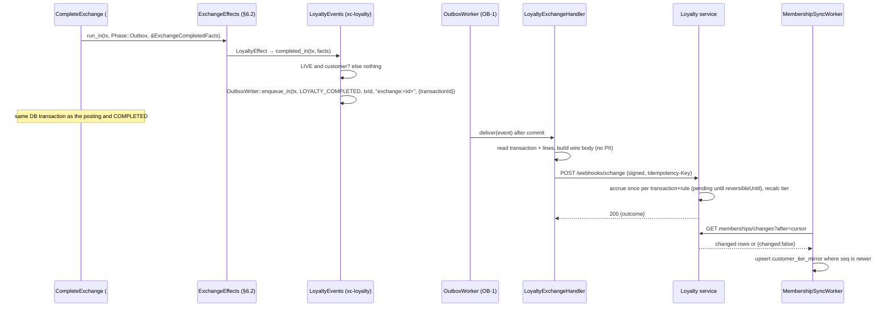

# Blueprint membership tiers and points: v3 as a client of the central Loyalty service (#559)

> Design only. No code, no migration, no `ready`. Written by claude/5edf7bb5-subagent for the xchange lane controller
> claude/5edf7bb5. The code tickets are cut by the lane controller after a `Verdict: PASS`.

**Source of the logic.** *XC Desk — Blueprint & Data Model v2*, committed at
`docs/blueprint/XC-Desk-Blueprint-Data-Model-v2.html`. Line numbers `bp:N` are in its tag-stripped text
(`sed 's/<[^>]*>/\n/g' | grep -v '^\s*$'`), the same convention as `customer-identity-consent.md`. The owner's rule
(#564): **the Blueprint's logic is fixed, and only the look may change**.

| What | Blueprint |
|---|---|
| Entities | §07 `TierRuleVersion(id, org_id, tier_code, rolling_months, qualification JSON, benefits JSON, version)`, `Membership(customer_id PK, tier_rule_id, calculated_at, effective_until)`, `MembershipHistory(id, customer_id, old/new_tier, rule_id, evidence_snapshot JSON, effective_at)` (bp:495); §16 `PointRuleVersion(id, org_id, basis, points_ratio, rounding, qualification, valid_from/to, version)`, `PointAccount(id, customer_id UQ, cached_balance)`, `PointEntry(id, account_id, transaction_id?, reversal_id?, redemption_id?, rule_id, signed_points BIGINT, type, expires_at)` (bp:815) |
| Ledger rules | §16 *"append-only ledger: EARN/REDEEM/EXPIRE/REVERSE/ADJUST; UQ(transaction,rule,EARN); pending ห้ามใช้; points กับ tier แยกกัน; reversal หลังใช้ไปเป็น balance/debt policy"* (bp:816) |
| States | §06 Member *"CALCULATED → EFFECTIVE; เปลี่ยน tier ผ่าน history"*, *"รัน recalculation idempotent; reversal ปรับฐาน; tier สิทธิและช่วงมีผลต้องเก็บ version"* (bp:397-398) |
| Atomicity | §09 Commission / tier: *"worker อ่าน outbox หลัง commit; consumer idempotent และมี reconciliation job"* (bp:551-552); Reversal: *"… member recalculation event; ไม่ลบ original"* (bp:560) |
| Values | §07 *"ช่วงย้อนหลังเสนอ 12 เดือน; threshold ยังไม่กำหนด"*; §12 Member *"rolling 12 เดือน + recalculation history"* / still open: *"tier thresholds; upgrade/downgrade; grace period; สิทธิแต่ละระดับ"* (bp:641-643) |
| Not a decision | §17 *"floor(THB total/100) points; Gold ≥1,000 / Platinum ≥5,000 — เป็นกติกาสาธิต"* (bp:851-852); §14 *"demo threshold ไม่ใช่ข้อสรุปธุรกิจ"* (bp:697) |
| Acceptance | §18 *"retry event ไม่ได้คะแนนซ้ำ; reversal ได้ adjustment; expired points ไม่ใช้; tier คำนวณจาก approved rule ไม่ copy demo threshold"* (bp:875); §13 phase 5 *"rule version ย้อนตรวจได้; reversal ไม่ค้างสิทธิ"* |
| Screen | C05 `/app/member` (CUSTOMER): *"tier; รอบคำนวณ; progress; สิทธิ/คูปอง"* (bp:184-189); M03 `/marketing/members` reads tiers (bp:247-252, #560) |

**Measured on** `108-Plaza/xchange` `main` at `978d94b1` and `108-Plaza/108-platform-services` `main` at `681bea2`.
Every `file:line` is at those shas.

**Designs this one stands on:**
- **the Loyalty side: 108-platform-services PR #407 (`docs/design/loyalty-xchange-integration.md`, head `6c8c070`)**. Its §4 (migration M-X1), §5 (contracts) and §12 (tickets LP-0..LP-4 = #408–#412) are the source of truth for everything inside Loyalty; this doc matches its §11 D-1..D-10.
- `broker-seam.md` (#563): OB-1, the lane's single outbox core (`xc-outbox`), and §11.1's registration seams. It already
  names *"#559's Loyalty events"* as an `OutboxHandler` (`broker-seam.md:250`, `:612`).
- `quote-transaction.md` (#551) §4.5 / §6.3: the completion enqueues `loyalty.exchange_completed`, key
  `exchange:<transaction id>`, once #559 adds its handler.
- `reversal.md` (#552) §4.3: the post enqueues `loyalty.exchange_reversed`, aggregate = the original transaction.
- `customer-identity-consent.md` (#554): one customer per organisation (`customers.id` text, `organization_id` uuid),
  `CustomerSelf`.
- `org-roles-branches.md` (#550): `Permission`, `Authorizer`, the CUSTOMER and MARKETING roles.

---

## 0. The owner's answers

| # | Question | Answer (verbatim) | Where | What this design does |
|---|---|---|---|---|
| B-3 | Build points in v3 or extend the central Loyalty? | *"ขยาย Loyalty กลาง"*: extend `108-platform-services` `crates/loyalty`; v3 sends a completed-exchange event (and the reversal event) through its outbox and Loyalty earns with an idempotent consumer; `PointRuleVersion`, `TierRuleVersion`, rolling tiers and `MembershipHistory` go into Loyalty | 2026-10-09, session claude/e5ab6c, #559 issuecomment-6074305245 and Blueprint §19 (bp:996-1000) | D-1: no points or tier table in v3; the ledger, rules and tiers are Loyalty's |
| P1–P8 | The eight questions of §10 (tier basis, window, up/downgrade and grace, point basis/rounding/expiry, tier benefits and spending points, where rules are edited, history, pending period) | *"ใช้คำแนะนำทั้งหมด"* (2026-10-10, session claude/5edf7bb5, the xchange lane controller): every recommendation accepted | 2026-10-10, session claude/5edf7bb5 | §10 records each decision; the numbers (thresholds, ratio, grace N, expiry months) stay **data** in the rule versions |
| L-1 | Dispatching the Loyalty work in `108-platform-services` (no lane controller there) | *"อนุมัติจ่ายงาน Loyalty ได้เลย"* | 2026-10-10, session claude/5edf7bb5 | LP-0..LP-4 (§9.2) may be dispatched |
| P9 | How Loyalty keys xchange's accounts, and whether xchange shares POS108's Loyalty data | *"เราแยกกัน กับ POS ไปรัน ที่ของเค้าเอง แค่ reuse ระบบ ให้ ผูกเบอร์"* | 2026-10-10, recorded by the lane controller claude/5edf7bb5 on #559 and PR 966 | D-3: xchange runs its **own** Loyalty deployment `loyalty-xchange` (code reused, data not shared with POS108); D-2: accounts keyed by the customer's verified **phone**, as Loyalty already does; no ADR-0003 exception |
| P10 | How a walk-in desk customer gets a verified phone | *"ยืนยันเบอร์ด้วย OTP ที่เคาน์เตอร์"* | 2026-10-10, the lane controller's session claude/5edf7bb5; recorded on PR 966 issuecomment-6095191220 and #559 | D-16, §6.3, CU-P1: the teller types the phone, an SMS code is sent through Notify, the customer reads it back, and the PHONE identity is written with `verified_at` |

---

## 1. Today (measured)

| Fact | Evidence |
|---|---|
| v3 has no tier, point or loyalty code: `git grep -i loyalty` on xchange `main` finds only design docs | `git grep -il loyalty 978d94b -- api web app` = 0 files |
| v3's `members` is a **staff-verified booking token** per branch and customer (`token_hash`, `verified_at`), not the Blueprint's `Membership` | `api/migrations/20261008130000_bookings.sql:1-11` |
| v3 customers are one per organisation, id `text` (`CX-%08d`), `organization_id uuid` | `api/migrations/20261019100000_customers_org.sql:28-51`; `customer-identity-consent.md` §4.1 |
| A quote carries `benefit_snapshot` (empty) and `base_rate = final_rate` | `api/src/application/workflows/exchange/quote.rs:186-187`, `:206` |
| No outbox crate yet (`xc-outbox` is OB-1, designed in `broker-seam.md` §5, not in `api/crates/`) | `ls api/crates` = xc-approval, xc-auth, xc-customer, xc-device-agent, xc-exchange, xc-kernel, xc-kiosk, xc-rate, xc-shift |
| The MARKETING role and `MarketingMembers` exist | `xc-auth/src/domain/access/permission.rs:34-36`, `role_permissions.rs:102-105` |
| **Loyalty** accounts: `loyalty_accounts(tenant_id, customer_id uuid, phone NULL, current_points, lifetime_points, version)`, unique `(tenant_id, customer_id)` and `(tenant_id, phone) WHERE phone IS NOT NULL` | platform-services `crates/loyalty/migrations/20260625000001_init_loyalty.sql:43-62` |
| Loyalty ledger: append-only `loyalty_transactions`, types `AWARD/REVERSE/ADJUST/EXPIRE`, unique `(tenant_id, reference_type, reference_id)`, `balance_after >= 0`; FIFO expiry lots `loyalty_point_lots` | same file `:65-106`; `domain/value_objects/transaction_type.rs:4-9` |
| Loyalty rule: **one mutable row per tenant** (`points_per_currency_unit`, `minimum_sale_amount`, `points_expiry_months`, later `tier_discount_percent`, `redeem_rate`) | `20260625000001_init_loyalty.sql:24-40`; `20260904000001_rule_discount_rates.sql:5-7` |
| Loyalty tiers are **hard-coded** Bronze/Silver ≥1,000/Gold ≥5,000 lifetime points, with earn multipliers 1.0/1.2/1.5 | `domain/value_objects/loyalty_tier.rs:15-31` |
| Loyalty accrual intake is pos108's HMAC webhook only (`POST /webhooks/pos108`, `loyalty.sale.v1` / `loyalty.sale_reversed.v1`), keyed by **phone** (ADR-0003), with an idempotency ledger `loyalty_sale_accruals` / `loyalty_sale_reversals` | `presentation/http/webhooks.rs:33-38`, `:128-188`; `20260903000001_sale_accrual.sql:19-64` |
| Loyalty read routes: `GET /loyalty/accounts/{customerId}` (uuid), `…/transactions`, `POST …/redeem`, `GET/PUT /loyalty/rules` | `presentation/http/loyalty.rs:30-39` |
| Loyalty has its own outbox table and no relay yet | `20260625000002_outbox.sql:1-32` |
| Loyalty's mandatory standard: design before code, migrations additive only, redemption online only, a sale completes with loyalty absent (ADR-0002) | `services/loyalty/CLAUDE.md` ("Domain invariants") |

**Gaps of Loyalty against the Blueprint** (from #559 issuecomment-6074287421, re-checked at `681bea2`): tiers hard-coded; rules
not versioned; no pending points; identity by phone (Blueprint bp:418 *"ไม่ถือเบอร์โทรเป็น PK"*); intake is pos108's
webhook only.

## 2. Decisions

| # | Decision | Why |
|---|---|---|
| D-1 | **Two homes.** Loyalty owns `PointRuleVersion`, `PointAccount`, `PointEntry`, `TierRuleVersion`, `Membership`, `MembershipHistory` and the recalculation. v3 owns: the two outbound events, the customer reference it sends, a read-only **mirror** of each customer's current tier, and the C05 view. v3 holds **no** points balance and no ledger row. | B-3; fleet rule ♻️ (one shared core, not a copy) |
| D-2 | **Keys sent to Loyalty.** The account key is the customer's **verified phone** (owner P9), in E.164 from `xc-kernel::pii::normalize`. Beside it v3 sends `customerRef = UUIDv5(NS_XC_LOYALTY, "xchange:" ‖ organization_id ‖ ":" ‖ customers.id)`, computed in one function, as Loyalty's `customer_id` soft reference (its webhook contract requires a uuid, `webhooks.rs:56-61`). v3 never sends a passport, name or `lookup_hash`. **Foreign phones earn:** most FX customers are tourists with a non-Thai number, so xchange's Loyalty keys accounts with `pos_kernel::phone::phone_key` (Thai → national number, anything else → E.164; platform-services `crates/pos-kernel/src/phone.rs:63-74` @ `681bea2`), **not** `th_phone_key` (`phone.rs:22-23` returns `None` for any `+` number other than `+66`), which today's `canonical_phone` uses (`accrual.rs:192-193`). The TH-only keying stays for POS108 (LP-2). **The phone's provider** is `CustomerService::verified_phone_for_system` (D-15). **Privacy:** the phone goes **only to xchange's own Loyalty instance** (D-3), over the signed webhook; it is never in the outbox row (the payload holds references only; the handler reads the phone when it sends), never logged, and never sent to POS108's Loyalty. | owner P9; Loyalty ADR-0003 (phone is the account key, unchanged); #554 K3/K8 (one PII core, no PII in logs) |
| D-3 | **xchange's own Loyalty deployment** (owner P9). xchange runs its own deployment `loyalty-xchange` with its own database (#407 §11 D-2), not a tenant in POS108's; the Loyalty code and image are reused, the data is not. Its base URL, `tenant_id` and webhook secret are configuration (`APP_LOYALTY__BASE_URL`, `APP_LOYALTY__TENANT_ID`, `APP_LOYALTY__WEBHOOK_SECRET`). Provisioning it is LP-0 (#408). | owner P9: *"เราแยกกัน กับ POS ไปรัน ที่ของเค้าเอง"*; #407 |
| D-4 | **Two events through OB-1**, one row per destination (`broker-seam.md` §5.2): `loyalty.exchange_completed` (key `exchange:<transaction id>`, written at `CompleteExchange`'s *write outbox* step) and `loyalty.exchange_reversed` (key `reversal:<reversal id>`, written at `PostReversal`'s *member recalculation event* step). **#559 edits neither file**: it registers one `ExchangeEffect` (§6.2), which TX-5 and RV-3 already call. Both have `aggregate_type = "transaction"` and `aggregate_id` = the **original** transaction id, so OB-1's per-aggregate FIFO never delivers a reversal before its earn. The stored payload is references only (`{"transactionId"}` / `{"reversalId"}`); the handler builds the wire body from the rows when it sends. | §09 (bp:551); OB-1's redaction rule (`broker-seam.md` §5.1) |
| D-5 | **Only LIVE exchanges of a customer with a verified phone are sent.** `LoyaltyEffect` enqueues the completion only when the customer has an `ACTIVE` `PHONE` identity with `verified_at` set (`customer_identities`, #554 §4.1; an existence check through `CustomerService::has_verified_phone_in(tx, org, customer)` (D-15), no decryption). DEMO, a customer without a verified phone, and an exchange with no customer enqueue nothing, so **a customer without a phone earns no points**. A reversal is enqueued only if its completion was. | owner P9 (keyed by phone); test data must not earn |
| D-6 | **The event carries the facts, not the points.** v3 never computes points or tiers. The wire body has each line's currency, shop side, quantity, `thb_amount`, `settle_thb` and `realized_margin_thb` (NULL until #553), the branch, `completed_at`, the business date and `reversibleUntil`. The owner chose settled THB for points and THB volume for tiers (P1, P4); other bases (contribution) stay computable in Loyalty without a v3 change. | P1, P4; a rule change must not need a v3 release |
| D-7 | **Pending points = until the reversal window closes.** Each earned **point lot** carries `available_at = reversibleUntil` (#407 §4.1 adds `loyalty_point_lots.available_at`; §11 D-5), the end of the branch business day of completion (reversal R-1, `reversal.md` §0). Before it the points are *pending*: shown, never spendable (§16 *"pending ห้ามใช้"*). Because v3 forbids a reversal after that day, a v3 reversal never meets spent points, so §16's *"balance/debt policy"* is never triggered by v3. Decided by the owner (P8). | §16 bp:816; R-1; P8 |
| D-8 | **v3 keeps a tier mirror, filled by pull.** `customer_tier_mirror` (§4.1) holds each **Loyalty member's** (phone key's) current tier code, rule version and `effective_until`, filled by `MembershipSyncWorker` from a Loyalty changes feed with a cursor (fleet rule 🔁: only what changed). #560 reads it for tier eligibility at quote time and for M03 segments. **A quote never calls Loyalty**: an outage leaves the last known tier, and an exchange always completes (Loyalty ADR-0002). | ADR-0002; §09 *"worker อ่าน outbox หลัง commit"*; 🔁 |
| D-9 | **C05 reads Loyalty live** for one customer (balance available/pending, next expiry, progress to the next tier) with a 2 s timeout. Unavailable ⇒ the view answers the mirror's tier and `points: null, pointsUnavailable: true`, never an error page. | one customer, on demand; the balance must be Loyalty's, not a copy |
| D-10 | **Tier and points are separate** (§16). A tier rule's qualification names its own basis (for example THB volume over `rolling_months`), computed by Loyalty from its accrual records, not from the points balance. | bp:816 *"points กับ tier แยกกัน"* |
| D-11 | **Recalculation is idempotent per (member, tier rule version, as-of date, new tier)** (#407 §11 D-9: the new tier is in the history `run_key`, so a second change on one day is recorded) in Loyalty, run (a) after each accrual or reversal for that customer and (b) by a daily job for window expiry. A run that finds the same tier writes nothing; a change writes one `MembershipHistory` row with its evidence snapshot. | §06 bp:398; §09 reconciliation job |
| D-12 | **No points redemption at the desk in this design.** Spending points was decided against for phase 5 by the owner (P5): it would need (a) a rule for what points buy and (b) a cross-service hold, because Loyalty cannot join v3's DB transaction. If the owner wants it, #560 adds a `POINTS` benefit type that reserves through Loyalty before `complete` and confirms after. | §16 REDEEM exists in the ledger; Loyalty's redeem is online only (ADR-0002) |
| D-13 | **`members` is left alone.** It is the booking member token (#555 redesigns bookings) and is not the Blueprint `Membership`. Screens never call it "membership". | `bookings.sql:1-11`; avoids a rename across #555's files |
| D-15 | **A system read of the verified phone, in the customer crate.** No provider exists today: `CustomerService::reveal` decrypts the `PASSPORT` identity only and requires a human `Actor` holding `IdentityDocumentRead` (`xc-customer/src/application/customer/service.rs:195-260` @ `a793021`). A new `impl CustomerService` block in its own file, `api/crates/xc-customer/src/application/customer/system_phone.rs`, adds two methods `[required]`: `has_verified_phone_in(tx, organization_id, customer_id) -> AppResult<bool>` (row exists: `type = 'PHONE'`, `status = 'ACTIVE'`, `verified_at IS NOT NULL`; no decryption) and `verified_phone_for_system(organization_id, customer_id, purpose: SystemReadPurpose, now) -> AppResult<Option<E164Phone>>` (decrypts through `PiiCipher` with AAD `customer_id ‖ "PHONE"`, the same convention as `reveal`'s `customer_id ‖ "PASSPORT"`). Each `verified_phone_for_system` call writes one `audit_events` row: `actor_id = "system:<purpose>"`, `actor_role = "SYSTEM"`, action `identity.system_read`, `object_ref` = the identity id, a reason = the purpose; **never** the value, its `lookup_hash` or its masked form (#554 K8). `SystemReadPurpose` is an enum with one variant, `Loyalty`, so no caller can name an ad-hoc purpose. Owned by the new ticket **CU-L1** (§9.1). | no caller decrypts by itself (#554 K3); every read of an identity value is audited (K8) |
| D-16 | **Two writers of a verified PHONE identity** (owner P10). Today nothing writes one: every `customer_identities` write on main encrypts a PASSPORT (`xc-customer/src/application/customer/service.rs:119`, `infrastructure/customer/customer_repository.rs:228` @ `b5b6cff`). (a) **The desk**: CU-P1 (§6.3), phone typed by the teller and verified by an SMS one-time code the customer reads back. (b) **The customer app**: #554 CI-7 (#654) `customerRegister` stores the Identity token's phone when Identity reports it verified. Both write the row the same way #554 defines it: `PiiCipher` with AAD `customer_id ‖ "PHONE"` (#554 §4.1, `customer-identity-consent.md:84`), `lookup_hash = LookupHasher(PHONE, normalize(PHONE, raw))` (E.164), `verified_at = now`, `status ACTIVE`, and the customer's previous ACTIVE PHONE becomes REVOKED in the same transaction. **Until one of them is merged no exchange earns points** (§6.1). | owner P10; reviewer claude/709ec749 on PR 966 (issuecomment-6095182267) |

## 3. Who does what

| Step | Who | Permission / auth |
|---|---|---|
| Complete or reverse an exchange (writes the outbox row) | TELLER / FINANCE through #551 and #552 | unchanged (`ExchangeTransact`, `ReversalRequest`) |
| Deliver the events to Loyalty | the OB-1 worker (`OutboxWorker`) through `LoyaltyExchangeHandler` | Loyalty service auth (§4.5) |
| Earn, reverse, expire points; recalculate tiers | Loyalty | — |
| Capture and verify a customer's phone at the desk (CU-P1) | TELLER | `ExchangeTransact` |
| Read own tier and points (C05) | CUSTOMER | `CustomerSelf` (#550 §3.4) |
| Read tiers of customers (M03) | MARKETING | `MarketingMembers` (#560's view, through the mirror) |
| Draft tier/point rule versions | EXECUTIVE, on a v3 screen (P6) | a new permission row `LoyaltyRulesManage` (EXECUTIVE) |
| Approve and publish them to Loyalty | EXECUTIVE through AP-1 (`LOYALTY_RULE_VERSION`), the proposer never deciding; published by a service write to Loyalty | `ApprovalsDecide` |

## 4. Model

### 4.1 v3 tables (migration M1, ticket LY-4)

```
customer_tier_mirror(                              -- the mirror (D-8); one row per Loyalty member (phone key)
  organization_id   uuid NOT NULL REFERENCES organizations(id),
  phone_lookup_hash bytea NOT NULL,               -- LookupHasher(PHONE, E.164 of the feed's phoneKey); never the phone itself
  tier_code         text NOT NULL,                -- Loyalty's code, opaque to v3 (no CHECK list: tiers are data)
  tier_rule_id      uuid NOT NULL,                -- Loyalty's TierRuleVersion id (soft reference, no FK)
  tier_rule_version int  NOT NULL CHECK (tier_rule_version > 0),
  effective_at      timestamptz NOT NULL,
  effective_until   timestamptz NULL,             -- NULL = open-ended
  loyalty_seq       bigint NOT NULL,              -- the feed position this row came from
  synced_at         timestamptz NOT NULL,
  PRIMARY KEY (organization_id, phone_lookup_hash)
)
loyalty_sync_cursor(
  organization_id   uuid PRIMARY KEY REFERENCES organizations(id),
  cursor            bigint NOT NULL DEFAULT 0,    -- last loyalty_seq applied
  last_ok_at        timestamptz NULL,
  last_error        text NULL                     -- redacted, ≤ 500 chars
)
```

- **Keyed by the member, not the v3 customer** (#407 §11 D-10): Loyalty's member is a phone, and one phone may be
  several v3 customers. The feed carries `phoneKey` (#407 §5.2: Thai `812345678`, otherwise E.164). v3 turns it back to
  E.164 (`+66` + the national number when it has no `+`) and stores only `LookupHasher(PHONE, normalize(PHONE, e164))`
  — the same value `customer_identities.lookup_hash` holds for that phone (#554 §4.1). No phone is stored in plain text.
- `MembershipMirror::tier_of(org, customer)` joins the customer's ACTIVE verified `PHONE` identity on
  `lookup_hash = phone_lookup_hash`; no decryption. A customer with no verified phone has no tier.
- An apply is `INSERT … ON CONFLICT (organization_id, phone_lookup_hash) DO UPDATE … WHERE excluded.loyalty_seq >
  customer_tier_mirror.loyalty_seq`, so an old page applied twice or late never moves a tier backwards.
- The events need no v3 table: they are OB-1 rows (`outbox_events`, `broker-seam.md` §5.1).

### 4.2 Loyalty tables (designed in 108-platform-services PR #407 (`docs/design/loyalty-xchange-integration.md`, head `6c8c070`), not here)

Summary for readers of this doc; #407 §4.1 is the physical source. Additive only (Loyalty standard).

| Blueprint | Loyalty (#407 §4.2) |
|---|---|
| `PointRuleVersion` | new `loyalty_point_rule_versions` (basis, ratio, rounding, minimum, expiry months, validity, DRAFT → PENDING_APPROVAL → APPROVED, no overlapping APPROVED versions) |
| `PointAccount` | existing `loyalty_accounts`, phone-keyed, in the `loyalty-xchange` database (D-3); `customer_id = customerRef` as a soft reference only |
| `PointEntry` | existing `loyalty_transactions` (+ `rule_version_id`) and its point lot (`expires_at`, + **`available_at` on the lot**, #407 §11 D-5) |
| EARN / REDEEM / EXPIRE / REVERSE / ADJUST | `AWARD` / `ADJUST` with `'redeem'` / `EXPIRE` / `REVERSE` / `ADJUST`: **no new type** (#407 §11 D-4) |
| `UQ(transaction, rule, EARN)` | the existing `(tenant_id, reference_type, reference_id)` unique with `('sale', transactionId)`: one AWARD per exchange; **no new index** (#407 §11 D-4) |
| intake idempotency | the existing `loyalty_sale_accruals` / `loyalty_sale_reversals` (+ `occurred_at`, `available_at`, `rule_version_id`, `facts`); the xchange webhook is an adapter onto the existing accrual core (#407 §5.1) |
| `TierRuleVersion` | new `loyalty_tier_rule_versions` |
| `Membership` / `MembershipHistory` | new `loyalty_memberships` / `loyalty_membership_history`, keyed by the account; history `run_key` includes the new tier (D-11) |

### 4.3 States

```
Loyalty PointRuleVersion / TierRuleVersion:  DRAFT → PENDING_APPROVAL → APPROVED   (REJECTED → a new DRAFT)
    an APPROVED version applies on [valid_from, valid_to); "current" is derived from the clock, never written
Loyalty Membership (§06):  CALCULATED → EFFECTIVE   (a run computes; the row becomes effective at effective_at;
    every change of tier appends MembershipHistory; the row is never deleted)
Loyalty point lot (#407 §4.3):  pending (now < available_at) → available → expired (EXPIRE at expires_at) | reversed
    derived from the lot's timestamps, no status column
v3 outbox rows: OB-1's PENDING → DELIVERED | FAILED | EXPIRED (broker-seam.md §5.2)
```

### 4.4 Rules the machines enforce

| Rule | Where |
|---|---|
| a completed LIVE exchange with a customer enqueues exactly one `loyalty.exchange_completed`, in the completion's DB transaction; a rollback writes none | `LoyaltyEffect` (an `ExchangeEffect`, §6.2) → `LoyaltyEvents::completed_in` + OB-1 `enqueue_in`, run by #551's `CompleteExchange` through `ExchangeEffects` |
| a posted reversal enqueues exactly one `loyalty.exchange_reversed` for the original's aggregate | `LoyaltyEffect` → `LoyaltyEvents::reversed_in`, run by #552's `PostReversal` through `ExchangeEffects` |
| a repeat of either (same key, same hash) is a no-op; same key, other hash ⇒ `IdempotencyConflict` | OB-1 writer |
| the handler sends the row's `idempotency_key`; Loyalty answers a repeat 200 with the first outcome | `LoyaltyExchangeHandler`; Loyalty's accrual ledger |
| no phone, passport, name or `lookup_hash` in the stored outbox payload; the wire body carries the verified phone and nothing else personal, and only to xchange's own instance (D-2) | `LoyaltyWireBody` builder; OB-1 `Redactor` |
| a customer without a verified phone enqueues nothing and earns nothing | `LoyaltyEffect` (D-5) |
| the mirror never moves backwards | `loyalty_seq` guard (§4.1) |
| a quote and a completion never wait on Loyalty | D-8: only the mirror is read in-request |
| Loyalty: an xchange event is keyed by `(tenant_id, phone)` in xchange's own instance (D-3); one EARN per (transaction, rule); a reversal reverses at most what was earned; pending is not spendable; expired is not spendable; tier from an APPROVED version only | Loyalty design (§4.2) |

### 4.5 The wire contract `[required]` (both sides must implement exactly this)

Delivered by `POST {APP_LOYALTY__BASE_URL}/webhooks/xchange`, signed like the pos108 webhook
(header exactly **`X-POS108-Signature`**: `t=<ts>,v1=<hex HMAC-SHA256(secret, "<ts>.<body>")>`, verified by the shared
`pos_kernel::webhook_signature`, `webhooks.rs:7-15`). Header `Idempotency-Key` = the outbox row's key. Money is a
decimal **string**; JSON is camelCase (fleet contract).

```jsonc
// type "xchange.exchange_completed.v1"
{ "id": "<outbox event uuid>", "type": "xchange.exchange_completed.v1", "data": {
    "tenantId": "<uuid>", "phone": "+66…", "customerRef": "<uuid, D-2>", "transactionId": "<uuid>", "documentRef": "XC-…",
    "branchId": "<text>", "completedAt": "<RFC 3339>", "businessDate": "YYYY-MM-DD", "reversibleUntil": "<RFC 3339>",
    "lines": [ { "currency": "USD", "shopSide": "BUY|SELL", "quantity": "100.0000", "unitSize": "1.0000",
                 "thbAmount": "3400.00", "settleThb": "3400.00", "realizedMarginThb": null } ] } }
// type "xchange.exchange_reversed.v1"
{ "id": "<uuid>", "type": "xchange.exchange_reversed.v1", "data": {
    "tenantId": "<uuid>", "phone": "+66…", "customerRef": "<uuid>", "transactionId": "<original uuid>", "reversalId": "<uuid>",
    "postedAt": "<RFC 3339>", "amountThb": "3400.00", "full": true } }
```

- **`phone` is on both events**; `customerRef` is a reference only (#407 §11 D-1). The phone is E.164 as xchange stores it; Loyalty keys it with `phone_key`.
- **A reversal's `amountThb` is cumulative**: the total reversed so far for that transaction, not the slice (#407 §11 D-6, the core's set-wise maths). v3's MVP reversal is whole (`full: true`, `reversal.md`), so today it equals the original's total.

Answers the handler reads (OB-1 `DeliveryResult`): 2xx ⇒ `Final(Delivered)` with `outcome` recorded; 400 ⇒
`Final(Failed)` (the body is wrong; retrying will not help); 401/503/5xx/timeout ⇒ `Retry`. Same rules as the pos108
receiver (`webhooks.rs:17-20`).

Loyalty read routes v3 calls (service bearer, `aud=loyalty`, scope `loyalty:read`):

| Route (#407 §5.2) | Caller | Answer |
|---|---|---|
| `GET /api/v1/loyalty/memberships/changes?after=<seq>&limit=500` | `MembershipSyncWorker` every 60 s | `{changed:false, next}` when nothing is after `seq` (one index probe); else `{changed:true, items:[{phoneKey, customerRef, tierCode, tierRuleId, tierRuleVersion, effectiveAt, effectiveUntil, seq}], next}` — **keyed by `phoneKey`** (#407 §5.2, §11 D-8; fleet rule 🔁) |
| `POST /api/v1/loyalty/members/summary`, body `{phone}` (no PII in a URL) | `LoyaltySummaryClient` for C05 (the phone from `verified_phone_for_system`, D-15) | `{phoneKey, available, pending, nextExpiry: {points, at} \| null, tier: {code, effectiveUntil, progress: {basis, current, next \| null}} \| null}`; unknown phone ⇒ zeros, `tier: null` (#407 §5.2) |

### 4.6 v3 routes

| View / command | Route | Permission |
|---|---|---|
| view `my_membership` (C05: tier, `effective_until`, points available/pending, next expiry, progress; D-9) | `GET /api/v3/views/my_membership` | `CustomerSelf` (the owner check, #550 §3.5 item 4) |
| view `customer_tier` (one customer's mirrored tier for the desk's customer step and #560) | `GET /api/v3/views/customer_tier?customer=` | `ExchangeTransact` or `MarketingMembers` |
| command `loyaltyRuleDraft` (LY-6, §6.4): `{kind: POINT\|TIER, fields}` → `{versionId, status: DRAFT}` | `POST /api/v3/commands/loyalty_rule_draft` | `LoyaltyRulesManage` (EXECUTIVE) |
| command `loyaltyRuleSubmit` (LY-6, §6.4): `{versionId}` → `{versionId, status: PENDING_APPROVAL}`, opens AP-1 `LOYALTY_RULE_VERSION` | `POST /api/v3/commands/loyalty_rule_submit` | `LoyaltyRulesManage` (EXECUTIVE) |

v3 writes nothing about points itself. Rule management (P6) is a later ticket (LY-6, §9.1): an EXECUTIVE screen, `loyaltyRuleDraft`/`loyaltyRuleSubmit` commands and an AP-1 subject whose approval publishes the version to Loyalty.

## 5. Flow



## 6. Class diagram (v3 side)

New crate `api/crates/xc-loyalty` (depends on `xc-outbox`, `xc-kernel`; never on `xc-exchange`). The `api` crate
wires it.

```mermaid
classDiagram
  class LoyaltyEventKinds { <<xc-loyalty domain/events.rs>> LOYALTY_COMPLETED: EventKind; LOYALTY_REVERSED: EventKind }
  class LoyaltyCustomerRef { <<xc-loyalty domain/customer_ref.rs>> +of(org_id, customer_id) Uuid }
  class CompletedFacts { <<xc-loyalty domain/facts.rs>> transaction_id; customer_id; mode; branch_id; completed_at; business_date; reversible_until; lines }
  class ReversedFacts { <<xc-loyalty domain/facts.rs>> reversal_id; transaction_id; customer_id; posted_at; amount_thb }
  class LoyaltyFactsSource { <<trait xc-loyalty domain/facts_source.rs>> +completed(tx_id) CompletedFacts +reversed(rev_id) ReversedFacts }
  class PhoneVerificationService { <<xc-customer application/customer/phone_verification_service.rs (CU-P1)>> +start() +confirm() }
  class PhoneVerification { <<xc-customer domain/phone_verification.rs (CU-P1)>> }
  class PhoneOtpPolicy { <<xc-customer domain/phone_otp_policy.rs (CU-P1)>> }
  class SmsSender { <<trait xc-customer domain/sms_sender.rs (CU-P1)>> +send(phone, text) }
  class NotifySmsSender { <<api infrastructure/notify/notify_sms_sender.rs (CU-P1)>> }
  class PgPhoneVerificationRepository { <<xc-customer infrastructure/customer/phone_verification_repository.rs (CU-P1)>> }
  class CustomerRegister { <<api http/v3/commands/customer_register.rs (#554 CI-7, #654)>> }
  class CustomerSystemPhone { <<xc-customer application/customer/system_phone.rs (CU-L1)>> +has_verified_phone_in(tx, org, customer) +verified_phone_for_system(org, customer, purpose, now) }
  class PgLoyaltyFactsSource { <<api infrastructure/loyalty/pg_facts_source.rs>> }
  class LoyaltyWireBody { <<xc-loyalty domain/wire_body.rs>> +completed(facts, tenant, ref) +reversed(facts, tenant, ref) }
  class LoyaltyEvents { <<xc-loyalty application/events.rs>> +completed_in(tx, &CompletedFacts) +reversed_in(tx, &ReversedFacts) }
  class LoyaltyExchangeHandler { <<xc-loyalty infrastructure/exchange_handler.rs>> +kind() +deliver() +on_final() }
  class LoyaltyHttp { <<xc-loyalty infrastructure/http_client.rs>> signer; base_url; service token }
  class LoyaltyConfig { <<xc-loyalty infrastructure/config.rs>> base_url; tenant_id; webhook_secret; timeout; service_token (LY-6, R3) }
  class MembershipMirror { <<trait xc-loyalty domain/membership_mirror.rs>> +tier_of(org, customer) +apply_in(tx, page) }
  class PgMembershipMirror { <<xc-loyalty infrastructure/pg_membership_mirror.rs>> }
  class MembershipFeed { <<trait xc-loyalty domain/membership_feed.rs>> +changes_after(seq) }
  class HttpMembershipFeed { <<xc-loyalty infrastructure/http_membership_feed.rs>> }
  class MembershipSyncWorker { <<xc-loyalty application/sync_worker.rs>> +tick() }
  class LoyaltySummarySource { <<trait xc-loyalty domain/summary_source.rs>> +summary(ref) }
  class HttpLoyaltySummary { <<xc-loyalty infrastructure/http_summary.rs>> }
  class MyMembershipView { <<api presentation/http/v3/views/my_membership.rs>> }
  class CustomerTierView { <<api presentation/http/v3/views/customer_tier.rs>> }
  class LoyaltyHandlerRegistration { <<api bootstrap/outbox_handlers/loyalty.rs  broker-seam §11.1>> +handler(state) }
  class OutboxWriter { <<xc-outbox (OB-1)>> }
  class OutboxHandler { <<trait xc-outbox (OB-1)>> }
  class CompleteExchange { <<api workflows/exchange/complete.rs (#551 TX-5)>> }
  class PostReversal { <<api workflows/exchange/reversal_post.rs (#552 RV-3)>> }
  class ExchangeEffect { <<trait api workflows/exchange/effects.rs (XS-0, §6.2)>> +phase() +on_completed_in() +on_reversed_in() }
  class ExchangeEffects { <<api workflows/exchange/effects.rs (XS-0)>> +run_completed_in(tx, phase, facts) +run_reversed_in(tx, phase, facts) }
  class LoyaltyEffect { <<api bootstrap/exchange_effects/loyalty.rs (LY-3)>> }
  class LoyaltyRuleWriter { <<trait xc-loyalty application/rule_publisher.rs (LY-6, R4)>> +create_draft(kind, fields) RuleVersion +submit(kind, id) RuleVersion +approve(kind, id, approved_ref) RuleVersion +reject(kind, id, reason) RuleVersion +get(kind, id) optional RuleVersion }
  class RuleVersion { <<xc-loyalty application/rule_publisher.rs (LY-6)>> id; kind RuleKind POINT or TIER; status; approved_ref; content }
  class LoyaltyRuleError { <<xc-loyalty application/rule_publisher.rs (LY-6)>> Unavailable; Invalid; NotFound; InvalidTransition }
  class HttpLoyaltyRuleWriter { <<xc-loyalty infrastructure/http_rule_writer.rs (LY-6)>> +from_config(LoyaltyConfig) optional Self; base_url; bearer service_token; timeout }
  class LoyaltyRuleDraftCommand { <<api presentation/http/v3/commands/loyalty_rule_draft.rs (LY-6)>> NAME loyaltyRuleDraft }
  class LoyaltyRuleSubmitCommand { <<api presentation/http/v3/commands/loyalty_rule_submit.rs (LY-6)>> NAME loyaltyRuleSubmit }
  class LoyaltyRuleVersionSubject { <<api application/workflows/loyalty/rule_approval.rs (LY-6)>> TYPE LOYALTY_RULE_VERSION; optional writer +version_hash_or_unavailable() +on_decided_or_unavailable() }
  class LoyaltyRuleVersionPolicy { <<api application/workflows/loyalty/rule_approval.rs (LY-6)>> +may_decide() EXECUTIVE only }
  class LoyaltyRuleVersionRegistration { <<api bootstrap/approval_subjects/loyalty_rule_version.rs (LY-6)>> TYPE +register(registry, pool) +register_with_deps(registry, deps) }
  class ApprovalSubjectDeps { <<api bootstrap/approval_subjects/mod.rs (LY-6, R2)>> pool; optional loyalty LoyaltyRuleWriter +pool_only(pool) +from_settings(pool, settings) +registry_with(deps) }
  class MakeApprovalService { <<api presentation/http/v3/commands/mod.rs>> +make_approval_service(pool) +make_approval_service_with(deps) (LY-6) }
  class ApprovalDecideCommand { <<api presentation/http/v3/commands/approval_decide.rs>> maps DependencyUnavailable to 503 (LY-6, R1) }
  class ApprovalService { <<xc-approval application/approval_service.rs (AP-1)>> +request() +decide() ApprovalError DependencyUnavailable code message (LY-6, R1) }
  class ApprovalSubject { <<trait xc-approval domain/subject.rs (AP-1)>> +version_hash() +on_decided() +version_hash_or_unavailable() default +on_decided_or_unavailable() default (LY-6) }
  class SubjectError { <<xc-approval domain/subject.rs (LY-6, R1)>> DependencyUnavailable code message; Failed AppError }
  class ApprovalPolicy { <<trait xc-approval domain/policy.rs (AP-1)>> +may_decide() }

  CompleteExchange --> ExchangeEffects : run_completed_in (TX-5 owns the call)
  PostReversal --> ExchangeEffects : run_reversed_in (RV-3 owns the call)
  ExchangeEffects --> ExchangeEffect
  LoyaltyEffect ..|> ExchangeEffect
  LoyaltyEffect --> LoyaltyEvents : completed_in / reversed_in
  LoyaltyEvents --> OutboxWriter : enqueue_in
  LoyaltyEvents --> LoyaltyEventKinds
  LoyaltyExchangeHandler ..|> OutboxHandler
  LoyaltyExchangeHandler --> LoyaltyFactsSource
  LoyaltyExchangeHandler --> LoyaltyWireBody
  LoyaltyExchangeHandler --> LoyaltyHttp
  LoyaltyWireBody --> LoyaltyCustomerRef
  LoyaltyFactsSource <|.. PgLoyaltyFactsSource
  PhoneVerificationService --> PhoneVerification
  PhoneVerificationService --> PhoneOtpPolicy
  PhoneVerificationService --> SmsSender
  PhoneVerificationService --> PgPhoneVerificationRepository
  SmsSender <|.. NotifySmsSender
  PhoneVerificationService ..> CustomerSystemPhone : writes the PHONE row it reads
  CustomerRegister ..> CustomerSystemPhone : writes the PHONE row it reads
  PgLoyaltyFactsSource --> CustomerSystemPhone : verified_phone_for_system
  LoyaltyEffect --> CustomerSystemPhone : has_verified_phone_in
  LoyaltyHandlerRegistration --> LoyaltyExchangeHandler
  LoyaltyHttp --> LoyaltyConfig
  MembershipSyncWorker --> MembershipFeed
  MembershipSyncWorker --> MembershipMirror
  MembershipFeed <|.. HttpMembershipFeed
  MembershipMirror <|.. PgMembershipMirror
  LoyaltySummarySource <|.. HttpLoyaltySummary
  MyMembershipView --> LoyaltySummarySource
  MyMembershipView --> MembershipMirror
  CustomerTierView --> MembershipMirror
  LoyaltyRuleWriter <|.. HttpLoyaltyRuleWriter
  HttpLoyaltyRuleWriter --> LoyaltyConfig
  LoyaltyRuleWriter --> RuleVersion
  LoyaltyRuleWriter --> LoyaltyRuleError
  LoyaltyRuleDraftCommand --> LoyaltyRuleWriter : create_draft
  LoyaltyRuleSubmitCommand --> LoyaltyRuleWriter : submit, get
  LoyaltyRuleSubmitCommand --> MakeApprovalService : make_approval_service_with
  LoyaltyRuleSubmitCommand --> ApprovalService : request LOYALTY_RULE_VERSION
  ApprovalDecideCommand --> MakeApprovalService : make_approval_service_with
  ApprovalDecideCommand --> ApprovalService : decide
  MakeApprovalService --> ApprovalSubjectDeps : registry_with
  ApprovalSubjectDeps --> LoyaltyRuleWriter
  ApprovalSubjectDeps --> LoyaltyRuleVersionRegistration : register_with_deps
  LoyaltyRuleVersionRegistration --> LoyaltyRuleVersionSubject
  LoyaltyRuleVersionRegistration --> LoyaltyRuleVersionPolicy
  LoyaltyRuleVersionSubject ..|> ApprovalSubject
  LoyaltyRuleVersionPolicy ..|> ApprovalPolicy
  LoyaltyRuleVersionSubject --> LoyaltyRuleWriter : get, approve, reject
  ApprovalService --> ApprovalSubject : version_hash_or_unavailable, on_decided_or_unavailable
  ApprovalSubject --> SubjectError
```

`CompletedFacts` and `ReversedFacts` share `domain/facts.rs` and are written by one ticket (LY-1). `PgLoyaltyFactsSource`
lives in the `api` crate because it reads #551's and #552's tables, which `xc-loyalty` must not depend on.

### 6.1 Who provides, who uses

| Provider | Used by | Fallback if not merged |
|---|---|---|
| OB-1 `OutboxWriter`, `OutboxHandler`, `EventKind`, §11.1 handler registration (PL-0) | `LoyaltyEvents`, `LoyaltyExchangeHandler`, `bootstrap/outbox_handlers/loyalty.rs` | none: LY-2 starts after OB-1 and PL-0 |
| XS-0 `ExchangeEffect`, `ExchangeEffects` (§6.2) | TX-5 and RV-3 call it; `LoyaltyEffect` (LY-3) and #560's `MarketingEffect` register into it | TX-5 / RV-3 declare a no-op `ExchangeEffects` with the same signature in their own file if XS-0 is not merged (📐 fallback), replaced when it is |
| #551 TX-5 `CompleteExchange`, #552 RV-3 `PostReversal` | run the registered effects at their §09 steps; #559 edits neither | LY-3 registers whenever it merges; with no registration nothing is enqueued |
| **PHONE writer 1:** CU-P1 `PhoneVerificationService::confirm` (desk OTP, §6.3) | `has_verified_phone_in`, `verified_phone_for_system` (CU-L1), hence D-5 | **none: until CU-P1 or CI-7 is merged, no customer has a verified phone and no exchange earns points** |
| **PHONE writer 2:** #554 CI-7 (#654) `customerRegister` stores the Identity-verified phone (D-16) | same | app customers only; desk customers need CU-P1 |
| central Notify `POST /api/v1/notifications` (channel `sms`) | `NotifySmsSender` | unset `NOTIFY_BASE_URL`/`NOTIFY_API_KEY` ⇒ `start` answers `smsUnavailable`; nobody can verify at the desk. Foreign numbers need an international provider (Twilio) configured in Notify for xchange's tenant |
| CU-L1 `CustomerService::has_verified_phone_in`, `verified_phone_for_system` (D-15) | `LoyaltyEffect` (the D-5 check), `PgLoyaltyFactsSource` (the wire body's phone) | none: LY-2 and LY-3 start after CU-L1 |
| #554 `customers` (one per organisation) | `LoyaltyCustomerRef`, the mirror's FK | merged (`20261019100000_customers_org.sql`) |
| this design `MembershipMirror::tier_of` | #560 eligibility (quote time) and M03 segments | #560 treats "no mirror row" as "no tier" |
| this design `LoyaltyEventKinds` | #560 (none), #553 (none) | — |
| Loyalty: rule-version routes `/api/v1/loyalty/{point,tier}-rule-versions[/{id}/{submit,approve,reject}]` (LP-1 #409, LP-3 #411, merged at 108-platform-services `989d66d`), bearer with `loyalty:write` (and `loyalty:read` for the list) | LY-6's `HttpLoyaltyRuleWriter` | none: LY-6 starts after LP-1/LP-3 (merged). Token unset or Loyalty down ⇒ `loyaltyUnavailable` (§6.4) |
| LY-6 `LoyaltyRuleWriter` (trait), `ApprovalSubjectDeps`, `make_approval_service_with`, `SubjectError` / `ApprovalError::DependencyUnavailable` | the two LY-6 commands, `LoyaltyRuleVersionSubject`; any later subject that needs a dependency other than the pool | one ticket writes all of them (LY-6), so there is no fallback to declare |
| Loyalty: `/webhooks/xchange`, the changes feed, the summary route (LP tickets, §9.2) | LY-2, LY-4, LY-5 | the handler's rows wait `PENDING` (OB-1 keeps them 7 days, then `EXPIRED`, recorded); the worker logs and retries; C05 answers `pointsUnavailable` |

### 6.2 The exchange-effect seam (shared with #560; one shape for both)

The merged designs already put the call in the owning tickets: `quote-transaction.md` §6.3 (*"#559 (Loyalty earn) … register theirs"*), §4.5 (*"redeem benefit — its port is #560's"*), `reversal.md:152` (*"benefit adjustment — its port is #560's"*), `:154` and `:273` (RV-3's tests require the Loyalty event once). This section names that port, so #559 and #560 **register** and never edit `complete.rs` or `reversal_post.rs`.

```rust
// api/src/application/workflows/exchange/effects.rs   [required names]  (XS-0)
pub enum EffectPhase { Redeem, Outbox }   // §09: Redeem = "redeem benefit" / "benefit adjustment" (may refuse);
                                          //      Outbox = "write outbox" / "member recalculation event"
pub struct ExchangeCompletedFacts { pub organization_id: Uuid, pub branch_id: BranchId, pub transaction_id: Uuid,
    pub quote_id: Uuid, pub customer_id: Option<String>, pub mode: Mode, pub completed_at: DateTime<Utc>,
    pub business_date: NaiveDate, pub reversible_until: DateTime<Utc> }
pub struct PostedReversal { pub organization_id: Uuid, pub reversal_id: Uuid, pub transaction_id: Uuid,
    pub customer_id: Option<String>, pub mode: Mode, pub posted_at: DateTime<Utc>, pub amount_thb: Decimal }
pub trait ExchangeEffect: Send + Sync {
    fn name(&self) -> &'static str;
    fn phase(&self) -> EffectPhase;
    fn on_completed_in<'a>(&'a self, tx: &'a mut PgTx, e: &'a ExchangeCompletedFacts) -> BoxFuture<'a, AppResult<()>>;
    fn on_reversed_in<'a>(&'a self, tx: &'a mut PgTx, r: &'a PostedReversal) -> BoxFuture<'a, AppResult<()>>;
}
pub struct ExchangeEffects { /* Vec<Arc<dyn ExchangeEffect>>, from the generated list */ }
impl ExchangeEffects {
    pub async fn run_completed_in(&self, tx: &mut PgTx, phase: EffectPhase, e: &ExchangeCompletedFacts) -> AppResult<()>;
    pub async fn run_reversed_in(&self, tx: &mut PgTx, phase: EffectPhase, r: &PostedReversal) -> AppResult<()>;
}
```

- **Registration** follows `broker-seam.md` §11.1: `api/build.rs` scans `src/bootstrap/exchange_effects/*.rs`; each file has `pub fn effect(state: &AppState) -> Option<Arc<dyn ExchangeEffect>>` (`None` = not configured). Effects of one phase run in file-name order; an `Err` rolls back the whole completion or reversal (the caller's transaction).
- **Who calls:** TX-5's `CompleteExchange::run_in` calls `run_completed_in(tx, Redeem, …)` at §09's *redeem benefit* step and `run_completed_in(tx, Outbox, …)` at *write outbox*; RV-3's `PostReversal` calls `run_reversed_in` at *benefit adjustment* (`Redeem`) and *member recalculation event* (`Outbox`). Those calls are **TX-5's and RV-3's lines**, in their own tickets.
- **Who registers:** #559 `bootstrap/exchange_effects/loyalty.rs` (`LoyaltyEffect`, phase `Outbox`); #560 `bootstrap/exchange_effects/marketing.rs` (`MarketingEffect`, phase `Redeem`). Adding a destination is one file.
- **XS-0 owns** `effects.rs`, `api/src/bootstrap/exchange_effects/mod.rs` and one scan block in PL-0's generator (`api/build_support/registrations.rs`). Fallback (📐): if XS-0 is not merged when TX-5 or RV-3 starts, that ticket declares an `ExchangeEffects` with this signature that runs nothing, in its own file, removed when XS-0 merges. The lane controller writes these two calls into TX-5's and RV-3's ticket text; `quote-transaction.md` and `reversal.md` need no change beyond naming the port.

### 6.3 Desk phone capture and OTP verification (CU-P1, owner P10)

**How v3 reaches SMS.** v3 has no SMS path today: its only OTP is Identity's sign-in OTP (`IdentityClient::otp_request` /
`otp_verify`, `xc-auth/src/domain/identity/identity_client.rs:125-138`), whose verify answers a `login` and may
`register` an Identity account (`IdentityOtpVerifyResponse`, `:36-42`). That is a sign-in, and O-4 keeps Identity to
authentication, so the desk does **not** use it. The central Notify service sends SMS (`ChannelType::Sms`, providers
ThaiBulkSMS and Twilio, platform-services `crates/notification-api/src/main.rs:293-314` @ `681bea2`) through
`POST {NOTIFY_BASE_URL}/api/v1/notifications` with a per-tenant `X-API-Key`, the shape Loyalty's adapter already uses
(`crates/loyalty/src/infrastructure/notify.rs:1-60`). v3 gets a port `SmsSender` and one Notify adapter.

```
phone_verifications(                                   -- migration M2 (CU-P1)
  id              uuid PK,
  organization_id uuid NOT NULL REFERENCES organizations(id),
  customer_id     text NOT NULL REFERENCES customers(id),
  branch_id       text NOT NULL REFERENCES branches(id),
  phone_encrypted bytea NOT NULL, key_id text NOT NULL,  -- PiiCipher, AAD customer_id ‖ "PHONE_OTP"
  phone_lookup_hash bytea NOT NULL,                       -- LookupHasher(PHONE, E.164), for the per-phone rate limit
  code_hash       bytea NOT NULL,                         -- HMAC-SHA256(key, challenge id ‖ code); the code is never stored
  expires_at      timestamptz NOT NULL,
  attempts        int NOT NULL DEFAULT 0 CHECK (attempts >= 0),
  status          text NOT NULL CHECK (status IN ('PENDING','VERIFIED','LOCKED','SUPERSEDED')),  -- EXPIRED is derived
  requested_by    uuid NOT NULL REFERENCES users(id),
  identity_id     uuid NULL REFERENCES customer_identities(id),   -- set when VERIFIED
  created_at      timestamptz NOT NULL, decided_at timestamptz NULL
)
CREATE UNIQUE INDEX one_pending_per_customer ON phone_verifications (customer_id) WHERE status = 'PENDING';
CREATE INDEX phone_verifications_rate ON phone_verifications (organization_id, phone_lookup_hash, created_at);
```

| Rule | Value / behaviour |
|---|---|
| Code | 6 digits from the OS CSPRNG; stored only as `code_hash`; never logged, never in an audit row (the `Redactor` already drops `otp`, `xc-approval/src/domain/redactor.rs:64`) |
| Expiry | 5 minutes (`expires_at`); an expired PENDING is shown EXPIRED (derived) and cannot verify — `codeExpired` |
| Attempts | at most 5 wrong codes per challenge, then `LOCKED` — `tooManyAttempts`; compare in constant time |
| Rate limits | per customer ≤ 3 challenges / 15 min; per phone hash ≤ 5 / hour; per teller ≤ 30 / hour → `rateLimited` (counted from `phone_verifications` rows, under the customer's row lock) |
| New challenge | supersedes the customer's PENDING one (`SUPERSEDED`), so only the newest code works |
| Phone format | `normalize(PHONE, raw)` (E.164; Thai `0…` → `+66…`); a number that does not normalise → `validationFailed` before any SMS |
| Phone in use | if another customer of the organisation holds the same ACTIVE PHONE hash, verify refuses `phoneInUse` and writes nothing (#554's one-active index); a merge is #554 O-1 |
| Verify (one transaction) | code matches, not expired, not locked ⇒ REVOKE the customer's old ACTIVE PHONE, INSERT the new PHONE identity (D-16 encoding, `verified_at = now`), mark the challenge `VERIFIED` with `identity_id` |
| SMS text | one fixed template per language (th/en/zh, the customer's `preferred_language`, #576), in `PhoneOtpPolicy`; it holds the code and the shop name only |
| Notify down | `start` answers `smsUnavailable` (503); the challenge row is rolled back; the exchange itself is never blocked |
| Audit | `audit_events` rows for start (sent / refused) and verify (verified / wrong code / locked) with actor, customer id, challenge id and outcome — never the phone, the code, or their hashes |
| Values | the 6 / 5 min / 5 / 3 / 5 / 30 above are `[proposed]` security defaults, held in one `PhoneOtpPolicy` constant set, not business rules |

| Command | Route | Permission |
|---|---|---|
| `customerPhoneStart` (body: `phone`) → `{challengeId, expiresAt}` | `POST /api/customers/{id}/phone-verifications` | `ExchangeTransact` |
| `customerPhoneConfirm` (body: `code`) → `{verified: true, identityId}` | `POST /api/customers/{id}/phone-verifications/{challengeId}/confirm` | `ExchangeTransact` |

Classes (in the §6 diagram): `PhoneVerification` (`xc-customer/src/domain/phone_verification.rs`), `PhoneOtpPolicy`
(`xc-customer/src/domain/phone_otp_policy.rs`), `SmsSender` (trait, `xc-customer/src/domain/sms_sender.rs`),
`PhoneVerificationService` (`xc-customer/src/application/customer/phone_verification_service.rs`: `start`, `confirm`),
`PgPhoneVerificationRepository` (`xc-customer/src/infrastructure/customer/phone_verification_repository.rs`),
`NotifySmsSender` (`api/src/infrastructure/notify/notify_sms_sender.rs`), and the two command files
`api/src/presentation/http/v3/commands/{customer_phone_start,customer_phone_confirm}.rs`.

### 6.4 LY-6 rulings (2026-10-15, BE controller)

The xchange BE lane controller claude/7ca80c ruled these for LY-6 (#1411) on 2026-10-15, after the owner's answers in
#1411 issuecomment-6180559023 (a draft lives **in Loyalty**, no v3 table and no migration; Loyalty down while an
approval is decided ⇒ the request stays `PENDING`, retryable, no outbox).

| # | Ruling | What it fixes in the code |
|---|---|---|
| R1 | **Loyalty down ⇒ 503 `loyaltyUnavailable`.** Loyalty unreachable, timing out or answering 5xx while an approval is decided: the decide call answers 503 `loyaltyUnavailable`, the AP-1 request stays `PENDING`, no decision row is written (the command's transaction rolls back), and a retry with a new Idempotency-Key publishes once. Mapped through a **typed** error, never a string match. | `xc-approval/src/domain/subject.rs` gains `SubjectError { DependencyUnavailable { code, message }, Failed(AppError) }` and two **defaulted** trait methods, `version_hash_or_unavailable` and `on_decided_or_unavailable`, which call `version_hash` / `on_decided` and wrap any error as `Failed` (so no existing subject changes). `ApprovalService::request` and `::decide` call the new methods; `DependencyUnavailable` becomes `ApprovalError::DependencyUnavailable { code, message }` (`code()` returns `code`), `Failed` stays `Internal` as today. `approval_decide.rs` maps it to 503 with its `code`. **Both** methods matter: with Loyalty down, `version_hash` (which reads Loyalty's copy to detect a stale version) fails before `on_decided` is reached. `decide_by_policy` / `decide_self` keep calling the old methods; no LY-6 path uses them. |
| R2 | **Subject seam.** A subject can reach Loyalty through `ApprovalSubjectDeps { pool, loyalty: Option<Arc<dyn LoyaltyRuleWriter>> }`, built from `Settings` when the routes are configured, and passed through `make_approval_service_with(&deps)`. | **Shape adjusted to what the tree allows** (see below): `RegisterFn` stays `fn(&mut ApprovalRegistry, PgPool)`; `approval_subjects/mod.rs` adds `ApprovalSubjectDeps` (`pool_only`, `from_settings`) and `registry_with(&deps)`, which runs every generated `register` and then the `register_with_deps` of the subjects that need more than the pool (one line each; today only `loyalty_rule_version`). `commands/mod.rs` adds `make_approval_service_with(&deps)`; `make_approval_service(pool)` keeps its signature and delegates with `pool_only`. Only `approval_decide.rs` and `loyalty_rule_submit.rs` call the `_with` form. |
| R3 | **Credential.** `XC_LOYALTY_SERVICE_TOKEN` (env) → `LoyaltyConfig.service_token: Option<String>`, sent as `Authorization: Bearer` on every rule-version call. Unset ⇒ `loyaltyRuleDraft` / `loyaltyRuleSubmit` answer 503 `loyaltyUnavailable` before any write, and so does deciding a `LOYALTY_RULE_VERSION` request. | `config.rs` (the field; `from_raw` reads it; the `Debug` impl never prints it), `api/src/config/mod.rs` (one env read). `HttpLoyaltyRuleWriter::from_config` returns `None` without a token, so `ApprovalSubjectDeps.loyalty` is `None` and the subject answers `DependencyUnavailable`. Loyalty takes the tenant from the verified token (`auth_ctx.rs` at `989d66d`), so the token must carry xchange's Loyalty tenant and both `loyalty:write` and `loyalty:read` (the version read is the list route). **Provisioning the real token is the owner's** (deploy / secrets); the code only reads it. |
| R4 | **Port.** `LoyaltyRuleWriter` (create draft, submit, approve, reject, get) is a trait in `xc-loyalty/src/application/rule_publisher.rs`; its HTTP implementation is `HttpLoyaltyRuleWriter` in `xc-loyalty/src/infrastructure/http_rule_writer.rs`. The v3 commands and the AP-1 subject depend on the trait only. | `RuleKind`, `RuleVersion` and `LoyaltyRuleError` live beside the trait. Errors: connect failure, timeout or 5xx ⇒ `Unavailable`; 400 ⇒ `Invalid`; 404 ⇒ `NotFound`; 422 ⇒ `InvalidTransition`. |

**Why R2's shape differs from "change `RegisterFn`".** Two things measured on `main` `b68eeb19`:
- Changing `RegisterFn` breaks a locked test: `api/tests/approval_subjects_seam_test.rs` (*"Do not edit, delete or
  weaken"*) calls every generated `register(&mut registry, common::unreachable_pool())`.
- Widening `make_approval_service(pool)` itself would touch 18 callers (10 in `api/src`, 8 in `api/tests`).
- The other option, a process-global writer installed at boot (like `xc_customer::install_pii_keys`), fails LY-6's own
  tests. Every test there starts its own fake Loyalty on its own port, and all of them run in one process. A
  global set once would send every test to the first fake. PII keys get away with a global only because every test
  installs the same keys.

So the seam is additive: three existing files are touched (`approval_subjects/mod.rs`, `commands/mod.rs`,
`approval_decide.rs`), and no existing subject is touched.

**The subject's contract** `[required]` where the tests lock it, `[proposed]` otherwise:
- `[proposed]` `object_id` = `<KIND>/<versionId>` (e.g. `POINT/0192…`). The tests only require that it contains the
  version id.
- `[required]` `version_hash` covers the rule's **content as Loyalty holds it**: every field except `status`,
  `approvedRef`, `approvedAt` and `createdAt`. An edit made in Loyalty after submit then reads as `staleVersion`. A
  retry after a lost approve answer does not.
- `[required]` `on_decided(APPROVED)` calls `approve` with `approvedRef` = the AP-1 request id. The subject reads that
  id from `approval_requests` inside the decision's own transaction, by type and `object_id`.
- `[required]` A 422 `INVALID_TRANSITION` whose `get` shows `APPROVED` with the same `approvedRef` counts as done.
  This is "a repeat publish is a no-op".
- `[required]` `on_decided(REJECTED)` calls `reject`.
- `[required]` `LoyaltyRuleVersionPolicy` lets only EXECUTIVE decide. FINANCE and BRANCH_MANAGER get 403 `outOfScope`,
  as `CAMPAIGN_VERSION` does.

**The code `loyaltyUnavailable`.** There is no central API list of error codes. Each command builds its own
`V3Error`; `identityUnavailable` is built the same way, in `auth.rs`, `identity_client.rs` and
`session_service.rs`. The code is therefore registered here, in the commands and in `approval_decide.rs`. The web's
shared list is `web/src/shared/i18n/{th,en,zh}.ts` (`error.<code>`, read by `errorText`); it needs
`error.loyaltyUnavailable`. One more catch for the web: `wordedError` (`web/src/shared/i18n/worded-error.ts`) turns
every status ≥ 500 into `error.serverError`, so a 503 `loyaltyUnavailable` shows as a server error unless the FE
screen reads the code first. Both points belong to the FE half of #1411, which stays phase-locked (#1401).

## 7. Edge cases (§09) and the answer

| Case | Answer |
|---|---|
| The same completion is retried (network, double click) | #551's command key replays the completion; OB-1's `(org, event_type, key)` unique makes the second enqueue a no-op; Loyalty dedupes on `Idempotency-Key` and on `(source, transaction, rule, EARN)`. No double points (§18) |
| The worker crashes after delivering, before recording | OB-1 redelivers after the 60 s lease with the same key; Loyalty answers 200 with the first outcome |
| A reversal posted while the earn is still in backoff | per-aggregate FIFO (D-4): the reversal waits behind the earn |
| A reversal of an exchange that earned nothing (no rule, zero points) | Loyalty records the reversal key with `points = 0` (as `loyalty_sale_reversals` does), answers 200 |
| The earn ended `FAILED` / `EXPIRED` | the next row (the reversal) is released (OB-1); Loyalty finds no accrual and records a zero reversal; `on_final` writes the failure to the log and the reconciliation report (LY-2 test) |
| DEMO exchange, no customer, or a customer without a verified phone | nothing enqueued (D-5); that customer earns no points |
| The phone is revoked or changed between completion and delivery | the handler sends the phone current at delivery; with none it records the row `FAILED` with reason `noVerifiedPhone` (`on_final`), never sends a phone-less event |
| Two exchanges of one customer complete at the same time | two rows, two aggregates, no shared lock in v3; Loyalty locks the account row (`SELECT … FOR UPDATE`, Loyalty standard) |
| Same key, different payload | `IdempotencyConflict` from OB-1's writer; the completion rolls back |
| A rule version changes between completion and delivery | Loyalty chooses the version valid at `completedAt`, not at delivery (§16 `valid_from/to`) |
| Points expire | Loyalty's EXPIRE entry from the lots (`loyalty_point_lots`); expired points are not spendable (§18) |
| Loyalty is down for hours | rows wait (OB-1 retries to a 10-minute cap, expires after 7 days); exchanges keep completing; the mirror keeps the last tier; C05 shows `pointsUnavailable` |
| A mirror page is applied twice or out of order | the `loyalty_seq` guard ignores older rows |
| Two customers later merged (#554 O-1) | not handled here: a merge design must say how the two refs' Loyalty accounts merge (§10 O-2) |

## 8. Data migration

**v3, M1 `api/migrations/<ts>_customer_tier_mirror.sql` (LY-4).**
1. *Existing rows.* Creates `customer_tier_mirror` and `loyalty_sync_cursor` only. No existing table is altered:
   `transactions`, `customers`, `members` and `outbox_events` keep every row and column. `members` (D-13) is untouched.
2. *Backfill.* None in v3. The mirror fills itself from cursor 0 on the first worker tick. **Past exchanges are not
   sent to Loyalty**: v3 holds test data only (`xchange-v3.md` D6, O-5), and the owner decided points start at go-live (P7). Before the
   deploy, the number of exchanges that would be left out:
   `SELECT count(*) FROM transactions WHERE mode = 'LIVE';` while `transactions` has no `status` column (main at
   `978d94b`: every row is a finished exchange, `20261007190000_transactions.sql:2-36`), and
   `SELECT count(*) FROM transactions WHERE status = 'COMPLETED' AND mode = 'LIVE';` after #551 TX-2 adds it
   (on `xc_v3`, do-sgp1; test data, expected to be discarded with the recreated database, #554 U4).
3. *Order.* M1 and LY-4's binary together; the old binary ignores the new tables, so the migration may also run
   first. The events (LY-2, LY-3) need no migration beyond OB-1's `outbox_events`.
4. *`down`.* Drops the two tables. Nothing is lost that Loyalty does not hold: the next sync from cursor 0 rebuilds
   the mirror.

**v3, M2 `api/migrations/<ts>_phone_verifications.sql` (CU-P1).**
1. *Existing rows.* Creates `phone_verifications` only; `customer_identities` gains rows through the verify command, never through the migration, and no column changes.
2. *Backfill.* None: no phone has ever been verified (D-16). Before the deploy: `SELECT count(*) FROM customer_identities WHERE type = 'PHONE' AND verified_at IS NOT NULL;` (expected 0).
3. *Order.* M2 with CU-P1's binary; the old binary ignores the table.
4. *`down`.* Drops the table: pending and past challenges are lost; the PHONE identities they wrote stay.

**Loyalty.** Its tables of §4.2 are Loyalty's additive migrations, each with its own data-migration section in the
Loyalty design (LP-0). Existing pos108 accounts and the per-tenant `loyalty_rules` row are not changed by v3's needs:
a tenant without an APPROVED `PointRuleVersion` keeps today's rule and hard-coded tiers.

## 9. Tickets

### 9.1 v3 (`108-Plaza/xchange`, this lane)

| # | Ticket | Owns | Starts after |
|---|---|---|---|
| CU-P1 | desk phone capture + OTP verification (§6.3): `PhoneVerification`, `PhoneOtpPolicy`, `SmsSender`, `PhoneVerificationService`, the repository, `NotifySmsSender`, the two commands, M2 | `xc-customer/src/domain/{phone_verification,phone_otp_policy,sms_sender}.rs`, `xc-customer/src/application/customer/phone_verification_service.rs`, `xc-customer/src/infrastructure/customer/phone_verification_repository.rs`, `api/src/infrastructure/notify/notify_sms_sender.rs`, `http/v3/commands/{customer_phone_start,customer_phone_confirm}.rs`, M2 (`service.rs` is not edited) | #554 CI-4 (merged), CI-3 (`xc-kernel::pii`, merged); the desk screen's phone step is the desk design's (#536) |
| CU-L1 | system phone read (D-15): `has_verified_phone_in`, `verified_phone_for_system`, `SystemReadPurpose`, the audit row | `api/crates/xc-customer/src/application/customer/system_phone.rs` (new; `service.rs` is not edited; the `mod` line is not reserved, lane rule) | #554 CI-4 (merged) |
| LY-1 | `xc-loyalty` domain: `LoyaltyEventKinds`, `LoyaltyCustomerRef`, `CompletedFacts`/`ReversedFacts`, `LoyaltyWireBody`, the traits `LoyaltyFactsSource`, `MembershipMirror`, `MembershipFeed`, `LoyaltySummarySource`; `LoyaltyEvents` | `api/crates/xc-loyalty/{Cargo.toml,src/lib.rs,src/domain/**,src/application/events.rs}`; `api/Cargo.toml` (workspace member line) | OB-1 |
| LY-2 | the handler, HTTP signer/client, config, registration | `xc-loyalty/src/infrastructure/{exchange_handler,http_client,config}.rs`, `api/src/infrastructure/loyalty/pg_facts_source.rs` (gets the phone only from `CustomerService::verified_phone_for_system(…, SystemReadPurpose::Loyalty, …)`, D-15; it never decrypts), `api/src/bootstrap/outbox_handlers/loyalty.rs` | LY-1, PL-0, CU-L1, #551 TX-2 (tables the facts read) |
| XS-0 | the exchange-effect seam (§6.2), shared with #560 | `api/src/application/workflows/exchange/effects.rs`, `api/src/bootstrap/exchange_effects/mod.rs`, one scan block in `api/build_support/registrations.rs` | PL-0 |
| LY-3 | `LoyaltyEffect`: registers into the seam; maps `ExchangeCompletedFacts`/`PostedReversal` to `LoyaltyEvents` | `api/src/bootstrap/exchange_effects/loyalty.rs` (no line in `complete.rs` or `reversal_post.rs`) | LY-1, XS-0, CU-L1 |
| LY-4 | mirror: M1, `PgMembershipMirror`, `HttpMembershipFeed`, `MembershipSyncWorker` (spawned through a `bootstrap` worker seam or one line in `bootstrap/mod.rs`, ordered with LG-4's line) | `api/migrations/<ts>_customer_tier_mirror.sql`, `xc-loyalty/src/infrastructure/{pg_membership_mirror,http_membership_feed}.rs`, `xc-loyalty/src/application/sync_worker.rs` | LY-1, LP-4 deployed (or a fake feed in tests) |
| LY-5 | views `my_membership` and `customer_tier`, `HttpLoyaltySummary`; the C05 screen part goes to #558 | `api/src/presentation/http/v3/views/{my_membership,customer_tier}.rs`, `xc-loyalty/src/infrastructure/http_summary.rs` | LY-4 |
| LY-6 | rule management (P6): EXECUTIVE screen, `loyaltyRuleDraft` / `loyaltyRuleSubmit`, AP-1 subject `LOYALTY_RULE_VERSION` whose approval publishes the version to Loyalty (service write), permission row `LoyaltyRulesManage` | `http/v3/commands/{loyalty_rule_draft,loyalty_rule_submit}.rs`, `xc-loyalty/src/application/rule_publisher.rs`, `api/src/application/workflows/loyalty/rule_approval.rs`, `web/src/screens/admin/loyalty/**`, one row in `role_permissions.rs`; the seam and credential files of §6.4 (R1–R3) | LY-1, LP-1/LP-3 rule-version write routes |

### 9.2 Loyalty (`108-Plaza/108-platform-services`)

That repo has no lane controller. The owner approved dispatching the Loyalty work on 2026-10-10: *"อนุมัติจ่ายงาน Loyalty ได้เลย"* (relayed by the xchange lane controller claude/5edf7bb5).

| # | Ticket | Notes |
|---|---|---|
| LP-0 (#408) | **Provision xchange's own Loyalty** (`loyalty-xchange` values files, release mapping, runbook; the install itself is the owner's) | #407 §12; no Rust |
| LP-1 (#409) | foundations: migration M-X1 (versioned rules and tiers, `available_at` on lots, accrual facts), domain types, stubs | after #407 merges |
| LP-2 (#410) | consume `xchange.exchange_completed/reversed.v1` through an adapter onto the existing accrual core, keyed by `phone_key` (international policy); point rule routes. Up-front tests (#407): a Thai phone and **a foreign phone (`+14155550123`, `+8613800138000`) earn**; `+66…`/`0…` key one account; a POS108 sale with a foreign phone stays `skipped_no_phone`; a repeat earns once; a cumulative reversal reverses set-wise | LP-1 |
| LP-3 (#411) | tier versions, memberships, history (`run_key` with the new tier), idempotent recalculation | LP-1; P3 values as data |
| LP-4 (#412) | the `phoneKey` changes feed and `POST /members/summary` | LP-1, LP-3 |

### 9.3 Up-front tests (🧪, written by the ticket author before dispatch)

| Ticket | Behaviour locked |
|---|---|
| CU-P1 | `start` with a Thai `0…` number and with `+14155550123` sends one SMS through a fake `SmsSender` whose text holds the code; no table, log or audit row holds the code or the plain phone (read back); a wrong code increments `attempts`, the 5th wrong code locks; a right code after expiry ⇒ `codeExpired`; a right code ⇒ one ACTIVE PHONE identity with `verified_at`, AAD `customer_id ‖ "PHONE"`, E.164 `lookup_hash`, the old ACTIVE PHONE REVOKED, and `has_verified_phone_in` true; a phone ACTIVE on another customer ⇒ `phoneInUse`, nothing written; a 4th `start` in 15 min ⇒ `rateLimited`; a new `start` supersedes the old code; Notify failing ⇒ `smsUnavailable` and no row |
| CU-L1 | `has_verified_phone_in` is false for no PHONE row, a REVOKED one, or one with `verified_at` NULL, and true otherwise; `verified_phone_for_system` returns the E.164 value of the ACTIVE verified PHONE and `None` otherwise; each value-returning call writes exactly one `audit_events` row with `actor_role SYSTEM` whose stored columns hold neither the phone, its `lookup_hash` nor its last 4 (read back); `reveal` is unchanged (its tests still pass) |
| LY-1 | `LoyaltyCustomerRef::of` is stable for the same input and differs across organisations and customers; `completed_in` on a DEMO exchange, one without a customer, or **a customer without a verified phone** enqueues nothing (so that customer earns no points); on a LIVE one with a customer enqueues one row with key `exchange:<id>`, aggregate `transaction/<id>`, payload `{transactionId}` only; a second call is a no-op; `reversed_in` uses the **original** transaction as aggregate and key `reversal:<id>`; the stored payload has no phone, passport, name or `lookup_hash`; the wire body has the phone in E.164 and no passport, name or `lookup_hash` |
| LY-2 | 2xx ⇒ DELIVERED; 400 ⇒ FAILED; 401/5xx/timeout ⇒ retry; the request carries the row's `Idempotency-Key` and a signature the shared verifier accepts; money fields are strings with 2 places (THB) / 4 places (quantity); a reversal row is not delivered while the earn row is PENDING (FIFO, through the real worker) |
| XS-0 | with no registration, `run_completed_in`/`run_reversed_in` do nothing; two registered effects of one phase run in file order; an effect's `Err` rolls back the caller's transaction; a file returning `None` registers nothing |
| LY-3 | (through XS-0, with a test `CompleteExchange` stand-in) a completed LIVE exchange with a customer leaves one loyalty row; a completion that rolls back (for example `stockInsufficient`) leaves none; a posted reversal leaves one reversal row; the compat save path enqueues the same as the route (one row) |
| LY-4 | a `phoneKey` of `812345678` and one of `+447700900123` are stored as the `lookup_hash` of `+66812345678` / `+447700900123` and match the customers whose verified PHONE is that number (and no plain phone is stored); applying a page upserts tiers; an older `seq` never overwrites a newer one; `{changed:false}` writes nothing and keeps the cursor; an item whose `phoneKey` does not normalise as a phone is skipped (nothing stored for it), the rest of the page applies and the cursor moves to `next` (lane controller, #1402 Q2, 2026-10-12: the member is keyed by phone, #407 L-9/D-10; `customerRef` is not stored); the cursor advances only after the page commits |
| LY-5 | a CUSTOMER reads only their own membership (`outOfScope` otherwise); Loyalty timeout ⇒ the mirror's tier and `pointsUnavailable: true` with status 200; a customer with no mirror row ⇒ `tier: null` |
| LY-6 | EXECUTIVE drafts and submits; the submitter cannot approve; approval publishes exactly once to Loyalty (a repeat publish is a no-op); a version changed after submit is stale; no threshold or ratio is hard-coded in any v3 file; Loyalty down or `XC_LOYALTY_SERVICE_TOKEN` unset ⇒ 503 `loyaltyUnavailable` with the request left `PENDING`; every rule-version call carries the token as `Authorization: Bearer` (§6.4) |

## 10. Owner decisions (2026-10-10)

The owner was asked whether to use the recommendations listed here and answered *"ใช้คำแนะนำทั้งหมด"* (2026-10-10, session claude/5edf7bb5, the xchange lane controller). Each row is therefore
decided as recommended. The numbers it leaves to data (thresholds, point ratio, grace N, expiry months) are entered as
rule versions, never in code. The demo values of §17 (floor(THB/100), Gold ≥1,000, Platinum ≥5,000) were **not** options.

| # | Question | Options offered and cost | Decided (owner, 2026-10-10) |
|---|---|---|---|
| P1 | **Tier basis and thresholds**: what qualifies a customer for each tier, and the numbers | A. THB volume of completed exchanges over the window (simple; the event already carries it) · B. number of exchanges (visits) over the window (rewards frequency, ignores size) · C. points earned over the window (couples tiers to the point ratio, which §16 says to keep separate) | **Decided: A**, with the thresholds as data in `TierRuleVersion` — volume is what an FX desk's value is, it keeps tier and points separate (§16), and any later change is a new version, not code |
| P2 | **Rolling window and recalculation** | A. 12 months rolling, recalculated daily (Blueprint's proposal, bp:494, §12) · B. calendar year · C. 6 months rolling | **Decided: A** — it is the Blueprint's own proposal and the executive RFM lookback already uses 12 months (`executive-finance.md` E-4) |
| P3 | **Upgrade, downgrade and grace** | A. upgrade immediately on qualification; downgrade only at `effective_until`, which is set to qualification + N months of grace · B. both only at a fixed monthly review · C. upgrade immediately, downgrade immediately | **Decided: A** — customers see an upgrade at once and are not dropped mid-trip; N is a data value in the rule's `grace`, entered as a rule version |
| P4 | **Point ratio, basis, rounding, expiry** | ratio: a number of points per THB on A. settled THB · B. THB amount before fee · C. realized margin (needs #553 first); rounding: floor per exchange (cheapest to explain) vs half-up; expiry: N months after earn vs none | **Decided: basis A (settled THB), floor per exchange, expiry as data (`points_expiry_months` already exists in Loyalty)**; the ratio and the expiry months are data the owner enters as a rule version |
| P5 | **What each tier gets, and can points be spent at the desk?** | A. tier benefits are #560 `BenefitRule`s with eligibility on tier (rate improvement, fee waiver), points not spendable in phase 5 · B. A plus points redeemable for a THB discount at the desk (needs a cross-service hold, D-12) · C. points only, no tier benefits | **Decided: A** — benefits then live in one engine (#560) with budget and stacking; points redemption adds a cross-service hold and can be a later version |
| P6 | **Where tier and point rules are edited and approved** | A. an EXECUTIVE screen in v3 that drafts a version, approves it through v3's AP-1 approvals, and publishes it to Loyalty (service write) · B. a new admin screen in Loyalty (Loyalty has none today) · C. MARKETING edits in v3, EXECUTIVE approves | **Decided: A** — v3 already has the approval core and the roles; Loyalty stays a headless service storing immutable versions with an `approved_ref` |
| P7 | **History before go-live** | A. points start at go-live; nothing earlier earns · B. replay past LIVE exchanges into Loyalty once | **Decided: A** — v3 holds test data only (D6/O-5); there is no real history to replay |
| P8 | **Pending period** (D-7) | A. until the reversal window closes (end of the branch business day) · B. a fixed N days | **Decided: A** — it matches R-1, so a v3 reversal never meets spent points and no debt policy is needed |
| P9 | **How xchange's Loyalty accounts are keyed** (raised by the review after the P1–P8 answer) | A. a phone-less, subject-keyed account (an ADR-0003 exception) · B. keyed by the customer's verified phone in xchange's own Loyalty instance, separate from POS108 · C. a separate points ledger in v3 (refused by B-3) | **Decided: B**, by the owner on 2026-10-10: *"เราแยกกัน กับ POS ไปรัน ที่ของเค้าเอง แค่ reuse ระบบ ให้ ผูกเบอร์"* (recorded on #559 and PR 966 by claude/5edf7bb5). D-2, D-3, D-5; a customer without a phone earns no points |
| P10 | **How a walk-in desk customer gets a verified phone** (raised by the review after P9) | A. OTP at the counter: the teller types the phone, an SMS code is sent, the customer reads it back · B. the teller's word that the phone is right (unverified phones earn) · C. only app customers (Identity-verified phone) earn | **Decided: A**, by the owner on 2026-10-10: *"ยืนยันเบอร์ด้วย OTP ที่เคาน์เตอร์"* (lane controller's session claude/5edf7bb5; PR 966 issuecomment-6095191220). D-16, §6.3, CU-P1 |

## 11. Open (not decided here)

| # | Item | Why |
|---|---|---|
| O-2 | Customer merge (#554 O-1) | a merge must move the Loyalty account too; a later design |

## 12. Blueprint conformance (owner's rule: logic fixed, only the look may change)

| Blueprint item | This design |
|---|---|
| §07 TierRuleVersion / Membership / MembershipHistory (bp:495) | Loyalty §4.2, names kept; v3 mirror §4.1 |
| §16 PointRuleVersion / PointAccount / PointEntry (bp:815) | Loyalty §4.2 (`PointAccount` = `loyalty_accounts`, `PointEntry` = `loyalty_transactions` extended) |
| §16 append-only, EARN/REDEEM/EXPIRE/REVERSE/ADJUST, UQ(transaction, rule, EARN) | Loyalty §4.2 / #407 §4.2: the existing types (REDEEM = `ADJUST` `'redeem'`), one AWARD per exchange by the existing unique |
| §16 *"pending ห้ามใช้"* | D-7 |
| §16 *"points กับ tier แยกกัน"* | D-10 |
| §16 *"reversal หลังใช้ไปเป็น balance/debt policy"* | D-7: cannot happen from v3 (R-1); Loyalty keeps a policy for other sources |
| §06 Member CALCULATED → EFFECTIVE, history, idempotent recalculation, versions | §4.3, D-11 |
| §09 outbox after commit, idempotent consumer, reconciliation job | D-4, §7, D-11 (daily job) |
| §09 reversal ⇒ member recalculation event | D-4 `loyalty.exchange_reversed` |
| §12 rolling 12 months + recalculation history; thresholds etc. | P1–P3 (owner, 2026-10-10); thresholds are data |
| §17 demo values not a decision | §10 preamble |
| §18 retry no double points; reversal adjusts; expired unusable; tier from approved rule | §7, §4.3, §9.3 |
| §07 phone is never the key (bp:418) | v3's customer key stays `customers.id`, never the phone (#554). **Deviation decided by the owner (P9, 2026-10-10):** xchange's own Loyalty keys its accounts by the verified phone, as Loyalty already does |
| C05 tier, period, progress, benefits/coupons | §4.6 `my_membership` (benefits and coupons are #560's, shown by #558) |
