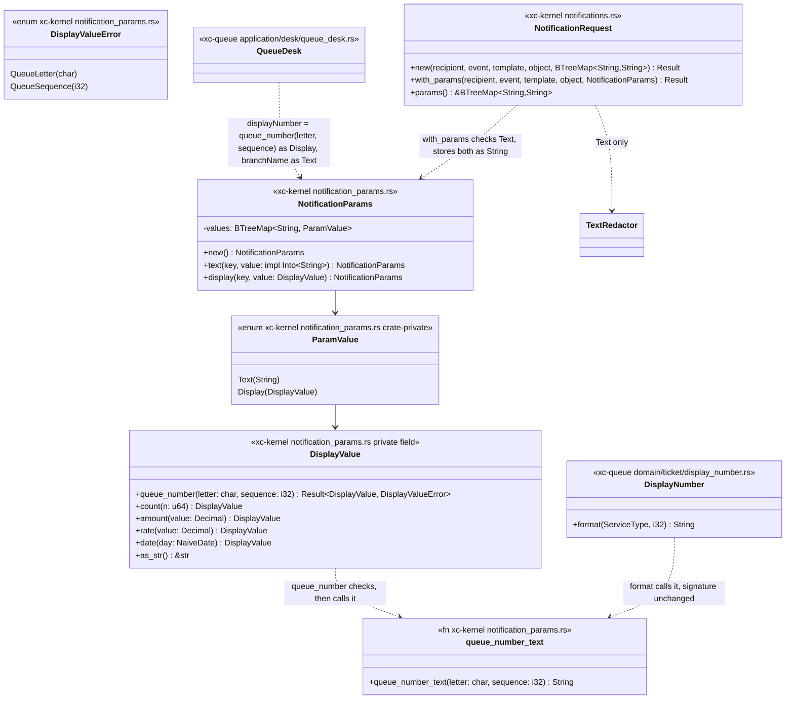

# Notification display values: server-built params skip the free-text PII check (#1629)

Design row for #1629. It amends `customer-app.md` P10 ("params hold references and display values, never PII").
Measured on `main` `8239784a` (APP-10 PR 1628 merged). Author: claude/e92db6 (xchange lane controller, 2026-10-14).

## 1. The problem

`NotificationRequest::new` (`api/crates/xc-kernel/src/notifications.rs:68-73`) runs every param value through
`pii::redact_text` and refuses the request if the text changes. `redact_text` masks any run of 4 or more digits
(`pii/text_redactor.rs:157`), because in free text such a run may be an OTP, a phone or a document number.

The check cannot tell **text a person typed** from **a value the server built from a typed field**. So a value
the server produced and knows to be safe is refused:

| Value | Built by | Today |
|---|---|---|
| `W1000` | `DisplayNumber::format` (`xc-queue/src/domain/ticket/display_number.rs:10-12`), sequence above 999 | refused: the notice is lost (APP-10's caller logs and goes on, the ruling on #1001) |
| a count `1200` | an integer | refused |
| a date `2026-10-14` | `chrono::NaiveDate` | refused (`2026` is 4 digits) |
| an amount `12500.00` | `rust_decimal::Decimal` | refused |

## 2. Decision

| # | Decision | Why |
|---|---|---|
| N1 | **A param is either `Text` or `Display`.** `Text` keeps today's full `redact_text` check. `Display` skips it. | Free text from a person keeps the check (#1629 §3). |
| N2 | **A `Display` value can only be built from a typed value**, through one constructor per kind. Its field is private. No constructor takes a `&str` or `String`. | This stops an accidental string. **It does not stop a producer that parses typed text into a number** and passes the number (`count("0812345678".parse()?)`). A producer PR that builds a `DisplayValue` from anything a person typed is a review **FAIL**. The type closes the easy path; review closes the other. |
| N3 | **The kinds at launch:** queue number, count, amount, rate, date. | The ones #1629 names. Adding a kind is one constructor in the core. |
| N4 | **The check and the kinds live in `xc-kernel` only** (♻️: safety logic in the core, never in a caller). Producers choose a kind; they never decide what is safe. | |
| N5 | **Storage does not change.** Both kinds are stored as the same string in `notifications.params` (jsonb of string → string). Templates read them as today. | No migration, no change to `xc-notify`. |
| N6 | **`NotificationRequest::new(…, BTreeMap<String, String>)` keeps its signature and behaviour**: every value is `Text`. Display values come through a new `NotificationRequest::with_params(…, NotificationParams)`. | The existing callers (`xc-alert` `evaluator.rs:245`, `xc-rate` `sharp_move_notices.rs:101`) and the APP-2 tests compile and behave exactly as before. |
| N7 | **The queue number is formatted in one place: `xc_kernel::notification_params::queue_number_text(letter: char, sequence: i32) -> String`**, a pure `format!("{letter}{sequence:03}")`. `DisplayNumber::format(ServiceType, i32) -> String` keeps its signature and its behaviour for every input (negative included) and calls it. `DisplayValue::queue_number(letter, sequence: i32)` checks first (letter `A`–`Z`, `1 ≤ sequence ≤ 99_999`), then calls the same function. | The ticket screen and the notice cannot drift apart. `ticket_issuer.rs:220`, the only production caller of `DisplayNumber::format`, is not touched. |
| N8 | **`QueueDesk` builds the notice's number from the ticket's typed fields** `ticket.service_type.letter()` and `ticket.sequence` (`queue_ticket.rs:81-82`), not from the stored string `ticket.display_number`. An `Err` from `queue_number` means no notice; the call still succeeds and a warning is logged, as today (ruling on #1001: a refused notice must not cost the call). | The stored string is text read back from the database; the typed fields are what the server issued. |
| N9 | **`queue_number` caps the sequence at 99 999.** A day's queue cannot reach that, and a longer run of digits next to a letter starts to look like a phone or an account number. | Closes the one kind whose digits a customer sees. |

A branch name (`branchName` in `queue_called`) stays `Text`: an admin types it, so it keeps the check.

## 3. Class diagram

### 3.1 Who provides, who uses

| Provider | Used by | If the provider has not landed |
|---|---|---|
| `DisplayValue`, `NotificationParams`, `NotificationRequest::with_params` (xc-kernel) | `QueueDesk` (APP-10's `queue_called`) | one ticket (NT-1, §6) ships both; no stub needed |
| `NotificationRequest::new` (unchanged) | `xc-alert` evaluator, `xc-rate` sharp-move notices | unchanged |

## 4. Behaviour

| Case | Result |
|---|---|
| `new(…, {displayNumber: "W1000"})` | refused, `PersonalData("displayNumber")` — **unchanged** (N6) |
| `with_params(…, display("displayNumber", queue_number('W', 1000)?))` | built; `params()["displayNumber"] == "W1000"` |
| `queue_number('W', 7)` | `"W007"` (same as `DisplayNumber::format(WalkIn, 7)`) |
| `queue_number('w', 1)` or `queue_number('1', 1)` | `Err(DisplayValueError::QueueLetter(_))`: only `A`–`Z` |
| `queue_number('W', 0)` · `queue_number('W', -1)` · `queue_number('W', 100_000)` | `Err(DisplayValueError::QueueSequence(_))` |
| `queue_number('W', 99_999)` | `"W99999"` |
| `DisplayNumber::format(WalkIn, 1000)` · `(Booking, 12)` · `(WalkIn, -1)` | `"W1000"` · `"B012"` · `"W-01"`: unchanged from today (`queue_ticket_machine_test.rs:109` stays green) |
| `with_params(…, text("note", "+66812345678"))` | refused, `PersonalData("note")` |
| `with_params(…, text("note", "รหัส 123456"))` | refused, `PersonalData("note")` |
| `with_params(…, text("branchName", "Siam"))` | built |
| `count(12345)` · `date(2026-10-14)` | `"12345"` · `"2026-10-14"`, built |
| `amount(dec!(12500.50))` · `rate(dec!(34.1250))` | `"12500.50"` · `"34.1250"` (the decimal's own scale, no rounding), built |
| empty recipient / event / template through `with_params` | the same `Empty(_)` errors as `new` |
| a ticket whose `sequence` is 1000 is called (APP-10) | one `queue_called` notification is written with `displayNumber = "W1000"`, where today none is |
| a ticket whose stored `display_number` was edited to another text but whose `sequence` is 7 is called | the notice says `"W007"`: it is built from the typed fields (N8) |
| `queue_number` returns `Err` while a ticket is called (a sequence above 99 999) | the call succeeds, the ticket is `CALLED`, no notification is written, one warning is logged |

## 5. Data migration

None. The `notifications.params` column, its jsonb shape and every stored row are unchanged (N5). The
existing rows were all accepted under the stricter check, so they stay valid. No backfill, no deploy order, no
`down`.

## 6. Ticket

| Ticket | What | File scope | Waits on |
|---|---|---|---|
| NT-1 (#1629) | N1–N9: the types, `queue_number_text`, `with_params`, `DisplayNumber::format` calling it, `QueueDesk` building `displayNumber` from the ticket's typed fields | `api/crates/xc-kernel/src/notification_params.rs` (new) · `api/crates/xc-kernel/src/notifications.rs` · `api/crates/xc-kernel/src/lib.rs` (one `pub mod` line) · `api/crates/xc-kernel/tests/notification_params_test.rs` (new, up-front) · `api/crates/xc-queue/src/domain/ticket/display_number.rs` · `api/crates/xc-queue/src/application/desk/queue_desk.rs` · `api/crates/xc-queue/tests/queue_called_display_value_test.rs` (new, up-front) · `api/crates/xc-queue/tests/queue_called_refused_notice_test.rs` (APP-10's provided test, rewritten by the ticket author, see below) | APP-10 #1001: merged as `8239784a` |

**Up-front tests** (rule 🧪, written by the ticket author now that APP-10 has merged): every row of §4, in the two new
test files. `api/crates/xc-kernel/tests/notification_request_test.rs` (APP-2's provided tests) is not edited.

**The one provided test this design reverses.** APP-10's
`queue_called_refused_notice_test.rs::ticket_w1000_with_customer_user_call_succeeds_is_called_and_no_notification_written`
pins today's refusal (`assert_eq!(written(&db).await, Vec::<String>::new())`). It also fakes W1000 by editing
`display_number` while `sequence` stays 1. In the same test commit, the **ticket author** (never the implementer, rule 🧪):

- replaces it with `ticket_with_sequence_1000_is_called_and_one_notification_written`. That test drives a real sequence of 1000 (`UPDATE queue_tickets SET sequence = 1000, display_number = 'W1000'`) and asserts one `queue_called` row whose `displayNumber` is `W1000`;
- adds `ticket_with_sequence_above_cap_is_called_and_no_notification_written` (sequence 100 000, N9), which keeps "a refused notice must not cost the call" pinned;
- leaves every other test in that file as it is.
