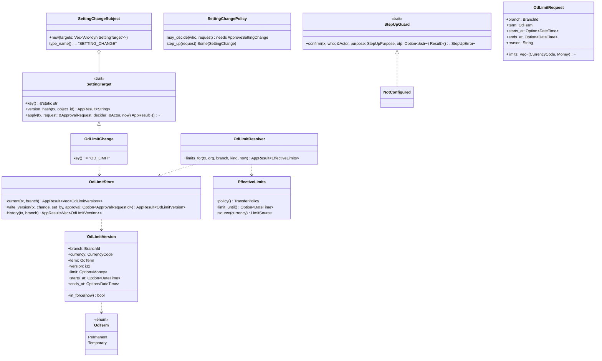

# Blueprint: a branch manager asks the Owner to raise the OD limit

Part of the user-set-settings designs ([user-set-settings](user-set-settings.md)). It adds the first **settings-change approval kind**, which later settings reuse.

**Owner's order** (relayed by the lane controller claude/608dff, 2026-11-03 about 06:00 ICT):
- *"มันเป็นการเบิก เงิน Over จากปกติ"* (an OD is a draw of money over the normal amount): a mid-shift `SAFE_TO_DRAWER` transfer;
- *"แล้ว ผจก ก็ต้องขอ ขยาย วงเงิน ชั่วคราวหรือถาวรได้"* (and the manager must be able to ask for the limit to be extended, temporarily or permanently);
- *"โดย เจ้าของอนุมัติ"* (with the Owner approving).

Asked which limit, the owner picked **the per-draw OD limit**. Today that is the organisation-wide cash transfer limit.

## 1. What happens today (measured on `origin/main` `ec9ddac9`, 2026-11-03 11:59 ICT)

**An OD is a `SAFE_TO_DRAWER` transfer.** The opening float is not one: it is the `OPENING` posting of a verified OPEN count (`count_service.rs:1194`). Only `SAFE_TO_DRAWER` may carry `to_shift` (`kinds/safe.rs:51-56`).

**The limit decides who approves the draw. It never stops the draw.**

1. `transferSubmit` → `TransferFlow::submit_in` (`xc-cash/src/application/transfer/transfer_flow.rs:536`).
2. It reads the organisation's latest policy: `find_latest_policy(tx, org)` (`transfer_flow.rs:565-568`), which runs `SELECT version, limits FROM cash_transfer_policy_versions WHERE organization_id = $1 ORDER BY created_at DESC LIMIT 1` (`xc-cash/src/infrastructure/transfer_repository.rs:413-445`).
3. `TransferPolicy::is_within_limit(&t.lines)` (`xc-cash/src/domain/transfer/transfer_policy.rs:112-146`): for each currency moved, Σ `qty_sent` × `face_value` ≤ that currency's limit. A currency with no limit is above it (`:141`). No policy row is above it too (`transfer_flow.rs:574` `unwrap_or(false)`).
4. The result is **frozen** into the request payload `{"transfer_id", "from_branch", "within_limit"}` (`transfer_flow.rs:576-580`). A `CASH_TRANSFER` approval request is raised and the transfer stays `DRAFT` with `approval_request_id` set (`:585-604`).
5. `TransferApprovalPolicy::may_decide` (`xc-cash/src/application/approval/transfer.rs:130-169`) reads the frozen flag:
   - within the limit: `ApproveCashTransferWithinLimit` on the source branch (BRANCH_MANAGER);
   - above it: `ApproveCashTransferAboveLimit` (EXECUTIVE, the Owner), else refusal `ABOVE_LIMIT`.
6. The limit applies the same way to **every** transfer kind (`BRANCH`, `DRAWER_TO_SAFE`, `SAFE_TO_DRAWER`, `EXTERNAL_IN`, `EXTERNAL_OUT`); `submit_in` does not look at the kind.

So "within the limit" means "the branch manager may approve this draw without the Owner". Raising a branch's OD limit lets that branch's manager approve larger draws; above it, the Owner still decides each one.

**xc-v3 (read-only, 2026-11-03 11:59 ICT):**

| What | Count |
|---|---|
| `cash_transfer_policy_versions` | 1 row: `{"THB": "20000.00"}`, saved 2026-11-02 21:51 ICT |
| branches | 2 |
| `cash_transfers` | 4 `SAFE_TO_DRAWER` and 2 `EXTERNAL_IN`, all `RECEIVED` |
| `CASH_TRANSFER` approval requests | 6, all `APPROVED` (5 above the limit, 1 within); none `PENDING` |

## 2. The design

### 2.1 What the limit becomes

For a `SAFE_TO_DRAWER` transfer from branch B, the limit for currency C is the first of these that applies **at the moment it is read**:

1. B's **temporary extension** for C, if one is in force: `starts_at ≤ now < ends_at`;
2. otherwise B's **permanent override** for C, if one is set;
3. otherwise the **organisation base**: `cash_transfer_policy_versions`, as today;
4. otherwise **not set**: the draw is above the limit, so the Owner decides it (today's rule, `transfer_policy.rs:141`).

- **Expiry needs no job.** The rule is evaluated whenever the limit is read. Once `now ≥ ends_at`, step 1 no longer matches and the limit falls to step 2 or 3 on the next read.
- **A temporary extension falls back to what was in force before it,** the permanent override if B has one, otherwise the base. With no permanent override, that is the base, as the order says.
- **Other transfer kinds keep the base.** An OD extension changes only `SAFE_TO_DRAWER`. See owner decision D-1.
- **Other branches are unaffected.**

### 2.2 Where the check reads it

- `TransferFlow::submit_in` stops calling `find_latest_policy` directly. It calls `OdLimitResolver::limits_for(tx, org, from_branch, kind, now)`, which returns an `EffectiveLimits`.
- For a `SAFE_TO_DRAWER` transfer, `EffectiveLimits` is the base overlaid by B's override and extension per currency. For every other kind, it is the base unchanged.
- `TransferPolicy::is_within_limit` is unchanged. It runs on `EffectiveLimits::policy()`.
- **The payload gains `limit_until`.** It is the earliest `ends_at` among the temporary extensions the check used, or `null`. `within_limit` stays as it is.
- **A draw decided after its extension ended goes to the Owner.** `TransferApprovalPolicy::may_decide` treats `within_limit = true` with `limit_until ≤ now` as above the limit. A branch manager cannot approve on an extension that has already expired.
- **Old requests have no `limit_until`.** It reads as `null`, so their outcome is unchanged.
- **A draw submitted before an extension is approved stays above the limit.** The flag is frozen at submit, as today. The manager can withdraw the draw and submit it again.

### 2.3 Requesting an extension

New command `odLimitRequest`, `POST /api/od-limits/requests`:
- **Who:** a holder of the new permission `Permission::OdLimitRequest` on branch B. The seed gives it to BRANCH_MANAGER only.
- **Input:**
  - `branchId`;
  - `term`: `PERMANENT` or `TEMPORARY`;
  - `limits`: one or more `{currency, amount}`;
  - `startsAt`: optional; when missing, the extension starts at approval;
  - `endsAt`: required for `TEMPORARY`, refused for `PERMANENT`;
  - `reason`: 1 to 500 characters.
- **Effect:** it raises one approval request of the new kind `SETTING_CHANGE` with `setting = "OD_LIMIT"` and `object_id = "OD_LIMIT:<branch>"`. Nothing else changes, and the limit in force stays as it is.
- **The payload carries the old and the new value** for each currency: the limit in force now, with its source (`TEMPORARY` / `PERMANENT` / `BASE` / `NOT_SET`), and the amount asked for.

**Refusals (400 `validationFailed` unless stated):**
- an unknown currency, or more decimals than the currency's `minor_unit` (the same checks as `transferPolicySave`, `api/src/presentation/http/v3/commands/cash.rs:530-563`);
- an amount at or below the limit in force: `notAnExtension`. Lowering a limit is the Owner's own save (§2.5);
- `TEMPORARY` with no `endsAt`, with `endsAt ≤ startsAt`, or with `endsAt ≤ now`; `PERMANENT` with an `endsAt`;
- a branch the caller does not hold the permission on: 403 `outOfScope`;
- a request already pending for B: 409. `one_pending_per_object` (`20261010110000_approvals.sql:15`) enforces it.

### 2.4 The Owner decides

The Owner decides through the existing `approvalDecide` (`api/src/presentation/http/v3/commands/approval_decide.rs`) and the existing approvals screen. There is no second approval flow.

- **Who may decide:** `SettingChangePolicy::may_decide` needs the new `Permission::ApproveSettingChange`. The seed gives it to EXECUTIVE only.
- **The requester never decides their own request.** The core already refuses that before asking the policy (`xc-approval/src/domain/policy.rs`, `may_decide` doc).
- **Approving needs the Owner's OTP** (user-set-settings rule 2):
  - `approvalDecide` gains an optional `otp` field.
  - `ApprovalPolicy` gains `fn step_up(&self, request) -> Option<StepUpPurpose>`. The default is `None`, so every existing kind is unchanged. `SettingChangePolicy` returns `Some(SettingChange)` for `APPROVED`.
  - The decide command calls `StepUpGuard::confirm(tx, who, purpose, otp)` before `ApprovalService::decide`.
  - **The OTP design owns `StepUpGuard`'s implementation.** Until it lands, the only implementation is `StepUpGuard::NotConfigured`, which refuses with 503 `stepUpUnavailable`. That is the safe "not set": no setting changes without an OTP.
  - A missing or wrong code is refused (403 `stepUpRequired` / `stepUpFailed`), and nothing changes.
- **Approve:** in the same transaction, `OdLimitChange::apply` writes one new version per currency through `OdLimitStore::write_version` (§2.6) and an `audit_events` row with the before and after values.
- **Reject:** nothing changes. The reason (at least 1 character, `approval_decide.rs:79`) stays in `approval_decisions.reason`.
- **Stale:** the request's `object_version_hash` is a hash of B's current override versions. If the Owner saved B's limit directly in the meantime, deciding returns 409 `staleVersion`, and the manager files again.

### 2.5 The Owner's own save

New command `odLimitSave`, `PUT /api/od-limits/{branchId}`:
- **Who:** the new `Permission::OdLimitSave`, seeded to EXECUTIVE only, and confirmed by OTP through the same `StepUpGuard`.
- **What it does:** sets, ends or clears B's override for a currency.
  - Ending a temporary extension early writes a version with `ends_at = now`.
  - Clearing a permanent override writes a version with `limit_amount = NULL`, which means "use the base".
- **It is the same writer** as an approval (`OdLimitStore::write_version`). The only difference is that `approval_request_id` is NULL.

### 2.6 Storage and versions

There is one new table, `branch_od_limit_versions` (§6). It uses the version pattern that every settings table should use from now on (the PR 6019 review's follow-up 2):
- an integer `version` per key;
- `superseded_at IS NULL` marks the current row, and a partial unique index allows only one current row per key;
- the writer locks the current row `FOR UPDATE`, closes it, and inserts version + 1;
- "current" therefore has no tie, and two saves at once are serialised.

The key is `(branch_id, currency_code, term)`. A branch can hold one current permanent row and one current temporary row per currency. Old and new values are both kept, and the view reads the history back.

### 2.7 What the screens show

New view `od_limits` (`SettingsRead`) returns, per branch and currency:
- the base;
- the permanent override, or "not set";
- the temporary extension with its `startsAt` and `endsAt`, and whether it is in force, not started yet, or ended;
- the limit in force now, with its source;
- the pending request, if there is one;
- the version history.

The front end is claude/01TxaRJG's:
- a request form on the branch manager's cash screen;
- the request on the Owner's approvals screen, with the old and new values and the OTP;
- the per-branch overrides with their expiry on `admin/cash-policy`.

## 3. Class diagram



**One core, one target per setting (♻️).** `SettingChangeSubject` / `SettingChangePolicy` are the settings-change kind. `OD_LIMIT` is its first `SettingTarget`. The next delegated setting, for example finance asking for a count-difference limit, adds one file with one `SettingTarget`, with no new approval kind.

| Class | File | Who provides | Who uses |
|---|---|---|---|
| `SettingTarget`, `SettingChangeSubject`, `SettingChangePolicy` | `api/crates/xc-approval/src/application/setting_change.rs` (new) | OD-2 | OD-4, `api/src/bootstrap/approval_subjects/setting_change.rs` (new) |
| `ApprovalPolicy::step_up` (default `None`), `StepUpPurpose` | `api/crates/xc-approval/src/domain/policy.rs` | OD-2 | `approval_decide.rs` |
| `StepUpGuard`, `StepUpError`, `NotConfigured` | `api/crates/xc-auth/src/domain/step_up.rs` (new) | OD-2 (seam); the OTP design adds the real guard | `approval_decide.rs`, `od_limit_save.rs` |
| `OdTerm`, `OdLimitVersion`, `EffectiveLimits`, `LimitSource` | `api/crates/xc-cash/src/domain/transfer/od_limit.rs` (new) | OD-1 | OD-3, OD-4 |
| `OdLimitStore` | `api/crates/xc-cash/src/infrastructure/od_limit_store.rs` (new) | OD-1 | OD-3, OD-4, the view |
| `OdLimitResolver` | `api/crates/xc-cash/src/application/transfer/od_limit_resolver.rs` (new) | OD-3 | `transfer_flow.rs` |
| `TransferApprovalPolicy` (`limit_until`) | `api/crates/xc-cash/src/application/approval/transfer.rs` | OD-3 | — |
| `OdLimitChange` | `api/crates/xc-cash/src/application/approval/od_limit_change.rs` (new) | OD-4 | `SettingChangeSubject` |
| `odLimitRequest`, `odLimitSave` | `api/src/presentation/http/v3/commands/od_limits.rs` (new) | OD-5 | FE |
| view `od_limits` | `api/src/presentation/http/v3/views/od_limits.rs` (new) | OD-5 | FE |
| `Permission::{OdLimitRequest, OdLimitSave, ApproveSettingChange}` | `api/crates/xc-auth/src/domain/access/permission.rs`, `role_grants.rs`, `permission_module.rs` | OD-1 | all |

**Stub rule:** a ticket whose provider has not merged declares the signature above in its own file, with a comment saying it will move, and never edits the provider's file.

## 4. Behaviour

The base is THB 20,000 in every row unless the row says otherwise. B is the branch, B′ is another branch, and T is the time of the check.

| # | Case | Result |
|---|---|---|
| O-1 | No override; `SAFE_TO_DRAWER` THB 25,000 from B | `within_limit = false`, `limit_until = null` (unchanged) |
| O-2 | Permanent override THB 30,000 on B; draw of 25,000 | `within_limit = true`, `limit_until = null`; B's branch manager may approve |
| O-3 | Temporary THB 50,000 on B, `starts_at ≤ T < ends_at`; draw of 45,000 | `within_limit = true`, `limit_until = ends_at` |
| O-4 | The same extension, T ≥ `ends_at` | Falls back to the permanent override, else the base; 45,000 is above. No job ran |
| O-5 | Temporary not started (T < `starts_at`) | The permanent override or the base |
| O-6 | Temporary 50,000 over permanent 30,000, after `ends_at` | 30,000 |
| O-7 | Override on B; a `BRANCH` (or `DRAWER_TO_SAFE`, `EXTERNAL_*`) transfer of 25,000 from B | The base: `within_limit = false` |
| O-8 | Override on B; a draw of 25,000 from B′ | The base: `within_limit = false` |
| O-9 | Draw submitted with `limit_until` = U; B's branch manager approves at T ≥ U | Refused `ABOVE_LIMIT`; the Owner may approve |
| O-10 | A `CASH_TRANSFER` request from before this change (no `limit_until`) | Decided exactly as today |
| O-11 | No base for USD, no override; USD draw | Above the limit (unchanged) |
| O-12 | Permanent USD override 5,000 approved, no USD base; USD draw of 4,000 | `within_limit = true` |
| O-13 | B's branch manager files `odLimitRequest` | One `PENDING` `SETTING_CHANGE` request; the payload has the old value with its source and the new value; the limit in force is unchanged |
| O-14 | A second request for B while one is pending | 409; nothing written |
| O-15 | A branch manager of B′, a teller, or FINANCE files for B | 403 `outOfScope` / refused; nothing written |
| O-16 | Amount ≤ the limit in force | 400 `notAnExtension` |
| O-17 | `TEMPORARY` without `endsAt`, or `endsAt ≤ startsAt`, or `endsAt ≤ now`; `PERMANENT` with `endsAt` | 400 on that field |
| O-18 | Too many decimals, or an unknown currency | 400, as `transferPolicySave` |
| O-19 | The requester decides their own request | Refused by the core |
| O-20 | A branch manager or FINANCE decides | Refused: needs `ApproveSettingChange` |
| O-21 | The Owner approves with no OTP guard installed (`NotConfigured`) | 503 `stepUpUnavailable`; nothing written |
| O-22 | The Owner approves with a missing or wrong OTP | 403 `stepUpRequired` / `stepUpFailed`; nothing written |
| O-23 | The Owner approves with a valid OTP | One new version per currency, previous one `superseded_at` set, `approval_request_id` set, one `audit_events` row with before and after |
| O-24 | The Owner rejects with a reason | No version written; `approval_decisions.reason` holds it |
| O-25 | The Owner saved B's limit directly while a request was pending, then decides it | 409 `staleVersion` |
| O-26 | Two writes to the same (B, C, term) at once | Serialised; versions n+1 and n+2, exactly one current row |
| O-27 | The Owner ends a temporary early (`odLimitSave`) | New version with `ends_at = now`; the next read uses the fallback |
| O-28 | The Owner clears a permanent override | New version with `limit_amount = NULL`; the base applies |
| O-29 | `od_limits` view | Shows the base, permanent, temporary with `endsAt` and state, the limit in force with its source, the pending request, the history; "not set" where nothing is set |
| O-30 | Every existing kind's `step_up` | `None`; `approvalDecide` behaves as today without `otp` |

**Tests that pin today's behaviour and must be read when the tickets are cut:**
- `xc-cash/tests/ap4_transfer_policy_kinds_test.rs` and `or71_transfer_policy_test.rs` pin `may_decide`. O-10 keeps them green. They gain `limit_until` cases in a new file and are not edited.
- `api/tests/v3_cash_transfer_policy_test.rs` and `xc-cash/tests/transfer_flow_test.rs` pin the base read. For non-`SAFE_TO_DRAWER` kinds they stay green, and the `SAFE_TO_DRAWER` cases stay green with no override.
- `APPROVAL_KINDS` grows from 10 to 11 (`permission_module.rs:78`). Any test that counts it must be swept by running the crates (`xc-auth`, `xc-cash`, `api`), not by grep.

## 5. Tickets (cut only after the controller brings §6 to the owner and the owner approves)

| Ticket | Class | What | Depends on |
|---|---|---|---|
| OD-1 | guarded | Migration (§6), `od_limit.rs` domain, `OdLimitStore`, the three permissions and the next seed version | — |
| OD-2 | logic | `setting_change.rs` core, `ApprovalPolicy::step_up`, `StepUpGuard` + `NotConfigured`, `approvalDecide`'s `otp` field and step-up call | — |
| OD-3 | logic | `OdLimitResolver`, `submit_in` reads it, `limit_until` in the payload and in `TransferApprovalPolicy` | OD-1's signatures |
| OD-4 | logic | `OdLimitChange` and its registration in `api/src/bootstrap/approval_subjects/setting_change.rs` (new) plus one `mod.rs` line | OD-1, OD-2 |
| OD-5 | logic | `odLimitRequest`, `odLimitSave`, view `od_limits`, generated TS and fixtures | OD-1..OD-4 |
| FE | (claude/01TxaRJG) | Request form, approvals row with OTP, overrides with expiry on `admin/cash-policy` | OD-5 merged |

OD-1 and OD-2 run in parallel. OD-3 and OD-4 are released after the signatures they consume have merged (the PR 6019 review's follow-up 4). OD-5's File scope lists `web/src/shared/testing/fixtures/index.ts` and the web tests that build the new DTOs.

**Seed version:** OD-1 takes the next free `RoleGrants::SEED_VERSION`. Group A's GA-1 also needs one, so whichever merges second takes the next number.

## 6. Data migration

New migration `api/migrations/<slot>_od_limit_versions.sql`, numbered with `scripts/migration-slot.sh next` right before `pr_open`.

```sql
CREATE TABLE branch_od_limit_versions (
    id                  uuid        PRIMARY KEY,
    organization_id     uuid        NOT NULL REFERENCES organizations (id),
    branch_id           text        NOT NULL REFERENCES branches (id),
    currency_code       text        NOT NULL REFERENCES currencies (code),
    term                text        NOT NULL CHECK (term IN ('PERMANENT', 'TEMPORARY')),
    version             integer     NOT NULL CHECK (version >= 1),
    limit_amount        numeric     NULL CHECK (limit_amount >= 0),
    starts_at           timestamptz NULL,
    ends_at             timestamptz NULL,
    approval_request_id uuid        NULL REFERENCES approval_requests (id),
    reason              text        NOT NULL,
    set_by              uuid        NOT NULL REFERENCES users (id),
    created_at          timestamptz NOT NULL DEFAULT now(),
    superseded_at       timestamptz NULL,
    UNIQUE (branch_id, currency_code, term, version),
    CHECK ((term = 'TEMPORARY') = (ends_at IS NOT NULL)),
    CHECK (starts_at IS NULL OR ends_at IS NULL OR starts_at < ends_at)
);
CREATE UNIQUE INDEX branch_od_limit_current
    ON branch_od_limit_versions (branch_id, currency_code, term) WHERE superseded_at IS NULL;
```

- `limit_amount` NULL means the override was cleared; the base applies.
- The amount's scale is checked by the writer against `currencies.minor_unit`, as `transferPolicySave` does. The table holds no business number.

**1. What existing rows look like afterwards.**
- The table starts empty. Every branch reads the base exactly as today, so no draw's outcome changes.
- `approval_requests` gets no schema change. `type` is free text with no CHECK (`20261010110000_approvals.sql:3`), so `SETTING_CHANGE` needs no constraint change.
- The 6 `CASH_TRANSFER` requests on xc-v3 have no `limit_until` and read as `null` (O-10). None is pending.
- `cash_transfer_policy_versions` is unchanged.

**2. Backfill.** None. The table starts empty because no extension has ever been granted, and the base stays where it is. Nothing is seeded: an OD limit is a business value, saved only from the screen.

**Role grants.** The next seed version adds `OdLimitRequest` to BRANCH_MANAGER, and `OdLimitSave` and `ApproveSettingChange` to EXECUTIVE. This uses the existing startup mechanism (`SEED_ADDITIONS`, `xc-auth/src/domain/access/role_grant_store.rs:56-59`), not SQL in the migration. It inserts grant rows for the built-in groups on the first start of the new binary. That is a data change, listed here for the owner. Custom groups get nothing until the Owner grants it on the roles screen.

**3. Deploy order.**
- The migration runs before the new binary. The old binary works with the new schema: it never reads the new table, and its `CASH_TRANSFER` payloads are what O-10 reads.
- The new binary needs the table. It reads it on every `SAFE_TO_DRAWER` submit, so it must not run before the migration.
- **No step-up implementation exists yet.** Until the OTP design lands, a branch manager can file a request, but the Owner cannot approve it (O-21). This is by design (rule 2: no setting changes without an OTP). If the owner wants extensions working before the OTP design, that is decision D-3.
- The FE half ships in the same deploy as OD-5. Without it, nobody can file or see a request.

**4. What `down` loses.**
- `DROP TABLE branch_od_limit_versions` loses every override, every extension and their history.
- `SETTING_CHANGE` approval requests and decisions stay in `approval_requests`, but nothing reads them any more.
- After `down`, every branch is back on the base.
- The seed-version grant rows stay until removed through `SEED_REMOVALS`.

## 7. Owner decisions (through the lane controller)

| # | Question | Options | We propose |
|---|---|---|---|
| D-1 | Which transfers does an OD extension raise? | A. `SAFE_TO_DRAWER` only. B. Every transfer kind leaving branch B | **A.** The owner named the OD draw. B would also let the branch manager approve larger branch-to-branch and external moves on an OD request. Reversible: one match arm in `OdLimitResolver` |
| D-2 | When a temporary extension ends, does the limit return to the permanent override or to the base? | A. The permanent override if B has one, else the base. B. Always the base | **A.** A permanent override is what the Owner approved as B's normal limit, so it should outlast a temporary one. With no permanent override, A and B are the same |
| D-3 | Approve extensions before the OTP design lands? | A. No; requests wait (O-21). B. Allow EXECUTIVE approval without an OTP until then | **A.** Rule 2 says a save without an OTP changes nothing. B would be a business value changed without the step-up the owner ordered |

**If there is no answer:** the tickets are cut as written with A, A and A.
