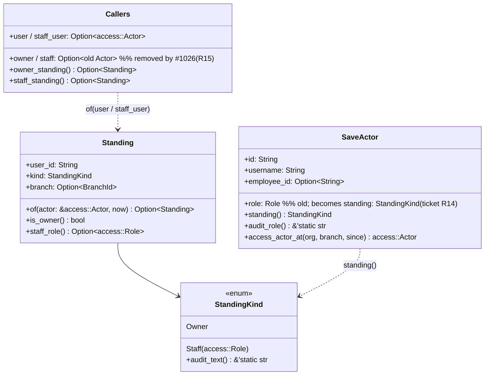

# OR-7: the last readers of the old identity types move onto `Standing`

Child design of `org-roles-branches.md` §10 row OR-7 (parent #947). Branch: `feat/or7`. Sub-controller: claude/011658c1
("AG controller OR-7"), under the BE controller claude/c81c8986 (option A, #564).

## 1. What is left

Measured on `main` `967a0e56` (2026-10-18). Command:
`git grep -l -E 'policy::value_objects::(actor|role|actor_kind)|legacy_actor\(' -- api ':!api/crates/xc-auth' ':!*/tests/*' ':!api/tests/*'`.
It lists 23 files.

- **No authorization decision** reads the old types. `Policy::authorize` takes `access::Actor`.
- **What is left is four uses:**
  - the audit `actor_role` text;
  - the `KioskRole` / `CustodyRole` mappings;
  - owner-vs-staff checks on `Callers.owner` / `Callers.staff`;
  - the branch from `branch_id()`.
- **The rule that turns an `access::Actor` into "owner, or staff with a role at a branch" exists twice:** `legacy_actor`
  (`presentation/extractors/actor.rs:141`) and `SaveActor::from_actor_at` (`application/workflows/save_step.rs:41`).

## 2. The core

One file, `api/crates/xc-auth/src/domain/access/standing.rs`, holds the rule once. Every reader takes it from there.

| Type / function | File | Provided by | Used by |
|---|---|---|---|
| `Standing`, `StandingKind`, `Standing::of`, `StandingKind::audit_text` | `xc-auth/src/domain/access/standing.rs` | S0 | every reader below |
| `SaveActor::{standing, audit_role, access_actor_at}` | `application/workflows/save_step.rs` | skeleton | R4–R8 |
| `Callers::{owner_standing, staff_standing}` | `presentation/pages.rs` | skeleton | R9–R12 |

**The rule** (each outcome stays what the old path gave the mapped Blueprint role, the OR-7 rule):
- **The owner:** org-wide EXECUTIVE **and** org-wide ADMIN, both valid at `now`.
- **Staff:** otherwise, the first valid role in the order TELLER > BRANCH_MANAGER > RATE_MANAGER > FINANCE > ADMIN >
  VERIFICATION_REVIEWER, at that role's branch, else `MAIN`.
- **No standing:** anything else (EXECUTIVE alone, MARKETING, CUSTOMER, nothing valid). Today's readers treat that as "not
  signed in" or `roleNotAllowedHere`, and keep doing so.
- **Audit text keeps v3's spelling.** OWNER, FRONT, MANAGER, RATES, FINANCE, SYSTEM and DOCUMENT_REVIEW are pinned by
  `or7_5_save_actor_test.rs:458` and ruling 5 on #1020.
- **Front-only pages stay "staff role TELLER".** They do not become `ExchangeTransact`, which would let BRANCH_MANAGER in.

**One known difference, password sessions only.** A password employee whose stored role is BACKEND or MONITOR/DOCUMENTS
now reads as MANAGER or DOCUMENT_REVIEW (design §3.3 maps them that way). Blueprint sessions never had those roles, and
#1027 deletes password login.

## 3. Tickets

All are cut against `feat/or7`. File scopes are disjoint within a wave.

| Id | File scope | What moves | Model | After |
|---|---|---|---|---|
| S0 | `xc-auth/src/domain/access/standing.rs` | the `todo!()` bodies (provided tests in the file) | Argon | — |
| R1 | `presentation/http/v3/commands/exchange_settings.rs` | no `legacy_actor`; audit from `Standing` | Flash | — |
| R2 | `v3/commands/denomination_groups.rs`, `xc-rate/.../denomination_group_service.rs` | service takes `&access::Actor`; owner check on `Standing` | Argon | — |
| R3 | `infrastructure/devices/device_service.rs`, `presentation/http/devices.rs` | drop the unused `_actor: &Actor` | Flash | — |
| R4 | `application/workflows/exchange/confirm.rs` | `access_actor_at`, `audit_role` | Flash | — |
| R5 | `application/workflows/exchange/reversal_request.rs` | `access_actor_at` | Flash | — |
| R6 | `exchange/{cancel,create,complete}.rs` | `audit_role()` | Flash | — |
| R7 | `application/workflows/kiosk_save_step.rs` | `kiosk_role(StandingKind)` | Flash | — |
| R8 | `application/custody_role.rs`, `application/workflows/custody_save_step.rs` | `custody_role_of(StandingKind)` | Flash | — |
| R9 | `presentation/pages.rs` (readers), `presentation/screens.rs` | `owner_standing` / `staff_standing` | Argon | — |
| R10 | `presentation/http/kiosk.rs` | the same | Argon | — |
| R11 | `presentation/http/bookings.rs` | the same; `execute_action` takes the actor id | Flash | — |
| R12 | `http/employees.rs`, `http/files.rs`, `http/payment_methods.rs`, `http/device_setup.rs` | the same | Flash | — |
| R14 | `save_step.rs`, `save_transaction.rs`, `kiosk_ports.rs`, `compat/actions/save.rs`, and the tests that build `SaveActor` | `SaveActor.role` → `standing: StandingKind`; `from_actor_at` uses `Standing::of` | Flash | R4–R8, S0 |
| R13 | `compat/rpc.rs`, `compat/staff_view.rs`, `compat/actions/save.rs`, `presentation/http/rpc.rs` | `RpcCaller.standing: Standing`, `StaffMember.role: access::Role` | Argon | R14 |
| R15 = #1026 | `presentation/extractors/actor.rs`, `Callers` fields, `SaveActor::from_actor_at` copy | delete `legacy_actor`, `Callers.owner/staff` | Argon | all |

**Left for #1027:** the password-cookie path (`staff_actor`, `actor_of`, `old_cookie_callers`, `actor_from_v3`), which reads
`employees`. Also `employee_custody_role` and `compat/rpc.rs` `colleagues`, which parse the stored `employees.role`. And
the old types themselves, `policy.rs:1-400`, and `v3_roles.rs`. #1027 starts after `feat/rbac` is on `main`
(`domain/account/` overlap), and its migration 3 waits for the owner through claude/c81c8986.

## 4. Tests

- **S0** has provided tests in `standing.rs` (`mod tests`). They fail at `todo!()` on the skeleton.
- **The R tickets change no outcome.** Each ticket names the existing tests that pin its outcomes. They must stay green
  unedited, except where a test builds the type that changes (R14's `SaveActor` literals, mechanical).
- **The reviewer** reverts the reader change and checks that a named test goes red, or else it adds one.
- **The full api suite** runs on `feat/or7` on the Mac Studio as soon as S0 and the first readers merge.
