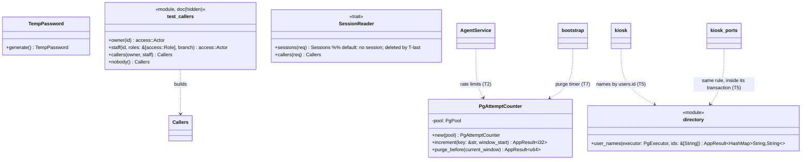

# OR-7.m: v3's password login and the old identity types go

Child design of `org-roles-branches.md` §10 row OR-7 and §9 migration 3 (ticket #1027, parent #947), after
`or7-standing.md`. Branch: `feat/or7m`. Sub-controller: claude/ba2128ed ("AG controller OR-7.m"), under the BE
controller claude/a90ab16c.

## 1. What is left

Measured on `main` `5cdac176` (2026-10-19):

- **Old types still imported outside tests:** `access/v3_roles.rs`, `policy/entities/policy.rs`,
  `presentation/extractors/actor.rs`.
- **Password-cookie path:** `pages.rs` (`Sessions`, `SessionReader::sessions`, `old_cookie_callers`), `extractors/actor.rs`
  (`password_session`, `staff_password_session`, `actor_of`, `staff_actor`, `AccountSessionReader::sessions`) and its
  callers `http/{auth,employees,kiosk,rpc}.rs`.
- **Readers of the dropped tables:** `custody_ports.rs` (`employees.role`), `kiosk_ports.rs` and `http/kiosk.rs`
  (`employees.username`, `owners.username`), `compat/rpc.rs` and `compat/snapshot_sources.rs` (`employees`),
  `xc-shift` `shift_repository.rs` (`resolve_teller` forms 2–4), `xc-cash` `handover_service.rs` (`legacy_employee_id`),
  `User.legacy_employee_id` (`xc-auth` user, session and user services), the purge timer in `bootstrap/mod.rs`.
- **Missed by earlier lists:** the device agent's rate limits write `auth_attempts` through `PgAccountRepository`
  (`infrastructure/device_agents/agent_service.rs:117,134`); `userCreate` uses `domain/account/temp_password.rs`; the
  desk script `api/static/xc-desk.js:262` and `deploy/server/smoke.sh:96` call `POST /api/auth`.
- **Tests:** 262 test files use the old types, the dropped tables or a `SessionReader::sessions` override.

## 2. The seams (skeleton commit on `feat/or7m`)

| Type / function | File | Provided by | Used by |
|---|---|---|---|
| `PgAttemptCounter` | `api/crates/xc-auth/src/infrastructure/attempts.rs` | skeleton (`todo!()`), bodies T2 | T2 (agent), T7 (purge) |
| `directory::user_names` | `api/crates/xc-auth/src/application/user/directory.rs` | skeleton (`todo!()`), body T1 | T5 |
| `TempPassword` | `api/crates/xc-auth/src/domain/user/temp_password.rs` (re-exported from `domain::account`) | skeleton (move) | `userCreate` |
| `test_callers::{owner, staff, callers, nobody}` | `api/src/presentation/test_callers.rs` | skeleton (bodies) | the test sweep |
| `SessionReader::sessions` default | `api/src/presentation/pages.rs` | skeleton | the test sweep, then deleted |

**Provided tests:** `api/crates/xc-auth/tests/or7m_seams_test.rs` (T1, T2) fail at `todo!()` on the skeleton.
`test_callers.rs` `mod tests` pins `callers(..)` to what `old_cookie_callers` built for every v2 role.

## 3. Rulings (sub-controller, 2026-10-19)

1. **`auth_attempts` stays.** It is the device agent's rate-limit table, written through `PgAttemptCounter`. Migration 3
   drops the other five tables and the column, which is narrower than design §9 (it drops less).
2. **A name comes from `users.name` by `users.id`.** Where nobody has the id (an old employee id, `"owner"`), the id itself
   is shown, as `username_or_id` does today. v3 holds test data only, so old rows printing raw ids is accepted.
3. **`create_owner`'s `u.legacy_employee_id IS NULL` filter goes.** No v2 employee maps to EXECUTIVE (`v3_roles.rs:13`: only
   OWNER does), so no migrated employee can count as a second owner.
4. **Logout stops clearing `__Host-xc_owner` / `__Host-xc_staff`** when the password routes go; they lapse within
   `SESSION_SECONDS` (12 h).
5. **The purge timer purges attempt windows only.** It never purged `user_sessions`; that gap is not this ticket's.
6. **The desk script reads `POST /api/auth/session`** and shows `user.name`; `smoke.sh` checks that route's 200.
7. **`resolve_teller` keeps form 1 only** (#1027 §5, unchanged): `"owner"` and usernames stop resolving (`TellerUnknown`).

## 4. Tickets

All are cut against `feat/or7m`, PRs into `feat/or7m`. File scopes are disjoint within a wave.

| Id | Area | Model | After |
|---|---|---|---|
| T1 | `directory::user_names` body | Flash | skeleton |
| T2 | `PgAttemptCounter` bodies; `AgentService` and `device_agent.rs` use it | Flash | skeleton |
| T3 | `User.legacy_employee_id` out of `xc-auth` and its callers | Flash | skeleton |
| T4 | custody: `employee_role` port and `custody_role.rs` go | Flash | skeleton |
| T5 | kiosk: names by `users.id`, no password `who` | Argon | skeleton (T1 for its tests to pass) |
| T6 | the old employees screen, its routes, view, DTO, workflows and tests go | Flash | skeleton |
| T7 | purge timer on `PgAttemptCounter`; `create-owner --username` goes | Flash | skeleton |
| T8 | desk script and `smoke.sh` on `/api/auth/session` | Flash | skeleton |
| T9 | `resolve_teller` forms 2–4; `holds_cash_in` | Flash | `feat/lg6` on `main` |
| T10 | compat RPC and snapshot people from `users` + `user_roles` | Argon | `feat/lg6` on `main`; its own seam commit |
| S1–Sn | test sweep: `Sessions {..}` → `test_callers`, dropped-table seeds → `users` | Flash | T1–T10; #3262–#3267 merged |
| T-last | password login, the old types, `policy.rs` old half, `v3_roles.rs`, `domain/account` go | Argon | all above |
| M3 | migration 3 | Argon, guarded | T-last; owner confirms OR-3 is live |

### 4.1 T-last, split (sub-controller, 2026-10-20, after `feat/rbac-groups` reached main)

Measured on `or7m-sd` + `main` `5c798023` (merge `13919f61`): 130 files still use the old types. About 19 are
production, about 98 are tests (`git grep` of `Sessions`, `fn sessions`, `old_cookie_callers`,
`password_session`, `policy::value_objects::{actor,role}`, `v3_roles`, `Policy::allow` and the account module).

**Rulings for every T-last test ticket:**
1. A test names a v2 staff role only as a string, and reads its Blueprint roles from
   `test_callers::V2_STAFF` / `v2_staff_roles(name)` (skeleton `9daf4c08`). There are no private copies of the
   table, no v2 `Role` / `Actor`, and no `v3_roles`.
2. A session reader overrides `callers` with `test_callers`. No `Sessions`, `fn sessions` or `old_cookie_callers`.
3. A test that asked `Policy::allow` for **v2's verdict on a recorded step** reads it from the recording itself:
   the step's recorded status and sentence.
4. A test that asked `Policy::allow` for **who a route admits** expects the caller's Blueprint roles to hold
   `Policy::need`'s permission in `RoleGrants::seed` (RBAC §11.2's convention). It asserts that
   `Policy::authorize` agrees, so the oracle stays independent of the code under test.
5. Behaviour is unchanged: each binary's pass count is the same before and after. A shared helper
   (`*_common/`) keeps its public signatures.

| Wave | Ticket | Files | After |
|---|---|---|---|
| 1 | TLX | `xc-auth` / `xc-notify` tests that map v2 roles (not the `Policy::allow` ones) | skeleton |
| 1 | TLR | `rpc_common/mod.rs`, `rpc_test.rs` (ruling 3 for the replay oracle) | skeleton |
| 1 | TLO1, TLO2 | view tests whose oracle is `Policy::allow` (ruling 4), 6 files each | skeleton |
| 1 | TLM1–TLM7 | the other ~70 tests (rulings 1, 2), about 6.6k lines each | skeleton |
| 2 | P1 | `compat/rpc.rs`, `compat/snapshot_sources.rs`, `http/rpc.rs::compat_rpc`, `http/devices.rs`: the `accounts` parameter goes, with TA's six tests | wave 1 |
| 2 | P2 | the password path: `http/auth.rs` password routes, `extractors/actor.rs` (`password_session`, `actor_of`, `staff_actor`), `pages.rs` (`Sessions`, `old_cookie_callers`, `resolve_old_cookie_org_id`, `SessionReader::sessions`), `bootstrap/mod.rs` (`old_cookie_org_id`), `http/rpc.rs` password callers, `test_callers`' bridge test; with `auth_http*`, `login_redirect_next_test` and `old_cookie_org_id_test` | P1 |
| 2 | P3 | `xc-auth`: `domain/account` and its application and infrastructure, `v3_roles.rs`, `Policy::allow`'s old half and the v2 `Actor` / `Role` value objects; with their own tests (`policy_test`, `policy_route_table_test`, `area_rows_seam_test`, `approvals_decide_manager_test`, `account_*`) | P2 |

## 5. Migration 3 (data migration)

1. **Existing rows:** `owners`, `owner_sessions`, `employees`, `employee_sessions` and their rows go; `users` loses
   `legacy_employee_id`. `employee_audit` and `auth_attempts` stay unchanged.
2. **Backfill:** none. Precheck, inside the migration: it `RAISE`s unless
   `SELECT count(*) FROM employees e WHERE NOT EXISTS (SELECT 1 FROM users u WHERE u.legacy_employee_id = e.id)` is 0.
3. **Deploy order:** this binary with the migration. The old binary must not run after it (it reads the dropped tables).
4. **What `down` loses:** every password hash and old session, and the employee-to-user link, for good.

**Gate:** the owner's standing v3 migration approval covers writing and merging it into `feat/or7m`. The `feat/or7m` → `main`
PR waits until the owner confirms OR-3 is live on the test server (the owner signs in through Identity). No deploy.
