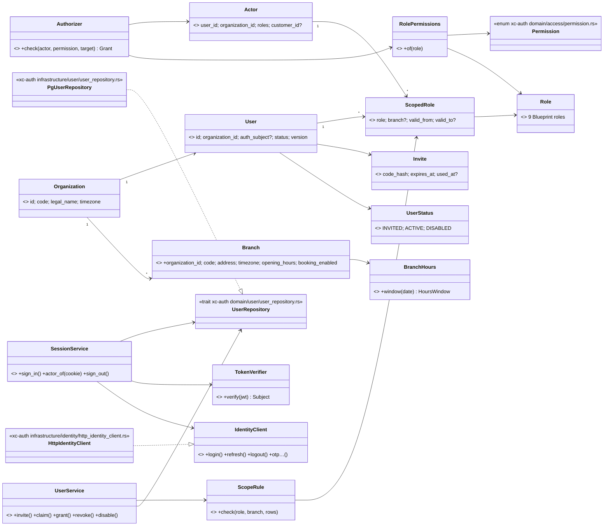

# Blueprint: organisation, roles, branch scope and users (#550)

- **Source:** `docs/blueprint/XC-Desk-Blueprint-Data-Model-v2.html` (#565). "§N" below is the Blueprint's own section.
- **Gap list:** `docs/design/xc-desk-blueprint-v2-mapping.md` §3.2 (roles), K12, K13.
- **v3 measured** at `origin/main` `3690ed5`.
- **Rules:**
  - Blueprint logic is fixed; only the look may change (owner, #564).
  - Brokers, partners and commission belong to Broker-Platform (§1 of #564). PARTNER is therefore not a v3 role.
- **Waiting on this design:** #582 (cash certifiers), #549's approval policy (PR 570 §5.3), the staff report (PR 533
  B.0), the desk (PR 536) and the staff page's branch hours (PR 532 S12).

---

## 0. The owner's answers (2026-10-09, in session claude/e5ab6c)

| # | Question (#550 §8 and this design) | Answer, verbatim | What it fixes |
|---|---|---|---|
| B1 | What becomes of v3 roles with no Blueprint equivalent | "Map by duty" | §3.3: FRONT→TELLER; BACKEND, MANAGER→BRANCH_MANAGER; RATES→RATE_MANAGER; FINANCE→FINANCE; SYSTEM→ADMIN; MONITOR, DOCUMENTS, DOCUMENT_REVIEW→VERIFICATION_REVIEWER. The migration converts the rows and the old roles go |
| B2 | Is a user authenticated here or by Identity | "Everyone logs in via Identity", then, asked again because it reverses the 10-06 order *"ให้ xc-auth เก็บบัญชีพนักงานเอง"*: **"Follow the Blueprint: Identity for everyone"** | §5: OWNER, staff and CUSTOMER sign in through Identity Platform. v3 keeps `auth_subject`, roles and status only, and stores no password or OTP (§07 `User(auth_subject)`, §17). **Identity gains no feature**: a person registers in Identity themselves, and v3 binds them by invite (§5.3) |
| B3 | The owner account | "OWNER = EXECUTIVE + ADMIN" | §3.3: one user with two organisation-wide `UserRole`s |
| B4 | The service window | "Yes, per branch" | §6: every rule that uses 11:00–22:50/23:00 (`xchange-v3.md` D7) reads the branch's `opening_hours`. A branch with no hours set does not open service |
| B5 | Branch hours (asked by claude/89458e53 on #550) | *"เอาตาม blueprint ที่ผมส่งให้แล้ว"* | per-branch `opening_hours` as A04 sets them (§6) |

---

## 1. v3 today (measured)

- **No organisation.** `git grep -i 'tenant|organi[sz]ation|org_id'` over `api` and `web` finds nothing.
  - **One owner** is assumed: `create_owner` "the one owner" (`api/crates/xc-auth/src/application/account/service.rs:562`) and `LOCK TABLE owners … count(*)>0` (`api/crates/xc-auth/src/infrastructure/account/account_repository.rs:444-457`).
  - The owner is the constant `OWNER_ID="owner"` (`api/src/presentation/extractors/actor.rs:26`).
- **Accounts.** `owners` and `employees`, both with a password hash (`api/migrations/20261007150000_accounts.sql:1-29`).
  - An employee has exactly **one** `role` (text, no CHECK) and **one** `branch_id` (no FK).
  - Sessions are two cookies, `__Host-xc_owner` and `__Host-xc_staff` (`actor.rs:23-24`), and both can be present at once (`api/src/presentation/pages.rs:19-24`).
- **Roles.** `Role { Owner, Front, Backend, Manager, Rates, Monitor, Finance, System, Documents, DocumentReview }`
  (`api/crates/xc-auth/src/domain/policy/value_objects/role.rs:5-45`) has no validity period and no multi-branch scope.
- **Policy.**
  - `Policy::allow(actor, EntryPath, action)` (`api/crates/xc-auth/src/domain/policy/entities/policy.rs:17-40`): 16 entry paths, each with a role × action-string table.
  - It is called from 19 sites (e.g. `compat/rpc.rs:213`, `http/v3/view.rs:349`).
  - `Policy::branch` (`:43-53`) silently **overrides** a staff member's named branch with their own. It does not refuse it.
- **Branches.** `branches(id, name, created_at, created_by, request_id)` (`20261007100000_branches_rates.sql:1-8`). There is no code, address, timezone, hours or booking switch.
- **Fixed hours.** The service window is fixed at `660..1370` / `660..1380` minutes of the day **in Bangkok**
  (`api/crates/xc-shift/src/domain/custody/entities/custody_machine.rs:746`, `:804`, `:1195`, via
  `custody_time.rs:18`), i.e. 11:00, 22:50 and 23:00 (D7).

---

## 2. Decisions

- **D-1. One organisation table, and every entity carries `organization_id`** (§07: *"ทุก entity ในองค์กรมี organization_id
  … ใช้ composite FK หรือ server constraint ป้องกันข้อมูลข้ามองค์กร"*).
  - Tables that already have `branch_id` get `organization_id` with a **composite FK** `(organization_id, branch_id)`
    → `branches(organization_id, id)`, so a row can never name another organisation's branch.
  - Tables without a branch get `organization_id` → `organizations(id)`.
  - The column's `DEFAULT` is the organisation the install migration creates. Until a second organisation exists, no
    insert has to change. Reads are scoped by the actor's organisation (D-4).
- **D-2. Users and scoped roles replace owners and employees** (§07 `User`, `Role`, `UserRole`).
  - A user holds **any number** of `UserRole(role, organization_id, branch_id NULL, valid_from, valid_to)`.
  - `branch_id NULL` means the whole organisation, *"เมื่อมีสิทธิ"* (only for roles whose §02 scope allows it, §3.2).
- **D-3. Nine roles: the Blueprint's nine minus PARTNER, plus VERIFICATION_REVIEWER** (§02, §15). Their scopes and
  duties are §02's, word for word (§3.1). v3-only features keep the role rows they have today, translated through B1
  (§4.2).
- **D-4. Permissions replace action strings, and the server checks organisation, branch scope and owner on every
  request** (§02: *"Server ตรวจทั้ง organization_id, branch scope และ owner ของข้อมูลทุก request; UI ซ่อนปุ่มอย่างเดียวไม่เพียงพอ"*).
  - A request naming a branch outside the actor's scope is **refused** (`outOfScope`, the §10 name). It is no longer
    silently replaced. That replacement was v3's own rule (`policy.rs:43-53`), and the Blueprint rule supersedes it.
- **D-5. Identity authenticates, v3 authorises** (B2).
  - v3 keeps no password and no OTP.
  - Its session is its own cookie, issued after it verifies Identity's token.
  - Disabling a user is v3's `users.status`; Identity is not asked to do anything new.
- **D-6. Branch hours are data** (§07 `Branch.opening_hours JSON`, A04). The rules of D7 read them (§6). A branch with
  no hours is "not set", never a default (owner via claude/89458e53).

---

## 3. Roles, scopes and permissions

### 3.1 The roles (§02, §15), verbatim

| Role | Scope | Does | Control | v3 wire |
|---|---|---|---|---|
| EXECUTIVE | every branch of the organisation | overview; approves rate frames, budgets and exceptions | by the approval policy, per type and amount | `EXECUTIVE` |
| ADMIN | organisation or branches, by grant | system settings, users, roles, branches | **never approves money automatically** | `ADMIN` |
| RATE_MANAGER | assigned branches | drafts rates, adjusts %, proposes publication | an out-of-frame change needs approval | `RATE_MANAGER` |
| BRANCH_MANAGER | own branch | queue, cash, hand-over and shift close | exceptions per the approval policy | `BRANCH_MANAGER` |
| TELLER | branch and the **open** shift | checks customers, takes bookings, makes exchanges | never edits a completed exchange directly | `TELLER` |
| FINANCE | branches, by grant | reconciliation, cost, (commission/payout: Broker-Platform) | maker, approver and payer kept apart | `FINANCE` |
| MARKETING | the data marketing needs | promotion drafts, segments, measurement | **never opens identity documents** | `MARKETING` |
| CUSTOMER | own data | booking, history, benefits | the account is verified before personal data | `CUSTOMER` |
| VERIFICATION_REVIEWER | organisation or branch | document queue, evidence, request changes, approve/reject | not for Marketing/Partner | `VERIFICATION_REVIEWER` |
| *(PARTNER)* | — | — | Broker-Platform, not v3 | — |

### 3.2 Scope rules (what `branch_id` may be)

| Role | `branch_id NULL` (whole organisation) allowed | Several branches |
|---|---|---|
| EXECUTIVE | **required** (*"ทุกสาขาตามองค์กร"*) | — |
| ADMIN, VERIFICATION_REVIEWER | allowed (§02 ADMIN *"องค์กร/สาขาตามสิทธิ"*; §15 VERIFICATION_REVIEWER *"scope ตามองค์กร/สาขา"*) | yes, one row per branch |
| FINANCE | **no** (§02 *"สาขาตามสิทธิ"*: branches, by grant) | yes, one row per branch |
| MARKETING | allowed (§02 *"ข้อมูลที่จำเป็นต่อการตลาด"*: data, not a branch) | — |
| RATE_MANAGER | no | yes (*"สาขาที่ได้รับมอบหมาย"*), one row per branch |
| BRANCH_MANAGER | no | no: one branch (*"สาขาตนเอง"*) |
| TELLER | no | no: one branch. The "open shift" part of its scope is checked by the shift rules (#582) |
| CUSTOMER | not branch-scoped: own data only (owner check, §3.5) | — |

These are enforced by `ScopeRule::check(role, branch_id, existing_rows)`
(`api/crates/xc-auth/src/domain/access/scope_rule.rs`) when a role is granted. A role row outside
`[valid_from, valid_to)` grants nothing.

### 3.3 v3 roles → Blueprint roles (B1, B3)

| v3 | Blueprint | Why (by duty) |
|---|---|---|
| OWNER | EXECUTIVE **and** ADMIN, both organisation-wide (B3) | approves (EXECUTIVE) and manages users and branches (ADMIN) |
| FRONT | TELLER | serves customers at the desk |
| BACKEND | BRANCH_MANAGER | opens and closes service, dispatches and commits transfers (`policy.rs` Custody rows) = §02's *"เงินสด ส่งมอบและปิดกะ"* |
| MANAGER | BRANCH_MANAGER | branch head |
| RATES | RATE_MANAGER | rates |
| FINANCE | FINANCE | reconciliation |
| SYSTEM | ADMIN, scoped to the employee's branch | system settings |
| MONITOR, DOCUMENTS, DOCUMENT_REVIEW | VERIFICATION_REVIEWER, scoped to the employee's branch | reviews customers and documents |

Each v3 employee's single `branch_id` becomes the `branch_id` of the mapped role row. The OWNER's rows are
organisation-wide.

### 3.4 Permissions

`Permission` (`api/crates/xc-auth/src/domain/access/permission.rs`) is one enum. There is one variant per
Blueprint screen or capability (§03), plus the v3-only capabilities (§4.2). `RolePermissions`
(`api/crates/xc-auth/src/domain/access/role_permissions.rs`) is the **one** table role → permissions, written
from §02/§03 and §4.2 below. No other file decides access.

| Permission | Blueprint | Roles |
|---|---|---|
| `OverviewRead` | A01 | EXECUTIVE |
| `RatesDraft` (draft, simulate, submit, publish) | A02, §05; EXECUTIVE per PR 570 A5 (owner, 2026-10-09: *"OWNER publishes directly"*, which presupposes OWNER drafting) | RATE_MANAGER, EXECUTIVE |
| `RatesHistoryRead` | A03 | RATE_MANAGER, EXECUTIVE |
| `RatePolicySave` | §02 EXECUTIVE approves rate frames | EXECUTIVE (PR 570 A3) |
| `BranchesManage` | A04 | ADMIN |
| `UsersManage` (users, roles, scopes) | A05 | ADMIN |
| `ApprovalsDecide` | A06 | per the approval policy of each type (PR 570 §5.3); a role only qualifies, the type's policy decides |
| `ShiftOperate` (open, count, hand over) | B01 | TELLER, BRANCH_MANAGER |
| `ShiftCloseCertify` | B01 *"ปิดและรับรอง"* | BRANCH_MANAGER (#582) |
| `BookingsDesk` | B02 | TELLER |
| `ExchangeTransact` | B03 | TELLER |
| `TransactionRead`, `ReceiptReprint`, `ReversalRequest` | B04 | TELLER, BRANCH_MANAGER |
| `CashManage` (stock, transfers, counts) | B05 | BRANCH_MANAGER, FINANCE |
| `QueueOperate` | B06 | TELLER, BRANCH_MANAGER |
| `SystemSettings` (devices, printers, payment settings) | §02 ADMIN *"ตั้งค่าระบบ"*; EXECUTIVE by B1 | ADMIN, EXECUTIVE |
| `CompatRead`, `RequestAbandon`, `DocumentsList`, `FileRead`, `ProofUpload`, `DeviceQueue`, `DeviceProcess`, `DevicePrinterOnline`, `DrawerPassport` | v3-only features; roles = the B1 translation of today's rows (§4.2) | per §4.2 |
| `FinanceReconcile` | F01 | FINANCE |
| `VerificationReview` | F02 | VERIFICATION_REVIEWER |
| `IdentityDocumentRead` | B03 *"ตรวจลูกค้า"*, F02; never MARKETING (§02) | TELLER, VERIFICATION_REVIEWER |
| `MarketingCampaigns`, `MarketingMembers` | M01–M03 | MARKETING |
| `MarketingPerformance` | M04 | MARKETING, EXECUTIVE |
| `CustomerSelf` (own bookings, history, receipts, profile, consent) | C01–C14 | CUSTOMER, with the owner check |
| `AttendanceClock` (clock in and out) | v3 custody feature kept by the owner (#582 A4, *"ใช้ตามนี้"*) | every staff role: all roles except CUSTOMER (#582 decides the exact set) |
| `CustomerHoldPlace` (place a hold; releasing one is `VerificationReview`) | v3 custody feature kept (#582 A4) | TELLER, BRANCH_MANAGER |
| `CashTargetSet` | v3 custody feature kept (#582 A4) | FINANCE |
| `BranchDayOperate` (start service, cut-off) | v3 custody feature kept (#582 A4); §02 BRANCH_MANAGER *"เงินสด ส่งมอบและปิดกะ"* | BRANCH_MANAGER |

The last four rows are named by the cash design (#582, PR 590) and live in this one table, so that
`role_permissions.rs` keeps one owner (OR-2). #582's rules check them only through `Authorizer::check`.

### 3.5 The check (D-4)

`Authorizer::check(actor, permission, target) -> Result<Grant, Refusal>`
(`api/crates/xc-auth/src/domain/access/authorizer.rs`), pure. In order:

1. **No actor** → `signIn`.
2. **Organisation.** The target's organisation must be the actor's, else `outOfScope`.
3. **Permission and branch.** The actor needs a role row that is valid now, carries the permission, and has a scope
   covering the target's branch (`branch_id` equal, or `NULL` where §3.2 allows). Otherwise `outOfScope` if the role
   exists elsewhere, else `roleNotAllowed`.
4. **Owner.** For `CustomerSelf`, the target's customer must be the actor's customer, else `outOfScope`.

`Grant { branch: BranchId, roles_used }` is what handlers use. The branch is the **named** branch when it is in
scope. A user whose roles cover exactly one branch, and who names none, gets that branch. A user with an
organisation-wide role who names none gets `MAIN`, v3's rule (`policy.rs:43-53`, which the Blueprint does not
replace).

---

## 4. How `xc-auth` and its callers change

### 4.1 Types

| Today | Becomes | File |
|---|---|---|
| `Role` (10 v3 variants) | `access::Role` (9 Blueprint variants, §3.1), **in a new file beside the old one** | `xc-auth/src/domain/access/role.rs` (new). The old `policy/value_objects/role.rs` stays until OR-7 |
| `Actor { id, kind, role, branch_id }` | `access::Actor { user_id, organization_id, roles: Vec<ScopedRole>, customer_id: Option }`, also new | `xc-auth/src/domain/access/actor.rs` (new). The old `actor.rs` and `actor_kind.rs` stay until OR-7 |
| `ActorKind {Owner, Staff}` | none in the new model; deleted with the old types in OR-7 | — |
| `ScopedRole` | new: `{ role, branch: Option<BranchId>, valid_from, valid_to }` | `xc-auth/src/domain/access/scoped_role.rs` |
| `Policy::allow(actor, EntryPath, action)` | `Authorizer::check(actor, Permission, Target)` (§3.5) | `xc-auth/src/domain/access/authorizer.rs` |
| `Policy::branch` | `Grant.branch` (§3.5) | — |
| `EntryPath` (16) | kept **only** as the route-to-permission table of §4.2 while compat routes live; each route names its `Permission` | `xc-auth/.../entry_path.rs` |
| v3 view `INHERITS: (EntryPath, &str)` | `REQUIRES: Permission` | `api/src/presentation/http/v3/view.rs` and every view file |

**The seam lands green.** OR-2 adds `domain/access/**` **beside** the old types and touches no file that uses them.
- OR-3 switches the extractor (`extractors/actor.rs`) to `access::Actor`.
- OR-4 switches `policy.rs` (reduced to the route → permission table) and the 19 call sites.
- OR-7 deletes the old `role.rs`, `actor.rs` and `actor_kind.rs`.

Every ticket compiles on its own.

### 4.2 Every v3 route and action → its permission (the controller's ruling (b))

**The rule** (lane controller's ruling on §4.3, issuecomment on PR 589):
- each row's roles are the **B1 translation of today's roles**: OWNER→EXECUTIVE, FRONT→TELLER, BACKEND/MANAGER→BRANCH_MANAGER, RATES→RATE_MANAGER,
  FINANCE→FINANCE, SYSTEM→ADMIN, MONITOR/DOCUMENTS/DOCUMENT_REVIEW→VERIFICATION_REVIEWER;
- a row changes **only** where the Blueprint's role table says otherwise, and the change is listed in the last column
  with its citation.

The owner's user holds EXECUTIVE + ADMIN (B3), so wherever OWNER was allowed, the owner still is: OWNER's rows go to
EXECUTIVE, SYSTEM's to ADMIN. Each compat path keeps its own row while compat routes live (`EntryPath`, §4.1).

| Path · action (today, `policy.rs`) | Today | B1 translation | Permission | Roles after | Change (Blueprint) |
|---|---|---|---|---|---|
| Rpc `adminSnapshot`, `adminDeskConfig`, `getConnectionStatus` | OWN + 9 staff | E, T, BM, RM, VR, F, A | `CompatRead` (v3-only; retires with V4) | same | none |
| StaffRpc `adminSnapshot`, `getConnectionStatus` | 9 staff | T, BM, RM, VR, F, A | `CompatRead` | same | **C1** below |
| StaffRpc `adminDeskConfig`; StaffDesk; StaffRpc `reserveCustomer`, `saveTransaction` | FR | T | `ExchangeTransact` | T | none |
| Rpc `reserveCustomer`, `saveTransaction` | OWN, FR | E, T | `ExchangeTransact` | T | **C2**: E refused (§03 B03 user TELLER) |
| Rpc / StaffRpc `adminSaveRate`; Kiosk `manage`, `configure` | OWN, RT | E, RM | `RatesDraft` | RM, E | none. E drafts per PR 570 A5 (owner, 2026-10-09: OWNER drafts and publishes) |
| Rpc `adminOpenShift`, `adminCloseShift` | OWN, BE, MG | E, BM | `ShiftOperate` / `ShiftCloseCertify` | **#582** | #582's owner-confirmed table (PR 590) |
| Rpc `adminMoveStock` | OWN, FI | E, F | `CashManage` | BM, F | **C3**: E refused, BM allowed (§03 B05 users MANAGER/FINANCE) |
| Rpc `adminCreateBranch`; OwnerRoute (branches, employees) | OWN | E | `BranchesManage` / `UsersManage` | A | **C4**: E refused, A allowed within its scope (§03 A04/A05 user ADMIN; §02 ADMIN *"ผู้ใช้ บทบาท สาขา"*). The owner keeps it through ADMIN |
| DeviceSetup; Devices `setPrinter`, `setDrawer`; PaymentMethods `save` | OWN | E | `SystemSettings` | E, A | **C5**: A allowed (§02 ADMIN *"ตั้งค่าระบบ"*) |
| Rpc `adminAbandonRequest` | OWN | E | `RequestAbandon` (v3-only) | E | none |
| StaffRpc `documents`; StaffFile | all staff but RT, SY | T, BM, VR, F | `IdentityDocumentRead` | same | none |
| UserRoute `documents`; File | OWN + all signed in (File: but RT, SY) | as translated | `DocumentsList` / `FileRead` (v3-only) | same | **C6**: MARKETING refused (§02 *"ไม่เปิดสิทธิเอกสารยืนยันตัวตน"*). The role is new, so no v3 user loses anything |
| Upload | OWN, FR, FI | E, T, F | `ProofUpload` (v3-only) | same | none |
| StaffUpload | FR, FI | T, F | `ProofUpload` | same | none |
| UserRoute (other); Devices other names; Kiosk `notifications`, `list`; PaymentMethods `list` | anyone signed in | every role | `SignedIn` | same | none |
| Devices `queue` | OWN, FR, BE, MG | E, T, BM | `DeviceQueue` (v3-only) | same | none |
| Devices `process`, `retry`, `drawerObservation` | OWN, FR, BE | E, T, BM | `DeviceProcess` (v3-only) | same | **C7**: ex-MANAGER users gain them, because B1 merges BACKEND and MANAGER into BRANCH_MANAGER (the owner's mapping) |
| Devices `printerOnline` | OWN, BE | E, BM | `DevicePrinterOnline` (v3-only) | same | **C7** (same cause). TELLER does not gain it |
| Kiosk `identityChecked`, `publishReceipt`, `get`, `accept` | OWN, FR, BE, MG | E, T, BM | `QueueOperate` | T, BM | **C8**: E refused (§03 B06 users TELLER/MANAGER) |
| Kiosk `rates`, `quote`, `confirm`, `status`, `customerReceipt` | everyone | public | public | public | none |
| DrawerPassport | OWN, FR, BE, MG | E, T, BM | `DrawerPassport` (v3-only) | same | none |
| StaffBookings | FR, BE, MG | T, BM | `BookingsDesk` | T | **C9**: BM refused (§03 B02 user TELLER) |
| Custody `ops*` | per action | — | #582 (PR 590): `ShiftOperate`, `ShiftCloseCertify`, `CashManage`, `FinanceReconcile`, `VerificationReview`, `ApprovalsDecide`, `AttendanceClock`, `CustomerHoldPlace`, `CashTargetSet`, `BranchDayOperate` | #582 | #582's |

**C1, the one change that comes from the user model rather than a table row.** Today the owner is refused on every
staff path (StaffRpc, StaffFile, StaffUpload, StaffBookings), because the owner is not an employee (`ActorKind`).
- The Blueprint has one `User` holding `UserRole`s (§07). There is no owner kind, so a staff path admits whoever holds
  one of its roles.
- The owner's user holds ADMIN, so it now passes the staff-path rows that ADMIN (ex-SYSTEM) passes:
  `CompatRead` on StaffRpc.
- No other staff-path row allows ADMIN, so nothing else changes.

---

### 4.3 Moving the provided tests (the controller's ruling: (a) 1:1 table, (b) changes cited, (c) one commit per file)

**The fixture.** The 1,425 cases of `v2_policy_cases.json` (`policy_test.rs:54-69`) are re-expressed once by
`api/tools/policy-map.mjs` (OR-4):
- each case's actor becomes the B1-mapped user (OWNER → one user with EXECUTIVE + ADMIN);
- its expected outcome stays **unless** the case's (path, action, mapped role) is in C1–C9;
- the output is `blueprint_policy_cases.json`, with the same count.

The test `the_mapping_changes_exactly_c1_to_c9` asserts that the outcomes differing between the two files are exactly
the cases C1–C9 name, no more and no fewer. Then `every_mapped_case_is_answered_as_mapped` replays them all.

**`policy_test.rs`, one row per test:**

| Test (line) | New test | Kept / changed / dropped |
|---|---|---|
| `the_fixture_is_whole` (:52) | `the_mapped_fixture_is_whole` (1,425) | kept |
| `every_answer_v2_gave_is_given_again` (:99) | `every_mapped_case_is_answered_as_mapped` + `the_mapping_changes_exactly_c1_to_c9` | kept, changes C1–C9 only |
| `the_sentences_said_are_exactly_v2s_twenty_two` (:128) | same name | kept: the Thai refusal sentences are unchanged. `outOfScope` adds one (§10) |
| `every_call_runs_on_the_branch_v2_ran_it_on` (:147) | `every_call_runs_on_the_branch_named_in_scope` | changed: a branch outside scope is **refused** (§02 *"Server ตรวจ … branch scope"*) |
| `which_branch_an_employee_belongs_to_changes_no_answer` (:169) | same | kept |
| `roles_are_spelled_as_v2_spells_them` (:189) | `roles_are_spelled_as_the_blueprint_spells_them` (the nine of §3.1) | changed (§02, §15; B1) |
| `a_role_v2_does_not_have_is_no_role` (:214) | `a_role_the_blueprint_does_not_have_is_no_role` (`FRONT`, `OWNER`, `PARTNER` refused) | changed (§02; PARTNER is Broker-Platform's) |
| `the_owner_has_no_branch_and_an_employee_always_has_one` (:235) | `scope_rules_hold` (§3.2: EXECUTIVE organisation-wide; TELLER and BRANCH_MANAGER exactly one branch) | changed (§07 UserRole, §02 scopes) |
| `nobody_is_an_employee_with_the_owners_role` (:254) | — | **dropped**: §07 has no owner kind (one `User`). `scope_rules_hold` covers what remains |
| `an_employee_is_pinned_to_their_own_branch_whatever_they_name` (:264), `naming_another_branch_is_not_refused_it_is_ignored` (:281) | `naming_a_branch_outside_scope_is_refused` | changed (§02 server checks branch scope) |
| `the_owner_works_on_the_branch_named_and_on_main_when_none_is` (:293) | `an_organisation_wide_user_works_on_the_branch_named_and_on_main_when_none_is` | kept (MAIN is v3's rule; the Blueprint is silent) |
| `a_caller_who_is_not_signed_in_is_on_the_branch_named` (:301) | same | kept |
| `opening_and_closing_a_shift_depends_on_the_path` (:310) | moves to #582's tickets | #582 |
| `the_desk_configuration_depends_on_the_path` (:320), `reading_a_transactions_documents_depends_on_the_path` (:337), `the_two_paths_refuse_in_sentences_one_word_apart` (:371) | same names | kept (per-path rows), plus C6 |
| `what_each_role_may_write_on_both_paths` (:382) | same | kept, with C2, C3, C4 |
| `the_owner_may_do_all_eleven_actions_of_the_owner_rpc` (:397) | `the_owners_user_may_do_the_owner_rpc_actions_its_roles_allow` | changed: C2, C3 (C4 keeps it through ADMIN) |
| `the_owner_is_let_through_wherever_a_signed_in_caller_is` (:417) | same | kept |
| `the_owner_is_not_an_employee` (:437) | `a_staff_path_admits_whoever_holds_its_role` | changed: C1 (§07) |
| `only_the_owner_passes_an_owner_route` (:462) | `only_admin_passes_branch_and_user_management` | changed: C4 (A04/A05) |
| `an_unknown_action_is_refused_in_the_words_of_its_path` (:481), `the_device_route_does_not_stop_a_name_it_has_no_list_for` (:548), `paths_with_one_purpose_do_not_read_the_action` (:562) | same | kept |
| `the_staff_bridge_lets_through_whatever_starts_with_ops` (:523), `each_custody_action_has_its_roles` (:720), `signing_is_refused_in_three_different_sentences` (:744), `the_owner_starts_custody_and_does_nothing_else_in_it` (:762) | move to #582's tickets | #582 |
| `front_and_finance_upload_evidence_and_nobody_else_on_the_staff` (:590), `rates_and_system_read_no_customer_file_and_each_path_says_so_differently` (:609), `the_staff_desk_page_is_fronts` (:627) | renamed to the mapped roles | kept |
| `device_actions_have_their_own_role_lists` (:646) | same | kept, with C5, C7 |
| `the_customer_kiosk_needs_nobody_signed_in` (:668) | same | kept |
| `the_kiosk_queue_is_for_front_backend_manager_and_the_owner` (:677) | `the_kiosk_queue_is_for_teller_and_branch_manager` | changed: C8 |
| `a_refusal_carries_the_status_v2_answered_with` (:784), `a_refusal_is_an_error_whose_text_is_the_sentence` (:804), `an_action_is_its_v2_name_and_nothing_else` (:818) | same | kept |

**The other files:**

| File | Becomes |
|---|---|
| `policy_common/mod.rs` (`PATHS`, `:106`) | kept: `EntryPath` stays the route table |
| `policy_addon_paths_test.rs`, `policy_kiosk_test.rs`, `policy_staff_bookings_test.rs` | the same assertions with mapped roles, with C5, C7, C8 and C9 |
| `api/tests/rpc_common/mod.rs:598-622` `one_of_each_role` | the same 10 users in the same order, each with its B1-mapped role(s): OWNER → EXECUTIVE + ADMIN, FRONT → TELLER, BACKEND → BRANCH_MANAGER, MANAGER → BRANCH_MANAGER, … So the 38 files that index it keep their positions |
| `STAFF_ROLES` (`v3_view_test.rs:201-211`, `v3_me_version_test.rs:195-205`) | the 9 entries mapped by B1, in the same order (BRANCH_MANAGER and VERIFICATION_REVIEWER appear more than once, on purpose) |
| `compat_staff_view_test.rs:224,566` | mapped roles: RATES→RATE_MANAGER, SYSTEM→ADMIN keep their stripped views |
| `custody_role_test.rs` | #582 |
| `auth_http_test.rs:488-490`, `account_test.rs` (password login, `:456` `create_owner`) | **dropped with OR-7**: §17 *"ไม่เก็บ raw password/OTP"* and B2. Replaced by OR-3's sign-in tests and OR-5's invite tests |

**(c) Order of commits.** Each code ticket that moves a file above moves it in **one commit per file**, before any
behaviour change, so the reviewer diffs assertion by assertion.

---

## 5. Sign-in through Identity (B2)

### 5.1 Flow

```mermaid
sequenceDiagram
  participant B as Browser
  participant X as v3 (xc-auth BFF)
  participant I as Identity Platform
  B->>X: POST /api/auth/login {identifier, password | otp…}
  X->>I: POST /auth/login (client credentials of the "xchange" client app)
  I-->>X: access token (EdDSA JWT, aud=xchange) + refresh token
  X->>X: verify JWT (JWKS / pinned key), read sub
  X->>X: users WHERE auth_subject = sub AND status = ACTIVE → roles
  X-->>B: Set-Cookie __Host-xc_session (opaque; user_id + users.version)
```

- **The routes v3 forwards.** Identity's `POST /auth/login`, `/auth/refresh`, `/auth/logout`, `/auth/otp/request` and
  `/auth/otp/verify`, plus `/auth/register` for a person with no Identity account
  (`108-platform-services` `crates/auth/src/api/mod.rs:84-103`). The browser never sees the client secret.
- **Errors** are mapped by Identity's error code, never by HTTP status, because Identity reuses 401/404/403 for both
  user and caller faults. Unknown codes, caller-side codes, an unreadable body and 5xx all become `503` with a log line.
- **Sessions.** v3 keeps its own session row (`user_sessions(hash, user_id, version, expires, refresh_token_enc)`). The
  refresh token is stored encrypted server-side. `users.version` moves on any role or status change, which ends that
  user's sessions.
- **One cookie** `__Host-xc_session` replaces `__Host-xc_owner` + `__Host-xc_staff`, so a browser has exactly one
  actor. The "owner wins" rule (`view.rs:339-342`) disappears with it.

### 5.2 Which Identity, and the client (done 2026-10-09)

v3 uses **its own Identity instance on the xchange host**, `xc-identity.service` on do-sgp1. It is not the Dell Identity.
The owner's order: *"Identity จะต้อง deploy ที่โฮสต์ xchange ไม่ยุ่งกับของเดิม"*. The host record is PR 593,
`deploy/HOST-do-sgp1.md` §4.

| Item | Value (from that record) |
|---|---|
| Address | `127.0.0.1:8095`; public `xc-id.spacing.cloud` once DNS and the certificate exist (I-1, the owner's) |
| Token | `iss=auth-service`, `aud=xchange`, 15-minute life, EdDSA; keys at `/.well-known/jwks.json` |
| The xchange client | already registered (`audience=xchange`). Its credentials are in `/etc/xc-v3/identity-client.env` on the host (`IDENTITY_BASE_URL`, `IDENTITY_CLIENT_ID`, `IDENTITY_CLIENT_SECRET`, `IDENTITY_AUDIENCE`, `IDENTITY_ISSUER`, …), never in the repo |
| Registration | requires a phone number (`phone_required`), so each staff member registers with their phone |
| OTP delivery | `noop` today, so sign-in is by password until an SMS/e-mail sender is chosen (I-3, the owner's) |

- **Token verification** (the JWKS, `aud`, `iss`) is ticket **I-2** under #554's design. OR-3 uses I-2's verifier, under
  the name #554 gives it, and does not build a second one.
- **Staff sign-in.** Everyone signs in through `xc-identity`: staff, OWNER and CUSTOMER (B2 in §0, 2026-10-09; the
  host record's I-2 row says the same, PR 593 `deploy/HOST-do-sgp1.md:88`). All of them verify through the same I-2
  verifier.

### 5.3 Binding a person to a user: invites (no new Identity feature)

- **Creating a user.** An ADMIN creates the v3 user with name, roles and scopes, and status `INVITED`. v3 shows a
  one-time `invite_code`; only its hash is stored, with an expiry. No Identity account is created for anyone (Identity
  only authenticates).
- **Claiming.** The person registers or signs in to Identity themselves, then enters the code. In one transaction v3:
  - checks the code (unexpired, unused);
  - sets `auth_subject = sub`, enforced by `UNIQUE (auth_subject)`;
  - sets the user `ACTIVE`;
  - spends the code.

  A second claim with the same code, or a second code for the same `sub`, is refused.
- **Disabling.** `users.status = DISABLED` plus `version+1`. All sessions end. Identity is untouched.
- **The first user of an install.** The `create-owner` CLI (`api/src/main.rs:32`) becomes `create-admin-invite`. It
  creates the organisation's first user with EXECUTIVE + ADMIN (B3) and prints that invite code once.

### 5.4 CUSTOMER

A customer is a `User` with role CUSTOMER and an `auth_subject`. The `Customer` record, its link to the user, its
verification and consent belong to #554 and #557. This design gives only the role and the owner check (§3.5).

---

## 6. Branches and hours (D-6, B4, B5)

- **`Branch` gains** (§07, A04): `organization_id`, `code` (unique per organisation), `address`, `timezone` (IANA),
  `opening_hours jsonb NULL` and `booking_enabled bool`.
- **`opening_hours` shape** [required], weekly, as A04 sets *"เวลาเปิด"*:
  `{"mon":[{"open":"11:00","close":"23:00"}], …, "sun":[]}`. An empty day is closed. `NULL` means "not set".
  Holiday and closure dates are booking slots' (#555), not here.
- **`BranchHours::window(date) -> HoursWindow { Closed | NotSet | Open { open, close } }`**
  (`api/crates/xc-rate/src/domain/branch/branch_hours.rs`) uses the branch timezone. It replaces the Bangkok minutes:

| v3 rule today (`custody_machine.rs`) | Becomes |
|---|---|
| `:746` / `:804`: begin a transaction or start service only within `660..1370` (11:00–22:50) | within `[open, close − 10 min)` of today's window |
| `:1195`: save only within `660..1380` (11:00–23:00) | within `[open, close)` |
| `NotSet` or `Closed` | service does not open: `OutsideServiceHours` / `ServiceNotReady`, as today outside the window |

The 10 minutes before close is v3's existing rule (D7, v2 parity). The Blueprint does not state it, so it stays.
`CustodyTime::bangkok_minute_of_day` (`custody_time.rs:18`) is replaced by the branch-timezone minute.

---

## 7. Class diagram



HTTP: `api/src/presentation/http/auth.rs` (rewritten: the BFF routes of §5.1, `POST /api/auth/invite/claim`);
`api/src/presentation/extractors/actor.rs` (rewritten: one cookie → `Actor`). The A04/A05 commands are
`CommandAction`s (PR 570 §6) under `api/src/presentation/http/v3/commands/`; the views are under `http/v3/views/`.

### 7.1 Who provides, who uses

| Provider | Used by |
|---|---|
| `Authorizer` + `Permission` | every route and view (§4.2), the approval policies (PR 570 §5), #582's custody rules, the staff report (PR 533), the desk (PR 536) |
| `Actor` | every handler |
| `BranchHours` | custody rules (§6), the staff page heading (PR 532 S12), booking slots (#555) |
| `Organization`, `organization_id` | every table (D-1), the approval and idempotency keys (PR 570 `idempotency_records.org_id`) |
| `SessionService`, `IdentityClient` | the sign-in screen (`/login`), the customer app (#558) |

---

## 8. Tables

```
organizations(id uuid PK, code text UNIQUE, legal_name text, timezone text, created_at)
branches + organization_id uuid NOT NULL FK, code text, address text NULL, timezone text NOT NULL,
           opening_hours jsonb NULL, booking_enabled bool NOT NULL DEFAULT false,
           UNIQUE (organization_id, code), UNIQUE (organization_id, id)   -- the composite FK target
users(id uuid PK, organization_id FK, auth_subject text NULL UNIQUE, name text, status text
      CHECK (status IN ('INVITED','ACTIVE','DISABLED')), version integer, created_at, created_by,
      legacy_employee_id text NULL UNIQUE)          -- the migration window only (§9); dropped by migration 3
user_invites(user_id FK PK, code_hash text, expires_at, used_at NULL)
roles(code text PK)                              -- the 10 of §3.1, seeded; Blueprint Role(id, code UQ)
user_roles(id uuid PK, user_id FK, role_code FK, organization_id FK, branch_id NULL,
           valid_from timestamptz, valid_to timestamptz NULL,
           FOREIGN KEY (organization_id, branch_id) REFERENCES branches(organization_id, id))
user_sessions(hash text PK, user_id FK, version integer, expires timestamptz, refresh_token_enc bytea)
user_audit(id, actor_id, subject_id, action, at)   -- or PR 570's audit_events once AP-1 lands
<every other table> + organization_id uuid NOT NULL DEFAULT <install org>, with the composite FK where branch_id exists,
                      except branch_versions and employees (§9 migration 1)
```

---

## 9. Data migration

v3 is not installed anywhere; its data is test data (D6), and `xc_v3` on do-sgp1 may be recreated. v3 migrations are
approved until the first install. The migrations below still run correctly on a database that has rows.

**1. `api/migrations/20261011100000_organizations.sql`** (OR-1)

- **Changes:**
  - creates `organizations` and inserts one row (`code 'XC'`, `timezone 'Asia/Bangkok'`, `legal_name` NULL until
    ADMIN sets it);
  - adds the branch columns with **defaults**, so that a binary that inserts only `(id, name, …)` still works:
    - `code` backfilled from `id`;
    - `timezone text NOT NULL DEFAULT 'Asia/Bangkok'`;
    - `opening_hours jsonb NULL`;
    - `booking_enabled bool NOT NULL DEFAULT false`.

    `code` stays nullable in this migration. OR-1's branch creation writes it (the id, unless given), and a later
    migration sets it `NOT NULL` once no writer leaves it empty (checked by `SELECT count(*) FROM branches WHERE code IS
    NULL` = 0);
  - adds `organization_id` (default: that org) to **every** table, plus the composite FKs, **except on two tables**
    that keep only the FK to `organizations(id)` (found by OR-1's up-front tests, #615, measured):
    - `branch_versions`: the kernel's lock row for any branch id, by contract (`BranchTx::run` inserts it on first use,
      `xc-kernel/src/branch_tx.rs:70`; `api/tests/v3_view_unknown_branch_test.rs:131-142`). It holds no business data;
    - `employees`: the old model OR-7 retires. Its branch check is at the writer (§9 migration 2, "Mirroring"), and
      `user_roles` carries the composite FK. With the FK here, v2-parity creates at an unregistered branch would fail
      with a raw FK error before OR-2's check exists.
- **Existing rows** all belong to the one organisation. `opening_hours NULL` means "not set", so **service will not
  open on any branch until ADMIN sets its hours** (B4). That is the rule, not a fault, and the release note must say it.
- **Count first:**

  ```sql
  SELECT count(*) FROM branches;
  SELECT relname, n_live_tup FROM pg_stat_user_tables ORDER BY 1;
  ```
- **Deploy order and the old binary.**
  - It ships with the OR-1 binary, which reads `opening_hours` and writes `code`.
  - The pre-OR-1 binary still works against the new schema: every new column has a default or is nullable, and
    `organization_id` defaults to the one organisation.
  - So a rollback of the binary alone is safe. Its only cost is that new branches get no `code` until OR-1 is back.
- **`down`** drops the columns and the table. The hours and codes are lost.

**2. `api/migrations/20261011110000_users_roles.sql`** (OR-2)

- **Changes:** creates `users`, `user_invites`, `roles`, `user_roles`, `user_sessions` and `user_audit`.
- **Backfill:**
  - **each `employees` row** becomes a `users` row with status `INVITED`, `auth_subject NULL`,
    **`legacy_employee_id = e.id`** and an expired invite (ADMIN reissues invites). It gets exactly one `user_roles`
    row, mapped by §3.3, at its `branch_id`: every v3 staff role maps to exactly one Blueprint role. A disabled
    employee becomes `DISABLED`. Setting `legacy_employee_id` here is what lets migration 3's precheck pass for every
    employee that existed before migration 2;
  - **the `owners` row** becomes a `users` row with EXECUTIVE + ADMIN, organisation-wide (B3).
- **Count first:**

  ```sql
  SELECT role, count(*) FROM employees GROUP BY role;
  SELECT count(*) FROM owners;
  ```

  An employee role outside §3.3's ten v3 roles is refused by the migration (`RAISE`), not guessed.
  **An employee whose `branch_id` names no `branches` row** is refused the same way: `employees.branch_id` has no FK
  today (§1), and `user_roles` has the composite FK of §8, so the backfill would fail on it with a raw FK error. The
  migration counts them first and `RAISE`s with a clear message (they can only be test data, D6; fix or delete the
  row, then run again):

  ```sql
  SELECT count(*) FROM employees e WHERE NOT EXISTS (SELECT 1 FROM branches b WHERE b.id = e.branch_id);   -- must be 0
  ```
- **`owners` / `employees` are not dropped here.** They are dropped with the password login (migration 3).
- **The window between migration 2 and OR-7.**
  - **Who writes accounts:** until OR-5 (the A05 screen) is live, the existing `employees` route
    (`api/src/presentation/http/employees.rs:43`) is the only writer.
  - **Mirroring:** OR-2 mirrors each employee write into `users` + `user_roles` **in the same transaction**, mapped by
    §3.3, at the two repository methods every path goes through
    (`xc-auth/src/infrastructure/account/account_repository.rs`, measured at main `4b8f73b`):
    - `create_employee` (`:254`, its own tx `:260-300`): inserts the `users` row (`INVITED`,
      `legacy_employee_id = <new id>`) and its one `user_roles` row before the commit;
    - `disable_employee_in` (`:345`): sets `users.status = 'DISABLED'` where `legacy_employee_id = id`, in the
      caller's tx. Every disable reaches it:
      - the route's `DisableEmployee` (`api/src/presentation/http/employees.rs:107-144` →
        `api/src/application/workflows/disable_employee.rs:74` → `AccountService::disable_employee_in`,
        `service.rs:531-542`);
      - `employees("disable")` → `disable_employee` (`account_repository.rs:338-342`), which wraps it.
    - `create_owner` (`:428`): inserts the owner's `users` row (`INVITED`, `legacy_employee_id NULL`) with EXECUTIVE +
      ADMIN, organisation-wide, in its transaction. On a fresh install the migrations run before the owner is
      created, so without this the owner would have no `users` row, and #582 CA-1's `"owner"` lookup would find none
      (found while writing OR-2's tests, #616);
    - `reset_employee_password` changes nothing in `users`: passwords are not part of the new model.
    - **An unknown branch is refused before the insert.** `create_employee` checks that `branch_id` names a
      `branches` row and refuses with the route's sentence (`NO_SUCH_BRANCH`,
      `xc-rate/src/application/branch/service.rs:36`). Today only the route checks it
      (`api/src/presentation/http/employees.rs:149-155`, `BranchService::require`); `AccountService::employees("create")`
      checks only the format. With `user_roles`' composite FK, the check belongs at the writer, where every path meets
      it. `[proposed]` how: a `SELECT 1 FROM branches` in the same transaction, so the FK violation never reaches the
      caller as a database error.

    Mirroring in `AccountService::employees` would miss the route's disable, which does not pass through it.
    `users.legacy_employee_id` (nullable, dropped in migration 3) records the link.
  - **Nothing is frozen and nothing is stale.** Once OR-5 is live, the `employees` route is refused (`UsersManage`
    moves to A05), and from then on only `users` is written.
- **Deploy order:** with the OR-2 binary, which does the mirroring. The pre-OR-2 binary works against the schema,
  because nothing it reads changes. But it would not mirror, so it must not run once migration 2 is applied; v3
  deploys one binary at a time.
- **`down`** drops the new tables.

**3. `api/migrations/20261030100000_drop_password_login.sql`** (OR-7, after OR-3 is live)

- **Version: the cleanup block.** This migration retires the old model and drops a transitional column, so it is in
  the lane's cleanup block `20261030*`, ordered after every feature block (lane controller's rule, #564
  issuecomment-6074383060; its slot is `20261030100000`). This design's own block `20261011*` holds only the
  creating migrations 1 and 2. On a fresh database, every migration that reads `legacy_employee_id` (#582's cash M1
  in `20261012*`) therefore runs before the drop, with plain SQL.

- **Changes:** drops `owners`, `owner_sessions`, `employees`, `employee_sessions`, `auth_attempts` and
  `users.legacy_employee_id`. v3 then holds no password hash. `employee_audit` is **kept** as read-only history, with
  no writer from here on, because `user_audit` takes over.
- **Precheck**, which must be 0, else the migration `RAISE`s:

  ```sql
  SELECT count(*) FROM employees e WHERE NOT EXISTS (SELECT 1 FROM users u WHERE u.legacy_employee_id = e.id);
  ```
- **Readers of `legacy_employee_id` that must go first.** #582's CA-1 (PR 590 `cash-shift-transfer.md` §8, M1)
  reads the column twice: its migration M1 fills `shifts.teller_id` from it, and its binary resolves the opener's user
  through it in `xc-shift/src/infrastructure/shift/shift_repository.rs`.
  - **CA-1 merges before OR-7**, so that M1 runs while the column exists.
  - **The id that reaches the lookup changes at OR-3, not at OR-7.** Before OR-3 the actor id is an employee id or
    `"owner"`. From OR-3 on, the extractor (`api/src/presentation/extractors/actor.rs`, OR-3's file) gives
    `access::Actor`, whose id is a `users.id`. If the lookup only knew `legacy_employee_id`, every shift open would fail
    between OR-3 and OR-7 (`shifts.teller_id` is NOT NULL), the owner's included.
  - **So CA-1's lookup accepts both forms from the start** (PR 590 issuecomment of this round asks its text to agree):
    `SELECT id FROM users WHERE id::text = $1 OR legacy_employee_id = $1` (`users.id` is uuid and `$1` may be an employee id or `"owner"`, so the uuid is compared as text), and `"owner"` resolves to the one organisation-wide
    EXECUTIVE + ADMIN user with `legacy_employee_id IS NULL` (migration 2's owner row). It works on either side of
    OR-3, so no ticket has to land on one exact release.
  - **OR-7 removes the legacy half** (the `legacy_employee_id` branch and the `"owner"` case) in the PR that drops the
    column, leaving `id::text = $1` (or `$1` parsed as a uuid first). OR-7 owns that one site (§10 row).
  - Before writing migration 3, OR-7 greps for every other reader:
    `git grep -n legacy_employee_id origin/main -- api ':!api/migrations'` must list only the sites OR-7 changes.
- **Deploy:** after OR-3 has shipped and the owner's first user has claimed their invite. Before that there is no way
  in.
- **`down`** recreates empty tables. **All password hashes are lost for good**, which is the point.

---

## 10. Tickets

Each ticket owns disjoint files.

| # | Ticket | Owns | Starts after |
|---|---|---|---|
| OR-1 | organisation and branch profile; hours | `xc-auth/src/domain/organization/**`, `xc-auth/src/domain/mod.rs`; `xc-rate/src/domain/branch/{entities/branch.rs, branch_hours.rs, mod.rs}`; `xc-rate/src/application/branch/service.rs` (the `Branch` literal, `:113`); `xc-rate/Cargo.toml` + `api/Cargo.lock` (an IANA timezone crate: `chrono-tz`, none in the workspace today); `xc-rate/src/infrastructure/branch/branch_repository.rs`; migration 1 | this design |
| OR-2 | users, scoped roles, permissions, `Authorizer`, the employees mirror | `xc-auth/src/domain/{user,access}/**` (all **new** files, beside the old types), `xc-auth/src/application/user/**`, `xc-auth/src/infrastructure/user/**`, `xc-auth/src/infrastructure/account/account_repository.rs` (the mirror only: `create_employee`, `disable_employee_in`, `create_owner`, and the unknown-branch check); migration 2 | OR-1 |
| OR-3 | Identity sign-in BFF and sessions | `xc-auth/src/domain/identity/**`, `xc-auth/src/infrastructure/identity/**`, `xc-auth/src/application/session/**`, `api/src/presentation/http/auth.rs`, `api/src/presentation/extractors/actor.rs`, `web/src/screens/login/**` | OR-2; I-2 (#554, the token verifier) |
| OR-4 | every route and view onto `Authorizer` (§4.2); the provided tests of §4.3 moved 1:1 (one commit per file, before any behaviour change); `api/tools/policy-map.mjs` + `blueprint_policy_cases.json` | `xc-auth/src/domain/policy/entities/policy.rs` (reduced to the route table), `entry_path.rs`, `api/src/presentation/http/v3/view.rs`, `action.rs`, the 19 call sites, the test files of §4.3 | OR-2, OR-3 (which supplies `access::Actor`). Split per area if the controller prefers; custody rows are #582's |
| OR-5 | A04 branches and A05 users screens and their commands | `web/src/screens/admin/{branches,users}/**`, `http/v3/commands/{branch_save,user_invite,user_grant,user_revoke,user_disable}.rs`, `http/v3/views/{admin_branches_profile,admin_users}.rs` | OR-2, OR-4, PR 570 CM-1 |
| OR-6 | service window per branch (§6) | `xc-shift/.../custody_machine.rs` (the three checks), `custody_time.rs`, and the kiosk's work-times reader | OR-1. **OR-6 merges before #582's CA-7** (PR 590 §5.1), which then moves these checks into `branch_day.rs` and carries `BranchHours` along |
| OR-7 | drop password login and the old types; re-point every `legacy_employee_id` reader | migration 3; the old account code in `xc-auth`; `xc-auth/src/domain/policy/value_objects/{role.rs, actor.rs, actor_kind.rs}` (deleted); `xc-shift/src/infrastructure/shift/shift_repository.rs` (the `teller_id` lookup only: removes its legacy half, #582 CA-1) | OR-3 live, OR-4 merged, the first claim done, **#582 CA-1 merged** |

**Up-front tests per ticket** (🧪), written by the ticket author:

- **OR-1:**
  - `BranchHours::window` across the branch timezone's midnight;
  - `NotSet` for NULL hours; an empty day is `Closed`;
  - a row naming another organisation's branch is refused by the composite FK.
- **OR-2:**
  - `ScopeRule`: EXECUTIVE must be organisation-wide; BRANCH_MANAGER and TELLER take exactly one branch;
    RATE_MANAGER can hold several;
  - a role row outside `[valid_from, valid_to)` grants nothing;
  - `Authorizer`, in its §3.5 order:
    - another organisation → `outOfScope`;
    - a branch outside scope → `outOfScope`, not overridden;
    - MARKETING asking for `IdentityDocumentRead` → refused;
    - CUSTOMER reading another customer's data → `outOfScope`;
  - the §3.3 backfill maps each of the nine v3 roles and the owner, and sets `legacy_employee_id = e.id` on every
    backfilled employee: after migration 2, migration 3's precheck query returns 0;
  - the mirror: a create through the `employees` route leaves one `users` row (`INVITED`, `legacy_employee_id` = the
    new id) with its one role; a disable through the route (the `DisableEmployee` workflow) and one through
    `employees("disable")` each leave `users.status = 'DISABLED'`; a failed disable (holds cash) changes no `users`
    row;
  - an owner created after migration 2 (`create_owner`) has one `users` row with EXECUTIVE + ADMIN, organisation-wide;
  - a create naming a branch with no `branches` row is refused with `NO_SUCH_BRANCH` and writes no `employees`,
    `users` or `user_roles` row; migration 2 `RAISE`s on a pre-existing employee whose branch has no row.
- **OR-3:**
  - a JWT with a wrong `aud`, a wrong signature or an expired time is refused;
  - an Identity error code maps to its sentence, and an unknown code is 503;
  - a valid `sub` with no user → `signIn`; a `DISABLED` user → refused;
  - an invite claimed twice → refused;
  - a `users.version` change ends the session;
  - **a shift opens for a user signed in the new way:** after sign-in through the BFF, opening a shift writes
    `shifts.teller_id` = that user's `users.id` (the id now reaching #582 CA-1's lookup; §9 migration 3).
- **OR-4:** one row per old assertion (§4.3), old role → mapped role → outcome, with every changed outcome named.
- **OR-5:**
  - ADMIN invites, grants and revokes; a non-ADMIN is refused;
  - an invite code is shown once;
  - repeating a command with the same key applies it once (`idempotency_records`, §09).
- **OR-6:**
  - for a branch whose window is 10:00–20:00 in its timezone, a service start at 19:51 is refused and a save at 19:59
    is allowed;
  - a branch with `NotSet` hours never opens.

---

## 11. Blueprint conformance

| Blueprint rule | § | Here |
|---|---|---|
| Organization(code, legal_name, timezone); Branch(organization_id, code UQ/org, address, timezone, opening_hours JSON, booking_enabled) | 07 | §6, §8 |
| User(auth_subject UQ, status); Role(code UQ); UserRole(user, role, organization, branch nullable, valid_from/to); a NULL branch means the organisation, when permitted | 07 | §3.2, §8 |
| Every entity in the organisation has `organization_id`; a composite FK or server constraint against cross-organisation data | 07 | D-1, §8 |
| The server checks organisation, branch scope and owner on every request; hiding a button is not enough | 02 | D-4, §3.5 |
| The role table: scopes, duties and controls | 02 | §3.1, §3.4 |
| VERIFICATION_REVIEWER, organisation or branch scoped; never Marketing or Partner | 15 | §3.1, §3.4 |
| Real auth provider; store `auth_subject`; no raw password or OTP; no demo credential path | 14, 17 | §5 (B2); OR-7 removes v3's hashes |
| Times stored in UTC, shown in Asia/Bangkok; business date by branch timezone | 07, 11 | §6 `BranchHours` |
| Idempotency for mutations | 09 | A04/A05 commands through PR 570's `CommandAction` |

**Where the Blueprint is silent:**

| Silent on | v3's choice | Why |
|---|---|---|
| The service window inside opening hours | the last start at close − 10 min, the last save at close | v3's existing D7 rule (v2 parity), now relative to the branch's own hours (B4) |
| How a person is bound to a user | a one-time invite code | binds an Identity `sub` without any new Identity feature (B2) |
| The `opening_hours` JSON shape | weekly, per day | A04 sets *"เวลาเปิด"*; closure dates belong to booking slots (#555) |
| The branch an organisation-wide user works on when naming none | `MAIN` | v3's existing rule (`policy.rs:43-53`) |
| Error codes `signIn`, `roleNotAllowed` | kept | §10 lists its error names as proposals (*"errors เสนอ"*); v3's existing codes stay beside them |

---

## 12. Deploy steps that belong to the owner

| Step | When | Why |
|---|---|---|
| ~~Register an Identity client with audience `xchange`~~ **done 2026-10-09**: xc-identity on do-sgp1 (PR 593 §4) | — | §5.2 |
| DNS `xc-id.spacing.cloud`, then the certificate (I-1) | before OR-3 is used from outside the host | §5.2 |
| Choose an SMS/e-mail sender for OTP (I-3) | before any sign-in by OTP; password sign-in works without it | §5.2 |
| Enter each branch's opening hours in A04 | after OR-1 and OR-5 | a branch with no hours does not open service (B4) |
| Claim the first invite (`create-admin-invite`) | after OR-3, before OR-7 | OR-7 removes the password login |

## 13. Must ask the owner (not decided here)

| # | Question | Blocks |
|---|---|---|
| O-1 | The organisation's legal name and code | nothing: ADMIN enters them (`legal_name` NULL until then) |
| O-2 | Each branch's opening hours | service on that branch. ADMIN enters them in A04 (B4), and until then the branch does not open |
| O-3 | ~~Registering the `xchange` client in Identity~~: done (§5.2) | — |
