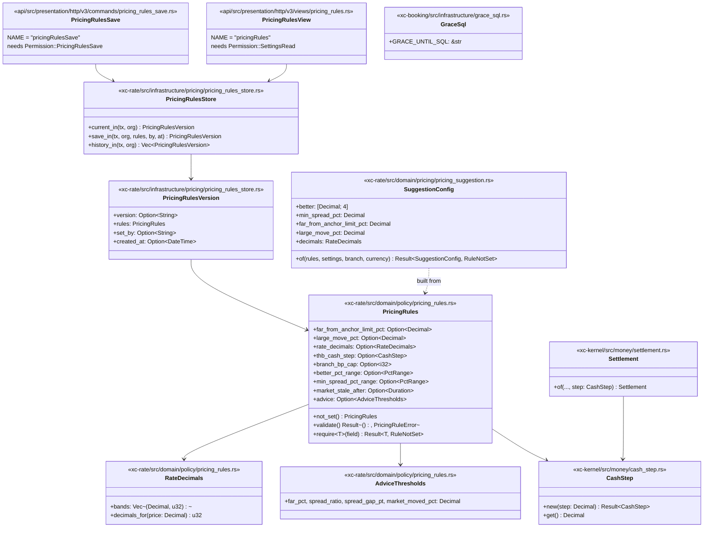

# Blueprint: the Owner's pricing rules and the hidden fallbacks (user-set settings, Groups A and D)

**Source.** Owner principle #5993 ([user-set-settings](user-set-settings.md)): every business value is stored data saved from a screen; only the Owner saves it; "not set" behaves safely and the screen shows it. The values come from the lane controller's survey (#564 issuecomment-6580330681), Group A rows 2, 3, 4, 5, 7, 8, 9, 16, 17 and Group D rows 6, 15, 19, 22, 23. Row 1 (tier bands) is [pricing-tiers](pricing-tiers.md) §15.14. Groups B and C are a later design. Row 13 is not part of this design (the controller asks the owner).

Measured on `origin/main` `6d9e0784` (2026-11-03). Data counts are from xc-v3, read-only, at 09:54 ICT.

## 1. What is fixed in code today

| Row | Value | Where (main `6d9e0784`) | What it decides | Stored today |
|---|---|---|---|---|
| 2 | far from the market: `far_from_anchor_pct` 1, multiplied by 3 at use ⇒ 3 % | `xc-rate/src/domain/pricing/pricing_suggestion.rs:58`; `tier_check.rs:86` `config.far_from_anchor_pct * Decimal::from(3)` | refuses tier approve (`pricing_approve.rs:388-392`), branch push (`branch_push.rs:121` → `branch_policy.rs:143`), and blocks auto-follow (`follow_plan.rs:186`) | no |
| 3 | large move: `large_move_pct` 1 % | `pricing_suggestion.rs:59`; read at `:281` and `follow_plan.rs:164` | stops auto-follow (`FollowReason::LargeMove`); on the board it is a warning only (`pricing_flag.rs:18,30`) | no |
| 4 | rate decimals: 2 dp at ≥ 10, 3 dp at ≥ 1, else 4 dp (a TT decimals hint ≥ 2 wins, capped at 4) | `pricing_suggestion.rs:122-127` | the suggested tier prices; buy is floored and sell is ceiled (`:130-131`) | no |
| 5 | THB cash step 0.25 | `xc-kernel/src/money/settlement.rs:31` `THB_CASH_STEP`; DB CHECKs `migrations/20261226090000_cash_rounding.sql:5,7` (`< 0.25`) | cash THB settlement rounding of every quote and transaction line | no |
| 7 | unit size JPY 100, KRW 1000, else 1 | `xc-rate/src/domain/draft/draft_evaluation.rs:35-40` (and `MinorUnit::new(2)` at `:153`) | the draft guard's per-unit comparison | **yes**: `currencies.unit_size` / `minor_unit` (`20261010100000_rate_units.sql:6`) |
| 8 | branch markup cap ±300 bp | `xc-rate/src/domain/pricing/branch_policy.rs:66` `MAX_BP`; `web/src/screens/admin/pricing/pricing-labels.ts:49-50`; DB CHECK `20261226100000_v9_pricing.sql:34-35` | refuses `pricingBranchPolicySave` (`pricing_branch_policy_save.rs:111,123`); bounds the web inputs (`BranchPolicy.tsx:38,75`, `BranchDefault.tsx:32,64`) | no |
| 9 | allowed margin range: better −2..2 %, minimum spread 0..5 % | `xc-rate/src/domain/pricing/suggestion_settings.rs:68-69`; `xc-rate/src/domain/policy/currency_tier_override.rs:63`; `pricing_suggestion_settings_save.rs:115`; DB CHECKs `20261219170000_rate_policy_currency_tiers.sql:23`, `20261226100000_v9_pricing.sql:75` | refuses `pricingSuggestionSettingsSave` and `pricingConfigure` | no |
| 16 | market stale after 30 min | `xc-rate/src/domain/pricing/market_snapshot.rs:67` `STALE_AFTER_MINUTES` (`REFRESH_AFTER_MINUTES = 5` at `:69` has no reader) | blocks auto-follow (`follow_plan.rs:68,151`) and bulk approve (`market_quote.rs:57` → `PricingFlag::StaleSource`, blocking at `pricing_flag.rs:30`); board staleness (`pricing_board.rs:150,151,392,396,746`; `pricing_approve.rs:382`) | no |
| 17 | board advice: far 1 %, spread ratio 1.5×, spread gap 0.5 pt, market moved 0.2 % | locals in `Recommendation::list`, `xc-rate/src/domain/pricing/recommendation.rs:119-123`, used at `:150-182,196,220` | which advice the pricing board shows (only caller `pricing_board.rs:953`) | no |
| 6 | margin fallback: better 0.1/0.14/0.2/0.3, minimum spread 0.3 | `SuggestionConfig::v9_default()` `pricing_suggestion.rs:49-61`, used by `SuggestionSettings::better_for` (`suggestion_settings.rs:46`) and `min_spread_for` (`:60`) | the suggested margins when a branch has no `pricing_suggestion_settings` row | yes, per branch, `pricing_suggestion_settings` |
| 15 | quote lifetime 300 s when the organisation has no row | `xc-exchange/src/infrastructure/settings/repository.rs:41` `row.unwrap_or(300)` | INDICATIVE quote expiry (`quote.rs:283`) | yes, `exchange_settings.quote_ttl_seconds` (NOT NULL) |
| 19 | booking no-show grace 15 min when the organisation has no policy row, in 6 places | SQL `COALESCE(p.no_show_grace_minutes, 15)` in `views/my_bookings.rs:150`, `views/desk_bookings.rs:91`, `commands/bookings/qr.rs:89`; Rust `unwrap_or(15)` in `commands/bookings/kiosk_check_in.rs:79`, `commands/bookings/check_in.rs:141`, `xc-booking/src/application/check_in.rs:178` | until when a booking can still check in | yes, `booking_policies.no_show_grace_minutes` (NOT NULL) |
| 22 | kiosk currencies USD, EUR, GBP, JPY, CNY, AUD when a branch has no switches | `xc-kiosk/src/domain/kiosk/value_objects/kiosk_currencies.rs:8` `DEFAULT_CODES` | which currencies a kiosk sells (`currencies.rs:27`; `customer.rs:51,111,563`) | yes, per branch, `kiosk_currencies` |
| 23 | rate display: tiers 1–4, ten featured currencies, highlight on, all market on | `xc-rate/src/domain/pricing/display_settings.rs:57-67` `v9_default()`, used when neither the branch nor MAIN has a row (`display_settings_store.rs:71`) | the public rate display | yes, per branch, `rate_display_settings` |

**What the code keeps (protocol and safety bounds, [user-set-settings](user-set-settings.md) "What is not a business value").** These stay as they are:
- the rounding **direction**: buy is rounded down and sell up, so a price never rounds against the shop;
- the 4-decimal precision check (`follow_plan.rs:183`) and the 5-dp cap on branch push (`branch_policy.rs:121`);
- the 8-dp storage rounding (`publish_service.rs:492`, `rate_repository.rs:39`);
- `DisplaySettings::MAX_FEATURED` (10), which fits the display board;
- the quote lifetime bounds of 30 to 3600 s (`repository.rs:24-25`), and the 0 to 129,600 min bound on the grace (`commands/bookings/policy.rs:71-75`).

The design does not move these.

## 2. The rule for each Group A value

**One store, versioned.** Rows 2, 3, 4, 5, 8, 9, 16 and 17 are organisation-wide rules of the Owner's pricing. They go into **one new table, `pricing_rule_versions`**: one row per save, never overwritten (banking control 5). The current rules are the newest version of the organisation. Every column is NULL-able, and NULL means "not set".

Why one new table and not the existing ones:
- `pricing_suggestion_settings` is **per branch** and overwritten in place. These rules are the Owner's frame for every branch.
- `exchange_settings` is per organisation but overwritten in place, and it is about quotes.
- A versioned table is what banking control 5 asks for.

The existing per-branch tables keep what they hold; §6 lists them for the banking (4) survey.

**Save.**
- **Command:** `pricingRulesSave` on `/api/pricing/rules`.
- **Permission:** a new `Permission::PricingRulesSave`. It has no module and is granted only to EXECUTIVE, like the B2 saves (`role_grants.rs`, user-management-rbac §11.11).
- **OTP:** the Owner's OTP step-up comes with the OTP design. It wraps this save like every other settings save, and nothing here waits for it.
- **What a save writes:** each save writes one full version. The fields the request leaves out are copied from the current version, and a field sent as `null` clears it.
- **Read view:** `pricingRules` needs `SettingsRead`.

**Screen.** A "Pricing rules" card on `/admin/pricing` (`web/src/screens/admin/pricing/`). It shows each value, or "Not set" with what that means (the third column below). It also shows who saved the current version and when, and the list of earlier versions. The FE half belongs to claude/01TxaRJG.

| Row | Field (`pricing_rule_versions`) | Unit and check | Readers that change | Not set |
|---|---|---|---|---|
| 2 | `far_from_anchor_limit_pct numeric(9,4)` | % > 0. It stores **the limit itself** (today's effective value is 3), so the hidden ×3 at `tier_check.rs:86` goes. | `TierCheck::validate` (tier approve, branch push, auto-follow) | Tier approve and branch push refuse with `pricingRuleNotSet`, field `farFromAnchorLimitPct`. Auto-follow stops with `FollowReason::RuleNotSet`. Nothing is published unchecked. |
| 3 | `large_move_pct numeric(9,4)` | % > 0 | `PricingSuggestion::of_with` (`:281`), `FollowPlan::plan_with` (`:164`) | Auto-follow stops with `RuleNotSet`, so every move waits for a person. The board shows the warning flag as "rule not set". |
| 4 | `rate_decimals jsonb` | a list of `{fromPrice, decimals}`, rising `fromPrice` starting at 0, and `decimals` 0..=4. Today's rule is `[{0,4},{1,3},{10,2}]`. | `PricingSuggestion::of_with` `:122-127`. The TT-hint arm stays: it is the source's own precision. The branch push keeps its own rule, the base's scale capped at 5, which is derived from data. | The suggestion has no suggested prices. It carries the blocking flag `RuleNotSet`, so it is not selectable for bulk approve, and auto-follow stops. |
| 5 | `thb_cash_step numeric(6,2)` | > 0 | `Settlement::of` (`settlement.rs:34`), through `QuoteService::price_in` `quote.rs:382,537` only. Callers reached: desk transaction save (`save_transaction.rs:439`), quotes command (`commands/quotes.rs:263`), binding issue (`binding_issue.rs:176`). The kiosk passes `payment_method: None` (`kiosk_ports.rs:480`) and never settles in cash. The web only shows `roundingThb` from the server (`desk/steps/payment/step.tsx:43`, `desk/Summary.tsx:70`). | A cash THB quote is refused with `pricingRuleNotSet`, field `thbCashStep`. Non-cash quotes are unchanged. The drawer cannot pay satang, so no rounding at all would not be safe. |
| 7 | none | **No new value.** The draft guard reads the stored `currencies.unit_size` and `minor_unit`, which its only caller already loads (`rate_draft_service.rs:513,544`). | `DraftEvaluation::of_tiered_with` gains a units parameter. `currency_unit_size` (`draft_evaluation.rs:35-40`) and `MinorUnit::new(2)` (`:153`) are deleted. | Not applicable: `unit_size` is NOT NULL with a CHECK > 0. |
| 8 | `branch_bp_cap integer` | > 0. It is one symmetric cap, as today. | `BranchPricingPolicy::check_bp` (`branch_policy.rs:155-161`) via `pricing_branch_policy_save.rs:111,123`. The web reads the cap from the `pricingRules` view; the constants in `pricing-labels.ts:49-50` go. | Saving a non-NULL bp is refused with `pricingRuleNotSet`, field `branchBpCap`. Clearing a bp is still allowed. Push uses the bps already saved. |
| 9 | `better_pct_min`, `better_pct_max`, `min_spread_pct_min`, `min_spread_pct_max` (`numeric(9,4)`) | min ≤ max, and the spread min is ≥ 0 | `SuggestionSettings::validate` (`suggestion_settings.rs:68-69`), `CurrencyTierOverride::new` (`currency_tier_override.rs:63`), `pricing_suggestion_settings_save.rs:115` | A save that sets a better % or a minimum spread is refused with `pricingRuleNotSet`. Clearing is still allowed. |
| 16 | `market_stale_after_minutes integer` | > 0 | `MarketStaleness::is_stale` and `SourceFreshness::is_current` (`follow_plan.rs:68`). `REFRESH_AFTER_MINUTES` is deleted; it has no reader. | Every source counts as stale: auto-follow stops (`StaleSource`), and bulk approve is blocked by the existing blocking flag. |
| 17 | `advice_far_pct`, `advice_spread_ratio`, `advice_spread_gap_pt`, `advice_market_moved_pct` (`numeric(9,4)`) | each > 0 | `Recommendation::list` (`recommendation.rs:119-123`), whose only caller is `pricing_board.rs:953` | The board shows no advice, and one line says "advice thresholds not set". Advice is information only, so nothing else changes. |

**The values in force on main today** are the ones in §1. The data migration does not write them (§5). The Owner enters them on the card. The card may show them as a hint ("V.9 used 3 %"), but a hint is never saved for the Owner.

## 3. Group D: one rule for the hidden fallbacks

**Rule.** A stored setting has **no code fallback**. When the stored value is missing, the reader does the safe thing the design names, with no number, and the screen says "not set". None of these five fallbacks is a value the screen can show as "the effective default", because each is a business choice: which margins to suggest, which currencies to sell, how long a booking waits. So every one takes the safe-behaviour branch.

| Row | Today | Not set becomes | Why that is safe | One owner |
|---|---|---|---|---|
| 6 | `SuggestionConfig::v9_default()` margins when a branch has no row | `better_for` / `min_spread_for` return "not set". The suggestion has no suggested prices and carries `RuleNotSet` (blocking), and auto-follow stops. The board's margin column says "not set". | no price is suggested from margins the Owner never chose | `SuggestionSettings` (`suggestion_settings.rs`); `v9_default()` is deleted |
| 15 | 300 s when the organisation has no `exchange_settings` row | `get_ttl_in` returns `None`. A quote is refused with `settingNotSet`, field `quoteTtlSeconds`, and the view shows "not set". | xc-v3 has a row for its 1 organisation (measured); a new organisation sees the refusal until the Owner saves | `PgSettingsRepository::get_ttl_in` (`repository.rs:41`); `ExchangeSettings::default` (`settings.rs:15`) has no caller and is deleted |
| 19 | `15` in six places when the organisation has no `booking_policies` row | No grace: check-in is refused with the existing `BookingsClosed`, which `booking_service.rs:173,538` already gives with no policy row. The views show no `grace_until`. | bookings with no policy are already closed for booking, and check-in now matches | **one owner:** `BookingPolicy::grace_until` (`xc-booking/src/domain/policy/booking_policy.rs:23`) for the three Rust sites. The three SQL sites share one fragment, `GRACE_UNTIL_SQL`, in a new `xc-booking/src/infrastructure/grace_sql.rs`, which joins `booking_policies` with no `COALESCE`. ♻️ |
| 22 | six default codes when a branch has no switches | `KioskCurrencies::new` starts from an empty list, so a kiosk with no switches sells nothing and says "no currencies set up". | the kiosk never sells a currency nobody chose | `KioskCurrencies` (`kiosk_currencies.rs`); `DEFAULT_CODES` is deleted |
| 23 | `DisplaySettings::v9_default()` when neither the branch nor MAIN has a row | `DisplaySettings::not_set()`: every published tier and every published currency, nothing featured, no highlight. The display screen says "not set: showing everything". | showing everything that is published hides nothing and invents no choice | `DisplaySettings` (`display_settings.rs`); `v9_default()` is replaced |

**Found, not decided here.**
- The kiosk currency switches are saved by the kiosk action `configure`, which needs `Permission::RatesDraft` (`xc-auth/.../areas/kiosk.rs`), not an EXECUTIVE-only save.
- `pricing_branch_policy` and `rate_display_settings` have no versions, and their saves write no audit row.

These are for the banking approval matrix and the banking (4) survey (§6). This design does not move them.

## 4. Class diagram



| Provides | Used by |
|---|---|
| `PricingRules`, `RateDecimals`, `AdviceThresholds`, `PricingRuleError`, `RuleNotSet` | `SuggestionConfig::of`, `TierCheck::validate`, `FollowPlan::plan_with`, `MarketStaleness::is_stale(fetched_at, now, stale_after: Option<Duration>)`, `Recommendation::list` (`RecommendationInput.advice: Option<AdviceThresholds>`), `BranchPricingPolicy::check_bp(bp, cap: Option<i32>)`, `SuggestionSettings::validate(ranges)`, `CurrencyTierOverride::new(.., range)` |
| `PricingRulesStore::current_in` | `market_pricing_loop.rs:367` `build_follow_input`, `pricing_board.rs:764-781` `load_pricing_board`, `pricing_approve.rs:388`, `branch_push.rs:121`, `spread_check.rs:345`, `quote.rs` `price_in` (for `thb_cash_step`), and the three save commands of row 8 and row 9 |
| `CashStep` (xc-kernel) | `Settlement::of`. xc-kernel does not depend on xc-rate, so `quote.rs` reads the store and passes the step in. |
| `DraftEvaluation::of_tiered_with(.., units: &HashMap<CurrencyCode, CurrencyUnits>)` | `rate_draft_service.rs:600` |
| `GRACE_UNTIL_SQL` | `views/my_bookings.rs`, `views/desk_bookings.rs`, `commands/bookings/qr.rs` |

**Fallback while the provider has not landed.** A consumer ticket that starts before `pricing_rules.rs` merges declares the struct with this signature in its own file, marked `// moves to domain/policy/pricing_rules.rs`. It never edits the provider's file.

## 5. Data migration

**New table** (one migration, numbered by `scripts/migration-slot.sh next` right before `pr_open`):

```sql
CREATE TABLE pricing_rule_versions (
    version                     text        PRIMARY KEY,
    organization_id             uuid        NOT NULL REFERENCES organizations(id),
    far_from_anchor_limit_pct   numeric(9,4) NULL CHECK (far_from_anchor_limit_pct > 0),
    large_move_pct              numeric(9,4) NULL CHECK (large_move_pct > 0),
    rate_decimals               jsonb        NULL,
    thb_cash_step               numeric(6,2) NULL CHECK (thb_cash_step > 0),
    branch_bp_cap               integer      NULL CHECK (branch_bp_cap > 0),
    better_pct_min              numeric(9,4) NULL,
    better_pct_max              numeric(9,4) NULL,
    min_spread_pct_min          numeric(9,4) NULL CHECK (min_spread_pct_min >= 0),
    min_spread_pct_max          numeric(9,4) NULL,
    market_stale_after_minutes  integer      NULL CHECK (market_stale_after_minutes > 0),
    advice_far_pct              numeric(9,4) NULL CHECK (advice_far_pct > 0),
    advice_spread_ratio         numeric(9,4) NULL CHECK (advice_spread_ratio > 0),
    advice_spread_gap_pt        numeric(9,4) NULL CHECK (advice_spread_gap_pt > 0),
    advice_market_moved_pct     numeric(9,4) NULL CHECK (advice_market_moved_pct > 0),
    set_by                      text        NOT NULL,
    created_at                  timestamptz NOT NULL,
    CHECK (better_pct_min IS NULL OR better_pct_max IS NULL OR better_pct_min <= better_pct_max),
    CHECK (min_spread_pct_min IS NULL OR min_spread_pct_max IS NULL OR min_spread_pct_min <= min_spread_pct_max)
);
CREATE INDEX pricing_rule_versions_current ON pricing_rule_versions (organization_id, created_at DESC);
```

**Constraints that encode a business number, changed in the same migration:**

| Constraint | Today | Becomes |
|---|---|---|
| `pricing_branch_policy` `buy_bp` / `sell_bp` (`v9_pricing.sql:34-35`) | `BETWEEN -300 AND 300` | dropped; the save checks against `branch_bp_cap` |
| `min_spread_pct` CHECKs (`20261219170000_rate_policy_currency_tiers.sql:23`, `v9_pricing.sql:75`) | `BETWEEN 0 AND 5` | `>= 0`; the save checks the range |
| `quote_lines_rounding_within_a_coin`, `transaction_lines_rounding_within_a_coin` (`20261226090000_cash_rounding.sql:5,7`) | `< 0.25` | each table gains `cash_step_thb numeric(6,2) NULL`, the step the line was settled with. The CHECK becomes `cash_step_thb IS NULL AND <rounding> = 0` or `<rounding> < cash_step_thb`. |

1. **Existing rows after the migration.**
   - `pricing_rule_versions` starts empty, so every organisation reads "not set" until the Owner saves.
   - `pricing_branch_policy` has 0 rows on xc-v3.
   - `quote_lines` (33) and `transaction_lines` (15) are the rows that would violate the new line CHECK while their `cash_step_thb` is NULL and their rounding is not 0.
2. **Backfill.** One backfill, of history and not of a business value: every existing line was settled under the code step 0.25, so
   ```sql
   UPDATE quote_lines SET cash_step_thb = 0.25 WHERE settle_thb <> CASE shop_side WHEN 'BUY' THEN thb_amount - fee_thb ELSE thb_amount + fee_thb END;
   UPDATE transaction_lines SET cash_step_thb = 0.25 WHERE settle_thb <> CASE shop_side WHEN 'BUY' THEN thb_amount - fee_thb ELSE thb_amount + fee_thb END;
   ```
   It runs before the new CHECK is added. Count before deploy, read-only:
   ```sql
   SELECT count(*) FROM quote_lines WHERE settle_thb <> CASE shop_side WHEN 'BUY' THEN thb_amount - fee_thb ELSE thb_amount + fee_thb END;
   SELECT count(*) FROM transaction_lines WHERE settle_thb <> CASE shop_side WHEN 'BUY' THEN thb_amount - fee_thb ELSE thb_amount + fee_thb END;
   ```
   (Upper bound measured 2026-11-03 09:54 ICT: 33 and 15 lines in total.) The backfill is Data Risk and needs the owner's approval. **No backfill writes a pricing rule:** a seeded rule would be a business value in a migration, which the principle forbids.
3. **Deploy order.**
   - The migration runs before the new binary (embedded, at boot).
   - The old binary does **not** fully work with the new schema. It never reads `pricing_rule_versions`, which is harmless, but it does not write `cash_step_thb`, and a line with non-zero rounding needs that column under the new CHECK. So **the old binary's cash quotes would fail the CHECK.** The migration and the new binary therefore go in the same deploy, which is the normal boot order.
   - **After the deploy, before pricing runs again,** the Owner saves the pricing rules on the card. Until then, auto-follow stops, bulk approve and branch push refuse, and cash THB quotes are refused.
   - The FE card ships in the same deploy. Without it the Owner has no way to save, and pricing stays stopped.
4. **What `down` loses.** It drops `pricing_rule_versions`, with every saved version and its history, and drops `cash_step_thb` from both line tables. It restores the `-300..300`, `0..5` and `< 0.25` CHECKs. Restoring them fails if a saved row lies outside them, in which case those rows are reported and nothing is changed.

Group D (§3) adds no table and no column.

## 6. Behaviour rows (the tickets' tests)

| # | Case | Result |
|---|---|---|
| G-1 | no `pricing_rule_versions` row; tier approve | refused, `pricingRuleNotSet`, field `farFromAnchorLimitPct`; nothing published |
| G-2 | `far_from_anchor_limit_pct` 3; tier 1 at 3.5 % from the anchor | refused `FarFromAnchor { limit_pct: 3 }` (today's `tier_check_test` restated through a saved rule) |
| G-3 | `far_from_anchor_limit_pct` 5; the same tier | approved: the saved value decides, with no ×3 |
| G-4 | no `large_move_pct`; auto-follow tick | plan stops, `RuleNotSet` |
| G-5 | `rate_decimals` `[{0,4},{1,3},{10,2}]`; USD anchor 35.1234 | suggested buy floored to 2 dp, sell ceiled to 2 dp |
| G-6 | no `rate_decimals` | the suggestion has no prices, flag `RuleNotSet` blocks, not selectable |
| G-7 | `thb_cash_step` 0.25; cash THB line of 1,000.13 | settles 1,000.00 (buy) / 1,000.25 (sell); the line stores `cash_step_thb` 0.25 |
| G-8 | `thb_cash_step` 0.50; the same line | settles to the 0.50 step; `cash_step_thb` 0.50 |
| G-9 | no `thb_cash_step`; cash THB quote | refused, `pricingRuleNotSet`, field `thbCashStep`; a PromptPay quote is unchanged |
| G-10 | JPY draft line with `currencies.unit_size` 100 | the guard compares per 100 (today's result, read from the column) |
| G-11 | `branch_bp_cap` 200; save `buyBp` 250 | 400 `validationFailed`, field `buyBp` |
| G-12 | no `branch_bp_cap`; save `buyBp` 50 / clear `buyBp` | refused `pricingRuleNotSet` / 200 |
| G-13 | better range −1..1; save better 1.5 | 400 `validationFailed` |
| G-14 | `market_stale_after_minutes` 30; snapshot 30 min / 31 min old | current / stale |
| G-15 | no `market_stale_after_minutes` | every source stale: auto-follow stops, bulk approve blocked |
| G-16 | no advice thresholds | the board lists no advice; the view says not set |
| G-17 | FINANCE, BRANCH_MANAGER, ADMIN without EXECUTIVE: `pricingRulesSave` | refused, permission |
| G-18 | EXECUTIVE saves twice | two versions; `pricingRules` answers the newer with `setBy`/`createdAt`, and the history lists both |
| D-1 | branch with no `pricing_suggestion_settings` row | no suggested prices, `RuleNotSet`; no V.9 margins |
| D-2 | organisation with no `exchange_settings` row; quote | refused `settingNotSet`, field `quoteTtlSeconds` |
| D-3 | organisation with no `booking_policies` row; desk check-in, kiosk check-in, QR, both booking views | `BookingsClosed` / no `grace_until`, in all six places |
| D-4 | `no_show_grace_minutes` 20 | every one of the six places uses 20 |
| D-5 | branch with no kiosk switches | the kiosk offers no currency |
| D-6 | no display row for the branch or MAIN | every published tier and currency, nothing featured, no highlight |

**Tests that pin today's numbers and are restated** (each sets the value through `pricingRulesSave` or a fixture row, never a constant):
- `xc-rate/tests/tier_check_test.rs` `tier_one_far_from_the_anchor_is_refused`
- `v9_pricing_branch_policy_test.rs` `an_adjusted_set_far_from_the_anchor_is_refused`, `a_bp_is_between_minus_and_plus_three_hundred`
- `tests/pricing_approve_tier_check_test.rs`
- `tests/v9_pricing_push_test.rs`, `tests/v9_pricing_approve_test.rs`
- `pricing_suggestion_test.rs` (`tier_one_moving_more_than_one_percent_is_a_large_move`, `half_a_percent_better_rounds_buy_down`, `yen_keeps_four_decimals`, `rupiah_cannot_be_expressed_in_four_decimals`, `usd_default_tiers_are_v9s`)
- `v9_pricing_follow_plan_test.rs` (the four `LargeMove` tests, the two 30/31-minute tests)
- `tests/v9_pricing_follow_test.rs`
- `market_snapshot_test.rs`, `v9_pricing_source_freshness_test.rs`
- `recommendation_test.rs`
- `suggestion_settings_test.rs` (`v9s_configure_checks`, `currency_then_branch_then_v9s_default`)
- `currency_tier_override_test.rs`
- `v9_pricing_domain_test.rs` `min_spread_is_the_currency_override_then_the_branch_then_v9s`
- `tests/pricing_board_suggestion_test.rs`
- `xc-kernel/tests/settlement_test.rs` (`the_step_is_a_quarter_baht` goes; `cr1`–`cr6` take the step as input)
- `tests/cash_rounding_quote_test.rs`, `tests/cash_rounding_transaction_test.rs`
- `rate_evaluation_test.rs` (`units_of` reads the column)
- `tests/tx4_repositories_test.rs` and `tests/exchange_settings_view_test.rs` (the no-row 300 cases)
- `xc-kiosk/tests/kiosk_currencies_test.rs` `row1_empty_switches_offers_default_currencies`
- `xc-rate/tests/v9_pricing_display_test.rs` `the_default_is_v9s`, `tests/v9_pricing_display_test.rs`
- web: `BranchPolicy.test.tsx`, `BranchDefault.test.tsx`

A ticket's flip table is measured by running the whole touched crates against the ticket author's throwaway, not by this list.

## 7. Tickets (cut after this design and its data migration are approved)

All are `class:logic` on Argon. The File scopes are disjoint, so they release together.

| Ticket | Scope | Needs |
|---|---|---|
| GA-1 | migration, `pricing_rules.rs`, `pricing_rules_store.rs`, `pricing_rules_save.rs`, `pricing_rules.rs` (view), `Permission::PricingRulesSave` in xc-auth | owner approval of §5 (`class:guarded`) |
| GA-2 | xc-rate domain: rows 2, 3, 4, 16, 17, D-row 6, and the new signatures of row 8 (`check_bp`) and row 9 (`SuggestionSettings::validate`, `CurrencyTierOverride::new`). Files: `pricing_suggestion.rs`, `tier_check.rs`, `follow_plan.rs`, `market_snapshot.rs`, `recommendation.rs`, `suggestion_settings.rs`, `branch_policy.rs`, `currency_tier_override.rs`, `branch_push.rs`, `spread_check.rs` | GA-1's signature (stub allowed) |
| GA-3 | the readers in `api/src`: `market_pricing_loop.rs`, `pricing_board.rs`, `pricing_approve.rs`, `published_rates.rs`, and the three save commands (`pricing_branch_policy_save.rs`, `pricing_suggestion_settings_save.rs`, `pricing_configure.rs`) | GA-1 and GA-2 (they pass the store's rules into GA-2's signatures) |
| GA-4 | row 5: `cash_step.rs`, `settlement.rs`, `quote.rs` | GA-1 |
| GA-5 | row 7: `draft_evaluation.rs`, `rate_draft_service.rs` | none; can go first |
| GD-1 | Group D rows 15, 19, 22, 23 (`repository.rs`, `grace_sql.rs`, the six booking sites, `kiosk_currencies.rs`, `display_settings.rs`) | none |
| FE | "Pricing rules" card; cap from the view; the not-set lines on the board, kiosk and display screens | claude/01TxaRJG, same deploy as GA-1..GA-4 |
