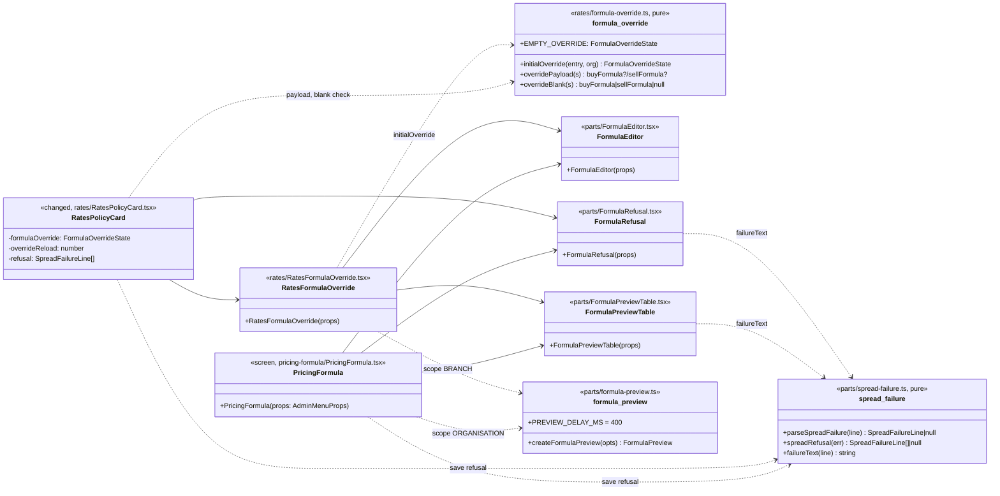

# Blueprint pricing formula, FE (wave 4): the formula editor, the branch override, the save refusal (#564)

> designed-by: claude/studio-claude-3 (AG FE pricing-formula, under the XC FE lane controller claude/e92db6),
> 2026-10-30 ICT · measured on `main` `bf5305fc` (every `file:line` below) · parent design
> [`pricing-formula.md`](pricing-formula.md) (§0 rulings F-1…F-7, §4 save check, §6 FE row, §9 wave 4, §11 as built)

## 0. What the BE gives (measured, not assumed)

| Contract | Where | Shape the FE relies on |
|---|---|---|
| view `pricing_formula?branch=` | `api/src/presentation/http/v3/views/pricing_formula.rs`; TS `web/src/shared/api/generated/pricing_formula.ts` | `PricingFormulaData { organisation: OrganisationFormulaDto \| null, default: {buyFormula, sellFormula}, inputs: [{name}], branches: [{branch, source: BRANCH\|ORGANISATION\|DEFAULT, own: texts \| null}] }`. Read permission inherits `rateDraft` (`views/pricing_formula.rs:104`). |
| `pricingFormulaPreview` `POST /api/pricing/formula/preview` | `commands/pricing_formula_preview.rs:101-110`; TS `pricing_formula_preview.ts` | input `{branch, buyFormula, sellFormula, scope: ORGANISATION\|BRANCH}`; output `{parseError: {field, code, message} \| null, rows: FormulaCheckRowDto[], notChecked: [{branch, currency}], ok}`. A parse error is in `parseError`, not an error status. Writes nothing. |
| `pricingFormulaSave` `POST /api/pricing/formula` | `commands/pricing_formula_save.rs:52-140`; TS `pricing_formula_save.ts` | input `{branch, buyFormula, sellFormula, reason}`; output `{id, version, notChecked}`. Refusals: blank reason ⇒ `400` field `reason`; bad text ⇒ `400 validationFailed` field `buyFormula`/`sellFormula`, message = the `FormulaError`; failing check ⇒ `400 validationFailed` field `buyFormula`, message = one `SpreadFailure::describe()` per line joined by `\n` (A-6). |
| `ratePolicySave` `POST /api/rate-policies` | `commands/rate_policy_save.rs:74-95`, `:292-320`, `:610-612`; TS `rate_policy_save.ts:5-18` | `buyFormula?`/`sellFormula?`: absent = keep, `null` = follow the organisation, text = own; both or neither, else `400` field `sellFormula`. Output gains `notChecked?`. A failing check ⇒ `400 validationFailed`, field `buyFormula` when texts were sent, else `buyAdjustPct`, message = the same `\n`-joined lines (A-7). Any formula change other than keep needs EXECUTIVE (`rate_policy_save.rs:454-468`). |
| a failure line | `api/crates/xc-rate/src/application/formula/spread_check.rs:92-130` `SpreadFailure::describe` | `<branch> <currency>[ tier <n>][ FOLLOW] <detail>`, detail one of `buy <p> > sell <p>` · `<syntax\|unknownInput\|missingInput\|divideByZero\|overflow\|notPositive\|tooLong\|tooDeep>` · `<buy\|sell> <p> outside guard [<min>, <max>] (<±pct> %)`; `-` for a missing price. The preview row's `failure` is the same text. |
| who may | `pricing_formula_save.rs:74-81`, `pricing_formula_preview.rs:108-133` | both commands inherit `ratePolicySave` (permission `RatePolicySave`) and then require EXECUTIVE (organisation-wide for scope `ORGANISATION`), else `403 roleNotAllowedHere` (A-10). |

**Gap posted for the BE lane (claude/553782), not worked around:** a preview row does not carry the currency's unit size,
which §6a's "constants are per the line's unit" note needs beside each row (#564 issuecomment-6511702725). The FE expects
`FormulaCheckRowDto.unitSize: string`. Only ticket T4 reads it; every other ticket is independent of it.

**Who sees what (F-2, F-4).** The FE checks permissions, never role names (owner 2026-10-22: who may do what is the
customer's to configure). The menu needs `RatePolicySave`, the permission both commands inherit. The EXECUTIVE rule is the
server's: a non-EXECUTIVE caller sees the screen, and the server's `roleNotAllowedHere` is shown in words, as
`RatesPolicyFrame` does today (`web/src/screens/admin/rates/RatesPolicyFrame.test.tsx:671-677`).

## 1. Where it lives

- **Organisation formula editor = a new admin menu `pricing-formula`**, group `money`, `order: 30`, `needs: 'RatePolicySave'`,
  `blueprint: true`. Measured: the money group holds `cash` 4, `rates` 5, `payments` 6, `reports` 7, `denomination-groups` 13,
  `cash-policy` 18, `reconciliation` 19, `starting-prices` 22, `campaigns` 23, `campaign-performance` 24, `loyalty` 27,
  `cash-limits` 28, `pricing` 29 (`web/src/screens/admin/*/menu.ts`); 30 is free and puts it right after the pricing board
  (FOLLOW) and with the other rate menus. It is its own menu, not a section of `rates` or `pricing`, because the formula
  is organisation-wide and those two screens are per branch.
- **Branch override = a block at the foot of the policy card** (`web/src/screens/admin/rates/RatesPolicyCard.tsx`), saved by
  the card's existing "บันทึกนโยบาย" button through `ratePolicySave`.
- 🔴 **The block is collapsed and reads `pricing_formula` only when opened.** Measured: a read on show breaks
  `RatesDraft.test.tsx:607` ("an unexpected read on show"), which pins the reads the rates screen makes. A closed block
  sends nothing, so the card's save keeps the formula (`buyFormula` absent).
- Shared pieces (editor, preview, preview table, refusal) live in `web/src/screens/admin/parts/`: no admin menu imports
  another menu's folder today, and both the new menu and the rates card use them.

## 2. Class diagram



Every signature below is `[required]`: the skeleton commit fixes it and the up-front tests import it.

```ts
// parts/spread-failure.ts
export type SpreadFailureKind = 'buyAboveSell' | 'outsideGuard' | 'formula';
export interface SpreadFailureLine {
  branch: string; currency: string; tier: number | null; follow: boolean; kind: SpreadFailureKind;
  buy: string | null; sell: string | null;          // buyAboveSell: both ('-' ⇒ null); outsideGuard: the side's price
  side: 'buy' | 'sell' | null;                       // outsideGuard only
  guardMin: string | null; guardMax: string | null; pct: string | null; // outsideGuard only, pct with its sign
  code: string | null;                               // formula only: the FormulaError code
  raw: string;                                       // the line as received
}
export function parseSpreadFailure(line: string): SpreadFailureLine | null;
export function spreadRefusal(err: unknown): SpreadFailureLine[] | null;
export function failureText(line: SpreadFailureLine): string; // Thai, from parts/formula-i18n.ts

// parts/formula-preview.ts
export type FormulaScope = 'ORGANISATION' | 'BRANCH';
export const PREVIEW_DELAY_MS = 400;
export const ROUTE_PRICING_FORMULA_PREVIEW = '/api/pricing/formula/preview';
export const ROUTE_PRICING_FORMULA_SAVE = '/api/pricing/formula';
export interface FormulaPreviewOptions {
  api: ApiClient; branch: () => string; scope: FormulaScope;
  buy: () => string; sell: () => string; enabled: () => boolean;
}
export interface FormulaPreview {
  result: () => PricingFormulaPreviewOutput | null; pending: () => boolean;
  error: () => string | null; stopped: () => boolean;
}
export function createFormulaPreview(o: FormulaPreviewOptions): FormulaPreview; // call inside a component

// parts/FormulaEditor.tsx
export interface FormulaEditorProps {
  buy: () => string; sell: () => string; onBuy: (v: string) => void; onSell: (v: string) => void;
  inputs: () => readonly string[]; defaults: () => FormulaTextsDto;
  parseError: () => FormulaParseErrorDto | null; disabled: () => boolean;
}
// parts/FormulaPreviewTable.tsx
export interface FormulaPreviewTableProps {
  result: () => PricingFormulaPreviewOutput | null; pending: () => boolean; error: () => string | null;
}
// parts/FormulaRefusal.tsx
export interface FormulaRefusalProps { lines: () => readonly SpreadFailureLine[] }

// rates/formula-override.ts
export type OverrideChoice = 'ORGANISATION' | 'BRANCH';
export interface FormulaOverrideState {
  current: BranchFormulaDto | null; // null = never loaded (block closed or load failed)
  choice: OverrideChoice; buy: string; sell: string;
}
export const EMPTY_OVERRIDE: FormulaOverrideState;
export function initialOverride(entry: BranchFormulaDto, org: FormulaTextsDto): FormulaOverrideState;
export function overridePayload(s: FormulaOverrideState): Pick<RatePolicySaveInput, 'buyFormula' | 'sellFormula'>;
export function overrideBlank(s: FormulaOverrideState): 'buyFormula' | 'sellFormula' | null;

// rates/RatesFormulaOverride.tsx
export interface RatesFormulaOverrideProps {
  branch: () => string; state: () => FormulaOverrideState; setState: (s: FormulaOverrideState) => void;
  reloadKey: () => number; disabled: () => boolean;
}
```

`RatesPolicyCardProps` does not change: the card owns the override state, so its existing callers and tests
(`Rates.tsx:340`, `admin-settings-bounds.test.tsx:666-700`) compile untouched.

**Text and look are in the skeleton, not in the tickets:** every string lives in `parts/formula-i18n.ts`
and `pricing-formula/i18n.ts` (`admin.pricing-formula`). The formula texts are read only through
`formulaT` (exported by `parts/formula-i18n.ts`, `screenT('admin.parts', …)`), never by a `screenT` call of the
consumer's own: the namespace guard (`shared/i18n/namespace.test.ts`, W10) wants every call to name its own folder, and
a shared `admin.formula` key failed it from `parts/`, `rates/` and `pricing-formula/` (measured on all nine heads
together, 2026-10-30). `parts/formula-i18n.test.ts` keeps its keys apart from `parts/i18n.ts`, which `screenT` reads first.
Tests build view and command objects with `shared/testing/fixtures` factories (`no-inline-dto.guard.test.ts`, §4.3). Staff screens are TH/EN only:
`collectScreens` refuses a `zh` export on an admin table ("is a staff screen: TH/EN only", measured on the skeleton), so
there is no `zh`. `pricing-formula/i18n.ts` has `en` copied from `th` (owner 2026-10-28: translation is a later ticket).
`parts/formula-i18n.ts` has real English in `en`, because these parts render on the rates screen and
`rates/RatesDraft.test.tsx` ("carry no Thai") refuses Thai text in English mode there (measured on the skeleton with the
block mounted). Every class name a ticket uses has its CSS rule in `parts/formula.css`
or `pricing-formula/pricing-formula.css`, so the class ratchet (`web/src/shared/ui/screen-look.test.ts`, check 3) passes.
A ticket that needs a key or a class the skeleton lacks stops and comments on its ticket.

## 3. Behaviour table (the up-front tests)

| # | Given | When | Then |
|---|---|---|---|
| **spread-failure (T2)** | | | |
| S1 | `MAIN USD buy 33.8837374 > sell 33.7293303` | `parseSpreadFailure` | branch MAIN, currency USD, tier null, follow false, kind buyAboveSell, buy `33.8837374`, sell `33.7293303` |
| S2 | `MAIN USD tier 3 FOLLOW buy 1.1 > sell 1.0` | parse | tier 3, follow true |
| S3 | `B2 JPY tier 1 divideByZero` | parse | kind formula, code `divideByZero`, buy/sell null |
| S4 | `MAIN USD buy 34.1 outside guard [-1, 1] (+1.2 %)` | parse | kind outsideGuard, side buy, buy `34.1`, guardMin `-1`, guardMax `1`, pct `+1.2` |
| S5 | `MAIN USD buy - > sell 33.7` | parse | buy null, sell `33.7` |
| S6 | `unknown input foo`, `MAIN USD hello` | parse | null |
| S7 | `ApiError` 400 `validationFailed`, field `buyFormula`, message of two S1-shaped lines | `spreadRefusal` | two lines, in order |
| S8 | the same error with one line that does not parse | `spreadRefusal` | null (an ordinary field error) |
| S9 | 403 / 500 / a non-`ApiError` / code other than `validationFailed` | `spreadRefusal` | null |
| S10 | S1, S3, S4 lines | `failureText` | Thai text naming the problem with the numbers (`ราคาซื้อ 33.8837374 สูงกว่าราคาขาย 33.7293303`; the formula code's Thai text; `ราคาซื้อ 34.1 อยู่นอกกรอบ -1 ถึง 1 (+1.2 %)`) |
| **live preview (T1)** | | | |
| P1 | enabled, both texts set | the texts stop changing for `PREVIEW_DELAY_MS` | one `POST /api/pricing/formula/preview` with `{branch, buyFormula, sellFormula, scope}`, texts trimmed; `result()` = the answer |
| P2 | three edits each within the delay | timers run out | exactly one call, with the last texts |
| P3 | call A sent, then the texts change and call B is sent; B answers before A | A answers | `result()` stays B's |
| P4 | either text blank | any time | no call; `result()` null |
| P5 | `enabled()` false | texts change | no call |
| P6 | the server answers 403 | — | `error()` worded, `stopped()` true, no further call when the texts change; a branch change clears `stopped` and calls again |
| P7 | the server answers 500 | — | `error()` worded, `result()` null; the next text change calls again |
| P8 | a call in flight | — | `pending()` true until it answers |
| **override payload (T8)** | | | |
| O1 | `current` null | `overridePayload` | `{}` (keep: never change what was not read) |
| O2 | choice ORGANISATION, `current.source` BRANCH | payload | `{buyFormula: null, sellFormula: null}` |
| O3 | choice ORGANISATION, source ORGANISATION or DEFAULT | payload | `{}` |
| O4 | choice BRANCH, texts equal `current.own` after trimming | payload | `{}` (so a RATE_MANAGER saving percentages is not refused at `rate_policy_save.rs:468`) |
| O5 | choice BRANCH, texts differ | payload | both texts, trimmed |
| O6 | choice BRANCH, a blank text | `overrideBlank` | that field name (`buyFormula` first); else null |
| O7 | entry source BRANCH with `own` | `initialOverride` | choice BRANCH, texts = own |
| O8 | entry source ORGANISATION or DEFAULT | `initialOverride` | choice ORGANISATION, texts = the `org` texts given (the organisation's, or the default) |
| **organisation screen (T6)** | | | |
| F1 | view answers an organisation formula v3 | show | the editor holds its texts; the header names version 3, `approvedBy` and `validFrom` in ICT |
| F2 | view answers `organisation: null` | show | the editor holds the default texts; the header says no organisation formula yet, the system default applies |
| F3 | view answers three branches (BRANCH with own texts, ORGANISATION, DEFAULT) | show | the branch list shows each branch with its source in Thai, and the BRANCH one's texts |
| F4 | loaded | — | the preview runs with scope `ORGANISATION`, branch = `props.branch()` |
| F5 | blank reason or a blank text | press save | nothing sent; a field error on the blank field |
| F6 | valid input | save | one `POST /api/pricing/formula` `{branch, buyFormula, sellFormula, reason}` trimmed; on 200 a toast, the answer's `notChecked` listed, the view read again, the reason cleared |
| F7 | the server refuses with failure lines | save | the refusal list shows one row per line (branch, currency, tier, mode, buy, sell, problem); nothing else changes |
| F8 | the server refuses `validationFailed` field `sellFormula` with a parse message | save | the error shows under the sell field, no refusal list |
| F9 | the server answers `403 roleNotAllowedHere` | save | the worded refusal shows; the texts stay |
| F10 | the view read fails | show | a worded error and a retry button; retry reads again |
| F11 | branch changes | — | the view is read again for the new branch |
| **override block (T7)** | | | |
| V1 | block closed | show | no read of `pricing_formula`; `state()` stays `EMPTY_OVERRIDE` |
| V2 | open | — | one read of `pricing_formula?branch=<branch>`; `setState(initialOverride(entry, organisation ?? default))` for this branch's entry |
| V3 | opened, source ORGANISATION | — | "follow the organisation" checked, the organisation text shown read-only, no editor, no preview call |
| V4 | choose "this branch's own formula" | — | the editor shows (prefilled from O8), the preview runs with scope `BRANCH`, and a note says the preview uses the branch's saved percentages and tiers |
| V5 | edits in the editor | — | `setState` with the new texts and choice BRANCH |
| V6 | `reloadKey` changes while open | — | the view is read again and the state re-initialised |
| V7 | branch changes | — | the block closes and `setState(EMPTY_OVERRIDE)` |
| V8 | the view read fails | open | a worded error in the block; `state()` stays with `current` null (so the save keeps the formula) |
| **policy card (T9)** | | | |
| C1 | block never opened | save policy | the body has no `buyFormula`/`sellFormula` key (today's body exactly) |
| C2 | opened, own formula typed | save | the body carries both texts (O5) |
| C3 | opened, BRANCH chosen with a blank text | save | nothing sent; a field error `data-field-error="formula"` |
| C4 | the server refuses with failure lines | save | the card shows `FormulaRefusal` with every line; the toast says the save was refused |
| C5 | the server refuses `buyAdjustPct` with one ordinary message | save | today's path (field error + toast), no refusal list |
| C6 | a save succeeds | — | the refusal clears, the block's `reloadKey` moves, and `notChecked` currencies are named in the toast |
| C7 | branch changes | — | the refusal clears |
| **mechanical (T3, T4, T5)** — behaviour rows, tests written by the implementer | | | |
| E1 | editor | show | two `<textarea>`s `data-field="buyFormula"` / `"sellFormula"`, `maxlength=500`, each labelled in Thai; each input name from `inputs()` as `<code>` with its Thai meaning |
| E2 | editor | press "ใช้สูตรมาตรฐานของระบบ" | `onBuy(defaults().buyFormula)` and `onSell(defaults().sellFormula)` |
| E3 | editor, `parseError` on `sellFormula` | — | the Thai text of its code, then its message, under the sell field (`data-field-error="sellFormula"`) |
| E4 | editor, `disabled()` | — | both fields and the button disabled |
| T1r | table, rows given | — | one row per `FormulaCheckRowDto`: branch, currency, the unit (`ต่อ <unitSize> <currency>`), tier (`—` for null), mode in Thai, buy, sell (`—` for null), and "ผ่าน" or `failureText(parseSpreadFailure(failure))` (the raw text if it does not parse); a failing row has `formula-row--fail` |
| T2r | table | — | the note that a constant is per the currency's unit size (5 satang per 1 USD, but per 100 JPY) |
| T3r | table, `notChecked` non-empty | — | a list of `<branch> <currency>` under the heading "ยังไม่ได้ตรวจ (ไม่มีเรทอ้างอิง)" |
| T4r | table, `pending()` / `error()` / `result()` null | — | a "กำลังคำนวณ…" line / the error / nothing |
| T5r | table, `parseError` set | — | no rows; "แก้สูตรให้ถูกก่อน แล้วตัวอย่างจะแสดง" |
| R1 | refusal, lines given | — | `role="alert"`, a Thai heading, one row per line: branch, currency, tier (`—`), FOLLOW or AUTO in Thai, buy, sell, `failureText` |
| R2 | refusal, no lines | — | nothing rendered |

## 3a. DOM hooks the up-front tests use `[required]`

| Where | Hook |
|---|---|
| organisation screen | header `[data-testid="formula-current"]` · branch rows `tr[data-branch="<id>"]` (own texts in `<code>`) · `textarea[data-field="reason"]` · `button[data-action="formula-save"]` · field errors `[data-field-error="reason"\|"buyFormula"\|"sellFormula"\|"save"]` · `[data-testid="formula-not-checked"]` with one `<li>` `<branch> <currency>` each · load error `[data-testid="formula-load-error"]` with `button[data-action="formula-retry"]` |
| override block | `button[data-action="formula-override-open"]` · `[data-testid="formula-override-source"]` · `input[type="radio"][name="formula-choice"][value="ORGANISATION"\|"BRANCH"]` · `[data-testid="formula-override-org"]` · `[data-testid="formula-override-note"]` · `[data-testid="formula-override-error"]` |
| policy card | `[data-field-error="formula"]` (a blank text under BRANCH) |
| editor | `textarea[data-field="buyFormula"]`, `textarea[data-field="sellFormula"]` |

## 4. Tickets (wave 4, released together on `feat/pricing-formula-web`)

Base and PR target: `feat/pricing-formula-web`. Every test-carrying ticket names its test file; the up-front tests of
T6, T7 and T9 replace the `parts/` pieces with `vi.mock` stand-ins, so no ticket waits for another to merge.

| Ticket | File scope | Class | Model | Tests |
|---|---|---|---|---|
| T1 live preview | `web/src/screens/admin/parts/formula-preview.ts` | logic | Gemini 4 Argon | `parts/formula-preview.test.tsx` (P1–P8) |
| T2 failure lines | `web/src/screens/admin/parts/spread-failure.ts` | logic | Gemini 4 Argon | `parts/spread-failure.test.ts` (S1–S10) |
| T3 editor | `web/src/screens/admin/parts/FormulaEditor.tsx` | mechanical | Gemini 3.8 Flash | implementer writes E1–E4 |
| T4 preview table | `web/src/screens/admin/parts/FormulaPreviewTable.tsx` | mechanical | Gemini 3.8 Flash | implementer writes T1r–T5r; **waits for `unitSize` (§0 gap)** |
| T5 refusal list | `web/src/screens/admin/parts/FormulaRefusal.tsx` | mechanical | Gemini 3.8 Flash | implementer writes R1–R2 |
| T6 organisation screen | `web/src/screens/admin/pricing-formula/PricingFormula.tsx` | logic | Gemini 4 Argon | `pricing-formula/PricingFormula.test.tsx` (F1–F11) |
| T7 override block | `web/src/screens/admin/rates/RatesFormulaOverride.tsx` | logic | Gemini 4 Argon | `rates/RatesFormulaOverride.test.tsx` (V1–V8) |
| T8 override payload | `web/src/screens/admin/rates/formula-override.ts` | logic | Gemini 4 Argon | `rates/formula-override.test.ts` (O1–O8) |
| T9 card wiring | `web/src/screens/admin/rates/RatesPolicyCard.tsx` | logic | Gemini 4 Argon | `rates/RatesPolicyCard.formula.test.tsx` (C1–C7) |

The skeleton (`feat/pricing-formula-web` at `07c158d8`) holds, complete: `pricing-formula/menu.ts`, `pricing-formula/i18n.ts`, `pricing-formula/pricing-formula.css`,
`parts/formula-i18n.ts`, `parts/formula.css`, and every file above with its signature and a stub body
(a pure function throws `todo`, a component renders nothing). After the last merge, the sub-controller adds one
un-mocked test, `pricing-formula/PricingFormula.flow.test.tsx` (type → preview → save refused → list shown), and runs
the full web suite on the Mac Studio.

**Run the web tests with Node 24** (CI's version, `.github/workflows/web.yml:112`): under Node 26 the built-in
`localStorage` hides jsdom's and `src/shared/i18n/audience.test.tsx` fails 27/27 on an untouched tree (measured 2026-10-30).

**Gates measured by CI on these tickets:** `npm run typecheck`, the web vitest suite (`web` job), the class ratchet
(`screen-look.test.ts` check 3, main-only per the lane's note: run it locally), the i18n parity tests, and the raw-write
gate (`web/src/shared/api/raw-write.gate.test.ts`: writes go through `keyedWrite`, which the preview uses too).

**Not touched:** `api/**`, `qa/e2e/**`, `web/src/screens/desk/**`, `ShiftCard.tsx`, generated files, provided tests.
No data migration: the FE stores nothing.
