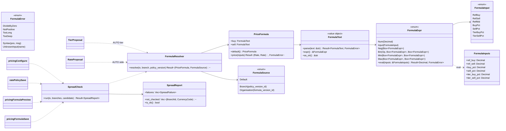

# Blueprint pricing formula: the owner writes the AUTO price formula (#564)

> designed-by: claude/e92db6 (xchange FE lane controller), on the owner's order in that session, 2026-10-29 ·
> measured on `main` `2a186bc9` (every `file:line` below)

## 0. Why, and what the owner decided

**What went wrong (2026-10-29).** MAIN policy v10 (`buy_adjust_pct +0.7000`, `sell_adjust_pct −0.7000`) was saved
without complaint. On the 10-28 BOT USD line (buy 33.6482, sell 33.9671) the AUTO formula gives buy 33.884 > sell
33.729, so every draft was refused hours later at `api/crates/xc-rate/src/domain/draft/rate_proposal.rs:102`, under a
different person. The chain:

`publish refused` ← `RateProposal::of` buy > sell (`rate_proposal.rs:98-104`) ← AUTO = `base × (1 + pct/100)`
hard-coded (`rate_proposal.rs:44-48`, `:74-78`; tiers `tier_proposal.rs:63-66`, `:94-97`) ← **`ratePolicySave` only
parses the two numbers** (`api/src/presentation/http/v3/commands/rate_policy_save.rs:132-141`) and nothing prices
them before they are saved.

So there are two root causes: the save never checks the formula it stores, and the formula itself is code, so the owner
can only turn its two knobs.

**The owner's words** (in session claude/e92db6, 2026-10-29 ICT):

| # | Words | What it fixes here |
|---|---|---|
| F-1 | *"ราคามันควรจะ config ได้ว่าจะเอาสูตรไหน"* · *"เพื่อ ให้ เจ้าของ กำหนด สูตรเองได้"* · *"ไม่งั้นปัญหาไม่จบไม่สิ้น"* · *"เพราะเจ้าของ หากต้องการเปลี่ยน สูตรการคำนวณ จะได้ปรับได้เอง"* | the formula is data the owner writes (§2), not code |
| F-2 | *"EXECUTIVE เท่านั้น"* | only EXECUTIVE saves a formula, organisation or branch (§5) |
| F-3 | *"สูตร ระดับ องค์กร"* · *"แต่ สาขา สามารถ แก้ไข ได้"* · *"เพราะ การแข่ง ขันแต่ละสาขาไม่เหมือนกัน"* | one organisation formula, and a branch may override it (§3) |
| F-4 | AskUserQuestion, label chosen: "EXECUTIVE เท่านั้น (Recommended)" for who edits a branch override | the branch override is EXECUTIVE-only too (§5) |
| F-5 | AskUserQuestion, label chosen: "ใช้กฎที่ถูกต้อง (Recommended)" | the save prices every currency from today's reference and refuses buy > sell (§4). A rule on the two percentages alone (buy % ≤ sell %) was proposed first and withdrawn: it refuses ±0.3 %, which is valid on today's 0.948 % USD spread |
| F-7 | AskUserQuestion, label chosen: "ใช้สูตรเดียวกันทั้งหมด (Recommended)" for whether the owner's formula also governs FOLLOW | one formula for AUTO and FOLLOW (§3a) |
| F-6 | *"A ใช้ ±0.3% เลย"* | MAIN goes back to +0.3000 / −0.3000 now, outside this design (#564 issuecomment-6492053004) |

**Not changed:** rounding, guards, policy versions, the draft → approve → publish flow (`rates.md` §4), the value-tier
switch (R-12e), per-currency anchors (`pricing-tiers.md` §3.1). The V.9 suggestion engine (`pricing-tiers.md` §5.2) keeps its anchor
rule, its `better` settings, its rounding, min spread and equal-or-better, but prices through the same formula (§3a, F-7).

## 1. The model in one paragraph

A formula is two expressions, one per side, over named inputs (the anchor's buy and sell, the policy's percentages,
the tier's margins). The organisation has one current formula version. A branch's policy version may carry its own
formula, which then replaces the organisation's for that branch. When a draft prices an AUTO side, it resolves the
formula (branch → organisation → built-in default) and evaluates it in `rust_decimal`. The built-in default is the
formula that is hard-coded today, so a database with no formula rows prices exactly as now. Every save that can change
a price (formula, branch override, `ratePolicySave`, `pricingConfigure`) first prices every affected currency and tier
from the current reference and refuses buy > sell.

## 2. The formula language

Deliberately small: arithmetic only, no functions the owner could misuse, no loops, no rounding (the system rounds).

| Element | Allowed |
|---|---|
| numbers | decimal literals, e.g. `1`, `0.997`, `100`, `0.05` (no exponent, at most 8 places) |
| operators | `+` `-` `*` `/`, unary `-`, parentheses |
| functions | `min(a, b)`, `max(a, b)` |
| inputs | the table below, by English name (the screen shows the Thai label beside each) |

| Input | Meaning | Source today |
|---|---|---|
| `ref_buy`, `ref_sell` | the anchor's buy / sell, normalised to the currency's unit size | `reference_base.rs` (`base_buy`, `base_sell`) |
| `ref_mid` | `(ref_buy + ref_sell) / 2` | computed |
| `buy_pct`, `sell_pct` | the policy version's `buy_adjust_pct` / `sell_adjust_pct` | `rate_policy_versions` |
| `tier_buy_pct`, `tier_sell_pct` | the tier's margin (0 when the value-tier switch is off or for the single-price line) | `rate_policy_value_tiers` / `rate_policy_currency_tiers` |

**The built-in default** (exactly today's code, `rate_proposal.rs:44-48`, `tier_proposal.rs:63-66`):
`buy = ref_buy * (1 + (buy_pct + tier_buy_pct) / 100)` · `sell = ref_sell * (1 + (sell_pct + tier_sell_pct) / 100)`.

Examples the owner could write: `ref_mid - 0.05` / `ref_mid + 0.05` (fixed satang either side of the middle);
`min(ref_buy * 0.997, ref_mid - 0.03)` (whichever is lower).

**Evaluation rules** (the system's, not the owner's): every value is `rust_decimal`; `/` by zero, an unknown name or a
result ≤ 0 is an error; the result is rounded to 8 places half-away-from-zero, as today (`rate_proposal.rs:49-52`).
Text is at most 500 characters and nests at most 16 levels (`bounded-inputs.md`).

## 3. Where a formula lives and which one wins

- **Organisation:** `pricing_formula_versions`, versioned like policies (§8). At most one current row per organisation.
- **Branch:** two nullable columns on `rate_policy_versions` (`buy_formula`, `sell_formula`). Both NULL = follow the
  organisation; both set = this branch's own formula; one set alone is refused at save.
- **Resolution** for (branch, policy version): the version's own formula if set → else the organisation's current
  formula → else the built-in default.
- **Audit:** each priced draft line records which formula priced it (`formula_source`: `BRANCH`, `ORGANISATION` +
  the version id, or `DEFAULT`), so a published price can always be traced to its text.

## 3a. FOLLOW uses the same formula (F-7)

One formula text, two input bindings. The formula never knows which mode it runs in.

| Input | AUTO (draft path) | FOLLOW and the suggestion (`PricingSuggestion::of`) |
|---|---|---|
| `ref_buy`, `ref_sell` | the configured anchor's line (`AnchorSource`, default BOT), at `unit_size` | V.9's anchor: TT headline if `buy > 0 && sell > buy`, else SR (`pricing-tiers.md` §5.2). V.9 quotes it per one unit (`pricing_suggestion.rs:136-137`); the binding multiplies it by the currency's `unit_size`, so both modes see the same unit |
| `buy_pct`, `sell_pct` | the policy version's percentages | `0` (FOLLOW prices never included `adjust_pct`; keeping 0 keeps today's prices) |
| `tier_buy_pct`, `tier_sell_pct` | the tier margins | `+better[n]` and `−better[n]` for tier `n` |

With these bindings the built-in default text gives `anchor.buy × (1 + b/100)` and `anchor.sell × (1 − b/100)`, which is
V.9's step 1 exactly. The formula's result is divided by `unit_size` (exact) to get V.9's per-unit price, and the
system then applies V.9's own steps, unchanged: `floor_d` buy / `ceil_d` sell at V.9's
decimals, the min-spread widening (step 2), equal-or-better across tiers (step 3), and the flags. So a database with no
formula rows publishes the same FOLLOW tiers as today (B21).

**Margins out of a suggestion.** Today `pricing_suggestion.rs:175-200` turns suggested prices back into policy margins
by inverting the default formula, for `pricingApprove`. An arbitrary formula has no general inverse, so:
- resolved formula = the default ⇒ unchanged: the inverse, `Precision` on a non-reproducible margin, and
  `pricingApprove` writing a policy version;
- any other formula ⇒ no margins are derived (the board shows "—" in the margin columns with the formula's source),
  and `pricingApprove` submits the suggested tier prices as a MANUAL tier line through `TierSetPublisher`, the same way
  FOLLOW publishes, writing no policy version.

## 4. The save check (F-5)

Run by every command that can change an AUTO price, **before** it writes, inside the same transaction:

1. Work out the affected branches: an organisation formula save ⇒ every branch of the organisation whose current policy
   version has no own formula; a branch save ⇒ that branch.
2. For each affected branch and each currency with a current reference line from that branch's anchor
   (`AnchorSource`, per currency): build the inputs; evaluate buy and sell for the single-price line and, when the
   switch is on, for tiers 1–4. A currency in FOLLOW mode is evaluated with the §3a FOLLOW binding against its
   current market anchor, tiers 1–4, before V.9's rounding and spread steps.
3. Any buy > sell, any result ≤ 0, or any evaluation error ⇒ refuse with `validationFailed`, field `buyFormula` (or the
   percentage that was changed), and the full list of failures: branch, currency, tier, buy, sell.
4. A currency with no reference line is not checked; it is listed as `notChecked` in the answer, never silently passed.
5. The publish check (`rate_proposal.rs:98-104`) stays: a reference spread can narrow after the save.

The same evaluation, without writing, answers `pricingFormulaPreview` (§6), which the screen calls as the owner types.

## 5. Who may save

`may_change_the_frame` (`rate_policy_save.rs:498`): EXECUTIVE only, for the organisation formula and for a branch
override alike (F-2, F-4). `ratePolicySave` and `pricingConfigure` keep their current permission; they gain only the
§4 check.

## 6. Class diagram



| Type / file | Where (new unless noted) | Pure? |
|---|---|---|
| `FormulaText`, `FormulaExpr`, `FormulaInput`, `FormulaInputs`, `FormulaError` | `api/crates/xc-rate/src/domain/formula/{text,expr,input,error}.rs` | yes |
| `PriceFormula` | `api/crates/xc-rate/src/domain/formula/price_formula.rs` | yes |
| `FormulaSource`, `FormulaResolver` | `api/crates/xc-rate/src/application/formula/formula_resolver.rs` | reads DB |
| `SpreadCheck`, `SpreadReport`, `SpreadFailure` | `api/crates/xc-rate/src/application/formula/spread_check.rs` | reads DB |
| `RateProposal::of`, `TierProposal::of` (changed) | `rate_proposal.rs:44-48`, `:74-78`; `tier_proposal.rs:63-66`, `:94-97` | take a `PriceFormula` instead of inlining the formula |
| `pricingFormulaSave`, `pricingFormulaPreview` | `api/src/presentation/http/v3/commands/pricing_formula_{save,preview}.rs` | — |
| `ratePolicySave` (changed) | `rate_policy_save.rs`: inputs `buyFormula`/`sellFormula` (both or neither), §4 check before `PolicyVersionWriter::next` | — |
| `pricingConfigure` (changed) | `pricing_configure.rs`: §4 check before writing | — |
| view `pricing_formula` | the organisation's current formula, each branch's source, and the default text | — |
| FE | the organisation formula editor with a live preview table; a branch override block on the policy card (`RatesPolicyCard.tsx`); the save error lists each failing currency | — |

## 6a. Every place that computes, or assumes, the AUTO formula

Swept on `main` `2a186bc9` with `git grep -n "buy_adjust_pct\|sell_adjust_pct" -- 'api/src/**' 'api/crates/*/src/**'`
(13 files; the rows below are every one that prices, inverts or checks a price; the others only read, store or
serialise the percentages: `rate_policy.rs`, `policy_version_writer.rs`, `views/rate_policy.rs`, `dto/v3/rate_policy.rs`,
`rate_draft_service.rs`).

| Site | What it does today | After this design |
|---|---|---|
| `RateProposal::of` (`rate_proposal.rs:44-48`, `:74-78`) | AUTO single price | the resolved `PriceFormula` |
| `TierProposal::of` (`tier_proposal.rs:63-66`, `:94-97`) | AUTO tier prices | the resolved `PriceFormula` |
| `publish_service.rs:340-375`, `:525-535` | re-prices each AUTO line at publish and snapshots `buy_adjust_pct`/`sell_adjust_pct` into `source_snapshot` | resolves the formula the same way, and adds `formula_source` + the formula text to the snapshot |
| `pricingConfigure` guard check (`pricing_configure.rs:267`, and the sell twin) | `eff = adjust_pct + margin`, checked against the currency guard | no second copy (♻️): price through `PriceFormula`, then `eff = (price ÷ ref − 1) × 100` against the guard; the same helper serves `ratePolicySave` |
| `PricingSuggestion::of` step 1 and margins (`pricing_suggestion.rs`, step 1 and `:175-200`) | prices `anchor × (1 ± b/100)` inline, then inverts the default formula into margins | step 1 through the resolved `PriceFormula` with the FOLLOW binding (§3a); the inverse only when the formula is the default |
| FOLLOW loop (`market_pricing_loop.rs:143-260`) → `TierSetPublisher::publish_in` (`tier_publish.rs:45-66`) | publishes the suggestion's tier prices as MANUAL lines every 5 min; never calls `RateProposal` | resolves the branch's formula, passes it to the suggestion, and records `formula_source` on the tier set |
| pricing board view (`views/pricing_board.rs:745-790`) | shows the suggestion and its margins | the same suggestion as FOLLOW would publish; margins "—" under a non-default formula |
| `pricingApprove` (`commands/pricing_approve.rs`) | writes the suggestion's margins as a policy version | default formula: unchanged; otherwise a MANUAL tier line through `TierSetPublisher`, no policy version (§3a) |

**Two saves at once.** An organisation-formula save checks the branches with no own formula; a concurrent branch save
could check against the old organisation formula, so each passes alone and the pair inverts. Both paths therefore take
`SELECT … FROM organizations WHERE id = $1 FOR UPDATE` before the §4 check. (The publish check would still catch it;
the lock stops the bad version being stored at all.)

**Constants are per the line's unit.** `ref_*` are normalised to the currency's `unit_size` (§2), so a literal `0.05`
means 0.05 THB per `unit_size`: 5 satang per 1 USD, but 5 satang per 100 JPY. The editor says so beside each currency's
row of the preview table.

## 7. Behaviour table (the up-front tests)

| # | Given | When | Then |
|---|---|---|---|
| B1 | no formula rows anywhere | a draft prices USD AUTO | the same rate as `main` `2a186bc9` to the 8th place, `formula_source = DEFAULT` |
| B2 | the default text | `FormulaText::parse` | it parses, and `PriceFormula::default()` equals it |
| B3 | `ref_mid - 0.05` / `ref_mid + 0.05` as the organisation formula, USD 33.6482 / 33.9671 | price | buy 33.75765, sell 33.85765 |
| B4 | MAIN at +0.7 / −0.7 with the default formula, the 10-28 USD line | `ratePolicySave` | `400 validationFailed`, failure `MAIN USD buy 33.884 > sell 33.729`; nothing written |
| B5 | MAIN at +0.3 / −0.3 | `ratePolicySave` | saved |
| B6 | a branch override with only `buyFormula` | save | `400`, field `sellFormula` |
| B7 | an organisation formula that fails for branch X only | `pricingFormulaSave` | `400`, the list names X; nothing written |
| B8 | the same, but X has its own formula | `pricingFormulaSave` | saved (X does not follow the organisation) |
| B9 | a currency with no reference line | save | saved; the answer lists it under `notChecked` |
| B10 | `ref_buy / (buy_pct - buy_pct)` | price | `DivideByZero`, at save |
| B11 | `ref_buy * 0` | save | refused, `NotPositive` |
| B12 | `foo + 1`, `ref_buy +`, 501 characters, 17 nested parentheses | parse | `UnknownInput` / `Syntax` / `TooLong` / `TooDeep` |
| B13 | a BRANCH_MANAGER, a FINANCE user | `pricingFormulaSave`, or `ratePolicySave` with a formula | `403` |
| B14 | value tiers on, a tier margin that inverts tier 3 only | save | refused, the failure names tier 3 |
| B15 | a draft line priced by the organisation formula v2 | read the line | `formula_source = ORGANISATION`, the v2 id |
| B16 | the reference spread narrows after a valid save | publish | still refused at `rate_proposal.rs:102`, as today |
| B17 | `pricingFormulaPreview` | as the owner types | the same table as the save, nothing written |
| B18 | a currency guard of [−1, +1] %, a formula whose USD buy is 1.2 % above `ref_buy` | `ratePolicySave` / `pricingConfigure` | refused by the guard, computed from the price (§6a), not from `adjust_pct + margin` |
| B19 | an organisation formula save and a branch `ratePolicySave` started together, each valid alone, inverting together | both commit in turn | the second waits on the organisation row lock, re-checks, and is refused |
| B20 | a published AUTO line priced by an organisation formula | read `source_snapshot` | it holds `formula_source` and the formula text |
| B21 | no formula rows, a FOLLOW currency | the loop plans it | the published tiers equal `main` `2a186bc9`'s to the digit |
| B22 | organisation formula `ref_mid - 0.05` / `ref_mid + 0.05`, FOLLOW USD | the loop plans it | tiers from the market anchor through the formula, then V.9's floor/ceil, min spread and equal-or-better; the tier set records `ORGANISATION` + the version id |
| B23 | the same | read the pricing board | the board's tier prices equal what B22 publishes; margin columns "—" |
| B24 | `pricingApprove` on a suggestion | default formula / organisation formula | a policy version as today / a MANUAL tier line and no policy version |
| B26 | `unit_size` 100 (JPY), organisation formula `ref_mid - 0.05` / `ref_mid + 0.05`, one currency in AUTO and one branch in FOLLOW | price both | both move by 0.05 THB per 100 JPY from their mid; neither moves by 0.05 per 1 JPY |
| B25 | an organisation formula that inverts a FOLLOW currency's tier 4 on today's market anchor | `pricingFormulaSave` | refused; the failure names the currency, tier 4 and FOLLOW |

## 8. Data migration (needs the owner's approval before any ticket that writes it)

```sql
CREATE TABLE pricing_formula_versions (
    id               uuid PRIMARY KEY,
    organization_id  uuid NOT NULL REFERENCES organizations(id),
    version          integer NOT NULL,
    buy_formula      text NOT NULL CHECK (length(buy_formula) BETWEEN 1 AND 500),
    sell_formula     text NOT NULL CHECK (length(sell_formula) BETWEEN 1 AND 500),
    valid_from       timestamptz NOT NULL,
    valid_to         timestamptz NULL,
    approved_by      text NOT NULL,
    reason           text NOT NULL,
    source_version   integer NULL,
    UNIQUE (organization_id, version)
);
CREATE UNIQUE INDEX pricing_formula_versions_current
    ON pricing_formula_versions (organization_id) WHERE valid_to IS NULL;

ALTER TABLE rate_policy_versions
    ADD COLUMN buy_formula  text NULL,
    ADD COLUMN sell_formula text NULL,
    ADD CONSTRAINT rate_policy_versions_formula_pair
        CHECK ((buy_formula IS NULL) = (sell_formula IS NULL));

ALTER TABLE rate_draft_lines
    ADD COLUMN formula_source text NULL
        CHECK (formula_source IS NULL OR formula_source IN ('BRANCH', 'ORGANISATION', 'DEFAULT')),
    ADD COLUMN formula_version_id uuid NULL REFERENCES pricing_formula_versions(id);

-- added with F-7 (FOLLOW uses the formula); approved as Q-F3 (§10)
ALTER TABLE pricing_tier_sets
    ADD COLUMN formula_source text NULL
        CHECK (formula_source IS NULL OR formula_source IN ('BRANCH', 'ORGANISATION', 'DEFAULT')),
    ADD COLUMN formula_version_id uuid NULL REFERENCES pricing_formula_versions(id);
```

- **Existing rows:** no backfill. Every policy version has NULL formulas and no organisation has a formula row, so
  every price resolves to the built-in default, which is today's formula (B1). Old draft lines keep NULL
  `formula_source`, read as "before formulas".
- **Deploy:** the migration runs at boot before the new binary serves; the old binary never reads the new columns.
- **Down:** drop the two `pricing_tier_sets` columns and the two `rate_draft_lines` columns, the constraint and two columns on `rate_policy_versions`, then the
  table. It loses every saved formula; prices fall back to the default.
- **Existing invalid data:** MAIN v10 on xc-v3 is replaced by the ±0.3 version (F-6) before this ships. The §4 check
  runs only at save, so an old invalid version never stops the service from starting or a history page from reading.

## 9. Work plan (after the class diagram merges and the migration is approved)

| Wave | Ticket (one function or file each, Gemini) | Lane | Class |
|---|---|---|---|
| 1 | `FormulaText::parse` + `FormulaExpr::eval` (B2, B10–B12) | BE | logic → Gemini 4 Argon |
| 1 | `PriceFormula::default` + `price` (B1 unit half, B3) | BE | logic |
| 1 | migration §8 | BE | guarded |
| 2 | `FormulaResolver` (B15) | BE | logic |
| 2 | `SpreadCheck` (B4, B7–B9, B14) | BE | logic |
| 2 | `RateProposal::of` / `TierProposal::of` take a `PriceFormula` (B1, B16) | BE | logic |
| 2 | `PricingSuggestion::of` takes a `PriceFormula` with the FOLLOW binding; inverse only under the default (B21, B23) | BE | logic |
| 3 | FOLLOW loop resolves the formula and records `formula_source` on the tier set (B21, B22) | BE | logic |
| 3 | `pricingApprove` non-default path through `TierSetPublisher` (B24) | BE | logic |
| 3 | pricing board margins "—" under a non-default formula (B23) | BE | mechanical |
| 3 | `pricingFormulaSave`, `pricingFormulaPreview` + view (B7, B13, B17) | BE | logic |
| 3 | `ratePolicySave` / `pricingConfigure` gain the check and the branch formula (B4–B6, B13) | BE | logic |
| 4 | organisation formula screen + preview table | FE | logic |
| 4 | branch override block on `RatesPolicyCard.tsx`; the save error lists failures | FE | logic |

The skeleton (types and signatures with `todo!()`, the provided tests B1–B17) goes on `feat/pricing-formula` first, per
the `lane-controllers` playbook; BE waves run under a BE sub-controller agreed with the BE lane controller
(claude/553782), FE waves under claude/e92db6.

## 10. Decided after the first draft

| # | Question | Answer |
|---|---|---|
| Q-F1 | Approve the §8 migration (one new table, two columns on `rate_policy_versions`, two on `rate_draft_lines`, no backfill)? | **Approved.** The owner typed *"ทำตามที่เสนอ"* in session claude/e92db6 at 2026-10-29 16:2x ICT, answering a proposal that asked to approve it, with the migration ticket held until this design merges. Deploy stays a separate order |
| Q-F3 | Approve the two `pricing_tier_sets` columns (`formula_source`, `formula_version_id`) that F-7 adds to §8? | **Approved:** "อนุมัติ (Recommended)", AskUserQuestion in session claude/e92db6, 2026-10-29 17:0x ICT. Nullable, no backfill |
| Q-F2 (answered, F-7) | A currency in FOLLOW mode (`market_pricing_loop.rs`) is priced by the V.9 suggestion engine (market anchor ± `better`, min spread, equal-or-better), not by the AUTO formula, and publishes every 5 min. Does the owner's formula also govern FOLLOW? | **Answered:** "ใช้สูตรเดียวกันทั้งหมด (Recommended)", AskUserQuestion in session claude/e92db6, 2026-10-29 16:4x ICT. Proposed and taken: yes, one formula for both, with the suggestion's min-spread and equal-or-better kept as system rules after it, FOLLOW storing prices (no inverse margins), and the default FOLLOW text reproducing V.9 exactly. If no: FOLLOW keeps V.9's formula, configured only by `better`, and F-1 then covers AUTO (BoT) prices only |
