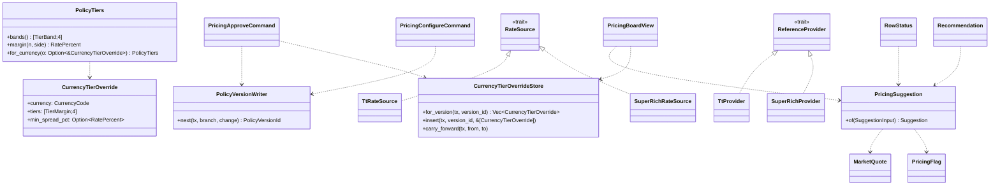

# Blueprint pricing tiers: V.9's 4-tier pricing page in v3 (#564)

> designed-by: claude/5edf7bb5 (xchange FE lane controller), on the owner's order in that session, 2026-10-19 ·
> measured on `main` `1bfa8846` (every `file:line` below) · source material: the V.9 `/pricing` RBAC patch the owner
> shared (`docs/user-management/XCHANGE-PRICING-RBAC.md`, `pricing-permissions.v1.json`, `legacy/src/pricing.mjs`,
> `public/pricing.js`), kept out of the repo · decisions recorded on #564 issuecomment-6268455744

## 0. Decided (the owner, 2026-10-19, AskUserQuestion in session claude/5edf7bb5, labels verbatim)

| # | Question | Answer | What it fixes here |
|---|---|---|---|
| P-0 | What to do with V.9's `/pricing` | "Bring the pricing page in" | this document |
| P-1 | Tier model | "Per currency, default from branch" | §3. **Amends O-7** (`rates.md:1849`, §12.3 "the same for every currency") to: *the branch's margins are the default; a currency may override them* |
| P-2 | TT Pattaya and Super Rich feeds | "Send the 3 V.9 files" | §4 and §5.2 wait for V.9's `runtime/market-rates.mjs`, `runtime/pricing.mjs`, `runtime/pricing-store.mjs` |
| P-3 | Approval | "Use xchange's flow" | §6. Approve = a policy version + a rate draft, submitted; in-bound publishes by policy, out-of-bound waits for EXECUTIVE (`rates.md` §4.5). V.9's approve-is-publish is **not** brought in |

Still decided by earlier rulings and unchanged: R-12 (counter prices come from BoT through the draft path every 3 h,
`rates.md` §12.0) · R-12d (`adjust_pct` stays in every price) · R-12e (the value-tier switch, default OFF) · §12.3's
additive formula and the per-tier guard check.

## 1. What V.9's page does, and what v3 already has (measured)

| V.9 (`legacy/src/pricing.mjs`, `public/pricing.js`) | v3 today | Gap |
|---|---|---|
| 4 tier prices per currency per branch; tier 1 is the shop rate | `rate_policy_value_tiers` (`api/migrations/20261205151000_rate_tiers_and_starting_prices.sql:4-13`): 4 THB bands + one buy/sell margin per tier, **the same for every currency**; `TierProposal::of` (`api/crates/xc-rate/src/domain/draft/tier_proposal.rs:29`) | per-currency margins (§3) |
| Market references TT and Super Rich, refreshable, with staleness | BoT only: `BotProvider` (`api/crates/xc-rate/src/infrastructure/reference/bot_provider.rs:43`) + `BotApiRateSource` / `FallbackRateSource`; the `ReferenceProvider` seam (`domain/reference/reference_provider.rs:10-14`) and `ReferenceBatchWriter::with_provider` (`application/reference/reference_batch_writer.rs:43`) | two providers (§4) |
| Suggested tiers from the market anchor, flags, recommendations | AUTO = reference × adjust (`domain/draft/rate_proposal.rs`); guards (`domain/draft/draft_evaluation.rs:43-110`); sharp-move notice (`domain/publication/sharp_move.rs:61`) | suggestion engine, flags, recommendations (§5) |
| `approve`: tier set saved + tier 1 pushed as the shop rate | drafts → submit → `xc-approval` → publish (`application/draft/rate_draft_service.rs:76,509`, `application/publication/publish_service.rs:46`) | one command that writes both (§6) |
| `configure`: per-currency `better`% and `minSpreadPct` | `ratePolicySave` (`api/src/presentation/http/v3/commands/rate_policy_save.rs:91`), next version `:359-402`, tiers `:404-436` | per-currency config on the policy version (§3, §6) |
| Every saved order keeps the market it was priced against (`afterSave`) | `quote_lines.published_rate_line_id` → `published_rate_lines.source_snapshot` (`publish_service.rs:425-440`, holds reference, policy, partner) | market lines in the snapshot (§7) |
| 9 `pricing.*` permissions from the `RATES_STOCK` level | 5 rate permissions mapped to `RATES_STOCK` (`xc-auth/src/domain/access/permission.rs:6-8,44,66`; `permission_module.rs:79-90`) | a mapping, one new permission (§8) |
| The page: a work queue, currency × 4 tiers, status per row, bulk approve, policy editor, order references | A02 `web/src/screens/admin/rates/Rates.tsx` (draft → simulate → submit → publish, policy card) | a new screen (§9) |

The draft path reads only `reference_type = 'BOT'` (and `'START'`) references (`application/draft/reference_base.rs:27,44`),
so adding market providers cannot change a counter price by itself.

## 2. The idea in one paragraph

The counter price stays **BoT base × (1 + (adjust + margin) ÷ 100)** (§12.3, R-12). What the pricing page adds is a
**per-currency margin** and a **market-informed suggestion** for it: the page reads TT and Super Rich, computes V.9's
suggested 4 tier prices, turns them into margins over today's BoT base, and on approve writes them as a new policy
version and a draft for those currencies. From then on the 3-hourly BoT refresh keeps those currencies on their own
margins, until the next approve. A person can edit a tier price on the page; it is stored as the margin that produces it.

## 3. Per-currency tier margins (P-1)

```sql
CREATE TABLE rate_policy_currency_tiers (
    policy_version_id uuid         NOT NULL REFERENCES rate_policy_versions(id),
    currency_code     char(3)      NOT NULL REFERENCES currencies(code),
    tier_no           smallint     NOT NULL CHECK (tier_no BETWEEN 1 AND 4),
    buy_margin_pct    numeric(9,4) NOT NULL,   -- signed, scale 4, like rate_policy_value_tiers
    sell_margin_pct   numeric(9,4) NOT NULL,
    PRIMARY KEY (policy_version_id, currency_code, tier_no)
);

CREATE TABLE rate_policy_currency_settings (
    policy_version_id uuid         NOT NULL REFERENCES rate_policy_versions(id),
    currency_code     char(3)      NOT NULL REFERENCES currencies(code),
    min_spread_pct    numeric(9,4) NOT NULL CHECK (min_spread_pct BETWEEN 0 AND 5),
    PRIMARY KEY (policy_version_id, currency_code)
);
```

- `[required]` **Bands stay per branch.** A currency overrides margins only, never the THB bounds: `TierBand` and
  `infrastructure/publication/published_rates.rs:247-262`'s tier pick need one band table per branch.
- `[required]` **All four or none.** A currency has 0 or 4 rows in `rate_policy_currency_tiers` for a version;
  `ratePolicySave` (and §6's commands) refuse any other count (`validationFailed`). Cross-row, so the command enforces it.
- `[required]` **Resolution:** effective margin for (currency, tier, side) = the currency's row if the currency has rows
  in that version, otherwise `rate_policy_value_tiers`. `value_tiers_on = false` ignores both (one `'ALL'` line, as today).
- `[required]` **The guard check at save** (§12.3, "refuses a version where `adjust_pct + margin_pct_n` lies outside that
  version's own guard") applies to every override row too, against **that currency's** guard: the loop at
  `rate_policy_save.rs:302-335` with the override's margins for its own currency.
- `[required]` **Override margins are frame, like the branch tiers:** only a caller with a valid EXECUTIVE row may change
  them (`may_change_the_frame`, `rate_policy_save.rs:340-357`, `:447`); a RATE_MANAGER gets `roleNotAllowedHere`.
- **Versioned like the rest of the policy:** rows hang off `policy_version_id`, immutable once inserted. A new version
  copies the previous version's override rows unless the save replaces them. `[required]` That copy lives in
  `PolicyVersionWriter::next` (§6), which calls `CurrencyTierOverrideStore::carry_forward(tx, from, to)`, so a plain
  `ratePolicySave` (an adjust change) keeps every override. A copied row that breaks the new version's guard ⇒
  `validationFailed`, nothing written. The skeleton writes the call; PT-3 writes the body.
- `min_spread_pct`: V.9's per-currency minimum spread (0–5 %). A currency with no row uses `rate_policy_versions`' value
  if §5.2 adds one, otherwise V.9's `DEFAULT_CONFIG.minSpreadPct` (value waits for P-2's files).

**Domain:** `CurrencyTierOverride` (new file) holds one currency's four `TierMargin`s; `PolicyTiers::for_currency`
returns a `PolicyTiers` with the same bands and that currency's margins. `TierProposal::of` is **unchanged**: its three
callers (`rate_draft_service.rs:484`, `publish_service.rs:443`, `draft_evaluation.rs:137`) pass the resolved tiers.

## 4. Market sources: TT Pattaya and Super Rich (P-2)

Each source is one `RateSource` (fetch) + one `ReferenceProvider` (parse) pair, written through its own
`ReferenceBatchWriter::new(source, store).with_provider(..)`, exactly like BoT (`rate-feed-connector.md` §3.1, ♻️).

| Provider | `provider()` | `reference_type()` | Read by |
|---|---|---|---|
| `TtProvider` | `"TT"` | `"MARKET_TT"` | the pricing board and the order snapshot only |
| `SuperRichProvider` | `"SR"` | `"MARKET_SR"` | the pricing board and the order snapshot only |

- `[required]` **Never read by the draft path.** `reference_base.rs:27` stays `'BOT'`; a test pins that a fresh MARKET
  batch changes no AUTO price.
- **Fetched on the feed loop's tick** (`api/src/infrastructure/rate_feed/feed_loop.rs`) and on demand through
  `rateReferenceFetch` (`commands/rate_reference_fetch.rs:45`), which gains an optional `provider` field.
- **Staleness** per source = `fetched_at` age against V.9's threshold (waits for P-2's files), shown as `STALE_SOURCE`.
- 🔴 **Open until P-2's files arrive:** the URLs, the response shapes, which rate V.9 calls the headline (cash / TT,
  denomination), the refresh interval. The fetcher tickets are not released before then.

## 5. Suggestion, flags, status, recommendations (pure domain, new module `domain/pricing/`)

### 5.1 Types

| Type | File | Holds |
|---|---|---|
| `MarketSource` | `domain/pricing/market_quote.rs` | `Tt` · `SuperRich` · `Bot` |
| `MarketQuote` | `domain/pricing/market_quote.rs` | source, buy, sell (`Rate`), unit size, `fetched_at`, `stale: bool` |
| `PricingFlag` | `domain/pricing/pricing_flag.rs` | `NoAnchor` · `NoTtQuote` · `StaleSource` · `MinSpread` · `BelowCost` · `LargeMove` · `Precision`, each with `blocking()` (V.9: `BelowCost`, `StaleSource`, `Precision` keep a row out of bulk approve) |
| `PricingSuggestion` | `domain/pricing/pricing_suggestion.rs` | `of(SuggestionInput) -> Suggestion { tiers: [TierPrice; 4], margins: [TierMargin; 4], flags: Vec<PricingFlag> }` |
| `RowStatus` | `domain/pricing/row_status.rs` | `Current` · `Pending` · `Unpriced` · `Tiers` · `Review` · `Manual` · `Reference` (V.9's `STATUS`), `of(&Suggestion, approved, enabled)` |
| `Recommendation` | `domain/pricing/recommendation.rs` | severity (`High`·`Warn`·`Medium`·`Low`), code, currency, side; `list(..) -> Vec<Recommendation>` |

All are pure: no I/O, no clock (the caller passes `now`), decimals as `rust_decimal`, never `f64` (V.9 uses floats;
we don't copy that, `rate-display.md` B7).

### 5.2 The formula — waits for P-2's files

`PricingSuggestion::of` must reproduce V.9's `suggestTiers`, `validateTiers`, `anchorFor`, `recommend` and
`orderReference` from `runtime/pricing.mjs`. **Not written here until those files arrive.** What is fixed now:

- `[required]` the anchor is V.9's (`anchorFor`): TT, else Super Rich (`NoTtQuote`), else none (`NoAnchor`);
- `[required]` the output is tier **prices**, then converted to margins over the draft path's base (BoT, else START, `reference_base.rs:27,44`) per side, at the currency's unit size (`tier_proposal.rs:60-66`):
  `margin_n = (price_n ÷ base − 1) × 100 − adjust_pct`, rounded to scale 4; if the margin's price differs from
  `price_n` at the scale the board shows a rate (set with P-2's files; never the 8-dp compute scale of
  `tier_proposal.rs:67-70`, or every row would flag), flag `Precision`; no base ⇒ no margin, flag `NoAnchor`;
- `[required]` higher tiers give the customer an equal-or-better price than lower tiers (V.9 `configure`'s check);
- `[required]` `BelowCost` compares against the partner cost already in `source_snapshot.partner`
  (`publish_service.rs:436-440`); `LargeMove` = tier 1 moves more than 1 % from the current publication (V.9's value).

## 6. Commands and the view (P-3)

| Name | File | Permission (§8) | Does |
|---|---|---|---|
| view `pricing_board` | `api/src/presentation/http/v3/views/pricing_board.rs` | `ReferenceRatesRead` | per branch: bands, sources (name, `fetched_at`, stale, error), one row per currency (market quotes, current published rates, effective margins and whether overridden, suggestion, flags, status), recommendations. A page load or a click, not polled |
| `pricingConfigure` | `api/src/presentation/http/v3/commands/pricing_configure.rs` | `RatePolicySave` | save one currency's override margins and `min_spread_pct` as a new policy version, no draft |
| `pricingApprove` | `api/src/presentation/http/v3/commands/pricing_approve.rs` | `RatePolicySave` + `RatesDraft` | for 1..n currencies (bulk): one new policy version with their margins, then one draft with one AUTO line per currency, submitted. In-bound ⇒ published by policy; out-of-bound ⇒ waits in A06 for EXECUTIVE. Returns the draft id and its state |
| `rateReferenceFetch` + `provider` | `commands/rate_reference_fetch.rs` | as today (inherits `rateDraft`) | `"TT"` / `"SR"` / `"BOT"` (default) |

- **One writer of policy versions.** `ratePolicySave` builds and inserts the version inline (`rate_policy_save.rs:359-436`: next number, close the current version, insert it, insert its tiers).
  The first BE ticket moves that into `api/crates/xc-rate/src/application/policy/policy_version_writer.rs`
  (`PolicyVersionWriter::next(tx, branch, change) -> PolicyVersionId`), a pure move with `ratePolicySave`'s tests
  unchanged; both new commands call it. Never three copies of the version logic.
- `[required]` **Idempotent:** `pricingApprove` takes a `requestId`, as every v3 command does (`rates.md` §5.6).
- `[required]` **Lost update:** `pricingApprove` carries the `policy_version_id` the page was built on; a newer version
  ⇒ `conflict`, the page reloads (V.9's `previousUpdated`).
- `[required]` **Branch scope:** `BranchScope::of` (`xc-auth`), as every rate command. V.9's `pricing.branch:any` is the
  org-wide scope an OWNER already has (§8).

## 7. Order reference

At publish, `published_rate_lines.source_snapshot` gains `"market": [{source, buy, sell, unit_size, fetched_at}]` with
the latest TT and Super Rich lines for that currency (`publish_service.rs:425-440`, next to `"partner"`). Every quote
line already points at its published line (`quote_lines.published_rate_line_id`), so every saved order reaches the market
it was priced against without a new column. A currency with no market line writes `"market": []`.

## 8. Permissions: V.9's catalog onto v3

| V.9 permission | Level | v3 permission | New? |
|---|---|---|---|
| `pricing.page:view`, `pricing.market:read`, `pricing.tiers:read`, `pricing.policy:read` | VIEW | `ReferenceRatesRead` | no |
| `pricing.orders:read` | VIEW | `RatesHistoryRead` | no |
| `pricing.market:refresh` | CREATE | `MarketRatesRefresh` → `RATES_STOCK` Create (PT-14); `rateReferenceFetch` with `provider ≠ BOT` checks it (PT-13's file) | **yes, one** |
| `pricing.tiers:approve` | FULL | `RatePolicySave` + `RatesDraft` | no |
| `pricing.policy:write` (ownerOnly) | FULL | `RatePolicySave` + the EXECUTIVE frame check margins already need (`may_change_the_frame`, `rate_policy_save.rs:340-357`) | no |
| `pricing.branch:any` (ownerOnly) | FULL | the org-wide branch scope | no |

- The one new variant lands **after `feat/rbac-groups` merges** (it replaces `RolePermissions` with `RoleGrants`), so its
  ticket is `blocked by` that merge. Every other ticket here needs no new permission.
- V.9's limits stay recorded, not copied: v3 already has maker–checker (P-3) and per-command audit; denied requests are
  in the audit, not only in logs.

## 9. The screen: A-PR `/admin/pricing` (new directory `web/src/screens/admin/pricing/`)

One screen, separate from A02 (`Rates.tsx`), so its tickets never touch `Rates.tsx`. Layout follows V.9's work queue.

| Component | File | Shows / does |
|---|---|---|
| `Pricing` | `Pricing.tsx` | loads `pricing_board`, branch picker (org scope only), filter (all · to approve · review · current), search, reload |
| `MarketSources` | `MarketSources.tsx` | one chip per source: name, age, stale, error; refresh button if `MarketRatesRefresh` |
| `PricingGrid` | `PricingGrid.tsx` | the table: enabled currencies first, others folded below |
| `PricingRow` | `PricingRow.tsx` | code, TT / SR / BoT, current shop rate, suggested tier 1, status chip, flags, select box (disabled when a flag blocks) |
| `TierEditor` | `TierEditor.tsx` | 4 rows buy/sell, the suggested values prefilled, the margin each produces, approve one |
| `BulkApprove` | `BulkApprove.tsx` | count, confirm, calls `pricingApprove` with the selected rows |
| `PricingPolicy` | `PricingPolicy.tsx` | per-currency margins and min spread (`pricingConfigure`), owner only |
| `Recommendations` | `Recommendations.tsx` | the list by severity |
| `OrderRefs` | `OrderRefs.tsx` | recent orders with the market they were priced against |
| status / flag labels | `pricing-labels.ts`, `i18n.ts` | TH/EN, V.9's wording |
| menu | `menu.ts` | the entry under rates; registered in `web/src/screens/admin/menus.ts` by the skeleton |

Values are decimal strings end to end (B7); the generated DTOs come from the view and commands (`ts-rs`).

## 10. Class diagram



### 10.1 Files (one class set per file; no two tickets share a file)

| Class | File (`api/crates/xc-rate/src/` unless noted) |
|---|---|
| `CurrencyTierOverride`, `TierMargin` | `domain/policy/currency_tier_override.rs` |
| `PolicyTiers::for_currency` | `domain/policy/policy_tiers.rs` (one method added) |
| `CurrencyTierOverrideStore` | `infrastructure/policy/currency_tier_override_store.rs` |
| `PolicyVersionWriter` | `application/policy/policy_version_writer.rs` |
| `TtRateSource` / `SuperRichRateSource` | `infrastructure/reference_source/tt_rate_source.rs` / `superrich_rate_source.rs` |
| `TtProvider` / `SuperRichProvider` | `infrastructure/reference/tt_provider.rs` / `superrich_provider.rs` |
| `MarketQuote`, `MarketSource` | `domain/pricing/market_quote.rs` |
| `PricingFlag` | `domain/pricing/pricing_flag.rs` |
| `PricingSuggestion` | `domain/pricing/pricing_suggestion.rs` |
| `RowStatus` | `domain/pricing/row_status.rs` |
| `Recommendation` | `domain/pricing/recommendation.rs` |
| `PricingBoardView` | `api/src/presentation/http/v3/views/pricing_board.rs` |
| `PricingApproveCommand` | `api/src/presentation/http/v3/commands/pricing_approve.rs` |
| `PricingConfigureCommand` | `api/src/presentation/http/v3/commands/pricing_configure.rs` |
| the market snapshot | `application/publication/publish_service.rs` (one block) |
| the resolve at the three callers | `rate_draft_service.rs`, `draft_evaluation.rs`, `publish_service.rs` — one ticket, since `publish_service.rs` is also §7's |

The skeleton commit writes every new file as a stub with the final signature, every `mod` line, the route registration,
the migration, and the admin menu entry, so the function tickets touch only their own file.

### 10.2 Who provides, who uses

| Provider | Users |
|---|---|
| `CurrencyTierOverrideStore` | `PolicyTiersStore` callers (resolve), `PricingBoardView`, both commands |
| `PolicyVersionWriter` | `ratePolicySave`, `pricingConfigure`, `pricingApprove` |
| `PricingSuggestion` | `PricingBoardView`, `RowStatus`, `Recommendation` |
| MARKET reference lines | `PricingBoardView`, `PublishService` (§7) — never the draft path |

## 11. Behaviour table (cases the up-front tests lock)

| Case | Required result |
|---|---|
| tiers ON, currency without override | prices exactly as today (§12.3 worked example unchanged) |
| tiers ON, currency with override | that currency's 4 lines use its margins; other currencies unchanged |
| tiers OFF, override rows present | one `'ALL'` line, overrides ignored, rows kept |
| override with 3 rows | `validationFailed`, no version written |
| override margin outside the version's guard | `validationFailed` |
| a MARKET_TT batch arrives | no AUTO price changes; the board shows it |
| no TT quote, SR present | suggestion anchored on SR, flag `NoTtQuote` |
| no market quote | flag `NoAnchor`, status `Manual`, row not bulk-selectable |
| source older than the threshold | flag `StaleSource`, row not bulk-selectable |
| suggested buy below partner cost | flag `BelowCost`, row not bulk-selectable |
| tier 1 moves > 1 % from published | flag `LargeMove` (warns, does not block) |
| approve, in bound | new policy version + draft submitted + published; board shows `Current` |
| approve, out of bound | draft waits in A06; board shows `Review` until decided |
| approve with a stale `policy_version_id` | `conflict`, nothing written |
| approve twice with one `requestId` | one version, one draft |
| user without `RatePolicySave` | approve and configure refused (`forbidden`); the page hides both |
| RATE_MANAGER (no EXECUTIVE row) configures margins | `roleNotAllowedHere`, nothing written |
| `ratePolicySave` changes only `adjust_pct` | the new version carries every currency's overrides |
| a guard tightened so a carried override breaks it | `validationFailed`, nothing written |
| order saved after a publish with market lines | its published line's snapshot holds those lines |

## 12. Data migration

One migration, `api/migrations/<slot>_rate_policy_currency_tiers.sql` (slot from `scripts/migration-slot.sh next`
right before `pr_open`), creating §3's two tables.

1. **Existing rows after the migration:** no existing table changes. Every policy version has zero override rows, so
   every currency resolves to the branch default, which is exactly today's price.
2. **Backfill:** none. Zero rows is the correct state for every existing version.
3. **Deploy order:** migration before the new binary (migrations run at boot, embedded). The old binary never reads the
   new tables, so it works with the new schema.
4. **What `down` loses:** every per-currency override and min spread ever saved. Policy versions themselves survive.

The migration still needs the owner's approval before it merges (process rule); deploy is a separate owner order.

## 13. Tickets (to cut after this document merges)

BE (sub-controller under the BE lane controller claude/a90ab16c), base `feat/pricing-tiers`:

| # | Ticket | Class | Waits for |
|---|---|---|---|
| PT-0 | skeleton: stubs, `mod` lines, routes, migration, up-front tests | (Claude) | owner approval of §12 |
| PT-1 | `PolicyVersionWriter` extracted from `ratePolicySave` (pure move) | mechanical | PT-0 |
| PT-2 | `CurrencyTierOverride` + `PolicyTiers::for_currency` | logic | PT-0 |
| PT-3 | `CurrencyTierOverrideStore` | logic | PT-0 |
| PT-4 | resolve at the three callers + §7 market snapshot | logic | PT-0 |
| PT-5 | `pricingConfigure` | logic | PT-0 |
| PT-6 | `pricingApprove` | guarded | PT-0 |
| PT-7 | `pricing_board` view | logic | PT-0 |
| PT-8 | `MarketQuote`, `PricingFlag`, `RowStatus` | logic | PT-0 |
| PT-9 | `PricingSuggestion` | logic | P-2's files |
| PT-10 | `Recommendation` | logic | P-2's files |
| PT-11 / PT-12 | TT / Super Rich source + provider | logic | P-2's files |
| PT-13 | `rateReferenceFetch` `provider` (+ the `MarketRatesRefresh` check) + feed-loop wiring | logic | PT-11, PT-12, PT-14 |
| PT-14 | `MarketRatesRefresh` variant + its `RATES_STOCK` mapping only (`permission.rs`, `permission_module.rs`) | logic | `feat/rbac-groups` on main |

FE (sub-controller under claude/5edf7bb5), base `feat/fe-pricing-board`: one ticket per §9 row (9 components + labels),
mechanical except `Pricing`, `TierEditor` and `BulkApprove` (logic). They code against the generated DTOs with a mocked
fetch; `feat/fe-pricing-board` merges to main only after the BE view and commands land.

## 14. Must ask the owner (not decided here)

| # | Question | Default until answered |
|---|---|---|
| Q-P1 | Should the AUTO anchor become the market (TT/SR) instead of BoT? Today R-12 fixes BoT; with BoT anchoring, a currency keeps its approved margin while TT and BoT drift apart, and the page shows the drift as a new suggestion | BoT (R-12) |
| Q-P2 | Approve the §12 migration | not merged |
