# Blueprint pricing tiers: V.9's 4-tier pricing page in v3 (#564)

> designed-by: claude/5edf7bb5 (xchange FE lane controller), on the owner's order in that session, 2026-10-19 ·
> measured on `main` `1bfa8846` (every `file:line` below) · source material: the V.9 `/pricing` RBAC patch the owner
> shared (`docs/user-management/XCHANGE-PRICING-RBAC.md`, `pricing-permissions.v1.json`, `legacy/src/pricing.mjs`,
> `public/pricing.js`), kept out of the repo · decisions recorded on #564 issuecomment-6268455744
>
> §0 P-2, §4, §5, §10, §11, §13 and §14 updated by claude/mbp-xc-pricing (sub-controller XC-PRICING under the BE lane
> controller claude/553782), 2026-10-22, measured on `main` `1e96d4c5`, from the owner's V.9 desk source
> `xchange-desk-v9-20261015` (V.9 main `092446f`; ruling on #4324 issuecomment-6322861561). **`V9:` below means that
> tree:** `V9:market` = `src/pricing/market.mjs`, `V9:engine` = `src/pricing/engine.mjs`, `V9:store` =
> `src/pricing/store.mjs`, `V9:pricing` = `src/pricing.mjs`, `V9:test` = `test/pricing.mjs`. The tree is kept out of
> the repo (it is the owner's); copies are on the MacBook (`~/Downloads/XCHANGE-V9/`) and the Mac Studio
> (`~/worktrees/v9-pricing-ref/`).

## 0. Decided (the owner, 2026-10-19, AskUserQuestion in session claude/5edf7bb5, labels verbatim)

| # | Question | Answer | What it fixes here |
|---|---|---|---|
| P-0 | What to do with V.9's `/pricing` | "Bring the pricing page in" | this document |
| P-1 | Tier model | "Per currency, default from branch" | §3. **Amends O-7** (`rates.md:1849`, §12.3 "the same for every currency") to: *the branch's margins are the default; a currency may override them* |
| P-2 | TT Pattaya and Super Rich feeds | "Send the 3 V.9 files"; on 2026-10-22 the owner supplied the V.9 source and ordered *"ทำราคาแนะนำเลย"* (#4324 issuecomment-6322861561) | §4 and §5.2 are written from `V9:market`, `V9:engine`, `V9:store` (the files the RBAC patch called `runtime/market-rates.mjs`, `runtime/pricing.mjs`, `runtime/pricing-store.mjs`) |
| P-4 | AUTO anchor: BoT or the market (Q-P1) | *"ให้ คอนฟิกได้เอง"* (2026-10-20, same session): configurable | §3.1. Each branch chooses, and a currency may override. The default stays `BOT` (R-12 unchanged until someone changes the setting) |
| P-5 | The §12 migration (Q-P2) | *"อนุมัติ migration"* (2026-10-20, same session) | §12 may merge (still no deploy without an owner order) |
| P-3 | Approval | "Use xchange's flow" | §6. Approve = a policy version + a rate draft, submitted; in-bound publishes by policy, out-of-bound waits for EXECUTIVE (`rates.md` §4.5). V.9's approve-is-publish is **not** brought in |

Still decided by earlier rulings and unchanged: R-12 (counter prices come from BoT through the draft path every 3 h,
`rates.md` §12.0) · R-12d (`adjust_pct` stays in every price) · R-12e (the value-tier switch, default OFF) · §12.3's
additive formula and the per-tier guard check.

## 1. What V.9's page does, and what v3 already has (measured)

| V.9 (`legacy/src/pricing.mjs`, `public/pricing.js`) | v3 today | Gap |
|---|---|---|
| 4 tier prices per currency per branch; tier 1 is the shop rate | `rate_policy_value_tiers` (`api/migrations/20261205151000_rate_tiers_and_starting_prices.sql:4-13`): 4 THB bands + one buy/sell margin per tier, **the same for every currency**; `TierProposal::of` (`api/crates/xc-rate/src/domain/draft/tier_proposal.rs:29`) | per-currency margins (§3) |
| Market references TT and Super Rich, refreshable, with staleness | BoT only: `BotProvider` (`api/crates/xc-rate/src/infrastructure/reference/bot_provider.rs:43`) + `BotApiRateSource` / `FallbackRateSource`; the `ReferenceProvider` seam (`domain/reference/reference_provider.rs:10-14`) and `ReferenceBatchWriter::with_provider` (`application/reference/reference_batch_writer.rs:43`) | two providers (§4) |
| Suggested tiers from the market anchor, flags, recommendations | AUTO = reference × adjust (`domain/draft/rate_proposal.rs`); guards (`domain/draft/draft_evaluation.rs:43-110`); sharp-move notice (`domain/publication/sharp_move.rs:61`) | suggestion engine, flags, recommendations (§5) |
| `approve`: tier set saved + tier 1 pushed as the shop rate | drafts → submit → `xc-approval` → publish (`application/draft/rate_draft_service.rs:76,509`, `application/publication/publish_service.rs:46`) | one command that writes both (§6) |
| `configure`: per-currency `better`% and `minSpreadPct` | `ratePolicySave` (`api/src/presentation/http/v3/commands/rate_policy_save.rs:91`), next version `:359-402`, tiers `:404-436` | per-currency config on the policy version (§3, §6) |
| Every saved order keeps the market it was priced against (`afterSave`) | `quote_lines.published_rate_line_id` → `published_rate_lines.source_snapshot` (`publish_service.rs:425-440`, holds reference, policy, partner) | market lines in the snapshot (§7) |
| 9 `pricing.*` permissions from the `RATES_STOCK` level | 5 rate permissions mapped to `RATES_STOCK` (`xc-auth/src/domain/access/permission.rs:6-8,44,66`; `permission_module.rs:79-90`) | a mapping, one new permission (§8) |
| The page: a work queue, currency × 4 tiers, status per row, bulk approve, policy editor, order references | A02 `web/src/screens/admin/rates/Rates.tsx` (draft → simulate → submit → publish, policy card) | a new screen (§9) |

The draft path reads only `reference_type = 'BOT'` (and `'START'`) references (`application/draft/reference_base.rs:27,44`),
so adding market providers cannot change a counter price by itself.

## 2. The idea in one paragraph

The counter price stays **BoT base × (1 + (adjust + margin) ÷ 100)** (§12.3, R-12). What the pricing page adds is a
**per-currency margin** and a **market-informed suggestion** for it: the page reads TT and Super Rich, computes V.9's
suggested 4 tier prices, turns them into margins over today's BoT base, and on approve writes them as a new policy
version and a draft for those currencies. From then on the 3-hourly BoT refresh keeps those currencies on their own
margins, until the next approve. A person can edit a tier price on the page; it is stored as the margin that produces it.

## 3. Per-currency tier margins (P-1)

```sql
CREATE TABLE rate_policy_currency_tiers (
    policy_version_id uuid         NOT NULL REFERENCES rate_policy_versions(id),
    currency_code     char(3)      NOT NULL REFERENCES currencies(code),
    tier_no           smallint     NOT NULL CHECK (tier_no BETWEEN 1 AND 4),
    buy_margin_pct    numeric(9,4) NOT NULL,   -- signed, scale 4, like rate_policy_value_tiers
    sell_margin_pct   numeric(9,4) NOT NULL,
    PRIMARY KEY (policy_version_id, currency_code, tier_no)
);

CREATE TABLE rate_policy_currency_settings (
    policy_version_id uuid         NOT NULL REFERENCES rate_policy_versions(id),
    currency_code     char(3)      NOT NULL REFERENCES currencies(code),
    min_spread_pct    numeric(9,4) NULL CHECK (min_spread_pct IS NULL OR min_spread_pct BETWEEN 0 AND 5),
    PRIMARY KEY (policy_version_id, currency_code)
);
```

- `[required]` **Bands stay per branch.** A currency overrides margins only, never the THB bounds: `TierBand` and
  `infrastructure/publication/published_rates.rs:247-262`'s tier pick need one band table per branch.
- `[required]` **All four or none.** A currency has 0 or 4 rows in `rate_policy_currency_tiers` for a version;
  `ratePolicySave` (and §6's commands) refuse any other count (`validationFailed`). Cross-row, so the command enforces it.
- `[required]` **Resolution:** effective margin for (currency, tier, side) = the currency's row if the currency has rows
  in that version, otherwise `rate_policy_value_tiers`. `value_tiers_on = false` ignores both (one `'ALL'` line, as today).
- `[required]` **The guard check at save** (§12.3, "refuses a version where `adjust_pct + margin_pct_n` lies outside that
  version's own guard") applies to every override row too, against **that currency's** guard: the loop at
  `rate_policy_save.rs:302-335` with the override's margins for its own currency.
- `[required]` **Override margins are frame, like the branch tiers:** only a caller with a valid EXECUTIVE row may change
  them (`may_change_the_frame`, `rate_policy_save.rs:340-357`, `:447`); a RATE_MANAGER gets `roleNotAllowedHere`.
- **Versioned like the rest of the policy:** rows hang off `policy_version_id`, immutable once inserted. A new version
  copies the previous version's override rows unless the save replaces them. `[required]` That copy lives in
  `PolicyVersionWriter::next` (§6), which calls `CurrencyTierOverrideStore::carry_forward(tx, from, to)`, so a plain
  `ratePolicySave` (an adjust change) keeps every override. A copied row that breaks the new version's guard ⇒
  `validationFailed`, nothing written. The skeleton writes the call; PT-3 writes the body.
- `min_spread_pct`: V.9's per-currency minimum spread (0–5 %). A currency with no row uses `rate_policy_versions`' value
  if §5.2 adds one, otherwise V.9's `DEFAULT_CONFIG.minSpreadPct`, 0.3 (`V9:engine:13`, §5.2).

**Domain:** `CurrencyTierOverride` (new file) holds one currency's four `TierMargin`s; `PolicyTiers::for_currency`
returns a `PolicyTiers` with the same bands and that currency's margins. `TierProposal::of` is **unchanged**: its three
callers (`rate_draft_service.rs:484`, `publish_service.rs:443`, `draft_evaluation.rs:137`) pass the resolved tiers.

### 3.1 The AUTO anchor is configurable (P-4)

The owner's answer to Q-P1 (2026-10-20): *"เลือกว่าราคา AUTO จะยึด BoT หรือ TT เป็นฐาน ให้ คอนฟิกได้เอง"*.

```sql
ALTER TABLE rate_policy_versions
    ADD COLUMN anchor_source text NOT NULL DEFAULT 'BOT'
        CHECK (anchor_source IN ('BOT', 'MARKET_TT', 'MARKET_SR'));
ALTER TABLE rate_policy_currency_settings
    ADD COLUMN anchor_source text NULL
        CHECK (anchor_source IS NULL OR anchor_source IN ('BOT', 'MARKET_TT', 'MARKET_SR'));
```

- `[required]` **Effective anchor** for (branch, currency) is the currency's `anchor_source` if it is set, otherwise
  the version's. The column on `rate_policy_currency_settings` lets one currency follow TT while the branch stays on
  BoT. `min_spread_pct` on that table becomes nullable, so a row can carry only the anchor.
- `[required]` **The draft path reads the effective anchor's reference type, inside `ReferenceBase::newest_in`.**
  Today `reference_base.rs:27` reads `reference_type = 'BOT'` only. `newest_in(tx, branch, currency)` keeps its signature
  and resolves the effective anchor itself, so its callers (`rate_draft_service.rs:130`, `:248`,
  `org_starting_price_save.rs:271`) do not change. The starting-price check then sees the anchor-aware base, as it
  should, since it checks against "the AUTO base".
- `[required]` **`'START'` stays the fallback for the `BOT` anchor only** ("before BoT first quotes", `:37-58`).
- `[required]` **A market anchor with no line for the currency has no AUTO base.** `newest_in` returns `None`, the
  line needs MANUAL, and the board flags `NoAnchor`. It never falls back to BoT or `START`, since that would publish a price
  nobody chose.
- `[required]` **A stale market line is handled like a stale BoT line.** The snapshot carries that line's `fetched_at`
  (for a MARKET batch, the last fetch that confirmed it, §4, so an unchanged market answer does not age),
  the published side reads stale, and `StalePolicy::admits` (`stale_policy.rs:47`) decides at quote time (STOP or LIMIT).
- `[required]` **The snapshot records what priced the line.** `"anchor_source"` in `published_rate_lines.source_snapshot`
  is the `reference_type` of the line `reference_line_id` points at, so no new lookup. It is written in
  `publish_service.rs:421-440`, which is PT-4's file.
- `[required]` **Who sets the branch anchor:** `ratePolicySave` takes an optional `anchorSource`.
  - `PolicyVersionWriter::next` carries the column forward, so an adjust-only save keeps the anchor.
  - A change to it is a **frame** change, under the EXECUTIVE frame check (`rate_policy_save.rs:340-357`). A RATE_MANAGER
    changing it gets `roleNotAllowedHere`.
  - The per-currency override goes through `pricingConfigure` (PT-5), under the same frame rule.
- **Guards and `adjust_pct` are unchanged.** They measure distance from the line actually used as the anchor.
- **Who may change it:** the anchor is part of the policy frame, so the same rule applies as for override margins
  (§3: EXECUTIVE-gated frame change through `ratePolicySave` / `pricingConfigure`).
- The pricing screen (§9) shows the effective anchor per row and, in `PricingPolicy`, a selector per branch and currency.

## 4. Market sources: TT Pattaya and Super Rich (P-2)

What V.9 does (`V9:market`), and what v3 keeps:

| V.9 rule | Where | v3 |
|---|---|---|
| TT = `https://api.software.ttexchange.com/currencies?is_main=false&branch_id=1` (JSON), its update time from `…/currencies/updated_at?branch_id=1` | `V9:market:7` | same URLs, `[required]` |
| Super Rich = `https://www.superrichthailand.com/exchange-rate` (HTML; rates sit in Next.js flight chunks) | `V9:market:8,30-31` | same URL, `[required]` |
| A request times out after 10 s; a non-2xx status is an error (`HTTP <status>`) | `V9:market:78-79` | `[required]` 10 s per request, status ≠ 2xx ⇒ error |
| User agent `XCHANGE-rate-monitor/1.0 (+https://xc-th.work)`; `Accept` JSON for TT, HTML for SR | `V9:market:11,78` | `[proposed]` same header text |
| TT's update-time call may fail without failing TT | `V9:market:84` | `[required]` |
| A source refreshes when its last attempt is older than 5 min; a source is **stale** when it has no good snapshot or its newest good one is older than 30 min | `V9:market:10,133,147-148` | `[required]` both numbers; stale ⇒ flag `StaleSource` |
| Failures are stored and the page shows the last error while still serving the last good data | `V9:market:99-113,124-137`, `V9:test:61-69` | `[required]` last good data still served; each source's last attempt and error are stored in `market_feed_status` (§12.1), one row per source, because `rate_reference_batches` has no ok/error column (`api/migrations/20261010120000_rate_engine.sql:3-11`) and a failed fetch writes no batch. The error survives a restart, as in V.9 |
| Retention: every row for 2 days, one per source per hour for 90 days | `V9:market:114-119` | **not built here**: v3 keeps reference batches like BoT's. The 5-minute writes dedupe on `raw_checksum` (`reference_batch_writer.rs:58-72`), so only an answer never seen before writes a batch; a repeat **confirms** the batch it matches (below). Retention is a follow-up if the table grows |
| TT row: name `USD(L)`/`USD(M)`/`USD(S)`/`JPY` (code + optional band), `current_buy_rate`, `current_sell_rate`, `decimals`, `description` (denominations); a row with neither price, or a name that is not a code, is skipped; no rows ⇒ error `TT: no rates`; a non-array ⇒ `TT: unexpected response` | `V9:market:15-28`, `V9:test:33-40,48-51,57-58` | `[required]` |
| SR: the `self.__next_f.push([1,"…"])` chunks are decoded and concatenated; the object after `"exchangeList":` is cut out by brace depth (quotes and escapes respected); `date` is `"date":"YYYY-MM-DD"`; one row per (code, list index) with `denomRem`, `buyText`, `sellText`; codes match `^[A-Z]{3,4}$`; zero prices dropped; errors `SR: exchangeList not found`, `SR: exchangeList is cut off`, `SR: no rates` | `V9:market:32-63`, `V9:test:41-46,52-56` | `[required]` |
| A price counts only if it is a finite number > 0 | `V9:market:12` | `[required]` |
| **Headline** per currency = the large-note quote: TT band order `L`, none, `M`, `S`; SR the first list entry (its highest denomination) | `V9:market:13,65-75` | `[required]`. Only the headline is stored as a reference line |

**Design (♻️ one core, one trait impl per source):**

- `[required]` `MarketFeed` (trait, `domain/pricing/market_feed.rs`) is the only per-source code:
  `source() -> MarketSource`, `requests() -> Vec<MarketRequest>` (URL, `Accept`, `optional`), and
  `parse(&[MarketBody]) -> Result<MarketSnapshot, MarketFeedError>`, pure (no I/O, no clock).
  `TtFeed` (`infrastructure/market/tt_feed.rs`) and `SuperRichFeed` (`infrastructure/market/superrich_feed.rs`) implement it.
  A third source = a third file.
- `[required]` `MarketSnapshot { source, source_updated_at: Option<String>, rows: Vec<MarketRow> }` and
  `MarketRow { code, band, denoms, buy: Option<Decimal>, sell: Option<Decimal>, decimals: Option<u32> }`, plus
  `MarketSnapshot::headline() -> Vec<MarketRow>` (one per code, V.9's rank), in `domain/pricing/market_snapshot.rs`.
- `[required]` **The HTTP core is shared:** `MarketRateSource` (`infrastructure/market/market_rate_source.rs`)
  implements the existing `RateSource` (`domain/rate/entities/rate_source.rs:14`) for any `Arc<dyn MarketFeed>`: one
  `reqwest::Client` with a 10 s timeout, the user agent, status check, an `optional` request's failure becomes `None`,
  then `feed.parse(..)`, then `headline()`. It returns `ReferenceRates { source: "TT"|"SR", fetched_at, kind: "MARKET",
  rows }` with one JSON row per headline (`code`, `band`, `denoms`, `buy`, `sell`, `decimals`, `source_updated_at`).
  Timeout, transport error, status and parse error all come back as `AppError` with the source and reason, never a panic.
- `[required]` **One provider for both sources:** `MarketProvider { source, known: HashSet<String> }`
  (`infrastructure/market/market_provider.rs`) implements `ReferenceProvider`: `provider()` `"TT"`/`"SR"`,
  `reference_type()` `"MARKET_TT"`/`"MARKET_SR"`, `unit_size` 1 (V.9 quotes are per one unit), the row JSON kept as `raw`.
  It drops a code not in `known` (the `currencies` table, loaded each tick), because `rate_reference_lines.currency_code`
  is `char(3)` with a foreign key to `currencies` (`20261010120000_rate_engine.sql:16`); SR's 4-letter codes go too.
  This replaces the four classes `TtRateSource`/`SuperRichRateSource`/`TtProvider`/`SuperRichProvider` the first
  version of this section planned: with one core, the per-source difference is only `parse`.
- `[required]` **`MarketRefresh`** (`application/market/market_refresh.rs`) runs every 5 min (V.9 `REFRESH_AFTER_MS`),
  on its own loop next to the BoT feed loop: for each feed, a `ReferenceBatchWriter::new(Arc::new(MarketRateSource::new(feed)), store).with_provider(Arc::new(MarketProvider::new(source, known)))`
  in its own transaction, then records the attempt with `MarketFeedStatusStore::record`
  (`infrastructure/market/market_feed_status_store.rs`, an upsert into `market_feed_status`: `last_attempt_at`,
  `last_error` ≤ 200 chars, V.9 `V9:market:110`; `NULL` after a success). One source failing
  never stops the other (`V9:market:104-113`). `[required]` The loop is spawned in `bootstrap/mod.rs` next to
  `RateFeedLoop` (`:459-476`) **only when `MARKET_FEED_ENABLED=true`**; unset or anything else ⇒ not spawned. The api
  tests build the whole `Application` (e.g. `api/tests/f10b_rate_feed_loop_test.rs`), so a default-on loop would reach
  TT and Super Rich from CI. Setting the variable in an environment is a deploy setting, so it is the owner's call.
  Interval `MARKET_FEED_INTERVAL_SECS`, default 300. It **never** triggers a branch refresh or a draft: `reference_base.rs`
  reads `'BOT'` unless a branch or currency chose a market anchor (§3.1), and that path reprices on the BoT tick as today.
- `[required]` **A repeated answer confirms its batch** (root cause of review FAIL issuecomment-6328842369, must-fix 1).
  `ReferenceBatchWriter` dedupes on any earlier batch of the provider with the same checksum
  (`pg_reference_batch_store.rs:40-56`, `reference_batch_writer.rs:65-72`), so without this a batch's `fetched_at`
  would mean "first seen": an unchanged TT answer would turn stale after 30 min although every fetch succeeds, and
  TT going A → B → A would leave B as the newest line (`reference_base.rs` and the board read the newest line by
  `fetched_at`). V.9 never has either problem because it writes a row per successful fetch (`V9:market:107`, read at
  `:128,133`). The fix is at the writer:
  - `ReferenceProvider` gains `fn confirms_on_repeat(&self) -> bool { false }` (a default method; BoT keeps `false`, so
    BoT's behaviour is unchanged); `MarketProvider` returns `true`.
  - On a checksum hit with `confirms_on_repeat()`, the writer calls `PgReferenceBatchStore::confirm(tx, batch_id,
    fetched_at)`, which sets that batch's `fetched_at` to this fetch's time, and returns its id. No new row, so the
    `(provider, source_date, raw_checksum)` unique key is never hit.
  - For MARKET batches `fetched_at` therefore means **"last confirmed by a successful fetch"**: every reader (the board,
    `ReferenceBase::newest_in`, `StalePolicy` through the snapshot's `fetched_at`) gets the right answer unchanged. A
    failed fetch confirms nothing, so a source that stops answering goes stale after 30 min, as in V.9.
  - No schema change: an existing column of MARKET batches (none exist on any database yet) is written at run time.
  - Files: `application/reference/reference_batch_writer.rs`, `infrastructure/reference/pg_reference_batch_store.rs`
    (PX-12); `domain/reference/reference_provider.rs` (the default method, skeleton).
- `[required]` **Staleness** is computed where it is read: `MarketStaleness::is_stale(fetched_at: Option<DateTime>, now) -> bool`
  in `domain/pricing/market_snapshot.rs` (`None` or older than 30 min ⇒ stale), from the newest batch's `fetched_at` (= last confirmed, above) for a
  source, and from the quote's own batch `fetched_at` for a quote (a currency missing from the current answer keeps an
  older batch's line and goes stale with it). The board sets `PricingSourceDto.stale`,
  `PricingQuoteDto.stale` and `MarketQuote.stale` from it, and `PricingSourceDto.error` from
  `MarketFeedStatusStore::all`.
- On demand: `rateReferenceFetch` + `provider` (`TT`/`SR`) runs the same writer once (PT-13, unchanged plan).
- `[required]` **Never read by the draft path** except through the §3.1 anchor; a test pins that a fresh MARKET batch
  changes no AUTO price for a `BOT`-anchored branch.

## 5. Suggestion, flags, status, recommendations (pure domain, new module `domain/pricing/`)

### 5.1 Types

| Type | File | Holds |
|---|---|---|
| `MarketSource` | `domain/pricing/market_quote.rs` | `Tt` · `SuperRich` · `Bot` |
| `MarketQuote` | `domain/pricing/market_quote.rs` | source, buy, sell (`Rate`), unit size, `fetched_at`, `stale: bool` |
| `PricingFlag` | `domain/pricing/pricing_flag.rs` | `NoAnchor` · `NoTtQuote` · `StaleSource` · `MinSpread` · `BelowCost` · `LargeMove` · `Precision`, each with `blocking()` (V.9: `BelowCost`, `StaleSource`, `Precision` keep a row out of bulk approve) |
| `PricingSuggestion` | `domain/pricing/pricing_suggestion.rs` | `of(&SuggestionInput) -> Suggestion { tiers: Option<[TierPrice; 4]>, margins: Option<[TierMargin; 4]>, flags: Vec<PricingFlag> }` (types already on main, `pricing_suggestion.rs:14-35`) |
| `SuggestionInput` | `domain/pricing/pricing_suggestion.rs` | `[required]` from §5.2, replacing the `[proposed]` shape on main (`:37-54`): `currency`, `quotes: Vec<MarketQuote>` (per one unit), `unit_size`, `base_buy`/`base_sell: Option<Rate>` (unit size), `buy_adjust_pct`/`sell_adjust_pct`, `min_spread_pct: Option<RatePercent>`, `partner_cost: Option<Decimal>` (per one unit; replaces `partner_buy`), `published_tier1_buy`/`published_tier1_sell: Option<Rate>` (unit size), `config: SuggestionConfig` |
| `SuggestionConfig` | `domain/pricing/pricing_suggestion.rs` | `better: [Decimal; 4]`, `min_spread_pct`, `far_from_anchor_pct`, `large_move_pct`; `V9_DEFAULT` (§5.2) |
| `TierCheck`, `TierError` | `domain/pricing/tier_check.rs` | `validate(&[TierPrice], unit_size: Decimal, anchor: Option<&MarketQuote>, &SuggestionConfig) -> Vec<TierError>` (§5.2) |
| `RowStatus` | `domain/pricing/row_status.rs` | `Current` · `Pending` · `Unpriced` · `Tiers` · `Review` · `Manual` · `Reference` (V.9's `STATUS`), `of(&Suggestion, approved, enabled)` |
| `Recommendation`, `RecommendationInput`, `RecommendationCode`, `Severity` | `domain/pricing/recommendation.rs` | severity (`High`·`Warn`·`Medium`·`Low`), `RecommendationCode` (§5.2 table), currency, side, `gap_pct`, `value`; `list(&RecommendationInput) -> Vec<Recommendation>` |
| `MarketFeed`, `MarketRequest`, `MarketBody`, `MarketFeedError` | `domain/pricing/market_feed.rs` | the per-source trait (§4) |
| `MarketSnapshot`, `MarketRow`, `MarketStaleness` | `domain/pricing/market_snapshot.rs` | a parsed answer, `headline()`, `is_stale(fetched_at, now)` (§4) |
| `SuggestionSettings` | `domain/pricing/suggestion_settings.rs` | a branch's `better` rows (`'*'` and per currency); `better_for(currency) -> [Decimal; 4]`; `validate(&[Decimal]) -> Result<(), String>` (§5.2) |

All are pure: no I/O, no clock (the caller passes `now`), decimals as `rust_decimal`, never `f64` (V.9 uses floats;
we don't copy that, `rate-display.md` B7).

### 5.2 The formula (from `V9:engine`)

All arithmetic is `rust_decimal`; V.9's `1e-9` epsilons (`V9:engine:24-25`) only undo float error and are not ported.
Quotes are **per one unit** (V.9's numbers). The engine works per unit, then multiplies tier prices by the currency's
`unit_size` (exact, no rounding) for the board and the margins.

**Constants** (`SuggestionConfig::V9_DEFAULT`, `[required]` values, `V9:engine:13`): `better = [0.10, 0.14, 0.20, 0.30]`
(% better for the customer than the anchor, per tier), `min_spread_pct = 0.3`, `far_from_anchor_pct = 1`,
`large_move_pct = 1`. `min_spread_pct` is the currency's `rate_policy_currency_settings.min_spread_pct` when set (§3),
otherwise 0.3. **`better` is configurable, as in V.9** (owner approved the migration 2026-10-22, #564
issuecomment-6323680134): the effective value for (branch, currency) is the currency's row in
`pricing_suggestion_settings`, else the branch's `'*'` row, else V.9's default (`V9:pricing:51`
`{...DEFAULT_CONFIG, ...config['*'], ...config[code]}`). It is **not** part of the policy version: it shapes the
suggestion only, never a price, like V.9's unversioned `pricing_config` (`V9:store:10-11`).
`pricingSuggestionSettingsSave` writes it (§6), with V.9's checks (`V9:pricing:204-206`): exactly 4 values, each in
[−2, 2] %, each ≥ the one before; a frame change (EXECUTIVE only, `may_change_the_frame`), as V.9's is owner-only
(`V9:pricing:201`).

**Anchor** (`V9:engine:30-36`), `[required]`: TT's headline if `buy > 0` and `sell > buy`, else SR's under the same test
(flag `NoTtQuote`), else none (flag `NoAnchor`, no tiers). A stale anchor adds `StaleSource` (`V9:engine:45`).
`MarketQuote::anchor_for` (PT-8) gains the `buy > 0 && sell > buy` test; today it takes any TT quote.

**Decimals** `d` (`V9:engine:19-22`): the anchor's `decimals` hint if it is an integer ≥ 2, capped at 4; otherwise
`2` if `buy ≥ 10`, `3` if `buy ≥ 1`, else `4`. Never more than 4 (`V9:test:99`).

**Tiers** (`V9:engine:40-58`), for `n = 1..4` with `b = better[n]`, `mid = (anchor.buy + anchor.sell) / 2`,
`min_spread = mid × min_spread_pct / 100`:
1. `buy = floor_d(anchor.buy × (1 + b/100))`, `sell = ceil_d(anchor.sell × (1 − b/100))` (buy rounds down, sell up:
   in the shop's favour);
2. if `sell − buy < min_spread`: `buy = floor_d(mid − min_spread/2)`, `sell = ceil_d(mid + min_spread/2)`, flag `MinSpread` once;
3. **equal-or-better** (kept rule): `buy = max(buy, prev.buy)`, `sell = min(sell, prev.sell)`.

**Flags** (`V9:engine:59-63`):
- `Precision` (V.9's rule): tier 1's buy or sell differs by more than 1 % from its unrounded value
  (`anchor.buy × (1 + better[1]/100)`, `anchor.sell × (1 − better[1]/100)`): 4 decimals cannot express it (IDR, `V9:test:97-98`);
- `Precision` (v3's margin rule, kept from the first version of this section): the margin that would be stored does not
  reproduce the tier price at `d` decimals (below);
- `BelowCost` (kept rule, **wording corrected to V.9**): the partner cost `c > 0` and **any tier** has `sell < c` or `buy > c`
  (`V9:engine:61-62`). The partner cost is `source_snapshot.partner.cost` of the current publication (per one unit,
  `publish_service.rs:406-441`). The first version of this section said "suggested buy below partner cost"; V.9's test is
  the one above;
- `LargeMove` (kept rule, warns only): `|tier1.buy ÷ published_tier1.buy − 1| × 100 > 1` against the current publication's
  tier 1 buy at the same unit (`V9:engine:63`; V.9 compares with the last approved set, which in v3 is the publication).

**Margins** (v3, §2): with the draft path's base per side at the currency's unit size (`base_buy`, `base_sell`;
`reference_base.rs:27,44`) and the policy's `adjust_pct`:
`margin_n = (price_n ÷ base − 1) × 100 − adjust_pct`, rescaled to 4. Reproduce
`base × (1 + (adjust_pct + margin_n)/100) ÷ unit_size` rounded **half-up** at `d` decimals; a difference from the
per-unit tier price ⇒ `Precision`. Half-up, not floor/ceil: the 4-place margin is itself rounded, so e.g. a sell of
33.80 over a base of 34 gives margin −0.5882 and 33.800012, which must read as 33.80 (ceil would give 33.81). No base on a side ⇒ `margins: None` for the row and `NoAnchor`.

**Approval check** `TierCheck::validate(tiers, unit_size, anchor, config) -> Vec<TierError>` (`V9:engine:68-84`), `[required]`:
exactly 4 tiers; each `buy > 0` and `sell > 0`; `sell > buy`; tier `n` buy ≥ tier `n−1` buy and sell ≤ tier `n−1` sell
(equal-or-better); and, only when every check above passed and there is an anchor, tier 1 within
`3 × far_from_anchor_pct` (= 3 %) of the anchor on both sides. `pricingApprove` calls it per row and answers
`validationFailed` with field `tiers` and the first error. Measured: `pricing_approve.rs` on `1e96d4c5` checks count,
parse and the margin range only, none of these.

**Recommendations** `Recommendation::list(RecommendationInput) -> Vec<Recommendation>` (`V9:engine:154-198`).
Input: both sources' staleness, every enabled currency's counter rate (the current publication's tier-1 line, or its
`ALL` line when tiers are off), its partner cost, its publication time, its anchor, TT's `source_updated_at`, the
currencies TT and SR both list, and each currency's THB volume over the last 7 days. Each row: `severity`, `code`
(below), `currency`, `side`, plus `gap_pct` and `value` for the engine's tests.

| `code` | Severity | Rule | V.9 |
|---|---|---|---|
| `TtStale` / `SrStale` | `Warn` | that source is stale | `V9:engine:165-166` |
| `SellAboveMarket` | `High` | `(sell ÷ anchor.sell − 1) × 100 > 1` | `:172-174` |
| `SellBelowMarket` | `Medium` | the same gap `< −1` | `:175-176` |
| `BuyBelowMarket` | `High` | `(buy ÷ anchor.buy − 1) × 100 < −1` | `:177-178` |
| `BuyAboveMarket` | `Medium` | the same gap `> 1` | `:179-180` |
| `SpreadWide` | `Medium` | shop spread % > 1.5 × anchor spread % and the difference > 0.5 point (spread % = `(sell − buy) ÷ mid × 100`) | `:181-183` |
| `BelowPartnerCost` | `High` | partner cost > 0 and (`sell < cost` or `buy > cost`) | `:184-185` |
| `MarketMovedSinceUpdate` | `Low` | anchor is TT, TT's `source_updated_at` is after the publication, and either gap is > 0.2 % in size | `:186-188` |
| `NotOffered` | `Low` | one row **per currency** TT and SR both list that the branch does not sell (V.9 makes one row with a list; the DTO has no list field, so v3 makes one per currency) | `:193-195` |

Not ported: V.9's "counter rate ≠ approved tier 1" (`:189-191`). In V.9 another screen could edit the shop rate after
approval; in v3 the publication is the only writer, so this cannot happen.

Order (`V9:engine:196-197`): `High`, `Warn`, `Medium`, `Low`, then by 7-day volume, largest first. Volume = `SUM(principal)`
of `transactions` for the branch with `mode = 'LIVE'`, `status <> 'CANCELLED'`, `recorded_at ≥ now − 7 days`, per `code`
(`api/migrations/20261007190000_transactions.sql:2-33`, status from `20261111170000_transaction_states.sql:18-20`;
V.9 uses `|amount × rate|` of non-cancelled orders, `V9:engine:159-163`).

**Row status:** `RowStatus::of` stays as PT-8 wrote it. V.9's status labels live in its page script (`public/pricing.js`),
which is not in the supplied tree, so there is no further rule to port.

**Contract (FE):** two additive DTO changes: `PricingRowDto` gains `betterPct: string[]` (the 4 effective values) and
`betterPctFrom: "currency" | "branch" | "default"`; a new command `pricingSuggestionSettingsSave` (§6). Otherwise no shape
changes. `PricingRowDto.suggestion` carries the 4 tier prices at the currency's unit size;
`PricingRecommendationDto.code` takes exactly the values in the table above (posted on #4324 for the FE lane).
`gap_pct`/`value` stay inside the domain type and are not sent.

## 6. Commands and the view (P-3)

| Name | File | Permission (§8) | Does |
|---|---|---|---|
| view `pricing_board` | `api/src/presentation/http/v3/views/pricing_board.rs` | `ReferenceRatesRead` | per branch: bands, sources (name, `fetched_at`, stale, error), one row per currency (market quotes, current published rates, effective margins and whether overridden, suggestion, flags, status), recommendations. A page load or a click, not polled |
| `pricingConfigure` | `api/src/presentation/http/v3/commands/pricing_configure.rs` | `RatePolicySave` | save one currency's override margins and `min_spread_pct` as a new policy version, no draft |
| `pricingApprove` | `api/src/presentation/http/v3/commands/pricing_approve.rs` | `RatePolicySave` + `RatesDraft` | for 1..n currencies (bulk): one new policy version with their margins, then one draft with one AUTO line per currency, submitted. In-bound ⇒ published by policy; out-of-bound ⇒ waits in A06 for EXECUTIVE. Returns the draft id and its state |
| `rateReferenceFetch` + `provider` | `commands/rate_reference_fetch.rs` | as today (inherits `rateDraft`) | `"TT"` / `"SR"` / `"BOT"` (default) |
| `pricingSuggestionSettingsSave` | `api/src/presentation/http/v3/commands/pricing_suggestion_settings_save.rs` | `RatePolicySave` + the EXECUTIVE frame check | `{currency: "*" \| "<code>", betterPct: [4 decimal strings] \| null}`: upsert the branch's row, or delete it on `null` (back to the branch default / V.9's); `validationFailed` on V.9's checks. Answers `{saved: true}`. No policy version, no draft (§5.2) |

- **One writer of policy versions.** `ratePolicySave` builds and inserts the version inline (`rate_policy_save.rs:359-436`: next number, close the current version, insert it, insert its tiers).
  The first BE ticket moves that into `api/crates/xc-rate/src/application/policy/policy_version_writer.rs`
  (`PolicyVersionWriter::next(tx, branch, change) -> PolicyVersionId`), a pure move with `ratePolicySave`'s tests
  unchanged; both new commands call it. Never three copies of the version logic.
- `[required]` **Idempotent:** `pricingApprove` takes a `requestId`, as every v3 command does (`rates.md` §5.6).
- `[required]` **Lost update:** `pricingApprove` carries the `policy_version_id` the page was built on; a newer version
  ⇒ `conflict`, the page reloads (V.9's `previousUpdated`).
- `[required]` **Branch scope:** `BranchScope::of` (`xc-auth`), as every rate command. V.9's `pricing.branch:any` is the
  org-wide scope an OWNER already has (§8).

## 7. Order reference

At publish, `published_rate_lines.source_snapshot` gains `"market": [{source, buy, sell, unit_size, fetched_at}]` with
the latest TT and Super Rich lines for that currency (`publish_service.rs:425-440`, next to `"partner"`). Every quote
line already points at its published line (`quote_lines.published_rate_line_id`), so every saved order reaches the market
it was priced against without a new column. A currency with no market line writes `"market": []`.

## 8. Permissions: V.9's catalog onto v3

| V.9 permission | Level | v3 permission | New? |
|---|---|---|---|
| `pricing.page:view`, `pricing.market:read`, `pricing.tiers:read`, `pricing.policy:read` | VIEW | `ReferenceRatesRead` | no |
| `pricing.orders:read` | VIEW | `RatesHistoryRead` | no |
| `pricing.market:refresh` | CREATE | `MarketRatesRefresh` → `RATES_STOCK` Create (PT-14); `rateReferenceFetch` with `provider ≠ BOT` checks it (PT-13's file) | **yes, one** |
| `pricing.tiers:approve` | FULL | `RatePolicySave` + `RatesDraft` | no |
| `pricing.policy:write` (ownerOnly) | FULL | `RatePolicySave` + the EXECUTIVE frame check margins already need (`may_change_the_frame`, `rate_policy_save.rs:340-357`) | no |
| `pricing.branch:any` (ownerOnly) | FULL | the org-wide branch scope | no |

- The one new variant lands **after `feat/rbac-groups` merges** (it replaces `RolePermissions` with `RoleGrants`), so its
  ticket is `blocked by` that merge. Every other ticket here needs no new permission.
- V.9's limits stay recorded, not copied: v3 already has maker–checker (P-3) and per-command audit; denied requests are
  in the audit, not only in logs.

## 9. The screen: A-PR `/admin/pricing` (new directory `web/src/screens/admin/pricing/`)

One screen, separate from A02 (`Rates.tsx`), so its tickets never touch `Rates.tsx`. Layout follows V.9's work queue.

| Component | File | Shows / does |
|---|---|---|
| `Pricing` | `Pricing.tsx` | loads `pricing_board`, branch picker (org scope only), filter (all · to approve · review · current), search, reload |
| `MarketSources` | `MarketSources.tsx` | one chip per source: name, age, stale, error; refresh button if `MarketRatesRefresh` |
| `PricingGrid` | `PricingGrid.tsx` | the table: enabled currencies first, others folded below |
| `PricingRow` | `PricingRow.tsx` | code, TT / SR / BoT, current shop rate, suggested tier 1, status chip, flags, select box (disabled when a flag blocks) |
| `TierEditor` | `TierEditor.tsx` | 4 rows buy/sell, the suggested values prefilled, the margin each produces, approve one |
| `BulkApprove` | `BulkApprove.tsx` | count, confirm, calls `pricingApprove` with the selected rows |
| `PricingPolicy` | `PricingPolicy.tsx` | per-currency margins and min spread (`pricingConfigure`), owner only |
| `Recommendations` | `Recommendations.tsx` | the list by severity |
| `OrderRefs` | `OrderRefs.tsx` | recent orders with the market they were priced against |
| status / flag labels | `pricing-labels.ts`, `i18n.ts` | TH/EN, V.9's wording |
| menu | `menu.ts` | the entry under rates; registered in `web/src/screens/admin/menus.ts` by the skeleton |

Values are decimal strings end to end (B7); the generated DTOs come from the view and commands (`ts-rs`).

## 10. Class diagram

```mermaid
classDiagram
  class PolicyTiers {
    +bands() [TierBand;4]
    +margin(n, side) RatePercent
    +for_currency(o: Option~&CurrencyTierOverride~) PolicyTiers
  }
  class CurrencyTierOverride {
    +currency: CurrencyCode
    +tiers: [TierMargin;4]
    +min_spread_pct: Option~RatePercent~
  }
  class CurrencyTierOverrideStore {
    +for_version(tx, version_id) Vec~CurrencyTierOverride~
    +insert(tx, version_id, &[CurrencyTierOverride])
    +carry_forward(tx, from, to)
  }
  class PolicyVersionWriter {
    +next(tx, branch, change) PolicyVersionId
  }
  class MarketFeed {
    <<trait>>
    +source() MarketSource
    +requests() Vec~MarketRequest~
    +parse(&[MarketBody]) Result~MarketSnapshot~
  }
  class TtFeed
  class SuperRichFeed
  class MarketSnapshot {
    +headline() Vec~MarketRow~
  }
  class MarketStaleness {
    +is_stale(Option~DateTime~, now) bool
  }
  class MarketRateSource {
    +new(Arc~dyn MarketFeed~) MarketRateSource
  }
  class MarketProvider {
    +new(MarketSource, HashSet~String~) MarketProvider
  }
  class MarketRefresh {
    +tick(now) MarketTickReport
    +run(stop)
  }
  class MarketFeedStatusStore {
    +record(pool, source, at, error)
    +all(tx) HashMap~MarketSource, MarketAttempt~
  }
  class SuggestionSettings {
    +better_for(currency) [Decimal;4]
    +validate(&[Decimal]) Result
  }
  class PricingSuggestionSettingsStore {
    +for_branch(tx, branch) SuggestionSettings
    +save(tx, branch, scope, better, by, at)
  }
  class PricingSuggestionSettingsSaveCommand
  class ReferenceBatchWriter {
    +fetch_and_write(tx) Uuid
  }
  class PgReferenceBatchStore {
    +find_existing_by_checksum(tx, provider, checksum) Option~Uuid~
    +confirm(tx, batch_id, fetched_at)
  }
  class TierCheck {
    +validate(&[TierPrice], Decimal, Option~&MarketQuote~, &SuggestionConfig) Vec~TierError~
  }
  class ReferenceProvider {
    <<trait>>
  }
  class RateSource {
    <<trait>>
  }
  class MarketQuote
  class PricingSuggestion {
    +of(SuggestionInput) Suggestion
  }
  class PricingFlag
  class RowStatus
  class Recommendation {
    +list(&RecommendationInput) Vec~Recommendation~
  }
  class PricingBoardView
  class PricingApproveCommand
  class PricingConfigureCommand
  MarketFeed <|.. TtFeed
  MarketFeed <|.. SuperRichFeed
  RateSource <|.. MarketRateSource
  ReferenceProvider <|.. MarketProvider
  MarketRateSource o-- MarketFeed
  MarketFeed ..> MarketSnapshot
  MarketRefresh ..> ReferenceBatchWriter
  ReferenceBatchWriter ..> PgReferenceBatchStore
  ReferenceBatchWriter ..> ReferenceProvider
  MarketRefresh ..> MarketRateSource
  MarketRefresh ..> MarketProvider
  MarketRefresh ..> MarketFeedStatusStore
  PricingBoardView ..> MarketFeedStatusStore
  PricingBoardView ..> PricingSuggestionSettingsStore
  PricingSuggestionSettingsStore ..> SuggestionSettings
  PricingSuggestionSettingsSaveCommand ..> PricingSuggestionSettingsStore
  PricingBoardView ..> MarketStaleness
  PricingBoardView ..> Recommendation
  PricingApproveCommand ..> TierCheck
  TierCheck ..> MarketQuote
  PolicyTiers ..> CurrencyTierOverride
  PricingSuggestion ..> MarketQuote
  PricingSuggestion ..> PricingFlag
  RowStatus ..> PricingSuggestion
  Recommendation ..> PricingSuggestion
  PricingBoardView ..> PricingSuggestion
  PricingBoardView ..> CurrencyTierOverrideStore
  PricingApproveCommand ..> PolicyVersionWriter
  PricingApproveCommand ..> CurrencyTierOverrideStore
  PricingConfigureCommand ..> PolicyVersionWriter
```



### 10.1 Files (one class set per file; no two tickets share a file)

| Class | File (`api/crates/xc-rate/src/` unless noted) |
|---|---|
| `CurrencyTierOverride`, `TierMargin` | `domain/policy/currency_tier_override.rs` |
| `PolicyTiers::for_currency` | `domain/policy/policy_tiers.rs` (one method added) |
| `CurrencyTierOverrideStore` | `infrastructure/policy/currency_tier_override_store.rs` |
| `PolicyVersionWriter` | `application/policy/policy_version_writer.rs` |
| `MarketFeed`, `MarketRequest`, `MarketBody`, `MarketFeedError` | `domain/pricing/market_feed.rs` |
| `MarketSnapshot`, `MarketRow`, `MarketStaleness` | `domain/pricing/market_snapshot.rs` |
| `TtFeed` | `infrastructure/market/tt_feed.rs` |
| `SuperRichFeed` | `infrastructure/market/superrich_feed.rs` |
| `MarketRateSource` | `infrastructure/market/market_rate_source.rs` |
| `MarketProvider` | `infrastructure/market/market_provider.rs` |
| `MarketRefresh`, `MarketTickReport` | `application/market/market_refresh.rs` |
| `MarketFeedStatusStore`, `MarketAttempt` | `infrastructure/market/market_feed_status_store.rs` |
| `SuggestionSettings` | `domain/pricing/suggestion_settings.rs` |
| `PricingSuggestionSettingsStore` | `infrastructure/pricing/suggestion_settings_store.rs` |
| `PricingSuggestionSettingsSaveCommand` | `api/src/presentation/http/v3/commands/pricing_suggestion_settings_save.rs` |
| the §12.1 migration | `api/migrations/<slot>_pricing_suggestion_settings.sql` (skeleton) |
| `TierCheck`, `TierError` | `domain/pricing/tier_check.rs` |
| `SuggestionConfig`, `SuggestionInput` | `domain/pricing/pricing_suggestion.rs` (with `PricingSuggestion`) |
| the 5-minute loop's spawn | `api/src/bootstrap/mod.rs` (skeleton only: `MarketRefresh::run` is spawned next to `RateFeedLoop`, `bootstrap/mod.rs:461-476`) |
| `MarketQuote`, `MarketSource` | `domain/pricing/market_quote.rs` |
| `PricingFlag` | `domain/pricing/pricing_flag.rs` |
| `PricingSuggestion` | `domain/pricing/pricing_suggestion.rs` |
| `RowStatus` | `domain/pricing/row_status.rs` |
| `Recommendation`, `RecommendationInput`, `RecommendationCode`, `Severity` | `domain/pricing/recommendation.rs` |
| `PricingBoardView` | `api/src/presentation/http/v3/views/pricing_board.rs` |
| `PricingApproveCommand` | `api/src/presentation/http/v3/commands/pricing_approve.rs` |
| `PricingConfigureCommand` | `api/src/presentation/http/v3/commands/pricing_configure.rs` |
| the market snapshot | `application/publication/publish_service.rs` (one block) |
| the resolve at the three callers | `rate_draft_service.rs`, `draft_evaluation.rs`, `publish_service.rs` — one ticket, since `publish_service.rs` is also §7's |

The skeleton commit writes every new file as a stub with the final signature, every `mod` line, the route registration,
the migration, and the admin menu entry, so the function tickets touch only their own file.

### 10.2 Who provides, who uses

| Provider | Users |
|---|---|
| `CurrencyTierOverrideStore` | `PolicyTiersStore` callers (resolve), `PricingBoardView`, both commands |
| `PolicyVersionWriter` | `ratePolicySave`, `pricingConfigure`, `pricingApprove` |
| `PricingSuggestion` | `PricingBoardView`, `RowStatus`, `Recommendation` |
| MARKET reference lines | `PricingBoardView`, `PublishService` (§7) — never the draft path |
| `MarketFeed` impls (`TtFeed`, `SuperRichFeed`) | `MarketRateSource` only |
| `MarketRateSource`, `MarketProvider` | `MarketRefresh`, and `rateReferenceFetch` + `provider` (PT-13) |
| `MarketFeedStatusStore` | written by `MarketRefresh`; read by `PricingBoardView` |
| `PricingSuggestionSettingsStore` | read by `PricingBoardView`; written by `pricingSuggestionSettingsSave` |
| `MarketStaleness` | `PricingBoardView` (sources, quotes, `MarketQuote.stale`) |
| `TierCheck` | `pricingApprove` |
| `Recommendation` | `PricingBoardView` |

## 11. Behaviour table (cases the up-front tests lock)

| Case | Required result |
|---|---|
| tiers ON, currency without override | prices exactly as today (§12.3 worked example unchanged) |
| tiers ON, currency with override | that currency's 4 lines use its margins; other currencies unchanged |
| tiers OFF, override rows present | one `'ALL'` line, overrides ignored, rows kept |
| override with 3 rows | `validationFailed`, no version written |
| override margin outside the version's guard | `validationFailed` |
| a MARKET_TT batch arrives | no AUTO price changes; the board shows it |
| no TT quote, SR present | suggestion anchored on SR, flag `NoTtQuote` |
| no market quote | flag `NoAnchor`, status `Manual`, row not bulk-selectable |
| source older than the threshold | flag `StaleSource`, row not bulk-selectable |
| partner cost set and any suggested tier has sell < cost or buy > cost (`V9:engine:61-62`) | flag `BelowCost`, row not bulk-selectable |
| tier 1 moves > 1 % from published | flag `LargeMove` (warns, does not block) |
| approve, in bound | new policy version + draft submitted + published; board shows `Current` |
| approve, out of bound | draft waits in A06; board shows `Review` until decided |
| approve with a stale `policy_version_id` | `conflict`, nothing written |
| approve twice with one `requestId` | one version, one draft |
| user without `RatePolicySave` | approve and configure refused (`forbidden`); the page hides both |
| RATE_MANAGER (no EXECUTIVE row) configures margins | `roleNotAllowedHere`, nothing written |
| `ratePolicySave` changes only `adjust_pct` | the new version carries every currency's overrides |
| a guard tightened so a carried override breaks it | `validationFailed`, nothing written |
| order saved after a publish with market lines | its published line's snapshot holds those lines |
| branch anchor `BOT`, no currency setting | AUTO prices exactly as today (reads `'BOT'`) |
| currency anchor `MARKET_TT` with a fresh TT line | that currency's AUTO price uses the TT line; snapshot `anchor_source = 'MARKET_TT'` |
| currency anchor `MARKET_TT`, no TT line for it | no AUTO base: the line needs MANUAL and the board flags `NoAnchor`; never BoT or `START` |
| currency anchor `MARKET_TT`, TT line older than `max_reference_age_hours` | published side reads stale; `StalePolicy` decides at quote time (STOP/LIMIT) |
| RATE_MANAGER saves a policy that changes `anchorSource` | `roleNotAllowedHere`, nothing written |
| adjust-only `ratePolicySave` on a branch anchored `MARKET_TT` | the new version keeps `anchor_source = 'MARKET_TT'` |
| **V.9 ports (§4, §5.2; every expected value is V.9's, `V9:test` line given)** | |
| TT fixture (`V9:test:33-40`) parsed | 4 rows; headline USD = band `L`, `100-50`, 33.2 / 33.9, decimals 2; JPY band `''` (`:48-51`) |
| SR fixture split over two flight chunks (`V9:test:41-46`) | `source_updated_at = 2026-10-18`; USD headline 33.33 / 33.40, denoms `100`; LKR (zero prices) dropped (`:52-55`) |
| SR page without `exchangeList` · TT body not an array · TT `[]` | errors `exchangeList not found` · `unexpected` · `no rates` (`:56-58`) |
| a source answers 503 | its attempt is recorded with `HTTP 503`; the last good batch is still served; not stale until 30 min (`:64-70`) |
| a source does not answer within 10 s | the attempt fails with a timeout error; the other source is still written |
| the loop | ticks every `MARKET_FEED_INTERVAL_SECS` (default 300, V.9 `REFRESH_AFTER_MS`, `V9:market:10`); off unless `MARKET_FEED_ENABLED=true`. V.9's on-demand `needsRefresh` (`V9:market:147-148`, test `V9:test:71`) is not ported: v3 runs a fixed loop |
| the same answer at every fetch for 35 min | the source and its quotes are **not** stale (each fetch confirms the batch) |
| TT answers A, then B, then A | the newest `MARKET_TT` batch is A again (A's `fetched_at` = the third fetch), and no third batch is written |
| BoT returns the same rows twice | unchanged: the existing batch id, its `fetched_at` untouched (`confirms_on_repeat` is `false`) |
| USD, TT 33.2 / 33.9, defaults | tiers 33.23/33.87, 33.24/33.86, 33.26/33.84, 33.29/33.80; no flags (`:81-86`) |
| `better = [0, 0.1, 0.2, 0.3]` | 33.20/33.90, 33.23/33.87, 33.26/33.84, 33.29/33.80 (`:84`) |
| GBP (SR only, 44.40 / 44.55) | anchor SR, `NoTtQuote`, `MinSpread`; every tier's spread ≥ 0.3 % (`:87-90`) |
| ZZZ (no quote) | flags exactly `[NoAnchor]` (`:91`) |
| USD, partner cost 33.85 | `BelowCost` (`:92`) |
| USD, published tier 1 buy 32 | `LargeMove` (`:93`) |
| JPY, TT 0.2085 / 0.2175, decimals 4 | `d = 4`, tier 1 0.2087 / 0.2173, no `Precision` (`:94-96`) |
| IDR, TT 0.00178 / 0.0021, decimals 5 | `Precision`; `d = 4` (`:97-99`) |
| USD, `better = 0.5` on every tier | tier 1 buy 33.36 (`:100`) |
| `TierCheck` on USD's suggestion with its anchor | no error (`:103`) |
| `TierCheck`: tier 1 sell = buy · tiers 1 and 2 swapped · four tiers 30/31 vs TT 33.2/33.9 · two tiers | sell-above-buy error · equal-or-better error on tier 2 · far-from-anchor error · wrong-count error (`:104-107`) |
| recommendations, the `V9:test:110-127` fixture | `SellAboveMarket` USD 1.47 %, `BuyBelowMarket` USD 1.20 %, `SellBelowMarket` EUR, `BelowPartnerCost` JPY, `MarketMovedSinceUpdate` USD; first row `High`; USD volume 3400 (7 days only); JPY before every `Medium`; TT stale ⇒ first row `TtStale` |
| a currency in both TT and SR, not sold at the branch | one `NotOffered` row for it |
| a currency with an anchor and a BoT base | the board row's `suggestion` holds the 4 tier prices at the unit size; `margins` and flags from §5.2 |
| a currency with its own `better` row | its suggestion uses it; the row's `betterPct` shows it with `betterPctFrom: "currency"` |
| only the branch `'*'` row / no row | the `'*'` values (`"branch"`) / V.9's default (`"default"`) |
| `betterPct` with 3 values · a value above 2 · a value below the previous one | `validationFailed`, nothing written (`V9:pricing:204-206`) |
| a RATE_MANAGER saves `betterPct` | `roleNotAllowedHere`, nothing written |
| `betterPct: null` | the row is deleted; the currency follows the branch / default |
| a source fails, then the api restarts | the board still shows the source's last error (`market_feed_status`) |

## 12. Data migration

One migration, `api/migrations/<slot>_rate_policy_currency_tiers.sql` (slot from `scripts/migration-slot.sh next`
right before `pr_open`), creating §3's two tables and adding §3.1's two `anchor_source` columns.

1. **Existing rows after the migration:** every existing `rate_policy_versions` row gets `anchor_source = 'BOT'` (the
   default), which is what the draft path reads today. Every policy version has zero override rows, so every currency
   resolves to the branch default. Today's prices are unchanged.
2. **Backfill:** none. Zero rows is the correct state for every existing version.
3. **Deploy order:** migration before the new binary (migrations run at boot, embedded). The old binary never reads the
   new tables, so it works with the new schema. Its `ratePolicySave` INSERT omits `anchor_source`, so `DEFAULT 'BOT'`
   fills it, which is safe. **After a rollback to the old binary, any `MARKET_*` anchor is ignored and prices come from
   BoT again** until the new binary returns.
4. **What `down` loses:** every per-currency override, min spread and anchor choice ever saved. Policy versions themselves
   survive and price from BoT again.

**Approved by the owner 2026-10-20 (P-5): it may merge.** Deploy is still a separate owner order.

### 12.1 Data migration for #4324 (XC-PRICING)

One migration, `api/migrations/<slot>_pricing_suggestion_settings.sql` (slot from `scripts/migration-slot.sh next`;
renumbered with `renumber` right before the feat → main PR), **additive only**. Approved by the owner 2026-10-22
(*"อนุมัติ migration"*, scope *"ทุกตัวที่งานคืนนี้ต้องใช้"*, recorded on #564 issuecomment-6323680134); no deploy.

```sql
CREATE TABLE pricing_suggestion_settings (
    branch_id  text           NOT NULL REFERENCES branches(id),
    scope      text           NOT NULL CHECK (scope = '*' OR scope ~ '^[A-Z]{3}$'),
    better_pct numeric(9,4)[] NOT NULL CHECK (array_length(better_pct, 1) = 4),
    updated_by text           NOT NULL,
    updated_at timestamptz    NOT NULL,
    PRIMARY KEY (branch_id, scope)
);

CREATE TABLE market_feed_status (
    source          text        PRIMARY KEY CHECK (source IN ('TT', 'SR')),
    last_attempt_at timestamptz NOT NULL,
    last_error      text        NULL
);
```

1. **Existing rows after the migration:** none change; both tables start empty. Every currency's suggestion uses V.9's
   default `better` (as with no row), and the board shows no source error until the first attempt.
2. **Backfill:** none. Empty is the correct state.
3. **Deploy order:** migration before the new binary (embedded, runs at boot). The old binary never reads either table.
4. **What `down` loses:** saved `better` settings (suggestions fall back to V.9's default) and the last fetch errors.
   No price changes, since neither table feeds the draft path.

## 13. Tickets (to cut after this document merges)

BE (sub-controller under the BE lane controller claude/a90ab16c), base `feat/pricing-tiers`:

| # | Ticket | Class | Waits for |
|---|---|---|---|
| PT-0 | skeleton: stubs, `mod` lines, routes, migration (§3 + §3.1), up-front tests | (Claude) | — (P-5 approved) |
| PT-1 | `PolicyVersionWriter` extracted from `ratePolicySave` (pure move) | mechanical | PT-0 |
| PT-2 | `CurrencyTierOverride` + `PolicyTiers::for_currency` | logic | PT-0 |
| PT-3 | `CurrencyTierOverrideStore` | logic | PT-0 |
| PT-4 | resolve at the three callers + §7 market snapshot + `anchor_source` in the snapshot (§3.1) | logic | PT-0 |
| PT-5 | `pricingConfigure` | logic | PT-0 |
| PT-6 | `pricingApprove` | guarded | PT-0 |
| PT-7 | `pricing_board` view | logic | PT-0 |
| PT-8 | `MarketQuote`, `PricingFlag`, `RowStatus` | logic | PT-0 |
| PT-15 | effective anchor in the draft path: `api/crates/xc-rate/src/application/draft/reference_base.rs` only, `newest_in` signature unchanged (§3.1). The snapshot's `anchor_source` is PT-4's | guarded | PT-0 |
| PT-16 | `ratePolicySave` takes `anchorSource`, under the frame check; `PolicyVersionWriter::next` carries it forward (§3.1). Files: `rate_policy_save.rs` + `policy_version_writer.rs` | guarded | PT-1 |
| PT-9 | `PricingSuggestion` | logic | P-2's files |
| PT-10 | `Recommendation` | logic | P-2's files |
| PT-11 / PT-12 | TT / Super Rich source + provider | logic | P-2's files |
| PT-13 | `rateReferenceFetch` `provider` (+ the `MarketRatesRefresh` check) + feed-loop wiring | logic | PT-11, PT-12, PT-14 |
| PT-14 | `MarketRatesRefresh` variant + its `RATES_STOCK` mapping only (`permission.rs`, `permission_module.rs`) | logic | `feat/rbac-groups` on main |

**XC-PRICING (#4324), 2026-10-22, replaces the PT-9…PT-12 rows above.** Sub-controller claude/mbp-xc-pricing, base
`feat/4324-pricing-suggestion`. PX-0 is the skeleton (Claude): every new file and type with its final signature,
`todo!()` bodies, every `mod` line, the `SuggestionInput` change, the §12.1 migration, the new DTO fields and command
types (generated TS committed), the 5-minute loop spawned in `bootstrap/mod.rs` with a body that does nothing until
PX-5 lands, and up-front failing tests ported from `V9:test`. Then PX-1…PX-12 are released together, one file set
each, no shared file:

| # | Ticket | Files (`api/crates/xc-rate/src/` unless noted) | Class |
|---|---|---|---|
| PX-1 | `MarketSnapshot::headline`, `MarketStaleness::is_stale` | `domain/pricing/market_snapshot.rs` | logic |
| PX-2 | `TtFeed` (`parseTT`) | `infrastructure/market/tt_feed.rs` | logic |
| PX-3 | `SuperRichFeed` (`parseSuperRich`) | `infrastructure/market/superrich_feed.rs` | logic |
| PX-4 | `MarketRateSource` (HTTP core, timeout) + `MarketProvider` | `infrastructure/market/market_rate_source.rs`, `infrastructure/market/market_provider.rs` | logic |
| PX-5 | `MarketRefresh::tick`/`run` + `MarketFeedStatusStore` | `application/market/market_refresh.rs`, `infrastructure/market/market_feed_status_store.rs` | logic |
| PX-6 | `PricingSuggestion::of` + `MarketQuote::anchor_for`'s valid-quote test | `domain/pricing/pricing_suggestion.rs`, `domain/pricing/market_quote.rs` | logic |
| PX-7 | `TierCheck::validate` + its call in `pricingApprove` | `domain/pricing/tier_check.rs`, `api/src/presentation/http/v3/commands/pricing_approve.rs` | logic |
| PX-8 | `Recommendation::list` | `domain/pricing/recommendation.rs` | logic |
| PX-9 | `pricing_board` wiring: suggestion (`pricing_board.rs:342`), staleness, errors, recommendations, 7-day volume, `betterPct` | `api/src/presentation/http/v3/views/pricing_board.rs` | logic |
| PX-10 | `SuggestionSettings` (`better_for`, `validate`) + `PricingSuggestionSettingsStore` | `domain/pricing/suggestion_settings.rs`, `infrastructure/pricing/suggestion_settings_store.rs` | logic |
| PX-11 | `pricingSuggestionSettingsSave` | `api/src/presentation/http/v3/commands/pricing_suggestion_settings_save.rs` | logic |
| PX-12 | a repeated answer confirms its batch (§4): `PgReferenceBatchStore::confirm` + the writer's call | `application/reference/reference_batch_writer.rs`, `infrastructure/reference/pg_reference_batch_store.rs` | logic (shared with BoT; BoT's tests must stay green) |

Every ticket's tests are the up-front tests in its own test file, named in the ticket. PX-9's tests call the domain
functions through the view, so they go green only once PX-1, PX-6 and PX-8 are on the branch; it is released with the
rest and written against the skeleton signatures. `rateReferenceFetch` + `provider` (PT-13) and `MarketRatesRefresh`
(PT-14) are unchanged and not part of #4324.

FE (sub-controller under claude/5edf7bb5), base `feat/fe-pricing-board` (plus one FE ticket for §3.1: `anchorSource` in `pricing-board.types.ts`, shown in `PricingRow`, chosen in `PricingPolicy`): one ticket per §9 row (9 components + labels),
mechanical except `Pricing`, `TierEditor` and `BulkApprove` (logic). They code against the generated DTOs with a mocked
fetch; `feat/fe-pricing-board` merges to main only after the BE view and commands land.

## 14. Must ask the owner (not decided here)

| # | Question | Default until answered |
|---|---|---|
| Q-P3 | V.9's `runtime/pricing.mjs`, `market-rates.mjs`, `pricing-store.mjs` (P-2) | **Answered 2026-10-22:** the owner supplied the V.9 source (§0 P-2); §4 and §5.2 are written from it |
| Q-P4 | Per-currency `better` % (V.9 `configure`, `V9:pricing:204-211`) | **Answered 2026-10-22:** migration approved (#564 issuecomment-6323680134); built per §5.2 and §12.1 |
| Q-P5 | Keep a fetch error after a restart (V.9 stores failed fetches, `V9:market:110`) | **Answered 2026-10-22:** same approval; `market_feed_status` (§4, §12.1) |
