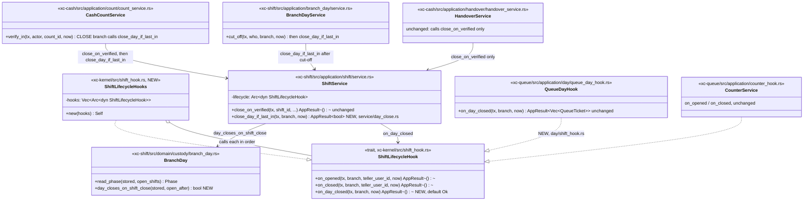

# Queue day close: the last CLOSE verify cancels the queue's leftovers (#4136)

> designed-by: claude/studio-claude-9 (AG controller 4136, under the BE lane controller claude/553782) · measured on `main` `fc19cdbd`, re-checked on `ac0b6929` after review (every file:line below)

## 0. Decided

| # | Rule | Source |
|---|---|---|
| Q8 | When the branch day closes, every WAITING or CALLED ticket becomes `CANCELLED` with reason `dayClosed`. SERVING and finished tickets are left alone. | `queue-tickets.md:47,125` |
| §4.2 | The day reads CLOSED when the stored phase is CUT_OFF and no shift is OPEN, i.e. once the last shift's CLOSE count is verified. There is no stored "close" transition. | `cash-shift-transfer.md` §4.2, `xc-shift/src/domain/custody/branch_day.rs:58-64` |
| K-1 | A kiosk-linked ticket still WAITING/CALLED at day close is a **cancellation with a stored reason** naming the day close, not `NO_SHOW`. The reason is visible in the record the way a staff cancel's is. Owner: *"เป็นรายการ ยกเลิก พร้อม เหตุผลไง"* | owner 2026-10-21 via claude/553782 on #4136 |
| K | `xc-shift` never names the queue. It talks to it only through `ShiftLifecycleHook`. | `xc-kernel/src/shift_hook.rs:3-4` |

No migration. `queue_tickets.ended_reason` is free text (`api/migrations/20261101100000_queue.sql:20`) and `QueueDayHook` already writes `dayClosed`.

## 1. What is missing today (measured)

- `QueueDayHook::on_day_closed` (`api/crates/xc-queue/src/application/day/queue_day_hook.rs:44-146`) does the work: it cancels WAITING/CALLED, writes one CANCEL event each, tells the booking port, then refreshes the status, all in the caller's transaction. Only tests call it: `xc-queue/tests/queue_day_hook_test.rs`, `api/tests/booking_check_in_test.rs:1074`, `api/tests/booking_check_in_rework_test.rs:562`.
- `queue-tickets.md:142,242,307` planned a call from `BranchDay`. That cannot exist: `BranchDay` is stateless and has no close transition (`branch_day.rs:18-64`).
- A shift closes in exactly one place, `ShiftService::close_on_verified` (`xc-shift/src/application/shift/service.rs:216-244`). It already calls `lifecycle.on_closed` in the same transaction. `ShiftRepository::close_shift` (`xc-shift/src/infrastructure/shift/shift_repository.rs:413`) has no production caller.
- Two paths call `close_on_verified`:
  - the **CLOSE** count verify, `CashCountService::verify_in` (`xc-cash/src/application/count/count_service.rs:1252-1261`), reached only from the `countVerify` route (`api/src/presentation/http/v3/commands/cash.rs:287`);
  - the **handover** accept (`xc-cash/src/application/handover/handover_service.rs:586`). It closes the giver *before* it opens the receiver (:589). A "0 OPEN shifts" check inside `close_on_verified` would therefore fire on a handover after cut-off.
- The day can also close at **cut-off**. `BranchDay::cut_off` (`branch_day.rs:43-53`) needs only phase OPEN, not an open shift, and `BranchDayService::cut_off` (`xc-shift/src/application/branch_day/service.rs:214-266`) stores CUT_OFF with no shift of the cutter's own. If every CLOSE is verified while the day is OPEN, the cut-off makes the day read CLOSED at once (`read_phase`, `branch_day.rs:59`), and no CLOSE verify is left to notice. The cut-off route builds its `ShiftService` with no lifecycle hook (`api/src/presentation/http/v3/commands/branch_day.rs:486-492`).
- A COUNT_DIFFERENCE over the limit returns `AwaitingFinance` before `close_on_verified` (`count_service.rs:1159-1197`). Finance approval does not close the shift; the manager verifies again, through the same `verify_in`.
- Every route that closes a shift builds its hook from `shift_lifecycle_hook(pool)` (`cash.rs:191-196`). That is `CounterService` alone. `countSubmit`/`countVerify` use it at `cash.rs:204,259`, and the three handover routes at `cash/handovers.rs:35,93,133`.

## 2. Behaviour

| # | Given | Expected | Test (ticket) |
|---|---|---|---|
| 1 | the stored phase is CUT_OFF, and the CLOSE verify of the last OPEN shift | `on_day_closed` is called once, in the verify's transaction. WAITING and CALLED tickets of the branch (any `service_date`) become `CANCELLED`, `ended_reason = 'dayClosed'`, with one CANCEL event each. SERVING, COMPLETED, CANCELLED and NO_SHOW are unchanged. | S1, W1 |
| 2 | a CLOSE verify while another shift of the branch is still OPEN | not called; nothing cancelled | S1, W1 |
| 3 | a CLOSE verify while the stored phase is OPEN (before cut-off), READY, or there is no `ops_state` row | not called | S1 |
| 4 | a handover accept after cut-off by the branch's last teller | not called. The handover path never asks (§3.2). | W1 |
| 5 | the hook answers an error | `verify_in` answers that error. The transaction rolls back: the shift is still OPEN, the count is unverified, no ticket changed. | W1 |
| 6 | a WAITING ticket linked to a booking, at row 1 | the booking is told `dayClosed` through `BookingQueueEvents::on_ticket_ended_in` (what it does with that is the booking's rule, `xc-booking/src/application/lifecycle.rs:174`) | W1 |
| 7 | `close_day_if_last_in` runs a second time in the same state | it answers `true` again and changes nothing: no row and no event written, because no WAITING/CALLED ticket is left | S1 |
| 8 | two tellers' CLOSE verifies at once, in two transactions | exactly one of them calls the hook (the later one, after the first commits). Without the lock in §3.2 each sees the other's shift still OPEN, and neither fires. | S1 |
| 9 | a CLOSE verify that answers `AwaitingFinance` | not called; the shift stays OPEN | W1 |
| 11 | a cut-off while no shift of the branch is OPEN (every CLOSE already verified) | `on_day_closed` is called once, in the cut-off's transaction; row 1's tickets are cancelled | S1, W1 |
| 12 | a cut-off while a shift is still OPEN | not called; that shift's later CLOSE verify is row 1 | S1 |
| 13 | the hook errors during a cut-off | `cut_off` answers that error; the transaction rolls back and the stored phase is still OPEN | S1 |
| 14 | a cut-off and the last CLOSE verify at once, in two transactions | exactly one of them calls the hook. Both take the `ops_state` row lock (the cut-off by its `store_state_in` write, the verify by §3.2 step 1), so the second sees the first's commit. | S1 |
| 10 | a composite of hooks `[a, b]` | each method calls `a` then `b`, in the same transaction. The first error is answered and the later hooks are not called. | K1 |

**Kiosk-linked tickets** follow row 1 for now: `CANCELLED`, with `ended_reason = 'dayClosed'` stored on the ticket, which is K-1's cancellation with a reason. The kiosk request itself is #4147 (§6).

## 3. Design

### 3.1 The hook gains a day-close method (`xc-kernel/src/shift_hook.rs`)

- `ShiftLifecycleHook::on_day_closed(tx, branch, now) -> BoxFuture<AppResult<()>>`, with a default body of `Ok(())` like the other two. An error rolls the close back. `NoShiftLifecycleHook` and `CounterService` inherit the default.
- `ShiftLifecycleHooks`, a composite `Vec<Arc<dyn ShiftLifecycleHook>>`. Every method calls each hook in order and stops at the first error. It lives beside the trait so any context can stack hooks without `xc-shift` knowing how many there are.

### 3.2 The shift service decides that the day closed (`xc-shift`)

- `BranchDay::day_closes_on_shift_close(stored: Phase, open_after: usize) -> bool` is `stored == CutOff && open_after == 0`. It sits beside `read_phase` (`branch_day.rs:58`).
  - It is deliberately **not** `read_phase(..) == Closed`, because that is also true for a stored CLOSED or a missing row (row 3).
- `ShiftService::close_day_if_last_in(tx, branch, now) -> AppResult<bool>` (new file `application/shift/service/day_close.rs`, a child module of `service.rs`, so it can reach `self.lifecycle`). It runs in the caller's transaction, **after** the shift's `UPDATE`:
  1. `SELECT phase FROM ops_state WHERE branch_id = $1 FOR UPDATE`. The lock orders two concurrent closes (row 8). No row ⇒ `false`.
  2. Decode the phase with `infrastructure::custody::decode::str_to_phase` (`decode.rs:40`, `pub(crate)`).
  3. Count OPEN shifts: `SELECT count(*) FROM shifts WHERE branch_id = $1 AND status = 'OPEN'` (same query as `custody_repository.rs:235`).
  4. If `BranchDay::day_closes_on_shift_close(stored, n)`, call `self.lifecycle.on_day_closed(tx, branch, now)` and answer `true`. Otherwise answer `false`.
  - It writes nothing to `ops_state`. The day still reads CLOSED through `read_phase`, as today.
- **It has two callers, and only these two:** the CLOSE verify (§3.3), and the cut-off (§3.3a). `close_on_verified` is unchanged, so the handover path (`handover_service.rs:586`) never reaches it (row 4).

### 3.3a The cut-off asks too (`xc-shift`)

- `BranchDayService::cut_off` (`application/branch_day/service.rs:214`) adds `self.shifts.close_day_if_last_in(tx, branch, now).await?;` after `append_event`, in the same transaction (rows 11–14). `BranchDayService` already holds `self.shifts` (`:118`).
- `store_state_in` has already written the new CUT_OFF to `ops_state` in this transaction, so step 1's `FOR UPDATE` reads it back on a row this transaction already holds.

### 3.3 The CLOSE verify asks (`xc-cash`)

- In `CashCountService::verify_in`, the CLOSE branch adds one call right after `self.shifts.close_on_verified(..)` (`count_service.rs:1252-1261`), before `update_count_verified`:
  `self.shifts.close_day_if_last_in(&mut *tx, &count.branch_id, now).await?;`
- `AwaitingFinance` returns earlier, so row 9 holds by position.

### 3.4 The queue answers the hook (`xc-queue`)

- `impl ShiftLifecycleHook for QueueDayHook` (new file `application/day/shift_hook.rs`). It overrides `on_day_closed` only, calling the existing inherent `QueueDayHook::on_day_closed` and dropping the ticket list. The inherent method is unchanged.

### 3.5 The route installs both (`api`)

- `shift_lifecycle_hook(pool)` (`cash.rs:191`) returns `ShiftLifecycleHooks::new(vec![counters, day])`, where:
  - `counters` is today's `CounterService`;
  - `day` is `QueueDayHook::new(repo, status).with_booking_events(pg_booking_lifecycle(pool))`, built the way `QueueServices::new` builds its booking events (`v3/commands/queue.rs:71-72`).
- The handover routes get the composite too, which is harmless: they never call `close_day_if_last_in`.
- The cut-off route's `register` (`v3/commands/branch_day.rs:486`) installs the same hook: `ShiftService::new(..).with_lifecycle_hook(shift_lifecycle_hook(&pool))`. Without that, row 11 calls `NoShiftLifecycleHook`. `shift_lifecycle_hook` is `pub(crate)` in the same crate.
- `rpc.rs:298` `shift_service` (the save path) is unchanged. It never closes a shift.

## 4. Class diagram

| Provides | Used by |
|---|---|
| `ShiftLifecycleHook::on_day_closed`, `ShiftLifecycleHooks` (K1) | `ShiftService` (S1), `QueueDayHook` impl (Q1), `cash.rs` (W1) |
| `BranchDay::day_closes_on_shift_close`, `ShiftService::close_day_if_last_in` (S1) | `CashCountService::verify_in` (W1), `BranchDayService::cut_off` (S1) |
| `impl ShiftLifecycleHook for QueueDayHook` (Q1) | `cash.rs::shift_lifecycle_hook` (W1) |

**Skeleton** (the sub-controller's commit on `feat/4136-queue-day-close`):
- the trait method with its default body;
- `ShiftLifecycleHooks` and its impl with `todo!()` bodies;
- `day_closes_on_shift_close` and `close_day_if_last_in` with `todo!()`;
- the `QueueDayHook` impl with a `todo!()` `on_day_closed`;
- the `mod` lines (`service.rs` → `mod day_close;`, `day/mod.rs` → `pub mod shift_hook;`);
- every ticket's up-front tests.

The W1 call line and the `cash.rs` composite are **not** in the skeleton: a `todo!()` reached from every CLOSE verify would break today's tests.

## 5. Tickets → files (disjoint; Gemini 4 Argon; `class:guarded` feature, base `feat/4136-queue-day-close`)

| # | Ticket | File scope | Rows | After |
|---|---|---|---|---|
| K1 | the composite's three methods | `api/crates/xc-kernel/src/shift_hook.rs::ShiftLifecycleHooks` · `api/crates/xc-kernel/tests/shift_lifecycle_hooks_test.rs` (new, `_test` DB) | 10 | skeleton |
| S1 | the day-close rule, the service step with its lock, and the cut-off's call | `api/crates/xc-shift/src/domain/custody/branch_day.rs::day_closes_on_shift_close` · `api/crates/xc-shift/src/application/shift/service/day_close.rs` (new) · `api/crates/xc-shift/src/application/branch_day/service.rs::cut_off` (one line) · `api/crates/xc-shift/tests/shift_day_close_test.rs` (new, `_test` DB) · `api/crates/xc-shift/tests/cut_off_day_close_test.rs` (new, `_test` DB) | 1–3, 7, 8, 11–14 | skeleton |
| Q1 | `QueueDayHook` as a `ShiftLifecycleHook` | `api/crates/xc-queue/src/application/day/shift_hook.rs` (new) · `api/crates/xc-queue/tests/queue_day_shift_hook_test.rs` (new) | 1 (through `Arc<dyn ShiftLifecycleHook>`) | skeleton |
| W1 | the verify call and the route wiring | `api/crates/xc-cash/src/application/count/count_service.rs::verify_in` (one line) · `api/src/presentation/http/v3/commands/cash.rs::shift_lifecycle_hook` · `api/src/presentation/http/v3/commands/branch_day.rs::register` (one line) · `api/crates/xc-cash/tests/day_close_on_close_verify_test.rs` (new, a recording hook; rows 2, 5, 9) · `api/tests/queue_day_close_wiring_test.rs` (new, over HTTP like `api/tests/shift_counter_hook_wiring_test.rs`; rows 1, 4, 6, 11) | 1, 2, 4, 5, 6, 9, 11 | K1, S1, Q1 |

- K1, S1 and Q1 go out together in one dispatch. W1 cannot be in it: its provided tests pass only once the other three are in.
- Every new test file is its own binary today. If PR 1507 (one integration-test binary per package) lands first, each must also be listed in its package's `tests/all.rs`. Whichever lands second does that.

## 6. Ruled out of this design

Ruled on #4136 (2026-10-21; claude/553782, then the owner's K-1): kiosk-linked tickets take Q8's `CANCELLED`/`dayClosed` here (option A). #4147 is the kiosk request's half, blocked by KC-S: it routes kiosk-linked tickets through `cancel_with` with a **day-close reason** (a cancellation with a stored reason, never `NO_SHOW`/`CUSTOMER_LEFT`). The reason's code and the matching change to `kiosk-cancel.md` §3.7 are AG controller KC's (claude/studio-claude-10). The queue's open/close at start service and cut-off is #4148.

The questions as asked (kept for the record; question 1's `CUSTOMER_LEFT`/`NO_SHOW` reading is superseded by K-1):

1. **Kiosk-linked tickets at day close.**
   - Q8 makes the ticket `CANCELLED`/`dayClosed`, and leaves the kiosk request `WAITING`/`ACCEPTED`.
   - `kiosk-cancel.md` §3.7 wants day close to go through `KioskDesk::cancel_with` with reason `CUSTOMER_LEFT`. Its §2 table makes such a ticket `NO_SHOW`, not `CANCELLED`/`dayClosed`.
   - The two documents give opposite results for the same ticket, and `cancel_with` does not exist yet (KC-S of PR 4125 §5).
2. **Q8's queue open at start service and close at cut-off** (`queue-tickets.md:47,127`) is not wired either: `branch_day.rs` and `xc-shift/src` have no queue reference. It is not in this design.
