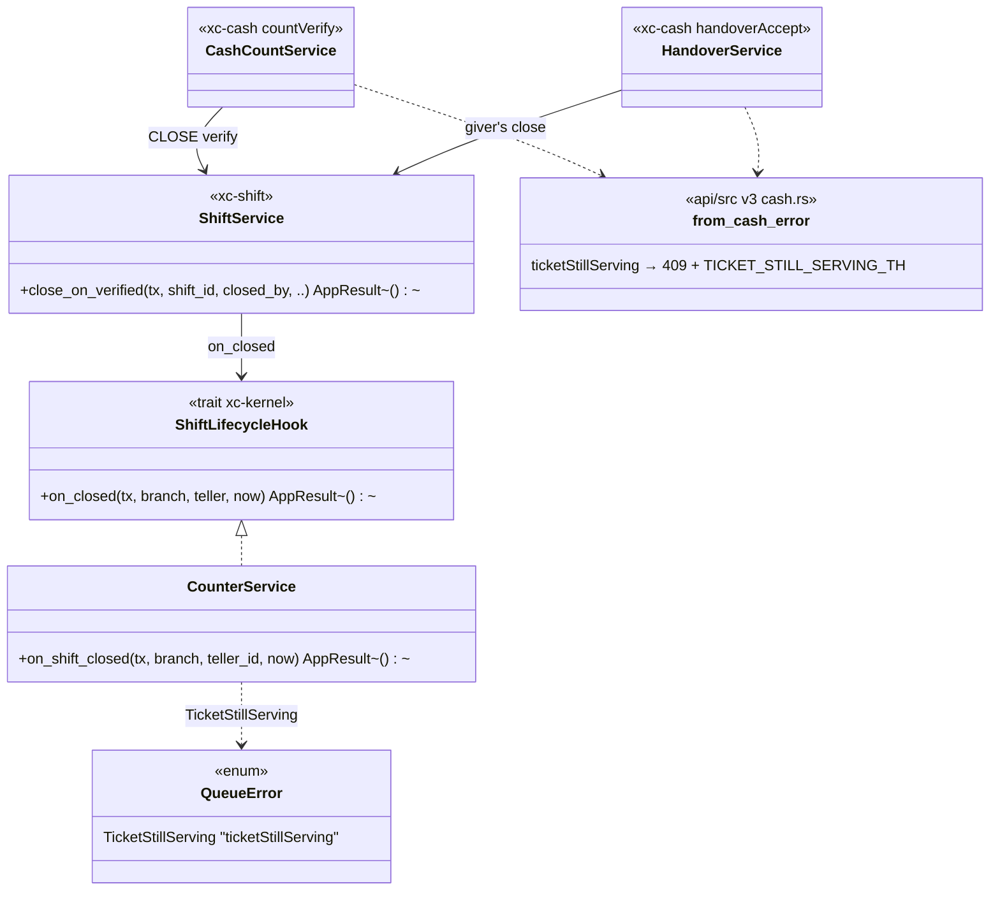

# Blueprint queue: tickets with daily numbers, call / recall / skip, branch service status (#556)

> designed-by: claude/b060e9 · 2026-10-09 · measured on `main` at `1bf3323`
> Source of the rules: *XC Desk — Blueprint & Data Model v2* §16 `QueueTicket` / `QueueEvent` /
> `BranchServiceStatus`, §16 relations (*"Booking → QueueTicket 1:0..N … active ticket จำกัดหนึ่งตาม service policy"*),
> screens B06 `/desk/queue`, C08 `/app/branches`, C09 `/app/journey`, §17 (*"production เปลี่ยนสถานะโดยสาขา;
> customer subscribe queue events; estimated wait มี as_of และ uncertainty"*), §18 Queue acceptance.
> Built on: PR 589 (`docs/design/blueprint/org-roles-branches.md`: organisation, `users`, `QueueOperate`,
> `BranchDayOperate`, `Authorizer`), PR 590 (`docs/design/blueprint/cash-shift-transfer.md`: one OPEN shift per teller,
> the branch day), PR 570 (`docs/design/blueprint/rates.md`: `CommandAction`, `idempotency_records`), #555 (bookings).
> Umbrella: #564. The owner's standing rule is *"logic ห้ามแก้ไข — ปรับได้แค่หน้าตา"*.

## 0. The owner's answers (2026-10-09, typed in session claude/b060e9, recorded on #556 issuecomment-6074469884)

| # | Question | Answer |
|---|---|---|
| Q-A1 | Service types (each has its own daily sequence) | **WALK_IN and BOOKING separate**: booked customers have their own line and numbers |
| Q-A2 | Does a booking create a ticket on check-in (B02)? | **A ticket at check-in, called first**: linked to the booking and called ahead of waiting walk-ins |
| Q-A3 | Skip (ข้าม) on a called customer who did not come | **NO_SHOW, final**: the customer takes a new number |
| Q-A4 | Pause (พัก) on `/desk/queue` | **The teller's counter**: that counter stops calling, `active_counters` drops by one and the estimate updates; waiting tickets are untouched |
| Q-A5 | The estimate's window (recorded on #556 issuecomment-6074684262) | *"Use today's median once at least 3 tickets are completed today; before that, fall back to the median of the last 30 completed tickets from previous days."* |
| Q-A6 | How the estimate shows its uncertainty (§17; recorded on #556 issuecomment-6076848699) | **"A range"**: "about 10–15 min", a low and a high estimate from the spread of the same service times (25th–75th percentile), shown with `as_of` |

## 1. v3 today (measured at `1bf3323`)

| Fact | Evidence |
|---|---|
| The kiosk's queue is its requests: `kiosk_requests.status` `QUOTED → WAITING → ACCEPTED → ID_CHECKED → COMPLETED`, keyed `(branch_id, id)`, with no ticket number and no service date | `api/migrations/20261007170000_kiosk.sql:4-25`; `xc-kiosk/src/domain/kiosk/value_objects/kiosk_status.rs` |
| Work times sit on the request: `started_at`, `completed_at` | `20261008110000_kiosk_work_times.sql` |
| A teller takes a request with `accept` (it becomes ACCEPTED and the teller's) | `xc-kiosk/src/application/kiosk/desk.rs:105` (`accept`), `:28` (`notifications`), `:78` (`queue_before`) |
| The staff queue card, the panel and the admin queue bar (#486, #471) read `kiosk_notifications` (working list, employees) and `kiosk_queue` (rows with `can_accept`) | `api/src/presentation/http/v3/views/kiosk_notifications.rs:38-39`; `dto/v3/kiosk_queue.rs:45-63`; `web/src/shared/queue/{queue-store.ts,wire.ts}`; `web/src/shared/ui/{QueueCard,QueuePanel}.tsx`; `web/src/screens/admin/queue/QueueBar.tsx` |
| Change detection for polling is the per-branch version every `BranchTx` raises | `api/migrations/20261006120000_branch_versions.sql`; `xc-kernel/src/branch_versions.rs:20-21` |
| Bookings are staff-made rate locks with `PENDING / CONFIRMED / USED / CANCELLED`, no check-in | `20261008130000_bookings.sql:13-37`; redesigned by #555 (Blueprint `CHECKED_IN`) |
| No ticket, no call/recall/skip, no counter, no branch service status, no wait estimate | `git grep -n -i 'queue_ticket\|service_status\|estimate' origin/main -- api` is empty |

## 2. Decisions

| # | Decision | Source |
|---|---|---|
| Q1 | **A ticket is a place in a line, not an order.** `queue_tickets` holds the Blueprint's fields. A ticket's completion is not a transaction's completion (§16 *"queue completion ไม่เท่ากับ transaction completion"*). The kiosk request stays the walk-in's order data; a booking stays the booked customer's. | §16 |
| Q2 | **Two service types, `WALK_IN` and `BOOKING`**, each with its own daily sequence per branch. | Q-A1, §16 UQ |
| Q3 | **Numbers.** `sequence` starts at 1 per (branch, service date, service type). `service_date` is the branch's local date (Branch `timezone`, PR 589 OR-1). `display_number` is the type's letter and the sequence zero-padded to 3: `W001`, `B001`. [proposed: the letters and padding are look only] | §16, §18 *"เลขคิวไม่ซ้ำในสาขา/วัน"* |
| Q4 | **Who issues.** A walk-in ticket is issued when the kiosk request becomes WAITING (the customer submits on the tablet), or by a teller at the desk for a customer without the tablet. A booking ticket is issued by the booking's check-in (B02, #555), linked to it. A booking has at most one active ticket. | Q-A2, §16 relations |
| Q5 | **States** (§16): `WAITING → CALLED → SERVING → COMPLETED`; `CANCELLED`, `NO_SHOW`. Recall keeps CALLED and writes an event. Skip = `NO_SHOW`, final (Q-A3). Cancel is allowed from WAITING or CALLED. SERVING ends in COMPLETED, or, when no sale was saved, in CANCELLED with reason `noSale` (§4.6, owner 2026-10-29, #5541). | §16, B06, Q-A3 |
| Q6 | **Call order: BOOKING before WALK_IN** (Q-A2). Within a type: lowest sequence first. "Call next" takes the first WAITING ticket in that order. A teller may also call a chosen ticket. | Q-A2 |
| Q7 | **A counter is a teller with an OPEN shift** (PR 590 C1: one OPEN shift per teller). Its state is `ACTIVE` or `PAUSED` (Q-A4). `active_counters` = the branch's ACTIVE counters. A teller with no OPEN shift cannot call. | Q-A4, PR 590 |
| Q8 | **The branch's queue is open or closed** (`queue_open`). BRANCH_MANAGER closes it: no new ticket is issued, and existing tickets are still served. The queue opens with the branch day's start service (PR 590 C9) and closes at cut-off unless reopened. When the branch day closes, every WAITING or CALLED ticket becomes `CANCELLED` with reason `dayClosed`; before that, every unfinished kiosk request (`WAITING`, `ACCEPTED`, `ID_CHECKED`) is cancelled `DAY_CLOSED`, and its ticket (SERVING included) ends `kioskCancelled:DAY_CLOSED` (`queue-day-close.md` §7, ticket 4147). | §16 `queue_open`, PR 590 C9; owner 2026-10-21 (K-1, K-4) |
| Q9 | **The estimate is computed, never typed** (§16 *"ไม่มีข้อมูลให้ unknown ไม่ใช้เลข hard-coded"*). `estimate_seconds` = (tickets ahead ÷ `active_counters`) × a median service time (`served_at → completed_at`). The median is taken from the branch's COMPLETED tickets **of the service date once there are at least 3**. Before that, it is taken from **the branch's last 30 COMPLETED tickets of earlier days** (Q-A5). The estimate is NULL ("unknown") when neither source has a ticket, or when there are no active counters. `estimate_as_of` is when it was computed. **The range (Q-A6):** `estimate_low_seconds` and `estimate_high_seconds` use the same formula with the 25th and 75th percentile of the same sample (PostgreSQL `percentile_cont` semantics, linear interpolation). All three are NULL together, and `low ≤ estimate ≤ high`. | Q-A5, Q-A6, §16, §17 *"as_of และ uncertainty"* |
| Q10 | **Only the branch moves a ticket** (§17, §18 *"customer advance ไม่ได้"*). A customer reads their own ticket and the public service status. They have no command that changes a ticket. | §17, §18 |
| Q11 | **Concurrency** (§18 *"concurrent ticket issuance ถูก"*). Issuance takes the next number from `queue_sequences` with one `INSERT … ON CONFLICT … DO UPDATE SET last_sequence = last_sequence + 1 RETURNING`, so two kiosks never get the same number. "Call next" selects with `FOR UPDATE SKIP LOCKED`, so two tellers never call the same ticket. Every transition is compare-and-set on the expected status; a lost race answers `STALE_VERSION`. | §18, §09 |
| Q12 | **Idempotency.** Every command is a `CommandAction` with an `Idempotency-Key` (PR 570 CM-1, `idempotency_records`). Issuance is also unique per source: one ticket per kiosk request, one active per booking. A retry returns the same ticket. | §09, §10 |
| Q13 | **Polling sends only changes** (fleet rule 🔁). `branch_service_status.queue_version` is the branch version that `BranchTx` raises (`branch_versions`). Every queue view takes `since` and answers `{changed:false}` when the version is unchanged. | fleet rule, §16 `queue_version` |
| Q14 | **The public status shows no customer data** (§02 *"Public display … ไม่เปิดยอดเงินสดหรือข้อมูลลูกค้า"*): `queue_open`, `active_counters`, waiting count per type, `estimate_seconds`, `estimate_low_seconds`, `estimate_high_seconds`, `estimate_as_of`, and the numbers being called. | §02, C08 |

## 3. Who does what (PR 589 permissions)

| Step | Permission | Notes |
|---|---|---|
| Issue a walk-in ticket at the kiosk | the kiosk device's own path (today `EntryPath::Kiosk`; after PR 589 OR-4 the kiosk route's permission) | the request is the source; no person |
| Issue a walk-in ticket at the desk | `QueueOperate` (TELLER, BRANCH_MANAGER) | |
| Issue a booking ticket | the check-in command of #555 (B02 `BookingsDesk`, TELLER) | called inside check-in's transaction |
| Call next, call chosen, recall, skip, start, finish, cancel | `QueueOperate` | the caller must have an OPEN shift (Q7); start, finish and recall only on the teller's own called ticket, or by BRANCH_MANAGER |
| Pause / resume my counter | `QueueOperate` | own counter only |
| Open / close the branch queue | `BranchDayOperate` (BRANCH_MANAGER) | |
| Read the desk board (B06) | `QueueOperate` | |
| Read the public service status (C08) | public | Q14 |
| Read my ticket (C09) | the customer who owns it (#558's customer session) | |

## 4. Model

### 4.1 Tables (migration `api/migrations/20261101100000_queue.sql`)

Every table has `organization_id uuid NOT NULL` with PR 589 D-1's composite FK `(organization_id, branch_id) →
branches(organization_id, id)`, and `created_at`. Mutable tables also have `updated_at`. Person columns are
`uuid REFERENCES users(id)`.

```
queue_sequences(organization_id, branch_id, service_date date, service_type text, last_sequence integer NOT NULL,
                PRIMARY KEY (branch_id, service_date, service_type))
queue_tickets(id uuid PK, organization_id, branch_id, service_date date NOT NULL,
              service_type text NOT NULL CHECK (service_type IN ('WALK_IN','BOOKING')),
              sequence integer NOT NULL CHECK (sequence > 0), display_number text NOT NULL,
              status text NOT NULL CHECK (status IN ('WAITING','CALLED','SERVING','COMPLETED','CANCELLED','NO_SHOW')),
              customer_id NULL, booking_id NULL, kiosk_request_id text NULL,
              counter_teller_id uuid NULL,                  -- who called / serves it
              issued_at, called_at NULL, served_at NULL, completed_at NULL, ended_reason text NULL,
              idempotency_key text NOT NULL, created_at, updated_at,
              UNIQUE (branch_id, service_date, service_type, sequence),
              UNIQUE (branch_id, idempotency_key),
              UNIQUE (branch_id, kiosk_request_id),         -- one ticket per kiosk request
              FOREIGN KEY (branch_id, kiosk_request_id) REFERENCES kiosk_requests (branch_id, id),
              CHECK ((service_type = 'BOOKING') = (booking_id IS NOT NULL)))
CREATE UNIQUE INDEX queue_tickets_one_active_per_booking ON queue_tickets (booking_id)
       WHERE status IN ('WAITING','CALLED','SERVING')
CREATE INDEX queue_tickets_waiting ON queue_tickets (branch_id, service_date, service_type, sequence)
       WHERE status = 'WAITING'
queue_events(id uuid PK, organization_id, ticket_id FK, status text, kind text
             CHECK (kind IN ('ISSUE','CALL','RECALL','START','FINISH','SKIP','CANCEL')),
             actor_id uuid NULL, at timestamptz, reason text NULL, created_at)          -- immutable
queue_counters(organization_id, branch_id, teller_id uuid REFERENCES users(id),
               status text CHECK (status IN ('ACTIVE','PAUSED')), updated_at, created_at,
               PRIMARY KEY (branch_id, teller_id))
branch_service_status(branch_id PK, organization_id, queue_open boolean NOT NULL DEFAULT false,
                      active_counters integer NOT NULL DEFAULT 0 CHECK (active_counters >= 0),
                      queue_version bigint NOT NULL DEFAULT 0, estimate_seconds integer NULL,
                      estimate_low_seconds integer NULL, estimate_high_seconds integer NULL,   -- Q-A6
                      estimate_as_of timestamptz NULL, updated_at,
                      CHECK ((estimate_seconds IS NULL) = (estimate_low_seconds IS NULL) AND (estimate_seconds IS NULL) = (estimate_high_seconds IS NULL)),
                      CHECK (estimate_low_seconds <= estimate_seconds AND estimate_seconds <= estimate_high_seconds))
```

- `queue_counters` is not a Blueprint entity. It is where `active_counters` (§16) comes from, and it holds Q-A4's
  pause. A row exists while its teller's shift is OPEN. Opening the shift (PR 590 `ShiftService::open_on_verified`)
  inserts it ACTIVE, and closing the shift deletes it.
- `branch_service_status.queue_version` is written in the same transaction as the branch version (Q13), so the
  public read can serve both from one row.

### 4.2 States

```
queue_tickets:  WAITING --call--> CALLED --start--> SERVING --finish--> COMPLETED
                CALLED  --recall--> CALLED                   (event only; called_at unchanged)
                CALLED  --skip--> NO_SHOW                    (final, Q-A3)
                WAITING | CALLED --cancel(reason)--> CANCELLED
                SERVING --release--> CANCELLED (reason noSale; refused while a non-CANCELLED sale names it, §4.6)
                WAITING | CALLED --branch day closes--> CANCELLED (reason dayClosed)
queue_counters: ACTIVE --pause--> PAUSED --resume--> ACTIVE ; removed when the shift closes, refused while its teller holds a CALLED or SERVING ticket (§4.7)
branch queue:   closed --open (start service or BRANCH_MANAGER)--> open --close (cut-off or BRANCH_MANAGER)--> closed
```

### 4.3 Rules the machine enforces (domain)

| Rule | Where |
|---|---|
| issue only while `queue_open` (refused `queueClosed`, `VALIDATION_FAILED`) | `TicketIssuer::issue` |
| the next number is taken in the issuing transaction (Q11) | `QueueRepository::next_sequence_in` |
| one ticket per kiosk request; one active per booking; a retry with the same key returns the same ticket | the unique indexes; `TicketIssuer::issue` |
| call needs an OPEN shift and an ACTIVE counter; a PAUSED counter cannot call (`counterPaused`) | `QueueDesk::call_next`, `call` |
| call next: BOOKING first, then WALK_IN, lowest sequence; `FOR UPDATE SKIP LOCKED` | `CallOrder`, `QueueRepository::lock_next_waiting_in` |
| a teller serves one ticket at a time: no call while they hold a CALLED or SERVING ticket (`alreadyServing`) | `QueueDesk::call_next` |
| every transition checks the expected status; a lost race answers `STALE_VERSION` | `QueueTicket::apply` |
| every transition writes a `queue_events` row, raises the branch version and recomputes the estimate in the same transaction (§09) | `QueueDesk`, `StatusService::refresh_in` |
| a shift close is refused while its teller holds a CALLED or SERVING ticket in the branch (`ticketStillServing`, §4.7) | `CounterService::on_shift_closed`, called through `ShiftLifecycleHook::on_closed` |
| when the branch day closes, WAITING and CALLED tickets are cancelled (`dayClosed`) | `QueueDayHook::on_day_closed`, called through `ShiftLifecycleHook::on_day_closed` after the last CLOSE verify (`queue-day-close.md`, #4136; `BranchDay` has no close transition to call it from) |

### 4.4 Commands and views

All commands are `CommandAction`s (PR 570 §6) with an `Idempotency-Key`. Blueprint §10 names no queue route, so these
routes are [proposed] and may be renamed in review without changing logic.

| Command | Route | Permission |
|---|---|---|
| `ticketIssueWalkIn` | `POST /api/queue/tickets` (desk) | `QueueOperate` |
| `ticketCallNext` | `POST /api/queue/call-next` | `QueueOperate` |
| `ticketCall` / `ticketRecall` / `ticketSkip` / `ticketStart` / `ticketFinish` / `ticketCancel` | `POST /api/queue/tickets/{id}/call` · `/recall` · `/skip` · `/start` · `/finish` · `/cancel` | `QueueOperate` |
| `counterPause` / `counterResume` | `POST /api/queue/counter/pause` · `/resume` | `QueueOperate` |
| `ticketRelease` (§4.6) | `POST /api/queue/tickets/{id}/release` | `QueueOperate` |
| `queueOpen` / `queueClose` | `POST /api/queue/open` · `/close` | `BranchDayOperate` |

The kiosk's ticket and the booking's ticket are issued inside the kiosk's `confirm` and in #555's check-in. They are not
separate routes.

| View | Who | Content |
|---|---|---|
| `queue_board` (B06) | `QueueOperate` | WAITING per type in call order, CALLED/SERVING with teller, my counter state, `since` → `{changed:false}` |
| `branch_service_status` (C08, public) | public | Q14 fields, `since` |
| `my_queue_ticket` (C09) | the ticket's customer (#558) | number, status, tickets ahead, estimate with its low–high range + `as_of`, `since` |

### 4.5 The kiosk request, the queue card and the admin bar

- **Kiosk.** The kiosk's `confirm` (`xc-kiosk/src/application/kiosk/customer.rs:97`, `QUOTED → WAITING`) issues the walk-in ticket in the same transaction, through the
  `QueueTickets` port. `accept` becomes "start" on that ticket: calling it first if it is WAITING. The request's own
  states continue as today for the order data (`ACCEPTED → ID_CHECKED → COMPLETED`). Its `started_at` /
  `completed_at` are then copies of the ticket's `served_at` / `completed_at`. They are kept until the readers move
  (QU-6) and are dropped in the cleanup block (§8 M2).
- **Queue card and admin bar** (#486, #471). They move from `kiosk_notifications` to `queue_board` (QU-6). PR 535's
  comment on #556 asks for exactly this. `queue_board` answers only `{waiting, called, myCounter}`
  (`views/queue_board.rs:93-131`) behind `QueueOperate`. So the card and bar derive what they show: the count from
  `waiting.length`, the lines from `called`, the new-request key from the newest waiting id, the branch name from the
  shell's `me` or the page label, and the client clock for "now". The card mounts only for sessions holding
  `QueueOperate`.
- **The queue panel stays on `kiosk_queue`** (amended 2026-10-12, #1354 issuecomment-6117565689). It lists kiosk
  *requests* (amount, staff, accept, filter, paging, request id), not queue tickets, and `queue_board` carries none of
  that. The earlier text grouped it with the card by mistake. `kiosk_queue` therefore stays until a later row gives the
  panel a v3 request view. **Its `startedAt`/`completedAt` keep their wire shape but are read from the request's queue ticket** (`queue_tickets.served_at`/`completed_at`, joined on the ticket the kiosk `confirm` issued), not from the request's own columns, which QU-8's M2 drops. This is the copy relation stated above, read at the source. A request with no ticket answers `null` for both.

### 4.6 Releasing a SERVING ticket with no sale (#5541)

> Design delta by claude/2ca5874b (BE lane, under claude/553782), 2026-10-29 ICT. Measured on `origin/main` `6d573093`.
> Owner's decision, 2026-10-29 19:0x ICT, in claude/553782's session (label verbatim): **"ยกเลิกได้ ระบุว่าไม่มีการขาย (Recommended)"** (#5541 §2). It answers desk check round 4's P3.

**The gap.**
- The desk serves a walk-in at the booking step (`web/src/screens/desk/steps/booking/step.tsx:63` → `POST /api/queue/tickets/serve`), before any sale exists.
- In round 4, W013's PromptPay save was blocked, so W013 stayed SERVING. The teller's next walk-in got 409 `alreadyServing` (`check_not_serving`, `queue_desk.rs:88-109`).
- The only way out was `finish`, which recorded COMPLETED for a sale that never happened. `QueueTicket::apply` has `Finish` as SERVING's only exit (`queue_ticket.rs:120`), and `Cancel` is WAITING | CALLED only (`:125`).

**The transition.** `SERVING --release--> CANCELLED`, with `ended_reason = noSale` and a `CANCEL` event whose `reason` is `noSale`.
- `[required]` The reason is the one fixed value `NO_SALE = "noSale"` (`queue_ticket.rs`), and the request carries no reason text. It is camelCase like the desk's other reasons (`dayClosed`, `customerLeft`).
- The event reuses what the one existing SERVING → CANCELLED path writes: the kiosk end (`ticket_issuer.rs:391-401`) writes status CANCELLED, kind `CANCEL`, and the reason in `queue_events.reason`.
  - Its reason is `kioskCancelled:<code>`, which means the kiosk request ended. `noSale` means a teller served the customer and no sale was saved.
  - No new event kind is added, so the `queue_events.kind` CHECK (`20261101100000_queue.sql:37`) is unchanged.
  - (#5541 §3 also cites the day-close hook, `queue_day_shift_hook_test.rs:122`. Measured there: day close leaves a SERVING ticket SERVING, with no event, so it is not such a path.)
- **A new command, not a wider `cancel`.** `cancel` keeps its free reason and its WAITING | CALLED rule. The existing pins stay true unedited: `queue_ticket_machine_test.rs:271-275` (SERVING + `Cancel` is stale) and `every_command_outside_the_table_is_stale` (`:279`, whose `all_commands()` list has no `Release`).
  - #5541 §4 expected `queue_desk_test.rs:321-337` to flip. Measured: those lines refuse commands on a NO_SHOW ticket, not a SERVING one, so they stay true.

**Who may send it.** The same as `finish` (QU-A2, `queue_desk.rs:729-741`): `QueueOperate` (`authorize_in`), an OPEN shift (`check_on_duty`), and either the serving teller or a BRANCH_MANAGER of the branch (`check_ticket_owner`, `:111`).

**A ticket with a sale cannot be released.** When a transaction with `status <> 'CANCELLED'` names the ticket (`transactions.queue_ticket_id`, `20261226130000_transactions_queue_ticket_id.sql`), release is refused with `ticketHasSale` (409), and the ticket stays SERVING.
- The predicate is the one the column's unique index uses (`:3-4`). So a DRAFT, PENDING_APPROVAL or CONFIRMED sale blocks release: the teller cancels the sale first, then releases the ticket.
- A sale that is completed later finishes its ticket through `finish_for_sale_in` (`complete.rs:323-326`). That path is unchanged.

**After a release:**
- the branch version and the estimate refresh (`StatusService::refresh_in`), as for every transition (§4.3);
- the teller holds no CALLED or SERVING ticket, so `alreadyServing` no longer fires;
- a kiosk-linked ticket tells its request through `KioskQueueEvents::on_ticket_ended_in(.., Cancelled { reason: "noSale" })`, as `cancel_in` does (`queue_desk.rs:845-857`);
- a booking's ticket tells its booking `BookingQueueEvents::on_ticket_ended_in(.., "noSale")`, which ends the booking `CANCELLED (noSale)` (booking-slots §4.2a, staff e2e 2026-11-01 T1). A manual `finish` that no COMPLETED sale names tells it the same; a sale's own completion (`finish_for_sale_in`) tells nothing.

**Class diagram (the delta).**

```mermaid
classDiagram
    class TicketCommand {
        <<enum>>
        Release
    }
    class QueueTicket {
        +apply(cmd, now) Result~Transition, QueueError~
    }
    class QueueError {
        <<enum>>
        TicketHasSale  "ticketHasSale"
    }
    class QueueDesk {
        +release(actor, branch, ticket_id, now) AppResult~QueueTicket~
        +release_in(tx, actor, branch, ticket_id, now) AppResult~QueueTicket~
    }
    class Release {
        <<CommandAction ticketRelease>>
        POST /api/queue/tickets/{id}/release
    }
    Release --> QueueDesk : release_in
    QueueDesk --> QueueTicket : apply(Release)
    QueueDesk ..> QueueError : TicketHasSale
```

| Item | File | Provided by | Used by |
|---|---|---|---|
| `TicketCommand::Release`, `NO_SALE` | `api/crates/xc-queue/src/domain/ticket/queue_ticket.rs` | skeleton on `test/5541` | T1 |
| the `(Serving, Release)` arm of `apply` | same file | **T1** | `QueueDesk::release_in` |
| `QueueError::TicketHasSale` (`"ticketHasSale"`) | `api/crates/xc-queue/src/domain/ticket/queue_error.rs` | skeleton | T1 |
| `QueueDesk::release`, `release_in` (signatures) | `api/crates/xc-queue/src/application/desk/queue_desk.rs` | skeleton (answers `staleVersion`, today's refusal) | the route |
| `release_in` body | same file | **T1** | — |
| `Release` (`ticketRelease`, the `ticket_command!` macro), its `register` line, `ticketHasSale` → 409 in `refusal` | `api/src/presentation/http/v3/commands/queue.rs` | skeleton | FE ticket |
| `queue_operate("ticketRelease")` | `api/crates/xc-auth/src/domain/policy/areas/queue.rs` | skeleton | — |

`[required]` route `POST /api/queue/tickets/{id}/release`, body `{branch, id}` (`QueueTicketInput`), answer `QueueTicketDto`, and refusal codes `staleVersion`, `notYourTicket`, `noOpenShift`, `ticketHasSale` (each 409), plus the policy's role refusal.

**Behaviour table.**

| # | Ticket | Caller | Answer | Up-front test |
|---|---|---|---|---|
| N-1 | SERVING, no sale | the serving teller | CANCELLED `noSale`; one `CANCEL` event by them, reason `noSale`; version moves; the teller can call the next ticket | `xc-queue/tests/queue_desk_release_test.rs::the_serving_teller_releases_…` (red today) |
| N-2 | SERVING | another teller | `notYourTicket`; unchanged | `…::another_teller_is_refused_and_a_branch_manager_on_duty_releases` (red today) |
| N-3 | SERVING | a BRANCH_MANAGER on duty | CANCELLED `noSale`; the event is theirs | same test |
| N-4 | WAITING, CALLED or COMPLETED | the teller | `staleVersion`; unchanged (CALLED is cancelled or skipped instead) | `…::only_a_serving_ticket_is_released_…` |
| N-5 | SERVING | a caller with no OPEN shift | `noOpenShift`; unchanged | `…::a_teller_without_an_open_shift_is_refused` (red today) |
| N-6 | SERVING, named by a non-CANCELLED sale | the teller | `ticketHasSale`; stays SERVING | `api/tests/queue_release_no_sale_route_test.rs::a_ticket_a_sale_names_is_refused_ticket_has_sale_and_stays_serving` (red today) |
| N-7 | SERVING, its only sale CANCELLED | the teller | CANCELLED `noSale` | `…::a_ticket_whose_only_sale_was_cancelled_is_released` (red today) |
| N-8 | round 4's W013: served, released | the teller, then a second `serve` | release 200 CANCELLED; the second serve gets a new ticket, not `alreadyServing` | `…::a_served_walk_in_with_no_sale_is_released_and_the_next_walk_in_is_served` (red today) |
| N-9 | domain: `apply(Release)` from SERVING / any other state | — | CANCELLED `noSale`, `Cancel` event, `served_at` kept, no `completed_at` / `StaleVersion` | `xc-queue/tests/queue_ticket_release_test.rs` (the SERVING case is red today) |
| N-10 | the policy row | — | `ticketRelease` needs `QueueOperate` | `…route_test::the_policy_row_ticket_release_needs_queue_operate` |

**Up-front tests.** They are on branch **`test/5541`** at `dc0d3fee`, off `origin/main` `6d573093`, with the skeleton above and 12 tests in the three files.
- On `test/5541`: 7 fail on the result (the skeleton's `staleVersion` where a release or a different refusal is expected), and 5 pass.
- With a throwaway T1: 106/106 across these files and `queue_desk_test`, `queue_ticket_machine_test`, `queue_desk_rules_test`, `queue_desk_on_duty_test`, `kiosk_ticket_cancel_test`, `gapsa6_desk_kiosk_events_test`, `walk_in_desk_test`, `walkin_sale_link_test`, `walkin_serve_command_test` and `queue_commands_views_test`.
- clippy `-p xc-queue -p xc-auth -p xchange --all-targets -D warnings`, `cargo fmt --all --check` and `bash scripts/fmt-included.sh origin/main` are clean.
- No existing test changes.

**Function tickets.**

| Ticket | Lane | File scope | Done line |
|---|---|---|---|
| **T1** release with no sale | BE: `class:logic`, Gemini 4 Argon, base `main`, from `test/5541` | `api/crates/xc-queue/src/domain/ticket/queue_ticket.rs`, `api/crates/xc-queue/src/application/desk/queue_desk.rs` | `cd api && cargo nextest run -p xc-queue -p xchange -E 'test(/^(queue_desk_release_test\|queue_ticket_release_test\|queue_release_no_sale_route_test\|queue_desk_test\|queue_ticket_machine_test\|kiosk_ticket_cancel_test\|walkin_sale_link_test)::/)'` all green; clippy and `fmt-included.sh` clean |
| **FE-1** the desk's "ไม่มีการขาย" (no sale) button | FE: cut by the FE controller claude/e92db6 | for the FE controller to set; measured candidates: `web/src/screens/desk/queue/queue-commands.ts` (`TicketVerb` gains `release`), `web/src/screens/desk/queue/actions/TicketActions.tsx` (the SERVING ticket's actions, beside finish), and the booking step's walk-in card (`web/src/screens/desk/steps/booking/step.tsx`) | the button shows on a SERVING ticket, posts the route above, and shows `ticketHasSale` as "this ticket has a sale; cancel the sale first" |

FE-1 needs T1 on main for a live route, but it can start against the `[required]` contract above.

**Data migration.** None. `CANCELLED` and `ended_reason` exist (`20261101100000_queue.sql:14`, `:20`). `ended_reason` is free text with no CHECK, and `CANCEL` is an allowed event kind (`:37`). No row changes shape.

**Out of scope.** Releasing a CALLED ticket (it already has `cancel` and `skip`), and any change to `finish` or `cancel`.

### 4.7 A shift close never orphans a CALLED or SERVING ticket (#5675)

> Design delta by claude/01TxaRJG (AG controller #5675, under BE lane controller claude/553782), 2026-10-30 ICT. Measured on `origin/main` `9861594a`.
> Owner's ruling, 2026-10-30 13:5x ICT, typed in claude/553782's session and recorded on #5675: **A. Refuse the close.** A shift close is refused while that teller has a CALLED or SERVING ticket at their counter. The teller first finishes, releases (#5541) or skips it. Nothing is released or cancelled automatically.

**The gap.**
- On xc-v3 at `0b4400a3`, walk-in W035 stayed SERVING after its teller's shift closed. The branch manager's `finish` got 409 `noOpenShift`.
- Every shift close runs `ShiftLifecycleHook::on_closed` in the close's transaction (`xc-shift/src/application/shift/service.rs:240-242`). `CounterService` is that hook (`xc-queue/src/application/counter_hook.rs:27-35`).
- `on_shift_closed` deletes the teller's `queue_counters` row and never looks at their tickets (`counter_service.rs:195-210`).
- The ticket keeps `counter_teller_id`, but no counter backs it. `finish`, `start`, `recall`, `release` and `cancel` all need the caller's counter (`check_on_duty`, `queue_desk.rs:63-85`). So nobody can end the ticket until someone opens a shift of their own or the day closes.

**Root cause.** `on_shift_closed` is allowed to delete a counter that still holds a live ticket. It is the one place a counter is deleted (`git grep "DELETE FROM queue_counters"` finds only `counter_service.rs:202`), so the rule goes there.

**The rule.** `[required]` `CounterService::on_shift_closed` first reads whether the teller holds a ticket in that branch with `status IN ('CALLED','SERVING')` and `counter_teller_id` = the teller.
- If one exists, it answers `QueueError::TicketStillServing`, which is `AppError::Validation("ticketStillServing")` through the existing `From`. It deletes nothing.
- `ShiftLifecycleHook::on_closed` documents that an error rolls the close back (`shift_hook.rs:29-30`). So the shift stays OPEN, the counter stays, the CLOSE count stays unverified, a hand-over stays PENDING, and `close_day_if_last_in` never runs.
- WAITING tickets and other tellers' tickets do not block. A PAUSED counter is checked the same as an ACTIVE one.
- The teller's way out is an action that already exists:
  - CALLED: `skip` (→ NO_SHOW) or `cancel`;
  - SERVING: `finish` (→ COMPLETED) or `release` (→ CANCELLED `noSale`, §4.6);
  - a SERVING ticket that a sale names: complete the sale (it finishes the ticket), or cancel the sale and then release.
  The teller still holds their counter, so `check_on_duty` passes.

**No race.** Every v3 command, including `countVerify`, `handoverAccept` and each queue desk command, runs inside the branch's `BranchTx`, which takes `SELECT … FOR UPDATE` on that branch's `branch_versions` row first (`xc-kernel/src/branch_tx.rs:1-12`; `api/src/presentation/http/v3/command.rs:562-563`). A desk `call` cannot interleave with a close of the same branch, so a plain `SELECT` in `on_shift_closed` is enough.

**Which closes the rule covers.** Measured on `9861594a`, `close_on_verified` has two callers:
- the CLOSE count verify (`xc-cash/src/application/count/count_service.rs:1390-1399`);
- the hand-over accept, which closes the giver's shift (`handover_service.rs:733-735`).
Both reach the same hook, so the rule holds on both without another change.
- **A forced or manager close of another teller's shift follows the same rule.** There is no separate force-close: `adminCloseShift` is retired (`api/src/application/compat/rpc.rs:23`). Another person closes a teller's shift only by verifying that teller's CLOSE count (`countVerify`: BRANCH_MANAGER, or EXECUTIVE / ADMIN via `ShiftCloseCertify`).
- I found no reason to treat that case differently. The ticket still belongs to the teller, and the same orphan would follow. The teller is still on duty while the close is refused, so the teller can end the ticket.
- A BRANCH_MANAGER who holds an OPEN shift can also end it (`check_ticket_owner`, `queue_desk.rs:111`).
- A hand-over follows the rule too. The receiver does not inherit the giver's live ticket, because no rule moves `counter_teller_id`, and adding one would be an automatic change the ruling forbids.

**Where a ticket can still be orphaned.** Only rows from before this change. Day close cancels WAITING and CALLED ones (#4136); a SERVING orphan stays until someone with a shift ends it. This is the existing data question on #564 and is not part of this ticket. No backfill.

**The refusal on the wire.** `[required]` `countVerify` (`POST /api/cash-counts/{id}/verify`) and `handoverAccept` (`POST /api/handovers/{id}/accept`) answer **409 `ticketStillServing`**. The message is:
> ปิดกะไม่ได้ ยังมีคิวที่เรียกหรือกำลังให้บริการค้างอยู่ กรุณาจบคิวนั้นก่อน (เสร็จสิ้น ไม่มีการขาย หรือข้ามคิว)

(*"Cannot close the shift: a called or serving ticket is still open. End that ticket first (finish, no sale, or skip)."*)
- Both routes map service errors through `from_cash_error` (`api/src/presentation/http/v3/commands/cash.rs:165`). Today that turns `Validation(_)` into 400 `validationFailed`.
- The skeleton adds one arm ahead of it, matching only `QueueError::TicketStillServing.code()`, which answers 409 with the text above (`TICKET_STILL_SERVING_TH`). No other cash refusal changes.
- The code is camelCase like the queue's other codes. The message names the three desk actions by the labels the desk shows ("เสร็จสิ้น", "ไม่มีการขาย" from §4.6 FE-1, "ข้ามคิว").
- `countSubmit` and `handoverStart` are not refused. A CLOSE count can be submitted while a ticket is live; only the step that closes the shift is refused. Refusing at submit too would need xc-cash to read queue state through a new port, and the verify-time refusal already rolls back everything.

**Class diagram (the delta).**



| Item | File | Provided by | Used by |
|---|---|---|---|
| `QueueError::TicketStillServing` (`"ticketStillServing"`) | `api/crates/xc-queue/src/domain/ticket/queue_error.rs` | skeleton on `test/5675` | T1 |
| the check at the top of `on_shift_closed` | `api/crates/xc-queue/src/application/counter/counter_service.rs` | **T1** (the skeleton keeps today's body and documents the rule) | every shift close |
| `TICKET_STILL_SERVING_TH` and the `ticketStillServing` → 409 arm of `from_cash_error` | `api/src/presentation/http/v3/commands/cash.rs` | skeleton | `countVerify`, `handoverAccept`, FE ticket |
| the four `*_needs_an_open_shift` tests' setup, restated (below) | `api/crates/xc-queue/tests/queue_desk_on_duty_test.rs` | skeleton | — |

The skeleton keeps `on_shift_closed`'s body rather than `todo!()`. Some 29 existing test files close a shift through it, and a `todo!()` would turn them red for a reason the ticket does not change.

**Behaviour table.**

| # | Teller's tickets at close | Close by | Answer | Up-front test |
|---|---|---|---|---|
| S-1 | one CALLED | hook | `ticketStillServing`; shift OPEN, counter ACTIVE, ticket CALLED, branch version unchanged | `xc-queue/tests/queue_shift_close_live_ticket_test.rs::a_called_ticket_refuses_the_close_and_nothing_moves` (red today) |
| S-2 | one SERVING | hook | same, ticket SERVING | `…::a_serving_ticket_refuses_the_close_and_nothing_moves` (red today) |
| S-3 | one SERVING, counter PAUSED | hook | same; counter stays PAUSED | `…::a_paused_counter_with_a_serving_ticket_is_refused` (red today) |
| S-4 | the live ticket finished, released or skipped | hook | close goes through; counter removed, `active_counters` 0 | `…::after_finish_release_or_skip_the_close_goes_through` (red today: the first close is not refused) |
| S-5 | only WAITING tickets; another teller SERVING | hook | close goes through; the other counter and tickets unchanged | `…::waiting_tickets_and_another_tellers_live_ticket_do_not_block` (green today, stays green) |
| S-6 | — | — | `AppError::from(TicketStillServing)` is `Validation("ticketStillServing")` | `…::the_refusal_is_validation_ticket_still_serving` (green on the skeleton) |
| S-7 | SERVING (W035) | `countVerify` by the BRANCH_MANAGER (a close of another teller's shift) | 409 `ticketStillServing` with the Thai text; shift OPEN, counter ACTIVE, count unverified, ticket SERVING | `api/tests/shift_close_live_ticket_route_test.rs::h1_h2_a_close_verify_while_the_teller_serves_is_refused_until_the_ticket_ends` (red today) |
| S-8 | W035 released by the teller (#5541) | the same `countVerify` again | 200 `VERIFIED`; shift CLOSED; counter removed | same test |
| S-9 | CALLED | `handoverAccept` by the receiver | 409 `ticketStillServing`; giver's shift OPEN and counter ACTIVE, receiver has no OPEN shift, hand-over PENDING | `…::h3_a_handover_accept_while_the_giver_holds_a_called_ticket_is_refused` (red today) |
| S-10 | nothing live | any close | unchanged from today | the existing files below, unedited |

**Up-front tests.** They are on branch **`test/5675`** at `a3dbc686`, off `origin/main` `9861594a`, with the skeleton above. That is 8 new tests in two new files, plus the restated setup below. clippy `-p xc-queue -p xchange --all-targets -D warnings`, `cargo fmt --all --check` and `bash scripts/fmt-included.sh origin/main` are clean.

**Tests that pin today's close.** I listed every test file that closes a shift with `git grep -lE "on_shift_closed|\.on_closed\(|close_on_verified|close_shift\(|handovers/\{[a-z_]+\}/accept|\.accept_or_await|accept_in\(|\"kind\": \"CLOSE\"|CountKind::Close" -- 'api/tests/**' 'api/crates/*/tests/**'` on `9861594a`. That finds 53 files.
- **24 cannot reach the rule:** `xc-cash` (20), `xc-shift` (2) and `xc-kernel` (1) tests, plus `xc-queue/tests/queue_day_shift_hook_test.rs`. The first three crates do not depend on `xc-queue` (`Cargo.toml`), so they install `NoShiftLifecycleHook` or their own recorder. The day-shift test calls `QueueDayHook::on_closed`, which does nothing.
- **29 reach `CounterService::on_shift_closed`:**
  - in `xc-queue/tests`: `queue_counter_test`, `queue_counter_hook_test`, `queue_desk_test`, `queue_desk_on_duty_test`, and `queue_desk_common/mod.rs`'s `close_shift` helper;
  - in `api/tests`, through `countVerify` or `handoverAccept`: `abandon_request_test`, `cash_rounding_transaction_test`, `custody_ports_test`, `device_save_step_test`, `handover_accept_v3_awaiting_finance_test`, `handover_decide_branch_scope_test`, `handover_start_receiver_and_shift_test`, `kiosk_day_close_wiring_test`, `queue_day_close_wiring_test`, `save_transaction_test` (+ `save_common`), `shift_close_notices_v3_test`, `shift_counter_hook_wiring_test`, `transfer_receive_open_shift_and_dispatch_source_test`, `transfer_shift_branch_test`, `tx4_repositories_test`, `tx_8l_custody_ports_test`, `v3_admin_cash_view_test`, `v3_admin_overview_view_test`, `v3_admin_parts_views_test`, `v3_cash_commands_test`, `v3_devices_view_test`, `v3_staff_daily_report_view_test` (+ `shift_setup_common`).
- **Measured, not read:** with a throwaway T1 (the check above, not committed), I ran these 29 files, plus `queue_desk_release_test`, `queue_release_no_sale_route_test` and the two new files. Result: 257 tests run, 253 passed, 4 failed. All 4 failures are in `xc-queue/tests/queue_desk_on_duty_test.rs`: `recall_needs_an_open_shift`, `skip_needs_an_open_shift`, `start_needs_an_open_shift` and `finish_needs_an_open_shift`.
  - Each one sets up the orphan this ticket forbids. Teller A calls (and for `finish`, starts) a ticket, then `close_shift` closes A's shift. The test then checks that A's desk command is refused `noOpenShift`.
  - Under ruling A that close is refused, so the setup's `close_shift` helper panics (`queue_desk_common/mod.rs:179`).
- **Restated on `test/5675`, setup only, for claude/553782 to PASS or reject.**
  - The four tests now reach "off duty with a live ticket" through a new local helper, `off_duty_with_a_live_ticket`. It makes the state rows from before #5675 still have: the shift CLOSED and the counter row deleted, in SQL. The helper's comment cites §4.7 and the ruling.
  - Every assertion is unchanged, so what they pin still holds: a desk command needs the caller's counter.
  - That file's header says "do not edit". This is the trap in skill `lane-controllers` §5: a provided test written before an owner decision pins the old decision, so the controller restates it and cites the owner's words.
  - I did not delete or weaken any assertion, and I did not touch the shared `close_shift` helper.
- **After the restatement, measured 2026-10-30 ICT:**
  - On the skeleton, `queue_desk_on_duty_test` passes 7/7. The new files fail 6 tests on the result (no refusal yet) and pass 2: S-5, and S-6, which needs only the skeleton.
  - With the throwaway T1, `queue_desk_on_duty_test` plus the two new files pass 15/15. The other 249 tests of the 257-test run above were already green under T1.
- Other near misses I checked by reading and confirmed by the run:
  - `kiosk_day_close_wiring_test.rs:474-480` sets a kiosk ticket SERVING but leaves `counter_teller_id` NULL;
  - `queue_day_close_wiring_test.rs` closes with WAITING tickets only.

**Function tickets** (released only after claude/553782 PASSes this design).

| Ticket | Lane | File scope | Done line |
|---|---|---|---|
| **T1** refuse a shift close while the teller holds a live ticket | BE: `class:guarded` (it gates cash custody's shift close), **Gemini 4 Argon**, base `main`, from `test/5675` | `api/crates/xc-queue/src/application/counter/counter_service.rs` | `cd api && cargo nextest run -p xc-queue -p xchange -E 'test(/(queue_shift_close_live_ticket_test\|shift_close_live_ticket_route_test\|queue_desk_on_duty_test\|queue_counter_test\|queue_counter_hook_test\|shift_counter_hook_wiring_test\|queue_day_close_wiring_test)::/)'` all green; clippy `-p xc-queue -p xchange --all-targets -D warnings` and `bash scripts/fmt-included.sh origin/main` clean |
| **FE-1** show `ticketStillServing` on the shift-close and hand-over screens | FE: cut by the FE controller claude/e92db6 | for the FE controller to set; measured candidates: `web/src/screens/staff/shift/ShiftCard.tsx` (the verify call's error branch, `:405-411`, beside `notWaiting`) and `web/src/screens/staff/shift/i18n.ts` | a 409 `ticketStillServing` on verify or accept shows the Thai line above (TH/EN/ZH per PR 607), and the count stays waiting so it can be verified again |

T1 is one function in one file, so the queue's file lock gives it no conflict with the FE ticket. FE-1 can start against the `[required]` wire contract above before T1 merges.

**Data migration.** None. No table, column or CHECK changes; the rule is a read plus a refusal.

**Out of scope.** Moving a live ticket to the hand-over's receiver; refusing `countSubmit` or `handoverStart`; clearing W035 or other existing orphans (#564, #4136).

## 5. Class diagram


`QueueTickets` is a port in `xc-kernel`, so `xc-kiosk` and the booking crate call it without depending on `xc-queue`.
`api/src` wires `TicketIssuer` behind it.

### 5.1 Who provides, who uses

| Provider | Used by | Fallback if not merged |
|---|---|---|
| PR 589 `users`, `organization_id`, `Branch.timezone`, `QueueOperate`, `BranchDayOperate`, `Authorizer` | every table and command | none: QU-1 starts after PR 589's OR-1/OR-2, QU-3 after its permission ticket |
| PR 590 one OPEN shift per teller (CA-3), `BranchDay` (CA-7) | counters (Q7), day close (Q8) | QU-4 starts after CA-3. QU-5's `QueueDayHook` call starts after CA-7 |
| PR 570 `CommandAction`, `idempotency_records` (CM-1) | every command | none: QU-7 starts after CM-1 |
| #555 booking check-in | booking tickets | QU-2 ships the port and the kiosk source. The booking source is wired by #555's check-in ticket |

## 6. Kept, changed, retired

| Today | After |
|---|---|
| a kiosk request is a place in the queue | it has a ticket; the request keeps the order data |
| `accept` takes a WAITING request | `accept` starts the request's ticket (calling it first) |
| `kiosk_requests.started_at/completed_at` | copies of the ticket's times, then dropped (§8 M2) |
| `kiosk_notifications` / `kiosk_queue` feed the queue card, panel and admin bar | `queue_board` feeds them (QU-6); the two old views are retired in QU-8 |

## 7. Known differences from v2 (all decided by Q-A1–Q-A4 or by the Blueprint)

| v2 / v3 today | After |
|---|---|
| the queue is the kiosk's request list | numbered tickets per type and day |
| a booking has no place in the queue | its check-in issues a BOOKING ticket, called first |
| a teller "accepts" any waiting request | call next / call chosen / recall / skip / start / finish |
| no wait shown | estimate from today's service times, unknown when there are none |

## 8. Data migration

v3 has not been installed for a shop and starts empty (`xchange-v3.md` D6); the test instance holds test data only.
The owner approved v3's migrations until its first install (2026-10-06). Versions follow the controller's allocation:
the queue's feature block is `20261018*`, and transitional drops go in the cleanup block `20261030*` (#564
issuecomment-6074383060).

**M1. `api/migrations/20261101100000_queue.sql` (QU-1): create only.**

*Versions (lane controller, 2026-10-10, on #879):* M1 is `20261101100000` and M2 is proposed at `20261102100000`. The `migration-order` gate refuses any version at or below main's highest, which was `20261030160000` when QU-A1 was cut, so the earlier `20261018100000` / `20261030140000` would fail CI.
1. *Existing rows.* Nothing existing changes. The new tables start empty. `branch_service_status` gets one row per
   existing branch with `queue_open = false`, `active_counters = 0` and NULL estimate. An existing WAITING kiosk
   request gets no ticket: requests in flight at deploy finish on the old path, and the next `confirm` issues tickets.
2. *Backfill.* Only the status rows. Count first: `SELECT count(*) FROM branches;` (one status row each) and
   `SELECT count(*) FROM kiosk_requests WHERE status IN ('WAITING','ACCEPTED','ID_CHECKED');` (requests that will finish
   without a ticket; test data only).
3. *Order.* After PR 589's OR-1/OR-2 migrations (it references `organizations`, `users` and the composite branch key)
   and PR 590's M1. The binary of the same release issues tickets. The previous binary works with the schema, because
   it never reads the new tables.
4. *`down` loses* the new tables and their rows.

**M2. `api/migrations/20261102100000_retire_kiosk_work_times.sql` (QU-8): drop `kiosk_requests.started_at` and
`completed_at`.**
1. *Existing rows.* The two columns go. Their values are already on each request's ticket for every request issued
   since M1. Older requests lose their work times (test data only).
2. *Backfill.* None. Count before deploy: `SELECT count(*) FROM kiosk_requests WHERE started_at IS NOT NULL AND
   NOT EXISTS (SELECT 1 FROM queue_tickets t WHERE t.branch_id = kiosk_requests.branch_id AND t.kiosk_request_id = kiosk_requests.id);`
3. *Order.* With QU-8's binary, which no longer reads them. The old binary fails against M2.
4. *`down`* re-adds the columns empty.

M2 is a destructive operation: the deploy that runs it is ordered by the owner.

## 9. Tickets

Each owns disjoint files. Up-front tests are written by the ticket author on each ticket's `feat/…` branch once its
start dependencies are merged.

| # | Ticket | Owns | Starts after |
|---|---|---|---|
| QU-1 | schema (§4.1) and M1 | `api/migrations/20261101100000_queue.sql` | this design, PR 589 OR-1/OR-2, PR 590 CA-1 |
| QU-2 | the crate, the ticket machine and issuance; the `QueueTickets` port; the kiosk source | `api/crates/xc-queue/{Cargo.toml,src/lib.rs}`, workspace `Cargo.toml` (one line), `xc-queue/src/domain/ticket/**`, `xc-queue/src/domain/repository.rs`, `xc-queue/src/infrastructure/repository.rs`, `xc-queue/src/application/issue/**`, `xc-kernel/src/queue_tickets.rs`, `xc-kiosk/src/application/kiosk/customer.rs` (`confirm` → issue) | QU-1 |
| QU-3 | the desk: call next, call, recall, skip, start, finish, cancel; `CallOrder` | `xc-queue/src/application/desk/**`, `xc-queue/src/domain/ticket/call_order.rs` | QU-2, PR 589's permission ticket |
| QU-4 | counters and pause | `xc-queue/src/domain/counter/**`, `xc-queue/src/application/counter/**`, the shift-open/close calls in `xc-shift/src/application/shift/service.rs` (two lines, after PR 590 CA-3 merges) | QU-2, PR 590 CA-3 |
| QU-5 | service status, estimate, open/close, day close | `xc-queue/src/domain/status/**`, `xc-queue/src/application/status/**`, `xc-queue/src/application/day/**`, the `QueueDayHook` call in PR 590's `branch_day.rs` (one line) | QU-3, QU-4, PR 590 CA-7 |
| QU-6 | kiosk `accept` on the ticket; the queue card, panel and admin bar on `queue_board` | `xc-kiosk/src/application/kiosk/desk.rs`, `web/src/shared/queue/**`, `web/src/shared/ui/{QueueCard,QueuePanel}.tsx`, `web/src/screens/admin/queue/**`, `web/src/shared/testing/page-wide.ts` (after QU-6a) | QU-7, QU-6a |
| QU-6a | test-only, no behaviour change: every screen test that answers the shell's page-wide queue reads (`/api/v3/views/kiosk_notifications`, `kiosk_queue`) by hand takes them from one shared helper instead, `web/src/shared/testing/page-wide.ts` (new). QU-6 then changes that one helper, not 31 test files | `web/src/shared/testing/page-wide.ts` (new) and the 31 test files listed in §9.2 | OR-7.7 #1030 merged (its scope names 7 of the 31 test files) |
| QU-7 | commands and views (§4.4) | `api/src/presentation/http/v3/commands/queue/**` (with its own `permissions.rs`, as PR 590 §4.4), `views/{queue_board,branch_service_status,my_queue_ticket}.rs`, their DTOs and generated TS | QU-3, QU-5, PR 570 CM-1, PR 589 OR-4 |
| QU-8 | retire the old queue read `kiosk_notifications` and the request work times (M2). **`kiosk_queue` is kept**: the queue panel still reads it (§4.5, amended 2026-10-12) | `views/kiosk_notifications.rs` and its DTO/TS, `views/kiosk_queue.rs` + its DTO and generated TS (only the two fields' source: `startedAt`/`completedAt` read from the ticket), `xc-kiosk` readers of `started_at/completed_at`, `api/migrations/20261102100000_retire_kiosk_work_times.sql`, the retired tests and fixtures | QU-6 |

The booking source (check-in → `QueueTickets::issue_in`) and the B06 desk screen are not tickets here. The first
belongs to #555's check-in ticket. The second is a desk screen ticket that reads `queue_board`. The customer views are
#558's screens, and they speak TH/EN/ZH (PR 607).

### 9.2 Why QU-6a exists (measured 2026-10-11 on `origin/main` after `d9cfa790`)

The shell's queue card polls `kiosk_notifications` on every staff and admin page (`web/src/shared/queue/queue-store.ts:208`), and the panel reads `kiosk_queue` (`QueuePanel.tsx:97`, `:112`). So every screen test that mounts the shell answers those routes by hand, usually in a list of page-wide reads that a "no other request" assertion depends on (for example `Overview.test.tsx:60`, `:179`).

`git grep -l "kiosk_notifications\|kiosk_queue" -- 'web/src/**/*.test.ts*'` finds 35 files. 4 are inside QU-6's own scope (`queue-store.test.ts`, `QueueCard.workers.test.tsx`, `QueuePanel.gaps.test.tsx`, `QueuePanel.test.tsx`); the other 31 are:

```
web/src/screens/admin/AdminShell.menu.test.tsx
web/src/screens/admin/AdminShell.test.tsx
web/src/screens/admin/alert-settings/AlertSettings.test.tsx
web/src/screens/admin/approvals/Approvals.test.tsx
web/src/screens/admin/bookings/bookings.freshness.test.tsx
web/src/screens/admin/bookings/bookings.paging.test.tsx
web/src/screens/admin/bookings/bookings.screen.test.tsx
web/src/screens/admin/cash/Cash.extra.test.tsx
web/src/screens/admin/cash/Cash.test.tsx
web/src/screens/admin/cash/calculators/ProfitSummaryPanel.test.tsx
web/src/screens/admin/cash/calculators/ShiftValuationPanel.test.tsx
web/src/screens/admin/cash/calculators/calculators.test.tsx
web/src/screens/admin/consent/Consent.test.tsx
web/src/screens/admin/customers/Customers.test.tsx
web/src/screens/admin/denomination-groups/DenominationGroups.test.tsx
web/src/screens/admin/employees/Employees.test.tsx
web/src/screens/admin/overview/Overview.extra.test.tsx
web/src/screens/admin/overview/Overview.test.tsx
web/src/screens/admin/payments/Payments.extra.test.tsx
web/src/screens/admin/payments/Payments.test.tsx
web/src/screens/admin/rates/Rates.freshness.test.tsx
web/src/screens/admin/rates/Rates.test.tsx
web/src/screens/admin/rates/RatesDraft.test.tsx
web/src/screens/admin/reports/Reports.extra.test.tsx
web/src/screens/admin/reports/Reports.test.tsx
web/src/screens/admin/slips/Slips.test.tsx
web/src/screens/admin/transactions/Transactions.test.tsx
web/src/screens/admin/transactions/extra.test.tsx
web/src/screens/kiosk-queue/KioskQueueScreen.test.tsx
web/src/screens/kiosk-queue/main.branch.test.tsx
web/src/shared/session/session.end.test.ts
```

If QU-6 moved the shell to `queue_board` directly, it would have to edit all of these, and they hold the file locks of nearly every admin ticket. That makes them one file set that many tickets must touch, the "diagram not finished" case. QU-6a is the split: a pure test refactor that puts the shell's page-wide reads in one helper, so QU-6 edits only that helper. QU-6a starts after OR-7.7 #1030, whose scope names 7 of the 31 files (`AdminShell.test.tsx`, `AdminShell.menu.test.tsx`, `Approvals`, `Consent`, `Customers`, `DenominationGroups`, `Employees`) to rewrite their menu pins.

### 9.1 Tests written before implementation

| Ticket | Tests (red until implemented) |
|---|---|
| QU-1 | on a fresh database every migration applies in version order; one status row per branch; the four unique rules refuse a duplicate number, a second ticket for one kiosk request, a second active ticket for one booking, a BOOKING ticket without a booking |
| QU-2 | numbers start at 1 per (branch, date, type) and the two types count apart; the date is the branch's local date at 23:59 and 00:01; `W001`/`B001`; 50 concurrent issues on one branch give 1…50 with no gap or duplicate; a retry with the same key returns the same ticket; a closed queue refuses (`queueClosed`); the kiosk `confirm` issues exactly one ticket |
| QU-3 | call next takes BOOKING before WALK_IN and the lowest sequence; two tellers calling at once get two different tickets; recall keeps CALLED and adds an event; skip gives NO_SHOW and nothing moves it again; start/finish only from the right state, else `STALE_VERSION`; a teller with a CALLED or SERVING ticket cannot call; no OPEN shift → refused; a customer actor has no command |
| QU-4 | opening a shift adds an ACTIVE counter, closing removes it; a PAUSED counter cannot call; pause and resume change `active_counters` by one |
| QU-5 | Q-A5: with 2 completed today and 30 earlier the median of the 30 earlier; with 3 today the median of today's 3; with none today and none earlier NULL; zero active counters NULL; **the range (Q-A6):** with service times 60/120/180/240 s and 2 tickets ahead on 1 counter, estimate = 2×150, low = 2×105, high = 2×195 (`percentile_cont` 0.25/0.5/0.75), the three NULL together, and `low ≤ estimate ≤ high`; `estimate_as_of` set; closing the queue stops issuance and keeps serving; the day close cancels WAITING and CALLED with `dayClosed`; every transition raises the branch version |
| QU-6 | `accept` on a WAITING request calls and starts its ticket; the queue card shows `queue_board`'s lines; QueueBar's provided tests (#471) are re-pointed in one commit per file before any behaviour change |
| QU-6a | none up front, on purpose: a pure test refactor. The proof is that `npm run check` stays green with no assertion changed, and that the `git grep` above, outside QU-6's scope, then finds only `web/src/shared/testing/page-wide.ts` |
| QU-7 | every route, permission refusals, `Idempotency-Key` replay and conflict, `since` → `{changed:false}`; `branch_service_status` carries no customer field; `branch_service_status` and `my_queue_ticket` carry `estimateLowSeconds`/`estimateHighSeconds` next to `estimateSeconds` and `estimateAsOf` |
| QU-8 | the workspace builds and passes with `kiosk_notifications` and the columns gone; `kiosk_queue` still served, its `startedAt`/`completedAt` equal to the ticket's `served_at`/`completed_at` (and `null` for a request without a ticket); `git grep -n started_at -- api/crates/xc-kiosk` finds no reader |


### Tickets as opened (reconciled 2026-10-11)

> Owner's order 2026-10-11: every opened ticket must appear in its design's ticket list; a split is either listed here (this PR, lane controller claude/5edf7bb5) or folded back into its parent. Measured on `origin/main` `5a2b0d19` against all 605 issues. No new ticket may be opened outside this list.

| Code | Issue | State 2026-10-11 | Listed because |
|---|---|---|---|
| QU-A1 | #879 | closed | QU-1 + QU-2 |
| QU-A2 | #880 | closed | QU-3, QU-4, QU-5 |
| QU-A3 | #1128 | open | the unfinished part of the QU-4 row: the shift-open/close calls into `CounterService` (#880 shipped the service, nothing calls it) |
| QU-B | #881 | closed `not planned` 2026-10-11, split into the four rows below | QU-6, QU-7, QU-8 |
| QU-7 | #1266 | opened 2026-10-11 | the QU-7 row |
| QU-8 | #1267 | opened 2026-10-11 | the QU-8 row |
| QU-6a | #1353 | opened 2026-10-11 | the QU-6a row (§9.2) |
| QU-6 | #1354 | opened 2026-10-11 | the QU-6 row; after #1266 and #1353 |

## 10. Must ask the owner

None open. Q-A1…Q-A6 are answered (§0).

## 11. Blueprint conformance

| Blueprint item | This design |
|---|---|
| §16 QueueTicket fields, UQ(branch, service_date, service_type, sequence) | §4.1 `queue_tickets` |
| §16 WAITING → CALLED → SERVING → COMPLETED; CANCELLED/NO_SHOW | Q5, §4.2 |
| §16 *"queue completion ไม่เท่ากับ transaction completion"* | Q1 |
| §16 QueueEvent(ticket, status, actor, at, reason) | `queue_events` (+ `kind`, look only) |
| §16 BranchServiceStatus fields; *"ไม่มีข้อมูลให้ unknown ไม่ใช้เลข hard-coded"* | §4.1, Q9 |
| §16 Booking → QueueTicket 1:0..N, one active | Q4, the partial unique index |
| B06 call / recall / pause / skip / start / finish | §4.4, Q-A3, Q-A4 |
| C08 service status, C09 queue on the pass | §4.4 views (screens are #558's) |
| §17 branch moves status; customer subscribes; estimate with as_of **and uncertainty** | Q10, Q13, Q9 (range: low/high from the 25th–75th percentile, Q-A6) |
| §18 unique number per branch/day; concurrent issuance; customer cannot advance; refresh shows latest | Q3, Q11, Q10, Q13 |
| §09 atomicity and idempotency | §4.3 last rows, Q12 |
| §07 organization_id, created_at/updated_at | §4.1 header |
| `queue_counters` (not a Blueprint entity) | the source of §16 `active_counters` and of Q-A4's pause |
