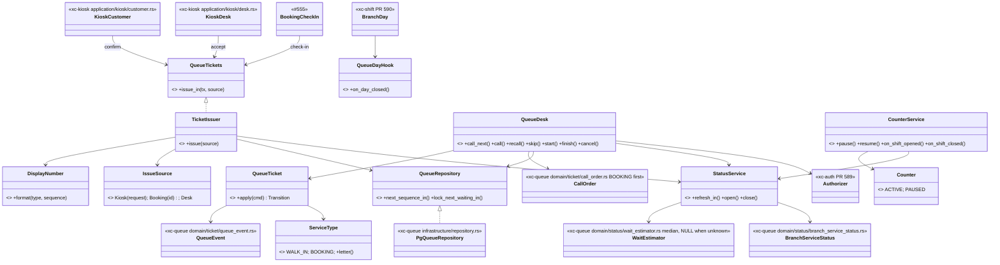

# Blueprint queue: tickets with daily numbers, call / recall / skip, branch service status (#556)

> designed-by: claude/b060e9 · 2026-10-09 · measured on `main` at `1bf3323`
> Source of the rules: *XC Desk — Blueprint & Data Model v2* §16 `QueueTicket` / `QueueEvent` /
> `BranchServiceStatus`, §16 relations (*"Booking → QueueTicket 1:0..N … active ticket จำกัดหนึ่งตาม service policy"*),
> screens B06 `/desk/queue`, C08 `/app/branches`, C09 `/app/journey`, §17 (*"production เปลี่ยนสถานะโดยสาขา;
> customer subscribe queue events; estimated wait มี as_of และ uncertainty"*), §18 Queue acceptance.
> Built on: PR 589 (`docs/design/blueprint/org-roles-branches.md`: organisation, `users`, `QueueOperate`,
> `BranchDayOperate`, `Authorizer`), PR 590 (`docs/design/blueprint/cash-shift-transfer.md`: one OPEN shift per teller,
> the branch day), PR 570 (`docs/design/blueprint/rates.md`: `CommandAction`, `idempotency_records`), #555 (bookings).
> Umbrella: #564. The owner's standing rule is *"logic ห้ามแก้ไข — ปรับได้แค่หน้าตา"*.

## 0. The owner's answers (2026-10-09, typed in session claude/b060e9, recorded on #556 issuecomment-6074469884)

| # | Question | Answer |
|---|---|---|
| Q-A1 | Service types (each has its own daily sequence) | **WALK_IN and BOOKING separate**: booked customers have their own line and numbers |
| Q-A2 | Does a booking create a ticket on check-in (B02)? | **A ticket at check-in, called first**: linked to the booking and called ahead of waiting walk-ins |
| Q-A3 | Skip (ข้าม) on a called customer who did not come | **NO_SHOW, final**: the customer takes a new number |
| Q-A4 | Pause (พัก) on `/desk/queue` | **The teller's counter**: that counter stops calling, `active_counters` drops by one and the estimate updates; waiting tickets are untouched |
| Q-A5 | The estimate's window (recorded on #556 issuecomment-6074684262) | *"Use today's median once at least 3 tickets are completed today; before that, fall back to the median of the last 30 completed tickets from previous days."* |
| Q-A6 | How the estimate shows its uncertainty (§17; recorded on #556 issuecomment-6076848699) | **"A range"**: "about 10–15 min", a low and a high estimate from the spread of the same service times (25th–75th percentile), shown with `as_of` |

## 1. v3 today (measured at `1bf3323`)

| Fact | Evidence |
|---|---|
| The kiosk's queue is its requests: `kiosk_requests.status` `QUOTED → WAITING → ACCEPTED → ID_CHECKED → COMPLETED`, keyed `(branch_id, id)`, with no ticket number and no service date | `api/migrations/20261007170000_kiosk.sql:4-25`; `xc-kiosk/src/domain/kiosk/value_objects/kiosk_status.rs` |
| Work times sit on the request: `started_at`, `completed_at` | `20261008110000_kiosk_work_times.sql` |
| A teller takes a request with `accept` (it becomes ACCEPTED and the teller's) | `xc-kiosk/src/application/kiosk/desk.rs:105` (`accept`), `:28` (`notifications`), `:78` (`queue_before`) |
| The staff queue card, the panel and the admin queue bar (#486, #471) read `kiosk_notifications` (working list, employees) and `kiosk_queue` (rows with `can_accept`) | `api/src/presentation/http/v3/views/kiosk_notifications.rs:38-39`; `dto/v3/kiosk_queue.rs:45-63`; `web/src/shared/queue/{queue-store.ts,wire.ts}`; `web/src/shared/ui/{QueueCard,QueuePanel}.tsx`; `web/src/screens/admin/queue/QueueBar.tsx` |
| Change detection for polling is the per-branch version every `BranchTx` raises | `api/migrations/20261006120000_branch_versions.sql`; `xc-kernel/src/branch_versions.rs:20-21` |
| Bookings are staff-made rate locks with `PENDING / CONFIRMED / USED / CANCELLED`, no check-in | `20261008130000_bookings.sql:13-37`; redesigned by #555 (Blueprint `CHECKED_IN`) |
| No ticket, no call/recall/skip, no counter, no branch service status, no wait estimate | `git grep -n -i 'queue_ticket\|service_status\|estimate' origin/main -- api` is empty |

## 2. Decisions

| # | Decision | Source |
|---|---|---|
| Q1 | **A ticket is a place in a line, not an order.** `queue_tickets` holds the Blueprint's fields. A ticket's completion is not a transaction's completion (§16 *"queue completion ไม่เท่ากับ transaction completion"*). The kiosk request stays the walk-in's order data; a booking stays the booked customer's. | §16 |
| Q2 | **Two service types, `WALK_IN` and `BOOKING`**, each with its own daily sequence per branch. | Q-A1, §16 UQ |
| Q3 | **Numbers.** `sequence` starts at 1 per (branch, service date, service type). `service_date` is the branch's local date (Branch `timezone`, PR 589 OR-1). `display_number` is the type's letter and the sequence zero-padded to 3: `W001`, `B001`. [proposed: the letters and padding are look only] | §16, §18 *"เลขคิวไม่ซ้ำในสาขา/วัน"* |
| Q4 | **Who issues.** A walk-in ticket is issued when the kiosk request becomes WAITING (the customer submits on the tablet), or by a teller at the desk for a customer without the tablet. A booking ticket is issued by the booking's check-in (B02, #555), linked to it. A booking has at most one active ticket. | Q-A2, §16 relations |
| Q5 | **States** (§16): `WAITING → CALLED → SERVING → COMPLETED`; `CANCELLED`, `NO_SHOW`. Recall keeps CALLED and writes an event. Skip = `NO_SHOW`, final (Q-A3). Cancel is allowed from WAITING or CALLED. SERVING ends only in COMPLETED. | §16, B06, Q-A3 |
| Q6 | **Call order: BOOKING before WALK_IN** (Q-A2). Within a type: lowest sequence first. "Call next" takes the first WAITING ticket in that order. A teller may also call a chosen ticket. | Q-A2 |
| Q7 | **A counter is a teller with an OPEN shift** (PR 590 C1: one OPEN shift per teller). Its state is `ACTIVE` or `PAUSED` (Q-A4). `active_counters` = the branch's ACTIVE counters. A teller with no OPEN shift cannot call. | Q-A4, PR 590 |
| Q8 | **The branch's queue is open or closed** (`queue_open`). BRANCH_MANAGER closes it: no new ticket is issued, and existing tickets are still served. The queue opens with the branch day's start service (PR 590 C9) and closes at cut-off unless reopened. When the branch day closes, every WAITING or CALLED ticket becomes `CANCELLED` with reason `dayClosed`. | §16 `queue_open`, PR 590 C9 |
| Q9 | **The estimate is computed, never typed** (§16 *"ไม่มีข้อมูลให้ unknown ไม่ใช้เลข hard-coded"*). `estimate_seconds` = (tickets ahead ÷ `active_counters`) × a median service time (`served_at → completed_at`). The median is taken from the branch's COMPLETED tickets **of the service date once there are at least 3**. Before that, it is taken from **the branch's last 30 COMPLETED tickets of earlier days** (Q-A5). The estimate is NULL ("unknown") when neither source has a ticket, or when there are no active counters. `estimate_as_of` is when it was computed. **The range (Q-A6):** `estimate_low_seconds` and `estimate_high_seconds` use the same formula with the 25th and 75th percentile of the same sample (PostgreSQL `percentile_cont` semantics, linear interpolation). All three are NULL together, and `low ≤ estimate ≤ high`. | Q-A5, Q-A6, §16, §17 *"as_of และ uncertainty"* |
| Q10 | **Only the branch moves a ticket** (§17, §18 *"customer advance ไม่ได้"*). A customer reads their own ticket and the public service status. They have no command that changes a ticket. | §17, §18 |
| Q11 | **Concurrency** (§18 *"concurrent ticket issuance ถูก"*). Issuance takes the next number from `queue_sequences` with one `INSERT … ON CONFLICT … DO UPDATE SET last_sequence = last_sequence + 1 RETURNING`, so two kiosks never get the same number. "Call next" selects with `FOR UPDATE SKIP LOCKED`, so two tellers never call the same ticket. Every transition is compare-and-set on the expected status; a lost race answers `STALE_VERSION`. | §18, §09 |
| Q12 | **Idempotency.** Every command is a `CommandAction` with an `Idempotency-Key` (PR 570 CM-1, `idempotency_records`). Issuance is also unique per source: one ticket per kiosk request, one active per booking. A retry returns the same ticket. | §09, §10 |
| Q13 | **Polling sends only changes** (fleet rule 🔁). `branch_service_status.queue_version` is the branch version that `BranchTx` raises (`branch_versions`). Every queue view takes `since` and answers `{changed:false}` when the version is unchanged. | fleet rule, §16 `queue_version` |
| Q14 | **The public status shows no customer data** (§02 *"Public display … ไม่เปิดยอดเงินสดหรือข้อมูลลูกค้า"*): `queue_open`, `active_counters`, waiting count per type, `estimate_seconds`, `estimate_low_seconds`, `estimate_high_seconds`, `estimate_as_of`, and the numbers being called. | §02, C08 |

## 3. Who does what (PR 589 permissions)

| Step | Permission | Notes |
|---|---|---|
| Issue a walk-in ticket at the kiosk | the kiosk device's own path (today `EntryPath::Kiosk`; after PR 589 OR-4 the kiosk route's permission) | the request is the source; no person |
| Issue a walk-in ticket at the desk | `QueueOperate` (TELLER, BRANCH_MANAGER) | |
| Issue a booking ticket | the check-in command of #555 (B02 `BookingsDesk`, TELLER) | called inside check-in's transaction |
| Call next, call chosen, recall, skip, start, finish, cancel | `QueueOperate` | the caller must have an OPEN shift (Q7); start, finish and recall only on the teller's own called ticket, or by BRANCH_MANAGER |
| Pause / resume my counter | `QueueOperate` | own counter only |
| Open / close the branch queue | `BranchDayOperate` (BRANCH_MANAGER) | |
| Read the desk board (B06) | `QueueOperate` | |
| Read the public service status (C08) | public | Q14 |
| Read my ticket (C09) | the customer who owns it (#558's customer session) | |

## 4. Model

### 4.1 Tables (migration `api/migrations/20261018100000_queue.sql`)

Every table has `organization_id uuid NOT NULL` with PR 589 D-1's composite FK `(organization_id, branch_id) →
branches(organization_id, id)`, and `created_at`. Mutable tables also have `updated_at`. Person columns are
`uuid REFERENCES users(id)`.

```
queue_sequences(organization_id, branch_id, service_date date, service_type text, last_sequence integer NOT NULL,
                PRIMARY KEY (branch_id, service_date, service_type))
queue_tickets(id uuid PK, organization_id, branch_id, service_date date NOT NULL,
              service_type text NOT NULL CHECK (service_type IN ('WALK_IN','BOOKING')),
              sequence integer NOT NULL CHECK (sequence > 0), display_number text NOT NULL,
              status text NOT NULL CHECK (status IN ('WAITING','CALLED','SERVING','COMPLETED','CANCELLED','NO_SHOW')),
              customer_id NULL, booking_id NULL, kiosk_request_id text NULL,
              counter_teller_id uuid NULL,                  -- who called / serves it
              issued_at, called_at NULL, served_at NULL, completed_at NULL, ended_reason text NULL,
              idempotency_key text NOT NULL, created_at, updated_at,
              UNIQUE (branch_id, service_date, service_type, sequence),
              UNIQUE (branch_id, idempotency_key),
              UNIQUE (branch_id, kiosk_request_id),         -- one ticket per kiosk request
              FOREIGN KEY (branch_id, kiosk_request_id) REFERENCES kiosk_requests (branch_id, id),
              CHECK ((service_type = 'BOOKING') = (booking_id IS NOT NULL)))
CREATE UNIQUE INDEX queue_tickets_one_active_per_booking ON queue_tickets (booking_id)
       WHERE status IN ('WAITING','CALLED','SERVING')
CREATE INDEX queue_tickets_waiting ON queue_tickets (branch_id, service_date, service_type, sequence)
       WHERE status = 'WAITING'
queue_events(id uuid PK, organization_id, ticket_id FK, status text, kind text
             CHECK (kind IN ('ISSUE','CALL','RECALL','START','FINISH','SKIP','CANCEL')),
             actor_id uuid NULL, at timestamptz, reason text NULL, created_at)          -- immutable
queue_counters(organization_id, branch_id, teller_id uuid REFERENCES users(id),
               status text CHECK (status IN ('ACTIVE','PAUSED')), updated_at, created_at,
               PRIMARY KEY (branch_id, teller_id))
branch_service_status(branch_id PK, organization_id, queue_open boolean NOT NULL DEFAULT false,
                      active_counters integer NOT NULL DEFAULT 0 CHECK (active_counters >= 0),
                      queue_version bigint NOT NULL DEFAULT 0, estimate_seconds integer NULL,
                      estimate_low_seconds integer NULL, estimate_high_seconds integer NULL,   -- Q-A6
                      estimate_as_of timestamptz NULL, updated_at,
                      CHECK ((estimate_seconds IS NULL) = (estimate_low_seconds IS NULL) AND (estimate_seconds IS NULL) = (estimate_high_seconds IS NULL)),
                      CHECK (estimate_low_seconds <= estimate_seconds AND estimate_seconds <= estimate_high_seconds))
```

- `queue_counters` is not a Blueprint entity. It is where `active_counters` (§16) comes from, and it holds Q-A4's
  pause. A row exists while its teller's shift is OPEN. Opening the shift (PR 590 `ShiftService::open_on_verified`)
  inserts it ACTIVE, and closing the shift deletes it.
- `branch_service_status.queue_version` is written in the same transaction as the branch version (Q13), so the
  public read can serve both from one row.

### 4.2 States

```
queue_tickets:  WAITING --call--> CALLED --start--> SERVING --finish--> COMPLETED
                CALLED  --recall--> CALLED                   (event only; called_at unchanged)
                CALLED  --skip--> NO_SHOW                    (final, Q-A3)
                WAITING | CALLED --cancel(reason)--> CANCELLED
                WAITING | CALLED --branch day closes--> CANCELLED (reason dayClosed)
queue_counters: ACTIVE --pause--> PAUSED --resume--> ACTIVE ; removed when the shift closes
branch queue:   closed --open (start service or BRANCH_MANAGER)--> open --close (cut-off or BRANCH_MANAGER)--> closed
```

### 4.3 Rules the machine enforces (domain)

| Rule | Where |
|---|---|
| issue only while `queue_open` (refused `queueClosed`, `VALIDATION_FAILED`) | `TicketIssuer::issue` |
| the next number is taken in the issuing transaction (Q11) | `QueueRepository::next_sequence_in` |
| one ticket per kiosk request; one active per booking; a retry with the same key returns the same ticket | the unique indexes; `TicketIssuer::issue` |
| call needs an OPEN shift and an ACTIVE counter; a PAUSED counter cannot call (`counterPaused`) | `QueueDesk::call_next`, `call` |
| call next: BOOKING first, then WALK_IN, lowest sequence; `FOR UPDATE SKIP LOCKED` | `CallOrder`, `QueueRepository::lock_next_waiting_in` |
| a teller serves one ticket at a time: no call while they hold a CALLED or SERVING ticket (`alreadyServing`) | `QueueDesk::call_next` |
| every transition checks the expected status; a lost race answers `STALE_VERSION` | `QueueTicket::apply` |
| every transition writes a `queue_events` row, raises the branch version and recomputes the estimate in the same transaction (§09) | `QueueDesk`, `StatusService::refresh_in` |
| when the branch day closes, WAITING and CALLED tickets are cancelled (`dayClosed`) | `QueueDayHook::on_day_closed` (called by PR 590's `BranchDay`) |

### 4.4 Commands and views

All commands are `CommandAction`s (PR 570 §6) with an `Idempotency-Key`. Blueprint §10 names no queue route, so these
routes are [proposed] and may be renamed in review without changing logic.

| Command | Route | Permission |
|---|---|---|
| `ticketIssueWalkIn` | `POST /api/queue/tickets` (desk) | `QueueOperate` |
| `ticketCallNext` | `POST /api/queue/call-next` | `QueueOperate` |
| `ticketCall` / `ticketRecall` / `ticketSkip` / `ticketStart` / `ticketFinish` / `ticketCancel` | `POST /api/queue/tickets/{id}/call` · `/recall` · `/skip` · `/start` · `/finish` · `/cancel` | `QueueOperate` |
| `counterPause` / `counterResume` | `POST /api/queue/counter/pause` · `/resume` | `QueueOperate` |
| `queueOpen` / `queueClose` | `POST /api/queue/open` · `/close` | `BranchDayOperate` |

The kiosk's ticket and the booking's ticket are issued inside the kiosk's `confirm` and in #555's check-in. They are not
separate routes.

| View | Who | Content |
|---|---|---|
| `queue_board` (B06) | `QueueOperate` | WAITING per type in call order, CALLED/SERVING with teller, my counter state, `since` → `{changed:false}` |
| `branch_service_status` (C08, public) | public | Q14 fields, `since` |
| `my_queue_ticket` (C09) | the ticket's customer (#558) | number, status, tickets ahead, estimate with its low–high range + `as_of`, `since` |

### 4.5 The kiosk request, the queue card and the admin bar

- **Kiosk.** The kiosk's `confirm` (`xc-kiosk/src/application/kiosk/customer.rs:97`, `QUOTED → WAITING`) issues the walk-in ticket in the same transaction, through the
  `QueueTickets` port. `accept` becomes "start" on that ticket: calling it first if it is WAITING. The request's own
  states continue as today for the order data (`ACCEPTED → ID_CHECKED → COMPLETED`). Its `started_at` /
  `completed_at` are then copies of the ticket's `served_at` / `completed_at`. They are kept until the readers move
  (QU-6) and are dropped in the cleanup block (§8 M2).
- **Queue card, panel and admin bar** (#486, #471). They move from `kiosk_notifications` / `kiosk_queue` to
  `queue_board` (QU-6). PR 535's comment on #556 asks for exactly this.

## 5. Class diagram



`QueueTickets` is a port in `xc-kernel`, so `xc-kiosk` and the booking crate call it without depending on `xc-queue`.
`api/src` wires `TicketIssuer` behind it.

### 5.1 Who provides, who uses

| Provider | Used by | Fallback if not merged |
|---|---|---|
| PR 589 `users`, `organization_id`, `Branch.timezone`, `QueueOperate`, `BranchDayOperate`, `Authorizer` | every table and command | none: QU-1 starts after PR 589's OR-1/OR-2, QU-3 after its permission ticket |
| PR 590 one OPEN shift per teller (CA-3), `BranchDay` (CA-7) | counters (Q7), day close (Q8) | QU-4 starts after CA-3. QU-5's `QueueDayHook` call starts after CA-7 |
| PR 570 `CommandAction`, `idempotency_records` (CM-1) | every command | none: QU-7 starts after CM-1 |
| #555 booking check-in | booking tickets | QU-2 ships the port and the kiosk source. The booking source is wired by #555's check-in ticket |

## 6. Kept, changed, retired

| Today | After |
|---|---|
| a kiosk request is a place in the queue | it has a ticket; the request keeps the order data |
| `accept` takes a WAITING request | `accept` starts the request's ticket (calling it first) |
| `kiosk_requests.started_at/completed_at` | copies of the ticket's times, then dropped (§8 M2) |
| `kiosk_notifications` / `kiosk_queue` feed the queue card, panel and admin bar | `queue_board` feeds them (QU-6); the two old views are retired in QU-8 |

## 7. Known differences from v2 (all decided by Q-A1–Q-A4 or by the Blueprint)

| v2 / v3 today | After |
|---|---|
| the queue is the kiosk's request list | numbered tickets per type and day |
| a booking has no place in the queue | its check-in issues a BOOKING ticket, called first |
| a teller "accepts" any waiting request | call next / call chosen / recall / skip / start / finish |
| no wait shown | estimate from today's service times, unknown when there are none |

## 8. Data migration

v3 has not been installed for a shop and starts empty (`xchange-v3.md` D6); the test instance holds test data only.
The owner approved v3's migrations until its first install (2026-10-06). Versions follow the controller's allocation:
the queue's feature block is `20261018*`, and transitional drops go in the cleanup block `20261030*` (#564
issuecomment-6074383060).

**M1. `api/migrations/20261018100000_queue.sql` (QU-1): create only.**
1. *Existing rows.* Nothing existing changes. The new tables start empty. `branch_service_status` gets one row per
   existing branch with `queue_open = false`, `active_counters = 0` and NULL estimate. An existing WAITING kiosk
   request gets no ticket: requests in flight at deploy finish on the old path, and the next `confirm` issues tickets.
2. *Backfill.* Only the status rows. Count first: `SELECT count(*) FROM branches;` (one status row each) and
   `SELECT count(*) FROM kiosk_requests WHERE status IN ('WAITING','ACCEPTED','ID_CHECKED');` (requests that will finish
   without a ticket; test data only).
3. *Order.* After PR 589's OR-1/OR-2 migrations (it references `organizations`, `users` and the composite branch key)
   and PR 590's M1. The binary of the same release issues tickets. The previous binary works with the schema, because
   it never reads the new tables.
4. *`down` loses* the new tables and their rows.

**M2. `api/migrations/20261030140000_retire_kiosk_work_times.sql` (QU-8): drop `kiosk_requests.started_at` and
`completed_at`.**
1. *Existing rows.* The two columns go. Their values are already on each request's ticket for every request issued
   since M1. Older requests lose their work times (test data only).
2. *Backfill.* None. Count before deploy: `SELECT count(*) FROM kiosk_requests WHERE started_at IS NOT NULL AND
   NOT EXISTS (SELECT 1 FROM queue_tickets t WHERE t.branch_id = kiosk_requests.branch_id AND t.kiosk_request_id = kiosk_requests.id);`
3. *Order.* With QU-8's binary, which no longer reads them. The old binary fails against M2.
4. *`down`* re-adds the columns empty.

M2 is a destructive operation: the deploy that runs it is ordered by the owner.

## 9. Tickets

Each owns disjoint files. Up-front tests are written by the ticket author on each ticket's `feat/…` branch once its
start dependencies are merged.

| # | Ticket | Owns | Starts after |
|---|---|---|---|
| QU-1 | schema (§4.1) and M1 | `api/migrations/20261018100000_queue.sql` | this design, PR 589 OR-1/OR-2, PR 590 CA-1 |
| QU-2 | the crate, the ticket machine and issuance; the `QueueTickets` port; the kiosk source | `api/crates/xc-queue/{Cargo.toml,src/lib.rs}`, workspace `Cargo.toml` (one line), `xc-queue/src/domain/ticket/**`, `xc-queue/src/domain/repository.rs`, `xc-queue/src/infrastructure/repository.rs`, `xc-queue/src/application/issue/**`, `xc-kernel/src/queue_tickets.rs`, `xc-kiosk/src/application/kiosk/customer.rs` (`confirm` → issue) | QU-1 |
| QU-3 | the desk: call next, call, recall, skip, start, finish, cancel; `CallOrder` | `xc-queue/src/application/desk/**`, `xc-queue/src/domain/ticket/call_order.rs` | QU-2, PR 589's permission ticket |
| QU-4 | counters and pause | `xc-queue/src/domain/counter/**`, `xc-queue/src/application/counter/**`, the shift-open/close calls in `xc-shift/src/application/shift/service.rs` (two lines, after PR 590 CA-3 merges) | QU-2, PR 590 CA-3 |
| QU-5 | service status, estimate, open/close, day close | `xc-queue/src/domain/status/**`, `xc-queue/src/application/status/**`, `xc-queue/src/application/day/**`, the `QueueDayHook` call in PR 590's `branch_day.rs` (one line) | QU-3, QU-4, PR 590 CA-7 |
| QU-6 | kiosk `accept` on the ticket; the queue card, panel and admin bar on `queue_board` | `xc-kiosk/src/application/kiosk/desk.rs`, `web/src/shared/queue/**`, `web/src/shared/ui/{QueueCard,QueuePanel}.tsx`, `web/src/screens/admin/queue/**` | QU-7 |
| QU-7 | commands and views (§4.4) | `api/src/presentation/http/v3/commands/queue/**` (with its own `permissions.rs`, as PR 590 §4.4), `views/{queue_board,branch_service_status,my_queue_ticket}.rs`, their DTOs and generated TS | QU-3, QU-5, PR 570 CM-1, PR 589 OR-4 |
| QU-8 | retire the old queue reads and the request work times (M2) | `views/{kiosk_notifications,kiosk_queue}.rs` and their DTOs/TS, `xc-kiosk` readers of `started_at/completed_at`, `api/migrations/20261030140000_retire_kiosk_work_times.sql`, the retired tests and fixtures | QU-6 |

The booking source (check-in → `QueueTickets::issue_in`) and the B06 desk screen are not tickets here. The first
belongs to #555's check-in ticket. The second is a desk screen ticket that reads `queue_board`. The customer views are
#558's screens, and they speak TH/EN/ZH (PR 607).

### 9.1 Tests written before implementation

| Ticket | Tests (red until implemented) |
|---|---|
| QU-1 | on a fresh database every migration applies in version order; one status row per branch; the four unique rules refuse a duplicate number, a second ticket for one kiosk request, a second active ticket for one booking, a BOOKING ticket without a booking |
| QU-2 | numbers start at 1 per (branch, date, type) and the two types count apart; the date is the branch's local date at 23:59 and 00:01; `W001`/`B001`; 50 concurrent issues on one branch give 1…50 with no gap or duplicate; a retry with the same key returns the same ticket; a closed queue refuses (`queueClosed`); the kiosk `confirm` issues exactly one ticket |
| QU-3 | call next takes BOOKING before WALK_IN and the lowest sequence; two tellers calling at once get two different tickets; recall keeps CALLED and adds an event; skip gives NO_SHOW and nothing moves it again; start/finish only from the right state, else `STALE_VERSION`; a teller with a CALLED or SERVING ticket cannot call; no OPEN shift → refused; a customer actor has no command |
| QU-4 | opening a shift adds an ACTIVE counter, closing removes it; a PAUSED counter cannot call; pause and resume change `active_counters` by one |
| QU-5 | Q-A5: with 2 completed today and 30 earlier the median of the 30 earlier; with 3 today the median of today's 3; with none today and none earlier NULL; zero active counters NULL; **the range (Q-A6):** with service times 60/120/180/240 s and 2 tickets ahead on 1 counter, estimate = 2×150, low = 2×105, high = 2×195 (`percentile_cont` 0.25/0.5/0.75), the three NULL together, and `low ≤ estimate ≤ high`; `estimate_as_of` set; closing the queue stops issuance and keeps serving; the day close cancels WAITING and CALLED with `dayClosed`; every transition raises the branch version |
| QU-6 | `accept` on a WAITING request calls and starts its ticket; the queue card shows `queue_board`'s lines; QueueBar's provided tests (#471) are re-pointed in one commit per file before any behaviour change |
| QU-7 | every route, permission refusals, `Idempotency-Key` replay and conflict, `since` → `{changed:false}`; `branch_service_status` carries no customer field; `branch_service_status` and `my_queue_ticket` carry `estimateLowSeconds`/`estimateHighSeconds` next to `estimateSeconds` and `estimateAsOf` |
| QU-8 | the workspace builds and passes with the two views and columns gone; `git grep -n started_at -- api/crates/xc-kiosk` finds no reader |

## 10. Must ask the owner

None open. Q-A1…Q-A6 are answered (§0).

## 11. Blueprint conformance

| Blueprint item | This design |
|---|---|
| §16 QueueTicket fields, UQ(branch, service_date, service_type, sequence) | §4.1 `queue_tickets` |
| §16 WAITING → CALLED → SERVING → COMPLETED; CANCELLED/NO_SHOW | Q5, §4.2 |
| §16 *"queue completion ไม่เท่ากับ transaction completion"* | Q1 |
| §16 QueueEvent(ticket, status, actor, at, reason) | `queue_events` (+ `kind`, look only) |
| §16 BranchServiceStatus fields; *"ไม่มีข้อมูลให้ unknown ไม่ใช้เลข hard-coded"* | §4.1, Q9 |
| §16 Booking → QueueTicket 1:0..N, one active | Q4, the partial unique index |
| B06 call / recall / pause / skip / start / finish | §4.4, Q-A3, Q-A4 |
| C08 service status, C09 queue on the pass | §4.4 views (screens are #558's) |
| §17 branch moves status; customer subscribes; estimate with as_of **and uncertainty** | Q10, Q13, Q9 (range: low/high from the 25th–75th percentile, Q-A6) |
| §18 unique number per branch/day; concurrent issuance; customer cannot advance; refresh shows latest | Q3, Q11, Q10, Q13 |
| §09 atomicity and idempotency | §4.3 last rows, Q12 |
| §07 organization_id, created_at/updated_at | §4.1 header |
| `queue_counters` (not a Blueprint entity) | the source of §16 `active_counters` and of Q-A4's pause |
