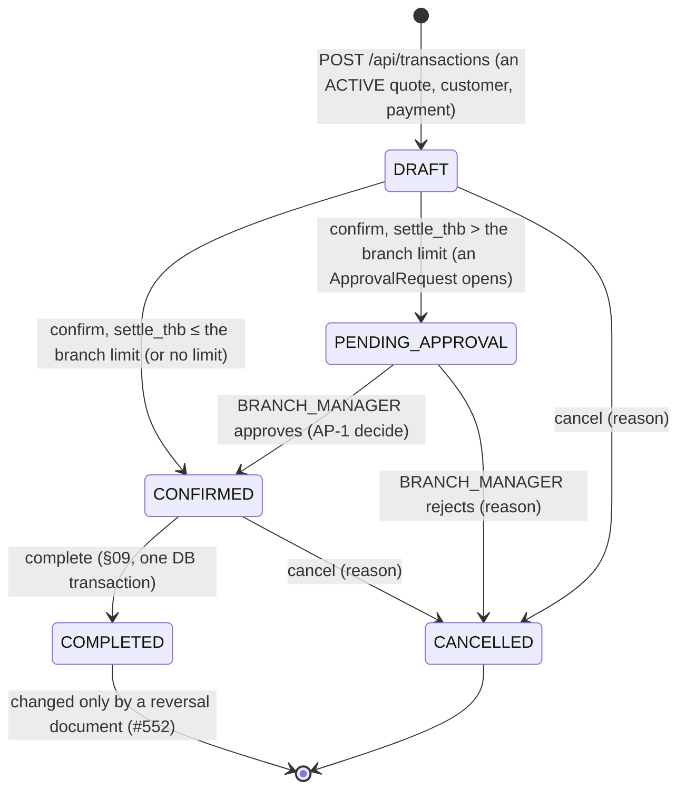

# Blueprint quote, transaction and receipt (#551)

> Design only. No code, no migration, no `ready`. Written by claude/e5ab6c on the lane controller's assignment
> (#564 issuecomment-6074257078). The code tickets are cut by the lane controller after a `Verdict: PASS`.

**Source of the logic.** *XC Desk — Blueprint & Data Model v2*, committed at `docs/blueprint/XC-Desk-Blueprint-Data-Model-v2.html`
(#565). The owner's rule (#564, 2026-10-09): **the Blueprint's logic is fixed, and only the look may change**.

| What | Blueprint |
|---|---|
| Entities | §07 `Quote`, `QuoteLine`, `Transaction`, `TransactionLine`, `Receipt` |
| States | §06 Quote `ACTIVE → ACCEPTED \| EXPIRED \| CANCELLED`; Transaction `DRAFT → PENDING_APPROVAL (ถ้าจำเป็น) → CONFIRMED → COMPLETED; CANCELLED ก่อนสำเร็จ` |
| Atomicity | §09 Complete exchange: *"validate branch/shift/quote → ตรวจเงินและธนบัตร → consume reservation ถ้ามี → post ledger/inventory → redeem benefit → mark COMPLETED → write outbox ใน DB transaction เดียว"* |
| Routes | §10 `POST /api/quotes` (B03/C02), `POST /api/transactions/:id/complete` (B03) |
| Screens | B03 `/desk/exchange` *"quote → ตรวจ → ยืนยันรายการ"*; B04 `/desk/transactions/:id` |
| Relations | §08 Customer → Booking → Transaction (walk-in has no booking); Transaction → TransactionLine → QuoteLine (*"snapshot final quote เป็นหลักฐาน"*) |
| Numbers | §11 buy/sell = THB of **completed** lines by `shop_side` |

**Measured on** `108-Plaza/xchange` `main` at `1bf3323`. Every `file:line` below is at that sha unless it names a PR.

**Designs this one stands on:**
- the rate design `docs/design/blueprint/rates.md` (main, plus its correction PR 594);
- org/roles PR 589 (#550);
- cash PR 590 (#582);
- the outbox OB-1 in PR 606 (#563);
- the desk design `docs/design/xchange-v3-wave3-desk.md` (main), whose §4.2 and §5.4 leave these calls to this design.

---

## 0. The owner's answers (2026-10-09, in session claude/e5ab6c, AskUserQuestion)

Recorded on #551 (issuecomment-6074341442), #553 (issuecomment-6074305056) and #559 (issuecomment-6074305245).

| # | Question | Answer (verbatim) | What this design does |
|---|---|---|---|
| T1 | How long a quote lives | *"5 นาที (แนะนำ) แต่ให้ ตั้งค่าเองได้"* | default 300 s for the desk and the kiosk, an organisation setting ADMIN can change (§4.3) |
| T2 | Which transactions need `PENDING_APPROVAL` | *"เกินวงเงิน ผู้จัดการอนุมัติ"* | a per-branch THB limit (data); above it, BRANCH_MANAGER approves through the AP-1 core; no limit set ⇒ nothing waits (§5) |
| T3 | Payment data (method, reference, account, slip, fees) | *"เก็บไว้ เป็น Payment แยก"* | `TransactionPayment` beside the Blueprint's entities; the customer fee is in the quote's final amount; the bank fee is the shop's expense on the payment (§3.4) |
| T4 | Banknote entry at completion | *"ยังไม่ต้อง"* | `TransactionLine.denomination_id` stays NULL (group `ALL`, rates A4); the count stays one confirmation (§6) |
| B-1 | Where the books live (#553) | *"แยกสองชั้น"* | the completion posts through #582's `CashPostings` port; #553 owns the ledger behind it (§6) |
| B-3 | Points (#559) | *"ขยาย Loyalty กลาง"* | a completed exchange enqueues an outbox event for Loyalty once #559 adds its handler (§6.3) |

**Not asked, decided by the designer within the Blueprint** (each is a `[proposed]` the reviewer may challenge):
- D-1 to D-9 in §2.

**Still open, for the owner, never guessed** (§11):
- the limit's value per branch;
- whether a teller may type a customer fee, or fees come from a fee table.

---

## 1. v3 today (measured)

| Fact | Where |
|---|---|
| **One writer** of `transactions`: `PgTransactionRepository::insert_in`, reached only through `SaveTransactionWorkflow::run`. No UPDATE or DELETE of the table anywhere outside tests | `api/crates/xc-exchange/src/infrastructure/exchange/transaction_repository.rs:178-246`; `api/src/application/workflows/save_transaction.rs:217-417` |
| **Saving equals completing.** One `BranchTx` runs, in order: prior lookup, step `before_in`, customer confirm, open shift, counter-rate check, stock delta, number, receipt file, insert, customer update, step `after_in` | `save_transaction.rs:253-416` |
| **No status column.** A row is a finished exchange; readers hard-code `COMPLETED`, `cancelled: 0`, `pending: 0` | `api/migrations/20261007190000_transactions.sql:2-37`; `api/src/infrastructure/devices/pg_saved_exchanges.rs:5-7`; `views/admin_overview.rs:173-174` |
| **One currency per row, wide.** `type`, `code`, `amount`, `rate`, `reference_rate`, `principal`, `fee`, `bank_fee`, `received`, `paid`, `method`, `payment_ref`, `account`, `staff_id`, `booking_no`, `notes`, `value_date`, `paid_at` | `20261007190000_transactions.sql:2-37` |
| **The number is the receipt number.** `document_ref` = `XC-YYYYMMDD-NNNNNN` (DEMO `TEST-XC-…`). It comes from `counters`, keyed `document-{LIVE\|DEMO}-{YYYYMMDD}`, so it is global (not per branch) and resets daily | `xc-exchange/.../value_objects/document_ref.rs:11-29`; `transaction_repository.rs:163-176` |
| **The receipt is a file.** It is HTML stored by content hash and linked as `transaction_files(kind='RECEIPT')`. The receipt prints the same string as "Receipt No" and "Document Ref" | `xc-exchange/.../entities/receipt.rs:61,68`; `file_service.rs:293-330` |
| **Idempotency** is `submission_id` + `payload_hash`, `UNIQUE (branch_id, mode, submission_id)`; a repeat with another hash is refused `CHANGED` | `save_transaction.rs:245,277-296` |
| **Five steps** take part in the save, through `SaveStep` (`before_in` / `after_in` in the same transaction): device, kiosk, custody, payment, booking | `api/src/application/workflows/save_step.rs:72-98`; `api/src/application/compat/actions/save.rs:52-73` |
| **No approval, PIN or amount limit** on a save. The only ceilings are format ones (100,000,000; `FEE_ABOVE_PRINCIPAL`) | `xc-kernel/src/money/money.rs:31`; `transaction_form.rs:147-161` |
| **No banknote entry.** The cash signal is one boolean, `countConfirmed`, checked by the device step (`COUNT_FIRST`) | `api/src/infrastructure/devices/device_service.rs:171-176` |
| **The kiosk has its own quote.** `kiosk_requests` holds rate, foreign amount and THB; it is valid 300 s; a desk save with `kioskRequestId` completes it | `xc-kiosk/.../kiosk_machine.rs:23-109,140`; `workflows/kiosk_save_step.rs:63-111` |
| **The customer is per branch**, keyed by passport, nationality and mode. `transactions.customer_id` is NOT NULL; the passport number is not on the row | `20261007120000_customers.sql:6-19`; `customer_repository.rs:133-157` |
| **Stock** moves through `ShiftService::apply_delta_in` (`shift_balances.expected`), not `stock_movements` | `xc-shift/src/application/shift/service.rs:384-415` |

---

## 2. Decisions

| # | Decision | Why |
|---|---|---|
| D-1 | **One writer, kept.** The new commands (§4) are the only code that writes `transactions`. The compat `saveTransaction` RPC becomes an **adapter** over them (TX-6), not a second writer. | 🌱 root cause: two writers of one table drift; the save digest and the new hash would disagree |
| D-2 | **The table `transactions` is evolved, not replaced.** It gains `status`, `quote_id`, `completed_at`, and its lines, payment and receipt move to child tables (§3). The wide columns stay, written by the same writer, until every reader reads the children (TX-8), then go (migration 3). | Ten readers read the wide row today (§7); moving them is per-file work in parallel tickets, as RE-4 does for rates |
| D-3 | **`document_ref` is the Blueprint's `transaction_no`.** It keeps its name and format (`XC-YYYYMMDD-NNNNNN`), is NULL until `COMPLETED`, and is assigned at completion. | A name is look; a cancelled draft must not burn a receipt number. §07 asks *"transaction_no UQ/org"*, which a NULL until completion satisfies |
| D-4 | **The counter becomes per organisation.** The key gains the organisation (`document-<org>-<mode>-<date>`), and the unique index becomes `(organization_id, document_ref)`. | §07 *"UQ/org"*; today it is global (`counters` has no organisation), which is the same thing while there is one organisation, and wrong at the second |
| D-5 | **A quote's expiry is derived, like rates' `SUPERSEDED`.** Only `ACTIVE`, `ACCEPTED` and `CANCELLED` are stored. **Validity** is one rule, `Quote::is_valid(now, current_publication)` = `now < expires_at` **and** `publication_id` is the branch's current publication, **whatever the stored status** (`ACTIVE` or `ACCEPTED`). The derived `EXPIRED` is only how an `ACTIVE` quote that fails it is *shown*; an `ACCEPTED` quote that fails it is still refused at `complete` (`quoteExpired`, D-6). | No sweeper writes; the clock and the publication pointer are the truth (rates §4.6 does the same). One rule for both statuses, so a late approval cannot complete at an outdated rate (PR 608 review) |
| D-6 | **A quote is checked at `confirm` and again at `complete`.** §10 complete says *"quote ยังมีผล"*. A transaction waiting for approval longer than the quote's life must re-quote (§5.3). | The Blueprint's words. The rate lock that would hold a price longer is phase 6 (`BINDING`, #555), not here |
| D-7 | **The existing `SaveStep`s are reused, unchanged.** The completion builds the `SaveContext` they already take from the stored transaction (`TransactionForm::from_transaction`, §4.5). | ♻️: device, kiosk, custody, payment and booking keep one implementation each |
| D-8 | **Quotes go through one service for every channel.** The desk, the kiosk and (later) bookings and the app all ask `QuoteService`. The kiosk's own quote arithmetic is retired (TX-7). | ♻️ and §05 *"quote = quantity × rate ÷ unit_size"* in one place (`ExchangeArithmetic`, rates §3.2) |
| D-9 | **`TransactionPayment` is one row per transaction now**, keyed so that more than one can be added later. | T3; split tender is not asked for, but the key does not forbid it |

---

## 3. Tables (Blueprint §07 names kept; every table carries `organization_id`, `created_at`, `updated_at`)

The composite key `(organization_id, id)` and the composite FKs are #550's convention (PR 589 §8). Money is
`numeric(20,2)` THB, foreign quantities `numeric(20,4)`, rates `numeric(20,8)` (rates §3.3, D-2).

### 3.1 `quotes`, `quote_lines` (migration 1)

```
quotes(
  id                uuid PK,
  organization_id   text NOT NULL,
  branch_id         text NOT NULL,                  -- FK branches, composite with organization_id
  customer_id       text NULL,                      -- FK customers; NULL for an anonymous kiosk or app quote (§07 nullable)
  type              text NOT NULL CHECK (type IN ('INDICATIVE','BINDING')),
  channel           text NOT NULL CHECK (channel IN ('DESK','KIOSK','BOOKING','APP')),
  status            text NOT NULL CHECK (status IN ('ACTIVE','ACCEPTED','CANCELLED')),   -- EXPIRED is derived (D-5)
  publication_id    uuid NOT NULL,                  -- FK rate_publications: the publication every line was priced on
  expires_at        timestamptz NOT NULL,
  benefit_snapshot  jsonb NOT NULL DEFAULT '{}',    -- §07; empty until #560
  created_by        text NOT NULL,
  accepted_by_transaction_id uuid NULL,             -- set when ACCEPTED (§4.4)
  CHECK ((status = 'ACCEPTED') = (accepted_by_transaction_id IS NOT NULL)),
  CHECK (type = 'INDICATIVE')                        -- BINDING is phase 6 (#555); dropped by its design
)
quote_lines(
  id                     uuid PK,
  organization_id        text NOT NULL,
  quote_id               uuid NOT NULL,             -- FK quotes
  published_rate_line_id uuid NOT NULL,             -- FK published_rate_lines (rates §4.1)
  shop_side              text NOT NULL CHECK (shop_side IN ('BUY','SELL')),   -- the shop's side, as v3's type today
  currency               char(3) NOT NULL,          -- FK currencies
  denomination_group     text NOT NULL DEFAULT 'ALL',
  quantity               numeric(20,4) NOT NULL CHECK (quantity > 0),
  unit_size              numeric(20,4) NOT NULL CHECK (unit_size > 0),
  base_rate              numeric(20,8) NOT NULL CHECK (base_rate > 0),   -- the published rate (before benefits)
  final_rate             numeric(20,8) NOT NULL CHECK (final_rate > 0),  -- after benefits; = base_rate until #560
  thb_amount             numeric(20,2) NOT NULL CHECK (thb_amount >= 0), -- ExchangeArithmetic::thb(quantity, final_rate, unit_size)
  fee_thb                numeric(20,2) NOT NULL DEFAULT 0 CHECK (fee_thb >= 0 AND fee_thb <= thb_amount),
  settle_thb             numeric(20,2) NOT NULL CHECK (settle_thb >= 0),  -- what changes hands: BUY thb − fee, SELL thb + fee
  line_no                int NOT NULL,
  UNIQUE (quote_id, line_no)
)
```

- **Before and after benefits** (§07 *"รวมทั้งเรทก่อน/หลังสิทธิ, rounding และ version"*): `base_rate` is the published
  line's rate, `final_rate` the rate after #560's benefits, and `publication_id` the version. Rounding is
  `ExchangeArithmetic`'s (HALF_UP to 2 places once, rates §3.2) and is not a column.
- **`settle_thb`** is `Quote::per_unit`'s `paid` (BUY) or `received` (SELL) (rates §3.2). The fee is the customer's,
  and part of the final amount (T3).
- **MVP is one line** (§07 *"เริ่มหนึ่งสกุลแต่โครงรองรับหลาย line"*). `QuoteService` refuses more than one line with
  `validationFailed` until a design asks for more.

### 3.2 `transactions` (migration 2 evolves it)

Added:
```
+ organization_id   (added by #550 OR-1 to every table)
+ status            text NOT NULL DEFAULT 'COMPLETED'
                    CHECK (status IN ('DRAFT','PENDING_APPROVAL','CONFIRMED','COMPLETED','CANCELLED'))
+ quote_id          uuid NULL REFERENCES quotes(id)            -- NULL only for rows saved before migration 2
+ booking_id        text NULL REFERENCES bookings(id)          -- §07; v3's booking_no text stays until TX-8
+ completed_at      timestamptz NULL
+ cancelled_at      timestamptz NULL, cancel_reason text NULL
+ approval_request_id uuid NULL REFERENCES approval_requests(id)   -- AP-1, set when PENDING_APPROVAL opens
~ document_ref      NOT NULL → NULL; UNIQUE → UNIQUE (organization_id, document_ref)       -- D-3, D-4
+ CHECK ((status = 'COMPLETED') = (document_ref IS NOT NULL))
+ CHECK ((status = 'COMPLETED') = (completed_at IS NOT NULL))
+ CHECK ((status = 'CANCELLED') = (cancelled_at IS NOT NULL AND cancel_reason IS NOT NULL))
+ CREATE INDEX transactions_branch_status_idx ON transactions (branch_id, status, recorded_at)
```

Kept as they are: `id`, `seq`, `branch_id`, `mode`, `shift_id` (the saver's own open shift, #582 C1), `customer_id`
(NOT NULL: §07 lists it without "nullable"), `customer_name`, `nationality`, `submission_id`, `payload_hash`,
`staff_id`, `notes`, `value_date`, `paid_at`, `recorded_at`, `recorded_by`. The wide figure and payment columns are
written by the one writer from the line and the payment until migration 3 drops them (D-2).

### 3.3 `transaction_lines` (migration 2)

```
transaction_lines(
  id                  uuid PK,
  organization_id     text NOT NULL,
  transaction_id      uuid NOT NULL REFERENCES transactions(id),
  quote_line_id       uuid NULL REFERENCES quote_lines(id),     -- NULL only for rows backfilled from before migration 2
  shop_side           text NOT NULL CHECK (shop_side IN ('BUY','SELL')),
  currency            char(3) NOT NULL,
  denomination_id     uuid NULL,                                 -- T4: NULL (group ALL) until banknote pricing
  quantity            numeric(20,4) NOT NULL CHECK (quantity > 0),
  unit_size           numeric(20,4) NOT NULL CHECK (unit_size > 0),
  rate_snapshot       numeric(20,8) NOT NULL CHECK (rate_snapshot > 0),   -- the quote line's final_rate
  reference_rate      numeric(20,8) NULL,                        -- today's column, kept for the reports
  thb_amount          numeric(20,2) NOT NULL,
  fee_thb             numeric(20,2) NOT NULL DEFAULT 0,
  settle_thb          numeric(20,2) NOT NULL,
  cost_basis_thb      numeric(20,2) NULL,                        -- #553 fills it at completion (weighted average, Q10)
  realized_margin_thb numeric(20,2) NULL,                        -- #553; SELL only (§11)
  line_no             int NOT NULL,
  UNIQUE (transaction_id, line_no)
)
```

### 3.4 `transaction_payments` (migration 2; T3, an addition beside §07)

```
transaction_payments(
  id               uuid PK,
  organization_id  text NOT NULL,
  transaction_id   uuid NOT NULL REFERENCES transactions(id),
  payment_no       int NOT NULL DEFAULT 1,
  method           text NOT NULL,                  -- today's six (transaction_form.rs:123-131); per-branch rules stay (PaymentSaveStep)
  reference        text NOT NULL DEFAULT '',       -- required unless Cash (today's rule, transaction_form.rs:143)
  account          text NOT NULL DEFAULT '',
  slip_file_key    text NULL REFERENCES files(key),-- required unless Cash (transaction_form.rs:170)
  amount_thb       numeric(20,2) NOT NULL,         -- = the line's settle_thb now
  bank_fee_thb     numeric(20,2) NOT NULL DEFAULT 0,  -- the shop's expense (T3), not the customer's
  paid_at          timestamptz NOT NULL,
  UNIQUE (transaction_id, payment_no)
)
```

`transaction_files` keeps PASSPORT and RECEIPT. SLIP moves to `transaction_payments.slip_file_key`, and the
`transaction_files` SLIP row stays until migration 3 (readers move in TX-8).

### 3.5 `receipts` (migration 2)

```
receipts(
  id               uuid PK,
  organization_id  text NOT NULL,
  transaction_id   uuid NOT NULL REFERENCES transactions(id),
  number           text NOT NULL,          -- revision 1 = transactions.document_ref; revision n = '<document_ref>-R<n>'
  revision         int  NOT NULL CHECK (revision >= 1),
  issued_at        timestamptz NOT NULL,
  document_ref     text NOT NULL REFERENCES files(key),   -- §07's name: the stored receipt document (a file key)
  UNIQUE (organization_id, number),
  UNIQUE (transaction_id, revision)
)
```

- **A receipt is never overwritten** (§07). A reprint prints the stored document again and writes nothing.
- **A new revision** is issued only by a later document that changes what the receipt says (§06: *"แก้ผ่าน
  reversal/adjustment เอกสารใหม่เท่านั้น"*). No ticket here issues one; the column and the number rule are for #552.
- ⚠️ **Name clash, recorded so nobody "fixes" it:** v3's `transactions.document_ref` is §07's `transaction_no` (D-3),
  and §07's `receipts.document_ref` is the stored file. They are different things with one name, each the Blueprint's
  or v3's own.

### 3.6 Settings (migration 1; T1, T2)

```
exchange_settings(
  organization_id    text PK,
  quote_ttl_seconds  int NOT NULL DEFAULT 300 CHECK (quote_ttl_seconds BETWEEN 30 AND 3600),
  updated_by text NOT NULL, updated_at timestamptz NOT NULL
)
branch_exchange_limits(
  organization_id    text NOT NULL,
  branch_id          text NOT NULL,          -- FK branches (composite)
  approval_limit_thb numeric(20,2) NULL CHECK (approval_limit_thb IS NULL OR approval_limit_thb > 0),
  updated_by text NOT NULL, updated_at timestamptz NOT NULL,
  PRIMARY KEY (organization_id, branch_id)
)
```

- The bounds 30–3600 s are format bounds, not a business value: a quote shorter than the kiosk's 3 s review or longer
  than an hour is a typing mistake. `[proposed]`
- `approval_limit_thb NULL` (or no row) means **no transaction waits** (T2). The value is the owner's (§11).
- Every change writes an `AuditLog` row through AP-1 (rates §5.5), with before and after.

---

## 4. Behaviour

### 4.1 States



Quote: `ACTIVE` → `ACCEPTED` (at confirm, bound to the transaction) | `CANCELLED` (its transaction cancelled before
completion, or the desk asked for a new quote) | `EXPIRED` (derived, D-5).

**The staff report's three questions** (#551 issuecomment of 02:37Z):
1. **The THB value of a completed deal** is `transaction_lines.thb_amount`, summed per transaction (the fee is
   `fee_thb`, separate). Until TX-8 it equals the wide `principal`.
2. **Done** is `status = 'COMPLETED'`.
3. **Unfinished** is `status IN ('DRAFT','PENDING_APPROVAL','CONFIRMED')`. `CANCELLED` is neither.

### 4.2 Routes (§10 paths kept; every write through the command seam, rates §6, with `Idempotency-Key`)

| Route | Kind | Permission (PR 589 §3.4) | Answers |
|---|---|---|---|
| `POST /api/quotes` (§10) | command | `ExchangeTransact` (desk); the kiosk's own entry (§4.6) | `QuoteDto`: id, type, channel, `expires_at`, publication ref, lines (currency, side, quantity, `unit_size`, `base_rate`, `final_rate`, `thb_amount`, `fee_thb`, `settle_thb`, `published_rate_line_id`), benefits (`[]` until #560), `stale` |
| `POST /api/transactions` | command; not in §10, needed to have a DRAFT (as rates' `POST /api/rate-drafts`) | `ExchangeTransact` | `TransactionDto` with `status: DRAFT` |
| `POST /api/transactions/:id/confirm` | command; B03 *"ยืนยันรายการ"* | `ExchangeTransact` | `TransactionDto`, `CONFIRMED` or `PENDING_APPROVAL` (with the request id) |
| `POST /api/transactions/:id/complete` (§10) | command | `ExchangeTransact` | `TransactionDto` `COMPLETED` + `ReceiptDto` (§10 *"response transaction+receipt"*) |
| `POST /api/transactions/:id/cancel` | command | `ExchangeTransact` | `TransactionDto` `CANCELLED` |
| `POST /api/approvals/:id/decide` | AP-1's generic command (rates §4.7) | `ApprovalsDecide`, then the type's policy (§5) | the decision; the transaction moves by `on_decided` |
| `GET /api/v3/views/transaction?id=` | view (B04) | `TransactionRead` | the transaction, lines, payment, receipts, approval state |
| `PUT /api/exchange-settings` | command | `SystemSettings` | the new settings |
| `PUT /api/branches/:id/exchange-limit` | command | `BranchesManage` (A04) | the new limit |

**`POST /api/quotes` input** `[required]`: `{ branchId, customerId?, channel, lines: [{ currency, shopSide, quantity,
feeThb? }] }`. Money and quantities are decimal strings (D-4 of the desk design). The server computes everything else
(§10 *"server คำนวณทั้งหมด"*).

**`POST /api/transactions` input** `[required]`: `{ quoteId, customerId, bookingId?, kioskRequestId?, staffDraftId?,
passport: {uploadKey}, payment: { method, reference, account, slip?: {uploadKey}, bankFeeThb, paidAt }, valueDate,
notes, countConfirmed }`. Everything figure-like comes from the quote, never from this body.

**Error codes** (§10, v3's camelCase, as rates §4.7): `validationFailed`, `outOfScope`, `staleVersion`,
`quoteExpired`, `rateUnavailable`, `stockInsufficient`, `approvalRequired`, `idempotencyConflict`,
`benefitLimitReached` (from #560). Kept from v3 with the same meaning: `noOpenShift`, `countFirst`, the custody
refusals, `NOT_THIS_PASSPORT`.

### 4.3 `POST /api/quotes`

1. Validates the body; one line only (§3.1).
2. Reads the current publication's line for `(branch, currency, side)` through `PublishedRates::line_in`
   (rates §4.8). No line ⇒ `rateUnavailable`.
3. Applies `StalePolicy::admits(side, thb)` (rates §4.8, A7).
4. Computes `thb_amount = ExchangeArithmetic::thb(quantity, final_rate, unit_size)` and `settle_thb` through
   `Quote::per_unit` (rates §3.2). `quantity` must fit the currency's minor unit (`ForeignAmount::parse`).
5. `expires_at = now + exchange_settings.quote_ttl_seconds` (T1).
6. Writes `quotes` + `quote_lines`, `status ACTIVE`, `publication_id` = the branch's current one.

A quote is a write (a row), so it is a command with an idempotency key. A new quote is asked for on each change of
type, currency, amount or benefits (§06, desk D-5); the old one simply expires or is cancelled by the desk.

### 4.4 `POST /api/transactions` and `confirm`

`POST /api/transactions`, in one `BranchTx`:
1. The quote is `ACTIVE`, not expired (D-5), of this branch and, if it names a customer, the same customer.
2. LIVE: the caller has an open shift (#582 C1); `shift_id` = it. DEMO: no shift (today's CHECK).
3. Customer confirm as today (`CustomerService::confirm_in`), passport and slip files as today
   (`save_transaction.rs:139-159`).
4. Inserts the `transactions` row (`DRAFT`, `document_ref NULL`), its `transaction_lines` (copied from the quote lines),
   and its `transaction_payments` row. The wide columns are filled from them (D-2).

`confirm`, in one `BranchTx`:
1. `DRAFT` only, else `staleVersion`.
2. The quote is still valid (D-5), else `quoteExpired`.
3. Runs every `SaveStep::before_in` (D-7): the custody window and custodian, the kiosk request's match, the booking
   claim, the payment rule (`PaymentSaveStep` checks in its own `after_in` today; it moves to `before_in` here, §4.5).
4. The quote becomes `ACCEPTED`, bound to this transaction.
5. `settle_thb` > the branch's `approval_limit_thb` ⇒ `ApprovalService::request(tx, "EXCHANGE_TRANSACTION", id, …)`
   (AP-1) and `PENDING_APPROVAL`. Otherwise `CONFIRMED`.

### 4.5 `complete` (§09, one DB transaction)

`CompleteExchange::run_in` (`api/src/application/workflows/exchange/complete.rs`); the route wraps it in `BranchTx::run`:

| §09 step | What runs |
|---|---|
| validate branch/shift/quote | `CONFIRMED` only (a repeat with the same key replays, CM-1); the shift is still the caller's and open; `Quote::is_valid(now, current)` on the `ACCEPTED` quote (D-5, D-6), else `quoteExpired` |
| ตรวจเงินและธนบัตร | cash: `countConfirmed` (the device step's `COUNT_FIRST`, `device_service.rs:171-176`); no banknote lines (T4) |
| consume reservation | none until phase 6 (#555); the port `StockReservations` is not created here |
| post ledger/inventory | `CashPostings::post_in` (cash design §4.6, final shape `ledger-inventory.md` §4.1) with **both** requests: the foreign leg (BUY: Customer → Drawer; SELL: Drawer → Customer) and the THB leg the other way, whose place is **`Drawer` for Cash and `Bank` otherwise** (`ledger-inventory.md` §4.3: `CompleteExchange` sends both legs; the posting port derives nothing). Insufficient stock ⇒ `stockInsufficient`. #553's `LedgerCashPostings` returns `cost_basis_thb` / `realized_margin_thb` per line, written on `transaction_lines` |
| redeem benefit | none until #560; its port is #560's |
| mark COMPLETED | `document_ref` from the per-organisation counter (D-4), `completed_at`, the receipt file (`receipt_html`, as today) and the `receipts` row (revision 1) |
| step `after_in` | device jobs, kiosk COMPLETED, booking USED, custody draft — unchanged (D-7) |
| write outbox | `OutboxWriter::enqueue_in` (PR 606 OB-1) for each destination that has a handler: none at first; #559 adds `loyalty.exchange_completed`, #563 its own |

`SaveContext` is built by `TransactionForm::from_transaction(&ExchangeTransaction)`
(`xc-exchange/src/domain/exchange/value_objects/transaction_form.rs`, a new constructor beside `parse`), so the five
steps need no change. `PaymentSaveStep`'s check moves from `after_in` to `before_in` (it refuses, it writes nothing),
which is the one edit to a step, in TX-5.

**Cancel** (from `DRAFT` or `CONFIRMED`) sets `CANCELLED`, `cancel_reason`, `cancelled_at`, and the quote
`CANCELLED`. Nothing was posted before `COMPLETED`, so nothing is undone.
- **A `PENDING_APPROVAL` transaction is not cancelled by the teller**; cancel answers `staleVersion`. It ends by the
  manager's decision: REJECTED ⇒ `CANCELLED` through `on_decided` (§5.1). AP-1 has no withdrawal of a pending request
  (`approval_requests.status` is `PENDING | APPROVED | REJECTED`, rates §5.1), and this design adds none.

### 4.6 The kiosk and the compat save

- **Kiosk** (D-8): `KioskMachine::quote` asks `QuoteService` through its port (`xc-kiosk` cannot depend on the `api` crate; the port's implementation is `api/src/infrastructure/kiosk/kiosk_ports.rs`, as the kiosk reaches rates today) with `channel KIOSK` and no customer, and stores
  `kiosk_requests.quote_id`. Its 300 s and the 3 s review stay (T1's default equals today's 300). The desk completes a
  kiosk request through `POST /api/transactions` with `kioskRequestId` and the request's `quote_id` (the kiosk step
  checks they match).
- **Compat `saveTransaction`** (D-1): `SaveAction::run` (`compat/actions/save.rs:81-111`) runs quote → create →
  confirm → complete **inside one `BranchTx`**, keyed by today's `submissionId`, and is **all-or-nothing**, as today's
  save is:
  - each step exists as an `_in(tx, …)` function (`QuoteService::quote_in`, `CreateTransaction::run_in`,
    `ConfirmTransaction::run_in`, `CompleteExchange::run_in`); the routes of §4.2 wrap each in its own `BranchTx`, and
    the adapter calls the four in **one**;
  - any refusal (`approvalRequired` over the limit, `quoteExpired`, `stockInsufficient`, `countFirst`, a custody or
    payment refusal) returns that error and rolls everything back: **no `quotes`, `transactions` or
    `approval_requests` row is left**, so today's readers (which count every row as finished, §1) never see a partial
    compat save;
  - in particular the adapter never leaves `PENDING_APPROVAL`. `ConfirmTransaction::run_in` returns
    `ConfirmOutcome::PendingApproval(request_id)` over the limit (a success for the route, which answers the
    transaction's new state); the **adapter turns that outcome into `Err(approvalRequired)`**, so the shared
    transaction rolls back the `approval_requests` row confirm has just written, with everything else. The compat
    screen cannot wait for approval, and v2 never could.

  It stays until the desk (DK-C, #539) is on the new routes, then is removed with `save_transaction.rs`.

---

## 5. Approval (T2)

### 5.1 The subject and the policy (AP-1's traits, rates §5.2)

`ExchangeTransactionSubject` + `ExchangeApprovalPolicy` (`api/src/application/workflows/exchange/approval.rs`):
- `type_name()` = `"EXCHANGE_TRANSACTION"`.
- `version_hash(id)` = sha256 over the lines (currency, side, quantity, `final_rate`, `settle_thb`), the payment
  (method, amount) and the customer. Any change after the request ⇒ the request is stale.
- `on_decided(tx, id, outcome)`: APPROVED ⇒ `CONFIRMED`; REJECTED ⇒ `CANCELLED` with the decision's reason.
- `may_decide(who, request)` ⇔ `who` holds BRANCH_MANAGER **of the transaction's branch** (PR 589 `Authorizer`,
  scope rules §3.2). EXECUTIVE is not named by T2 and does not decide here.
- `allows_self_decision(who)` = false. The proposer is the teller, who is never the decider (rates §5.4).

### 5.2 The limit

`settle_thb` of the transaction (the THB that changes hands) is compared with `approval_limit_thb`. `[proposed]`:
the owner said "เกินวงเงิน"; THB that changes hands is what a limit on a cash business usually means. The reviewer may
ask the owner if it should be `thb_amount` (before fee) instead; the two differ only by the fee.

### 5.3 Approval and the quote's life

The quote keeps its clock while the transaction waits (D-6). A manager who approves after the quote expired leaves a
`CONFIRMED` transaction that `complete` refuses with `quoteExpired`. The teller then cancels it and starts again with
a new quote, which opens a new request. With the default 300 s the manager must decide within the quote's life; the
setting is ADMIN's (T1). This is the Blueprint's order (§10 complete *"quote ยังมีผล"*); a lock that outlives it is
phase 6.

---

## 6. Money, stock and the other areas

### 6.1 Posting (B-1, #582, #553)

The completion calls **only** `CashPostings::post_in` (PR 590 §4.6), in the completion's transaction. Today's
`ShiftService::apply_delta_in` call (`save_transaction.rs:334-342`) is what `InterimCashPostings` does for a drawer
(PR 590), so the stock behaviour of an exchange is unchanged until #553 replaces the implementation. #553 also writes
`cost_basis_thb` and `realized_margin_thb` on the line it posts (weighted average, Q10).

PR 590's `post_in` takes the caller's `&mut Transaction<'_, Postgres>` (`cash-shift-transfer.md:246-247` at PR 590
`aa2fc85`), so the completion calls it inside its own `BranchTx` closure.

### 6.2 Customer (#554)

`customer_id` is v3's per-branch `customers.id` until #554 designs the Blueprint customer. This design reads the
customer only through `CustomerService::confirm_in` and `record_exchange_in` (as today), so #554 can change what is
behind them.

### 6.3 The outbox (OB-1, PR 606)

#551 defines no outbox. It calls `OutboxWriter::enqueue_in` in the completion (§4.5) for each destination with a
registered handler, one row per destination (PR 606 issuecomment-6074346934, gap 1). Keys: `exchange:<transaction id>`
per event type. #559 (Loyalty earn) and #553 (the GL summary is per shift, not per transaction) register theirs.

### 6.4 Bookings (#555)

A booking does not set the rate (desk D-13). `bookingId` links the transaction to the booking, and the existing
`BookingSaveStep` marks it `USED`. The booking's rate vouch (`booking_save_step.rs:28-30`) has no effect on the new
path, which never checks a client rate; #555 redesigns bookings.

---

## 7. Class diagram

```mermaid
classDiagram
  class QuoteService { <<api application/workflows/exchange/quote.rs>> +quote_in(tx: &mut Transaction~Postgres~, QuoteRequest, who: &SaveActor, now) AppResult~Quote~ }
  class Quote { <<xc-exchange domain/quote/quote.rs>> +status() QuoteStatus +is_valid(now, current_publication) }
  class QuoteLine { <<xc-exchange domain/quote/quote_line.rs>> }
  class QuoteRepository { <<trait xc-exchange domain/quote/repository.rs>> +insert_in() +find_in() +accept_in() +cancel_in() }
  class PgQuoteRepository { <<xc-exchange infrastructure/quote/repository.rs>> }
  class ExchangeSettings { <<xc-exchange domain/settings/settings.rs>> +quote_ttl +approval_limit(branch) }
  class SettingsRepository { <<trait xc-exchange domain/settings/repository.rs>> }
  class PgSettingsRepository { <<xc-exchange infrastructure/settings/repository.rs>> }

  class ExchangeTransaction { <<xc-exchange domain/transaction/transaction.rs>> +status +lines +payment }
  class TransactionLine { <<xc-exchange domain/transaction/line.rs>> }
  class TransactionPayment { <<xc-exchange domain/transaction/payment.rs>> }
  class Receipt { <<xc-exchange domain/transaction/receipt_record.rs>> +number +revision }
  class TransactionRepository2 { <<trait xc-exchange domain/transaction/repository.rs>> +insert_draft_in() +set_status_in() +complete_in() }
  class PgTransactionStore { <<xc-exchange infrastructure/transaction/store.rs>> }
  class CreateTransaction { <<api application/workflows/exchange/create.rs>> +run_in(tx: &mut Transaction~Postgres~, CreateRequest, who: &SaveActor, now) AppResult~ExchangeTransaction~ }
  class ConfirmTransaction { <<api application/workflows/exchange/confirm.rs>> +run_in(tx: &mut Transaction~Postgres~, id: TransactionId, who: &SaveActor, extras: &SaveExtras, now) AppResult~ConfirmOutcome~ }
  class ConfirmOutcome { <<enum api application/workflows/exchange/confirm.rs>> Confirmed; PendingApproval(ApprovalRequestId) }
  class CompleteExchange { <<api application/workflows/exchange/complete.rs>> +run_in(tx: &mut Transaction~Postgres~, id: TransactionId, who: &SaveActor, now) AppResult~CompletedExchange~ }
  class CancelTransaction { <<api application/workflows/exchange/cancel.rs>> +run_in(tx: &mut Transaction~Postgres~, id: TransactionId, reason: &str, who: &SaveActor, now) AppResult~ExchangeTransaction~ }
  class ExchangeTransactionSubject { <<api application/workflows/exchange/approval.rs>> }
  class ExchangeApprovalPolicy { <<api application/workflows/exchange/approval.rs>> }

  class TransactionForm { <<xc-exchange domain/exchange/value_objects/transaction_form.rs existing>> +from_transaction() }
  class SaveStep { <<trait api application/workflows/save_step.rs existing>> }
  class PublishedRates { <<trait xc-rate rates §4.8>> }
  class ExchangeArithmetic { <<xc-kernel rates §3.2>> }
  class CashPostings { <<trait xc-cash PR 590 §4.6>> }
  class ApprovalService { <<xc-approval AP-1>> }
  class OutboxWriter { <<xc-outbox PR 606 OB-1>> }
  class CommandAction { <<trait api http/v3/command.rs CM-1>> }

  class QuotesCommand { <<api http/v3/commands/exchange/quotes.rs>> }
  class TransactionCommands { <<api http/v3/commands/exchange/transactions.rs>> }
  class SettingsCommands { <<api http/v3/commands/exchange/settings.rs>> }
  class TransactionView { <<api http/v3/views/transaction.rs>> }

  QuoteService --> PublishedRates : line_in
  QuoteService --> ExchangeArithmetic
  QuoteService --> QuoteRepository
  QuoteService --> SettingsRepository : ttl
  PgQuoteRepository ..|> QuoteRepository
  PgSettingsRepository ..|> SettingsRepository
  Quote --> QuoteLine
  ExchangeTransaction --> TransactionLine
  ExchangeTransaction --> TransactionPayment
  ExchangeTransaction --> Receipt
  PgTransactionStore ..|> TransactionRepository2
  CreateTransaction --> QuoteRepository
  CreateTransaction --> TransactionRepository2
  ConfirmTransaction --> SaveStep : before_in
  ConfirmTransaction --> ApprovalService : request
  ConfirmTransaction --> SettingsRepository : limit
  CompleteExchange --> CashPostings : post_in
  CompleteExchange --> SaveStep : after_in
  CompleteExchange --> TransactionForm : from_transaction
  CompleteExchange --> OutboxWriter : enqueue_in
  ExchangeTransactionSubject ..|> ApprovalSubject
  ExchangeApprovalPolicy ..|> ApprovalPolicy
  QuotesCommand ..|> CommandAction
  TransactionCommands ..|> CommandAction
  SettingsCommands ..|> CommandAction
  QuotesCommand --> QuoteService
  TransactionCommands --> CreateTransaction
  TransactionCommands --> ConfirmTransaction
  TransactionCommands --> CompleteExchange
  TransactionCommands --> CancelTransaction
```



`TransactionRepository2` is a working name for the new port beside today's `TransactionRepository`
(`xc-exchange/src/domain/exchange/repositories/`); the implementer keeps today's name for the old one until TX-6
removes it. `[proposed]`

**Where the services live, and their signatures** `[required]` (they cross tickets: TX-6's adapter calls TX-1, TX-4
and TX-5's):
- **The orchestrators are in the `api` crate**, `api/src/application/workflows/exchange/{quote,create,confirm,complete,cancel,approval}.rs`,
  beside today's `save_transaction.rs`. They call `SaveStep` / `SaveActor` / `SaveExtras` (`api/src/application/workflows/save_step.rs:26-98`),
  `CashPostings` (xc-cash), `ApprovalService` (xc-approval) and `OutboxWriter` (xc-outbox); `xc-exchange` depends on
  none of those (`api/crates/xc-exchange/Cargo.toml`: kernel crates only), so it keeps the **domain**
  (`Quote`, `ExchangeTransaction`, lines, payment, receipt), the repositories and the settings, and nothing that
  orchestrates.
- **Every `_in` function takes the caller's `&mut sqlx::Transaction<'_, Postgres>` first** (the type `BranchTx::run`
  hands its closure, as `CashPostings::post_in`, `PublishedRates::line_in` and `ApprovalSubject::on_decided` take on
  main) and returns `AppResult<…>` (pos-error). The command layer maps `AppError` to `V3Error`, as every v3 command does.
  - `QuoteService::quote_in(tx, QuoteRequest, who: &SaveActor, now) -> AppResult<Quote>`
  - `CreateTransaction::run_in(tx, CreateRequest, who: &SaveActor, now) -> AppResult<ExchangeTransaction>`
  - `ConfirmTransaction::run_in(tx, id: TransactionId, who: &SaveActor, extras: &SaveExtras, now) -> AppResult<ConfirmOutcome>`,
    with `ConfirmOutcome::{Confirmed, PendingApproval(ApprovalRequestId)}`. Over the limit is **an outcome, not an
    error**: the route answers the new state; the compat adapter turns it into `Err(approvalRequired)` (§4.6).
  - `CompleteExchange::run_in(tx, id, who: &SaveActor, now) -> AppResult<CompletedExchange>` (the transaction and its
    receipt, §10 *"response transaction+receipt"*)
  - `CancelTransaction::run_in(tx, id, reason: &str, who: &SaveActor, now) -> AppResult<ExchangeTransaction>`
- **Module registration**: TX-1 creates `workflows/exchange/mod.rs` declaring all six modules, with empty files for the
  five later ones; each later ticket owns its file. (Per the lane rule on #564, one-line `mod.rs` registrations are
  not file-scope locks.)

### 7.1 Who provides, who uses

| Provided by | Used here | If it has not landed |
|---|---|---|
| rates RU-1 (#595): `ExchangeArithmetic`, `Quote::per_unit`, `ForeignAmount`, `UnitSize` | quote figures | TX-1 starts after RU-1 |
| rates RE-1 (#598): `PublishedRates`, `rate_publications`, `published_rate_lines` | the quote's line and publication | TX-1 starts after RE-1 |
| rates CM-1 (#597): `CommandAction`, `IdempotencyStore` | every command | TX-2 and TX-3 start after CM-1 |
| rates AP-1 (#596): `ApprovalService`, `ApprovalSubject/Policy`, `AuditLog` | §5; settings audit | TX-4 starts after AP-1 |
| #582 CA-1/CA-3 (PR 590): `CashPostings`, `InterimCashPostings`, the teller's shift | §4.5 posting, `shift_id` | TX-5 declares a stub `CashPostings` impl calling `ShiftService::apply_delta_in` in its own file, removed when #582's lands |
| #550 OR-1/OR-2/OR-4 (PR 589): `organization_id`, `Permission`, `Authorizer` | every table, every route | **OR-1 #615 is a start dependency of TX-1 and TX-2**: migration 1 reads `organizations` and every new table's composite FK needs OR-1's `(organization_id, id)` keys. The routes use today's `Policy` rows until OR-4 re-points them (as every v3 route) |
| #563 OB-1 (PR 606): `OutboxWriter` | §6.3 | the completion enqueues nothing until a handler exists; no stub needed |
| #553, #559, #560 | cost and margin; points; benefits | the columns stay NULL / `[]` |

---

## 8. Data migration (three in this area's block `20261014*`, one in the cleanup block `20261030*`)

Version blocks: #564 issuecomment-6074369626 (this area = `20261014*`) and issuecomment-6074383060 (a migration that
drops a transitional column goes in the cleanup block `20261030*`, after every feature block).

v3 is not installed anywhere and holds test data (D6); v3 migrations are approved until the first install. The
migrations still run correctly on a database with rows.

**1. `api/migrations/20261014100000_quotes.sql`** (TX-1)

- *Changes:* creates `quotes`, `quote_lines`, `exchange_settings` (one row per organisation, `300`),
  `branch_exchange_limits` (empty).
- *Existing rows:* none are touched.
- *Backfill:* the one `exchange_settings` row per organisation (`INSERT … SELECT id, 300, 'migration', now() FROM
  organizations`). Count first: `SELECT count(*) FROM organizations;` (expected 1).
- *Deploy:* with the TX-1 binary. An older binary never reads these tables.
- *`down`:* drops the four tables. Quotes are short-lived; nothing durable is lost.

**2. `api/migrations/20261014110000_transaction_states.sql`** (TX-2)

- *Changes:* §3.2's columns on `transactions`; creates `transaction_lines`, `transaction_payments`, `receipts`.
- *Existing rows:* every row is a finished exchange, so it gets `status 'COMPLETED'` (the column default),
  `completed_at = recorded_at`, `quote_id NULL`, `booking_id` from `bookings.transaction_ref = document_ref` when one
  exists.
- *Backfill* (one statement per table, all from the row's own columns):
  - one `transaction_lines` row: `shop_side = type`, `currency = code`, `quantity = amount`, `unit_size`,
    `rate_snapshot = rate`, `reference_rate`, `thb_amount = principal`, `fee_thb = fee`,
    `settle_thb = CASE type WHEN 'BUY' THEN paid ELSE received END`, `quote_line_id NULL`, `line_no 1`;
  - one `transaction_payments` row: `method`, `reference = payment_ref`, `account`, `slip_file_key` from
    `transaction_files kind='SLIP'`, `amount_thb` = the line's `settle_thb`, `bank_fee_thb = bank_fee`, `paid_at`;
  - one `receipts` row: `number = document_ref`, `revision 1`, `issued_at = recorded_at`, `document_ref` = the
    `transaction_files kind='RECEIPT'` file key.
  - Count first, and after (all four must match):

    ```sql
    SELECT count(*) FROM transactions;
    SELECT count(*) FROM transactions t WHERE NOT EXISTS (SELECT 1 FROM transaction_files f WHERE f.transaction_id = t.id AND f.kind = 'RECEIPT');   -- must be 0, else RAISE
    ```
- **Order with rates RE-4** ⚠️: `rate` and `unit_size` are copied as they are. RE-4's migration 5 converts
  `transactions.rate` × `unit_size` for JPY/KRW (rates §8, migration 5). If migration 2 ran first, the lines would keep
  the per-1 rate while the wide column is converted. So **TX-2 merges after RE-4**, and migration 2 converts nothing
  itself. (Version order does not enforce this: `sqlx::migrate!` applies any unapplied migration, whatever its
  version.)
- *Deploy and the old binary:* with the TX-2 binary, which writes the children on every save. A pre-TX-2 binary still
  inserts rows (every new column has a default or is NULL-able) but would write no children, so it must not run after
  migration 2; v3 deploys one binary at a time.
- *`down`:* drops the three tables and the new columns, and restores `document_ref NOT NULL` (it fails, by design, if a
  non-COMPLETED row exists; such rows must be cancelled and deleted first, which only test data can have).

**3. `api/migrations/20261030130000_drop_wide_transaction_columns.sql`** (TX-9, after TX-8) — cleanup block, slot
assigned on #564 (issuecomment-6074437590)

- *Changes:* drops `type`, `code`, `amount`, `rate`, `reference_rate`, `unit_size`, `principal`, `fee`, `bank_fee`,
  `received`, `paid`, `method`, `payment_ref`, `account`, `booking_no`, `published_rate_line_id`, and the
  `transaction_files` SLIP rows.
- *Precheck* (must be 0, else `RAISE`): `SELECT count(*) FROM transactions t WHERE NOT EXISTS (SELECT 1 FROM
  transaction_lines l WHERE l.transaction_id = t.id);`
- *Before writing it:* `git grep -n -E "\.(amount|principal|paid|received|payment_ref)\b|t\.(rate|code|type)\b"
  origin/main -- api/src api/crates` must list no reader of the wide row.
- *Deploy:* with TX-9's binary only. *`down`:* re-adds the columns NULL-able and fills them from the children.

**4. `api/migrations/20261014120000_kiosk_quote_id.sql`** (TX-7; added when the tickets were cut, because §4.6 stores
`kiosk_requests.quote_id` and no migration above created it)

- *Changes:* `ALTER TABLE kiosk_requests ADD COLUMN quote_id uuid NULL REFERENCES quotes(id)`.
- *Existing rows:* every row keeps `quote_id NULL`. A request quoted before TX-7 is either finished (`COMPLETED`,
  `CANCELLED`, `EXPIRED`) or expires within its 300 s, so no open request is left without a quote for long.
- *Backfill:* none, because a past kiosk quote has no `quotes` row to point at, and inventing one would invent a
  publication it was never priced on. The kiosk step's rule: a request with `quote_id NULL` completes by the rule in
  force before TX-7 (RE-4's published-line-id match, rates §4.8; the rate text at `kiosk_machine.rs:149-151` before RE-4); a request with a `quote_id` completes only with that `quoteId`.
  TX-7's binary writes `quote_id` on every new request, so only pre-TX-7 requests take the first branch.
  Count first: `SELECT status, count(*) FROM kiosk_requests GROUP BY status;`.
- *Deploy:* with TX-7's binary. An older binary inserts `quote_id NULL`, which the column allows.
- *`down`:* drops the column; the requests keep every other field.
- **The kiosk's old amount columns** (`kiosk_requests.foreign_amount`, `input_amount`, `numeric(20,2)`, rates §3.3)
  stay, written from the quote line by TX-7 like the wide `transactions` columns (D-2). Their drop needs every kiosk
  reader moved first and a cleanup-block slot from the lane controller. No ticket here drops them.

---

## 9. Tickets

Each ticket owns disjoint files. "Starts after" is a start dependency.

| # | Ticket | Owns | Starts after |
|---|---|---|---|
| TX-1 | quote domain, settings domain, `QuoteService`; migration 1 | `xc-exchange/src/domain/{quote,settings}/**`, `api/src/application/workflows/exchange/quote.rs`, `xc-exchange/src/infrastructure/{quote,settings}/**` (all new); migration 1 | RU-1 #595, RE-1 #598, OR-1 #615 |
| TX-2 | transaction aggregate, children, store; migration 2; the compat writer fills the children | `xc-exchange/src/domain/transaction/**`, `xc-exchange/src/infrastructure/transaction/**` (new); `transaction_repository.rs` (`insert_in` writes the children); migration 2 | TX-1, OR-1 #615, **RE-4 #601 merged** (§8 migration 2) |
| TX-3 | `POST /api/quotes` command + DTO | `http/v3/commands/exchange/quotes.rs`, `dto/v3/quote.rs` + its TS | TX-1, CM-1 #597 |
| TX-4 | create, confirm, cancel; approval subject and policy; settings commands | `api/src/application/workflows/exchange/{create,confirm,cancel,approval}.rs`, `http/v3/commands/exchange/{transactions,settings}.rs`, `dto/v3/transaction.rs` + TS | TX-2, TX-3, AP-1 #596 |
| TX-5 | `complete`: §09 order, `TransactionForm::from_transaction`, posting, receipt, outbox | `api/src/application/workflows/exchange/complete.rs`, `transaction_form.rs` (the new constructor only), `payment_save_step.rs` (check moves to `before_in`), the `complete` arm in `commands/exchange/transactions.rs` is TX-4's file ⇒ **TX-5 adds `commands/exchange/complete.rs`** | TX-4, #582 CA-3 (or the stub of §7.1) |
| TX-6 | compat `saveTransaction` becomes the adapter (§4.6); `save_transaction.rs` removed once DK-C #539 is on the new routes | `compat/actions/save.rs`, `workflows/save_transaction.rs` | TX-5, then the strict chain on `save_transaction.rs`: **RE-4 #601 → #582 CA-7 #623 → TX-6** (lane controller's ruling, 2026-10-09; a fourth ticket on that file is split per 📐, not added to the chain) |
| TX-7 | kiosk quotes through `QuoteService` | `xc-kiosk/.../kiosk_machine.rs` (quote part), `kiosk_ports.rs`, `kiosk_save_step.rs`; migration 4 | TX-3, RE-4 #601 (owns `kiosk_machine.rs`'s rate reading first) |
| TX-8 | readers: filter `status = 'COMPLETED'` and read the children | per reader file (§1 and the survey's list): `views/{admin_transactions,admin_slips,admin_overview,admin_customer_history,admin_customers,admin_reports,admin_cash,device_transactions,devices}.rs`, `dto/v3/transaction_row.rs`, `pages.rs` (receipt), `custody_ports.rs:59` — **one ticket per file**, each after RE-4 has finished that file | TX-2 |
| TX-9 | migration 3 | migration 3 | every TX-8 ticket, TX-6 |
| TX-10 | B04 view `transaction` | `views/transaction.rs`, `dto/v3/transaction_detail.rs` + TS | TX-2 |

- **Until TX-8 is complete, no non-COMPLETED row may exist in LIVE use**, because today's readers count every row.
  So the new routes (TX-3, TX-4, TX-5) are registered but the desk does not call them until TX-8 has merged for every
  reader. The lane controller gates DK-C #539 on TX-8. The compat adapter (TX-6) only ever leaves `COMPLETED` rows, or
  none.
- **DK-B #538** is superseded by TX-1/TX-3 (desk design O-6).
- **Merge order of the designs.** This design stands on PR 589 (#550), PR 590 (#582) and PR 606 (#563), all still in
  review. It merges after them, and no TX ticket goes `ready` before all four designs are on `main` (📐 class diagram
  before code).

### 9.1 Up-front tests per ticket (🧪)

| Ticket | Behaviour the provided tests lock |
|---|---|
| TX-1 | a quote's `thb_amount` = `ExchangeArithmetic::thb` (JPY 1,000 at 23.5/100 = 235.00); `settle_thb` for BUY and SELL with a fee; `expires_at = now + ttl`; `EXPIRED` derived after `expires_at` and after a new publication; two lines refused; a stale line under `STOP` refused `rateUnavailable` |
| TX-2 | migration 2 on a seeded `transactions` row gives exactly one line, one payment, one receipt with the row's figures; a non-COMPLETED row without `document_ref` passes the CHECKs, a COMPLETED one without it fails |
| TX-3 | `POST /api/quotes` without `Idempotency-Key` ⇒ 400; the same key replays; the answer has every §4.2 field; money as strings |
| TX-4 | create refuses an expired quote (`quoteExpired`) and another branch's quote (`outOfScope`); confirm under the limit ⇒ `CONFIRMED`, above ⇒ `PENDING_APPROVAL` with a request; no limit ⇒ never pending; the teller cannot decide (`outOfScope`); a manager of another branch cannot; approve ⇒ `CONFIRMED`, reject ⇒ `CANCELLED` with the reason; cancel from `DRAFT` and `CONFIRMED`, refused (`staleVersion`) from `PENDING_APPROVAL` |
| TX-5 | complete gives `COMPLETED`, a `document_ref`, a receipt revision 1, and the same stock change as today's save (v2_stock_cases.json survive); a repeat replays and posts once; `CONFIRMED` only; an expired quote ⇒ `quoteExpired` and nothing written; **an `ACCEPTED` quote past `expires_at` (a late approval) ⇒ `quoteExpired`**, and the same after a new publication; insufficient stock ⇒ `stockInsufficient` and nothing written; the five steps' after-effects (kiosk COMPLETED, booking USED, device jobs) happen once |
| TX-6 | today's provided save tests pass through the adapter (`api/tests/*save*`), byte-for-byte answers; over the limit ⇒ `approvalRequired`; **a refused compat save (over the limit, stock, custody, payment, expired quote) leaves no `quotes`, `transactions` or `approval_requests` row** |
| TX-7 | a kiosk quote has a `quote_id`; the kiosk's 300 s and 3 s rules unchanged; the kiosk tests pass; a request with `quote_id NULL` (before migration 4) still completes by the pre-TX-7 rule |
| TX-8 | each reader ignores a `DRAFT`/`CANCELLED` row and reads figures from the line |

---

## 10. What changes for the desk, the staff report and the documents

- **Desk** (`xchange-v3-wave3-desk.md` §4.2, §5.4): the calls are, in order, `POST /api/quotes` (on each change),
  `POST /api/transactions`, `POST /api/transactions/:id/confirm`, then `complete` when `CONFIRMED`. On
  `PENDING_APPROVAL` the desk re-reads `GET /api/v3/views/transaction?id=` (no new submit, no new key). The idempotency
  key is the command seam's `Idempotency-Key` header (desk D-10). DK-G #543 (payment step) sends §4.2's `payment`
  object.
- **Staff report** (PR 533 B.0): §4.1's three answers.
- **Documents** (PR 530, PR 587): a receipt is `receipts` revision 1; a reprint reads it; revisions come only from #552.

---

## 11. Must ask the owner (not decided here)

| # | Question | Blocks |
|---|---|---|
| Q-1 | The approval limit's value per branch (T2 made it data; unset = nothing waits) | nothing: set later by ADMIN |
| Q-2 | May a teller type the customer fee, as today (`fee` ≤ principal), or do fees come from a fee table? This design keeps today's typed fee as a quote input | TX-1's input shape only if the answer is a table |
| Q-3 | §5.2: the limit compares `settle_thb` (what changes hands) — or `thb_amount` before fee? | TX-4's one comparison |

---

## 12. Blueprint conformance (owner's rule: logic fixed, look free)

| Blueprint | Here | Status |
|---|---|---|
| §07 Quote fields `customer_id nullable, branch_id, type, expires_at, status, benefit_snapshot` | §3.1, plus `channel`, `publication_id`, `created_by`, `accepted_by_transaction_id` | kept + additions that serve §05 *"Desk quote อ้าง rate line id และ snapshot"* |
| §07 QuoteLine `published_rate_line_id, shop_side, currency, quantity(20,4), unit_size, final_rate(20,8), thb_amount(20,2)` | §3.1 | kept; `base_rate`, `fee_thb`, `settle_thb` added for *"เรทก่อน/หลังสิทธิ"* and T3 |
| §06 Quote states | §4.1, `EXPIRED` derived (D-5) | kept (storage differs, states do not) |
| §07 Transaction `transaction_no UQ/org, customer_id, branch_id, shift_id, booking_id nullable, quote_id, completed_at, status` | §3.2; `transaction_no` = `document_ref` (D-3) | kept; the name is look |
| §07 TransactionLine `quote_line_id, currency, denomination_id nullable, quantity, rate_snapshot, cost_basis_thb, realized_margin_thb` | §3.3 | kept; cost/margin filled by #553 |
| §07 Receipt `transaction_id, number UQ/org, issued_at, document_ref, revision`; *"ไม่ overwrite"* | §3.5 | kept |
| §06 Transaction states and *"แก้ผ่าน reversal/adjustment เอกสารใหม่เท่านั้น"* | §4.1; no UPDATE of a COMPLETED row's figures | kept |
| §09 complete-exchange order, one DB transaction | §4.5 | kept; reservation and benefit are empty ports until #555/#560 |
| §09 *"Idempotency-Key จำเป็นสำหรับ … complete"*; same key, other hash ⇒ conflict | CM-1 for every command | kept |
| §10 `POST /api/quotes`, `POST /api/transactions/:id/complete` | §4.2 | kept; create/confirm/cancel added, as rates added draft create |
| §10 errors | §4.2 | kept (camelCase, as rates) |
| §11 buy/sell = THB of completed lines by `shop_side` | §4.1 answers | kept |
| §17 *"rounded quote และจำนวนที่ส่งมอบต้องผ่าน teller validation"* | the teller confirms; `quantity` fits the minor unit | kept |
| — | `TransactionPayment` (T3) | an addition the Blueprint does not have; the owner chose it |
