# Blueprint rate alerts: a customer is told when a published rate crosses a target (#561)

> designed-by: claude/5edf7bb5 (subagent of the xchange lane controller) · 2026-10-10 · measured on `main` at `978d94b`
> Source of the rules: *XC Desk — Blueprint & Data Model v2* §15 C11 (*"สร้าง/หยุด/ลบ alert; แสดงฝั่ง หน่วย สาขา เวลาเรท"*),
> §16 `RateAlert` / `RateAlertEvent` (*"crossing transition + cooldown; at-most-one logical event/episode; delivery
> retry ไม่เกิด alert ใหม่; manual rate ให้เลือก policy ชัด"*), §16 relations (*"RateAlert → RateAlertEvent →
> Notification 1:N → 1:N"*), §14 alerts row (*"ผูก branch / shop_side / unit / rate source / publication และ deduplicate
> trigger"*), §18 Rate alerts (*"unit และ shop side ชัด; crossing/cooldown ป้องกันซ้ำ; delivery retry ไม่สร้าง logical
> notification ใหม่; pause ไม่ trigger"*), §09.
> Built on: `rates.md` (publications, `published_rate_lines`, `Freshness`, `CommandAction`, `idempotency_records`),
> `customer-app.md` (#558: `CustomerSide`, the `Notifications` port, `xc-notify`, the customer screens), `broker-seam.md`
> §5 (the outbox core, per-aggregate FIFO) and §11.1 (PL-0 seams), `customer-identity-consent.md` (company-wide customers).
> Umbrella: #564. The owner's standing rule is *"logic ห้ามแก้ไข — ปรับได้แค่หน้าตา"*.

## 0. The owner's answers

The owner was asked in the lane controller's session (`claude/5edf7bb5`) on **2026-10-10**:
*"คำถามธุรกิจของเอกสารออกแบบ 6 ใบ (การจอง ตรวจเอกสาร แอปลูกค้า แต้ม แคมเปญ แจ้งเตือนเรท) จะให้ใช้คำแนะนำของผมตามรายการข้างบนไหม?"*
and answered *"ใช้คำแนะนำทั้งหมด"* (use every recommendation as listed). The record is on #561.

| Question | Decided |
|---|---|
| Q-R1 cooldown | 24 hours (`default_cooldown_seconds = 86400`) |
| Q-R2 maximum per customer | 10 active alerts, paused ones included (`max_active_per_customer = 10`) |
| Q-R3 observed sides | `ALL_FRESH`: AUTO and manual rates alike, but a stale rate is skipped |
| Q-R4 default lifetime | 30 days (`default_lifetime_days = 30`); the customer may choose another date |

These values are **data, not code** (rates D-6's rule): they are the first `rate_alert_settings` row EXECUTIVE saves
(§8 item 1), and EXECUTIVE can change them later. Until an organisation has a row, creating an alert is refused
`validationFailed` / `alertSettingsMissing`.

## 1. v3 today (measured at `978d94b`)

| Fact | Evidence |
|---|---|
| Nothing exists for rate alerts | mapping C11 *"gap"*; `git grep -n -i "rate_alert" origin/main -- api web app` is empty |
| A rate changes only by a new immutable publication, moved under a `FOR UPDATE` lock on the branch row | `api/crates/xc-rate/src/application/publication/publish_service.rs:28` (`publish`), `:40` (the lock), `:366` (the pointer move) |
| Each line holds `unit_size`, `buy_rate`, `sell_rate` (scale 8) and a `source_snapshot` with each side's mode | `rates.md` §4.1; `api/migrations/20261010120000_rate_engine.sql` |
| Freshness of a side is one function | `api/crates/xc-rate/src/domain/publication/freshness.rs:14` (`Freshness::of_side`) |
| A currency's `unit_size` comes from the register | `xc-rate/src/domain/currency/currency_register.rs` (`CurrencyRegister::units`) |
| The shop side is `xc_kernel::money::Side::{Buy, Sell}` | `api/crates/xc-kernel/src/money/side.rs:5-10` |
| No customer app, notification table or outbox on `main` yet | `customer-app.md` §1; `ls api/crates` has no `xc-notify`, `xc-outbox` |

## 2. Decisions

| # | Decision | Source |
|---|---|---|
| R1 | **An alert watches one published side**: (branch, currency, `shop_side`, `unit_size`). The customer picks "I buy" / "I sell"; the API converts once with `CustomerSide::to_shop()` (`customer-app.md` P4) and stores `shop_side`. The screen shows side, unit, branch and the rate's time in words (C11). | §15 C11, §17, §18 *"unit และ shop side ชัด"* |
| R2 | **The target is THB per `unit_size` at scale 8**, the publication's own unit (rates D-1). `unit_size` is copied from `CurrencyRegister::units` at creation. Nothing divides by `unit_size`. If a later line's `unit_size` differs from the alert's, the alert is not compared: it is disabled with `disabled_reason = 'UNIT_CHANGED'` and the customer is told once. | rates D-1, §17 *"ห้ามหาร unit ซ้ำ"* |
| R2a | **"Told once" (R2) is one transactional notification, written in the same transaction that disables the alert.** Template `rate_alert_unit_changed`; `event_id = "rate_alert_unit_changed:<alert id>"`, so a re-run of the evaluation (R13), or a second publication, writes no second row (`UNIQUE (recipient_user_id, event_id, template_key)`, `api/migrations/20261106100000_customer_app.sql:52`; the alert is also no longer evaluated once disabled); object `{rate_alert, <alert id>}`, which C13 links to `/app/rate-alerts` once `objectHref` maps `rate_alert` (RA-4d; today `web/src/screens/customer/notifications/Notifications.tsx:11-16` maps only `rate_alert_event` and `rate_publication`, so until then the notice shows without a link); params `currency` and `side` (customer words, as R9's `rate_alert_crossed`), never a name, phone or amount. No `rate_alert_events` row: it is not a crossing. Added 2026-10-19 (gap survey, #564); R2 said *told* but no template, event id or params existed. | R2, R9, `customer-app.md` P8–P10 |
| R3 | **Conditions are `ABOVE` (rate ≥ target) and `BELOW` (rate ≤ target).** | §14 prototype *"above/below"* |
| R4 | **Only publications are observed.** An alert is evaluated against each publication of its branch, in version order, once. Rates move only by publication (§1), so nothing between two publications can be missed or invented. | §16 *"published_rate_line_id"*, §14 *"ผูก … publication"* |
| R5 | **A trigger is a crossing**: the side's relation to the target moves from `NOT_SATISFIED` to `SATISFIED` between two observed publications. Satisfied → satisfied is not a crossing. The relation starts `UNKNOWN`; the first observation (at creation or at resume) sets it and never fires. | §16 *"crossing transition"*, §18 *"pause ไม่ trigger"* |
| R6 | **An episode is one stretch of `SATISFIED`.** A crossing opens episode `n+1` and writes at most one `RateAlertEvent` for it (`UNIQUE (alert_id, episode_no)`). The episode ends when an observation is `NOT_SATISFIED`. | §16 *"at-most-one logical event/episode"* |
| R7 | **Cooldown** (Q-R1: 24 hours): a crossing that happens before `last_triggered_at + cooldown_seconds` opens its episode but writes no event and no notification (`suppressed_by_cooldown` on the observation counter). It does not fire later either: only a new crossing after the cooldown fires. | §16 *"+ cooldown"*, §18 *"crossing/cooldown ป้องกันซ้ำ"* |
| R8 | **Which published sides are observed is one explicit policy** (Q-R3: `ALL_FRESH`, AUTO and manual sides, a stale side skipped): `AlertSourcePolicy::observes(side_snapshot, freshness) -> Observation::{Compare(rate), Skip}`, in one file. A skipped side leaves the relation unchanged. | §16 *"manual rate ให้เลือก policy ชัด"* |
| R9 | **One event, one notification.** The event and its notification (through the `Notifications` port, `event_id = "rate_alert:<event id>"`, template `rate_alert_crossed`, transactional) are written in the evaluation's transaction. The notification's unique key makes a re-run a no-op; delivery retries live on `notification_deliveries` (#558 P9) and never write a new event or notification. | §16, §18 *"delivery retry ไม่สร้าง logical notification ใหม่"* |
| R10 | **Pause, resume, delete.** Pause = `enabled = false`: not evaluated. Resume = `enabled = true`, relation reset to `UNKNOWN`, re-observed against the current publication without firing (R5). Delete = `deleted_at` set; events stay (they are history). | §15 C11 *"สร้าง/หยุด/ลบ"*, §18 |
| R11 | **Expiry** (Q-R4: 30 days by default; the customer may pick another date at creation, `expiresAt`): an alert past `expires_at` is not evaluated and shows as expired. | §16 `expires_at` |
| R12 | **The evaluation is enqueued with the publication.** `PublishService::publish` writes one outbox row (`EventKind` `rate_alerts.publication`, destination `rate-alerts`, aggregate `branch:<id>`, key = publication id) in its own transaction. The `RateAlertEvaluator` handler runs in-process. The outbox core's per-aggregate FIFO (`broker-seam.md` §5.2) gives publications of a branch in version order; its at-least-once delivery is safe because R13 makes a re-run a no-op. Reusing the core avoids a second worker, lease and retry loop (♻️). | §09, ♻️ |
| R13 | **Idempotent evaluation.** Each alert keeps `last_publication_version`. Evaluating publication *v* touches only alerts with `last_publication_version < v` (or NULL), under `FOR UPDATE SKIP LOCKED`, and sets it to *v* in the same transaction. Two workers, or a redelivery, never evaluate one (alert, publication) twice. | §09 |
| R14 | **Limits are data** (Q-R1 24 h, Q-R2 10 active including paused): `rate_alert_settings(default_cooldown_seconds, max_active_per_customer, default_lifetime_days)` per organisation, set by EXECUTIVE. Creating at the limit → `validationFailed` / `alertLimitReached`. The count is taken under a lock on the customer row, so two concurrent creates cannot both pass. | #561 §8, §09 |
| R15 | **Only the owner manages an alert** (`CustomerSelf` + the owner check). Staff have no command on alerts; a read-only count per branch is not in the MVP. | §15 C11 user CUSTOMER |

## 3. Who does what

| Step | Who (permission) | Notes |
|---|---|---|
| Create, pause, resume, delete my alert; list my alerts and their events (C11) | CUSTOMER → `CustomerSelf` | owner check; signed in (an anonymous app session has no alerts: an alert needs a recipient user) |
| Set cooldown default, maximum, lifetime | EXECUTIVE → `RateAlertSettingsSave`, **new**, EXECUTIVE only (revised 2026-10-12 with RA-2b: the policy seam's `Need` has no role-only variant — `Public`, `Permission`, `AnyOf`, `Custody`, `policy.rs:504-513` — so "a role row, no new permission" cannot be built; EX-1's `AlertSettingsSave` is also held by ADMIN (`role_permissions.rs:47`) and must not be reused. Same shape as `CashTransferPolicySet` (CA-0p) and `CashLimitsManage`) | data, R14 |
| Evaluate | the outbox handler (system) | no route |

## 4. Model

### 4.1 Tables (migration `api/migrations/<version>_rate_alerts.sql`, version allocated by the lane controller, §8)

```
rate_alert_settings(organization_id uuid PK REFERENCES organizations(id),
    default_cooldown_seconds integer NOT NULL CHECK (default_cooldown_seconds >= 0),     -- Q-R1: 86400
    max_active_per_customer integer NOT NULL CHECK (max_active_per_customer > 0),       -- Q-R2: 10
    default_lifetime_days integer NULL CHECK (default_lifetime_days > 0),               -- Q-R4: 30; NULL = no expiry
    observe_policy text NOT NULL CHECK (observe_policy IN ('ALL_FRESH','ALL','AUTO_FRESH')),  -- Q-R3: ALL_FRESH
    updated_by uuid NOT NULL REFERENCES users(id), updated_at timestamptz NOT NULL)   -- always written by a person

rate_alerts(id uuid PK, organization_id uuid NOT NULL,
    customer_id text NOT NULL REFERENCES customers(id),
    branch_id text NOT NULL, FOREIGN KEY (organization_id, branch_id) REFERENCES branches(organization_id, id),
    currency_code text NOT NULL REFERENCES currencies(code),
    shop_side text NOT NULL CHECK (shop_side IN ('BUY','SELL')),
    unit_size numeric(20,4) NOT NULL CHECK (unit_size > 0),
    condition text NOT NULL CHECK (condition IN ('ABOVE','BELOW')),
    target numeric(20,8) NOT NULL CHECK (target > 0),                 -- §16 DECIMAL(20,8), THB per unit_size
    enabled boolean NOT NULL DEFAULT true,
    cooldown_seconds integer NOT NULL CHECK (cooldown_seconds >= 0),   -- copied from settings at creation
    expires_at timestamptz NULL,
    last_triggered_at timestamptz NULL,
    relation text NOT NULL DEFAULT 'UNKNOWN' CHECK (relation IN ('UNKNOWN','SATISFIED','NOT_SATISFIED')),
    last_publication_version integer NULL,                             -- R13
    episode_no integer NOT NULL DEFAULT 0,                             -- the current/last episode (R6)
    disabled_reason text NULL CHECK (disabled_reason IN ('UNIT_CHANGED')),
    deleted_at timestamptz NULL,
    version integer NOT NULL DEFAULT 1,                                -- optimistic, for pause/resume/delete
    idempotency_key text NOT NULL,
    created_at timestamptz NOT NULL DEFAULT now(), updated_at timestamptz NOT NULL DEFAULT now(),
    UNIQUE (customer_id, idempotency_key))
  CREATE INDEX rate_alerts_watch ON rate_alerts (branch_id, currency_code, shop_side)
         WHERE enabled AND deleted_at IS NULL
  CREATE INDEX rate_alerts_customer ON rate_alerts (customer_id) WHERE deleted_at IS NULL

rate_alert_events(id uuid PK, organization_id uuid NOT NULL,
    alert_id uuid NOT NULL REFERENCES rate_alerts(id),
    published_rate_line_id uuid NOT NULL REFERENCES published_rate_lines(id),
    observed_rate numeric(20,8) NOT NULL,
    trigger_at timestamptz NOT NULL,                                   -- the publication's published_at
    episode_no integer NOT NULL CHECK (episode_no > 0),
    created_at timestamptz NOT NULL DEFAULT now(),
    UNIQUE (alert_id, episode_no),                                     -- at most one per episode (R6)
    UNIQUE (alert_id, published_rate_line_id))                         -- one observation of a line fires once
```

- "Active" for the maximum (R14) = `deleted_at IS NULL AND (expires_at IS NULL OR expires_at > now())`, paused
  included (a paused alert can be resumed without asking again).
- Events are append-only: no `UPDATE` or `DELETE` path in the repository.
- Retention: a deleted or expired alert and its events use data type `RATE_ALERT` in `retention_policies`
  (`customer-identity-consent.md` K6); nothing is purged until EXECUTIVE sets a period.

### 4.2 States

```mermaid
stateDiagram-v2
  [*] --> UNKNOWN : create / resume (observed against the current publication, never fires)
  UNKNOWN --> SATISFIED : first observation satisfied (no event)
  UNKNOWN --> NOT_SATISFIED : first observation not satisfied
  NOT_SATISFIED --> SATISFIED : crossing, episode+1; event + notification unless in cooldown
  SATISFIED --> SATISFIED : still satisfied (nothing)
  SATISFIED --> NOT_SATISFIED : episode ends
  NOT_SATISFIED --> NOT_SATISFIED : nothing
```



Lifecycle, orthogonal to the relation: `enabled ⇄ paused` (R10), `→ expired` (R11), `→ deleted` (R10),
`→ disabled UNIT_CHANGED` (R2). Only an enabled, unexpired, undeleted alert is evaluated. A skipped side (R8) changes
no state.

### 4.3 Rules the machine enforces

| Rule | Where |
|---|---|
| the customer side becomes the shop side only through `CustomerSide::to_shop` | `RateAlertService::create` (input `customerSide`) |
| create needs settings, a currency the branch publishes, `target > 0` with ≤ 8 places; at the limit → `alertLimitReached`; counted under `SELECT … FROM customers WHERE id = $1 FOR UPDATE` | `RateAlertService::create` |
| same `Idempotency-Key` → the first alert; a different body → `idempotencyConflict` | `CommandEndpoint` + `idempotency_records`; `UNIQUE (customer_id, idempotency_key)` |
| pause / resume / delete with a stale `expectedVersion` → `staleVersion` | `RateAlertService` |
| a crossing is NOT_SATISFIED → SATISFIED; the first observation never fires | `CrossingDetector::observe` (pure) |
| one event per episode and per line; a redelivered evaluation writes nothing | the two unique keys; `last_publication_version` check (R13) |
| a crossing inside the cooldown writes no event | `CrossingDetector::observe` |
| which sides are observed (manual, stale) is one function | `AlertSourcePolicy::observes` |
| a line whose `unit_size` ≠ the alert's disables the alert (`UNIT_CHANGED`), compares nothing, and writes one `rate_alert_unit_changed` notification in the same transaction (R2a) | `RateAlertEvaluator` |
| event + notification + alert update are one transaction; a rollback writes none | `RateAlertEvaluator::evaluate_publication` |
| nobody but the owner reads or changes an alert | `CustomerSelf` + owner check |

`CrossingDetector::observe(alert_state, observation, now) -> (new_state, Option<Fire>)` is pure, so the table of R5–R7
is tested without a database.

### 4.4 Commands and views

`CommandAction`s with `Idempotency-Key` (`rates.md` §6). §10 names no alert route, so the routes are [proposed].
Policy rows in `xc-auth/src/domain/policy/areas/rate_alerts.rs` (PL-0 seam).

| Command / view | Route | Who |
|---|---|---|
| `rateAlertCreate` `{branch, currency, customerSide, condition, target, expiresAt?}` | `POST /api/app/rate-alerts` | `CustomerSelf` |
| `rateAlertPause` / `rateAlertResume` / `rateAlertDelete` `{expectedVersion}` | `POST /api/app/rate-alerts/{id}/pause` · `/resume` · `/delete` | `CustomerSelf` |
| `rateAlertSettingsSave` | `PUT /api/rate-alert-settings` | EXECUTIVE |
| view `my_rate_alerts` (side in customer words, unit, branch, target, relation, the current published rate and its `published_at`/`stale`, last event, `since`) | `/api/v3/views/my_rate_alerts` | `CustomerSelf` |
| view `rate_alert_settings` | `/api/v3/views/rate_alert_settings` | EXECUTIVE |

## 5. Class diagram

```mermaid
classDiagram
  class RateAlert { <<xc-alert domain/rate_alert.rs>> +pause() +resume() +delete() }
  class AlertCondition { <<enum xc-alert domain/condition.rs>> ABOVE; BELOW; +satisfied(rate, target) }
  class Relation { <<enum xc-alert domain/relation.rs>> UNKNOWN; SATISFIED; NOT_SATISFIED }
  class CrossingDetector { <<xc-alert domain/crossing_detector.rs  pure>> +observe(state, obs, now) }
  class AlertSourcePolicy { <<xc-alert domain/source_policy.rs  observe_policy, Q-R3 ALL_FRESH>> +observes(side, freshness) Observation }
  class RateAlertEvent { <<xc-alert domain/rate_alert_event.rs>> }
  class AlertSettings { <<xc-alert domain/settings.rs>> }
  class RateAlertRepository { <<trait xc-alert domain/repository.rs>> +lock_due_in(tx, branch, version) }
  class PgRateAlertRepository { <<xc-alert infrastructure/repository.rs>> }
  class RateAlertService { <<xc-alert application/rate_alert_service.rs>> +create() +pause() +resume() +delete() }
  class RateAlertEvaluator { <<xc-alert application/evaluator.rs>> +evaluate_publication(branch, publication) }
  class RateAlertsHandler { <<api bootstrap/outbox_handlers/rate_alerts.rs  OutboxHandler>> }
  class RateAlertCrossedTemplate { <<xc-notify templates/rate_alert_crossed.rs>> }
  class RateAlertUnitChangedTemplate { <<xc-notify templates/rate_alert_unit_changed.rs  R2a>> }

  class PublishService { <<xc-rate application/publication/publish_service.rs>> }
  class PublishedRates { <<trait xc-rate>> }
  class Freshness { <<xc-rate domain/publication/freshness.rs>> }
  class CurrencyRegister { <<trait xc-rate>> }
  class CustomerSide { <<xc-kernel money/customer_side.rs  #558>> }
  class Notifications { <<trait xc-kernel notifications.rs  #558>> }
  class OutboxWriter { <<xc-outbox  OB-1>> }

  RateAlertService --> RateAlert
  RateAlertService --> RateAlertRepository
  RateAlertService --> CustomerSide : to_shop
  RateAlertService --> CurrencyRegister : unit_size
  RateAlertService --> AlertSettings
  RateAlertEvaluator --> RateAlertRepository
  RateAlertEvaluator --> CrossingDetector
  RateAlertEvaluator --> AlertSourcePolicy
  RateAlertEvaluator --> Freshness
  RateAlertEvaluator --> RateAlertEvent
  RateAlertEvaluator --> Notifications : notify_in
  CrossingDetector --> Relation
  CrossingDetector --> AlertCondition
  RateAlertRepository <|.. PgRateAlertRepository
  PublishService --> OutboxWriter : rate_alerts.publication
  RateAlertsHandler --> RateAlertEvaluator
  Notifications ..> RateAlertCrossedTemplate : template_key
  Notifications ..> RateAlertUnitChangedTemplate : template_key
```



`xc-alert` is a new crate. It depends on `xc-rate` (lines, freshness, register) and `xc-kernel` (ports); `xc-rate`
never depends on `xc-alert` — it only enqueues an outbox row with a static `EventKind` declared in
`xc-rate/src/application/publication/alert_event.rs`.

### 5.1 Who provides, who uses

| Provider | Used by | Fallback if not merged |
|---|---|---|
| rates: `published_rate_lines`, `PublishService`, `Freshness`, `CurrencyRegister`, `CommandAction`, `idempotency_records` | everything here | merged on `main` |
| OB-1 `xc-outbox` (`OutboxWriter`, worker, FIFO) and PL-0's handler seam | R12 | RA-3 starts after OB-1 and PL-0 |
| #558 APP-2 `CustomerSide`, `Notifications` port | create, R9 | RA-2 may declare a stub of the port matching `customer-app.md` §5 in its own file until APP-2 merges |
| #558 APP-3 `xc-notify` + template seam | the notification | RA-4 starts after APP-3 |
| #558 APP-7 customer shell | the C11 screen | RA-5 starts after APP-7 |
| CI-6 `retention_policies` | `RATE_ALERT` data type | one unreserved line in CI-6's list (§9), added by RA-2 after CI-6 merges |

## 6. Kept, changed, retired

Nothing kept is changed except one write added to `PublishService::publish` (the outbox row, R12), in its existing
transaction. Nothing is retired.

## 7. Known differences from the Journey Pass prototype (§14)

| Prototype | After |
|---|---|
| above/below against a simulated ±2 % move | against real publications of one branch (R4) |
| side as the customer sees it | stored as `shop_side`, shown in customer words (R1) |
| rate per 1 for JPY/KRW | per `unit_size` (R2) |
| in-memory notices | durable event + notification (R9) |

## 8. Data migration

v3 starts empty (`xchange-v3.md` D6); `xc_v3` on do-sgp1 holds test data and may be recreated. The owner approved v3
migrations until the first install (2026-10-06).

**Version.** The umbrella reserved `20261025*` for #561 (#564 issuecomment-6074369626), but the `migration-order` gate
refuses versions at or below `main`'s highest (`20261030160000` at `978d94b`). **The lane controller allocates it
when RA-1 is cut**, after #558's APP-1 [proposed: `20261104100000_rate_alerts.sql`].

**M1 (RA-1): create only.**
1. *Existing rows.* No existing table or column changes. The three tables start empty. `rate_alert_settings` gets
   **no** row (its `updated_by` must be a person): until EXECUTIVE saves one, creating an alert is refused (R14). The
   first row EXECUTIVE saves holds the owner's 2026-10-10 values (§0): cooldown `86400`, maximum `10`, `ALL_FRESH`,
   lifetime `30`; alerts are opened to customers only after that row exists. Existing
   publications are not evaluated: evaluation starts with the first publication enqueued by the new binary (R12), and a
   new alert observes the current publication at creation (R5).
2. *Backfill.* None. For the record before deploy: `SELECT count(*) FROM rate_publications;` (publications that will
   never be evaluated) and `SELECT count(*) FROM customers WHERE user_id IS NOT NULL;` (who could create alerts).
3. *Order.* After rates' migrations (`published_rate_lines`, on `main`), CI-4 M1 (`customers`), #558's APP-1
   (`notifications`, referenced through the port, not by FK) and OB-1's `outbox_events`. The old binary works with the
   new schema (it never reads the tables). RA-3's binary writes the outbox row in `publish`; if it is deployed before
   RA-4's handler, the rows wait `PENDING` (no handler → stays pending, `broker-seam.md` §5.2) and are evaluated in
   order once the handler ships.
4. *`down`* drops the three tables, losing every alert, event and the settings row (test data only). Outbox rows of
   kind `rate_alerts.publication` stay and are expired by the core after 7 days. Forward-only like every v3 migration.

## 9. Tickets

Each owns disjoint files. Up-front tests are written by the ticket author before dispatch (🧪).

**Unreserved one-line registrations** (#564 lane rules: one-line registrations and `Cargo.lock` are not reserved).
These are **not** in RA-2's `## File scope`, because #558's tickets that run at the same time add a line to the same
files (`customer-app.md` §9). RA-2 adds only its own line, and on a rebase conflict keeps both sides:
- the workspace `api/Cargo.toml` `members` line for `xc-alert` (APP-3 and APP-4 add theirs);
- the `RATE_ALERT` data-type line in CI-6's retention list (APP-6 adds its two).

| # | Ticket | Owns | Starts after |
|---|---|---|---|
| RA-1 | schema (§4.1) and M1 | `api/migrations/<version>_rate_alerts.sql` | this design, #558 APP-1 |
| RA-2 | `xc-alert` domain and `RateAlertService`, the `RATE_ALERT` retention line. **Service layer only** since the lane controller's split on #1002 (2026-10-10): the HTTP items of this row moved to RA-2b, and AL-2 merged as PR 1091 with this scope. | `api/crates/xc-alert/{Cargo.toml,src/lib.rs,src/domain/**,src/infrastructure/**,src/application/rate_alert_service.rs}` (including `RateAlertRepository::lock_due_in`, delivered here for RA-4 and tested here) | RA-1, PL-0, #558 APP-2 (or its stub), CI-6 for the retention line only |
| RA-2b | the HTTP half of RA-2 (split 2026-10-10, never cut until now): commands create/pause/resume/delete/settings (`rateAlertCreate`, `rateAlertPause`, `rateAlertResume`, `rateAlertDelete`, `rateAlertSettingsSave`), views `my_rate_alerts` and `rate_alert_settings` over `RateAlertService`, their DTOs and generated TS, the area rows (§4.4), and the new permission `RateAlertSettingsSave` (EXECUTIVE only, §3) that the settings command and view rows need | `http/v3/commands/rate_alert_*.rs`, `views/{my_rate_alerts,rate_alert_settings}.rs`, `dto/v3/rate_alert*.rs`, their generated TS under `web/src/shared/api/generated/` (names as the export step writes them), `xc-auth/src/domain/policy/areas/rate_alerts.rs`, `xc-auth/src/domain/access/permission.rs` (one variant), `xc-auth/src/domain/access/role_permissions.rs` (one line in EXECUTIVE's list), `api/tests/v3_rate_alerts_http_test.rs` (new) | RA-2 (merged), PL-0a #910 (closed) |
| RA-3 | enqueue on publish: the `EventKind` and one `enqueue_in` call in `PublishService::publish` | `xc-rate/src/application/publication/alert_event.rs`, the call in `publish_service.rs` (after the pointer move, `:366`), `xc-rate/Cargo.toml` (the `xc-outbox` dependency) | OB-1, every open rates ticket on `publish_service.rs` merged |
| RA-4 | the evaluator, the handler, the template | `xc-alert/src/application/evaluator.rs`, `api/src/bootstrap/outbox_handlers/rate_alerts.rs`, `xc-notify/src/templates/rate_alert_crossed.rs` | RA-2, RA-3, #558 APP-3 |
| RA-4c | the UNIT_CHANGED notice (R2a): the evaluator's `UNIT_CHANGED` branch also calls `notify_in`; the new template (TH/EN/ZH; `zh` gets the human check of L7, #1605) | `xc-alert/src/application/evaluator.rs`, `xc-notify/src/templates/rate_alert_unit_changed.rs` (new; `xc-notify/build.rs` picks up every file under `src/templates/`, so no list changes), a new test file | RA-4 (merged) |
| RA-4d | the C13 link for R2a's notice: `objectHref` maps object type `rate_alert` to `/app/rate-alerts`, as it maps `rate_alert_event` | `web/src/screens/customer/notifications/Notifications.tsx` (one line in `objectHref`), `web/src/screens/customer/notifications/Notifications.links.test.tsx` (one added `expect`) | none: it can land before or after RA-4c |
| RA-5 | C11 screen `/app/rate-alerts` | `web/pages/app-rate-alerts.html`, `web/src/screens/customer/rate-alerts/**` (TH/EN/ZH, human `zh` check, L7) | RA-2b, #558 APP-7 |
| RA-6 | EXECUTIVE settings screen. Its menu record has `needs: 'RateAlertSettingsSave'` (OR-7.7 #1030 replaced menu `roles` with `needs`, a permission name; RA-2b adds the permission), and it is listed in `menus.test.ts` (`'rate-alert-settings'` in `BLUEPRINT_MENUS`, `'rate-alert-settings': 'RateAlertSettingsSave'` in `BLUEPRINT_NEEDS`) | `web/src/screens/admin/rate-alert-settings/**` (staff: TH/EN), plus the one allowed edit to `web/src/screens/admin/menus.test.ts` | RA-2b |

### 9.1 Tests written before implementation

| Ticket | Tests (red until implemented) |
|---|---|
| RA-1 | migrations apply in order on a fresh database; a second event with the same (alert, episode) or (alert, line) is refused; `shop_side`, `condition`, `relation` CHECKs refuse other values; `target` 0 is refused |
| RA-2 | create with `customerSide CUSTOMER_BUY` stores `SELL` and with `CUSTOMER_SELL` stores `BUY`; `unit_size` is the register's (JPY 100, KRW 1000, USD 1); no settings row → `alertSettingsMissing`; at the maximum → `alertLimitReached`, and two concurrent creates at max−1 give exactly one success; same key same body → one alert, other body → `idempotencyConflict`; another customer's alert → `outOfScope`; pause/resume/delete with a stale version → `staleVersion`; resume sets relation `UNKNOWN` and observes without firing; `lock_due_in(branch, v)` returns only enabled, unexpired, undeleted alerts with `last_publication_version < v` or NULL, and a second transaction calling it at once gets none of the rows the first holds (`SKIP LOCKED`); `my_rate_alerts` shows the side in customer words and the current rate with `published_at` and `stale` |
| RA-2 (`CrossingDetector`, pure) | the table: UNKNOWN + satisfied → SATISFIED, no fire; NOT_SATISFIED + satisfied → fire, episode+1; SATISFIED + satisfied → nothing; SATISFIED + not → NOT_SATISFIED, no fire; a crossing at `last_triggered_at + cooldown − 1 s` opens the episode without firing, and the next publication still satisfied does not fire; a crossing at `+ cooldown` fires; `ABOVE` fires at rate = target, `BELOW` at rate = target |
| RA-3 | publishing writes exactly one `rate_alerts.publication` outbox row keyed by the publication id in the same transaction; a refused publish (`staleVersion`) writes none |
| RA-4 | publications v1 (below), v2 (above), v3 (above), v4 (below), v5 (above) for an `ABOVE` alert with cooldown 0 give events for v2 and v5 only, episodes 1 and 2; delivering the v2 row twice gives one event and one notification; two evaluators on one publication at once give one event (`SKIP LOCKED` + version); a paused alert at v2 then resumed at v3 (above) does not fire; an expired alert does not fire; a line with `unit_size` ≠ the alert's disables it with `UNIT_CHANGED` and writes no event; with `ALL_FRESH` (Q-R3), a stale side is skipped and leaves the relation unchanged, and a fresh MANUAL side is compared like a fresh AUTO side; the notification's `params` hold no customer name, phone or amount of any transaction |
| RA-4c | a publication whose line's `unit_size` ≠ the alert's disables it and writes exactly one `notifications` row (`rate_alert_unit_changed`, `event_id = rate_alert_unit_changed:<alert id>`, object `rate_alert`, params only `currency` and `side`), no `rate_alert_events` row; delivering the same outbox row twice, or a second publication with the changed unit, writes no second row; a line with the same `unit_size` writes no such row; a rollback of the evaluation writes none |
| RA-4d | vitest: `objectHref({ objectType: 'rate_alert', objectId: 'a-1' })` is `/app/rate-alerts`; the existing mappings and the `undefined` cases are unchanged |
| RA-2b | every command's route, `Idempotency-Key` replay and conflict, refusals (`alertNotFound` for another customer's alert, per the lane controller's Q1 ruling on #1429, `roleNotAllowedHere` without `RateAlertSettingsSave` (ADMIN included)), and both views read back through `RateAlertService`; RA-2's 74 service tests stay unchanged |
| RA-5, RA-6 | vitest: create/pause/resume/delete flows, loading/empty/error/retry; the side is labelled in customer words with the unit; TH/EN/中文 on RA-5 only; RA-6 visible to EXECUTIVE only |


### Tickets as opened (reconciled 2026-10-11)

> Owner's order 2026-10-11: every opened ticket must appear in its design's ticket list; a split is either listed here (this PR, lane controller claude/5edf7bb5) or folded back into its parent. Measured on `origin/main` `5a2b0d19` against all 605 issues. No new ticket may be opened outside this list.

| Code | Issue | State 2026-10-11 | Listed because |
|---|---|---|---|
| AL-1 … AL-6 | #996, #1002, #1008–#1011 | AL-1 closed, others open | this design's RA-1 … RA-6, renamed AL-* because RA-1 … RA-3 are broker-seam.md's #979–#981. Read RA-n here as AL-n |

## 10. Owner decisions (2026-10-10)

The owner was asked in the lane controller's session (`claude/5edf7bb5`) on **2026-10-10**:
*"คำถามธุรกิจของเอกสารออกแบบ 6 ใบ (การจอง ตรวจเอกสาร แอปลูกค้า แต้ม แคมเปญ แจ้งเตือนเรท) จะให้ใช้คำแนะนำของผมตามรายการข้างบนไหม?"*
and answered *"ใช้คำแนะนำทั้งหมด"* (use every recommendation as listed). The record is on #561.
Every question below is decided with its recommended option, and the answer becomes the first `rate_alert_settings`
row (R14). The options are kept as the record of what was weighed.

**Q-R1. The default cooldown** (#561 §8). **Decided: C, 24 hours.** Used by R7, `rate_alert_settings.default_cooldown_seconds`.

| Option | Cost |
|---|---|
| A. 1 hour | a rate flapping around the target through several manual publications in a day can notify several times |
| B. 6 hours | at most about 4 notices a day per alert |
| **C. 24 hours** | at most one notice a day per alert; a second genuine crossing the same day is not told |

**Decided C (24 hours)**, as recommended. The BoT reference that AUTO sides follow is published once per business day, so one notice per day matches
the rhythm of the data, and the crossing rule (R5) already removes repeats while the rate stays past the target.
EXECUTIVE can change it as data.

**Q-R2. The maximum number of alerts per customer** (#561 §8). **Decided: B, 10 active, paused included.** Used by R14.

| Option | Cost |
|---|---|
| A. 5 | a customer watching buy and sell of three currencies runs out |
| **B. 10** | one per currency of the prototype's 9, plus one |
| C. 20 | more rows to evaluate per publication; little customer value over B |

**Decided B (10 active, paused included)**, as recommended. It covers every currency the Journey Pass shows and keeps the
per-publication evaluation small; it is data, so it can grow.

**Q-R3. Which published sides an alert observes** (Blueprint §16 *"manual rate ให้เลือก policy ชัด"*). **Decided: A,
`ALL_FRESH`.** Used by R8, `observe_policy`.

| Option | Cost |
|---|---|
| **A. `ALL_FRESH`: AUTO and MANUAL sides alike, except a stale side** | a manual price change by the branch notifies like any other; a stale AUTO side (which `StalePolicy` may refuse to quote) never notifies |
| B. `ALL`: every side, stale included | a customer may be told a price the branch will not quote (STOP policy) |
| C. `AUTO_FRESH`: only AUTO sides that are fresh | a branch that prices a currency by hand never notifies, although that is the price the customer would pay |

**Decided A**, as recommended. The alert promises the shop's published price, which is what the customer pays whether it was
set by formula or by hand; excluding stale sides keeps the notice to prices the branch will actually quote (rates §4.8).

**Q-R4. How long an alert lives by default** (§16 `expires_at`, no value given). **Decided: B, 30 days, the customer may choose another date.** Used by R11, `default_lifetime_days`.

| Option | Cost |
|---|---|
| A. No expiry unless the customer sets one | forgotten alerts notify months later and count toward the maximum |
| **B. 30 days, the customer may choose another date** | a long-term watcher renews monthly |
| C. 90 days | fewer renewals; more forgotten alerts |

**Decided B**, as recommended. It bounds surprise notices from forgotten alerts and frees the maximum by itself, while the
customer can still pick a later date at creation.

## 11. Blueprint conformance (owner's rule: logic is fixed, only the look may change)

| Blueprint item | This design |
|---|---|
| §16 RateAlert(customer, branch, currency, shop_side, unit_size, condition, target DECIMAL(20,8), enabled, cooldown_seconds, expires_at, last_triggered_at) | §4.1 (+ `relation`, `last_publication_version`, `episode_no`, `deleted_at` for R5–R13) |
| §16 RateAlertEvent(alert, published_rate_line_id, observed_rate, trigger_at, episode_no) | §4.1 |
| §16 crossing transition + cooldown; at most one event per episode | R5–R7, the unique keys |
| §16 delivery retry does not create a new alert/notification | R9, #558 P9 |
| §16 manual rate policy chosen explicitly | R8, Q-R3 (`ALL_FRESH`) |
| §16 RateAlert → RateAlertEvent → Notification 1:N → 1:N | R9 |
| §15 C11 create / pause / delete; show side, unit, branch, rate time | §4.4, RA-5 |
| §14 bound to branch / shop_side / unit / rate source / publication; deduplicated trigger | R1, R2, R4, R13 |
| §17 customer side mapped to shop side in the API; no double unit division | R1, R2 |
| §18 unit and shop side clear; crossing/cooldown prevents repeats; retry adds no notification; pause does not trigger | R1, R2, R5–R7, R9, R10 |
| §09 idempotency and concurrency | R13, R14, §4.3 |
