# Blueprint P01: the public customer rate display `/rates?branch=:code` (phase 1)

> designed-by: claude/5edf7bb5 (subagent of the xchange frontend lane controller) · 2026-10-11 · measured on `main` at `95170510`
> Source of the rules: *XC Desk — Blueprint & Data Model v2* §01, §02, §03 P01, §04 P01 wireframe, §05, §10, §13, §14, §19
> (line numbers are in the tag-stripped text of `docs/blueprint/XC-Desk-Blueprint-Data-Model-v2.html`:
> `sed 's/<[^>]*>/\n/g' | grep -v '^\s*$'`, written below as `BP:<line>`).
> Built on: `customer-app.md` P16 (the public rates route, merged as APP-5 #995), `languages.md` (customer audience),
> `rates.md` (publications, `Freshness`). Umbrella: #564. The owner's standing rule: *"logic ห้ามแก้ไข — ปรับได้แค่หน้าตา"*.
> Why this design exists: `rates.md:454-455` says the public route *"belongs to the storefront design"*, and no such design exists.
> P01 is phase 1 (§13 *"1 • เรทและหน้าร้าน"*, BP:659), so the owner's phase lock of 2026-10-11 (#564 issuecomment-6101191735) does not hold it.

## 0. What binds this design

Every rule below is a Blueprint row or a recorded owner answer. The four owner questions of §8 were answered on 2026-10-11 (B15).

| # | Source | Text (quoted) | Effect here |
|---|---|---|---|
| B1 | §03 P01 (BP:149-154) | `P01 • /rates?branch=:code` · PUBLIC · *"จอเรทลูกค้า"* · *"โลโก้; สาขา; BUY/SELL; หน่วย; updated_at; stale badge"* · *"เต็มจอ; QR จอง; เลือกภาษา"* · PublishedRate, Branch · phase 1 | the screen's content and actions |
| B2 | §03 layout (BP:268) | *"Display ไม่มีเมนูภายใน ทุกตารางมี loading / empty / error / retry"* | no shell, no menu; four states |
| B3 | §01 (BP:21) | *"จอแนวนอนสำหรับหน้าเรท"* | landscape first |
| B4 | §02 (BP:63) | *"Public display เปิดเฉพาะเรทเผยแพร่และข้อมูลสาขา ไม่เปิดยอดเงินสดหรือข้อมูลลูกค้า"* | reads only the two public routes |
| B5 | §04 P01 (BP:298-308, 270) | *"Currency • Unit • We Buy • We Sell"*, *"JPY • 100 JPY • — • —"*, *"Booking QR สแกนจองคิว"*, *"เวลาเปิดบริการ"*, *"ช่องทางติดต่อ"*, *"เรทร้านอัปเดตล่าสุด / วันที่เรทอ้างอิง / stale status / เงื่อนไข"*; *"ให้ใช้ asset บริษัทจริงในงาน UI"* | the layout; the real logo |
| B6 | §05 BUY/SELL (BP:352) | *"BUY = ร้านซื้อเงินต่างประเทศจากลูกค้า; SELL = ร้านขายให้ลูกค้า แสดงคำอธิบายนี้บน Desk และแอปลูกค้า"* | column headings and their one-line explanation |
| B7 | §05 unit, precision (BP:354, 364) | *"THB ต่อ unit_size … 100 JPY ไม่เท่ากับ 1 JPY"*; *"DECIMAL เท่านั้น … ห้าม JS float เป็น authoritative"* | unit column; no float |
| B8 | §05 refresh/stale (BP:368) | *"แสดง source date และ last fetched แยกกัน … ไม่อ้างว่าเป็น tick real time"* | two times shown; never "live" (#916) |
| B9 | §14 rates row (BP:685) | *"แยกเรท display กับ per-unit calculation; ไม่ย้ายราคาตัวอย่างไป production"* | the board shows rates per `unit_size` as published and computes nothing |
| B10 | §10 (BP:569-571) | `GET /api/public/branches/:code/rates` · P01 / C01 · *"publication_id, source_date, published_at, stale, lines{unit,buy,sell}; ไม่คืน reference cost/PII"* | the data source (path as moved by #995, B13) |
| B11 | §19 L-A4 (BP:1045; `languages.md` §0) | *"Chinese (zh-CN) for customer-facing screens only."* | the switch is TH / EN / 中文, not the wireframe's TH–EN |
| B12 | §19 unit_size (BP:903), R-12e (BP:1154), R-10 (BP:1137) | JPY 100, KRW 1000, others 1 · tiers are a switch, *"ปิดเป็นค่าเริ่มต้น … (value_tier = ALL)"* · when on, *"แสดงราคาขั้นแรก"* | one line per currency today; first-tier choice belongs to the route (F11 #1150), not the screen |
| B13 | lane controller ruling on #995 (issuecomment-6097916271), `customer-app.md:76` P16 | org code in the path: `GET /api/public/orgs/{org}/branches/{code}/rates` | the screen needs an org code (§2 D2, Q-1) |
| B15 | owner's answers, 2026-10-11 (asked by claude/5edf7bb5) | Q-1: *"ตาราง host → องค์กร"* · Q-2: *"แถวละเส้น ติดชื่อกลุ่ม"* · Q-3: *"ไม่ทำในระยะ 1"* · Q-4: *"ผู้ดูแลเพิ่มด้วย SQL"* | D2, D6, D12, D13; RD-0 |
| B14 | owner's phase lock, 2026-10-11 (#564 issuecomment-6101191735), §13 *"4 • Booking"* (BP:665), C02 `/app/book` phase 4 (BP:163-169) | booking is phase 4 and held | the booking QR is not in phase 1 (D9) |

## 1. v3 today (measured at `95170510`)

| Fact | Evidence |
|---|---|
| The public rates route exists, is sessionless, and answers `Cache-Control: no-store` with **no `ETag` and no `304`** | `api/src/presentation/http/public/branch_rates.rs:14-19` (route), `:21-57` (handler), `:47` (`no-store`); `public/mod.rs:1-3` (no policy row, credentials ignored) |
| `no-store` is pinned by an existing test | `api/tests/app_public_reads_test.rs:417` |
| Its body is `PublishedRatesData`, read by the one loader shared with the `published_rates` view | `api/src/presentation/http/v3/views/published_rates.rs:60-158`; DTO `api/src/presentation/dto/v3/published_rates.rs:6-35` (camelCase: `publication{id,version,publishedAt}`, `sourceDate`, `stale`, `lines[{currency,group,unitSize,buyRate,sellRate,lineId}]`) |
| Rates and unit size are already strings on the wire (`format!("{:.8}")`, `normalize()`) | `views/published_rates.rs:126-129` |
| `stale` is computed per request from each line's snapshot (`fetched_at` + `max_reference_age_hours`), so it can flip with no new publication | `api/crates/xc-rate/src/domain/publication/freshness.rs:14-38`; called at `views/published_rates.rs:131-144` |
| The loader does not filter `value_tier`; F11 #1150 reserves that file to add the first-tier filter | `views/published_rates.rs:104-107`; `api/migrations/20261110100000_rate_feed.sql:33-38,55-56`; #1150 `## File scope` |
| The generated TS for the body **is committed** | `web/src/shared/api/generated/published_rates.ts:3-7` |
| The public branch list exists with an ETag (count, `sum(version)`, `max(created_at)`) and `304`; its TS is committed outside `generated/` | `http/public/branches.rs:1-2,61,67`; `web/src/shared/api/public/public_branches.ts` (`code`, `name`, `address`, `openingHours`, `timezone`, `bookingEnabled`, `queueOpen`) |
| No web code calls either public route; `ApiClient` has `view`, `page`, `act`, `post`, `command` and no plain GET | `git grep -n "public/orgs" origin/main -- web/src` is empty; `web/src/shared/api/client.ts:77,111,140,159,182` |
| Pages are `web/pages/*.html` with `xc-path` / `xc-gate` metas; `api/build.rs` turns the built files into the screen table; `anyone` serves with no session; the match is on the path only, so `?branch=` reaches the page untouched | `api/build.rs:102-117`; `api/build_support/screens.rs:39-80`; `api/src/presentation/screens.rs:124-130`; e.g. `web/pages/login.html:7-8` |
| `/rates` collides with nothing | `api/src/presentation/pages.rs:106-190` (paths `/`, `/desk`, `/receipt-sample`, `/staff`, `/staff/report`, `/login`, `/kiosk`, `/devices`, `/kiosk-queue.html`, `/kiosk-currencies.html`, `/staff-guide`, `/staff-guide.html`, `/staff/desk`); the `xc-path` of the 8 files in `web/pages/`; `git grep -n -E '"/rates' origin/main -- api/src web` outside `/api/` is empty |
| A customer screen must live under `web/src/screens/customer/**` (the folder decides the audience; a `zh` table elsewhere throws) and its entry calls `setAudience('customer')` | `web/src/shared/i18n/index.ts:163`; `languages.md` L3 and §6.1; guard `web/src/shared/i18n/audience.test.tsx:340` |
| TH / EN / 中文 switch, `xc.lang` storage and `<html lang>` sync exist | `web/src/shared/i18n/languages.ts:6-9`; `index.ts:18,60-77`; `LangSwitch.tsx:5-37` |
| A stale badge + source date + published-at component exists, keys in TH/EN/ZH | `web/src/shared/ui/RateFreshness.tsx:11-38`; `th.ts:92-95`, `zh.ts:94-97` |
| A string-only rate formatter exists (2–8 places, no float) | `web/src/shared/ui/rate.ts:6-30` |
| A polling helper exists for v3 views (`since`/version, pause when hidden, back-off); none for ETag routes | `web/src/shared/live/view-poller.ts` |
| The company logo is committed once for the web, sha256 `9149f7e8…95ca` (same bytes as `app/assets/img/logo.png`); its folder's print test hashes it by path, so it cannot move without editing a test | `web/src/screens/receipt-sample/logo.png`; `receipt-sample/print.test.tsx:21,44` |
| Organisations: the migrations seed exactly one (`XC`); `organizations.code` is `UNIQUE`; branch codes are unique per organisation only; **nothing maps a public request or a page to an organisation** (no config key, no host table, no `import.meta.env` use) | `api/migrations/20261011100000_organizations.sql:1-10,20`; `git grep -n -i -E "XC_ORG\|org_code\|orgCode" origin/main -- web api/src` finds only the two public handlers; `git grep -n "import.meta.env" -- web/src` (non-test) is empty |
| v2 had no P01 board; the kiosk's `rates` action is the nearest thing | `docs/design/xc-desk-blueprint-v2-mapping.md:74` |
| No branch contact column and no "conditions" text exist | `git grep -n -i -E "phone\|contact" origin/main -- api/migrations` has no `branches` hit |

## 2. Decisions

| # | Decision | Source |
|---|---|---|
| D1 | **URL `/rates?branch=:code`**, one page `web/pages/rates.html` (`xc-path` `/rates`, `xc-gate` `anyone`), code in `web/src/screens/customer/rate-display/**` (not `web/src/screens/rate-display/`: the customer folder is what makes it a TH/EN/ZH screen). | B1; `languages.md` L3 |
| D2 | **The organisation comes from the host the board is opened on** (owner, Q-1 C). The URL stays the Blueprint's `/rates?branch=:code`. On load the screen calls `GET /api/public/host` once; the server reads the request's `Host` with the same rule as `extractors/origin.rs` (lower-cased, the scheme's default port removed; `X-Forwarded-Host` is not read), looks it up in `organization_hosts`, and answers `200 {"org":"XC"}` or the public `404`. `DisplayLocation` holds `branch` (from `?branch=`) and `org` (from that answer). It is a one-off read on load, not a poll, so 🔁 does not apply to it. The host rule is moved out of `origin.rs` into one function both use (♻️: one rule, not a copy). | B13, B15 |
| D3 | **Reads only the two public routes**: rates from `GET /api/public/orgs/{org}/branches/{code}/rates`; branch name and opening hours from `GET /api/public/orgs/{org}/branches` (the branch whose `code` matches). No session, no v3 view, no other data. | B4, B10; §1 |
| D4 | **Refresh obeys 🔁.** Both routes are polled with `If-None-Match`; a `304` changes nothing on screen. The rates route has no ETag today, so **RD-1 (BE lane)** adds one: `ETag: "p<publication id>-s<0\|1>"` (`"none"` with no publication), and `304` with no body when it matches. **The tag is built from the same `PublishedRatesData` the response serialises** (its `publication.id` and `stale`), never from a second query, so a tag can never name a body it was not sent with. The stale bit is in the tag because `stale` flips with time alone (§1). A `304` still runs the loader's two small queries; what it saves is the body and the client's re-render, which is what 🔁 asks. `Cache-Control: no-store` stays (pinned at `app_public_reads_test.rs:417`); the client keeps the last body in memory, so it does not need the browser cache. [proposed] intervals: rates 60 s, branch list 600 s, back-off ×2 to 300 s on error, paused while the tab is hidden (the `ViewPoller` pattern). | fleet rule 🔁; B8 |
| D5 | **Stale badge = the route's `stale`**, shown with `RateFreshness` (badge, `sourceDate`, `publishedAt`, Bangkok time, the reader's locale). The screen never computes staleness, never hides rates because of it, and never says "live" or "real time". | B1, B8; #916 |
| D6 | **One row per published line, in the route's order** (`currency_code ASC`). Columns: currency · unit · We Buy · We Sell. Unit = `unitSize` + code (`1 USD`, `100 JPY`, `1000 KRW`). Rates are the route's strings through `formatRate(rate, '1', code)` (number only, because the unit has its own column); a `null` side shows `—`. No arithmetic on any rate: what is published per `unit_size` is what is shown. A line whose `group` is not `ALL` gets its own row with the group's name under the currency (owner, Q-2 A). | B5, B6, B7, B9, B12 |
| D7 | **Language TH / EN / 中文** via `setAudience('customer')` in `main.tsx` and the shared `LangSwitch`; labels change, digits and times' values do not (times follow `locale()`). `i18n.ts` exports `th`, `en`, `zh`; the `zh` text is drafted by the ticket author and checked by a person who reads Chinese (L7). | B11; `languages.md` L5, L7 |
| D8 | **Full screen**: a button calling `document.documentElement.requestFullscreen()`, hidden while `document.fullscreenElement` is set and absent when the API is missing. No shell, no menu, no account bar, no link out. Landscape layout first; it still reads on a phone. Because `AppShell` always renders the account bar (and reads the session), the look gate LK-1 (`web/src/shared/ui/shell-look.test.ts`) gets a named `SHELL_LESS_PUBLIC_PAGES` entry for `rates.html` in RD-3, guarded by a test that every entry is an `xc-gate anyone` page. | B1, B2, B3, D3 |
| D9 | **Booking QR is not in phase 1.** Its target, C02 `/app/book`, is phase 4 and held by the owner's phase lock; a QR to a route that does not exist would be a dead end. RD-4 adds it when phase 4 opens and C02 (APP-16 #985) has merged: shown only when the branch's `bookingEnabled` is true. | B1, B14 |
| D10 | **Logo = the existing company asset**, a byte copy at `rate-display/logo.png` (the original cannot move, §1); a test pins its sha256 to `9149f7e8…95ca` so the two cannot drift. | B5 |
| D11 | **States** (B2): no `branch` → a "this display has no branch" message and no request · host not linked (`/api/public/host` 404) → the D13 message and no rates request · first load → loading · `404` → not found, polling stops · no publication → empty ("no published rates yet") · first load fails → error + retry button · a poll fails after a success → rows stay, a banner says the board could not update and shows the last `publishedAt`, and the next success clears it. | B2, B8 |
| D12 | **Opening hours** from the branch list's `openingHours` (B5 *"เวลาเปิดบริการ"*). **Contact channel and conditions** are not in phase 1 (owner, Q-3 A). | B5, B15 |
| D13 | **Host rows are written by the operator with SQL** (owner, Q-4), once per deployment, from the statement in §7. There is no admin screen in phase 1. A host with no row gets the public `404`, and the board shows "this display is not linked to an organisation". | B15 |

## 3. Class diagram

```mermaid
classDiagram
  class RatesPage { <<web/pages/rates.html>> xc-path=/rates; xc-gate=anyone }
  class Entry { <<rate-display/main.tsx>> setAudience('customer'); render(RateDisplay) }
  class RateDisplay { <<rate-display/RateDisplay.tsx>> header(logo, branch name, LangSwitch, FullscreenButton); RateBoard; RateFreshness; hours; banner }
  class RateBoard { <<rate-display/RateBoard.tsx>> rows: BoardRow[] }
  class BoardRows { <<rate-display/board-rows.ts>> boardRows(data: PublishedRatesData) BoardRow[] }
  class BoardRow { <<rate-display/board-rows.ts>> currency: string; group: string or null; unitLabel: string; buy: string; sell: string }
  class DisplayLocation { <<rate-display/location.ts>> org: string; branch: string; branchFromSearch(search) string or null; withOrg(branch, org) DisplayLocation }
  class public_host_handle { <<api http/public/host.rs  RD-0>> GET /api/public/host -> org or 404 }
  class request_host { <<api presentation/extractors/request_host.rs  RD-0>> request_host(req) Option~String~ }
  class origin_rs { <<api presentation/extractors/origin.rs  merged, RD-0 edits>> same_origin(req) bool }
  class OrganizationHosts { <<api migrations/…_organization_hosts.sql  RD-0>> host text PK; organization_id uuid FK; created_at }
  class FullscreenButton { <<rate-display/FullscreenButton.tsx>> }
  class DisplayTexts { <<rate-display/i18n.ts>> th; en; zh }
  class PublicPoller~T~ { <<shared/live/public-poller.ts>> constructor(url, fetch, intervalMs, maxIntervalMs); data(); state(): loading, ready, notFound, error; lastOkAt(); start(); stop() }
  class RateFreshness { <<shared/ui/RateFreshness.tsx  merged>> }
  class formatRate { <<shared/ui/rate.ts  merged>> }
  class LangSwitch { <<shared/i18n/LangSwitch.tsx  merged>> }
  class PublishedRatesData { <<shared/api/generated/published_rates.ts  merged>> }
  class PublicBranchesData { <<shared/api/public/public_branches.ts  merged>> }
  class branch_rates_handle { <<api http/public/branch_rates.rs  RD-1>> ETag pID-sN; 304 on If-None-Match }

  RatesPage --> Entry
  Entry --> RateDisplay
  RateDisplay --> DisplayLocation : reads org, branch
  RateDisplay --> PublicPoller : rates + branch list
  RateDisplay --> RateBoard
  RateDisplay --> RateFreshness
  RateDisplay --> FullscreenButton
  RateDisplay --> LangSwitch
  RateDisplay --> DisplayTexts
  RateBoard --> BoardRows
  BoardRows --> formatRate
  BoardRows --> PublishedRatesData
  PublicPoller --> branch_rates_handle : GET If-None-Match
  RateDisplay --> public_host_handle : GET once on load
  public_host_handle --> request_host
  public_host_handle --> OrganizationHosts
  origin_rs ..> request_host : origin.rs uses the same rule
```



Plus `rate-display/rate-display.css` (every static class has a rule: LK-6 gate `web/src/shared/ui/screen-look.test.ts`; no `:root` custom properties) and `rate-display/logo.png`.

| Provides | Used by | State |
|---|---|---|
| `PublishedRatesData`, `PublicBranchesData` (types) | `BoardRows`, `RateDisplay` | merged |
| `RateFreshness`, `formatRate`, `LangSwitch`, `setAudience`, `screenT` | `RateDisplay`, `BoardRows`, `Entry` | merged |
| `PublicPoller<T>` (RD-2) | `RateDisplay`; later C01/C08 (APP-8, APP-12) for the same routes | RD-2 |
| ETag / `304` on the rates route (RD-1) | `PublicPoller` | RD-1 |
| `DisplayLocation` | `RateDisplay` | RD-3 |
| `GET /api/public/host`, `organization_hosts`, `request_host()` (RD-0) | `RateDisplay`; `extractors/origin.rs`; later C01/C08 (APP-8, APP-12) | RD-0 |

## 4. Behaviour (the contract the up-front tests pin)

### 4.1 The rates route after RD-1

| Case | Result |
|---|---|
| GET with no `If-None-Match` | `200`, body exactly as today, `ETag: "p<publication id>-s0"` (or `-s1`), `Cache-Control: no-store` |
| repeat with that ETag, nothing changed | `304`, empty body, the same `ETag` |
| a new publication for the branch | `200`, the new body, a new ETag |
| the reference ages past `max_reference_age_hours` with no new publication | `200` with `stale: true`; the ETag ends `-s1` |
| a branch with no publication | `200` empty board, `ETag: "none"`; repeat → `304` |
| unknown org or branch | `404`, the body `public::not_found_response` gives today, no ETag |
| an `If-None-Match` from another branch's publication | `200` (publication ids differ) |
| any response with a body | its `ETag` names the `publication.id` and `stale` of **that** body (one read: the tag is computed from the `PublishedRatesData` being serialised) |
| every existing test in `app_public_reads_test.rs` | green and unedited |

### 4.1a `GET /api/public/host` (RD-0)

| Case | Result |
|---|---|
| `Host: rates.example.test` with a row for that host | `200 {"org":"XC"}`, `Cache-Control: no-store` |
| `Host: RATES.Example.TEST:443` with `X-Forwarded-Proto: https` | the same row is found (lower-cased, default port removed) |
| `Host: rates.example.test:8443` | looked up as `rates.example.test:8443`; no row → `404` |
| no row for the host | `404`, byte-identical to `public::not_found_response()` |
| no `Host` header | `404` |
| `X-Forwarded-Host` names a host that has a row, `Host` does not | `404` (`X-Forwarded-Host` is not read) |
| a session cookie or `Authorization` header | ignored, as on every public route |
| `api/tests/origin_rule_test.rs` | green and unedited after the host rule moves into `request_host()`; only the private `expected_origin` (`origin.rs:14-38`) changes, `same_origin`'s signature does not, so none of its 15 calling files is edited |

### 4.2 `PublicPoller` (RD-2)

| Case | Result |
|---|---|
| first tick | GET without `If-None-Match`; state `loading` → `ready` |
| `200` with `ETag` | `data()` set; the next tick sends `If-None-Match: <etag>` |
| `304` | `data()` is the same object (no re-render); interval back to `intervalMs`; `lastOkAt` updated |
| `404` | state `notFound`; no further request |
| network error or `5xx` after data | state `error`, `data()` kept; the interval doubles up to `maxIntervalMs` |
| tab hidden | no request; visible again → one tick at once |
| `stop()` | no further request |

### 4.3 The screen (RD-3)

| Case | Result |
|---|---|
| `/rates` with no `branch` | the no-branch message; `fetch` never called |
| `/api/public/host` answers `404` | the not-linked message; the rates route is never called |
| a line with `group: "G100"` next to the `ALL` line of the same currency | two rows; the second shows `G100` under the currency |
| lines USD (unit `1`, buy `"35.12000000"`, sell `"35.42000000"`), JPY (unit `100`, buy `"21.34500000"`), KRW (unit `1000`) | rows in route order; unit cells `1 USD`, `100 JPY`, `1000 KRW`; USD buy `35.12`; JPY buy `21.345` |
| a rate `"1234567890.12345678"` (17 significant digits, inside `numeric(20,8)`) | shown as `1234567890.12345678`; `parseFloat` would give `1234567890.1234567` (a 16-digit value such as `12345678.12345678` survives a double and proves nothing) |
| `sellRate: null` | `—` in that cell |
| `stale: true` | the badge with role `status` is visible; rates still shown |
| `sourceDate` and `publishedAt` | both shown, separately |
| `publication: null`, `lines: []` | the empty state, no freshness line |
| `404` | the not-found state |
| first load fails, then retry succeeds | error + retry; the button fetches again; the board appears |
| a poll fails after a success | rows stay; the banner appears; it goes on the next success |
| a `304` poll | the row nodes are the same DOM nodes as before |
| switch TH → EN → 中文 | headings (`We Buy`/`We Sell` and their explanation, unit, hours) change; every digit is unchanged; `<html lang>` is `th`/`en`/`zh-CN` |
| rendered text in any language | contains neither "real time", "live", "เรียลไทม์" nor "实时" |
| full screen supported / not supported | the button calls `requestFullscreen` and hides while full screen / there is no button |
| the page | no `nav`, no account bar, no link; the logo `img` `src` is the committed asset and its sha256 is `9149f7e8…95ca` |
| branch list has the code | its `name` is the title; otherwise the code is the title |

## 5. Tickets

All are phase 1. Each owns disjoint files. RD-0 and RD-1 both add files under `api/src/presentation/http/public/` but touch different files; RD-0 alone edits `public/mod.rs`. Up-front tests are written by the ticket author on the ticket's branch from
`origin/main` (🧪) before `ready`.

| # | Lane | Ticket | `## File scope` | Starts after |
|---|---|---|---|---|
| RD-0 | api (BE) | host → organisation (§4.1a, D2, D13): the `organization_hosts` migration; `request_host()` extracted from `extractors/origin.rs` (which then calls it); `GET /api/public/host` registered in `public/mod.rs` | `api/migrations/YYYYMMDDHHMMSS_organization_hosts.sql` (the concrete name, sorting after the last migration on `main` when the ticket is cut; no `<…>` in the scope block) · `api/src/presentation/extractors/request_host.rs` · `api/src/presentation/extractors/origin.rs` · `api/src/presentation/extractors/mod.rs` · `api/src/presentation/http/public/host.rs` · `api/src/presentation/http/public/mod.rs` · `api/tests/public_host_test.rs` | this design |
| RD-1 | api (BE) | ETag + `304` on the public rates route (§4.1). The handler in `branch_rates.rs` calls the existing loader once and builds the tag from its result (`publication.id`, `stale`); there is no second tag query, and staleness has one rule (`Freshness`, inside the loader). `views/published_rates.rs` is not touched (F11 #1150 reserves it) | `api/src/presentation/http/public/branch_rates.rs` · `api/tests/public_rates_etag_test.rs` | this design |
| RD-2 | web (FE) | `PublicPoller<T>` (§4.2) | `web/src/shared/live/public-poller.ts` · `web/src/shared/live/public-poller.test.ts` | this design |
| RD-3 | web (FE) | the P01 screen (§4.3, D1–D12 except D9) | `web/pages/rates.html` · `web/src/screens/customer/rate-display/` (new folder, reserves its subtree on purpose) · `web/src/shared/ui/shell-look.test.ts` (one allowed edit, D8: the new `SHELL_LESS_PUBLIC_PAGES` list with its `rates.html` entry, LK-1 skipping only its entries, and the guard test that every entry is an `xc-gate anyone` page; made in the up-front test commit, never by the implementer) | RD-0, RD-1 and RD-2 merged (the screen never ships polling without `304`, nor without the host lookup) |
| RD-4 | web (FE) | the booking QR (D9) | `web/src/screens/customer/rate-display/BookingQr.tsx` · its test · one line in `RateDisplay.tsx` (RD-3 merged by then) | phase 4 opened by the owner; C02 APP-16 #985 merged. Not cut before that. How the QR is drawn (no QR encoder is a web dependency today, `web/package.json` has only `solid-js`) is decided in a design PR then |

| Ticket | Up-front tests (red until implemented) |
|---|---|
| RD-0 | every row of §4.1a, with rows inserted by the test itself; plus a migration test in the form of `api/tests/branch_settings_migration_test.rs`: the file is the last migration, creates only `organization_hosts` with the §7 columns and checks, has no down half (only a commented `-- down:` block), and leaves every existing table unchanged |
| RD-1 | every row of §4.1, against the seeded organisation (`api/tests/publication_seed` fixtures); the stale flip is driven by a snapshot whose `fetched_at` is older than `max_reference_age_hours` |
| RD-2 | every row of §4.2 with an injected `fetch` and fake timers |
| RD-3 | every row of §4.3 with `PublicPoller` given a mocked `fetch`; LN-1's guard (`audience.test.tsx`) passes with the new `main.tsx`; `npm run check` in `web/` is green; a browser check on the test server with screenshots in the PR |
| RD-4 | written when the ticket is cut (phase 4) |

Done criteria shared by every ticket: no existing test edited or deleted (the one exception is RD-3's LK-1 edit above, made by the test author under the lane controller's ruling); RD-1 `cargo fmt --all --check`,
`cargo clippy --workspace --all-targets -- -D warnings`, `cargo nextest run` green; RD-2/RD-3 `cd web && npm run check` green.

## 6. Blueprint conformance (logic is fixed; only the look may change)

| Blueprint item | This design |
|---|---|
| §03 P01 route `/rates?branch=:code`, PUBLIC | D1, D2: the URL is unchanged; the organisation comes from the host |
| §03 P01 content: logo, branch, BUY/SELL, unit, updated_at, stale badge | D10, D3, D6, D5 |
| §03 P01 actions: full screen, language, QR | D8, D7, D9 (phase 4) |
| §03 P01 data: PublishedRate, Branch | D3 |
| §03 layout: no inner menu; loading / empty / error / retry | D8, D11 |
| §01 landscape rate screen | D8 |
| §02 public display: published rates and branch data only | D3, B4 |
| §04 P01 wireframe: columns, `100 JPY`, `—`, hours, freshness line | D6, D12, D5; contact and conditions not in phase 1 (owner, Q-3); QR → D9 |
| §05 BUY/SELL explained on customer screens | D6 (headings + one-line explanation) |
| §05 unit `THB per unit_size`; DECIMAL, no JS float | D6, §4.3 rows 2–3 |
| §05 source date and last fetched shown separately; not real time | D5, §4.3 |
| §10 public rates shape without reference cost or PII | the merged route (#995); RD-1 adds only headers |
| §13 phase 1 *"stale แสดงชัด"*, *"publication ทุกหน้าตรง"* | D5; the route reads the one loader the staff view uses (§1) |
| §14 display separate from per-unit calculation | D6, B9 |
| §19 L-A4 TH/EN/中文 on customer screens | D7 |
| §19 unit_size JPY 100 / KRW 1000 | D6 |
| §19 R-12e tiers off (`value_tier = ALL`); R-10 first tier when on | B12: the route's job (F11 #1150); the screen shows the lines it is given |
| fleet rule 🔁 | D4, RD-1, RD-2 |

## 7. Data migration

RD-0 adds one table; nothing else in the schema changes. RD-1 only adds response headers and a `304` path, and reads columns that already exist (`branches.current_publication_id`, `published_rate_lines.source_snapshot`). RD-2..RD-4 are web only.

```sql
CREATE TABLE organization_hosts (
    host text PRIMARY KEY CHECK (host = lower(host) AND host <> ''),
    organization_id uuid NOT NULL REFERENCES organizations (id),
    created_at timestamptz NOT NULL DEFAULT now()
);
```

1. **Existing rows after the migration.** No existing table changes, so every existing row stays as it is. The new table starts empty.
2. **Backfill: none.** Which host a deployment answers on is deployment config, not schema, so the migration seeds no row. The operator adds a row per deployment (owner, Q-4) with:
   ```sql
   INSERT INTO organization_hosts (host, organization_id)
   SELECT '<host as the browser sends it, lower-case, no :80/:443>', id FROM organizations WHERE code = 'XC'
   ON CONFLICT (host) DO NOTHING;
   ```
   Check before and after with `SELECT count(*) FROM organization_hosts;`. Until a row exists, `/api/public/host` answers `404` and the board shows the not-linked message. Nothing else reads the table.
3. **Deploy order.** The migration runs at boot, before the new binary serves (`sqlx::migrate!`). The old binary never reads the table, so it keeps working on the new schema.
4. **What `down` loses.** The repo has no down migrations (0 `.down.sql` files; `branch_settings_migration_test.rs:12` pins this). The file ends with a commented `-- down:` / `-- DROP TABLE organization_hosts;` block, as `20261012100000_cash.sql` does. Dropping the table by hand needs no `CASCADE`, because nothing refers to it. It loses only the operator's host rows, which the statement in item 2 recreates.

## 8. Owner questions (answered 2026-10-11)

| # | Question | Answer | Where it lands |
|---|---|---|---|
| Q-1 | Where does the display get the organisation code? (A `?org=` · B build-time · C host → organisation table) | **C**, against the designer's recommendation of A | D2, RD-0, §7 |
| Q-2 | Banknote groups other than `ALL`? (A one row per line + group name · B `ALL` only · C one row + small text) | **A** | D6, §4.3 |
| Q-3 | Contact channel and conditions text? (A not in phase 1 · B branch columns · C fixed text) | **A** | D12 |
| Q-4 | Who adds host rows? (SQL by the operator · admin screen in phase 1 · seed in the migration) | **SQL by the operator** | D13, §7 item 2 |

Follow-up: #999 (APP-8) says the org code comes *"from the app's build config"*, and no such config exists. C01/C08 (APP-8, APP-12) should read the organisation from `GET /api/public/host`, as P01 does. Their tickets are re-cut when phase 4 opens.
