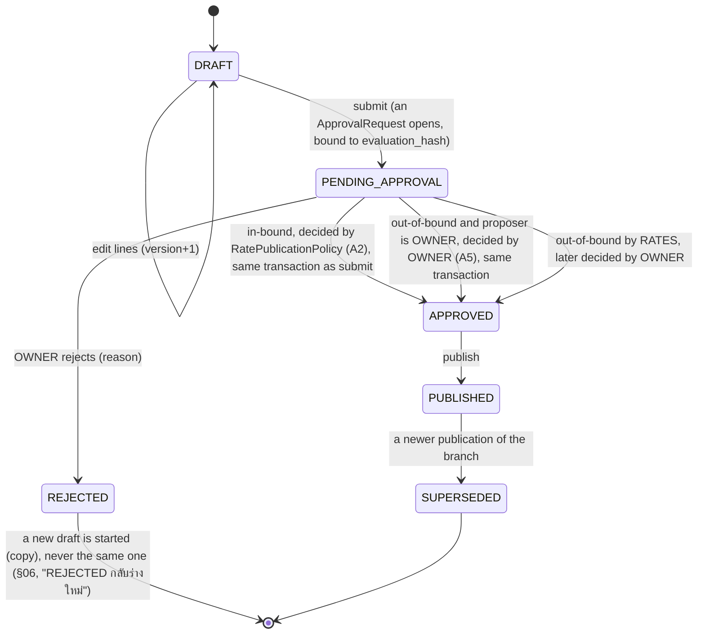
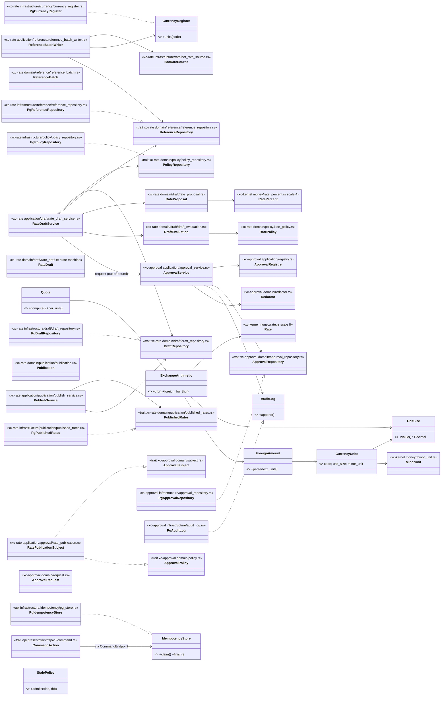

# Blueprint rates: units, the rate engine, and approvals (#547, #548, #549)

One design for three tickets. The lane controller ordered them in one file on 2026-10-09, because every other Blueprint
area waits on them:

| Ticket | Asks for | Here |
|---|---|---|
| #547 | rates per `unit_size` at scale 8; foreign amounts by minor unit | §3 |
| #548 | reference batches, % policy, AUTO/MANUAL per side, draft → approve → publish, immutable publications | §4 |
| #549 | one approval request/decision core for every type, plus a redacted audit trail | §5 |

- Source: the owner's Blueprint, `docs/blueprint/XC-Desk-Blueprint-Data-Model-v2.html` (#565). "§N" below means the
  Blueprint's own section.
- Gap list: `docs/design/xc-desk-blueprint-v2-mapping.md` (PR 527, rows K2–K4).
- v3 is measured at `origin/main` `3690ed5`.
- Brokers, referrals and commission are not here; they belong to Broker-Platform.

---

## 0. The owner's answers (2026-10-09, in session claude/e5ab6c)

| # | Question | Answer, verbatim | What it fixes |
|---|---|---|---|
| A1 | Which currencies are priced per `unit_size` ≠ 1 | *"ให้ อ่าน ใน พิมพ์ เขียน ว่า เค้าเอาแบบไหน"* (read the Blueprint for what it takes) | Read below the table |
| A2 | Who approves a rate publication | "In-bound: RATES; out-of-bound: OWNER" | §4.6 |
| A3 | Guards and the stale limit | "OWNER enters them in the policy screen" | §4.3: guards and stale age are data in `RatePolicyVersion`, set by OWNER; none are written in code |
| A4 | Denomination pricing | "Start with group ALL only" | §3.4 |
| A5 | OWNER drafts an out-of-bound set | "OWNER publishes directly; the audit records it" | §5.4 |
| A6 | Which BoT column is the buy base | "Buy = buying transfer" | §4.2: the sell base is BoT `selling` |
| A7 | What §05's *"จำกัด"* (limit) quotes on a stale rate means | "Cap the amount per transaction" | §4.3 `on_stale = LIMIT` with `stale_limit_thb`, an amount OWNER enters |

**A1 read from the Blueprint:**
- §03 P01 shows `USD • 1 USD`, `EUR • 1 EUR`, `JPY • 100 JPY`.
- §17 says *"model.js เก็บ JPY/KRW rate ต่อ 1 แต่ unit เป็น 100/1000 … JPY sell .235 ต่อ 1 → 23.5 ต่อ 100"*.
- §05 says *"100 JPY ไม่เท่ากับ 1 JPY"*.

So `unit_size` is **JPY 100, KRW 1000, and every other currency 1**. The Blueprint names no other currency.

Still open with the owner (§10): the BoT API's usage rights and its read schedule. Today's on-demand read stays meanwhile.

---

## 1. v3 today (measured)

- **Rate shape.** Every rate is THB per **1** unit, at scale 4:
  - `numeric(14,4)` on `rates.buy/sell/partner_cost` (`api/migrations/20261007100000_branches_rates.sql:22-25`);
  - `transactions.rate/reference_rate` (`20261007190000_transactions.sql:17-18`);
  - `kiosk_requests.rate` (`20261007170000_kiosk.sql:13`);
  - `bookings.rate` (`20261008130000_bookings.sql:24`).
- **`Rate` type.** `api/crates/xc-kernel/src/money/rate.rs` parses to scale 4 (`:17`) and always prints 4 places (`:28-33`).
- **No unit anywhere** in schema or domain. Only the BoT adapter knows JPY is quoted per 100, and it divides by 100 on
  read (`api/crates/xc-rate/src/infrastructure/rate/bot_rate_source.rs:215-220`). `currencies`
  (`branches_rates.sql:11-16`) has no `unit_size` and no `minor_unit`.
- **Arithmetic.** `Quote::compute` (`api/crates/xc-kernel/src/money/quote.rs:30-64`) is `principal = amount × rate`,
  rounded half away from zero to 2 places.
- **Code that assumes scale 4:**
  - the kiosk's reverse SELL, `thb_minor × 10_000 / rate.mantissa()`
    (`api/crates/xc-kiosk/src/domain/kiosk/entities/kiosk_machine.rs:55-57`);
  - `format_decimal_4` (`views/admin_rates.rs:25`, `views/admin_rate_history.rs:25`, `views/rates_reference.rs:25`);
  - `{:.5}` (`views/kiosk_currencies.rs:174`);
  - idempotency digests over the rate text (`api/src/application/workflows/save_transaction.rs:83`,
    `api/crates/xc-exchange/src/domain/booking/commands/create_booking.rs:39`).
- **Saving is direct.** OWNER or RATES saves one currency at a time and it is live at once:
  `RateService::save_rate` (`api/crates/xc-rate/src/application/rate/service.rs:126-292`) runs an optimistic
  `previousUpdated` check and appends to `rates`; the newest row per (branch, code) is current. Three callers:
  - `adminSaveRate` (`api/src/application/compat/rpc.rs:270-276`);
  - the kiosk `configure` action (`xc-kiosk/src/application/kiosk/currencies.rs:33-63` →
    `api/src/infrastructure/kiosk/kiosk_ports.rs:287-324`);
  - the web, at `web/src/screens/admin/rates/Rates.tsx:158` and `web/src/screens/kiosk-currencies/kiosk-api.ts:14-19`.
- **Readers of the current rate:**
  - `RateService::current` (`service.rs:62-116`) and `rate_in` (`:294-300`);
  - the kiosk's `SELECT DISTINCT ON (code) … FROM rates` (`kiosk_ports.rs:198-199`, `:255-256`);
  - the desk save's LIVE rate check, which compares the client's rate to `rate_in` and refuses `RATE_MISMATCH`
    (`save_transaction.rs:316-329`);
  - bookings, through `counter_rate_in` (`api/src/infrastructure/bookings/booking_ports.rs:100-125`);
  - `adminSnapshot` (`api/src/application/compat/snapshot.rs:95-118`, `:146-155`).
- **No approval or audit core.**
  - Approvals: the only one is custody's `custody_requests` + `custody_signatures` (`20261007140000_custody.sql:22-43`).
  - Audit: `ops_events` (`:69-80`), `device_events` (`20261007180000_devices.sql:16-27`), `branch_setting_history`
    (`20261008100000_branch_settings.sql`) and `employee_audit`. Each is its own shape.
- **Roles.**
  - `adminSaveRate`: OWNER on Rpc (`api/crates/xc-auth/src/domain/policy/entities/policy.rs:69`), RATES only among staff
    (`:82`, `:115`).
  - Kiosk `manage`/`configure`: OWNER or RATES (`:283-290`).
  - `/api/reference-rates`: OWNER only (`:215-223`).

---

## 2. Decisions

- **D-1. A rate is a `Rate` at scale 8, per the currency's `unit_size`** (§05, §07, K2, K3).
  - `unit_size` belongs to the **currency**, not to a rate row: `currencies.unit_size`, seeded per A1.
  - Every published line copies it (`published_rate_lines.unit_size`), so a line stays right if the register ever changes.
  - The single function that turns a rate into baht is `ExchangeArithmetic` (§3.2). Nothing else divides by
    `unit_size`, so it is never divided twice (§17).
- **D-2. Foreign amounts follow the currency's minor unit** (§05). `currencies.minor_unit` comes from ISO 4217: JPY 0,
  KRW 0, USD 2, and so on. An amount with more places than its currency allows is refused (`TooManyDecimals`), never
  rounded.
  - **Storage is `numeric(20,4)`** for every foreign amount, widened from `(20,2)` in migration 1:
    - the exchange rows: `transactions.amount`, `kiosk_requests.foreign_amount`, `kiosk_requests.input_amount`
      (foreign on a BUY by foreign amount, THB on a SELL by baht: `kiosk_machine.rs:48-57`), `bookings.amount`;
    - **the till**, which is per currency: `shift_balances.opening/expected/counted/difference` and
      `stock_movements.amount` (`20261007110000_shifts.sql:20-24`, `:35`). Every exchange moves `expected` for its
      currency, so the till must hold what the exchange holds.

    THB rows in those tables still carry 2 places, which the domain enforces. That is the Blueprint's own quantity type (§07
    `QuoteLine.quantity DECIMAL(20,4)`, `Denomination.face_value DECIMAL(20,4)`), and it holds the 3-place minor units
    of the seeded BHD, IQD, JOD, KWD, LYD, OMR and TND (`20261007100000_branches_rates.sql:62,105,109,116,124,145,174`).
    The domain refuses more places than `minor_unit` allows. THB-only columns stay `(20,2)`.
  - **In the domain**, `ForeignAmount` (`xc-kernel/src/money/foreign_amount.rs`) is its own scale-4 decimal. It is not
    `Money`, which is fixed at scale 2 (`money.rs:44`, `:51`, `:69`), and it converts to `Money` only for THB.
  - **Custody's JSON amounts** are encoded as `Money` minor units (cents) today (`custody_repository.rs`
    `minor_to_json`). Moving them to the currency's minor unit belongs to the cash design (#582/#553), which owns that
    encoding; it is listed there as a dependency. Until it lands, a 3-place currency can be exchanged and held in the
    till, but not counted through custody.
- **D-3. Publications replace `rates`** (§05, §07; K4). The current rate of a branch is the line of its
  `current_publication_id` (`branches.current_publication_id`). A publication is immutable, and moving the pointer is
  the only way a rate changes.
  - `rates`, `RateService::save_rate`, `adminSaveRate` and kiosk `configure`'s save are retired (§9 step 7).
  - The history screen (A03) reads publications, not `rates`.
- **D-4. One approval core, one policy per subject type** (#549, ♻️ rule).
  - `xc-approval` holds the request, decision and audit tables and the state rules.
  - Each subject type (rate publication now; reversal, campaign and cash variance later) implements `ApprovalSubject`
    in its own crate.
  - No type writes its own approval table.
- **D-5. Every submit opens an approval request, and the policy decides who closes it** (§06, §07; A2, A5).
  - In-bound: the policy closes it at submit.
  - Out-of-bound by OWNER: OWNER closes it at submit.
  - Out-of-bound by RATES: it waits for OWNER.

  The draft's guard evaluation decides which case applies. It is stored with its hash and the policy version, so the
  decision can be checked later.
- **D-6. Guards and stale age are data** (A3). OWNER enters them in a `RatePolicyVersion`, and each policy version is
  immutable. No number is fixed in code. A draft built under no policy has no AUTO side and is all MANUAL, so every
  line counts as out-of-bound (§4.5).
- **D-7. Writes go through a v3 command seam.** v3 has views (`/api/v3/views/*`) and compute actions
  (`/api/v3/compute/*`, `api/src/presentation/http/v3/action.rs:19`), but no write seam. The web client already
  posts to `/api/v3/{area}/{action}` (`web/src/shared/api/client.ts:136`).
  - `CommandAction` (§6) is the write sibling of `ComputeAction`: same policy gate, plus a required
    `Idempotency-Key` (§09).
  - The rate engine is its first user. Other areas reuse it; they do not copy it.

---

## 3. Units (#547)

### 3.1 The register

| Column | Type | Rule |
|---|---|---|
| `currencies.unit_size` | `numeric(20,4) NOT NULL DEFAULT 1` | `CHECK (unit_size > 0)`, the same type as the Blueprint's `unit_size DECIMAL` (§07). Seeded JPY 100, KRW 1000, all others 1 (A1). The selling unit each new published line copies |
| `currencies.minor_unit` | `smallint NOT NULL DEFAULT 2` | `CHECK (minor_unit BETWEEN 0 AND 3)`. Seeded from ISO 4217 for the 153 seeded codes. THB is 2 |

`UnitSize` (`api/crates/xc-kernel/src/money/unit_size.rs`) wraps a positive `Decimal` at scale 4, the same type as
every `unit_size` column (`numeric(20,4)`, Blueprint `DECIMAL`). No integer `unit_size` exists anywhere.

`CurrencyUnits` (`api/crates/xc-kernel/src/money/currency_units.rs`) is the domain view of one row:
`{ code, unit_size: UnitSize, minor_unit: MinorUnit }`. Every reader gets it from the port `CurrencyRegister`
(`api/crates/xc-rate/src/domain/currency/currency_register.rs`), implemented by `PgCurrencyRegister`
(`api/crates/xc-rate/src/infrastructure/currency/currency_register.rs`).

### 3.2 The one arithmetic

`api/crates/xc-kernel/src/money/exchange_arithmetic.rs`, **[required]** signatures:

```rust
pub struct ExchangeArithmetic;
impl ExchangeArithmetic {
    /// THB for `amount` foreign at `rate` per `unit_size`: amount × rate ÷ unit_size,
    /// rounded HALF_UP (away from zero) to 2 places once, at the end (§05).
    pub fn thb(amount: ForeignAmount, rate: Rate, unit: UnitSize) -> Money;
    /// The most foreign `thb` buys at `rate`: thb × unit_size ÷ rate, truncated
    /// to the currency's minor unit (the kiosk's SELL by baht).
    pub fn foreign_for_thb(thb: Money, rate: Rate, units: &CurrencyUnits) -> ForeignAmount;
}
```

- `ForeignAmount` (`api/crates/xc-kernel/src/money/foreign_amount.rs`) is `Money` plus its currency's `MinorUnit`.
  `ForeignAmount::parse(text, &CurrencyUnits)` refuses more places than `minor_unit` allows.
- `Quote::compute` (`quote.rs:30`) gains a sibling, `Quote::per_unit(side, amount: ForeignAmount, rate, unit: UnitSize,
  fee)`, whose principal is `ExchangeArithmetic::thb`. The old `compute` stays until every caller has moved (§9 step 7),
  so that callers can switch in parallel tickets without sharing a file. PR 536's `exchange_figures(side, amount, rate,
  unit_size, fee)` (`xc-exchange/.../figures.rs`, DK-B #538) calls `Quote::per_unit`.

**Callers that change.** Each switches in the ticket that owns its file (§9):

| Caller | Today | Becomes |
|---|---|---|
| desk save principal, `xc-exchange/.../transaction_form.rs:148-161` | `Quote::compute` | via `exchange_figures` → `Quote::per_unit` (DK-B #538 owns the file) |
| kiosk BUY, `kiosk_machine.rs:48-52` | `Quote(amount×rate)` | `ExchangeArithmetic::thb` |
| kiosk SELL by baht, `kiosk_machine.rs:55-67` | `×10_000 / mantissa`, then `foreign × rate` | `foreign_for_thb`, then `thb` |
| bookings, `admin_bookings.rs:280-282`, `booking_machine.rs` | `amount × rate` | `thb` |
| transaction row principal/reference value, `api/src/presentation/dto/v3/transaction_row.rs:164-196` | `amount × rate` | `thb` with the row's stored `unit_size` |
| admin cash reference spread, `api/src/presentation/http/v3/views/admin_cash.rs:28-47` | `amount × rate` | `thb` |
| admin reports, `views/admin_reports.rs:282-293` | `amount × rate` | `thb` |
| shift valuation, `v3/actions/shift_valuation.rs:141-150` | client rate per 1 | rate per `unit_size` from the publication (#509 owner) |
| devices COUNT_CONFIRMED, `api/src/infrastructure/devices/device_service.rs:734` | `amount × rate` | `thb` |
| customer page, `api/src/presentation/pages.rs:351-360` | `amount × rate` | `thb` |

Stored rows keep what was true when they were written. `transactions`, `kiosk_requests` and `bookings` each gain a
`unit_size` column (§8). A rate is never read without the unit it was stored with.

### 3.3 Precision and display

- **Scale.** `Rate::parse` accepts up to 8 places and stores scale 8 (`numeric(20,8)`). `RatePercent`
  (`api/crates/xc-kernel/src/money/rate_percent.rs`) is a signed decimal at scale 4 (`numeric(9,4)`).
- **On the wire.** A rate is the 8-place string the database holds, e.g. `"23.50000000"`.
  - Desk (PR 536 D-12) and staff (PR 532 S10) treat it as opaque, and must.
  - One web formatter, `formatRate(text)` (`web/src/shared/ui/rate.ts`), shows at least 2 and at most 8 places with
    trailing zeros trimmed, followed by `/ <unit_size> <code>` when `unit_size > 1`. No screen formats a rate itself.
- **Rounding.** THB is rounded HALF_UP to 2 places once, at the final amount (§05). A rate computed by AUTO is rounded
  HALF_UP to 8 places (§4.4).

### 3.4 Denominations (A4)

`denominations(id, currency_code, face_value numeric(20,4), group_code text)`, seeded with one `ALL` group per
currency and no face values. `published_rate_lines.denomination_group` is `'ALL'` for every line now. Pricing by
group needs no schema change later, only lines with other groups.

---

## 4. The rate engine (#548)

### 4.1 Tables (Blueprint §07, names kept)

```
rate_reference_batches(id uuid PK, provider text, source_date date, fetched_at timestamptz,
                       raw_checksum text, status text CHECK (status IN ('COMPLETE','PARTIAL')),
                       UNIQUE (provider, source_date, raw_checksum))
rate_reference_lines(id uuid PK, batch_id FK, currency_code FK, reference_type text,
                     unit_size numeric(20,4),         -- the SOURCE unit, as the provider quotes it
                     buy numeric(20,8) NULL, sell numeric(20,8) NULL,
                     raw jsonb,                        -- the provider's row as received
                     UNIQUE (batch_id, currency_code, reference_type))   -- never rewritten
rate_policy_versions(id uuid PK, branch_id FK, version integer, buy_adjust_pct numeric(9,4),
                     sell_adjust_pct numeric(9,4), guards jsonb,          -- min/max guards
                     max_reference_age_hours integer NULL, on_stale text NULL,  -- stale policy (A3, A7)
                     stale_limit_thb numeric(20,2) NULL,
                     valid_from timestamptz, valid_to timestamptz NULL,
                     approved_by text, reason text, source_version integer NULL,
                     UNIQUE (branch_id, version))      -- immutable once approved (inserted)
rate_drafts(id uuid PK, branch_id FK,
            status text CHECK (status IN ('DRAFT','PENDING_APPROVAL','APPROVED','REJECTED','PUBLISHED')),
            base_publication_version integer NULL,
            created_by text, created_at, updated_at, version integer,          -- optimistic
            evaluation jsonb NULL, evaluation_hash text NULL)
rate_draft_lines(id uuid PK, draft_id FK, branch_id FK, currency_code FK, denomination_group text DEFAULT 'ALL',
                 reference_line_id FK NULL, policy_version_id FK NULL,
                 buy_mode text CHECK (IN ('AUTO','MANUAL')), sell_mode text CHECK (IN ('AUTO','MANUAL')),
                 manual_buy numeric(20,8) NULL, manual_sell numeric(20,8) NULL, reason text NULL,
                 UNIQUE (draft_id, currency_code, denomination_group),
                 CHECK ((buy_mode = 'MANUAL') = (manual_buy IS NOT NULL)),
                 CHECK ((sell_mode = 'MANUAL') = (manual_sell IS NOT NULL)),
                 CHECK ((buy_mode = 'AUTO' AND sell_mode = 'AUTO') OR reason <> ''))
rate_publications(id uuid PK, branch_id FK, version integer, published_at timestamptz,
                  approved_request_id FK approval_requests(id) NOT NULL,
                  draft_id FK UNIQUE, published_by text,
                  UNIQUE (branch_id, version))
published_rate_lines(id uuid PK, publication_id FK, currency_code FK, denomination_group text,
                     unit_size numeric(20,4), buy_rate numeric(20,8) NULL, sell_rate numeric(20,8) NULL,
                     source_snapshot jsonb,           -- reference line + source_date/fetched_at, policy %, mode, reason
                     UNIQUE (publication_id, currency_code, denomination_group),
                     CHECK (buy_rate IS NULL OR sell_rate IS NULL OR buy_rate <= sell_rate))
branches.current_publication_id uuid NULL FK rate_publications(id)
```

- **Names.** Every entity and field the Blueprint names (§07: `RateReferenceBatch/Line`, `RatePolicyVersion`,
  `RateDraftLine`, `RatePublication/PublishedRateLine`, `branch.current_publication_id`) keeps its Blueprint name.
  `rate_drafts` is the header that `RateDraftLine`'s "unique draft + currency + group" implies, and it carries the §06
  state.
- **Immutability.** A publication and its lines are never updated or deleted. Reference lines are never rewritten
  (§07, *"ข้อมูลดิบไม่แก้ทับ"*).
- **Unavailable.** A side with `NULL` is unavailable: no quote is made on it (§05, *"หากไม่มีข้อมูลฝั่งที่ต้องใช้ ให้
  unavailable ห้ามเดา"*).
- **Reasons.** A MANUAL side must carry a reason (§06, *"MANUAL ทุกการเปลี่ยนมีเหตุผล"*), as the last CHECK enforces.
- **Partner cost.** `partner_name` / `partner_cost` (`rates` today) move to `source_snapshot.partner`, informational
  as today.

### 4.2 References (§05)

- **Raw, as received.** `BotRateSource` (`bot_rate_source.rs`) stops dividing by its unit.
  `ReferenceBatchWriter` (`api/crates/xc-rate/src/application/reference/reference_batch_writer.rs`) stores each
  provider row **in the provider's own unit**: BoT JPY is `unit_size 100` with BoT's value unchanged. It also keeps
  `source_date`, `fetched_at` and `raw` (§05: *"source, effective_date, fetched_at, source unit"*).
- **Normalising.** Conversion to the currency's selling unit happens only where it is used, in `RateProposal` (§4.4).
  It is done there once: `base = ref_value × currency.unit_size ÷ ref.unit_size`.
- **Which BoT columns (A6).** `buy` = BoT **buying transfer**, `sell` = BoT **selling**, and `reference_type = 'BOT'`.
  Buying sight stays in `raw`.
- **Missing data.** BoT covers 6 currencies (`bot_rate_source.rs:19`). Every other currency has no reference line, so
  its AUTO side is unavailable and only MANUAL can price it. A batch missing any of the 6 is `PARTIAL`; the missing
  lines are absent, never guessed.
- **When it is read.** On demand, when a draft asks for one, as today. The schedule waits on the owner (§10, O-1:
  Blueprint §05 *"ความถี่ดึงข้อมูลและ cutoff ต้องตรวจแหล่ง ธปท. ก่อน build adapter"*). A new batch is written only when
  the checksum differs from the newest batch's.

### 4.3 Policy (§05, §07; A3)

- **A version.** `RatePolicyVersion` holds:
  - `buy_adjust_pct` and `sell_adjust_pct`, signed, scale 4;
  - `guards`, the min/max guards per currency and side: the allowed range of the final rate's distance from its
    reference, in %, e.g. `{ "USD": { "buy": {"min_pct": "-2.0000", "max_pct": "0.5000"}, "sell": {...} } }`;
  - `max_reference_age_hours` and `on_stale`, the stale policy (§05, *"หาก stale ให้ใช้ policy จำกัด/หยุด quote"*).
    `on_stale` is one of:
    - `STOP`: a quote on a stale line is refused `rateUnavailable`;
    - `LIMIT` (A7): a quote on a stale line is allowed only when its THB amount ≤ `stale_limit_thb`, and above that it
      is refused `rateUnavailable`;
    - `NULL`: quotes go on, and every screen shows the stale badge;
  - `valid_from` / `valid_to`, `approved_by`, `reason` and `source_version`.
- **Approval.** OWNER enters a version (A3), and entering it is OWNER's approval (`approved_by` = OWNER). That is
  Blueprint §02, EXECUTIVE approving the rate frame. A version is immutable once inserted. A change is a new version.
- **The values.** None are fixed by this design (A3).
- **The type.** `RatePolicy` (`api/crates/xc-rate/src/domain/policy/rate_policy.rs`) parses `guards`. A currency with
  no guard entry is out-of-bound on any side that changes.

### 4.4 Draft lines → proposed rates (§05)

`RateProposal::of(line, reference_line?, policy?, units) -> ProposedLine`
(`api/crates/xc-rate/src/domain/draft/rate_proposal.rs`) is pure, and works per side:

| Mode | Proposed rate (scale 8) |
|---|---|
| AUTO | `base × (1 + adjust_pct ÷ 100)`, with `base` normalised as in §4.2. **Unavailable** when the reference side is missing |
| MANUAL | the side's `manual_*` value (> 0, ≤ 8 places), with its reason |

- **Rounding.** The Blueprint fixes the scale (8) and only one rounding mode, HALF_UP for the final THB. The proposed
  rate is rounded to scale 8 with that same HALF_UP. Proposal and quote then share one mode, and the design invents no
  second one.
- **Checks after rounding** (§05 validation):
  - every rate > 0;
  - `buy ≤ sell` → otherwise `validationFailed` with today's sentence (`xc-rate/src/domain/validation.rs:8-19`);
  - the AUTO reference must be complete for its side.
- **Global adjust.** It changes the draft's percent only. MANUAL sides keep their values (§05, *"ปุ่มปรับรวมข้ามฝั่ง
  MANUAL"*).
- **Back to AUTO.** It needs the preview (§05, *"กลับ AUTO ต้องยืนยันพร้อม preview"*): the command carries the AUTO
  value the client was shown, and a mismatch is refused `staleVersion`.

### 4.5 Evaluation: in-bound or out-of-bound (§05, §02)

`DraftEvaluation::of(lines, proposals, references, policy) -> Evaluation`
(`api/crates/xc-rate/src/domain/draft/draft_evaluation.rs`). A side is **out-of-bound** when any of these holds:

- it changes and its currency has no guard;
- its proposed rate's distance from its reference lies outside the guard's `[min_pct, max_pct]`;
- it is MANUAL with no reference to measure it against.

A MANUAL side **with** a reference is measured like an AUTO side. The Blueprint's out-of-bound rule (§05,
*"out-of-bound → approval"*) is about the rate, not the mode, so this design adds no rule about modes.

The evaluation is stored on the draft at submit as `evaluation` + `evaluation_hash`. The hash is sha256 of the
canonical JSON of the lines, the proposals, the policy version id and the reference line ids. The approval binds to
it (§06, *"อนุมัติผูก version/hash"*).

### 4.6 States and who moves them (§06; A2, A5)

The states are exactly the Blueprint's: `DRAFT → PENDING_APPROVAL → APPROVED → PUBLISHED → SUPERSEDED`, and
`REJECTED`. **Every** submit opens an `ApprovalRequest` (§5), so every publication carries `approved_request_id`
(§07). What differs by case is only **who decides**, per the owner's answers:



- **Who submits.** OWNER and RATES (Blueprint RATE_MANAGER: *"ร่างเรท ปรับ % เสนอเผยแพร่"*).
- **In-bound** (A2). The decision is written by the policy itself: `approver_id = "policy:<policy_version_id>"`,
  reason `in_bound`. No person approves it, and the audit says so.
- **Out-of-bound by RATES.** It stays `PENDING_APPROVAL` until OWNER decides. The proposer may never decide it (§5.4).
- **Out-of-bound by OWNER** (A5). OWNER's decision is written at submit, reason `proposer_is_owner`.
- **Edits.** An edit after submit is refused `staleVersion`. A change needs a new draft and a new request (§06,
  *"แก้แล้วต้องขอใหม่"*).
- **Publish** (§05, §09) carries `expected_version`, the branch's current publication version. In **one** DB
  transaction it:
  - checks the request is APPROVED and `evaluation_hash` is unchanged, else `approvalRequired`;
  - inserts the publication and all its lines;
  - moves `branches.current_publication_id`;
  - (the previous publication becomes SUPERSEDED by that move; see below);
  - bumps the branch version.

  A different current version means `staleVersion` and nothing is written. All lines publish or none do.

- **SUPERSEDED is derived, not stored.** A publication is immutable (§05), so it has no status column to update. Its
  state is read from the pointer: the publication `branches.current_publication_id` points at is `PUBLISHED`; every
  older version of the branch is `SUPERSEDED`. `Publication::state(current_version)`
  (`xc-rate/src/domain/publication/publication.rs`) answers it, and the views show it. A draft's own status stays
  `PUBLISHED`; its effective state is its publication's.

### 4.7 Routes (Blueprint §10 paths kept)

Writes go through the command seam (§6), which serves the route each command declares. Each needs
`Idempotency-Key`.

| Route | Kind | Who | Answers |
|---|---|---|---|
| `POST /api/rate-drafts/:id/simulate` (§10) | command with no write (V0-D compute semantics) | OWNER, RATES | the diff of AUTO/MANUAL, guard violations, no mutation |
| `POST /api/rate-drafts/:id/submit` (§10) | command | OWNER, RATES | the request and the resulting state |
| `POST /api/rate-drafts/:id/publish` (§10) | command | OWNER, RATES | the new `PublicationRef`; checks the approval hash and `expected_version` |
| `POST /api/rate-drafts` and `PUT /api/rate-drafts/:id` | command | OWNER, RATES | create and edit (`expected_version`); not in §10 but needed to have a draft |
| `POST /api/approvals/:id/decide` | command, generic (§5) | per the subject's policy | APPROVED or REJECTED with a reason (A06) |
| `POST /api/rate-policies` | command | OWNER | a new policy version |
| `POST /api/rate-references/fetch` | command | OWNER, RATES | a batch id, new or the unchanged one |
| `GET /api/v3/views/published_rates` | view, inherits `(Rpc, "adminSnapshot")` | as today's readers | `{ publication: {id, version, published_at}, source_date, stale, lines: [{currency, group, unit_size, buy_rate, sell_rate, line_id}] }`, with no reference cost or PII (the §10 public shape) |
| `GET /api/v3/views/staff_published_rates` | view, inherits `(StaffRpc, "adminSnapshot")` | staff | the same DTO. Two paths, two views (`xchange-v3-web.md` §4.4) |
| `GET /api/v3/views/rate_drafts`, `rate_draft` | views | OWNER, RATES | drafts, lines, proposals, evaluation |
| `GET /api/v3/views/rate_publications` | paged view (A03) | OWNER, RATES | versions, who, when, before/after per line |
| `GET /api/v3/views/rate_policy` | view | OWNER, RATES | the current policy version |
| `GET /api/v3/views/approval_requests` | paged view (A06), filters `status`, `type` | OWNER | requests with proposer, values before and after, reason |

- **The public display.** `GET /api/public/branches/:code/rates` (§10, P01) reads the same `PublishedRates` port with
  the same shape. Its route belongs to the storefront design.
- **Error codes.** They are §10's, written in v3's camelCase:
  - `validationFailed`
  - `outOfScope`
  - `staleVersion`
  - `rateUnavailable`
  - `approvalRequired`
  - `idempotencyConflict`

### 4.8 How the kiosk, the desk, the staff app and bookings read the rate

All of them read through one port, `PublishedRates` (`api/crates/xc-rate/src/domain/publication/published_rates.rs`),
implemented by `PgPublishedRates` (`api/crates/xc-rate/src/infrastructure/publication/published_rates.rs`):

```rust
// Ports return BoxFuture, as the repo's ports do (`xc-rate/src/domain/rate/entities/rate_source.rs:14-16`), so they
// are usable as `Arc<dyn …>`; the repo has no `async_trait`.
pub trait PublishedRates: Send + Sync {
    /// The branch's current publication and its lines; None before the first publication.
    fn current<'a>(&'a self, branch: &'a BranchId) -> BoxFuture<'a, AppResult<Option<Publication>>>;
    /// One line of the current publication for a side, in the caller's transaction.
    fn line_in<'a>(&'a self, tx: &'a mut BranchTx, branch: &'a BranchId, code: CurrencyCode, side: Side)
        -> BoxFuture<'a, AppResult<Option<PublishedSide>>>;
}
pub struct PublicationRef { pub id: PublicationId, pub version: i32 }
pub struct PublishedSide { pub line_id: PublishedRateLineId, pub rate: Rate, pub unit_size: UnitSize,
                           pub publication: PublicationRef }
```

| Reader | Reads | Stores on its own row | Its guard |
|---|---|---|---|
| kiosk quote (`kiosk_machine.rs`, via `kiosk_ports.rs`) | `line_in` for the side | `kiosk_requests.published_rate_line_id`, `rate`, `unit_size` | confirm refuses when the current line id ≠ the quoted line id (today: rate text, `kiosk_machine.rs:149-151`) |
| desk save LIVE check (`save_transaction.rs:316-329`) | `line_in` | `transactions.published_rate_line_id`, `rate`, `unit_size` | `RATE_MISMATCH` when the client's line id or rate differs from the current line |
| desk screen (PR 536 DK-A) | `published_rates` / `staff_published_rates` | — | the opaque string and `PublicationRef` |
| staff RATES card (PR 532 S-8) | `staff_published_rates` | — | read only; `rateUpdated` becomes `PublicationRef.version`, still opaque |
| bookings (`booking_ports.rs:100-125`) | `line_in` | `bookings.published_rate_line_id`, `rate`, `unit_size` | create/confirm compare line id |
| `adminSnapshot` (`snapshot.rs:95-118`) | `current` | — | v2 shape kept: `rates[]` from the lines, `updated` = `published_at` |

A quote and its stored row keep the line id and the rate snapshot. A later publication never rewrites them (§05).

**Stale at read time** (§05, §13 phase 1, *"stale แสดงชัด"*):
- `PublishedSide` carries `stale: bool` and `source_date`.
- An AUTO line is stale when `now − source_snapshot.fetched_at > max_reference_age_hours` of the policy version it was
  published under. A MANUAL line with no reference is never stale.
- Every quoting reader applies the policy the same way, through one function, `StalePolicy::admits(side, thb) ->
  Result<(), RateUnavailable>` (`api/crates/xc-rate/src/domain/policy/stale_policy.rs`). With `STOP` it refuses; with
  `LIMIT` it refuses a THB amount above `stale_limit_thb` (A7). The readers are the kiosk quote, the desk save,
  bookings, and P01's quote button.
- Every display shows the stale badge, and shows `source_date` and `published_at` separately. No display says
  "real time" (§05).

---

## 5. Approvals and audit (#549)

### 5.1 Tables

```
approval_requests(id uuid PK, type text, branch_id FK NULL, object_id text, object_version_hash text,
                  policy_version text, proposed_payload jsonb,         -- redacted (§5.5)
                  requested_by text, requested_at timestamptz,
                  status text CHECK (status IN ('PENDING','APPROVED','REJECTED')),
                  idempotency_key text, UNIQUE (type, idempotency_key))
CREATE UNIQUE INDEX one_pending_per_object ON approval_requests (type, object_id) WHERE status = 'PENDING';
approval_decisions(id uuid PK, request_id FK UNIQUE, approver_id text, approver_role text,
                   outcome text CHECK (outcome IN ('APPROVED','REJECTED')), reason text, at timestamptz)
idempotency_records(org_id text, operation text, key text, request_hash text, response_ref jsonb,
                    status text, created_at timestamptz,
                    PRIMARY KEY (org_id, operation, key))        -- Blueprint §07 IdempotencyRecord
audit_events(id bigint GENERATED ALWAYS AS IDENTITY PK, actor_id text, actor_role text, scope text,
             branch_id text NULL, action text, object_ref text, before_redacted jsonb NULL,
             after_redacted jsonb NULL, at timestamptz)
```

`audit_events` is append-only: no UPDATE or DELETE path, and the repository exposes `append` and paged reads only.
The existing audit tables (`ops_events`, `device_events`, `branch_setting_history`, `employee_audit`) stay as they are.
Moving them is out of scope (§10).

### 5.2 The core and the per-type trait (♻️)

```rust
// api/crates/xc-approval/src/domain/subject.rs
// dyn-safe: no associated const, no `async fn`; BoxFuture like the repo's other ports.
pub trait ApprovalSubject: Send + Sync {
    fn type_name(&self) -> &'static str;             // "RATE_PUBLICATION", later "REVERSAL", …
    /// The current hash of the object; a decision is refused if it moved.
    fn version_hash<'a>(&'a self, object_id: &'a str) -> BoxFuture<'a, AppResult<String>>;
    /// What happens on APPROVED / REJECTED (e.g. the draft's status), in the caller's tx.
    fn on_decided<'a>(&'a self, tx: &'a mut BranchTx, object_id: &'a str, outcome: Outcome)
        -> BoxFuture<'a, AppResult<()>>;
}
// api/crates/xc-approval/src/domain/policy.rs
pub trait ApprovalPolicy: Send + Sync {
    /// May `who` decide `request`? The core has already refused the proposer (§5.4).
    fn may_decide(&self, who: &Actor, request: &ApprovalRequest) -> Result<(), Refusal>;
    /// May the proposer `who` close their own request at submit (A5)? Default: no.
    fn allows_self_decision(&self, who: &Actor) -> bool { let _ = who; false }
    fn policy_version(&self) -> String;
}
```

- **`ApprovalService`** (`api/crates/xc-approval/src/application/approval_service.rs`) provides
  `request(subject, object_id, payload, by, key)`, `decide(request_id, who, outcome, reason, key)` and
  two core methods for decisions written at submit:
  - `decide_by_policy(request_id, policy_version)` writes the in-bound decision with
    `approver_id = "policy:<version>"`;
  - `decide_self(request_id, who, reason)` writes a proposer's own decision, only when the type's
    `ApprovalPolicy::allows_self_decision(who)` is true (A5), with the audit row.

  It is generic over `Arc<dyn ApprovalSubject>` + `Arc<dyn ApprovalPolicy>`, held in a registry keyed by
  `type_name()` (`api/crates/xc-approval/src/application/registry.rs`). It owns:
  - the state rules;
  - the hash check;
  - the one-pending rule;
  - idempotency;
  - writing the decision and the audit event in the same transaction as `on_decided`.
- **The first subject.** `RatePublicationSubject` + `RatePublicationPolicy`
  (`api/crates/xc-rate/src/application/approval/rate_publication.rs`). Policy: `may_decide` ⇔ the actor is OWNER (A2),
and `allows_self_decision` ⇔ the actor is OWNER (A5). Neither writes an approval table.
- **Adding a type** later (reversal #552, campaign #560) is one file in that area's crate, which implements both traits.
  No new tables or routes: `POST /api/approvals/:id/decide` and the `approval_requests` view serve every type.

### 5.3 Who may decide, by type

| Type | Decides | Bounds | Source |
|---|---|---|---|
| `RATE_PUBLICATION` | in-bound: the policy itself; out-of-bound: OWNER | the guards of the policy version | A2, A5 |
| reversal, campaign, cash variance, transfer | **not decided here**: each area's design names its policy and asks the owner its matrix | — | #549 §8 |

### 5.4 The proposer

- The core refuses a decision by the request's own proposer (`outOfScope`). That is §02's separation, and it applies to
  every type. A decision written by the policy itself (in-bound, `approver_id = "policy:<version>"`) is not a person
  deciding, so the rule does not apply to it.
- **The one exception for a person is A5.** OWNER's own out-of-bound rate draft is approved at submit through the core:
  `RateDraftService` calls `ApprovalService::decide_self(request, OWNER, "proposer_is_owner")`. The core checks
  `RatePublicationPolicy::allows_self_decision` and writes the decision and its audit row (♻️: the safety logic lives
  in the core). No type writes `approval_decisions` itself (D-4). The audit shows an owner self-decision, never no
  decision at all.

### 5.5 Redaction (§07: no secret or full PII in any log)

`Redactor` (`api/crates/xc-approval/src/domain/redactor.rs`) works on every `proposed_payload`, `before_redacted` and
`after_redacted` before it is written:

- it masks keys on a deny list (passport, phone, id numbers, tokens, passwords) to the last 4 characters;
- it drops whole values for `secret`, `token`, `password` and `otp`.

Rate payloads hold no PII. The rule is in the core so that no type has to remember it.

### 5.6 Concurrency and idempotency (§09)

- **Commands.** Every command carries `Idempotency-Key`, stored in `idempotency_records`. Until #550 adds
  organisations, `org_id` is the single organisation's constant. The same key with the same hash replays the stored
  answer. The same key with a different hash is refused `idempotencyConflict` (§07: *"retry key เดิม payload ต่างต้อง
  reject"*).
- **Draft edits.** They carry `expected_version`, so two editors cannot both win.
- **Decisions.** `decide` locks the request row (`FOR UPDATE`), so of two decisions on one request exactly one applies;
  the other gets `staleVersion`.
- **Publishing.**
  - Two publishes of one branch race on `UNIQUE (branch_id, version)` plus the `expected_version` check; one wins and
    the other gets `staleVersion`.
  - `draft_id UNIQUE` on publications stops a draft from publishing twice.

---

## 6. The command seam (shared, first used here)

`api/src/presentation/http/v3/command.rs`, **[required]** shape:

```rust
pub trait CommandAction: Send + Sync + 'static {
    const NAME: &'static str;
    const INHERITS: (EntryPath, &'static str);     // the policy row, as views (§4.4 of xchange-v3-web.md)
    type Input: DeserializeOwned + TS;
    type Output: Serialize + TS;
    const ROUTE: &'static str;                     // e.g. "/api/rate-drafts/{id}/submit" (Blueprint §10 paths)
    const METHOD: Method;                          // POST or PUT
    fn run(&self, branch: &BranchId, who: &Actor, input: Self::Input, key: IdempotencyKey)
        -> impl Future<Output = Result<Self::Output, V3Error>> + Send;
}
```

`CommandEndpoint::register` serves `METHOD ROUTE`, so a command keeps the route its area's design names (the
Blueprint's §10 paths here):
- `x-xchange-request: 1`, the same CSRF header as compat;
- a missing `Idempotency-Key` header is 400 `validationFailed`, field `idempotencyKey`;
- policy runs through `authenticate_and_authorize` (`view.rs:331`), and the branch through `Policy::branch`;
- errors are `V3Error`.

The client's `act(area, action, body)` (`client.ts:136`) is replaced by `command(method, path, body, key)`, which
posts to the command's route.

**The seam is general, not rate-specific.** The lane controller asked for this on #563 (issuecomment-6073290907,
condition 5).
- Any area registers its writes as `CommandAction`s. Nothing in `command.rs` names a rate.
- `INHERITS` may name any `EntryPath`, including the system/machine path that #563's condition 4 adds for service
  callers. `authenticate_and_authorize` then resolves a service actor instead of a session.
- `idempotency_records` (§5.6) is keyed by `(org_id, operation, key)`, so every command shares it. CM-1 owns it: the
  table (migration 3), the port `IdempotencyStore` (`api/src/infrastructure/idempotency/store.rs`:
  `claim(op, key, hash) -> Claim::{New, Replay(response), Conflict}`, `finish(op, key, response)`), and
  `PgIdempotencyStore`. `CommandEndpoint` calls it around `run`, so no command handles idempotency itself.
- **The system path is not CM-1's.** `CommandAction` works with whatever actor `authenticate_and_authorize`
  (`view.rs:331-353`) resolves, and today that is the owner and staff sessions. Teaching it a service actor is #563's
  v3 design ticket (condition 4), which owns that change to `view.rs`.

**Inbound, not outbound.** `CommandAction` is how a caller writes **into** v3. A push **out** of v3 to another service,
such as #563's attribution push to Broker-Platform `POST /api/v1/attributions`, is not a `CommandAction`:
- it is an outbox row (Blueprint §07 `OutboxEvent`), written in the same DB transaction as the business change;
- a worker delivers it with the row's own idempotency key, and the receiver dedupes on that key (§09);
- that outbox is its own shared core. It is designed with #563 and #551, not here.

What the two share is the key format and the rule that the same key with a different payload is a conflict.

**Policy rows.** These are new actions, so `policy.rs` gains rows. That is the only edit to the role table, in one
ticket (RE-3):

| Action | Rpc (owner page) | StaffRpc |
|---|---|---|
| `ratePolicySave` | OWNER | — |
| `rateDraft` (save, submit, simulate, publish, fetch reference) | OWNER, RATES | RATES |
| `approvalDecide` | OWNER | — |
| `approvalRead` | OWNER | — |

---

## 7. Class diagram



The HTTP side gets one file per view or command: `api/src/presentation/http/v3/views/<name>.rs`,
`api/src/presentation/http/v3/commands/<name>.rs` and `api/src/presentation/dto/v3/<name>.rs`, with names as in §4.7.

### 7.1 Who provides, who uses

| Provider | Used by |
|---|---|
| `ExchangeArithmetic`, `Quote::per_unit`, `ForeignAmount` | the desk (DK-B #538 `exchange_figures`), kiosk, bookings, `transaction_row`, admin views, devices, the customer page |
| `CurrencyRegister` | the reference writer, the draft service, every caller that parses a foreign amount |
| `PublishedRates` | kiosk, desk save, desk config (DK-A #537), staff RATES card (PR 532 S-8), bookings, `adminSnapshot`, P01 (storefront) |
| `ApprovalService` + `ApprovalSubject`/`ApprovalPolicy` | rates now; reversal #552, campaign #560, cash and transfer later |
| `AuditLog` | approvals, publications, policy saves; other areas append to it |
| `CommandAction` | the rate commands now; every later v3 write |

**If a provider has not landed yet.** A consuming ticket declares a stub with the exact signature above in its own
file, with a comment saying it will move, and never edits the provider's file (📐 rule).

---

## 8. Data migration

v3 is not installed anywhere. Its data is test data (D6), and the test database `xc_v3` on do-sgp1 may be recreated.
The owner approved v3 migrations until the first install. The migrations are still written to run correctly on a
database that already has rows.

**Six** new migration files, one per ticket that owns them (§9), applied in this order. A merged migration is never
edited: sqlx checksums them.

**1. `api/migrations/20261010100000_rate_units.sql`** (RU-1)

- `ALTER TABLE currencies ADD unit_size numeric(20,4) NOT NULL DEFAULT 1 CHECK (unit_size > 0), ADD minor_unit smallint
  NOT NULL DEFAULT 2 CHECK (minor_unit BETWEEN 0 AND 3)`, then `UPDATE currencies SET unit_size = 100 WHERE code =
  'JPY'`, the same with `1000` for `KRW`, and the ISO 4217 minor units.
- `CREATE TABLE denominations …` with one `ALL` row per currency.
- Widen every rate column to `numeric(20,8)`: `rates.buy/sell/partner_cost`, `transactions.rate/reference_rate`,
  `kiosk_requests.rate` and `bookings.rate`. Widen the foreign amounts to `numeric(20,4)` (D-2):
  `transactions.amount`, `kiosk_requests.foreign_amount`, `kiosk_requests.input_amount`, `bookings.amount`,
  `shift_balances.opening/expected/counted/difference` and `stock_movements.amount`. The CHECKs keep their meaning.
- **First add** `unit_size numeric(20,4) NOT NULL DEFAULT 1` to `transactions`, `kiosk_requests` and `bookings`.
  **Then** convert their rows:

  ```sql
  UPDATE <table> t SET rate = t.rate * c.unit_size, unit_size = c.unit_size
    FROM currencies c WHERE c.code = t.<currency column> AND c.unit_size <> 1;
  ```

  `rates` has no `unit_size` column and gets none. Its `buy`, `sell` and `partner_cost` are multiplied by the
  currency's `unit_size` in place, and RE-1's backfill copies `unit_size` from `currencies` into published line 1.

  The currency column is `code` on `transactions` (`20261007190000_transactions.sql:15`), `bookings`
  (`20261008130000_bookings.sql:22`) and `rates`, but `currency` on `kiosk_requests` (`20261007170000_kiosk.sql:12`).

  `transactions.reference_rate` gets the same multiplication. Count before deploy:

  ```sql
  SELECT 'transactions', count(*) FROM transactions WHERE code IN ('JPY','KRW') UNION ALL
  SELECT 'kiosk_requests', count(*) FROM kiosk_requests WHERE currency IN ('JPY','KRW') UNION ALL
  SELECT 'bookings', count(*) FROM bookings WHERE code IN ('JPY','KRW') UNION ALL
  SELECT 'rates', count(*) FROM rates WHERE code IN ('JPY','KRW');
  ```

  Stored principals do not change: `amount × (rate × u) ÷ u` is the same THB.
- **Deploy order:** the migration runs at boot with the new binary (embedded, `sqlx::migrate!`). The old binary cannot
  read a scale-8 JPY rate as per-1, so there is no mixed running. One binary at a time, as v3 has always deployed.
- **`down` loses** `unit_size`, `minor_unit` and the denominations, and divides the converted rates back. Narrowing to
  `(14,4)` and `(20,2)` truncates rates with more than 4 places and amounts with 3–4 places, including till balances
  and stock movements, so `down` is written but lossy, and says so in a comment.

**2. `api/migrations/20261010110000_approvals.sql`** (AP-1)

- Creates `approval_requests`, `approval_decisions` and `audit_events`.
- No existing rows. **`down`** drops them, and every request, decision and audit line is lost.

**3. `api/migrations/20261010115000_idempotency.sql`** (CM-1)

- Creates `idempotency_records` (§5.1). There are no existing rows.
- **`down`** drops it, which loses the stored replays. A retry after `down` runs as new.

**4. `api/migrations/20261010120000_rate_engine.sql`** (RE-1)

- Creates the tables of §4.1 and `branches.current_publication_id`.
- **Backfill.** For each branch with `rates` rows, the migration builds **publication version 1** from the newest
  row per (branch, code):
  - lines are MANUAL with `source_snapshot = {"migrated_from": "rates", "rates_id": …, "reference": <rates.reference>}`;
  - `published_by` = that row's `updated_by`;
  - because `approved_request_id` is NOT NULL (§07), the migration also writes one `RATE_PUBLICATION` request per
    branch, with a decision `{approver_id: "migration", reason: "migrated_from_rates"}`, so the audit shows where
    version 1 came from;
  - the branch pointer is set to it.

  Count first:

  ```sql
  SELECT count(DISTINCT (branch_id, code)) FROM rates;
  SELECT count(DISTINCT branch_id) FROM rates;
  ```

  Branches with no rates get no publication, so `current` answers `None` and every quote is unavailable. That is what
  "no rate set" answers today (`service.rs:62-116`, `None`).
- **The `rates` table is not dropped here.** RE-7 drops it after every reader has moved (§9), in its own migration.
- **`down`** drops the engine tables. Publications made after the migration are lost. The `rates` rows are still
  there until RE-7.

**5. `api/migrations/20261010125000_published_rate_line_ids.sql`** (RE-4)

- Adds `published_rate_line_id uuid NULL REFERENCES published_rate_lines(id)` to `transactions`, `kiosk_requests` and
  `bookings`.
- **Existing rows** get `NULL`. They were written before publications existed. Their rate, `unit_size` and principal
  are already stored on the row (migration 1), so nothing reads the line id to show them.
- **Readers.** A `NULL` line id means "recorded before publications": the row shows its own stored rate. Only rows
  written after RE-4 carry a line id, and only those are checked against the current line (§4.8). There is no
  backfill: matching an old row to publication 1's line would claim a link that never existed.
- **Deploy order.** It ships with the RE-4 binary. The RE-1 binary does not read the column, so it is unaffected.
- **`down`** drops the three columns and loses only the links. The rates stay on the rows.

**6. `api/migrations/20261010130000_drop_rates.sql`** (RE-7)

- Drops `rates` (its history now lives in publication 1's `source_snapshot`).
- Drops the kiosk `configure` rate path's leftovers, if any.
- **`down`** recreates an empty `rates`. The history is lost, except as snapshots.

---

## 9. Tickets

Each ticket owns disjoint files. The order is by start dependency.

| # | Ticket | Owns | Starts after |
|---|---|---|---|
| RU-1 | units in the kernel and the register | `xc-kernel` `money/{rate.rs, unit_size.rs, minor_unit.rs, currency_units.rs, foreign_amount.rs, rate_percent.rs, exchange_arithmetic.rs, quote.rs, mod.rs}`; `xc-rate` `domain/currency/**`, `infrastructure/currency/**`; migration 1; kernel tests | this design |
| AP-1 | approval and audit core | new crate `api/crates/xc-approval/**`; migration 2 | this design |
| CM-1 | the command seam and its idempotency store | `api/src/presentation/http/v3/command.rs`; `api/src/presentation/http/v3/commands/` (new dir; the generated table reads it); `api/build.rs` (the commands generation, after the views and actions blocks at `:155-190`); `api/build_support/commands.rs` (new, as `views.rs`); `api/src/presentation/http/v3/mod.rs` (`pub mod command;`, one `include!`, one loop in `configure_v3`, as `:18-27`); `api/src/infrastructure/idempotency/**` (new: `IdempotencyStore` port + `PgIdempotencyStore`); migration 3; `web/src/shared/api/client.ts` (`command(method, path, body, key)`); their tests | this design. **`http/v3/mod.rs` is also in DK-A #537** (`pub mod desk;`), so the queue serialises the two: CM-1 starts after #537 merges, or the controller orders the reverse |
| RE-1 | engine domain, tables and services | `xc-rate` `domain/{reference,policy,draft,publication}/**`, `application/{reference,draft,publication,approval}/**`, `infrastructure/{reference,policy,draft,publication}/**`; migration 4 | RU-1, AP-1 |
| RE-2 | BoT adapter writes batches | `xc-rate/src/infrastructure/rate/bot_rate_source.rs` and its tests | RU-1, RE-1 |
| RE-3 | routes: the views and commands of §4.7, the policy rows of §6 | `api/src/presentation/http/v3/views/{published_rates,staff_published_rates,rate_drafts,rate_draft,rate_publications,rate_policy,approval_requests}.rs`, `http/v3/commands/**`, the matching `dto/v3/*.rs` and generated TS, `xc-auth/.../policy.rs` | RE-1, CM-1 |
| RE-4 | readers switch to `PublishedRates` and `ExchangeArithmetic` | `kiosk_machine.rs`, `kiosk_ports.rs`, `save_transaction.rs` (rate check and stored line), `booking_ports.rs`, `booking_machine.rs`, `snapshot.rs` (rates part), `transaction_row.rs`, `admin_cash.rs`, `admin_reports.rs`, `device_service.rs`, `pages.rs` (customer page), migration 5 | RE-3. Split per reader if the controller prefers; no file is shared with DK-A…DK-J |
| RE-5 | admin screens A02, A03, A06 | `web/src/screens/admin/rates/**` (rebuilt), `web/src/screens/admin/approvals/**` (new), `web/src/shared/ui/rate.ts` | RE-3 |
| RE-6 | kiosk-currencies screen and `configure` on publications | `web/src/screens/kiosk-currencies/**`, `xc-kiosk/src/application/kiosk/currencies.rs`, `views/kiosk_currencies.rs` | RE-3 |
| RE-7 | retire the direct save | `xc-rate` `application/rate/service.rs` (`save_rate` removed), `rpc.rs` `adminSaveRate`, `Quote::compute` removed, migration 6, the tests that only pinned the old save | RE-4, RE-5, RE-6, DK-B #538 |

Desk (PR 536) and staff (PR 532) name these types: `PublicationRef`, `PublishedSide` / `PublishedRateLineDto` (rate
string, `unit_size`, `publication`), and `Quote::per_unit`. DK-A waits for RE-3, DK-B for RU-1, and S-8 for RE-3.

**Provided tests that change**, rewritten by the ticket author with the reason cited, never by the implementer:

| Test | Owner | Ticket | Becomes |
|---|---|---|---|
| `xc-kernel/tests/rate_value_test.rs:36` | pins scale 4 | RU-1 | scale 8 |
| `money_test.rs:95-133` | `TooManyDecimals` for `"32.12345"` | RU-1 | for 9 places |
| `quote_test.rs` | v2 cases | RU-1 | unchanged for `compute`, plus a `per_unit` table |
| `xc-rate/tests/bot_rate_source_test.rs:698` | JPY unit "100" | RE-2 | the adapter returns BoT's unit unchanged |
| `rates_test.rs`, `api/tests/v3_admin_rates_view_test.rs` | the direct save | RE-7 / RE-5 | publications |
| `xc-auth/tests/policy_test.rs:386,705` | `adminSaveRate == ["RATES"]` | RE-3 | the new rows of §6; `adminSaveRate` removed in RE-7 |

**Up-front tests per ticket** (🧪), each written by the ticket author before dispatch:

- **RU-1**
  - `thb(100 JPY, 23.50000000, 100) = 23.50`;
  - `thb(1000 KRW, 25.12345678, 1000) = 25.12`;
  - HALF_UP at `.005`;
  - `foreign_for_thb` truncates to minor unit 0 for JPY;
  - `ForeignAmount::parse("100.5", JPY)` is refused;
  - `Rate::parse` takes 8 places and refuses 9;
  - migration 1 converts a JPY row ×100 and leaves the principal unchanged.
- **AP-1**
  - the proposer cannot decide;
  - one pending request per object;
  - two concurrent decides give exactly one decision;
  - a hash that moved means a refused decision;
  - `Redactor` masks a passport field;
  - the same key with a different hash gives `idempotencyConflict`.
- **CM-1**
  - a missing key is 400 with field `idempotencyKey`;
  - a replay returns the stored answer;
  - the policy refusal matches the view core's.
- **RE-1**
  - AUTO = HALF_UP to 8 places of `ref × unit_size ÷ ref_unit × (1 + pct/100)`;
  - JPY referenced per 100 with `unit_size` 100 is not divided twice;
  - a missing reference makes the AUTO side unavailable;
  - a MANUAL side without a reason is refused;
  - a MANUAL side with a reference inside the guard is in-bound;
  - a MANUAL side with no reference is out-of-bound;
  - buy > sell after rounding is refused (`validationFailed`);
  - **every** submit opens exactly one request;
  - an in-bound submit by RATES gives APPROVED in the same transaction, with the decision `policy:<version>`;
  - an out-of-bound submit by RATES gives PENDING_APPROVAL;
  - an out-of-bound submit by OWNER gives APPROVED, written by `ApprovalService::decide_self` with
    `proposer_is_owner`, and `decide_self` by RATES is refused;
  - after two publishes, the older one reads as SUPERSEDED with no row having been updated;
  - publishing a PENDING draft gives `approvalRequired`;
  - REJECTED is final, and a new draft is a copy with a new id;
  - an edit after submit is refused;
  - a publish with a stale `expected_version` writes nothing;
  - two publishes, one winner;
  - an AUTO line older than `max_reference_age_hours` reads as `stale: true`;
  - `StalePolicy::admits`: `STOP` refuses; `LIMIT` admits THB = `stale_limit_thb` and refuses one satang more; `NULL`
    admits (RE-4 wires it into each reader);
  - the backfill builds version 1 from the newest row per code.
- **RE-2**
  - JPY from BoT per 100 is stored with unit 100 and its value unchanged;
  - buy = buying transfer, sell = selling;
  - a missing currency gives a `PARTIAL` batch with no line;
  - the same checksum writes no new batch.
- **RE-3**
  - every route's role row (OWNER, RATES, others refused; StaffRpc takes the staff session only);
  - `published_rates` answers 8-place strings with `unit_size`;
  - the version moves on publish.
- **RE-4**
  - a kiosk quote stores the line id;
  - a publish between quote and confirm refuses confirm;
  - the desk save's `RATE_MISMATCH` comes on a line-id mismatch;
  - a JPY save at 23.5 per 100 for 1000 JPY gives principal 235.00.
- **RE-5 / RE-6** (screens):
  - draft → simulate → submit → publish;
  - MANUAL keeps its value under "adjust all";
  - an out-of-bound line is marked;
  - the A06 queue approves and rejects with a reason;
  - `formatRate("23.50000000", 100, "JPY")` gives `23.50 / 100 JPY`.
- **RE-7**
  - `adminSaveRate` is gone (404/refused);
  - `rates` is absent;
  - every reader still answers.

---

## 10. Must ask the owner (not decided here)

| # | Question | Blocks |
|---|---|---|
| O-1 | BoT API: which product, its usage rights, and how often to read it (today: on demand when a draft asks) | the schedule only. RE-2 keeps on-demand reading until answered |
| O-2 | The guard and stale **values**, and the stale cap amount | nothing in code: OWNER enters them in `POST /api/rate-policies` (A3, A7) |
| O-3 | The approval matrix for reversal, campaign, cash variance and transfer | those areas' designs (#552, #560, #553), not this one |
| O-4 | Moving the existing audit tables into `audit_events` | nothing now; a later cleanup |
| O-5 | Roles beyond OWNER/RATES (Blueprint EXECUTIVE, RATE_MANAGER with assigned branches) | #550 (org and roles). `RatePublicationPolicy` is one file, so #550 changes it in one place |

---

## 11. Blueprint conformance (owner's rule, 2026-10-09: logic is fixed, only the look may change)

Owner, recorded on #564: *"พิมพ์ เราจะปรับ ได้ แค่เรื่อง หน้า ตา แค่นั้น ส่วน logic ห้าม แก้ไข"* (we may adjust only the
look; the logic must not be changed). Every rule of the Blueprint that this design touches is listed here, with where
it is implemented. Where the Blueprint is silent and v3 had to choose, the row says so; the choice is never a change
to a Blueprint rule.

| Blueprint rule | § | Here |
|---|---|---|
| Rate = THB per `unit_size`; quote = quantity × rate ÷ unit_size; 100 JPY ≠ 1 JPY | 05, 17 | §3.2 `ExchangeArithmetic::thb`, the only place that divides; §4.2 the normalisation is done once |
| `buy_reference` and `sell_reference` kept separately, with source, effective_date, fetched_at and source unit; missing → unavailable, never guess | 05 | §4.1 reference lines in the source unit with `raw`; §4.4 an AUTO side without a reference is unavailable |
| `auto = base × (1 + pct/100)`, signed % with a preview | 05 | §4.4 |
| `buy_mode`/`sell_mode` AUTO or MANUAL per side; global adjust skips MANUAL; back to AUTO needs confirmation with a preview | 05 | §4.4 |
| rate > 0; buy ≤ sell after rounding; reference complete; out-of-bound → approval; a publication all or nothing | 05 | §4.4, §4.5, §4.6 |
| DECIMAL only; rate scale 8, % scale 4; THB 2 places HALF_UP at the final amount; foreign by minor unit; no JS float authoritative | 05 | §3.2, §3.3; D-2. The screens only show strings |
| Publications immutable; the pointer moves atomically; a desk quote cites the line id and keeps a snapshot | 05, 09 | §4.1, §4.6, §4.8 |
| Stale: show source date and last fetched separately; stale limits or stops quotes per policy; never claim real time | 05 | §4.3 `on_stale` STOP / LIMIT (A7: a THB cap per transaction), §4.8 stale at read time |
| MVP: rates per branch and currency, denomination group, start with ALL | 05 | §3.4 (A4) |
| States DRAFT → PENDING_APPROVAL → APPROVED → PUBLISHED → SUPERSEDED; REJECTED → a new draft; every MANUAL change has a reason; approval bound to version/hash; an edit needs a new request | 06 | §4.6; the reason is enforced by CHECK in §4.1 |
| Entities and fields: RateReferenceBatch/Line (with `reference_type`, unique batch + currency + type), RatePolicyVersion (valid_from/to, approved_by, reason, source version), RateDraftLine (branch, reference line, policy version per line), RatePublication (`approved_request_id`), PublishedRateLine (`buy_rate`/`sell_rate`, `source_snapshot`), `branch.current_publication_id` | 07 | §4.1, names kept |
| Currency(code, minor_unit); Denomination(face_value, group_code) | 07 | §3.1, §3.4 |
| ApprovalRequest / ApprovalDecision / AuditEvent fields; no secret or full PII in logs; approval bound to an immutable proposal | 07 | §5.1, §5.5 |
| IdempotencyRecord PK(org, operation, key); same key with a different payload → reject | 07, 09 | §5.1, §5.6 |
| Rate publish: approval hash equals the draft; publication, lines and pointer written together | 09 | §4.6 |
| Routes `POST /api/rate-drafts/:id/simulate`, `submit`, `publish`; public rates shape without reference cost or PII | 10 | §4.7 (same paths; the public route is the storefront's, same shape) |
| Errors: VALIDATION_FAILED, OUT_OF_SCOPE, STALE_VERSION, RATE_UNAVAILABLE, APPROVAL_REQUIRED, IDEMPOTENCY_CONFLICT | 10 | §4.7, the same names in v3's camelCase. Only the casing differs, which is the look |
| RATE_MANAGER drafts, adjusts % and proposes publication; an out-of-bound change needs approval; EXECUTIVE approves rate frames | 02 | §4.3, §4.6. RATES = RATE_MANAGER and OWNER = EXECUTIVE until #550 (A2, A5) |
| Phase 1 acceptance: signed % works; MANUAL keeps its side; cross-unit is right; every page matches the publication; stale is clear; out-of-bound never publishes without approval | 13 | the tests of §9 |

**Where the Blueprint is silent, v3's choice, and why it is not a logic change:**

| Silent on | Choice here | Why |
|---|---|---|
| The rounding mode of a proposed rate | HALF_UP to scale 8 | the only mode the Blueprint names (§05, for THB). It invents no second one |
| Foreign for a THB amount (the kiosk's SELL by baht) | truncate to the minor unit | v3's existing rule (`kiosk_machine.rs:55-57`). §17 leaves the delivered amount to teller validation |
| Where the selling `unit_size` of a currency lives | `currencies.unit_size`, copied into each published line | §07 puts `unit_size` on the line; the register is where a new line takes it from (A1) |
| Out-of-bound for a MANUAL side with no reference | out-of-bound (needs OWNER) | nothing to measure it against; §05's guard is a distance from the reference |
| The header of a draft | `rate_drafts` | implied by RateDraftLine's "unique draft + currency + group" and by the §06 state |
| Routes to create/edit a draft, decide a request, save a policy, fetch a reference | §4.7 | §10 lists only simulate/submit/publish; these are the steps A02/A06 need before them |
