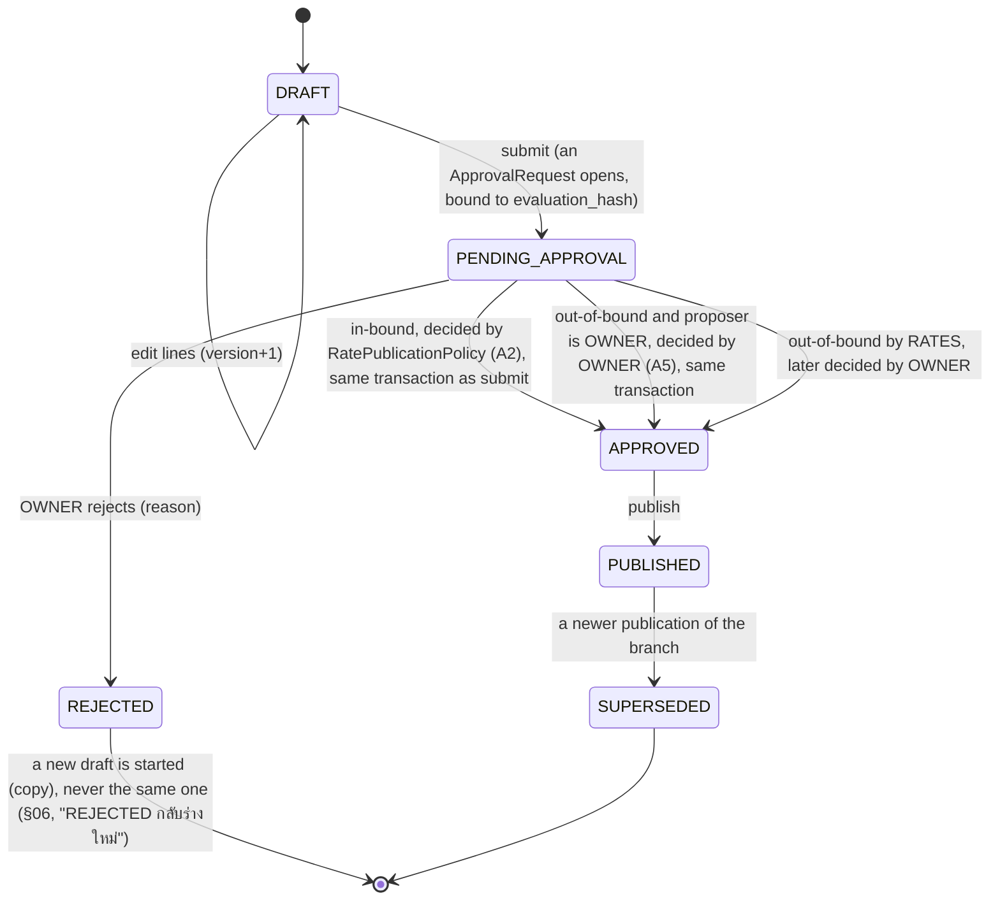
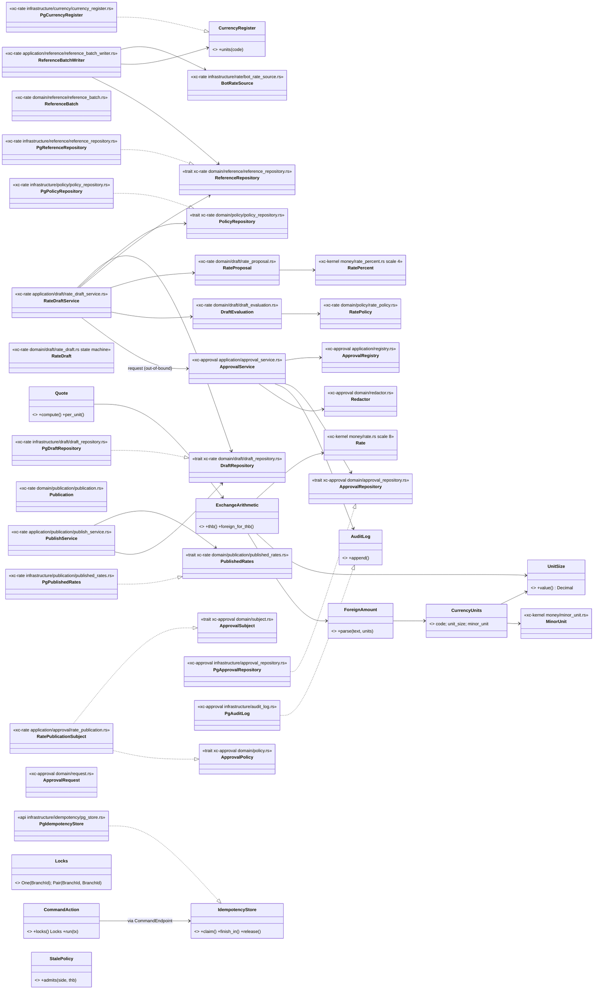
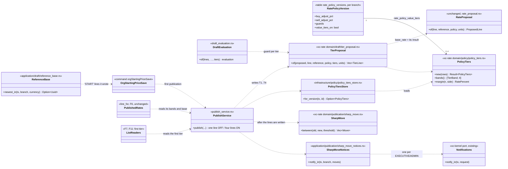

# Blueprint rates: units, the rate engine, and approvals (#547, #548, #549)

One design for three tickets. The lane controller ordered them in one file on 2026-10-09, because every other Blueprint
area waits on them:

| Ticket | Asks for | Here |
|---|---|---|
| #547 | rates per `unit_size` at scale 8; foreign amounts by minor unit | §3 |
| #548 | reference batches, % policy, AUTO/MANUAL per side, draft → approve → publish, immutable publications | §4 |
| #549 | one approval request/decision core for every type, plus a redacted audit trail | §5 |

- Source: the owner's Blueprint, `docs/blueprint/XC-Desk-Blueprint-Data-Model-v2.html` (#565). "§N" below means the
  Blueprint's own section.
- Gap list: `docs/design/xc-desk-blueprint-v2-mapping.md` (PR 527, rows K2–K4).
- v3 is measured at `origin/main` `3690ed5`.
- Brokers, referrals and commission are not here; they belong to Broker-Platform.

---

## 0. The owner's answers (2026-10-09, in session claude/e5ab6c)

| # | Question | Answer, verbatim | What it fixes |
|---|---|---|---|
| A1 | Which currencies are priced per `unit_size` ≠ 1 | *"ให้ อ่าน ใน พิมพ์ เขียน ว่า เค้าเอาแบบไหน"* (read the Blueprint for what it takes) | Read below the table |
| A2 | Who approves a rate publication | "In-bound: RATES; out-of-bound: OWNER" | §4.6 |
| A3 | Guards and the stale limit | "OWNER enters them in the policy screen" | §4.3: guards and stale age are data in `RatePolicyVersion`, set by OWNER; none are written in code |
| A4 | Denomination pricing | "Start with group ALL only" | §3.4 |
| A5 | OWNER drafts an out-of-bound set | "OWNER publishes directly; the audit records it" | §5.4 |
| A6 | Which BoT column is the buy base | "Buy = buying transfer" | §4.2: the sell base is BoT `selling` |
| A7 | What §05's *"จำกัด"* (limit) quotes on a stale rate means | "Cap the amount per transaction" | §4.3 `on_stale = LIMIT` with `stale_limit_thb`, an amount OWNER enters |

**A1 read from the Blueprint:**
- §03 P01 shows `USD • 1 USD`, `EUR • 1 EUR`, `JPY • 100 JPY`.
- §17 says *"model.js เก็บ JPY/KRW rate ต่อ 1 แต่ unit เป็น 100/1000 … JPY sell .235 ต่อ 1 → 23.5 ต่อ 100"*.
- §05 says *"100 JPY ไม่เท่ากับ 1 JPY"*.

So `unit_size` is **JPY 100, KRW 1000, and every other currency 1**. The Blueprint names no other currency.

Still open with the owner (§10): the BoT API's usage rights and its read schedule. Today's on-demand read stays meanwhile.

---

## 1. v3 today (measured)

- **Rate shape.** Every rate is THB per **1** unit, at scale 4:
  - `numeric(14,4)` on `rates.buy/sell/partner_cost` (`api/migrations/20261007100000_branches_rates.sql:22-25`);
  - `transactions.rate/reference_rate` (`20261007190000_transactions.sql:17-18`);
  - `kiosk_requests.rate` (`20261007170000_kiosk.sql:13`);
  - `bookings.rate` (`20261008130000_bookings.sql:24`).
- **`Rate` type.** `api/crates/xc-kernel/src/money/rate.rs` parses to scale 4 (`:17`) and always prints 4 places (`:28-33`).
- **No unit anywhere** in schema or domain. Only the BoT adapter knows JPY is quoted per 100, and it divides by 100 on
  read (`api/crates/xc-rate/src/infrastructure/rate/bot_rate_source.rs:215-220`). `currencies`
  (`branches_rates.sql:11-16`) has no `unit_size` and no `minor_unit`.
- **Arithmetic.** `Quote::compute` (`api/crates/xc-kernel/src/money/quote.rs:30-64`) is `principal = amount × rate`,
  rounded half away from zero to 2 places.
- **Code that assumes scale 4:**
  - the kiosk's reverse SELL, `thb_minor × 10_000 / rate.mantissa()`
    (`api/crates/xc-kiosk/src/domain/kiosk/entities/kiosk_machine.rs:55-57`);
  - `format_decimal_4` (`views/admin_rates.rs:25`, `views/admin_rate_history.rs:25`, `views/rates_reference.rs:25`);
  - `{:.5}` (`views/kiosk_currencies.rs:174`);
  - idempotency digests over the rate text (`api/src/application/workflows/save_transaction.rs:83`,
    `api/crates/xc-exchange/src/domain/booking/commands/create_booking.rs:39`).
- **Saving is direct.** OWNER or RATES saves one currency at a time and it is live at once:
  `RateService::save_rate` (`api/crates/xc-rate/src/application/rate/service.rs:126-292`) runs an optimistic
  `previousUpdated` check and appends to `rates`; the newest row per (branch, code) is current. Three callers:
  - `adminSaveRate` (`api/src/application/compat/rpc.rs:270-276`);
  - the kiosk `configure` action (`xc-kiosk/src/application/kiosk/currencies.rs:33-63` →
    `api/src/infrastructure/kiosk/kiosk_ports.rs:287-324`);
  - the web, at `web/src/screens/admin/rates/Rates.tsx:158` and `web/src/screens/kiosk-currencies/kiosk-api.ts:14-19`.
- **Readers of the current rate:**
  - `RateService::current` (`service.rs:62-116`) and `rate_in` (`:294-300`);
  - the kiosk's `SELECT DISTINCT ON (code) … FROM rates` (`kiosk_ports.rs:198-199`, `:255-256`);
  - the desk save's LIVE rate check, which compares the client's rate to `rate_in` and refuses `RATE_MISMATCH`
    (`save_transaction.rs:316-329`);
  - bookings, through `counter_rate_in` (`api/src/infrastructure/bookings/booking_ports.rs:100-125`);
  - `adminSnapshot` (`api/src/application/compat/snapshot.rs:95-118`, `:146-155`).
- **No approval or audit core.**
  - Approvals: the only one is custody's `custody_requests` + `custody_signatures` (`20261007140000_custody.sql:22-43`).
  - Audit: `ops_events` (`:69-80`), `device_events` (`20261007180000_devices.sql:16-27`), `branch_setting_history`
    (`20261008100000_branch_settings.sql`) and `employee_audit`. Each is its own shape.
- **Roles.**
  - `adminSaveRate`: OWNER on Rpc (`api/crates/xc-auth/src/domain/policy/entities/policy.rs:69`), RATES only among staff
    (`:82`, `:115`).
  - Kiosk `manage`/`configure`: OWNER or RATES (`:283-290`).
  - `/api/reference-rates`: OWNER only (`:215-223`).

---

## 2. Decisions

- **D-1. A rate is a `Rate` at scale 8, per the currency's `unit_size`** (§05, §07, K2, K3).
  - `unit_size` belongs to the **currency**, not to a rate row: `currencies.unit_size`, seeded per A1.
  - Every published line copies it (`published_rate_lines.unit_size`), so a line stays right if the register ever changes.
  - The single function that turns a rate into baht is `ExchangeArithmetic` (§3.2). Nothing else divides by
    `unit_size`, so it is never divided twice (§17).
- **D-2. Foreign amounts follow the currency's minor unit** (§05). `currencies.minor_unit` comes from ISO 4217: JPY 0,
  KRW 0, USD 2, and so on. An amount with more places than its currency allows is refused (`TooManyDecimals`), never
  rounded.
  - **Storage: new columns are `numeric(20,4)`; old columns are not widened here** (corrected for #595, measured).
    - Every **new** column that holds a foreign quantity is `numeric(20,4)` from the start: §07
      `QuoteLine.quantity DECIMAL(20,4)`, `Denomination.face_value DECIMAL(20,4)`, #551's `quote_lines` and
      `transaction_lines`, and #582's cash tables. That holds the 3-place minor units of the seeded BHD, IQD, JOD, KWD,
      LYD, OMR and TND (`20261007100000_branches_rates.sql:62,105,109,116,124,145,174`).
    - The **old** columns stay `numeric(20,2)`: `transactions.amount`, `kiosk_requests.foreign_amount/input_amount`,
      `bookings.amount`, `shift_balances.*` and `stock_movements.amount`. Their readers decode them at 2 places, so
      widening them in migration 1 broke every shift open (`undecodable shift_balances.opening: 100000.0000`, the
      workspace run against RU-1's implementation, #595). Each old column is retired with its reader, never widened in
      place:
      - `transactions.amount` → #551's `transaction_lines.quantity` (its cleanup drops the wide column);
      - `kiosk_requests` amounts → #551 TX-7 (the kiosk quotes through `QuoteService`);
      - `bookings.amount` → #555's booking design;
      - `shift_balances`, `stock_movements` → #553's ledger.
    - **Until then**, the old write paths parse amounts at 2 places (`TransactionForm`, the kiosk, bookings), so a
      3-place amount is refused there, never rounded into a 2-place column.
  - **In the domain**, `ForeignAmount` (`xc-kernel/src/money/foreign_amount.rs`) is its own scale-4 decimal. It is not
    `Money`, which is fixed at scale 2 (`money.rs:44`, `:51`, `:69`), and it converts to `Money` only for THB.
  - **Custody's JSON amounts** are encoded as `Money` minor units (cents) today (`custody_repository.rs`
    `minor_to_json`). Moving them to the currency's minor unit belongs to the cash design (#582/#553), which owns that
    encoding; it is listed there as a dependency. Until it lands, a 3-place currency can be exchanged and held in the
    till, but not counted through custody.
- **D-3. Publications replace `rates`** (§05, §07; K4). The current rate of a branch is the line of its
  `current_publication_id` (`branches.current_publication_id`). A publication is immutable, and moving the pointer is
  the only way a rate changes.
  - `rates`, `RateService::save_rate`, `adminSaveRate` and kiosk `configure`'s save are retired (§9 step 7).
  - The history screen (A03) reads publications, not `rates`.
- **D-4. One approval core, one policy per subject type** (#549, ♻️ rule).
  - `xc-approval` holds the request, decision and audit tables and the state rules.
  - Each subject type (rate publication now; reversal, campaign and cash variance later) implements `ApprovalSubject`
    in its own crate.
  - No type writes its own approval table.
- **D-5. Every submit opens an approval request, and the policy decides who closes it** (§06, §07; A2, A5).
  - In-bound: the policy closes it at submit.
  - Out-of-bound by OWNER: OWNER closes it at submit.
  - Out-of-bound by RATES: it waits for OWNER.

  The draft's guard evaluation decides which case applies. It is stored with its hash and the policy version, so the
  decision can be checked later.
- **D-6. Guards and stale age are data** (A3). OWNER enters them in a `RatePolicyVersion`, and each policy version is
  immutable. No number is fixed in code. A draft built under no policy has no AUTO side and is all MANUAL, so every
  line counts as out-of-bound (§4.5).
- **D-7. Writes go through a v3 command seam.** v3 has views (`/api/v3/views/*`) and compute actions
  (`/api/v3/compute/*`, `api/src/presentation/http/v3/action.rs:19`), but no write seam. The web client already
  posts to `/api/v3/{area}/{action}` (`web/src/shared/api/client.ts:136`).
  - `CommandAction` (§6) is the write sibling of `ComputeAction`: same policy gate, plus a required
    `Idempotency-Key` (§09).
  - The rate engine is its first user. Other areas reuse it; they do not copy it.

---

## 3. Units (#547)

### 3.1 The register

| Column | Type | Rule |
|---|---|---|
| `currencies.unit_size` | `numeric(20,4) NOT NULL DEFAULT 1` | `CHECK (unit_size > 0)`, the same type as the Blueprint's `unit_size DECIMAL` (§07). Seeded JPY 100, KRW 1000, all others 1 (A1). The selling unit each new published line copies |
| `currencies.minor_unit` | `smallint NOT NULL DEFAULT 2` | `CHECK (minor_unit BETWEEN 0 AND 3)`. Seeded from ISO 4217 for the 153 seeded codes. THB is 2 |

`UnitSize` (`api/crates/xc-kernel/src/money/unit_size.rs`) wraps a positive `Decimal` at scale 4, the same type as
every `unit_size` column (`numeric(20,4)`, Blueprint `DECIMAL`). No integer `unit_size` exists anywhere.

`CurrencyUnits` (`api/crates/xc-kernel/src/money/currency_units.rs`) is the domain view of one row:
`{ code, unit_size: UnitSize, minor_unit: MinorUnit }`. Every reader gets it from the port `CurrencyRegister`
(`api/crates/xc-rate/src/domain/currency/currency_register.rs`), implemented by `PgCurrencyRegister`
(`api/crates/xc-rate/src/infrastructure/currency/currency_register.rs`).

### 3.2 The one arithmetic

`api/crates/xc-kernel/src/money/exchange_arithmetic.rs`, **[required]** signatures:

```rust
pub struct ExchangeArithmetic;
impl ExchangeArithmetic {
    /// THB for `amount` foreign at `rate` per `unit_size`: amount × rate ÷ unit_size,
    /// rounded HALF_UP (away from zero) to 2 places once, at the end (§05).
    pub fn thb(amount: ForeignAmount, rate: Rate, unit: UnitSize) -> Money;
    /// The most foreign `thb` buys at `rate`: thb × unit_size ÷ rate, truncated
    /// to the currency's minor unit (the kiosk's SELL by baht).
    pub fn foreign_for_thb(thb: Money, rate: Rate, units: &CurrencyUnits) -> ForeignAmount;
}
```

- `ForeignAmount` (`api/crates/xc-kernel/src/money/foreign_amount.rs`) is `Money` plus its currency's `MinorUnit`.
  `ForeignAmount::parse(text, &CurrencyUnits)` refuses more places than `minor_unit` allows.
- `Quote::compute` (`quote.rs:30`) gains a sibling, `Quote::per_unit(side, amount: ForeignAmount, rate, unit: UnitSize,
  fee)`, whose principal is `ExchangeArithmetic::thb`. The old `compute` stays until every caller has moved (§9 step 7),
  so that callers can switch in parallel tickets without sharing a file. PR 536's `exchange_figures(side, amount, rate,
  unit_size, fee)` (`xc-exchange/.../figures.rs`, DK-B #538) calls `Quote::per_unit`.

**Callers that change.** Each switches in the ticket that owns its file (§9):

| Caller | Today | Becomes |
|---|---|---|
| desk save principal, `xc-exchange/.../transaction_form.rs:148-161` | `Quote::compute` | via `exchange_figures` → `Quote::per_unit` (DK-B #538 owns the file) |
| kiosk BUY, `kiosk_machine.rs:48-52` | `Quote(amount×rate)` | `ExchangeArithmetic::thb` |
| kiosk SELL by baht, `kiosk_machine.rs:55-67` | `×10_000 / mantissa`, then `foreign × rate` | `foreign_for_thb`, then `thb` |
| bookings, `admin_bookings.rs:280-282`, `booking_machine.rs` | `amount × rate` | `thb` |
| transaction row principal/reference value, `api/src/presentation/dto/v3/transaction_row.rs:164-196` | `amount × rate` | `thb` with the row's stored `unit_size` |
| admin cash reference spread, `api/src/presentation/http/v3/views/admin_cash.rs:28-47` | `amount × rate` | `thb` |
| admin reports, `views/admin_reports.rs:282-293` | `amount × rate` | `thb` |
| shift valuation, `v3/actions/shift_valuation.rs:141-150` | client rate per 1 | rate per `unit_size` from the publication (#509 owner) |
| devices COUNT_CONFIRMED, `api/src/infrastructure/devices/device_service.rs:734` | `amount × rate` | `thb` |
| customer page, `api/src/presentation/pages.rs:351-360` | `amount × rate` | `thb` |

Stored rows keep what was true when they were written. `transactions`, `kiosk_requests` and `bookings` each gain a
`unit_size` column (§8). A rate is never read without the unit it was stored with.

### 3.3 Precision and display

- **Scale.** `Rate::parse` accepts up to 8 places and stores scale 8 (`numeric(20,8)`). `RatePercent`
  (`api/crates/xc-kernel/src/money/rate_percent.rs`) is a signed decimal at scale 4 (`numeric(9,4)`).
- **`Rate`'s text.** `Rate::value()` and `Display` give **at least 4 and at most 8 places**: `"32.1000"`,
  `"0.02152"`, `"23.50000000"` → `"23.5000"`. A rate with 4 places or fewer prints exactly as today, so v2's
  strings, the save digest (`save_transaction.rs:83`) and the provided `rate_value_test.rs` stay as they are.
- **On the wire.** A rate in a published-rates view is the 8-place string the database holds, e.g. `"23.50000000"`.
  - Desk (PR 536 D-12) and staff (PR 532 S10) treat it as opaque, and must.
  - One web formatter, `formatRate(text)` (`web/src/shared/ui/rate.ts`), shows at least 2 and at most 8 places with
    trailing zeros trimmed, followed by `/ <unit_size> <code>` when `unit_size > 1`. No screen formats a rate itself.
- **Rounding.** THB is rounded HALF_UP to 2 places once, at the final amount (§05). A rate computed by AUTO is rounded
  HALF_UP to 8 places (§4.4).

### 3.4 Denominations (A4)

`denominations(id, currency_code, face_value numeric(20,4), group_code text)`, seeded with one `ALL` group per
currency and no face values. `published_rate_lines.denomination_group` is `'ALL'` for every line now. Pricing by
group needs no schema change later, only lines with other groups.

---

## 4. The rate engine (#548)

### 4.1 Tables (Blueprint §07, names kept)

```
rate_reference_batches(id uuid PK, provider text, source_date date, fetched_at timestamptz,
                       raw_checksum text, status text CHECK (status IN ('COMPLETE','PARTIAL')),
                       UNIQUE (provider, source_date, raw_checksum))
rate_reference_lines(id uuid PK, batch_id FK, currency_code FK, reference_type text,
                     unit_size numeric(20,4),         -- the SOURCE unit, as the provider quotes it
                     buy numeric(20,8) NULL, sell numeric(20,8) NULL,
                     raw jsonb,                        -- the provider's row as received
                     UNIQUE (batch_id, currency_code, reference_type))   -- never rewritten
rate_policy_versions(id uuid PK, branch_id FK, version integer, buy_adjust_pct numeric(9,4),
                     sell_adjust_pct numeric(9,4), guards jsonb,          -- min/max guards
                     max_reference_age_hours integer NULL, on_stale text NULL,  -- stale policy (A3, A7)
                     stale_limit_thb numeric(20,2) NULL,
                     valid_from timestamptz, valid_to timestamptz NULL,
                     approved_by text, reason text, source_version integer NULL,
                     UNIQUE (branch_id, version))      -- immutable once approved (inserted)
rate_drafts(id uuid PK, branch_id FK,
            status text CHECK (status IN ('DRAFT','PENDING_APPROVAL','APPROVED','REJECTED','PUBLISHED')),
            base_publication_version integer NULL,
            created_by text, created_at, updated_at, version integer,          -- optimistic
            evaluation jsonb NULL, evaluation_hash text NULL)
rate_draft_lines(id uuid PK, draft_id FK, branch_id FK, currency_code FK, denomination_group text DEFAULT 'ALL',
                 reference_line_id FK NULL, policy_version_id FK NULL,
                 buy_mode text CHECK (IN ('AUTO','MANUAL')), sell_mode text CHECK (IN ('AUTO','MANUAL')),
                 manual_buy numeric(20,8) NULL, manual_sell numeric(20,8) NULL, reason text NULL,
                 UNIQUE (draft_id, currency_code, denomination_group),
                 CHECK ((buy_mode = 'MANUAL') = (manual_buy IS NOT NULL)),
                 CHECK ((sell_mode = 'MANUAL') = (manual_sell IS NOT NULL)),
                 CHECK ((buy_mode = 'AUTO' AND sell_mode = 'AUTO') OR reason <> ''))
rate_publications(id uuid PK, branch_id FK, version integer, published_at timestamptz,
                  approved_request_id FK approval_requests(id) NOT NULL,
                  draft_id FK UNIQUE, published_by text,
                  UNIQUE (branch_id, version))
published_rate_lines(id uuid PK, publication_id FK, currency_code FK, denomination_group text,
                     unit_size numeric(20,4), buy_rate numeric(20,8) NULL, sell_rate numeric(20,8) NULL,
                     source_snapshot jsonb,           -- reference line + source_date/fetched_at, policy %, mode, reason
                     UNIQUE (publication_id, currency_code, denomination_group),
                     CHECK (buy_rate IS NULL OR sell_rate IS NULL OR buy_rate <= sell_rate))
branches.current_publication_id uuid NULL FK rate_publications(id)
```

- **Names.** Every entity and field the Blueprint names (§07: `RateReferenceBatch/Line`, `RatePolicyVersion`,
  `RateDraftLine`, `RatePublication/PublishedRateLine`, `branch.current_publication_id`) keeps its Blueprint name.
  `rate_drafts` is the header that `RateDraftLine`'s "unique draft + currency + group" implies, and it carries the §06
  state.
- **Immutability.** A publication and its lines are never updated or deleted. Reference lines are never rewritten
  (§07, *"ข้อมูลดิบไม่แก้ทับ"*).
- **Unavailable.** A side with `NULL` is unavailable: no quote is made on it (§05, *"หากไม่มีข้อมูลฝั่งที่ต้องใช้ ให้
  unavailable ห้ามเดา"*).
- **Reasons.** A MANUAL side must carry a reason (§06, *"MANUAL ทุกการเปลี่ยนมีเหตุผล"*), as the last CHECK enforces.
- **Partner cost.** v2's `rates.partner_name` / `partner_cost` is informational (the "partner cost" column beside the
  BoT reference). It changes no price and no approval. It uses only Blueprint entities, no new column:
  - **A partner's quote is reference data.** It is a `RateReferenceBatch` with `provider = <partner name>`, plus one
    `RateReferenceLine` per currency with `reference_type = 'PARTNER'`, the partner's `unit_size`, and `buy` / `sell`
    as the partner quoted them (NULL for a side it did not quote). It has a `source_date` and `fetched_at` like any
    batch, and is never rewritten.
  - **It is never an AUTO base.** The AUTO reference of a draft line is the newest line with `reference_type = 'BOT'`
    for its currency (§4.2, A6). A `'PARTNER'` line is never picked for it.
  - **At publish** `source_snapshot.partner` is copied from the newest `'PARTNER'` line for that currency (by the
    batch's `fetched_at`): `{"provider", "reference_line_id", "unit_size", "buy", "sell", "source_date", "fetched_at"}`.
    It is `null` when no partner line exists.
  - **Until RE-7**, RE-1's publish reads partner from the newest `rates` row of the branch and currency
    (`publish_service.rs`, the `SELECT partner_name, partner_cost FROM rates` query). RE-7 moves that read to the
    `'PARTNER'` reference lines in the same PR that drops `rates`, so the drop and its last reader move together.
    RE-7 also adds `reference_type = 'BOT'` to the draft service's AUTO reference lookup, which today takes the newest
    line of any type (`rate_draft_service.rs`, the two `SELECT l.id FROM rate_reference_lines` queries).
  - **Migration 4's backfill does not carry it.** Publication 1 is built from test data only: v2's data is test data
    and v3 starts from an empty database (owner, 2026-10-06). No partner value worth keeping is lost.
  - **Who enters a partner quote** (an admin page or a provider adapter) is a page-only follow-up after RE-7. Until
    then no `'PARTNER'` line exists, and `source_snapshot.partner` is `null`.

### 4.2 References (§05)

- **Raw, as received.** `BotRateSource` (`bot_rate_source.rs`) stops dividing by its unit.
  `ReferenceBatchWriter` (`api/crates/xc-rate/src/application/reference/reference_batch_writer.rs`) stores each
  provider row **in the provider's own unit**: BoT JPY is `unit_size 100` with BoT's value unchanged. It also keeps
  `source_date`, `fetched_at` and `raw` (§05: *"source, effective_date, fetched_at, source unit"*).
- **Normalising.** Conversion to the currency's selling unit happens only where it is used, in `RateProposal` (§4.4).
  It is done there once: `base = ref_value × currency.unit_size ÷ ref.unit_size`.
- **Which BoT columns (A6).** `buy` = BoT **buying transfer**, `sell` = BoT **selling**, and `reference_type = 'BOT'`.
  Buying sight stays in `raw`.
- **Missing data.** BoT covers 6 currencies (`bot_rate_source.rs:19`). Every other currency has no reference line, so
  its AUTO side is unavailable and only MANUAL can price it. A batch missing any of the 6 is `PARTIAL`; the missing
  lines are absent, never guessed.
- **When it is read.** On demand, when a draft asks for one, as today. The schedule waits on the owner (§10, O-1:
  Blueprint §05 *"ความถี่ดึงข้อมูลและ cutoff ต้องตรวจแหล่ง ธปท. ก่อน build adapter"*). 
- **Repeat fetches.** A fetch whose rows give the checksum of an existing batch from the same provider writes nothing
  and returns that batch's id. `UNIQUE (provider, source_date, raw_checksum)` allows only one batch per content, and
  BoT's rows carry their own date, so a new business day is a new checksum.
  - **Known limit:** if a provider's rows went A → B → A within one source date, the third fetch returns A's id, and
    B stays the newest batch by `fetched_at` until the next day's batch. BoT publishes once per business day, so
    this is not expected. If it ever matters, it needs a schema change, not a code one.
- **Where the source comes from.** `rateReferenceFetch` takes the `RateSource` from `AppState::rate_source`
  (`BotRateSource::bot()` unless a test or deployment injects another, as `with_database_probe` does). A command's
  `run` gets no `HttpRequest`, so the request-time `web::Data<Arc<dyn RateSource>>` that `kiosk.rs`, `rpc.rs` and
  `reference_rates.rs` read cannot reach it. Moving those three onto `AppState::rate_source`, so that one seam
  remains, is a follow-up.

### 4.3 Policy (§05, §07; A3)

- **A version.** `RatePolicyVersion` holds:
  - `buy_adjust_pct` and `sell_adjust_pct`, signed, scale 4;
  - `guards`, the min/max guards per currency and side: the allowed range of the final rate's distance from its
    reference, in %, e.g. `{ "USD": { "buy": {"min_pct": "-2.0000", "max_pct": "0.5000"}, "sell": {...} } }`;
  - `max_reference_age_hours` and `on_stale`, the stale policy (§05, *"หาก stale ให้ใช้ policy จำกัด/หยุด quote"*).
    `on_stale` is one of:
    - `STOP`: a quote on a stale line is refused `rateUnavailable`;
    - `LIMIT` (A7): a quote on a stale line is allowed only when its THB amount ≤ `stale_limit_thb`, and above that it
      is refused `rateUnavailable`;
    - `NULL`: quotes go on, and every screen shows the stale badge;
  - `valid_from` / `valid_to`, `approved_by`, `reason` and `source_version`.
- **Approval.** OWNER enters a version (A3), and entering it is OWNER's approval (`approved_by` = OWNER). That is
  Blueprint §02, EXECUTIVE approving the rate frame. A version is immutable once inserted. A change is a new version.
- **The values.** None are fixed by this design (A3).
- **The type.** `RatePolicy` (`api/crates/xc-rate/src/domain/policy/rate_policy.rs`) parses `guards`. A currency with
  no guard entry is out-of-bound on any side that changes.

### 4.4 Draft lines → proposed rates (§05)

`RateProposal::of(line, reference_line?, policy?, units) -> ProposedLine`
(`api/crates/xc-rate/src/domain/draft/rate_proposal.rs`) is pure, and works per side:

| Mode | Proposed rate (scale 8) |
|---|---|
| AUTO | `base × (1 + adjust_pct ÷ 100)`, with `base` normalised as in §4.2. **Unavailable** when the reference side is missing |
| MANUAL | the side's `manual_*` value (> 0, ≤ 8 places), with its reason |

- **Rounding.** The Blueprint fixes the scale (8) and only one rounding mode, HALF_UP for the final THB. The proposed
  rate is rounded to scale 8 with that same HALF_UP. Proposal and quote then share one mode, and the design invents no
  second one.
- **Checks after rounding** (§05 validation):
  - every rate > 0;
  - `buy ≤ sell` → otherwise `validationFailed` with today's sentence (`xc-rate/src/domain/validation.rs:8-19`);
  - the AUTO reference must be complete for its side.
- **Global adjust.** It changes the draft's percent only. MANUAL sides keep their values (§05, *"ปุ่มปรับรวมข้ามฝั่ง
  MANUAL"*).
- **Back to AUTO.** It needs the preview (§05, *"กลับ AUTO ต้องยืนยันพร้อม preview"*): the command carries the AUTO
  value the client was shown, and a mismatch is refused `staleVersion`.

### 4.5 Evaluation: in-bound or out-of-bound (§05, §02)

`DraftEvaluation::of(lines, proposals, references, policy) -> Evaluation`
(`api/crates/xc-rate/src/domain/draft/draft_evaluation.rs`). A side is **out-of-bound** when any of these holds:

- it changes and its currency has no guard;
- its proposed rate's distance from its reference lies outside the guard's `[min_pct, max_pct]`;
- it is MANUAL with no reference to measure it against.

A MANUAL side **with** a reference is measured like an AUTO side. The Blueprint's out-of-bound rule (§05,
*"out-of-bound → approval"*) is about the rate, not the mode, so this design adds no rule about modes.

The evaluation is stored on the draft at submit as `evaluation` + `evaluation_hash`. The hash is sha256 of the
canonical JSON of the lines, the proposals, the policy version id and the reference line ids. The approval binds to
it (§06, *"อนุมัติผูก version/hash"*).

### 4.6 States and who moves them (§06; A2, A5)

The states are exactly the Blueprint's: `DRAFT → PENDING_APPROVAL → APPROVED → PUBLISHED → SUPERSEDED`, and
`REJECTED`. **Every** submit opens an `ApprovalRequest` (§5), so every publication carries `approved_request_id`
(§07). What differs by case is only **who decides**, per the owner's answers:



- **Who submits.** OWNER and RATES (Blueprint RATE_MANAGER: *"ร่างเรท ปรับ % เสนอเผยแพร่"*).
- **In-bound** (A2). The decision is written by the policy itself: `approver_id = "policy:<policy_version_id>"`,
  reason `in_bound`. No person approves it, and the audit says so.
- **Out-of-bound by RATES.** It stays `PENDING_APPROVAL` until OWNER decides. The proposer may never decide it (§5.4).
- **Out-of-bound by OWNER** (A5). OWNER's decision is written at submit, reason `proposer_is_owner`.
- **Edits.** An edit after submit is refused `staleVersion`. A change needs a new draft and a new request (§06,
  *"แก้แล้วต้องขอใหม่"*).
- **Publish** (§05, §09) carries `expected_version`, the branch's current publication version. In **one** DB
  transaction it:
  - checks the request is APPROVED and `evaluation_hash` is unchanged, else `approvalRequired`;
  - inserts the publication and all its lines;
  - moves `branches.current_publication_id`;
  - (the previous publication becomes SUPERSEDED by that move; see below);
  - bumps the branch version.

  A different current version means `staleVersion` and nothing is written. All lines publish or none do.

- **SUPERSEDED is derived, not stored.** A publication is immutable (§05), so it has no status column to update. Its
  state is read from the pointer: the publication `branches.current_publication_id` points at is `PUBLISHED`; every
  older version of the branch is `SUPERSEDED`. `Publication::state(current_version)`
  (`xc-rate/src/domain/publication/publication.rs`) answers it, and the views show it. A draft's own status stays
  `PUBLISHED`; its effective state is its publication's.

### 4.7 Routes (Blueprint §10 paths kept)

Writes go through the command seam (§6), which serves the route each command declares. Each needs
`Idempotency-Key`.

| Route | Kind | Who | Answers |
|---|---|---|---|
| `POST /api/rate-drafts/:id/simulate` (§10) | command with no write (V0-D compute semantics) | OWNER, RATES | the diff of AUTO/MANUAL, guard violations, no mutation |
| `POST /api/rate-drafts/:id/submit` (§10) | command | OWNER, RATES | the request and the resulting state |
| `POST /api/rate-drafts/:id/publish` (§10) | command | OWNER, RATES | the new `PublicationRef`; checks the approval hash and `expected_version` |
| `POST /api/rate-drafts` and `PUT /api/rate-drafts/:id` | command | OWNER, RATES | create and edit (`expected_version`); not in §10 but needed to have a draft |
| `POST /api/approvals/:id/decide` | command, generic (§5) | per the subject's policy | APPROVED or REJECTED with a reason (A06) |
| `POST /api/rate-policies` | command | OWNER | a new policy version |
| `POST /api/rate-references/fetch` | command | OWNER, RATES | a batch id, new or the unchanged one |
| `GET /api/v3/views/published_rates` | view, inherits `(Rpc, "adminSnapshot")` | as today's readers | `{ publication: {id, version, published_at}, source_date, stale, lines: [{currency, group, unit_size, buy_rate, sell_rate, line_id}] }`, with no reference cost or PII (the §10 public shape) |
| `GET /api/v3/views/staff_published_rates` | view, inherits `(StaffRpc, "adminSnapshot")` | staff | the same DTO. Two paths, two views (`xchange-v3-web.md` §4.4) |
| `GET /api/v3/views/rate_drafts`, `rate_draft` | views | OWNER, RATES | drafts, lines, proposals, evaluation |
| `GET /api/v3/views/rate_publications` | paged view (A03) | OWNER, RATES | versions, who, when, before/after per line |
| `GET /api/v3/views/rate_policy` | view | OWNER, RATES | the current policy version |
| `GET /api/v3/views/approval_requests` | paged view (A06), filters `status`, `type` | OWNER | requests with proposer, values before and after, reason |

- **The public display.** `GET /api/public/orgs/:org/branches/:code/rates` (§10, P01; the org code is in the path because branch codes are unique only per organisation, #995) reads the same `PublishedRates` port with
  the same shape. Its route belongs to the storefront design.
- **Error codes.** They are §10's, written in v3's camelCase:
  - `validationFailed`
  - `outOfScope`
  - `staleVersion`
  - `rateUnavailable`
  - `approvalRequired`
  - `idempotencyConflict`

### 4.8 How the kiosk, the desk, the staff app and bookings read the rate

All of them read through one port, `PublishedRates` (`api/crates/xc-rate/src/domain/publication/published_rates.rs`),
implemented by `PgPublishedRates` (`api/crates/xc-rate/src/infrastructure/publication/published_rates.rs`):

```rust
// Ports return BoxFuture, as the repo's ports do (`xc-rate/src/domain/rate/entities/rate_source.rs:14-16`), so they
// are usable as `Arc<dyn …>`; the repo has no `async_trait`.
// "In the caller's transaction" = the `sqlx::Transaction<'_, Postgres>` that `BranchTx::run` hands its closure
// (`xc-kernel/src/branch_tx.rs:55-62`), as `xc-shift/src/domain/custody/repositories/custody_repository.rs:15-36` does.
// A port never takes `BranchTx` itself: `BranchTx` opens a transaction of its own.
pub trait PublishedRates: Send + Sync {
    /// The branch's current publication and its lines; None before the first publication.
    fn current<'a>(&'a self, branch: &'a BranchId) -> BoxFuture<'a, AppResult<Option<Publication>>>;
    /// One line of the current publication for a side, in the caller's transaction.
    fn line_in<'a>(&'a self, tx: &'a mut Transaction<'_, Postgres>, branch: &'a BranchId, code: CurrencyCode, side: Side)
        -> BoxFuture<'a, AppResult<Option<PublishedSide>>>;
}
pub struct PublicationRef { pub id: PublicationId, pub version: i32 }
pub struct PublishedSide { pub line_id: PublishedRateLineId, pub rate: Rate, pub unit_size: UnitSize,
                           pub publication: PublicationRef }
```

| Reader | Reads | Stores on its own row | Its guard |
|---|---|---|---|
| kiosk quote (`kiosk_machine.rs`, via `kiosk_ports.rs`) | `line_in` for the side | `kiosk_requests.published_rate_line_id`, `rate`, `unit_size` | confirm refuses when the current line id ≠ the quoted line id (today: rate text, `kiosk_machine.rs:149-151`) |
| desk save LIVE check (`save_transaction.rs:316-329`) | `line_in` | `transactions.published_rate_line_id`, `rate`, `unit_size` | `RATE_MISMATCH` when the client's line id or rate differs from the current line |
| desk screen (PR 536 DK-A) | `published_rates` / `staff_published_rates` | — | the opaque string and `PublicationRef` |
| staff RATES card (PR 532 S-8) | `staff_published_rates` | — | read only; `rateUpdated` becomes `PublicationRef.version`, still opaque |
| bookings (`booking_ports.rs:100-125`) | `line_in` | `bookings.published_rate_line_id`, `rate`, `unit_size` | create/confirm compare line id |
| `adminSnapshot` (`snapshot.rs:95-118`) | `current` | — | v2 shape kept: `rates[]` from the lines, `updated` = `published_at` |

A quote and its stored row keep the line id and the rate snapshot. A later publication never rewrites them (§05).

**Stale at read time** (§05, §13 phase 1, *"stale แสดงชัด"*):
- `PublishedSide` carries `stale: bool` and `source_date`.
- An AUTO line is stale when `now − source_snapshot.fetched_at > max_reference_age_hours` of the policy version it was
  published under. A MANUAL line with no reference is never stale.
- Every quoting reader applies the policy the same way, through one function, `StalePolicy::admits(side, thb) ->
  Result<(), RateUnavailable>` (`api/crates/xc-rate/src/domain/policy/stale_policy.rs`). With `STOP` it refuses; with
  `LIMIT` it refuses a THB amount above `stale_limit_thb` (A7). The readers are the kiosk quote, the desk save,
  bookings, and P01's quote button.
- Every display shows the stale badge, and shows `source_date` and `published_at` separately. No display says
  "real time" (§05).

---

### 4.9 The readers after RE-4, and how RE-4 is split (lane controller's ruling, 2026-10-09)

RE-4 #601 was too big for one ticket. Its first up-front tests needed files far outside its scope, and turned 66
existing tests red. It is split into five tickets. **RE-4a** (#601, narrowed) is migration 5 alone. **RE-4b…e** each
switch one family of readers. The rules below are shared by all five, so that each ticket's tests pin the same
contract.

**Rules every reader follows**

| # | Rule | Why |
|---|---|---|
| R1 | **Storage is per unit.** A row a reader writes stores the line's `rate` (scale 8, per `unit_size`), its `unit_size` and its `published_rate_line_id`. | §4.8: a quote and its row keep the line id and the rate snapshot |
| R2 | **Every THB figure** is `ExchangeArithmetic::thb(quantity, rate, unit_size)`, HALF_UP once (§3.2). No reader divides or multiplies a rate by hand. | one arithmetic (§3.2) |
| R3 | **The v2-compat wire stays per 1.** These surfaces keep v2's shape, and with it v2's per-1 rate: `adminSnapshot.rates[]` and `.transactions[]` (`rate` and `referenceRate`), `adminDeskConfig`, the kiosk JSON `rate`, the v2 booking JSON, and the desk receipt's "Booked Rate". That rate is `rate ÷ unit_size`, exact, normalised, through **one** function, `CompatRate::per_one(rate, unit_size) -> Result<Decimal, _>` (`api/crates/xc-kernel/src/money/compat_rate.rs`, created by RE-4b). A `unit_size` that is not a power of 10 is refused, so the division only moves the decimal point and never rounds. The result has at most `8 + log10(unit_size)` places, so up to **11** (KRW per 1000). **On the way in**, a per-1 rate on the v2 wire (desk save, booking create and confirm, the reference rate) takes up to 11 places, and a 12th non-zero place is `TOO_MANY_DECIMALS`; it is stored × `unit_size`. **Printed** (the receipt), it keeps v2's format of at least 4 places: JPY 0.235 prints `0.2350`. The kept v2 desk computes `amount × rate` per 1, so a per-100 JPY there would be 100× wrong. v3 views and every stored row speak per unit (R1). | the kept v2 pages until V4 (`xchange-v3-web.md` §7) |
| R4 | **One check before a write.** A reader that quoted from a line, and later writes on that quote (kiosk confirm, booking confirm), refuses when the branch's current line for that (currency, side) is not the stored line id. It answers with its existing "the rate changed" refusal, and writes nothing. The v2 desk save has no line id on the wire. It is accepted only when the client's per-1 rate equals the current line's `per_one`; otherwise `RATE_MISMATCH`. The row then stores the current line. | §4.8 guards; v2's own "rate changed" sentences kept |
| R5 | **Stale.** `StalePolicy::admits(side, thb)` uses the stale settings of the policy version **the line was published under** (`source_snapshot.policy_version_id`), the same rule as quotes (`quote-transaction.md` §4.3). It applies where a price is first taken: the kiosk quote, booking create and the LIVE desk save. A refusal is the reader's existing "no rate for this currency" answer (`RATE_MISMATCH` for the desk save). A stale line whose policy cannot be found must be an error; today's quote and booking copies admit it (fail open, #769). | §4.8 "of the policy version it was published under"; A7 |
| R6 | **Booking confirm** compares the line stored at create with the current line (R4). It never re-locks a new line silently (`booking_machine.rs:84-97` before RE-4d re-read the rate). A moved line refuses confirm, and the customer books again. **Stale is not checked at confirm**: the price was admitted at create, and only the line's identity decides. | a booking's price is the price the customer saw (§05) |
| R7 | **A vouched desk save stores the vouching line.** A save that completes a kiosk request stores **the request's** line id and rate. A save that redeems a booking stores **the booking's** line id, rate and unit. Neither is re-checked against a newer publication; the request's or the booking's own validity governs. The client's per-1 rate must still equal that line's `per_one`, otherwise `RATE_MISMATCH` and nothing is written. That comparison runs in `save_transaction.rs` before the steps' `before_in`, so it is never answered by redeem's `FORM_MISMATCH`. Redeem compares the exact per-1 `Decimal` (`RedeemBooking.rate`, up to 11 places, never rounded). | one price per customer journey |
| R8 | **`transaction_form.rs`** checks the principal limit and fees on R2's figure, not on `amount × per-1 rate`. | R2 |
| R9 | **Admin and report readers** read each row's own `unit_size` and go through R2, never the register's current `currencies.unit_size`. Rows with a NULL line id (before RE-4) show their own stored rate (§8 migration 5). A reader that needs a row (the device step reads the saved `transactions` row by document number) and finds none answers `Internal`: a missing row is an error, never a guess. The device count line's THB (`COUNT_CONFIRMED`) is the row's principal, 2 places, HALF_UP. | §8 migration 5 "Readers" |
| R10 | **`adminSnapshot`** reads `PublishedRates::current` for `rates[]` (R3): `updated` = `published_at`; `requestId` `""`; `partnerName`/`partnerCost` from `source_snapshot.partner` (else `""`/null); `botReference` `""`; `rateHistory` stays on `rates` until RE-7 drops it, then `[]`. `adminSaveRate` still writes `rates` until RE-7, but its answer (`write_answer(snapshot)`) shows the publication, so a direct save is no longer visible in it. | D-3; v2 shape kept |

**Open, for the owner (§10 O-6):** a **DEMO** save (`Mode::Demo`, "SAMPLE / DEMO — NOT A VALID RECEIPT") prices from
what the teller typed today. Does it read the publication, or keep its typed rate?
- **Recommendation: it keeps its typed rate.** It stores a NULL line id and the register's `unit_size`, and never
  reads publications, because a demo moves no stock and no money.
- RE-4c pins the LIVE path only until the owner answers.

**Who owns which file (no two RE-4 tickets reserve the same one):**

| Ticket | Readers | Files it reserves | Owns these signatures |
|---|---|---|---|
| RE-4a #601 | — | `api/migrations/20261010125000_published_rate_line_ids.sql` | the three columns |
| RE-4b | kiosk quote and confirm, the kiosk JSON | `xc-kiosk/src/domain/kiosk/entities/kiosk_machine.rs`, `…/value_objects/{counter_facts,kiosk_quote,counter_view}.rs`, `…/repositories/{kiosk_ports,kiosk_repository}.rs`, `xc-kiosk/src/infrastructure/kiosk/kiosk_repository.rs`, `xc-kiosk/src/application/kiosk/customer.rs`, `api/src/infrastructure/kiosk/kiosk_ports.rs`, `xc-kernel/src/money/compat_rate.rs` (new) | `KioskPorts`, `KioskRepository`, `CompatRate` |
| RE-4c | desk save, `transaction_form`, `adminSnapshot`/`adminDeskConfig` | `api/src/application/workflows/save_transaction.rs`, `xc-exchange/src/domain/exchange/repositories/transaction_repository.rs`, `xc-exchange/src/infrastructure/exchange/transaction_repository.rs`, `xc-exchange/src/domain/exchange/value_objects/transaction_form.rs`, `api/src/application/compat/{snapshot,v2_json}.rs` | `TransactionRepository` |
| RE-4d | bookings | `xc-exchange/src/domain/booking/entities/booking_machine.rs`, `…/repositories/{booking_ports,booking_repository}.rs`, `xc-exchange/src/infrastructure/booking/booking_repository.rs`, `api/src/infrastructure/bookings/booking_ports.rs` | `BookingPorts` (`counter_rate_in` returns the line, not `Option<Rate>`), `BookingRepository` |
| RE-4e | admin and report readers | `api/src/presentation/dto/v3/transaction_row.rs`, `api/src/presentation/http/v3/views/{admin_cash,admin_reports,admin_transactions,admin_slips,admin_overview,admin_customer_history}.rs`, `api/src/infrastructure/devices/device_service.rs`, `api/src/presentation/pages.rs` | — |

- **CompatRate.** RE-4c and RE-4d consume it. If RE-4b has not merged, each declares the same one-line stub in its own
  file, with a comment that it moves to `compat_rate.rs` (📐 fallback), and deletes the stub when it rebases.
  - **RE-4d merged first** (PR 764, `e28e941c`), so its stub stays in `xc-exchange/.../booking/entities/booking.rs`
    with a bare `Decimal` return. **RE-4c deletes it** and re-points its callers (`booking_machine.rs`,
    `dto/booking.rs`, `admin_bookings.rs`) to RE-4b's function; a refusal there is `Internal`.
- **Scopes grew while the tests were written** (2026-10-10), each recorded on its ticket:
  - RE-4b #756: `xc-kernel/src/money/mod.rs`, `dto/kiosk.rs`, `xc-kiosk/.../service.rs`.
  - RE-4c #757: `receipt.rs`, `booking_save_step.rs`, both `compat/snapshot_sources.rs` files (the row's unit),
    `redeem_booking.rs`, and in `booking_machine.rs` only the redeem comparison; plus the stub removal above.
  - RE-4d #758 (merged): the booking entity, steps and commands, `create.rs`/`change.rs`, `dto/booking.rs`,
    `http/bookings.rs`, `views/admin_bookings.rs`.
- **Merge order.** RE-4b, RE-4d and RE-4e in any order; **RE-4c last**, after all three, because their publish
  seeding lands in test files its switch would otherwise turn red, and it edits RE-4d's redeem line. RE-6 after RE-4b.
- **Follow-ups, after RE-4:** #769 (one stale-policy reader, not fail-open) and #770 (one per-1 wire parser in
  `CompatRate`, instead of a copy of `Rate::parse` per reader).
- **RE-6 #603 adds `published_both_sides_in` to `KioskRepository`**, a file RE-4b reserves. **RE-6 merges after RE-4b**
  and adds its method on top.
- **RE-4b…e start after RE-4a** (they write its columns). They run in parallel with each other.
- **They deploy together with RE-4a, and only when §8's gate counts 0** (RE-4a's done criterion 3).
- **v2 replay fixtures.** The ~53 replay steps that show an `adminSaveRate` rate in the next snapshot contradict D-3.
  RE-4c's up-front test commit re-expects them, one commit per fixture group with the reason, so its implementer never
  edits a provided test.


### 4.10 Showing freshness on every rate display (#773)

> designed-by: claude/83f682 · 2026-10-10 · measured on `origin/main` `ecdf2a7e` · assigned by the lane controller claude/608dff
> (#773 was claude/e5ab6c's)

§4.8 says: *"Every display shows the stale badge, and shows `source_date` and `published_at` separately. No display says
'real time'."* No display does this yet. This row decides **which** displays carry it, **which** wires must add the
facts, and the **one** rule and component behind it (♻️).

**v3 today (measured).**
- **Two stale rules.**
  - `views/published_rates.rs:101-162` and `views/staff_published_rates.rs` (byte-identical, the same DTO) decide per
    **publication**: a line is checked only when one of its sides is `AUTO`. A `MANUAL` side carrying a reference is
    never checked.
  - `PgPublishedRates::line_in` (`xc-rate/src/infrastructure/publication/published_rates.rs:120-147`) decides per
    **side**: `MANUAL` with no `fetched_at` is fresh, and any side with `fetched_at` and `max_reference_age_hours` is
    stale past the age.
  - The kiosk's `check_stale_in` (`api/src/infrastructure/kiosk/kiosk_ports.rs:397`) reads `line_in`'s answer.
  - So a `MANUAL` side with a reference past its age is **stale to a quote and fresh to a screen**.
- **Facts on the wire:**
  - `PublishedRatesData { publication: {id, version, published_at}, source_date, stale, lines }`
    (`dto/v3/published_rates.rs:30-35`) has all three.
  - `kiosk_currencies` (`dto/v3/kiosk_currencies.rs:54`, per currency `updated`), `admin_booking_settings.counterRates`
    (`dto/v3/admin_bookings.rs:74`, `{currency, buy, sell}`) and the kiosk JSON `rates` (`dto/kiosk.rs:116-146`) carry none.
- **What renders them:** no screen. Admin Rates (`web/src/screens/admin/rates/Rates.tsx:546-578`) reads
  `published_rates` but renders neither `stale`, `sourceDate` nor `publishedAt`. No i18n file has a stale text.

**The rule, once (§4.8 restated as one function).** A side is **stale** when its reference snapshot has `fetched_at`
and `max_reference_age_hours`, and `now − fetched_at > max_reference_age_hours`.
- A side with no reference (`MANUAL`, no `fetched_at`) is never stale. That is §4.8's two sentences together, and it
  is `line_in`'s rule today.
- A publication is stale when any of its sides is.
- Its `source_date` is the **oldest** `source_date` among its sides that have one. The views take the first line's
  today (`:115-119`), which can hide an older reference.

```rust
// api/crates/xc-rate/src/domain/publication/freshness.rs (new) [required: name, file, signatures]
pub struct Freshness { pub stale: bool, pub source_date: Option<NaiveDate> }
impl Freshness {
    /// One side of one line, from its `source_snapshot` and the side ("buy" / "sell").
    pub fn of_side(snapshot: &serde_json::Value, side: Side, now: DateTime<Utc>) -> Freshness;
    /// A whole publication: stale if any side is; the oldest source_date.
    pub fn of_publication<'a>(sides: impl IntoIterator<Item = Freshness>) -> Freshness;
}
```

`line_in` and both views call it. No reader computes staleness any other way.

**The component, once.**
- `web/src/shared/ui/RateFreshness.tsx` (new) [required: name, file, props]:
  `RateFreshness(props: { stale: boolean; sourceDate: string | null | undefined; publishedAt: string | null | undefined })`.
- It renders one `<p class="xc-rate-freshness">` holding, in this order:
  - when `stale`, a `<span class="xc-rate-stale" role="status">` with `rate.stale`;
  - `rate.sourceDate` with the date, or `rate.noSourceDate` when it is null;
  - `rate.publishedAt` with the time in Asia/Bangkok (`toLocaleString(locale, {timeZone: 'Asia/Bangkok'})`), left out when there is no publication.
- It never says "real time" or "live".
- The texts are shared keys under a new shared prefix `rate` (`web/src/shared/i18n/index.ts:19` `SHARED_PREFIXES`
  gains `'rate'`), in `th.ts`, `en.ts` and `zh.ts`. The wording is look-only [proposed]:

  | Key | th | en | zh |
  |---|---|---|---|
  | `rate.stale` | `เรทอ้างอิงเก่า` | `Reference out of date` | `参考汇率已过期` |
  | `rate.sourceDate` | `อ้างอิงวันที่ {date}` | `Reference date {date}` | `参考日期 {date}` |
  | `rate.noSourceDate` | `ไม่มีเรทอ้างอิง` | `No reference` | `无参考汇率` |
  | `rate.publishedAt` | `ประกาศเมื่อ {at}` | `Published {at}` | `发布于 {at}` |

- One `.xc-rate-stale` rule (the v2 admin warning colours, `#9a3412` on `#ffedd5`, radius 999px) in
  `web/src/shared/ui/rate-freshness.css`, imported by the component.

**Which displays, and what each needs.**

| Display | Reads | Facts today | Carries `RateFreshness` | Ticket | Starts after |
|---|---|---|---|---|---|
| Admin Rates, the published table (A02/A03) | `published_rates` | all three | above the table | **RF-2** (#773) | #792 merged (it holds `Rates.tsx`) |
| Staff RATES card (S-8) | `staff_published_rates` | all three | yes | S-8 #574 embeds it | the same rule (RF-1) |
| Desk rate step (DK-C) | `published_rates` / `staff_published_rates` | all three | yes | DK-C #539 embeds it | — |
| Kiosk currencies (the shop's own buy/sell) | `kiosk_currencies` | none | yes, once per page | **RF-3** | RE-6 #603 merged (it moves the page onto publications and owns the view and the screen) |
| Admin Bookings create dialog (counter rates) | `admin_booking_settings` | none | yes | **RF-4** | RE-4c #757 merged (it edits `admin_bookings.rs`) |
| Flutter kiosk (customer screen) | `POST /api/kiosk` `rates` | none | yes, on the select page | **RF-5** | RE-4b #756 merged (it holds `dto/kiosk.rs`) |
| v2 kept pages (desk.html, staff.html, kiosk.html) | v2 rpc | none | **no**: they are not in this repo and are retired at V4 (`xchange-v3-web.md` §7) | — | — |
| Rates of past transactions (reports, receipts, details) | the row's own rate | — | **no**: a stored row's rate is not a current rate, so freshness does not apply | — | — |

The wire additions are one shape, `RateFreshnessDto { stale: bool, sourceDate: Option<String>, publishedAt:
Option<String> }` in `dto/v3/common.rs`. A view that lacks the facts gains a `freshness` field with it. The kiosk JSON
gains the same object under `freshness`, an additive field; v2's kept kiosk page ignores it. `published_rates` keeps
its existing flat fields, because they are already on the wire and RF-2 maps them.

**Tickets.**

| # | Ticket | Owns | Starts after |
|---|---|---|---|
| RF-1 | the one rule, on both paths: the display views **and** the quote path (`line_in`, which every quoting reader and `check_stale_in` read) swap to `Freshness::of_side` | `xc-rate/src/domain/publication/{freshness.rs (new), mod.rs}`; `xc-rate/src/infrastructure/publication/published_rates.rs` (`line_in`'s stale block only); `api/src/presentation/http/v3/views/{published_rates,staff_published_rates}.rs`; `dto/v3/common.rs` (`RateFreshnessDto` only) + `common.ts` | this design; **#769 merged** (it holds `infrastructure/publication/published_rates.rs`) |
| RF-2 (#773) | the component, its texts, and the Admin Rates table | `web/src/shared/ui/{RateFreshness.tsx, rate-freshness.css}` (new); `web/src/shared/i18n/{index.ts, th.ts, en.ts, zh.ts}` (the `rate` prefix and four keys); `web/src/screens/admin/rates/Rates.tsx` (one embed) | #792 merged |
| RF-3 | kiosk currencies | `views/kiosk_currencies.rs`, `dto/v3/kiosk_currencies.rs`, `KioskCurrenciesScreen.tsx` (one embed) | #603 merged, RF-1, RF-2 |
| RF-4 | Admin Bookings dialog | `views/admin_bookings.rs` and `dto/v3/admin_bookings.rs` (`freshness` on the settings), `BookingsScreen.tsx` (one embed) | #757 merged, RF-1, RF-2 |
| RF-6 | the receipt sample says "Live Exchange Rates" (§05: no display says real time; the lane controller's ruling, 2026-10-10) | `web/src/screens/receipt-sample/ReceiptSample.tsx` (`:63`: the text becomes the `rate.publishedAt` wording or is dropped); the receipt-sample sha256 pin, re-expected in the up-front commit | RF-2 (the `rate.*` keys) |
| RF-5 | Flutter kiosk | `dto/kiosk.rs` (`freshness`), the kiosk `rates` handler, `app/lib/features/kiosk/**` (model, select page) | #756 merged, RF-1 |

RF-3…6 are cut when their blocker merges, so they are not written against files that are still moving.

**Up-front tests** (🧪):
- **RF-1.**
  - `Freshness::of_side`: AUTO past age → stale; AUTO within age → fresh; MANUAL with no reference → fresh; MANUAL
    with a reference past age → **stale** (the case the views get wrong today); no `max_reference_age_hours` → fresh.
  - `of_publication`: any stale side → stale; the oldest `source_date`.
  - Over HTTP: `published_rates` and `staff_published_rates` for a publication whose only old reference sits on a
    MANUAL side answer `stale: true`, and `sourceDate` is the oldest one.
  - **Quote and screen agree:** for that same MANUAL side with an old reference, `line_in` answers `stale: true`, and
    so does the screen's `published_rates`. A fresh AUTO line is fresh on both paths. The test fails if either path
    computes staleness its own way.
- **RF-2.**
  - The component renders the badge only when `stale`; it renders both dates, labelled; it leaves out `publishedAt`
    when there is none; it shows `rate.noSourceDate` for a null date; no text contains "real time", "realtime",
    "live" or "เรียลไทม์"; it follows `setLang`.
  - The Admin Rates published table shows it from `published_rates`.

**Data migration.** None: nothing is stored. Freshness is computed at read time from `rate_publication_lines.source_snapshot`.

**Out of this row:**
- **#769** (a stale line whose policy cannot be found is admitted: one `StalePolicy` reader, not fail-open) decides
  **quoting**. This row decides **showing**. RF-1's `Freshness` is the input both use, and #769 should read
  `Freshness::of_side` rather than `PublishedSide.stale` once RF-1 lands.
- **`ReceiptSample.tsx:63`** printed "Live Exchange Rates", v2's sample text. The lane controller ruled on 2026-10-10 that
  §05's "never say real time" applies to it, so it is RF-6.

---

## 5. Approvals and audit (#549)

### 5.1 Tables

```
approval_requests(id uuid PK, type text, branch_id FK NULL, object_id text, object_version_hash text,
                  policy_version text, proposed_payload jsonb,         -- redacted (§5.5)
                  requested_by text, requested_at timestamptz,
                  status text CHECK (status IN ('PENDING','APPROVED','REJECTED')),
                  idempotency_key text, UNIQUE (type, idempotency_key))
CREATE UNIQUE INDEX one_pending_per_object ON approval_requests (type, object_id) WHERE status = 'PENDING';
approval_decisions(id uuid PK, request_id FK UNIQUE, approver_id text, approver_role text,
                   outcome text CHECK (outcome IN ('APPROVED','REJECTED')), reason text, at timestamptz)
idempotency_records(org_id text, operation text, key text, request_hash text, response_ref jsonb,
                    status text, created_at timestamptz, claim token (§5.6; its column is CM-1's choice),
                    PRIMARY KEY (org_id, operation, key))        -- Blueprint §07 IdempotencyRecord
audit_events(id bigint GENERATED ALWAYS AS IDENTITY PK, actor_id text, actor_role text, scope text,
             branch_id text NULL, action text, object_ref text, before_redacted jsonb NULL,
             after_redacted jsonb NULL, at timestamptz)
```

`audit_events` is append-only: no UPDATE or DELETE path, and the repository exposes `append` and paged reads only.
The existing audit tables (`ops_events`, `device_events`, `branch_setting_history`, `employee_audit`) stay as they are.
Moving them is out of scope (§10).

### 5.2 The core and the per-type trait (♻️)

```rust
// api/crates/xc-approval/src/domain/subject.rs
// dyn-safe: no associated const, no `async fn`; BoxFuture like the repo's other ports.
pub trait ApprovalSubject: Send + Sync {
    fn type_name(&self) -> &'static str;             // "RATE_PUBLICATION", later "REVERSAL", …
    /// The current hash of the object, read in the caller's tx (so a hash written earlier in that
    /// tx, e.g. a submit's `evaluation_hash`, is the one bound); a decision is refused if it moved.
    fn version_hash<'a>(&'a self, tx: &'a mut Transaction<'_, Postgres>, object_id: &'a str)
        -> BoxFuture<'a, AppResult<String>>;
    /// What happens on APPROVED / REJECTED (e.g. the draft's status), in the caller's tx.
    fn on_decided<'a>(&'a self, tx: &'a mut Transaction<'_, Postgres>, object_id: &'a str, outcome: Outcome)
        -> BoxFuture<'a, AppResult<()>>;
}
// api/crates/xc-approval/src/domain/policy.rs
pub trait ApprovalPolicy: Send + Sync {
    /// May `who` decide `request`? The core has already refused the proposer (§5.4).
    fn may_decide(&self, who: &Actor, request: &ApprovalRequest) -> Result<(), Refusal>;
    /// May the proposer `who` close their own request at submit (A5)? Default: no.
    fn allows_self_decision(&self, who: &Actor) -> bool { let _ = who; false }
    fn policy_version(&self) -> String;
}
```

- **`ApprovalService`** (`api/crates/xc-approval/src/application/approval_service.rs`) provides
  `request(tx, subject, object_id, payload, by, key)`, `decide(tx, request_id, who, outcome, reason, key)` and
  two core methods for decisions written at submit. Every method takes the caller's transaction first (the same
  `&mut Transaction<'_, Postgres>` as `on_decided`), and the caller commits, so a submit and its decision are one
  transaction (§4.6):
  - `decide_by_policy(tx, request_id, policy_version)` writes the in-bound decision with
    `approver_id = "policy:<version>"`;
  - `decide_self(tx, request_id, who, reason)` writes a proposer's own decision, only when the type's
    `ApprovalPolicy::allows_self_decision(who)` is true (A5), with the audit row.

  It is generic over `Arc<dyn ApprovalSubject>` + `Arc<dyn ApprovalPolicy>`, held in a registry keyed by
  `type_name()` (`api/crates/xc-approval/src/application/registry.rs`). It owns:
  - the state rules;
  - the hash check;
  - the one-pending rule;
  - idempotency;
  - writing the decision and the audit event in the same transaction as `on_decided`.
- **The first subject.** `RatePublicationSubject` + `RatePublicationPolicy`
  (`api/crates/xc-rate/src/application/approval/rate_publication.rs`). Policy: `may_decide` ⇔ the actor is OWNER (A2),
and `allows_self_decision` ⇔ the actor is OWNER (A5). Neither writes an approval table.
- **Adding a type** later (reversal #552, campaign #560) is one file in that area's crate, which implements both traits.
  No new tables or routes: `POST /api/approvals/:id/decide` and the `approval_requests` view serve every type.

### 5.3 Who may decide, by type

| Type | Decides | Bounds | Source |
|---|---|---|---|
| `RATE_PUBLICATION` | in-bound: the policy itself; out-of-bound: OWNER | the guards of the policy version | A2, A5 |
| reversal, campaign, cash variance, transfer | **not decided here**: each area's design names its policy and asks the owner its matrix | — | #549 §8 |

### 5.4 The proposer

- The core refuses a decision by the request's own proposer (`outOfScope`). That is §02's separation, and it applies to
  every type. A decision written by the policy itself (in-bound, `approver_id = "policy:<version>"`) is not a person
  deciding, so the rule does not apply to it.
- **The one exception for a person is A5.** OWNER's own out-of-bound rate draft is approved at submit through the core:
  `RateDraftService` calls `ApprovalService::decide_self(request, OWNER, "proposer_is_owner")`. The core checks
  `RatePublicationPolicy::allows_self_decision` and writes the decision and its audit row (♻️: the safety logic lives
  in the core). No type writes `approval_decisions` itself (D-4). The audit shows an owner self-decision, never no
  decision at all.

### 5.5 Redaction (§07: no secret or full PII in any log)

`Redactor` (`api/crates/xc-approval/src/domain/redactor.rs`) works on every `proposed_payload`, `before_redacted` and
`after_redacted` before it is written:

- it masks keys on a deny list (passport, phone, id numbers, tokens, passwords) to the last 4 characters;
- it drops whole values for `secret`, `token`, `password` and `otp`.

Rate payloads hold no PII. The rule is in the core so that no type has to remember it.

### 5.6 Concurrency and idempotency (§09)

- **Commands.** Every command carries `Idempotency-Key`, stored in `idempotency_records`. Until #550 adds
  organisations, `org_id` is the single organisation's constant. The same key with the same hash replays the stored
  answer. The same key with a different hash is refused `idempotencyConflict` (§07: *"retry key เดิม payload ต่างต้อง
  reject"*).
- **How a claim ends** (#691; the lane controller's rulings on #597, option A then **X**). `claim` commits on its own,
  before the command, so concurrent claimers see it. Then `CommandEndpoint` opens the transaction the command's
  `locks()` declares (§6: `BranchTx::run` for one branch, `BranchTx::run_pair` for two), calls `run(tx, …)` and,
  in the **same** transaction, `finish_in(tx, token, answer)` (§6):
  - **`run` succeeds and `finish_in` succeeds** ⇒ the command's writes and its stored answer commit together. The
    record replays at any age. "Committed but not finished" cannot exist.
  - **`run` returns `Err`** ⇒ the transaction rolls back (R-TX, §6), `CommandEndpoint` calls `release`, which deletes
    the `PENDING` record, and answers `run`'s own error. A failure is never stored or replayed, and a retry with the
    same key and body runs again.
  - **`finish_in` fails** (the token no longer holds a `PENDING` record: it was taken over, or the record is gone) ⇒
    the whole transaction rolls back, **`run`'s writes with it**, and the endpoint calls `release` (a no-op if the
    record was taken over) and answers an error. Nothing of that run survives.
  - **The process dies before the commit** ⇒ the transaction is gone and the record stays `PENDING`. The **60 s
    lease** from `created_at` exists only to recover from this: after it, the next claim with **the same hash** takes
    the record over (`New`, a new token, `created_at = now()`). A different hash is `idempotencyConflict` at any age.
  - **A `run` that outlives the lease** is not run twice to effect: if a retry takes it over meanwhile, the slow run's
    `finish_in` finds its token gone and fails, so its transaction rolls back; only the taker's writes and answer
    remain. (Two runs on one branch also queue on the `BranchTx` row lock, so they do not interleave their writes.)
  - **Every claim has a token** (`Claim::New(ClaimToken)`). `finish_in` must update exactly the one `PENDING` record
    that token claimed, else it is an `Err`. `release` deletes only that record, and is a no-op otherwise. Binding to
    the key alone would let a dead or slow claimer finish or delete the taker's record.
- **Draft edits.** They carry `expected_version`, so two editors cannot both win.
- **Decisions.** `decide` locks the request row (`FOR UPDATE`), so of two decisions on one request exactly one applies;
  the other gets `staleVersion`.
- **Publishing.**
  - Two publishes of one branch race on `UNIQUE (branch_id, version)` plus the `expected_version` check; one wins and
    the other gets `staleVersion`.
  - `draft_id UNIQUE` on publications stops a draft from publishing twice.

---

## 6. The command seam (shared, first used here)

`api/src/presentation/http/v3/command.rs`, **[required]** shape:

```rust
pub trait CommandAction: Send + Sync + 'static {
    const NAME: &'static str;
    const INHERITS: (EntryPath, &'static str);     // the policy row, as views (§4.4 of xchange-v3-web.md)
    type Input: DeserializeOwned + TS;
    type Output: Serialize + TS;
    const ROUTE: &'static str;                     // e.g. "/api/rate-drafts/{id}/submit" (Blueprint §10 paths)
    const METHOD: Method;                          // POST or PUT
    /// The branches whose locks `run`'s writes need (#701). Provided; one-branch commands never override it.
    fn locks(&self, branch: &BranchId, _input: &Self::Input) -> Locks { Locks::One(branch.clone()) }
    fn run(&self, tx: &mut Transaction<'_, Postgres>,  // the transaction `locks()` asked for (§5.6, R-TX)
           branch: &BranchId, who: &Actor, input: Self::Input, key: IdempotencyKey)
        -> impl Future<Output = Result<Self::Output, V3Error>> + Send;
}
pub enum Locks { One(BranchId), Pair(BranchId, BranchId) }   // same file
```

**Locks [required]** (#701, the lane controller's ruling A):
- `One(b)` ⇒ `CommandEndpoint` opens `BranchTx::run(b)`. `Pair(a, b)` ⇒ `BranchTx::run_pair(a, b)`, which takes both
  locks in the one total order (`MAIN` first, then ascending `branch_id`) and moves both versions; that is ledger
  L-5's rule, so a two-branch command and a two-branch posting lock alike, and two opposite commands cannot deadlock.
- A `Pair` must contain `branch` (the caller's branch, the one the policy checked). Otherwise the endpoint refuses it
  `outOfScope` before claiming, so a command cannot lock (and write) a pair the caller was never checked against.
  `Pair(b, b)` is `One(b)`.
- The default is `One(branch)`, so `locks()` is additive: no existing command changes.

**R-TX [required] on every `CommandAction::run`** (#691; §5.6 depends on it):
1. All of `run`'s database writes go through the `tx` it is given: the branch's `BranchTx` transaction that
   `CommandEndpoint` opens, and commits only after `run` returned `Ok` **and** `finish_in` succeeded. `run` opens no
   transaction of its own, never commits, and takes no branch lock itself: a write that touches two branches declares
   `Locks::Pair` (above), and the endpoint opens `BranchTx::run_pair` for it. `lock_also` is not used by commands
   (#701). An `Err` from `run` rolls `tx` back.
2. `run` must **not** return `Err` after a side effect outside that transaction: a print job, an HTTP call to another
   service, a file write, a message sent. Such an effect either runs **after** the commit (an outbox row written in
   the transaction and delivered later, OB-1), or carries its own idempotency on the command's key, so that running
   `run` again repeats nothing.
3. A reviewer of any command checks R-TX: a `run` that commits and then can still fail, or that calls out before it
   can still fail, is **FAIL**.

`CommandEndpoint::register` serves `METHOD ROUTE`, so a command keeps the route its area's design names (the
Blueprint's §10 paths here):
- `x-xchange-request: 1`, the same CSRF header as compat;
- a missing `Idempotency-Key` header is 400 `validationFailed`, field `idempotencyKey`;
- policy runs through `authenticate_and_authorize` (`view.rs:331`), and the branch through `Policy::branch`;
- errors are `V3Error`.

The client's `act(area, action, body)` (`client.ts:136`) is replaced by `command(method, path, body, key)`, which
posts to the command's route.

**The seam is general, not rate-specific.** The lane controller asked for this on #563 (issuecomment-6073290907,
condition 5).
- Any area registers its writes as `CommandAction`s. Nothing in `command.rs` names a rate.
- `INHERITS` may name any `EntryPath`, including the system/machine path that #563's condition 4 adds for service
  callers. `authenticate_and_authorize` then resolves a service actor instead of a session.
- `idempotency_records` (§5.6) is keyed by `(org_id, operation, key)`, so every command shares it. CM-1 owns it: the
  table (migration 3), the port `IdempotencyStore` (`api/src/infrastructure/idempotency/store.rs`:
  `claim(op, key, hash) -> Claim::{New(ClaimToken), Replay(response), Conflict}`, `finish_in(tx, op, key, token, response)` (in the
  command's transaction; an `Err` unless it finishes exactly the token's `PENDING` record),
  `release(op, key, token)`; §5.6 says when each runs), and
  `PgIdempotencyStore`. `CommandEndpoint` calls it around `run`, so no command handles idempotency itself.
- **The system path is not CM-1's.** `CommandAction` works with whatever actor `authenticate_and_authorize`
  (`view.rs:331-353`) resolves, and today that is the owner and staff sessions. Teaching it a service actor is #563's
  v3 design ticket (condition 4), which owns that change to `view.rs`.

**Inbound, not outbound.** `CommandAction` is how a caller writes **into** v3. A push **out** of v3 to another service,
such as #563's attribution push to Broker-Platform `POST /api/v1/attributions`, is not a `CommandAction`:
- it is an outbox row (Blueprint §07 `OutboxEvent`), written in the same DB transaction as the business change;
- a worker delivers it with the row's own idempotency key, and the receiver dedupes on that key (§09);
- that outbox is its own shared core. It is designed with #563 and #551, not here.

What the two share is the key format and the rule that the same key with a different payload is a conflict.

**Policy rows.** These are new actions, so `policy.rs` gains rows. That is the only edit to the role table, in one
ticket (RE-3):

| Action | Rpc (owner page) | StaffRpc |
|---|---|---|
| `ratePolicySave` | OWNER | — |
| `rateDraft` (save, submit, simulate, publish, fetch reference) | OWNER, RATES | RATES |
| `approvalDecide` | OWNER | — |
| `approvalRead` | OWNER | — |

---

## 7. Class diagram



The HTTP side gets one file per view or command: `api/src/presentation/http/v3/views/<name>.rs`,
`api/src/presentation/http/v3/commands/<name>.rs` and `api/src/presentation/dto/v3/<name>.rs`, with names as in §4.7.

### 7.1 Who provides, who uses

| Provider | Used by |
|---|---|
| `ExchangeArithmetic`, `Quote::per_unit`, `ForeignAmount` | the desk (DK-B #538 `exchange_figures`), kiosk, bookings, `transaction_row`, admin views, devices, the customer page |
| `CurrencyRegister` | the reference writer, the draft service, every caller that parses a foreign amount |
| `PublishedRates` | kiosk, desk save, desk config (DK-A #537), staff RATES card (PR 532 S-8), bookings, `adminSnapshot`, P01 (storefront) |
| `ApprovalService` + `ApprovalSubject`/`ApprovalPolicy` | rates now; reversal #552, campaign #560, cash and transfer later |
| `AuditLog` | approvals, publications, policy saves; other areas append to it |
| `CommandAction` | the rate commands now; every later v3 write |

**If a provider has not landed yet.** A consuming ticket declares a stub with the exact signature above in its own
file, with a comment saying it will move, and never edits the provider's file (📐 rule).

---

## 8. Data migration

v3 is not installed anywhere. Its data is test data (D6), and the test database `xc_v3` on do-sgp1 may be recreated.
The owner approved v3 migrations until the first install. The migrations are still written to run correctly on a
database that already has rows.

**Six** new migration files, one per ticket that owns them (§9), applied in this order. A merged migration is never
edited: sqlx checksums them.

**1. `api/migrations/20261010100000_rate_units.sql`** (RU-1)

- `ALTER TABLE currencies ADD unit_size numeric(20,4) NOT NULL DEFAULT 1 CHECK (unit_size > 0), ADD minor_unit smallint
  NOT NULL DEFAULT 2 CHECK (minor_unit BETWEEN 0 AND 3)`, then `UPDATE currencies SET unit_size = 100 WHERE code =
  'JPY'`, the same with `1000` for `KRW`, and the ISO 4217 minor units.
- `CREATE TABLE denominations …` with one `ALL` row per currency.
- Widen every rate column to `numeric(20,8)`: `rates.buy/sell/partner_cost`, `transactions.rate/reference_rate`,
  `kiosk_requests.rate` and `bookings.rate`. Their readers parse with `Rate::parse`, which takes up to 8 places, so they
  read the wider columns unchanged. The CHECKs keep their meaning.
- **No amount or till column is widened** (D-2, corrected for #595): their readers decode at 2 places, and each is
  retired with its reader instead.
- Add `unit_size numeric(20,4) NOT NULL DEFAULT 1` to `transactions`, `kiosk_requests` and `bookings`. **No row is
  converted here.** Every existing and new row keeps `unit_size 1` and its per-1 rate, which is exactly what today's
  readers compute with (`amount × rate`).
  - **Why not convert here.** The readers switch to `ExchangeArithmetic` only in RE-4. If this migration multiplied JPY
    and KRW rates by 100 and 1000 while the RE-3 binary still quotes `amount × rate`, every JPY and KRW quote would be
    100× and 1000× too high until RE-4. Found while cutting the tickets.
  - The conversion moves to migration 5, which ships with the readers that understand it.
  - `rates` stays per-1 and gets no column; RE-1's backfill converts it into publication 1 (migration 4).
- **Deploy order:** this migration ships with the RU-1 binary. The pre-RU-1 binary also works on the schema: the columns
  are only wider, and `unit_size` has a default. So a rollback of the binary alone is safe.
- **`down` loses** `unit_size`, `minor_unit` and the denominations. Narrowing the rate columns back to `(14,4)`
  truncates rates with more than 4 places, so `down` is written but lossy, and says so in a comment.

**2. `api/migrations/20261010110000_approvals.sql`** (AP-1)

- Creates `approval_requests`, `approval_decisions` and `audit_events`.
- No existing rows. **`down`** drops them, and every request, decision and audit line is lost.

**3. `api/migrations/20261010115000_idempotency.sql`** (CM-1)

- Creates `idempotency_records` (§5.1), including the claim token §5.6 binds `finish_in` and `release` to. There are no
  existing rows: the migration has never been merged, so the token goes into the same file.
- **`down`** drops it, which loses the stored replays. A retry after `down` runs as new.

**4. `api/migrations/20261010120000_rate_engine.sql`** (RE-1)

- Creates the tables of §4.1 and `branches.current_publication_id`.
- **Backfill.** For each branch with `rates` rows, the migration builds **publication version 1** from the newest
  row per (branch, code):
  - lines are MANUAL, with `buy_rate`/`sell_rate` = the `rates` row's per-1 value **× `currencies.unit_size`**, and
    `unit_size` copied from `currencies` (JPY 23.5 per 1 → 2350 per 100 is wrong; 0.235 per 1 → 23.5 per 100 is right);
  - `source_snapshot = {"migrated_from": "rates", "rates_id": …, "per_one": <the original values>, "reference": <rates.reference>}`;
  - `published_by` = that row's `updated_by`;
  - because `approved_request_id` is NOT NULL (§07), the migration also writes one `RATE_PUBLICATION` request per
    branch, with a decision `{approver_id: "migration", reason: "migrated_from_rates"}`, so the audit shows where
    version 1 came from;
  - the branch pointer is set to it;
  - `published_at` = the migration's `now()`. Every `rates` row that fed it is older, which is what RE-4's deploy gate
    (migration 5) counts from.

  Count first:

  ```sql
  SELECT count(DISTINCT (branch_id, code)) FROM rates;
  SELECT count(DISTINCT branch_id) FROM rates;
  ```

  Branches with no rates get no publication, so `current` answers `None` and every quote is unavailable. That is what
  "no rate set" answers today (`service.rs:62-116`, `None`).
- **The `rates` table is not dropped here.** RE-7 drops it after every reader has moved (§9), in its own migration.
- **`down`** drops the engine tables. Publications made after the migration are lost. The `rates` rows are still
  there until RE-7.

**5. `api/migrations/20261010125000_published_rate_line_ids.sql`** (RE-4)

- Adds `published_rate_line_id uuid NULL REFERENCES published_rate_lines(id)` to `transactions`, `kiosk_requests` and
  `bookings`.
- **Converts the stored rates to per-`unit_size`**, in the same migration as the readers that use them (moved here from
  migration 1):

  ```sql
  UPDATE <table> t SET rate = t.rate * c.unit_size, unit_size = c.unit_size
    FROM currencies c WHERE c.code = t.<currency column> AND c.unit_size <> 1 AND t.unit_size = 1;
  ```

  - `transactions.reference_rate` gets the same multiplication.
  - The currency column is `code` on `transactions` and `bookings`, and `currency` on `kiosk_requests`.
  - Stored principals do not change, because `amount × (rate × u) ÷ u` is the same THB.
  - Count before deploy:

  ```sql
  SELECT 'transactions', count(*) FROM transactions WHERE code IN ('JPY','KRW') AND unit_size = 1 UNION ALL
  SELECT 'kiosk_requests', count(*) FROM kiosk_requests WHERE currency IN ('JPY','KRW') AND unit_size = 1 UNION ALL
  SELECT 'bookings', count(*) FROM bookings WHERE code IN ('JPY','KRW') AND unit_size = 1;
  ```
- **Existing rows** get a `NULL` line id. They were written before publications existed. Their rate, `unit_size` and
  principal are on the row, so nothing reads the line id to show them.
- **Readers.** A `NULL` line id means "recorded before publications": the row shows its own stored rate. Only rows
  written after RE-4 carry a line id, and only those are checked against the current line (§4.8). There is no
  backfill: matching an old row to publication 1's line would claim a link that never existed.
- **Deploy order.** It ships **only** with the RE-4 binary, whose readers use `ExchangeArithmetic` with each row's
  `unit_size`. A pre-RE-4 binary must not run after it, because it would read a converted JPY rate as per-1.
- **Deploy gate: every rate saved directly in the window is what the current publication says.** From RE-1's deploy
  (migration 4 builds publication 1) until RE-4's, the readers still read `rates`, and `adminSaveRate` and kiosk
  `configure` keep appending to it. At RE-4's deploy the readers switch to the current publication. A rate saved directly
  in that window would then silently change to whatever the current publication holds for that currency, or become
  unavailable if it holds no line. Migration 5 does **not** publish those rows itself: a publication nobody approved
  would bypass the Blueprint's draft → approve → publish (§4.6; owner, 2026-10-09, #564).

  The gate decides **per (branch, code), against that currency's line** in the branch's current publication, not
  against the publication's time. Before RE-4's binary and migration 5 deploy, this count must be **0**:

  ```sql
  -- per (branch, code): the newest direct-save row saved after the branch's first publication,
  -- against that code's line in the branch's current publication
  WITH latest AS (
    SELECT DISTINCT ON (r.branch_id, r.code) r.branch_id, r.code, r.buy, r.sell, r.updated_at
      FROM rates r ORDER BY r.branch_id, r.code, r.id DESC
  ), first_pub AS (
    SELECT branch_id, min(published_at) AS at FROM rate_publications GROUP BY branch_id
  )
  SELECT count(*)
    FROM latest l
    JOIN currencies c ON c.code = l.code
    JOIN branches b ON b.id = l.branch_id
    LEFT JOIN first_pub f ON f.branch_id = l.branch_id
    LEFT JOIN published_rate_lines pl
      ON pl.publication_id = b.current_publication_id
     AND pl.currency_code = l.code AND pl.denomination_group = 'ALL'
   WHERE (f.at IS NULL OR l.updated_at > f.at)                    -- saved inside the window
     AND (pl.id IS NULL                                           -- no line: the currency would vanish
          OR pl.buy_rate  IS DISTINCT FROM l.buy  * c.unit_size   -- the line says something else
          OR pl.sell_rate IS DISTINCT FROM l.sell * c.unit_size);
  ```

  - **Why "after the first publication".** Rows saved before RE-1 are publication 1's source (migration 4 takes the
    newest row per pair, × `unit_size`). A later approved publication that changes such a currency is a deliberate
    change, not a revert, so those rows are not counted.
  - **Why values, not times.** A `rates` row is per 1, and a line is per `unit_size` (migration 4's own conversion), so
    `l.buy * c.unit_size` is the line's figure for the same rate. `IS DISTINCT FROM` counts a side the line leaves
    NULL. A later publication of another currency clears nothing: only a line that says the same rate does.
  - **Worked case** (the review's, PR 594 issuecomment of 04:20Z):
    1. RE-1 deploys; publication 1 has JPY = X (`f.at` = its `published_at`).
    2. At T1, staff save JPY = Y through `adminSaveRate`; the readers quote Y.
    3. At T2, a RATE_MANAGER publishes version 2 through RE-5 to change USD. Its JPY line still holds X (carried or
       AUTO), or has no JPY line at all.
    4. The gate counts JPY: `T1 > f.at`, and the line is X ≠ Y, or missing. RE-4 does not deploy.
    5. It clears in one of two ways, both measurable by the same count: publish Y through RE-5 (the line becomes Y),
       or, if X was chosen on purpose, save X through `adminSaveRate` so the newest direct row agrees with the line.
       Either way the price the customer sees does not change at RE-4's deploy.
  - Drop the outer `count(*)` (select `l.*, pl.buy_rate, pl.sell_rate`) to list the pairs.
  - **Between RE-5's deploy and RE-4's**, a publication made through RE-5 is not yet what the kiosk or the desk quotes
    (they read `rates` until RE-4). Staff who change a rate in that window enter it in both places; the gate catches
    what they miss.
  - **This orders the releases: RE-5 merges and deploys before RE-4 deploys** (§9).
- **Between RE-4 and RE-7**, the old direct save (`adminSaveRate`, kiosk `configure`) still writes per-1 rows to `rates`.
  No reader uses them any more (they all read publications), and RE-7 removes that path. RE-5's screens are where
  rates change from RE-4 on.
- **`down`** drops the three columns, divides the converted rates back and sets `unit_size = 1` on those rows, so a
  rolled-back row reads per-1 again. It loses only the links.

**6. `api/migrations/20261030120000_drop_rates.sql`** (RE-7)

- **Version: the cleanup block.** It retires the old model, so it is in the lane's cleanup block `20261030*`, after
  every feature block (#564 issuecomment-6074383060; slot `20261030120000` assigned in issuecomment-6074437590).
  Migrations 1–5 stay in this design's block `20261010*`. RE-7 already starts only after every reader of `rates` has
  moved (§9: RE-4, RE-5, RE-6, DK-B #538), which is the cleanup rule's condition.

- Drops `rates` (its history now lives in publication 1's `source_snapshot`).
- Drops the kiosk `configure` rate path's leftovers, if any.
- **`down`** recreates an empty `rates`. The history is lost, except as snapshots. Partner cost needs no column:
  it is reference data (§4.1 "Partner cost"), which this migration does not touch.
- **Deploy order.** A pre-RE-7 binary still reads `rates` when publishing, so it must not run after migration 6. The
  migration and the binary that stops reading `rates` ship together, as every migration here does (at boot).

---

## 9. Tickets

Each ticket owns disjoint files. The order is by start dependency.

| # | Ticket | Owns | Starts after |
|---|---|---|---|
| RU-1 | units in the kernel and the register | `xc-kernel` `money/{rate.rs, unit_size.rs, minor_unit.rs, currency_units.rs, foreign_amount.rs, rate_percent.rs, exchange_arithmetic.rs, quote.rs, mod.rs}`; `xc-rate` `domain/currency/**`, `infrastructure/currency/**`; migration 1; kernel tests | this design |
| AP-1 | approval and audit core | new crate `api/crates/xc-approval/**`; migration 2 | this design |
| CM-1 | the command seam and its idempotency store | `api/src/presentation/http/v3/command.rs`; `api/src/presentation/http/v3/commands/` (new dir; the generated table reads it); `api/build.rs` (the commands generation, after the views and actions blocks at `:155-190`); `api/build_support/commands.rs` (new, as `views.rs`); `api/src/presentation/http/v3/mod.rs` (`pub mod command;`, one `include!`, one loop in `configure_v3`, as `:18-27`); `api/src/infrastructure/idempotency/**` (new: `IdempotencyStore` port + `PgIdempotencyStore`); migration 3; `web/src/shared/api/client.ts` (`command(method, path, body, key)`); their tests | this design. **`http/v3/mod.rs` is also in DK-A #537** (`pub mod desk;`), so the queue serialises the two: CM-1 starts after #537 merges, or the controller orders the reverse |
| CM-2 #704 | `Locks` and `CommandAction::locks()` (§6, #701): the endpoint opens `run` or `run_pair` from it | `api/src/presentation/http/v3/command.rs` (the trait's provided method, `Locks`, and the endpoint's choice of transaction); its tests | CM-1 #597 and LG-0 #661 merged; merges before cash CA-8 #624, the first two-branch command |
| RE-1 | engine domain, tables and services | `xc-rate` `domain/{reference,policy,draft,publication}/**`, `application/{reference,draft,publication,approval}/**`, `infrastructure/{reference,policy,draft,publication}/**`; migration 4 | RU-1, AP-1 |
| RE-2 | BoT adapter writes batches | `xc-rate/src/infrastructure/rate/bot_rate_source.rs` and its tests, `commands/rate_reference_fetch.rs` and `bootstrap/mod.rs` (`AppState::rate_source`, §4.2) | RU-1, RE-1 |
| RE-3 | routes: the views and commands of §4.7, the policy rows of §6 | `api/src/presentation/http/v3/views/{published_rates,staff_published_rates,rate_drafts,rate_draft,rate_publications,rate_policy,approval_requests}.rs`, `http/v3/commands/**`, the matching `dto/v3/*.rs` and generated TS, `xc-auth/.../policy.rs` | RE-1, CM-1 |
| RE-4a #601 | migration 5 alone (columns, stored-rate conversion, deploy gate) | migration 5 | RE-3. **Deploys only with RE-4b…e**, after RE-5 is deployed and the §8 gate counts 0 |
| RE-4b | kiosk on the line (R1–R5), `CompatRate` | §4.9 table | RE-4a |
| RE-4c | desk save, `transaction_form`, `adminSnapshot`/`adminDeskConfig` (R1–R5, R7, R8, R10); the v2 replay fixtures re-expected in its test commit | §4.9 table | RE-4a |
| RE-4d | bookings (R1–R6) | §4.9 table | RE-4a |
| RE-4e | admin and report readers (R2, R9) | §4.9 table | RE-4a |
| RE-5 | admin screens A02, A03, A06 | `web/src/screens/admin/rates/**` (rebuilt), `web/src/screens/admin/approvals/**` (new), `web/src/shared/ui/rate.ts` | RE-3 |
| RE-6 | kiosk-currencies screen and `configure` on publications | `web/src/screens/kiosk-currencies/**`, `xc-kiosk/src/application/kiosk/currencies.rs`, `views/kiosk_currencies.rs` | RE-3 |
| RE-7 | retire the direct save | `xc-rate` `application/rate/service.rs` (`save_rate` removed), `rpc.rs` `adminSaveRate`, `Quote::compute` removed, migration 6, `publication/publish_service.rs` (partner read moves from `rates` to the `'PARTNER'` reference lines), `draft/rate_draft_service.rs` (AUTO lookup filtered to `reference_type = 'BOT'`), the tests that only pinned the old save | RE-4, RE-5, RE-6, DK-B #538 |

Desk (PR 536) and staff (PR 532) name these types: `PublicationRef`, `PublishedSide` / `PublishedRateLineDto` (rate
string, `unit_size`, `publication`), and `Quote::per_unit`. DK-A waits for RE-3, DK-B for RU-1, and S-8 for RE-3.

**Provided tests that change**, rewritten by the ticket author with the reason cited, never by the implementer:

| Test | Owner | Ticket | Becomes |
|---|---|---|---|
| `xc-kernel/tests/rate_value_test.rs` | value = Display, scale 4, for 4 rates of ≤ 4 places | RU-1 | **unchanged**: those rates still print 4 places (§3.3) |
| `money_test.rs:126-132` (`rate_must_be_positive_plain_and_within_the_cap`) | `TooManyDecimals` for `"32.12345"`, `"0.00001"`, `"1.00001"` | RU-1 | those three now parse (≤ 8 places). `TooManyDecimals` moves to 9 places (`"0.000000001"`). The rest of the test is unchanged |
| `quote_test.rs` + `fixtures/v2_quote_cases.json` | v2 cases; `"32.12345"` refused `TooManyDecimals` | RU-1 | the 5-place rate moves to 9 places (`"32.123456789"`), refused the same way; the generator `tools/v2-fixtures/gen_quote.mjs` with it |
| `xc-exchange` `transaction_form_test.rs` + `fixtures/v2_save_form_cases.json` | "rate / reference rate with five decimals" refused | RU-1 | "… with nine decimals" (`gen_save_form.mjs` with it) |
| `xc-rate` `rates_test.rs:326` + `fixtures/v2_rate_cases.json` | buy / sell / partner cost with five decimals; "both wrong: buy is judged first" | RU-1 | nine decimals (`gen_rates.mjs` with it) |
| `api/tests/fixtures/rpc/engine_actions.json` n=12, n=91 | `adminSaveRate` buy and `saveTransaction` rate with five decimals → 400 | RU-1 | nine decimals (`gen_compat.mjs` with it) |
| `xc-exchange` `booking_repository_db_test.rs` `the_columns_are_the_designs` | the `bookings` columns and sizes | RU-1 | plus `unit_size`; `rate` is `(20,8)` |
| `xc-kiosk` `kiosk_work_times_test.rs` | 17 columns; old rows unchanged | RU-1 | 18 columns; the old-row comparison leaves out RU-1's `unit_size` |
| `xc-rate/tests/bot_rate_source_test.rs:698` | JPY unit "100" | RE-2 | the adapter returns BoT's unit unchanged |
| `rates_test.rs`, `api/tests/v3_admin_rates_view_test.rs` | the direct save | RE-7 / RE-5 | publications |
| `xc-auth/tests/policy_test.rs:386,705` | `adminSaveRate == ["RATES"]` | RE-3 | the new rows of §6; `adminSaveRate` removed in RE-7 |

**Up-front tests per ticket** (🧪), each written by the ticket author before dispatch:

- **RU-1**
  - `thb(100 JPY, 23.50000000, 100) = 23.50`;
  - `thb(1000 KRW, 25.12345678, 1000) = 25.12`;
  - HALF_UP at `.005`;
  - `foreign_for_thb` truncates to minor unit 0 for JPY;
  - `ForeignAmount::parse("100.5", JPY)` is refused;
  - `Rate::parse` takes 8 places and refuses 9;
  - migration 1 widens the rate columns and adds `unit_size`, and converts no stored rate (a per-1 JPY row reads back
    unchanged).
- **AP-1**
  - the proposer cannot decide;
  - one pending request per object;
  - two concurrent decides give exactly one decision;
  - a hash that moved means a refused decision;
  - `Redactor` masks a passport field;
  - the same key with a different hash gives `idempotencyConflict`.
- **CM-1**
  - a missing key is 400 with field `idempotencyKey`;
  - a replay returns the stored answer;
  - the policy refusal matches the view core's.
- **RE-1**
  - AUTO = HALF_UP to 8 places of `ref × unit_size ÷ ref_unit × (1 + pct/100)`;
  - JPY referenced per 100 with `unit_size` 100 is not divided twice;
  - a missing reference makes the AUTO side unavailable;
  - a MANUAL side without a reason is refused;
  - a MANUAL side with a reference inside the guard is in-bound;
  - a MANUAL side with no reference is out-of-bound;
  - buy > sell after rounding is refused (`validationFailed`);
  - **every** submit opens exactly one request;
  - an in-bound submit by RATES gives APPROVED in the same transaction, with the decision `policy:<version>`;
  - an out-of-bound submit by RATES gives PENDING_APPROVAL;
  - an out-of-bound submit by OWNER gives APPROVED, written by `ApprovalService::decide_self` with
    `proposer_is_owner`, and `decide_self` by RATES is refused;
  - after two publishes, the older one reads as SUPERSEDED with no row having been updated;
  - publishing a PENDING draft gives `approvalRequired`;
  - REJECTED is final, and a new draft is a copy with a new id;
  - an edit after submit is refused;
  - a publish with a stale `expected_version` writes nothing;
  - two publishes, one winner;
  - an AUTO line older than `max_reference_age_hours` reads as `stale: true`;
  - `StalePolicy::admits`: `STOP` refuses; `LIMIT` admits THB = `stale_limit_thb` and refuses one satang more; `NULL`
    admits (RE-4 wires it into each reader);
  - the backfill builds version 1 from the newest row per code.
- **RE-2**
  - JPY from BoT per 100 is stored with unit 100 and its value unchanged;
  - buy = buying transfer, sell = selling;
  - a missing currency gives a `PARTIAL` batch with no line;
  - the same checksum writes no new batch;
  - through the route `POST /api/rate-references/fetch`, with a fake source injected by `AppState::with_rate_source`:
    the answered `batchId` exists in `rate_reference_batches` with one line per currency, and a repeat answers the
    same id.
- **RE-3**
  - every route's role row (OWNER, RATES, others refused; StaffRpc takes the staff session only);
  - `published_rates` answers 8-place strings with `unit_size`;
  - the version moves on publish.
- **RE-4a**: migration 5 converts stored JPY/KRW rates × unit and adds the nullable line ids; the gate SQL on the
  worked case.
- **RE-4b**:
  - a kiosk quote stores the line id, rate and unit;
  - a publish between quote and confirm refuses confirm (R4);
  - the kiosk JSON rate is per 1 (R3);
  - BUY rounds HALF_UP once (R2);
  - `CompatRate::per_one` is exact, normalised, at most `8 + log10(unit)` places, and refuses a unit that is not a power
    of 10.
- **RE-4c**:
  - a JPY save at 23.5 per 100 for 1000 JPY gives principal 235.00;
  - `RATE_MISMATCH` when the client's per-1 rate is not the current line's (R4);
  - the row stores the current line;
  - a kiosk-vouched save stores the request's line (R7);
  - `adminSnapshot.rates[]` is the publication per 1 (R10);
  - `adminSnapshot.transactions[]` lists `rate` and `referenceRate` per 1 by the row's own unit (R3, R9);
  - a stale AUTO line under STOP refuses the LIVE save (R5);
  - a booked or kiosk-vouched save at another per-1 rate is `RATE_MISMATCH` and writes nothing (R7);
  - a booked save redeems a KRW-per-1000 booking at its 11-place per-1 rate (R7);
  - the receipt prints the per-1 rate in v2's format (R3).
- **RE-4d**:
  - create stores the line;
  - confirm refuses when the current line moved (R6);
  - a JPY booking stores the rate per 100;
  - stale is checked at create and not at confirm (R5, R6);
  - the v2 booking JSON and `expectedRate` are per 1, up to 11 places (R3).
- **RE-4e**:
  - the transaction row, reports, cash and devices divide by each row's unit (R9);
  - a NULL-line row shows its stored rate;
  - a device step with no stored row is refused (R9);
  - the count line's THB is the row's principal, HALF_UP to 2 places (R9).
- **RE-5 / RE-6** (screens):
  - draft → simulate → submit → publish;
  - MANUAL keeps its value under "adjust all";
  - an out-of-bound line is marked;
  - the A06 queue approves and rejects with a reason;
  - `formatRate("23.50000000", 100, "JPY")` gives `23.50 / 100 JPY`.
- **RE-7**
  - `adminSaveRate` is gone (404/refused);
  - `rates` is absent;
  - every reader still answers;
  - with no `rates` table present, a publish copies the newest `'PARTNER'` line of the currency into
    `source_snapshot.partner`, and writes `null` when there is none;
  - an AUTO line takes its base from the newest `'BOT'` line even when a newer `'PARTNER'` line exists.

---


### Tickets as opened (reconciled 2026-10-11)

> Owner's order 2026-10-11: every opened ticket must appear in its design's ticket list; a split is either listed here (this PR, lane controller claude/5edf7bb5) or folded back into its parent. Measured on `origin/main` `5a2b0d19` against all 605 issues. No new ticket may be opened outside this list.

| Code | Issue | State 2026-10-11 | Listed because |
|---|---|---|---|
| CM-3 | #708 | closed not planned | folded into CM-2 #704 |
| RF-7 (design question) | #1036 | open | per-side freshness: a §4.10 design amendment, no code ticket. Renamed from "RF-6 (design)", which collided with RF-6 #891 |
| RE-7 follow-up | #770 | open | named as a §4.9 follow-up (R3) |
| RE-3 follow-up | #1094 | open | §4.7 "Two paths, two views": the staff view reads through the one loader RE-3 owns; §4.10 notes the two views are byte-identical |

## 10. Must ask the owner (not decided here)

| # | Question | Blocks |
|---|---|---|
| O-1 | BoT API: which product, its usage rights, and how often to read it (today: on demand when a draft asks) | **Answered 2026-10-10** (owner): the official BoT API, product "Exchange Rates", 200 calls/hour; reads are on demand, capped by the source itself. Design: [`../rate-feed-connector.md`](../rate-feed-connector.md) §8 |
| O-2 | The guard and stale **values**, and the stale cap amount | nothing in code: OWNER enters them in `POST /api/rate-policies` (A3, A7) |
| O-3 | The approval matrix for reversal, campaign, cash variance and transfer | those areas' designs (#552, #560, #553), not this one |
| O-4 | Moving the existing audit tables into `audit_events` | nothing now; a later cleanup |
| O-5 | Roles beyond OWNER/RATES (Blueprint EXECUTIVE, RATE_MANAGER with assigned branches) | #550 (org and roles). `RatePublicationPolicy` is one file, so #550 changes it in one place |
| O-6 | Does a DEMO desk save read the publication or keep its typed rate? Recommended: keep its typed rate, NULL line id, register `unit_size` (§4.9) | RE-4c's DEMO path only; LIVE is pinned |

---

## 11. Blueprint conformance (owner's rule, 2026-10-09: logic is fixed, only the look may change)

Owner, recorded on #564: *"พิมพ์ เราจะปรับ ได้ แค่เรื่อง หน้า ตา แค่นั้น ส่วน logic ห้าม แก้ไข"* (we may adjust only the
look; the logic must not be changed). Every rule of the Blueprint that this design touches is listed here, with where
it is implemented. Where the Blueprint is silent and v3 had to choose, the row says so; the choice is never a change
to a Blueprint rule.

| Blueprint rule | § | Here |
|---|---|---|
| Rate = THB per `unit_size`; quote = quantity × rate ÷ unit_size; 100 JPY ≠ 1 JPY | 05, 17 | §3.2 `ExchangeArithmetic::thb`, the only place that divides; §4.2 the normalisation is done once |
| `buy_reference` and `sell_reference` kept separately, with source, effective_date, fetched_at and source unit; missing → unavailable, never guess | 05 | §4.1 reference lines in the source unit with `raw`; §4.4 an AUTO side without a reference is unavailable |
| `auto = base × (1 + pct/100)`, signed % with a preview | 05 | §4.4 |
| `buy_mode`/`sell_mode` AUTO or MANUAL per side; global adjust skips MANUAL; back to AUTO needs confirmation with a preview | 05 | §4.4 |
| rate > 0; buy ≤ sell after rounding; reference complete; out-of-bound → approval; a publication all or nothing | 05 | §4.4, §4.5, §4.6 |
| DECIMAL only; rate scale 8, % scale 4; THB 2 places HALF_UP at the final amount; foreign by minor unit; no JS float authoritative | 05 | §3.2, §3.3; D-2. The screens only show strings |
| Publications immutable; the pointer moves atomically; a desk quote cites the line id and keeps a snapshot | 05, 09 | §4.1, §4.6, §4.8 |
| Stale: show source date and last fetched separately; stale limits or stops quotes per policy; never claim real time | 05 | §4.3 `on_stale` STOP / LIMIT (A7: a THB cap per transaction), §4.8 stale at read time |
| MVP: rates per branch and currency, denomination group, start with ALL | 05 | §3.4 (A4) |
| States DRAFT → PENDING_APPROVAL → APPROVED → PUBLISHED → SUPERSEDED; REJECTED → a new draft; every MANUAL change has a reason; approval bound to version/hash; an edit needs a new request | 06 | §4.6; the reason is enforced by CHECK in §4.1 |
| Entities and fields: RateReferenceBatch/Line (with `reference_type`, unique batch + currency + type), RatePolicyVersion (valid_from/to, approved_by, reason, source version), RateDraftLine (branch, reference line, policy version per line), RatePublication (`approved_request_id`), PublishedRateLine (`buy_rate`/`sell_rate`, `source_snapshot`), `branch.current_publication_id` | 07 | §4.1, names kept |
| Currency(code, minor_unit); Denomination(face_value, group_code) | 07 | §3.1, §3.4 |
| ApprovalRequest / ApprovalDecision / AuditEvent fields; no secret or full PII in logs; approval bound to an immutable proposal | 07 | §5.1, §5.5 |
| IdempotencyRecord PK(org, operation, key); same key with a different payload → reject | 07, 09 | §5.1, §5.6 |
| Rate publish: approval hash equals the draft; publication, lines and pointer written together | 09 | §4.6 |
| Routes `POST /api/rate-drafts/:id/simulate`, `submit`, `publish`; public rates shape without reference cost or PII | 10 | §4.7 (same paths; the public route is the storefront's, same shape) |
| Errors: VALIDATION_FAILED, OUT_OF_SCOPE, STALE_VERSION, RATE_UNAVAILABLE, APPROVAL_REQUIRED, IDEMPOTENCY_CONFLICT | 10 | §4.7, the same names in v3's camelCase. Only the casing differs, which is the look |
| RATE_MANAGER drafts, adjusts % and proposes publication; an out-of-bound change needs approval; EXECUTIVE approves rate frames | 02 | §4.3, §4.6. RATES = RATE_MANAGER and OWNER = EXECUTIVE until #550 (A2, A5) |
| Phase 1 acceptance: signed % works; MANUAL keeps its side; cross-unit is right; every page matches the publication; stale is clear; out-of-bound never publishes without approval | 13 | the tests of §9 |

**Where the Blueprint is silent, v3's choice, and why it is not a logic change:**

| Silent on | Choice here | Why |
|---|---|---|
| The rounding mode of a proposed rate | HALF_UP to scale 8 | the only mode the Blueprint names (§05, for THB). It invents no second one |
| Foreign for a THB amount (the kiosk's SELL by baht) | truncate to the minor unit | v3's existing rule (`kiosk_machine.rs:55-57`). §17 leaves the delivered amount to teller validation |
| Where the selling `unit_size` of a currency lives | `currencies.unit_size`, copied into each published line | §07 puts `unit_size` on the line; the register is where a new line takes it from (A1) |
| Out-of-bound for a MANUAL side with no reference | out-of-bound (needs OWNER) | nothing to measure it against; §05's guard is a distance from the reference |
| The header of a draft | `rate_drafts` | implied by RateDraftLine's "unique draft + currency + group" and by the §06 state |
| Routes to create/edit a draft, decide a request, save a policy, fetch a reference | §4.7 | §10 lists only simulate/submit/publish; these are the steps A02/A06 need before them |

---

## 12. The value-tier switch (R-12e), the organisation's starting price (R-12a) and the sharp-move notice (R-12f) (amendment, 2026-10-11)

> designed-by: claude/5d45b017 on the xchange BE lane controller's order (claude/ad05bf8d, #986) · measured on `main`
> `37ea2f56` (every `file:line` below; the code files are unchanged since `748e4314`) · reviewers: claude/c954feda
> (`rate-feed-connector.md`) and claude/ad05bf8d · it lives here, not in `rate-feed-connector.md`, because this file owns
> `rate_policy_versions` (§4.1, §4.3) and the policy screen, and both new tables are rate-engine tables

### 12.0 Decided

| # | Ruling (verbatim on #986) | What it fixes here |
|---|---|---|
| R-12 | *"ใช้ ราคา กลางตั้งต้น แล้ว ดึง BoT ทุก3 ชม เพื่อ อัพเดท แต่ผมให้ สามารถ คอนฟิก จะดีกว่า"* (issuecomment-6103607280) | Counter prices come from BoT through the draft path (`rate-feed-connector.md` §11). Nothing here changes that path's OFF behaviour |
| R-12a | *"ใช้จนกว่าจะดึง ธปท. ได้ (แนะนำ)"* (issuecomment-6103628051); Blueprint v2 §19: the owner enters one central starting price per currency, once, at organisation level, used by every branch only until the first successful BoT fetch | §12.6–§12.8 |
| R-12d | *"บวก/ลบตามนโยบายเหมือนเดิม (แนะนำ)"* (issuecomment-6103628051) | `adjust_pct` stays in every price, tiered or not (§12.3) |
| Q-T (a) | *"(a) ไม่มีขั้นราคา"* (issuecomment-6103658425, -6103662781) | the default: one price per currency and side, `value_tier = 'ALL'` |
| R-12f | *"ถ้า Rate ขยับแรงให้ แจ้ง admin"* · *"ให้ ตั้งค่าได้ เอง ว่า จะ alertเมื่อมีค่ามากกว่า เท่าไรง"* · *"ประกาศตามปกติ แล้วแจ้ง admin (แนะนำ)"* · *"OWNER และ ADMIN ขององค์กร (แนะนำ)"* · *"แจ้งในหน้า admin ของ v3 (แนะนำ)"* (issuecomment-6103753375) | a sharp move still publishes; the organisation's OWNER and ADMIN get a notice in v3's admin screens; the threshold is owner data with **no default**: no threshold, no notice (§12.8) |
| R-12e | *"จุดนี้ อาจเปลี่ยนได้ ให้ มี config ได้ไหม"* · *"เผื่อเจ้าของ จะเลือก b"* · *"B: สร้าง config ตอนนี้"*, confirmed directly as "Yes, build switch now" (issuecomment-6103707361) | a switch, **default OFF = Q-T (a)**. ON = **four** value tiers: the BoT base plus an owner-set margin per tier, through §05's formula with `adjust_pct`. The margins are owner data on the policy screen, never constants (A3) |

### 12.1 What exists today (measured)

| Piece | Where | Fact |
|---|---|---|
| Policy version | `api/migrations/20261010120000_rate_engine.sql:26-42` | `rate_policy_versions`, **per branch**: `UNIQUE (branch_id, version)`; the current row is `valid_to IS NULL`. `organization_id` was added later with the default org (`20261011100000_organizations.sql:46-67`) |
| Policy save | `api/src/presentation/http/v3/commands/rate_policy_save.rs:59` (`ratePolicySave`, `POST /api/rate-policies`) | next version `:139`, closes the open row `:152`, inserts `:160-164`; a non-owner may change only the two `adjust_pct` (`:124-135`) |
| Policy view and screen | `api/src/presentation/http/v3/views/rate_policy.rs:35` (`rate_policy`); `web/src/screens/admin/rates/Rates.tsx:124` (read), `:336-342` (save) | the screen this design extends |
| The §05 formula | `api/crates/xc-rate/src/domain/draft/rate_proposal.rs:44-48` (buy), `:74-78` (sell) | `base = ref × currency.unit_size ÷ ref.unit_size`; `raw = base × (1 + adjust_pct ÷ 100)`; rounded to 8 places |
| The guard | `api/crates/xc-rate/src/domain/draft/draft_evaluation.rs:41` (`DraftEvaluation::of`), `:67`, `:100` (`guard_for`) | distance of the proposed rate from its reference, per currency and side |
| BoT publish | `api/crates/xc-rate/src/application/publication/publish_service.rs:311` (`RateProposal::of`), `:357-360` (insert) | **one line per currency, `denomination_group 'ALL'`**; `value_tier` takes its default `'ALL'`, bands and base rates are NULL. It cannot write tiers today |
| Tier columns | `api/migrations/20261110100000_rate_feed.sql:33-38`, `:54-55` | `published_rate_lines.value_tier` (`DEFAULT 'ALL'`), `tier_lower_exclusive_thb`, `tier_upper_inclusive_thb`, `base_buy_rate`, `base_sell_rate`; identity `(publication_id, currency_code, denomination_group, value_tier)` |
| Tier types | `api/crates/xc-rate/src/domain/publication/value_tier.rs:7`, `:44-48`, `:81` | `TierCode`, `TierBand { lower_exclusive_thb, upper_inclusive_thb }`, `TierTable::pick` (None on a gap or overlap) |
| Tier reader | `api/crates/xc-rate/src/infrastructure/publication/published_rates.rs:135-329` (`line_for`) | one `'ALL'` line → that line; otherwise a quantity is required, every line of `(code, group)` must share one base rate (`:217-235`), the tier is picked on `ExchangeArithmetic::thb(quantity, base_rate, unit)` (`:247`) |
| Tiered writer | `api/crates/xc-rate/src/application/publication/feed_publisher.rs:71` | the board path; no caller in `api/src`; `validate_tier_bands` `:444-509`. **Not used by this design**: R-12 has no board, and BoT prices are built by the draft path (`rate-feed-connector.md` §11.1) |
| Starting price | — | no table holds an organisation-level price (searched migrations, `api/src`, crates and web for `seed`, `starting_price`, `initial_rate`) |

### 12.2 Where the switch lives: per branch, on the policy version

**Decision: the switch and the tier table are part of `RatePolicyVersion`, so they are per branch** (accepted in review, PR 1240 issuecomment-6103898696).

- `rate_policy_versions` is already per branch (`UNIQUE (branch_id, version)`), and it already holds the other half of
  the formula, `adjust_pct` and the guards. The draft path reads exactly one policy version per line
  (`rate_draft_service.rs:84-86`, `rate_draft_lines.policy_version_id`), and publish stamps it into `source_snapshot`
  (`publish_service.rs:347-348`). Margins kept there combine with `adjust_pct` in one place, with no second lookup.
- **Versioning, approval and audit come for free.** A change is a new version through `ratePolicySave`, entered by
  OWNER, immutable once inserted (§4.3, A3). The switch's history is the policy's history.
- **Why not per organisation.** An organisation-wide switch would be a second source the draft path must join, plus a
  precedence rule against the branch policy. Nothing in the rulings asks for one. Turning tiers on everywhere means
  saving the same tiers on each branch's policy. A "copy to every branch" button is a screen convenience, not designed
  here.

### 12.3 The tier table and the formula

```sql
ALTER TABLE rate_policy_versions
    ADD COLUMN value_tiers_on boolean NOT NULL DEFAULT false;

CREATE TABLE rate_policy_value_tiers (
    policy_version_id   uuid          NOT NULL REFERENCES rate_policy_versions(id),
    tier_no             smallint      NOT NULL CHECK (tier_no BETWEEN 1 AND 4),
    upper_inclusive_thb numeric(20,2) NULL,         -- NULL only for tier 4 (open above)
    buy_margin_pct      numeric(9,4)  NOT NULL,     -- signed, scale 4, like buy_adjust_pct
    sell_margin_pct     numeric(9,4)  NOT NULL,
    PRIMARY KEY (policy_version_id, tier_no),
    CHECK ((tier_no = 4) = (upper_inclusive_thb IS NULL)),
    CHECK (upper_inclusive_thb IS NULL OR upper_inclusive_thb > 0)
);
```

- **Four tiers** `[required]` (R-12e says four). Tier 1 is open below; tier *n*'s lower bound is tier *n−1*'s upper
  bound. The uppers must rise strictly: `ratePolicySave` refuses any other set (`validationFailed`). It is a cross-row
  rule, so the command enforces it, and a test pins it.
- **The bands are THB value**, the same for every currency of the branch. **The margins are per tier and side**, the
  same for every currency (owner, O-7, #986 issuecomment-6103819465).
- **`value_tiers_on` is the switch.** `true` requires exactly four rows; `false` may keep rows, so switching back on
  later does not lose the owner's numbers. A version is immutable, so its rows are too.
- **The tier codes** written to `published_rate_lines.value_tier` are `'T1'`…`'T4'` `[required]`. No reader selects by
  them: `line_for` uses the bands, and lists use `tier_lower_exclusive_thb IS NULL` (`rate-feed-connector.md` §9.1).

**The formula (§05, extended additively; owner, O-9, #986 issuecomment-6103819465).** Per AUTO side, with `base` normalised as in §4.2:

```
untiered (OFF, unchanged):  rate      = round8( base × (1 + adjust_pct ÷ 100) )
tier n (ON):                rate_n    = round8( base × (1 + (adjust_pct + margin_pct_n) ÷ 100) )
                            base_rate = round8( base × (1 + adjust_pct ÷ 100) )   -- the same for all four lines
```

- **Additive, not compounded:** one multiplication and one rounding, as today. The guard measures the final distance
  from the reference, which is exactly `adjust_pct + margin_pct_n`.
- **`base_buy_rate` / `base_sell_rate`** on each tier line is the untiered rate. `line_for` picks the tier on it
  (`published_rates.rs:247`, Blueprint §02: "the tier is picked on the base, before the margin"), and all four lines
  share it, as `line_for` requires (`:217-235`).
- **MANUAL sides** have one person-set value. It is written unchanged on all four tier lines, and the margin does not
  apply. A MANUAL change already needs a reason and is measured by the guard as today.
- **Every tier line passes §4.4's checks** after rounding: rate > 0, and buy ≤ sell. A failing tier fails the draft
  like any line.
- **The guard is checked per tier.** `DraftEvaluation` measures every tier's rate, so a tier outside the guard makes
  the draft out of bounds and sends it to OWNER (§4.5, R-12c). To keep the 3-hour refresh from stopping on every
  batch, `ratePolicySave` refuses a version with `value_tiers_on = true` where `adjust_pct + margin_pct_n` lies
  outside that version's own guard, for any guarded currency, side or tier (accepted in review, PR 1240 issuecomment-6103898696).

**Worked example** (USD, unit 1; BoT buying transfer 32.4500, selling 32.9000; `buy_adjust_pct` −0.5000,
`sell_adjust_pct` +0.4000; the bands and margins are illustrative owner data, not values this design fixes):

| Tier | THB band (on the base) | buy margin | sell margin | buy rate | sell rate |
|---|---|---|---|---|---|
| base (`base_*_rate`) | — | — | — | 32.45 × 0.9950 = **32.28775000** | 32.90 × 1.0040 = **33.03160000** |
| T1 | ≤ 20,000.00 | 0.0000 | 0.0000 | 32.28775000 | 33.03160000 |
| T2 | (20,000.00, 100,000.00] | +0.1000 | −0.1000 | 32.45 × 0.9960 = 32.32020000 | 32.90 × 1.0030 = 32.99870000 |
| T3 | (100,000.00, 500,000.00] | +0.2000 | −0.2000 | 32.45 × 0.9970 = 32.35265000 | 32.90 × 1.0020 = 32.96580000 |
| T4 | > 500,000.00 | +0.3000 | −0.3000 | 32.45 × 0.9980 = 32.38510000 | 32.90 × 1.0010 = 32.93290000 |

A customer sells 1,000 USD (the shop's BUY): the base value is `thb(1000, 32.28775000, 1)` = 32,287.75 THB, so it falls
in T2. The quote is 1,000 × 32.32020000 = **32,320.20 THB**. With the switch OFF the same customer gets 32,287.75 THB.

### 12.4 Who builds tiered lines: the draft path, not `FeedPublisher`

The order named "the F5 publisher path". Measured, `FeedPublisher` (`feed_publisher.rs:71`) is the board's publisher.
It applies no `adjust_pct` (it reads the policy only for its id and stale hours, `:168-175`) and has no caller in
`api/src`. Under R-12 every BoT price is built by the draft path that `rate-feed-connector.md` §11 reuses: `copy` →
`evaluate` → `submit` → `publish`. So tiers are built there, and the refresh loop gets them without any change:
`copy` points each line at the branch's **active** policy version (`rate_draft_service.rs:84-86`), so a branch whose
version has `value_tiers_on = true` publishes tiers from its next refresh.

| Step | Change |
|---|---|
| price | a new pure `TierProposal::of(proposed: &ProposedLine, line, reference, policy, tiers, units) -> Vec<TierLine>` in its own file. `RateProposal::of` is unchanged, so the OFF path stays byte for byte (`rate_proposal.rs`) |
| evaluate | `RateDraftService::evaluate` (`rate_draft_service.rs:282`) loads the line's policy tiers and passes them to `DraftEvaluation::of` (`draft_evaluation.rs:41`), which measures every tier against the guard. The tier lines are part of the evaluation, and so of `evaluation_hash`, which publish checks (`publish_service.rs:77`, `:131`) |
| publish | `PublishService::publish` (`publish_service.rs:311`, `:357-360`): when the line's policy version has `value_tiers_on`, it inserts four lines per currency with `value_tier`, the band and `base_*_rate`, and the source snapshot gains `"tier": {"no", "buy_margin_pct", "sell_margin_pct"}`. OFF inserts exactly today's one line |

### 12.5 Which readers follow the switch

**No reader reads the switch.** Readers follow **the publication's shape**: OFF publications are one `'ALL'` line per
currency, ON publications are four tier lines. So the ON path needs every reader that assumes one line per currency to
be tier-safe **before any branch turns the switch on**. Those are exactly the readers `rate-feed-connector.md` §9 listed
for F7 and F11. Measured again at `37ea2f56`:

| Reader | `file:line` | Today | Fix (unchanged from `rate-feed-connector.md` §9) | Ticket |
|---|---|---|---|---|
| quote | `api/src/application/workflows/exchange/quote.rs:103-115` | `line_for` with a quantity | — (already tier-aware, F6) | — |
| bookings | `api/src/infrastructure/bookings/booking_ports.rs:116-127`, `:166-167` | `line_for` with a quantity; `line_by_id` for the stored line | — (F8) | — |
| kiosk rate check | `api/src/infrastructure/kiosk/kiosk_ports.rs:416` | `line_in`: `'ALL'` only, so `None` on a tiered publication | price at the tier of the amount (§9.3), payment check by `line_by_id` | F7 #1142 |
| kiosk counter lists | `kiosk_ports.rs:247-250`, `:296-299`; `api/crates/xc-kiosk/src/infrastructure/kiosk/kiosk_repository.rs:670-679`; `api/src/presentation/http/v3/views/kiosk_currencies.rs:165-166` | `denomination_group = 'ALL'`, no tier filter: four rows per currency | first tier (`tier_lower_exclusive_thb IS NULL`, §9.1) | F7 #1142 |
| published-rate lists | `api/src/presentation/http/v3/views/published_rates.rs:105-106` (used by `staff_published_rates.rs:44` and `branch_rates.rs:45`) | every line, no tier filter | first tier | F11 #1150 |
| desk and admin snapshot | `api/src/application/compat/snapshot.rs:361-365` (used `:100`, `:148-152`) | group `'ALL'`, no tier filter | first tier | F11 #1150 |
| admin bookings | `api/src/presentation/http/v3/views/admin_bookings.rs:100-105`, `:307-310` | group `'ALL'` / every line | first tier | F11 #1150 |
| desk save | `api/src/application/workflows/save_transaction.rs:393-397` | `line_in`, then compares the typed rate (`:402-405`) | `line_for` with the line's quantity, so the check is against the tier the save falls in | F11 #1150 |
| `PublishedRates::line_for` | `api/crates/xc-rate/src/infrastructure/publication/published_rates.rs:135-329` | tier pick on the base | — (F6). §12.3 writes the same base on all four lines, as it requires | — |

- **F7 and F11 keep their designed scope.** Only their dependency changes: they no longer wait for a board, and they
  must merge **before VT-4** (§12.10), the ticket that lets `ratePolicySave` set `value_tiers_on = true`. Until VT-4
  merges, no version can be ON, so no tiered BoT publication can exist.
- **F11's source guard** (`rate-feed-connector.md` §9.4: a test that fails when a SQL string reads
  `published_rate_lines` without a tier predicate) is what stops a new reader from forgetting this later.
- **Not a reader of published lines:** `api/src/presentation/http/v3/views/admin_rates.rs:48-108` reads the legacy
  `rates` table (`rate_repository.rs:88`). RE-7 (#604) retires it. It is out of scope here.

### 12.6 The organisation's starting price (R-12a)

```sql
CREATE TABLE org_starting_prices (
    id              uuid          PRIMARY KEY,
    organization_id uuid          NOT NULL REFERENCES organizations(id),
    currency_code   char(3)       NOT NULL REFERENCES currencies(code),
    version         integer       NOT NULL,
    unit_size       numeric(20,4) NOT NULL,          -- currencies.unit_size when entered
    buy             numeric(20,8) NULL,
    sell            numeric(20,8) NULL,
    entered_by      text          NOT NULL,
    entered_at      timestamptz   NOT NULL DEFAULT now(),
    reason          text          NOT NULL,
    reference_line_id uuid        NOT NULL REFERENCES rate_reference_lines(id),
    UNIQUE (organization_id, currency_code, version),
    CHECK (buy IS NOT NULL OR sell IS NOT NULL),
    CHECK (buy IS NULL OR buy > 0),
    CHECK (sell IS NULL OR sell > 0),
    CHECK (buy IS NULL OR sell IS NULL OR buy <= sell)
);
```

- **The owner's record.** One immutable row per entry; a change is a new version. It records who, when and why.
  OWNER only (A3: the owner enters price frames).
- **The engine reads it as a reference, so nothing downstream changes (♻️).** In the same transaction, the save command
  also writes one `rate_reference_batches` row with `provider = 'START:' || organization_id`, `status 'COMPLETE'`,
  `source_date` = the entry date, `fetched_at` = now and `raw_checksum` = the checksum of the entry. It writes one `rate_reference_lines` row per
  saved currency with `reference_type = 'START'`, the entry's `unit_size`, `buy`, `sell` and `raw` = the entry. `reference_line_id` links
  the two.
  - So `evaluate`, the guard, publish and `source_snapshot` treat a starting price exactly like a BoT reference. The
    snapshot names the provider, so every publication built on it says it came from the starting price.
- **"Until the first successful BoT fetch" is per currency.** The AUTO base of a line is the newest `'BOT'` reference
  line of its currency. If **no** `'BOT'` line has ever been written for that currency, it is the newest `'START'` line
  of the branch's organisation. Once BoT has quoted a currency, its starting price is never used again.
  - **A currency BoT never quotes** keeps its starting price as its AUTO base. BoT covers 6 currencies
    (`bot_rate_source.rs:19`). The owner confirmed it (O-8, #986 issuecomment-6103819465); MANUAL can still price it.

### 12.7 Every branch with a policy gets its first prices

`rate-feed-connector.md` §11.3 step 1: a branch with no publication answers `NothingToCopy`, so the refresh loop never
gives it prices. R-12a says the starting price is used by **every** branch.

- **`orgStartingPriceSave`**, after writing §12.6's rows, finds every branch of the organisation with
  `current_publication_id IS NULL`, and splits them in two.
- **A branch with an active policy version** (`valid_from <= now() AND (valid_to IS NULL OR valid_to > now())`, the
  query `create` uses, `rate_draft_service.rs:84-86`): in the same transaction, it calls:
  1. `RateDraftService::create` with an all-AUTO line per currency that has a base (§12.6);
  2. `submit` as the OWNER actor;
  3. `PublishService::publish`.
- **A branch with no active policy version is skipped:** nothing is written for it, no draft and no publication. It
  is returned in the command's answer as `unpriced: [{ branch, reason: "noPolicy" }]`, and the screen says
  "no policy: not priced".
  - **Why.** Without a policy, `RateProposal::of` prices no AUTO side: it needs both a policy and a reference
    (`rate_proposal.rs:42`, `:72`; otherwise `None` at `:65`, `:95`). A publication would then be every currency
    unavailable (`rate_engine.sql:99` allows NULL sides), and F10a would copy that empty draft on every batch.
  - **No policy is invented.** The owner sets a branch's policy first, as with every owner value (U2). After that,
    saving the starting prices again (or the owner's own draft) prices the branch.
  - This is the BE lane controller's ruling on the review (PR 1240 issuecomment-6103898696).
- **No new pricing code.** It calls existing services only, as F10 does (§11.1).
- **A branch that already has a publication is not touched.** Its prices come from its own drafts and the refresh
  loop. From the next BoT batch, the loop's `copy` moves every currency BoT quotes onto BoT.

### 12.8 The sharp-move notice (R-12f)

**The threshold: one column on the branch's policy version** (owner, O-10, #986 issuecomment-6103819465).

```sql
ALTER TABLE rate_policy_versions ADD COLUMN sharp_move_alert_pct numeric(9,4) NULL
    CHECK (sharp_move_alert_pct IS NULL OR sharp_move_alert_pct > 0);
```

- **It sits beside the guards and is versioned and entered the same way:** OWNER, through `ratePolicySave` (A3). A
  change is a new version.
- **`NULL` means no notice.** No default is given and none is invented, the same "not set ⇒ off" pattern as U2.
- **Per branch and one value for every currency and side** (owner, O-10, #986 issuecomment-6103819465).

**What "sharp" measures** (R-12f-1: the move of a currency side's price against the price currently published):
- for each `(currency, denomination_group)` and side, compare the new publication's line with the previous
  publication's line of the **same currency and group**: `move_pct = |new − old| ÷ old × 100`. Once banknote groups
  are priced (F3), each group is its own price and is compared on its own;
- a group that is new in this publication, or gone from it, has nothing to compare, so it gives no notice;
- notify when `move_pct > sharp_move_alert_pct`;
- **the compared price** is the line's rate when untiered, and `base_*_rate` when tiered (the price before the tier
  margin, §12.3), so a tier switch on its own is not a "move" (owner, O-11, #986 issuecomment-6103819465);
- **no comparison** when the branch had no publication, or either side is NULL (unavailable), so there is no notice.

**Where it runs: every publication** (owner, O-11, #986 issuecomment-6103819465). The check runs in `PublishService::publish`, which every BoT price goes
through: the owner's drafts and the refresh loop's (`rate-feed-connector.md` §11.1). The previous publication is already
read there, under the branch lock (`publish_service.rs:40`). It never refuses: it runs after the lines are written,
and the publication goes ahead whatever it finds (R-12f-2). R-12c alone decides whether a price publishes.

**The notice reuses the customer notifications table; no new table.** Measured at `37ea2f56`:
- **Staff are `users`.** `notifications.recipient_user_id REFERENCES users(id)`
  (`api/migrations/20261106100000_customer_app.sql:38-52`), and staff accounts are `users` rows with `user_roles`
  (`api/migrations/20261011110000_users_roles.sql:44-73`). So a staff member can be a recipient.
- **The producer port exists.** `xc_kernel::notifications::Notifications::notify_in(tx, &NotificationRequest)`
  (`api/crates/xc-kernel/src/notifications.rs:110`), implemented by `NotificationService`
  (`api/crates/xc-notify/src/application/notification_service.rs:198`). It writes inside the caller's transaction and
  is idempotent per (recipient, event, template).
- **The reader exists.** The view `my_notifications` (`api/src/presentation/http/v3/views/my_notifications.rs:42`)
  needs only `SignedIn` (`api/crates/xc-auth/src/domain/policy/areas/notifications.rs:17-21`), so a signed-in OWNER
  or ADMIN reads their own notices. Reading needs no new route.
- **Templates are one file each** under `api/crates/xc-notify/src/templates/`, listed by `xc-notify/build.rs:8-39`.
  Today only `mod.rs` is there. Adding `rate_sharp_move.rs` is the whole template change.
- **What is missing is only an admin page that lists them.** No file under `web/src` reads `my_notifications`
  (searched `web/src`).

**The notice:**
- **Recipients:** every user with an active `user_roles` row (`valid_to IS NULL OR valid_to > now()`) in the branch's
  organisation, with `role_code IN ('EXECUTIVE', 'ADMIN')` and `branch_id IS NULL`. That is "OWNER and ADMIN of the
  organisation" (R-12f-3; OWNER = EXECUTIVE, as in §11's mapping).
- `event_id` = `"rate-sharp-move:<publication_id>:<currency>:<side>"`, so a retry writes nothing twice.
- `template_key` = `"rate_sharp_move"`.
- `object` = (`"rate_publication"`, the publication id).
- `params`: branch code, currency, side, old rate, new rate, `move_pct`, threshold and publication version. These are
  display values only, no PII, as `NotificationRequest::new` enforces.
- **No external channel** (R-12f-4): only the IN_APP delivery that `notify_in` writes.

### 12.9 Data migration (one migration, `api/migrations/<next>_rate_tiers_and_starting_prices.sql`)

`<next>` is numbered after the newest migration on `main` when the ticket starts. That is `20261111170000` at
`37ea2f56`, and RE-7's `20261111180000_drop_rates.sql` comes before it if PR 1205 merges first.

1. **Existing rows after it:**
   - every `rate_policy_versions` row gets `value_tiers_on = false`, which is OFF, today's behaviour;
   - every `rate_policy_versions` row gets `sharp_move_alert_pct = NULL`, which means no notice, as R-12f asks
     until the owner sets one;
   - `rate_policy_value_tiers` and `org_starting_prices` start empty;
   - no publication, line or reference row changes.
2. **Backfill: none.** The default is the old meaning. To look at before deploy:
   `SELECT count(*) FROM rate_policy_versions;` (rows that take `false`). v3 data is test data, but the count goes in
   the deploy note.
3. **Deploy order:** migration first, then the binary.
   - **Old binary, new schema:** it works. `rate_policy_save.rs:160` names its columns, so both new columns take their
     defaults, and nothing old reads the new tables.
   - **Tiered BoT publications** exist only after a version is saved with `value_tiers_on = true`, which only VT-4's
     binary can do. F2's rule still holds: once tiered publications exist, no rollback to a binary older than F6
     (`rate-feed-connector.md` §4 item 3). Its check is `SELECT count(*) FROM published_rate_lines WHERE value_tier <> 'ALL'`.
4. **What a reversal loses:** there is no `down` migration in this repo (`ls api/migrations | grep -ci down` = 0), so
   reversing means dropping by hand. That drops the owner's tier margins and starting prices (both tables), and every
   version's switch and sharp-move threshold.
   - Notices already written stay in `notifications`, which this migration does not own.
   - Tiered publications stay valid. Their columns belong to F2's migration, not this one.
   - The 'START' reference batches stay, because reference lines are never deleted (§4.1). So check
     `SELECT count(*) FROM org_starting_prices` first: a non-zero count is owner data that would be lost.

### 12.10 Tickets (one class set each; no file in two tickets)

| # | Outcome | Files (its `File scope`) | Up-front tests (the ticket author writes them first) | Start after |
|---|---|---|---|---|
| VT-1 | the migration of §12.9 (all three rulings) | `api/migrations/<next>_rate_tiers_and_starting_prices.sql`, `api/tests/rate_tiers_migration_test.rs` | existing versions read `false` and a NULL threshold; a threshold ≤ 0 refused; four rows with a rising upper accepted; tier 4 with an upper, or tier 1–3 without one, refused by CHECK; `org_starting_prices` refuses buy > sell and an all-NULL row | PR 1205 (RE-7), for the migration number |
| VT-2 | the pure types and formula | `api/crates/xc-rate/src/domain/policy/policy_tiers.rs` (new: `PolicyTier`, `PolicyTiers::new` validating four rising bands), `api/crates/xc-rate/src/domain/draft/tier_proposal.rs` (new: `TierProposal::of`, `TierLine`), `api/crates/xc-rate/src/domain/policy/mod.rs`, `api/crates/xc-rate/src/domain/draft/mod.rs`, `api/crates/xc-rate/tests/tier_proposal_test.rs` | §12.3's worked example to the digit; MANUAL equal on all four tiers; the margin is additive (a compounded result fails); the base equals `RateProposal::of`; a tier with buy > sell refused; bands not rising refused | — |
| VT-3 | the draft path builds tiers | `api/crates/xc-rate/src/application/draft/rate_draft_service.rs`, `api/crates/xc-rate/src/domain/draft/draft_evaluation.rs`, `api/crates/xc-rate/src/application/publication/publish_service.rs`, `api/crates/xc-rate/src/infrastructure/policy/policy_tiers_store.rs` (new), `api/crates/xc-rate/src/application/draft/reference_base.rs` (new: a **pure move** of `create`'s and `copy`'s reference lookup, `rate_draft_service.rs:109`, `:234`), `api/crates/xc-rate/tests/rate_tiers_publish_test.rs` | ON publishes four lines per currency with T1…T4, bands and one base; OFF publishes one `'ALL'` line, identical to today's; a tier outside the guard makes the draft out of bounds; the evaluation hash moves when a margin changes; `line_for` picks T2 for §12.3's 1,000 USD | VT-1, VT-2, PR 1205 (RE-7 edits `publish_service.rs` and the lookup) |
| VT-4 | the owner can turn it on, and sets the sharp-move threshold | `api/src/presentation/http/v3/commands/rate_policy_save.rs`, `api/src/presentation/http/v3/views/rate_policy.rs`, `api/src/presentation/dto/v3/rate_policy.rs`, `api/tests/rate_policy_tiers_test.rs` | ON needs four rising bands; the threshold saves and reads back, NULL included; `adjust + margin` outside the version's guard refused; the view returns the tiers and the switch; a non-owner cannot change tiers or the switch (as `:124-135`); a version saved OFF keeps its rows | VT-1, VT-3, **F7 #1142, F11 #1150** |
| VT-5 | the policy screen edits it (FE lane) | `web/src/screens/admin/rates/Rates.tsx`, `web/src/screens/admin/rates/RatesTiers.test.tsx` (new) | the switch and four band/margin rows; amounts as strings; save sends VT-4's DTO | VT-4 |
| SP-1 | the owner enters starting prices | `api/src/presentation/http/v3/commands/org_starting_price_save.rs` (new), `api/src/presentation/http/v3/views/org_starting_prices.rs` (new), `api/src/presentation/dto/v3/org_starting_prices.rs` (new), `api/tests/org_starting_price_test.rs` | OWNER only; a new version per change; the mirrored `'START'` batch and line; an unpublished branch **with** an active policy gets a publication with priced sides; an unpublished branch **without** one gets no draft and no publication row and is listed in `unpriced` with `noPolicy`; a published branch is untouched | VT-1, SP-2 |
| SP-2 | the base falls back to the starting price | `api/crates/xc-rate/src/application/draft/reference_base.rs`, `api/crates/xc-rate/tests/reference_base_test.rs` | newest `'BOT'` wins; no `'BOT'` ever for the currency ⇒ the org's newest `'START'`; another organisation's `'START'` is never used; after a `'BOT'` line exists, `'START'` is never used again | VT-3 (which creates the file) |
| SM-1 | the sharp-move check and its notice | `api/crates/xc-rate/src/domain/publication/sharp_move.rs` (new, pure: `SharpMove::between(old, new, threshold) -> Vec<Move>`), `api/crates/xc-rate/src/domain/publication/mod.rs`, `api/crates/xc-notify/src/templates/rate_sharp_move.rs` (new), `api/crates/xc-rate/tests/sharp_move_test.rs` | NULL threshold ⇒ none; exactly at the threshold ⇒ none; above ⇒ one per currency side; tiered lines compare `base_*_rate`; no previous publication or a NULL side ⇒ none; the template renders TH and EN without PII | — |
| SM-2 | publish raises the notice | `api/crates/xc-rate/src/application/publication/publish_service.rs`, `api/crates/xc-rate/src/application/publication/sharp_move_notices.rs` (new: recipients query + `notify_in` per recipient), `api/tests/rate_sharp_move_notice_test.rs` | a 3% move with a 2% threshold notifies every org-wide EXECUTIVE and ADMIN once and nobody else; a branch-scoped ADMIN is not told; the publication commits either way; a rollback of the publish writes no notice; a retry writes none twice (the test inserts the policy version with its threshold directly; saving it is VT-4's) | VT-1, SM-1, **VT-3** (both edit `publish_service.rs`; the call is one line after VT-3's insert loop) |
| SM-3 | the admin notices page (FE lane) | `web/src/screens/admin/notices/` (new directory, whole subtree) | lists `my_notifications` newest first, marks read with `notificationRead`, renders the `rate_sharp_move` params as text | SM-2 |
| SP-3 | the starting-price screen (FE lane) | `web/src/screens/admin/starting-prices/` (new directory, whole subtree) | entry per currency with buy/sell strings; shows the version history; after a save, lists each `unpriced` branch as "no policy: not priced" | SP-1 |

- **`publish_service.rs` is in VT-3, then SM-2, in that order.** SM-2 adds one call after VT-3's insert loop. Every
  price is published there, so it is the right place, and splitting the file for one call would add a seam nobody
  else uses. The order is written as SM-2's "start after", and this line is the root-cause note 🧩 asks for.
- **`rate_draft_service.rs` is in VT-3 only.** VT-3 first moves the reference lookup into `reference_base.rs`, a pure
  move. SP-2 then edits only that file, so the two tickets never share a file (📐: the file many tickets touch is split
  first).
- **The `pub mod` lines** for the new command and view files in `commands/` and `views/` are generated by `api/build.rs`
  (the v3 generators), so no shared `mod.rs` is edited.
- **F7 and F11** keep their files from `rate-feed-connector.md` §9. None of them is in the table above.



**Who provides, who uses:**

| Provider | Used by | If it has not landed |
|---|---|---|
| VT-1's columns and tables | VT-3, VT-4, SP-1, SP-2 | they do not compile against the schema; each starts after VT-1 |
| `PolicyTiers`, `TierProposal` (VT-2) | VT-3 | VT-3 starts after VT-2 |
| `reference_base.rs` (VT-3's move) | SP-2 | SP-2 starts after VT-3 |
| tier-safe readers (F7, F11) | VT-4 (the gate) | VT-4 does not start: no version can be ON, so no tiered BoT publication can exist |
| `ratePolicySave` with tiers (VT-4) | VT-5 | VT-5 starts after VT-4 |
| `SharpMove` + the template (SM-1) | SM-2 | SM-2 starts after SM-1 |
| the notices in `notifications` (SM-2) | SM-3 | SM-3 starts after SM-2; until then the page lists the customer notices the user has, i.e. none for staff |

### 12.11 Decided by the owner on this design (2026-10-11)

The five questions this design first left open were answered by the owner directly in the BE lane controller's session,
each as recommended here (#986 issuecomment-6103819465, also on PR 1240):

| # | Question | Owner's answer | Where it lands |
|---|---|---|---|
| O-7 | Tier margins the same for every currency, or per currency? | **the same for every currency** (one margin per tier and side) | §12.3, VT-1's table key |
| O-8 | A currency BoT never quotes: does it keep the starting price as its AUTO base? | **yes**; MANUAL can still price it | §12.6, SP-2 |
| O-9 | Additive or compounded? | **additive**: `base × (1 + (adjust_pct + margin_pct) ÷ 100)`, one rounding | §12.3, VT-2 |
| O-10 | The sharp-move threshold's scope? | **per branch policy, one value** | §12.8, VT-1, VT-4 |
| O-11 | Which publications count as a move? | **every publication**, measured on the untiered price (`base_*_rate` when tiered), so turning the switch on is not a move | §12.8, SM-1, SM-2 |

The two choices left to the design review were accepted there (PR 1240 issuecomment-6103898696): the switch's home per branch (§12.2) and
`ratePolicySave` refusing a margin outside the version's own guard (§12.3).

### 12.12 Conformance with the Blueprint

| Blueprint rule | § | Here |
|---|---|---|
| `auto = base × (1 + pct/100)`, signed %, scale 4; rate scale 8 | 05 | the OFF formula is unchanged, and ON adds the tier's signed % to `adjust_pct` in the same formula (§12.3) |
| **No value tiers.** v2 §05 prices one rate per branch, currency and group | 05 | **an owner-ordered addition, not a change of logic.** The owner's words: *"จุดนี้ อาจเปลี่ยนได้ ให้ มี config ได้ไหม"* · *"เผื่อเจ้าของ จะเลือก b"* · *"B: สร้าง config ตอนนี้"*, confirmed as "Yes, build switch now" (#986 issuecomment-6103707361; Blueprint v2 §19, R-12e). The default is OFF, which is §05 exactly |
| Policy values are owner data, never constants | 05, A3 | bands and margins are rows of a policy version, entered by OWNER (§12.3) |
| Out-of-bound → approval | 05, 06 | each tier is measured by the guard (§12.3), so an out-of-bound tier waits for OWNER (R-12c) |
| Publications immutable; the pointer moves atomically | 05, 09 | tiers are four lines of the same publication, written in the same transaction (§12.4) |
| The starting price is a seed only, until BoT | 19 (R-12a) | §12.6: per currency, a `'BOT'` line always wins |
| A sharp move: publish as usual, then tell the organisation's OWNER and ADMIN in v3's admin screens | 19 (R-12f) | §12.8: the check never refuses; IN_APP only; no threshold, no notice |
