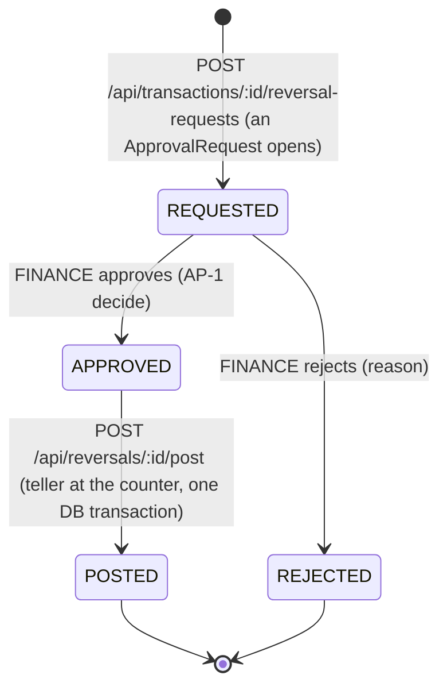

# Blueprint reversal (#552)

> Design only. No code, no migration, no `ready`. Written by claude/e5ab6c on the lane controller's assignment
> (#564 issuecomment-6074257078). Code tickets are cut by the lane controller after a `Verdict: PASS`.

**Source of the logic.** *XC Desk — Blueprint & Data Model v2* (`docs/blueprint/XC-Desk-Blueprint-Data-Model-v2.html`,
#565). The owner's rule (#564): **the Blueprint's logic is fixed; only the look may change**.

| What | Blueprint |
|---|---|
| States | §06 Reversal *"REQUESTED → APPROVED → POSTED; REJECTED"* — *"เชื่อม original transaction; MVP ยกเลิกทั้งรายการ; partial reversal เป็นขอบเขตเพิ่มเติม"* |
| Entity | §07 `Reversal(id, original_transaction_id FK, approval_id FK, posting_id FK, reason, amount)`; Receipt *"ใบเสร็จไม่ overwrite; reversal เชื่อมรายการบัญชีตรงข้าม"* |
| Atomicity | §09 Reversal: *"posting ตรงข้าม + benefit adjustment + commission adjustment + member recalculation event; ไม่ลบ original"* |
| Route | §10 `POST /api/transactions/:id/reversal-requests` (B04): *"เหตุผล; original; วงเงิน/approval policy; ไม่มีการลบทิ้ง"* |
| Numbers | §11 *"แสดง gross และ reversal แยก"* |
| Transaction | §06 *"แก้ผ่าน reversal/adjustment เอกสารใหม่เท่านั้น"* |

**Measured on** `108-Plaza/xchange` `main` at `82ba68d`. It stands on the merged designs:
- `quote-transaction.md` (#551): transactions, lines, payments, receipts;
- `ledger-inventory.md` (#553): postings, `CashPostings`, weighted average, `run_pair`;
- `rates.md` §5 (AP-1): approvals;
- `org-roles-branches.md` (#550): `Permission`, `BranchHours`;
- `broker-seam.md` (#563): OB-1 outbox and `ExchangeFeedWriter::record_reversed`.

---

## 0. The owner's answers (2026-10-09, in session claude/e5ab6c, AskUserQuestion; on #552 issuecomment-6077044656)

| # | Question | Answer (verbatim) | What this design does |
|---|---|---|---|
| R-1 | A time limit | *"ภายในวันทำการเดียวกัน"* | request **and** post within the branch business day of the original's completion (branch timezone, #550); after it, refused (`reversalWindowClosed`) |
| R-2 | The receipt | *"ออกเอกสารยกเลิกใหม่"* | a new **reversal document** with its own number refers to the original; the original receipt is never changed (§3.2) |
| R-3 | Who approves | *"FINANCE"* | FINANCE decides through AP-1; the requester never can (§5) |
| R-4 | How money goes back | *"ทางเดียวกับที่จ่ายมา"* | cash back from the poster's drawer; non-cash back through `Bank`; the opposite of the original payment (§4.3) |

---

## 1. v3 today (measured)

| Fact | Where |
|---|---|
| No reversal, void or refund of an exchange exists; no UPDATE or DELETE of `transactions` outside tests | #551 design §1 (`quote-transaction.md`, merged) |
| `ReversalRequest` is a Blueprint permission held by TELLER and BRANCH_MANAGER; FINANCE holds `FinanceReconcile` | `org-roles-branches.md` §3.4 |
| `receipts(transaction_id, number, revision, …)`: revision 1 = the sale; *"the column and the number rule are for #552"* | `quote-transaction.md` §3.5 |
| Broker's feed has `REVERSED` / `reversed_satang` waiting for this design: *"#552 calls `ExchangeFeedWriter::record_reversed`"* | `broker-seam.md` §1 row 2, §6.3 |
| OB-1 delivers per aggregate in order, so a reversal never reaches a destination before its earn | `broker-seam.md` §5 (per-aggregate FIFO) |

---

## 2. Decisions

| # | Decision | Why |
|---|---|---|
| V-1 | **Whole transaction only** (MVP). `amount` is the original's settled THB; there is no partial reversal. | §06 |
| V-2 | **The original `transactions` row is never changed.** It stays `COMPLETED`; "reversed" is read from its POSTED reversal. | §06, §07, §09 *"ไม่ลบ original"* |
| V-3 | **Three steps, three actors.** A teller or manager requests (REQUESTED + an AP-1 request); FINANCE decides (APPROVED / REJECTED); a teller at the counter **posts** (POSTED) — the money changes hands there, so the posting is the counter's act, not the approver's. | §06's three states; R-3, R-4 |
| V-4 | **The reversal document is a receipt revision.** `receipts` gains a `kind`; a reversal writes revision *n + 1* of the original's receipts, `kind REVERSAL`, number `<document_ref>-R<n+1>` — #551's rule. | R-2; `quote-transaction.md` §3.5 reserved exactly this |
| V-5 | **One reversal per transaction that is not REJECTED.** A REJECTED one may be followed by a new request. | §07 "เชื่อม original"; prevents two refunds of one exchange |
| V-6 | **The opposite posting values everything at the original's frozen figures**: the foreign leg at the original line's `cost_basis_thb`, THB at face, through the posting port's `reverses` field (`ledger-inventory.md` §4.6, LG-2). The original's margin is reversed exactly. | §09 *"posting ตรงข้าม"*; `ledger-inventory.md` §4.3 freezes cost on the line |

---

## 3. Tables (migration 1; `organization_id` and composite FKs per #550)

### 3.1 `reversals`

```
reversals(
  id                      uuid PK,
  organization_id         uuid NOT NULL,
  branch_id               text NOT NULL,
  original_transaction_id uuid NOT NULL REFERENCES transactions(id),
  status                  text NOT NULL CHECK (status IN ('REQUESTED','APPROVED','POSTED','REJECTED')),   -- §06, nothing else
  reason                  text NOT NULL CHECK (length(reason) BETWEEN 1 AND 500),
  amount_thb              numeric(20,2) NOT NULL CHECK (amount_thb > 0),   -- = the original's Σ settle_thb (V-1)
  business_date           date NOT NULL,          -- the original's completion date in the branch timezone (R-1)
  approval_request_id     uuid NULL REFERENCES approval_requests(id),      -- §07 approval_id; NULL only while REQUESTED (RG6)
  posting_id              uuid NULL,                                       -- §07 posting_id; set at POSTED; FK to ledger_postings added by RV-3 (RG1)
  receipt_id              uuid NULL REFERENCES receipts(id),              -- the reversal document; set at POSTED
  shift_id                text NULL,                                       -- the poster's shift; set at POSTED
  requested_by            text NOT NULL,  requested_at timestamptz NOT NULL,
  posted_by               text NULL,      posted_at    timestamptz NULL,
  realized_margin_reversed_thb numeric(20,2) NULL,                         -- − the original lines' margin; set at POSTED
  cost_difference_thb     numeric(20,2) NULL,     -- Σ ReversedCost.difference_thb (ledger-inventory.md §4.6); set at POSTED
  created_at, updated_at,
  CHECK (status = 'REQUESTED' OR approval_request_id IS NOT NULL),                                  -- RG6
  CHECK ((status = 'POSTED') = (posting_id IS NOT NULL AND receipt_id IS NOT NULL AND posted_at IS NOT NULL))
)
CREATE UNIQUE INDEX one_live_reversal_per_transaction
  ON reversals (original_transaction_id) WHERE status <> 'REJECTED';                      -- V-5
```

Rulings on #682, lane controller (claude/608dff), 2026-10-10:
- **RG1:** `ledger_postings` is #553's table and is not on main when RV-1 lands, so RV-1 creates `posting_id` with no
  foreign key. RV-3 (#684), which starts after LG-4, adds `REFERENCES ledger_postings(id)` in its own migration.
- **RG6:** `ApprovalService::request` reads the subject's `version_hash` from the reversal row
  (`api/crates/xc-approval/src/application/approval_service.rs:122`), so the row exists before its request does.
  `approval_request_id` is therefore NULL at insert. The request workflow sets it in the same transaction, and the
  CHECK keeps every decided reversal tied to its request.

### 3.2 `receipts` gains a kind (V-4)

```
receipts + kind text NOT NULL DEFAULT 'RECEIPT' CHECK (kind IN ('RECEIPT','REVERSAL'))
         + CHECK ((kind = 'RECEIPT') = (revision = 1))
```

- Revision 1 stays the sale's receipt, untouched (R-2). A reversal's document is revision 2, number
  `<document_ref>-R2`, its own HTML (*"เอกสารยกเลิก"*, the original number, the reason, the amounts, the poster) stored
  as a file like the receipt (`file_service.rs` content hash).
- Reprinting either reads its stored file; nothing is overwritten.

---

## 4. Behaviour

### 4.1 States



**The window (R-1)**: request and post are both refused `reversalWindowClosed` when "now" in the branch timezone is
past the original's `business_date`. An APPROVED reversal that was not posted in time stays APPROVED and is shown
"expired" (derived, as #551 derives `EXPIRED`); it can never be posted. §06's four states are the only stored ones.

### 4.2 Request (`POST /api/transactions/:id/reversal-requests`, §10)

Command (rates §6 seam, `Idempotency-Key`), permission `ReversalRequest` (TELLER, BRANCH_MANAGER of the branch).
Input `{ reason }`. In one `BranchTx` of the original's branch:
1. The transaction is `COMPLETED`, LIVE, of this branch; else `outOfScope` / `staleVersion`.
2. Inside the window (R-1).
3. No live reversal (V-5), else `staleVersion` with the existing reversal's id.
4. Insert `reversals` (REQUESTED, `amount_thb` = Σ the original's `settle_thb`, `business_date`) and
   `ApprovalService::request(tx, "TRANSACTION_REVERSAL", id, payload, by, key)` (AP-1, merged: every method takes the caller's transaction first).

### 4.3 Post (`POST /api/reversals/:id/post`)

Command, permission `ReversalRequest`, the poster's **own open shift** (#582 C1). In one `BranchTx` of the branch, §09
in order:

| §09 | What runs |
|---|---|
| validate | APPROVED; inside the window; the poster has an open shift at this branch |
| *posting ตรงข้าม* | `CashPostings::post_in` with the original's requests reversed: foreign `Customer ↔ Drawer(poster's shift)` the other way; THB the other way through **the original payment's place** (R-4: `Drawer` for cash, `Bank` otherwise). Valued at the original's frozen figures (V-6): each foreign request carries `reverses = Some(<original line>)` and `line = None`, and the THB requests carry neither (`ledger-inventory.md` §4.6). So reversing a BUY disposes the bought quantity at that line's `cost_basis_thb`, and reversing a SELL acquires a lot at `cost_basis_thb ÷ q`, whatever the average is now. The posting returns one `ReversedCost` per foreign request and no `LineCost`; nothing is written on the original's lines (V-2). A shortfall is `stockInsufficient`, or needs an approved `NEGATIVE_STOCK` (#553 §5.1) |
| *benefit adjustment* | none until #560; its port is #560's |
| *commission adjustment* | `ExchangeFeedWriter::record_reversed(tx, original, reversed_total, now)` (#563 §6.3), where `reversed_total: Satang` = `amount_thb × 100`, exact because `amount_thb` has 2 places (a value that is not a whole satang is refused, never rounded) — Broker reads it from the feed |
| *member recalculation event* | `OutboxWriter::enqueue_in` `loyalty.exchange_reversed` (aggregate = the original transaction, so OB-1's per-aggregate FIFO keeps it after the earn), once #559 registers its handler |
| document | the reversal document (V-4): `receipts` revision 2, `kind REVERSAL` |
| mark | `status POSTED`, `posting_id`, `receipt_id`, `shift_id`, `posted_by/at`, `realized_margin_reversed_thb = − Σ original realized_margin_thb`, `cost_difference_thb = Σ ReversedCost.difference_thb` |

The posting's `source_type` is `REVERSAL` (`ledger-inventory.md` §3.1), `source_id` the reversal id, `source_key`
`post`, so a repeat is one posting (and the command's key replays).

### 4.4 Reads

- `GET /api/v3/views/reversal?id=` and the B04 transaction view (#551 TX-10) gain `reversal: { id, status, reason,
  amount, requested_by/at, approved, posted_at, document number } | null`.
- **§11 numbers**: every report shows gross completed lines and reversals separately; a POSTED reversal subtracts its
  lines' THB and margin in the reversal column, never by editing the original's figures. The staff report (PR 533) and
  the executive view (#562) read `reversals` joined on the original.

---

## 5. Approval (R-3; AP-1 traits, `rates.md` §5.2)

`ReversalSubject` + `ReversalPolicy` (`api/src/application/workflows/exchange/reversal_approval.rs`):
- `type_name()` = `"TRANSACTION_REVERSAL"`;
- `version_hash(id)` = sha256 over the reversal's original id, amount, reason and status;
- `on_decided(tx, id, outcome)`: APPROVED ⇒ `APPROVED`; REJECTED ⇒ `REJECTED` (the decision's reason is the AP-1
  decision's);
- `may_decide(who, request)` ⇔ `who` holds **FINANCE** for the reversal's branch (organisation-wide or that branch,
  `Authorizer` scope rules); `allows_self_decision` = false, and the AP-1 proposer rule refuses the requester anyway.

---

## 6. Class diagram

```mermaid
classDiagram
  class Reversal { <<xc-exchange domain/reversal/reversal.rs>> +status +amount_thb +business_date }
  class ReversalRepository { <<trait xc-exchange domain/reversal/repository.rs>> +insert_in() +find_in() +set_status_in() +post_in() }
  class PgReversalRepository { <<xc-exchange infrastructure/reversal/repository.rs>> }
  class RequestReversal { <<api application/workflows/exchange/reversal_request.rs>> +run_in(tx: &mut Transaction~Postgres~, input: RequestReversalInput, who: &SaveActor, now) AppResult~Reversal~ }
  class PostReversal { <<api application/workflows/exchange/reversal_post.rs>> +run_in(tx: &mut Transaction~Postgres~, id: ReversalId, who: &SaveActor, now) AppResult~PostedReversal~ }
  class ReversalSubject { <<api application/workflows/exchange/reversal_approval.rs>> }
  class ReversalPolicy { <<api application/workflows/exchange/reversal_approval.rs>> }
  class ReversalWindow { <<xc-exchange domain/reversal/window.rs>> +business_date_of(completed_at, tz: Tz) NaiveDate +is_open(business_date, now, tz: Tz) bool }
  class ReversalCommands { <<api http/v3/commands/reversal_requests.rs>> }
  class ReversalView { <<api http/v3/views/reversal.rs>> }
  class CashPostings { <<trait xc-cash domain/posting.rs (#553)>> }
  class ExchangeFeedWriter { <<xc-referral application/feed_writer.rs (#563)>> +record_reversed() }
  class OutboxWriter { <<xc-outbox (#563 OB-1)>> }
  class ApprovalService { <<xc-approval (AP-1)>> }

  PgReversalRepository ..|> ReversalRepository
  RequestReversal --> ReversalRepository
  RequestReversal --> ReversalWindow
  RequestReversal --> ApprovalService : request
  PostReversal --> ReversalRepository
  PostReversal --> ReversalWindow
  PostReversal --> CashPostings : post_in
  PostReversal --> ExchangeFeedWriter : record_reversed
  PostReversal --> OutboxWriter : enqueue_in
  ReversalSubject ..|> ApprovalSubject
  ReversalPolicy ..|> ApprovalPolicy
  ReversalCommands ..|> CommandAction
  ReversalCommands --> RequestReversal
  ReversalCommands --> PostReversal
```



**Rulings on #682 (lane controller, 2026-10-10):**
- **RG2:** `BranchHours` is in xc-rate, which xc-exchange cannot depend on, so the window takes the branch's IANA timezone (`chrono_tz::Tz`, OR-1's `branches.timezone`). xc-exchange gains `chrono-tz` 0.10.
- **RG5:** `RequestReversalInput { branch, original, reason, key }`: the branch travels in the input, because `SaveActor` has none and the request must refuse another branch's transaction.
- **RG7:** the command file is flat, as above.
- **RG3/RG4:** the route rows (`reversalRequest`, and FINANCE's `ApprovalsDecide`) are #874's.

The orchestrators live in the `api` crate beside #551's (`quote-transaction.md` §7: `xc-exchange` depends on kernel
crates only); `xc-exchange` keeps the domain, the window rule and the repository.

### 6.1 Who provides, who uses

| Provided by | Used here | If it has not landed |
|---|---|---|
| #551 TX-2 (transactions, lines, payments, receipts), TX-5 (completion) | the original's figures; `receipts` | RV-1 starts after TX-2 |
| #553 LG-2/LG-4 (`LedgerCashPostings`, cost on lines, and the `reverses` field with its rule, `ledger-inventory.md` §4.6, owned by LG-2) | §4.3 posting and V-6 | RV-3 starts after LG-4 (which follows LG-2) |
| AP-1 (#596, merged) | §5 | — |
| #550 OR-1 `BranchHours` | the window (R-1) | RV-1 starts after OR-1 |
| #563 `ExchangeFeedWriter::record_reversed`, OB-1 | §4.3 | RV-3 starts after RF/OB-1 merge, or calls nothing until they do (no stub needed: the step is skipped when the writer is not wired) |
| #559 / #560 | events, benefits | nothing sent until their handlers/ports exist |

---

## 7. Data migration (block `20261016*`, #564 issuecomment-6074369626)

**1. `api/migrations/20261016100000_reversals.sql`** (RV-1)
- *Changes:* creates `reversals` with the partial unique index; adds `receipts.kind` (`DEFAULT 'RECEIPT'`) and its
  CHECK.
- *Existing rows:* every `receipts` row is revision 1 of a sale (#551 migration 2 backfill), so it takes `kind
  'RECEIPT'` and satisfies the CHECK. Count first: `SELECT count(*) FROM receipts WHERE revision <> 1;` — must be 0,
  else `RAISE` (no other revision exists before this design).
- *No backfill* of `reversals`: v3 has never reversed anything.
- *Deploy:* with RV-1's binary; an older binary never reads `reversals` and writes `receipts` revision 1 only, which
  the default covers.
- *`down`:* drops `reversals` and `receipts.kind`; refused (`RAISE`) once a `kind = 'REVERSAL'` row exists, because
  its document would lose its meaning.

---

## 8. Tickets

| # | Ticket | Owns | Starts after |
|---|---|---|---|
| RV-1 | domain, window rule, repository; migration 1 | `xc-exchange/src/domain/reversal/**`, `xc-exchange/src/infrastructure/reversal/**` (new); migration 1 | #551 TX-2, #550 OR-1 |
| RV-2 | request command, approval subject and policy | `api/src/application/workflows/exchange/{reversal_request,reversal_approval}.rs`, `http/v3/commands/reversal_requests.rs` (flat: `build.rs` serves only plain files in `commands/`; no committed TS for a command DTO, RG7) | RV-1, AP-1 (merged), CM-1 #597 |
| RV-3 | post: the opposite posting, the document, the feed and the event | `api/src/application/workflows/exchange/reversal_post.rs`, `http/v3/commands/exchange/reversal_post.rs` | RV-2, #553 LG-4 |
| RV-4 | reads: the reversal view and the B04 field | `http/v3/views/reversal.rs`, the reversal field in #551 TX-10's DTO (after TX-10) | RV-1, #551 TX-10 |

Module registration lines (`mod.rs`) are not reserved (lane rule, #564 issuecomment-6076309062).

### 8.1 Up-front tests (🧪)

| Ticket | Behaviour locked |
|---|---|
| RV-1 | `ReversalWindow` across the branch timezone's midnight (open until the end of the original's business date, closed after); a second live reversal of one transaction is refused by the index; a REJECTED one allows a new one; migration 1 gives every existing receipt `kind RECEIPT` and refuses a non-1 revision |
| RV-2 | a request needs `ReversalRequest` at the branch; outside the window ⇒ `reversalWindowClosed`; a non-COMPLETED, DEMO or other-branch transaction refused; the requester cannot decide; FINANCE of another branch cannot; FINANCE approves ⇒ APPROVED, rejects ⇒ REJECTED; the same key replays |
| RV-3 | posting a reversed BUY returns the THB through the original's place and takes the foreign back out at the original cost; a reversed SELL brings the foreign back as a lot at the original unit cost and reverses the margin exactly; **both hold after other exchanges have moved the average between the original and the reversal**; `cost_difference_thb` is 0 unless the reversal empties the position; cash moves on the poster's own shift; a shortfall ⇒ `stockInsufficient`; the reversal document is revision 2 `kind REVERSAL` with number `<no>-R2`; the original's row, lines and receipt are unchanged; `record_reversed` and the Loyalty event happen once; a repeat posts once; after the window ⇒ refused |
| RV-4 | the view and the B04 field show status, reason and the document number; a REJECTED one shows as rejected |

---

## 9. Must ask the owner (not decided here)

None open for this design. R-1…R-4 are answered; partial reversal is outside the MVP (§06) and needs its own decision
when it is wanted.

---

## 10. Blueprint conformance

| Blueprint | Here | Status |
|---|---|---|
| §06 REQUESTED → APPROVED → POSTED; REJECTED; whole transaction | §4.1, V-1 | kept |
| §07 `Reversal(original_transaction_id, approval_id, posting_id, reason, amount)` | §3.1 | kept + `status`, window, document, poster |
| §07 receipts never overwritten | V-4: a new revision | kept |
| §09 opposite posting + benefit + commission + member events; original never deleted | §4.3, V-2 | kept (benefit = #560's port) |
| §10 `POST /api/transactions/:id/reversal-requests` | §4.2 | kept; `/api/reversals/:id/post` added for the counter step |
| §11 gross and reversal separately | §4.4 | kept |
