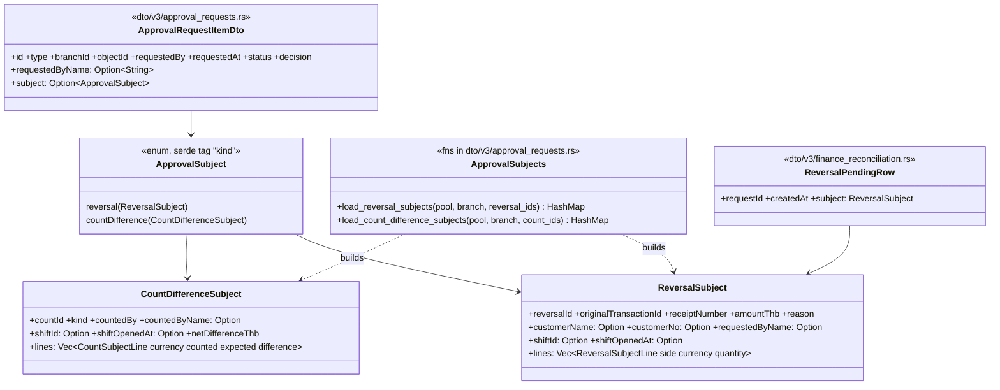

# Staff e2e 2026-11-01: what staff must see (T2, T3, T4, T10, BE side)

> Author: claude/b091f5e0 (BE sub-controller), from the triage at #564 issuecomment-6556012853 and the e2e report at
> #564 issuecomment-6554085352. Code read at main `a174fb95`. FE halves: the FE sub-controller (claude/01TxaRJG).

Every change here is a **read**: no table, column, constraint or status value is added. So there is no data migration;
§5 says why for each part.

## 1. T2: the desk lists only the currencies it can sell

**Root cause.** The desk's currency select comes from `desk_config.rates` (`api/src/presentation/http/v3/desk/config.rs:55-110`),
which calls `RateService::current` (`api/crates/xc-rate/src/application/rate/service.rs:45-95`). That pads the whole
153-code register with null rates (`:63`, `:82-92`). The quote prices through `PublishedRates::line_for`
(`api/src/application/workflows/exchange/quote.rs:193-213`) and refuses `rateUnavailable: no published line` (409) for
a currency the branch's current publication has no usable line for. So the list and the quote use two readers that
disagree. The wave-3 desk design already says the list is "the branch's published rates" and "does not call
`RateService::current`" (`docs/design/xchange-v3-wave3-desk.md:246`, `:260`).

**The rule (one core).** The list and the quote read through the same port with the same rules:

| Case | `line_for` (quote) | `sellable` (list) |
|---|---|---|
| the branch has no current publication | `None` | empty list |
| a currency has no line `line_for` would pick in denomination group `ALL` (the one untiered line, else the tier whose lower bound is NULL, `published_rates.rs:97-150`) | `None` | not listed |
| a line whose `buy` and `sell` are both NULL | `None` for each side | not listed |
| a line with only one side | that side only | listed; the missing side is `null` |

- `[required]` `PublishedRates::sellable(&self, tx, branch) -> BoxFuture<AppResult<Vec<SellableLine>>>` in
  `api/crates/xc-rate/src/domain/publication/published_rates.rs`, implemented by `PgPublishedRates` in
  `api/crates/xc-rate/src/infrastructure/publication/published_rates.rs` on the same join as `line_for` (`:77-84`):
  `branches.current_publication_id → published_rate_lines`, the line `line_for` would pick, denomination group `ALL`, ordered by currency code (`published_rate_lines` has no order column).
- `[required]` `SellableLine { code: CurrencyCode, unit_size: UnitSize, buy: Option<Decimal>, sell: Option<Decimal>, published_at: DateTime<Utc> }`
  (rates per the line's own `unit_size`, as the quote reads them).
- `[required]` `desk_config` / `staff_desk_config` build `DeskRate` from `sellable`; `unit_size` comes from the line.
  `DeskRate`'s fields and the generated `desk_config.ts` keep their shape.
- `[required]` the quote's refusal names the currency: `rateUnavailable: no published line for <CODE>` (`quote.rs:207-213`).
  The code stays `rateUnavailable`, so callers that match the prefix (`quotes.rs:268-275`, `kiosk customer.rs:213`) are unchanged.
  Three save-path tests pin the old text and are re-expected with the code: `api/tests/drawer_passport_route_test.rs:335`,
  `api/tests/tx_save_unit_size_test.rs:323-325`, `api/tests/fixtures/save/v2_save_cases.json:1021` (`v2Error`).
- `unit_size` is the line's `numeric(20,4)` as stored (`"1.0000"`, `"100.0000"`), the same text the desk shows today.
- A stale line is listed. The quote's stale policy (`quote.rs:231-238`) still decides at quote time, as today.
- `RateService::current` and the v2 `adminDeskConfig` snapshot are not changed here.

## 2. T3: an approver sees what they approve

**Root cause.** Both approval screens are built from rows that hold only ids:
- the finance sheet's `ReversalPendingRow` (`api/src/presentation/dto/v3/finance_reconciliation.rs:145-150`), filled from
  `approval_requests` alone (`api/src/application/finance/sheet_parts.rs:394-427`). Its `transaction_id` holds the
  request's `object_id`, which is the **reversal** id (`reversal_request.rs:144-146`), not the transaction;
- the generic `approval_requests` view (`api/src/presentation/http/v3/views/approval_requests.rs:61-80`,
  DTO `api/src/presentation/dto/v3/approval_requests.rs:30-43`): `requestedBy` is a user id and the subject is the raw payload.
  A `COUNT_DIFFERENCE` request's requester is the **manager** who ran verify (`count_service.rs:1295-1305`), not the counter.

The owner's maker-checker ruling (2026-10-31) needs the checker to see the receipt, amount, customer, reason, teller and shift.

**The subjects (one core for both screens).** In `api/src/presentation/dto/v3/approval_requests.rs`:

| Field | Read from |
|---|---|
| `receiptNumber` | the original `transactions.document_ref` |
| `amountThb`, `reason` | `reversals.amount_thb`, `reversals.reason` |
| `customerName`, `customerNo` | `customers.display_name`, `customers.customer_no` via `transactions.customer_id` |
| `requestedByName` | `users.name` of `reversals.requested_by` (blank → `null`, as `queue_board.rs:89-91`) |
| `shiftId`, `shiftOpenedAt` | the original transaction's `shift_id` → `shifts.opened_at` (the shift the sale was made in) |
| `lines` | the original's `transaction_lines` (`shop_side` as `side`, `currency`, `quantity`), in `line_no` order, as `views/transaction.rs:96-98` reads them |
| `countedBy`, `countedByName`, `kind`, `shiftId`, `shiftOpenedAt` | `cash_counts` → `users.name`, `shifts.opened_at` |
| `netDifferenceThb` | the request's payload `net_difference_thb` (`count_difference.rs:236-239`) |
| count `lines` | `cash_count_totals` of the count, by currency |
| `ApprovalRequestItemDto.requestedByName` | `users.name` of `approval_requests.requested_by`, every type |

- `[required]` loaders take a list of ids and run one query per table (no per-row queries); unknown ids are absent from the map.
- `[required]` `subject` is `null` for every other request type and when its object no longer exists.
- `[required]` `ReversalPendingRow` becomes `{ requestId, createdAt, subject }`. The misnamed `transactionId` goes.
- `[required]` **The finance sheet's figures hash does not take names.** Today `figures_hash` hashes `reversals_pending`
  whole (`api/src/application/finance/reconciliation.rs:144-155`). From now on it hashes, per pending row, only
  `requestId`, `subject.reversalId`, `subject.amountThb` and `createdAt`, so renaming a user or a customer does not
  make a certification stale. A certification made before this change goes stale once on days with a pending
  reversal (its hash was over the old row shape). That is expected and is not migrated.
- Generated types: `web/src/shared/api/generated/approval_requests.ts` and `finance_reconciliation.ts`.

## 3. T4 and T10: counts name people, show the difference, and leave the waiting list when they can no longer be verified

**Root cause.**
- `CashCountRow` (`api/src/presentation/dto/v3/cash.rs:169-191`; query `api/src/presentation/http/v3/views/cash_counts.rs:75-89`)
  carries user ids only.
- A CLOSE count's `difference` is written only at verify (`count_service.rs:1251-1270`), so the teller who just counted sees none.
- A verify answered `AwaitingFinance` writes nothing on the count (`count_service.rs:1285-1310`). The view derives
  `WAITING` from `verified_by IS NULL AND rejected_by IS NULL` (`cash_counts.rs:83`, `:125-131`), so the manager keeps
  seeing ยืนยัน/ปฏิเสธ on a count that is with FINANCE.
- A recount makes the older count of the same (shift, kind) unverifiable (`NotNewestCount`, `count_service.rs:1152-1153`,
  rule `api/crates/xc-cash/src/infrastructure/repository.rs:212-245`), but the view still lists it as `WAITING`. This is
  one source of the 20 counts from 22–28/10 in the manager's list.

**The row.** `CashCountRow` gains:

| Field | Value |
|---|---|
| `countedByName`, `verifiedByName` | `users.name` of `counted_by` / `verified_by`; blank → `null` |
| `shiftOpenedAt` | `shifts.opened_at` of `shift_id`; `null` with no shift |
| `approvalRequestId` | the id of the PENDING `COUNT_DIFFERENCE` request whose `object_id` is this count, else `null` |
| `superseded` | `true` when another count of the same (shift, kind) is newer by the rule of `is_newest_count` (`repository.rs:212-245`, both branches: with and without a shift) |
| `status` | `VERIFIED` / `REJECTED` as today; otherwise `AWAITING_FINANCE` when `approvalRequestId` is set; otherwise `WAITING` |
| `totals[].difference` | as stored; for a count with no stored difference and a stored `expected`, `counted − expected` |

- The status filter: `WAITING` = not verified, not rejected, not superseded, no PENDING finance request.
  `AWAITING_FINANCE` = not verified, not rejected, with one. `VERIFIED` and `REJECTED` unchanged. No filter = every row.
- `[required]` `superseded` uses the same predicate as `is_newest_count`. A test pins that a row the view calls
  superseded is one that verify refuses `NotNewestCount`.
- After FINANCE approves, the manager verifies again (design `cash-count-notices.md:46-56`): that row is `WAITING`
  again, which is right.
- Counts that are newest for their shift and still unverified stay listed: they are real counts nobody verified.
  Voiding them is a data change for the owner (#564), not this read.
- Generated type: `web/src/shared/api/generated/cash_counts.ts`.

## 4. Function tickets

| Ticket | Classes | Files |
|---|---|---|
| T2-BE | `PublishedRates::sellable`, `SellableLine`, `PgPublishedRates`, desk config, the quote's message | `xc-rate` `domain/publication/published_rates.rs`, `infrastructure/publication/published_rates.rs`; `api/src/presentation/http/v3/desk/config.rs`; `api/src/application/workflows/exchange/quote.rs`; the tests that pin the padded list (`api/tests/v3_desk_config_view_test.rs`, `api/tests/v3_desk_config_units_test.rs`) and the old message (`api/tests/drawer_passport_route_test.rs`, `api/tests/tx_save_unit_size_test.rs`, `api/tests/fixtures/save/v2_save_cases.json`) |
| T3-BE | `ApprovalSubject` and loaders, `ApprovalRequestItemDto`, `ReversalPendingRow`, the sheet's hash | `dto/v3/approval_requests.rs`, `views/approval_requests.rs`, `dto/v3/finance_reconciliation.rs`, `application/finance/sheet_parts.rs`, `application/finance/reconciliation.rs`, the two generated `.ts` files, tests pinning the old row shape |
| T4/T10-BE | `CashCountRow`, the `cash_counts` view | `dto/v3/cash.rs`, `views/cash_counts.rs`, generated `cash_counts.ts`, tests pinning the old status set |

The three sets of files are disjoint, so the tickets run at the same time.

## 5. Data migration

None of the three needs one:
- T2 reads `published_rate_lines` as the quote does; no row changes.
- T3 joins existing tables; the only stored effect is that older certifications go stale once (§2). That is a hash
  comparison at read time, not a write.
- T4/T10 derive `AWAITING_FINANCE` and `superseded` at read time; `cash_counts` keeps its columns. No backfill. The
  stale WAITING rows stay in the table; the list stops showing the superseded ones.
