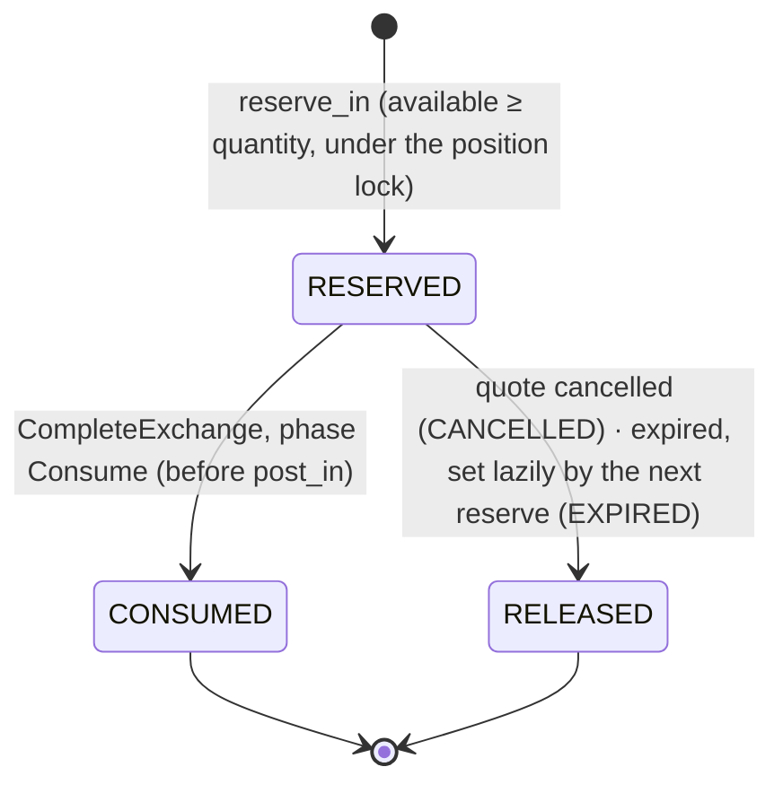
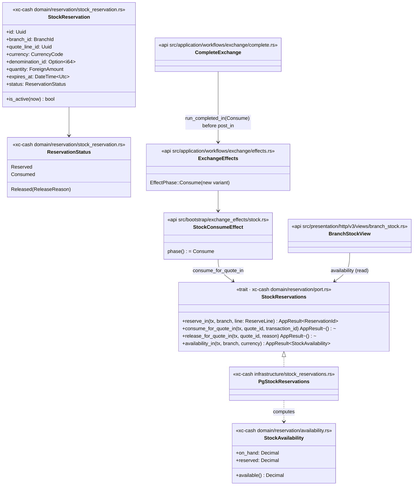

# B05 — Stock reservation: available vs reserved, and the low-stock flag

> Draft by claude/dell-claude-5 for the xchange BE lane controller claude/a90ab16c (#564), on `origin/main`
> `7e99ed0a`. The owner ordered B05 built now as a Blueprint gap (#564, 2026-10-19 ~08:1xZ: *"Build ... B05
> (reserved stock) now, as Blueprint gaps"*). Every business rule below cites its source. The six rules the
> Blueprint left open were decided by the owner on 2026-10-19 (§9; PR 3334 issuecomment-6263220520).
>
> 🔴 **Nothing reserves until the binding quote exists** (O-1 A). B05 ships the store, the consume/release paths,
> the completion's `available` check and the `available` figure; the one caller that reserves is the binding
> quote, designed in `docs/design/blueprint/binding-quote.md`. Until it lands, `reserved = 0` and
> `available = on_hand`.

| Blueprint v2 (`docs/blueprint/XC-Desk-Blueprint-Data-Model-v2.html`) | Text |
|---|---|
| §03 B05 `/desk/cash` (MANAGER / FINANCE) | *"เงินและสต็อก ยอดตามสกุล/ธนบัตร; available/reserved; ต่ำกว่าเกณฑ์ เสนอ transfer; รับส่งเงิน; นับยอด"* — entities *"CashAccount, Inventory, Transfer"* |
| §07 StockReservation | *"id PK; branch_id FK; quote_line_id FK; currency FK; denomination_id FK nullable; quantity; expires_at; status"* — *"ระยะ 6; available = on_hand − active_reserved; release on expire/cancel"* |
| §08 | *"QuoteLine → StockReservation 1:0..N ใช้เฉพาะ binding quote ระยะ 6"* |
| §06 Quote | *"ACTIVE → ACCEPTED \| EXPIRED \| CANCELLED; indicative สำหรับจองคิว; binding สำหรับล็อกเรทในระยะ 6"* |
| §09 Complete exchange | *"validate branch/shift/quote → ตรวจเงินและธนบัตร → consume reservation ถ้ามี → post ledger/inventory → redeem benefit → mark COMPLETED → write outbox ใน DB transaction เดียว"* |
| §10 errors | *"… STOCK_INSUFFICIENT …"* |
| §11 เงินพร้อมใช้งาน | *"on_hand − active reservations; เงิน in-transit แยก; cash variance = counted − expected"* |
| §12 Cash & cost | *"… วงเงิน; ผู้รับรอง; negative stock policy"* |
| §13 phase 2 | *"concurrent exchange ไม่ใช้ stock เกิน"* |
| §13 phase 6 | *"Rate lock / app reservation expiry คืน stock; complete ใช้ quote lock ที่ถูกต้อง; network retry ไม่ซ้ำ"* |
| §16 PlannerDraft | *"draft ไม่จอง ไม่กัน stock ไม่ล็อกเรท; เปิดใหม่ต้อง re-quote"* |
| §19 (owner, 9–11 Oct) | *"กรอกธนบัตรทีละชนิดตอนปิดรายการ — ยังไม่ต้อง"* ⇒ `denomination_id` ว่าง (กลุ่ม ALL); *"สต็อกติดลบ — ผู้จัดการอนุมัติให้ติดลบได้"* (`ledger-inventory.md` §0 N-1) |

Mapping rows this closes or narrows: `docs/design/xc-desk-blueprint-v2-mapping.md:65` (B05 *partial*: "Missing: … available vs reserved, low-stock thresholds …"), `:145` (StockReservation *gap*), `:236` (phase 6 *"reservation expiry returns stock"*: **no**).

---

## 1. v3 today (measured at `7e99ed0a`)

| Fact | Where |
|---|---|
| A branch's on hand per currency: THB = Σ ledger entries of its `DRAWER` + `SAFE` accounts; foreign = `inventory_positions.quantity` | `api/src/infrastructure/executive/ledger_cash_facts.rs:194-215` (`on_hand_by_currency`) |
| Positions are one row per (organisation, branch, currency), locked `FOR UPDATE` in `(branch_id, currency)` order inside `BranchTx` | `ledger-inventory.md` §3.2, L-5 |
| A posting that would take a position below zero ⇒ `stockInsufficient`, unless a BRANCH_MANAGER-approved `NEGATIVE_STOCK` request is named | `ledger-inventory.md` §4.5, §5.1 (N-1) |
| The low-stock alert compares **on hand** with `branch_stock_floors.min_quantity` (owner-entered rows, E-3) | `api/src/infrastructure/executive/alert_facts.rs:146-191`; table `api/migrations/20261031130000_executive_finance.sql:17-26`; `executive-finance.md` D-6, §3 row สต็อกต่ำ |
| Every quote is `INDICATIVE`; `BINDING` is forbidden by a CHECK and left to phase 6 | `quote-transaction.md` §3.1 (`CHECK (type = 'INDICATIVE') -- BINDING is phase 6 (#555); dropped by its design`), D-6 |
| Completion: `consume reservation` is *"none until phase 6 (#555); the port `StockReservations` is not created here"* | `quote-transaction.md:357` |
| Completion posts first (`complete.rs:247`, `post_in`), then runs the effect seam's `Redeem` phase (`:274`) and `Outbox` phase (`:326`) | `api/src/application/workflows/exchange/complete.rs`; phases `effects.rs:25-28` |
| A booking holds no rate and no lock (B1) | `booking-slots.md` B1 |
| The reserve-at-quote / consume-at-completion / release-by-expiry pattern exists for campaign budgets | `marketing-campaigns.md` D-8 (`benefit_reservations`), D-16 (the effect seam) |
| No table, type or code is named `stock_reservation`: `git grep -n -i "stock_reserv\|StockReserv" -- api` → 0 hits | — |

---

## 2. Decisions

| # | Decision | Source |
|---|---|---|
| D-1 | **`available = on_hand − active_reserved`**, per (branch, currency). `on_hand` is today's figure (§1 row 1), unchanged; `reserved` is Σ `quantity` of the branch's active reservations of that currency. In-transit money is not in either (it is its own figure). | §07, §11 |
| D-2 | **A reservation is one row per quote line**: `branch_id`, `quote_line_id`, `currency`, `denomination_id` (NULL = group ALL), `quantity`, `expires_at`, `status`. One quote line holds at most one live reservation. | §07 StockReservation; §08 *"1:0..N"*; §19 denomination ALL |
| D-3 | **Status: `RESERVED → CONSUMED \| RELEASED`.** Stored values only; "active" = `RESERVED AND expires_at > now()`. An expired `RESERVED` row counts as released **by the clock** and is set `RELEASED` lazily, under the same lock, by the next reserve of that (branch, currency). No sweeper. | §07 *"release on expire/cancel"*; the same rule as `marketing-campaigns.md` D-8 and `quote-transaction.md` D-5 (no sweeper writes) |
| D-4 | **Reserve is atomic under the position lock.** In the caller's `BranchTx`, lock the `inventory_positions` row `FOR UPDATE` (L-5 order), compute `available`, and insert `RESERVED` only if `available ≥ quantity`; otherwise refuse `stockInsufficient`. Two requests for the last units: one wins. | §09, §10 `STOCK_INSUFFICIENT`, §13 phase 2; `ledger-inventory.md` L-5 (no new lock) |
| D-5 | **Consume at completion, before the posting.** `CompleteExchange` consumes the quote's live reservations (`CONSUMED`, with `transaction_id`) in the same DB transaction, **before** `post_in`, through a new effect phase `Consume` (one call in `complete.rs`, next to the existing `Redeem` / `Outbox` calls). A reservation that has expired by then is re-reserved in the same step if `available` allows, else the completion is refused `stockInsufficient` (the marketing D-8 rule for budgets). | §09 order *"consume reservation ถ้ามี → post ledger/inventory"*; ♻️ the effect seam (`marketing-campaigns.md` D-16) |
| D-6 | **Release on cancel is explicit.** Cancelling a quote (its transaction cancelled, or the desk re-quotes) sets its `RESERVED` rows `RELEASED` in the same transaction, so stock comes back at once and not at `expires_at`. | §07 *"release on expire/cancel"*; §13 phase 6 *"expiry คืน stock"* |
| D-7 | **`expires_at` of a reservation = its quote's `expires_at`.** A reservation never outlives the quote that holds it. | §07 (both carry `expires_at`); §13 phase 6 *"complete ใช้ quote lock ที่ถูกต้อง"* |
| D-8 | **Retry creates nothing twice.** The reserve is keyed by `quote_line_id` (partial unique index on live rows); the consume by `transaction_id`. A repeated request with the same `Idempotency-Key` replays (CM-1). | §13 phase 6 *"network retry ไม่ซ้ำ"*; `quote-transaction.md` CM-1 |
| D-9 | **A PlannerDraft reserves nothing.** | §16 *"draft ไม่จอง ไม่กัน stock"* |
| D-10 | **The B05 screen shows, per branch and currency: on hand, reserved, available, the floor, and the low flag.** One view, `branch_stock` (new). The existing `admin_cash` (per shift) is not changed. | §03 B05 *"available/reserved; ต่ำกว่าเกณฑ์"* |
| D-11 | **The floor stays owner-entered data** (`branch_stock_floors`, E-3). No number in code; no floor ⇒ no flag. | `executive-finance.md` §0 E-3, D-6 |
| D-12 | **Only binding quotes reserve** (O-1 A). The reserve is called when a binding quote is issued (`binding-quote.md`); an `INDICATIVE` quote, a booking (`booking-slots.md` B1) and a PlannerDraft (D-9) reserve nothing. | §08 *"ใช้เฉพาะ binding quote ระยะ 6"*; owner, PR 3334 issuecomment-6263220520 |
| D-13 | **The low-stock flag and the A01 alert compare the floor with `available`** (O-2 A): `low = available < min_quantity`. | §03 B05; §11; owner, PR 3334 issuecomment-6263220520 |
| D-14 | **A completion checks `available`, excluding its own reservation** (O-3 A). After the `Consume` phase (D-5) has consumed the quote's own rows, `LedgerCashPostings` refuses a SELL disposal with `stockInsufficient` when `position.quantity − active reserved of others < q`. N-1's approval still lets a posting take the position below zero, but never into another quote's hold. This changes `ledger-inventory.md` §4.5's check. | §13 phase 6 *"complete ใช้ quote lock ที่ถูกต้อง"*; owner, PR 3334 issuecomment-6263220520 |
| D-15 | **Only the foreign currency of SELL lines is reserved** (O-4 A). BUY lines and THB reserve nothing. | owner, PR 3334 issuecomment-6263220520 |
| D-16 | **A reservation never exceeds `available`** (O-5 A). There is no approval path for it; N-1 applies to postings only. | §12 *"negative stock policy"*; owner, PR 3334 issuecomment-6263220520 |
| D-17 | **"ต่ำกว่าเกณฑ์ เสนอ transfer" is a link** (O-6 A): the `branch_stock` view returns, for a `low` row, the branch and currency to prefill the existing cash-transfer request (#582). Nothing is created automatically. | §03 B05; owner, PR 3334 issuecomment-6263220520 |

---

## 3. Table (migration; slot assigned by the lane controller on #564)

```
stock_reservations(
  id               uuid PK,
  organization_id  uuid NOT NULL,
  branch_id        text NOT NULL,                       -- FK branches (organization_id, id)
  quote_line_id    uuid NOT NULL,                       -- FK quote_lines (organization_id, id)
  currency         char(3) NOT NULL REFERENCES currencies (code),
  denomination_id  bigint NULL,                         -- NULL = group ALL (§19)
  quantity         numeric(20,4) NOT NULL CHECK (quantity > 0),
  expires_at       timestamptz NOT NULL,
  status           text NOT NULL CHECK (status IN ('RESERVED','CONSUMED','RELEASED')),
  transaction_id   uuid NULL,                           -- set when CONSUMED
  released_reason  text NULL CHECK (released_reason IN ('EXPIRED','CANCELLED')),
  created_at       timestamptz NOT NULL DEFAULT now(),
  updated_at       timestamptz NOT NULL DEFAULT now(),
  CHECK ((status = 'CONSUMED') = (transaction_id IS NOT NULL)),
  CHECK ((status = 'RELEASED') = (released_reason IS NOT NULL))
)
CREATE UNIQUE INDEX one_live_reservation_per_quote_line ON stock_reservations (quote_line_id)
  WHERE status = 'RESERVED';
CREATE INDEX stock_reservations_active ON stock_reservations (organization_id, branch_id, currency, expires_at)
  WHERE status = 'RESERVED';
```

- Composite keys and FKs follow #550's convention (`quote-transaction.md` §3).
- `quantity numeric(20,4)` = `quote_lines.quantity` (§3.1 there).

---

## 4. Behaviour

### 4.1 States

**Nothing enters `RESERVED` until the binding quote exists** (O-1 A, D-12): the only `reserve_in` caller is issuing a binding quote (`binding-quote.md`). Until then the store is reached only by its own tests, and every live figure has `reserved = 0`.



### 4.2 Behaviour rows (each one test)

| # | Case | Required result |
|---|---|---|
| S1 | on hand 100 USD, no reservations | `available = 100`, `reserved = 0` |
| S2 | on hand 100, reserve 60 | `RESERVED` row; `reserved = 60`, `available = 40` |
| S3 | on hand 100, reserved 60, reserve 50 | `stockInsufficient`; no row written |
| S4 | two concurrent reserves of 60 on hand 100 | exactly one `RESERVED`; the other `stockInsufficient` |
| S5 | a reservation past `expires_at` | not counted in `reserved`; `available` back to on hand |
| S6 | reserve after S5 | the expired row becomes `RELEASED` / `EXPIRED` in the same transaction; the new row is inserted |
| S7 | the quote is cancelled | its rows `RELEASED` / `CANCELLED` at once; `available` restored before `expires_at` |
| S8 | complete a quote holding a live reservation | the row `CONSUMED` with `transaction_id`, before `post_in`; position −quantity; `reserved` −quantity; `available` unchanged by the pair |
| S9 | complete a quote whose reservation expired, stock still available | re-reserved and consumed in the same step |
| S10 | complete a quote whose reservation expired, stock no longer available | `stockInsufficient`; the completion rolls back; nothing posted |
| S11 | the same reserve sent twice (same quote line) | one live row (the partial unique index); the second replays |
| S12 | the same completion sent twice | one consume; the replay changes nothing (CM-1) |
| S13 | a PlannerDraft | no row |
| S14 | the `branch_stock` view | on hand, reserved, available, floor, `low` per currency; a currency with no floor has `low = false` |
| S15 | a quote of another branch, or a currency the branch does not hold | `reserved` of that branch/currency unaffected |

| S16 | an `INDICATIVE` quote, a booking | no row (D-12) |
| S17 | floor 50, on hand 80, reserved 40 | `low = true` on the view and an A01 alert (D-13) |
| S18 | on hand 100, another quote holds 70, a completion with no reservation sells 40 | `stockInsufficient`; nothing posted (D-14) |
| S19 | the same, selling 30 | posted; position 70, `available` 0 |
| S20 | a BUY line | no row (D-15) |
| S21 | a reserve beyond `available` with an APPROVED `NEGATIVE_STOCK` request | still `stockInsufficient` (D-16) |
| S22 | a `low` row of `branch_stock` | carries `transferPrefill { branchId, currency }`; no transfer row exists (D-17) |

Until the binding quote lands, S2–S12 run against `PgStockReservations` directly (the store's own tests); the end-to-end path from an issued quote is the binding-quote design's.

---

## 5. Class diagram



### 5.1 Who provides, who uses

| Provides | Ticket | Used by |
|---|---|---|
| `stock_reservations` migration | SR-0 | SR-1 |
| `StockReservation`, `ReservationStatus`, `StockAvailability`, trait `StockReservations`, `PgStockReservations` (reserve / consume / release / availability, the lock, the lazy release) | SR-1 (core) | SR-2, SR-3, SR-4, SR-6, the binding quote (`binding-quote.md`) |
| `EffectPhase::Consume` + its one call before `post_in` in `complete.rs` + `StockConsumeEffect` registered in `bootstrap/exchange_effects/stock.rs` | SR-2 | the completion |
| release on quote cancel: one call in the cancel path (`cancel.rs`) | SR-3 | the desk's cancel and re-quote |
| `branch_stock` view (D-10) | SR-4 | the B05 screen (web, a separate ticket in the web lane) |
| low-stock alert on `available` (D-13) | SR-5 | A01 alerts |
| the completion's `available` check (D-14) | SR-6 | every completion |
| the caller that reserves: issuing a binding quote (D-12) | **`binding-quote.md`**, not this design | — |

**Stubs for parallel work.** SR-1 lands the trait and the types with `todo!()` bodies first (a skeleton commit on `feat/b05-stock`), so SR-2, SR-3 and SR-4 build against the signatures without waiting for SR-1's bodies.

---

## 6. Data migration

1. **Existing rows.** A new table, no change to existing tables. Every existing quote, transaction and position is unchanged; `reserved = 0` everywhere, so `available = on_hand` until the first reservation.
2. **Backfill.** None: nothing reserved before the table existed (every quote is `INDICATIVE`, §1).
3. **Deploy order.** Migration before the new binary. The old binary never reads the table and works with it present.
4. **`down`.** Drops `stock_reservations`. That loses the live reservations: stock they held becomes available at once. Nothing else is lost (consumed rows are history only; the posting is the record of the stock that moved).

---

## 7. Tickets (one core, then functions with disjoint File scopes; on `feat/b05-stock`)

| # | What | File scope | Waits on |
|---|---|---|---|
| SR-0 | migration (§3) | `api/migrations/<slot>_stock_reservations.sql` | the slot (#564) · **owner approval needed before merge** (a schema change) |
| SR-1 | core: types, trait, `PgStockReservations` (D-1 … D-4, D-6 … D-8), S1–S7, S11, S15 | `api/crates/xc-cash/src/domain/reservation/stock_reservation.rs` · `…/availability.rs` · `…/port.rs` · `api/crates/xc-cash/src/infrastructure/stock_reservations.rs` · `api/crates/xc-cash/tests/stock_reservations_test.rs` | SR-0 |
| SR-2 | consume at completion (D-5), S8–S10, S12 | `api/src/application/workflows/exchange/effects.rs` · `api/src/application/workflows/exchange/complete.rs` · `api/src/bootstrap/exchange_effects/stock.rs` · `api/tests/stock_consume_test.rs` | SR-1's skeleton |
| SR-3 | release on cancel (D-6), S7 end to end | `api/src/application/workflows/exchange/cancel.rs` · `api/tests/stock_release_on_cancel_test.rs` | SR-1's skeleton |
| SR-4 | view `branch_stock` (D-10), S14 | `api/src/presentation/http/v3/views/branch_stock.rs` · `api/tests/v3_branch_stock_view_test.rs` | SR-1's skeleton |
| SR-5 | low-stock alert on `available` (D-13), S17 | `api/src/infrastructure/executive/alert_facts.rs` · its test | SR-1's skeleton |
| SR-6 | the completion checks `available` excluding its own reservation (D-14), S18–S19 | `api/crates/xc-cash/src/infrastructure/ledger_postings.rs` · `api/crates/xc-cash/tests/ledger_available_check_test.rs` | SR-1's skeleton |

🔴 **Dependency:** none of SR-0 … SR-6 makes anything reserve. The reserve's only caller is the binding quote (`docs/design/blueprint/binding-quote.md`); until its tickets merge, B05's figures show `reserved = 0`.

Registration lines (not locked): `xc-cash/src/domain/mod.rs` (`pub mod reservation`), `xc-cash/src/domain/reservation/mod.rs`, `xc-cash/src/infrastructure/mod.rs`, `bootstrap/exchange_effects/mod.rs`, the views registry.

---

## 8. Do not touch

The quote's `type` CHECK and `QuoteService` are the binding-quote design's, not this one's. `LedgerCashPostings` changes only in SR-6 (D-14); `ledger-inventory.md` §4.5 is amended by that ticket's PR.

---

## 9. Decided (owner, 2026-10-19)

The owner, verbatim (relayed by the BE controller claude/a90ab16c, PR 3334 issuecomment-6263220520): *"B05: use all six recommendations in PR 3334's §9 (O-1 A through O-6 A). Design the binding quote next, in the same round."*

| # | Question | Answer | Where it lands |
|---|---|---|---|
| O-1 | Which quotes reserve stock? | **A.** Binding quotes only, as §08 says. Nothing reserves until the binding quote exists. | D-12; `binding-quote.md` |
| O-2 | Low flag and alert: available or on hand? | **A.** Available. | D-13, SR-5 |
| O-3 | May a completion without a reservation take reserved stock? | **A.** No: the completion checks `available` excluding its own reservation. | D-14, SR-6 |
| O-4 | Is THB reserved for BUY lines? | **A.** No: foreign currency of SELL lines only. | D-15 |
| O-5 | May a reservation exceed `available` with approval? | **A.** No: N-1 is for postings only. | D-16 |
| O-6 | What does "เสนอ transfer" do? | **A.** A prefilled link to the existing cash-transfer request; nothing automatic. | D-17, SR-4 |

**Data migration:** §6. **Class (proposed):** SR-0 `class:guarded` (schema); SR-1, SR-2, SR-3, SR-6 `class:logic` (stock holds); SR-4 `class:logic`; SR-5 `class:mechanical`.
