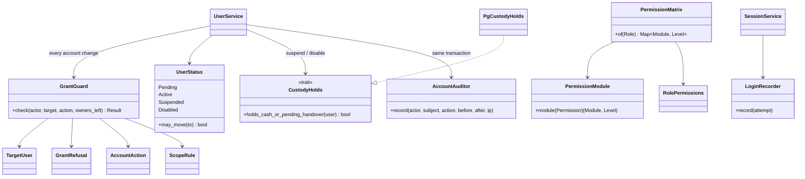
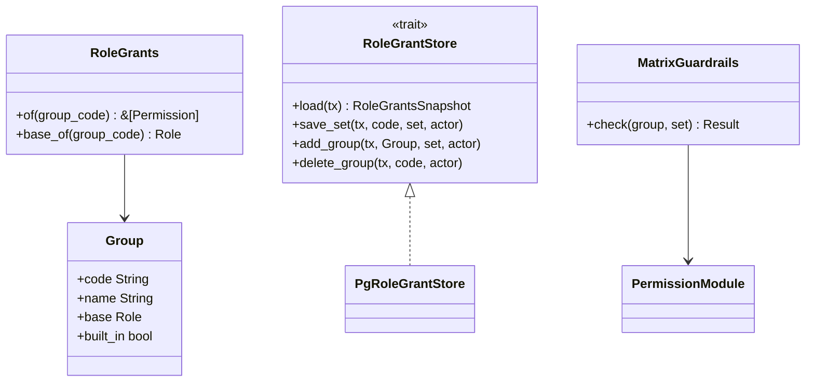
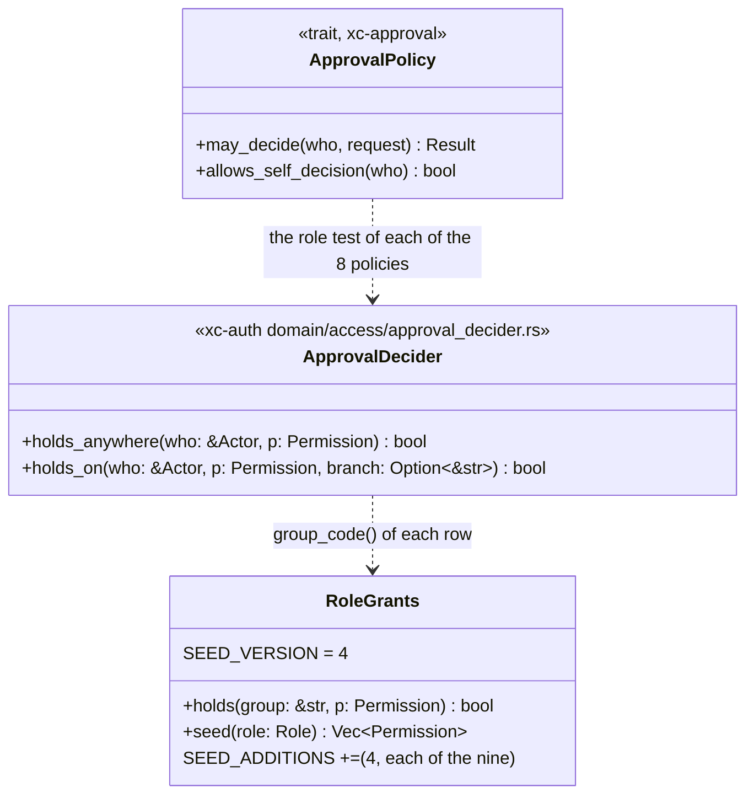

# Blueprint: user management and RBAC for v3 (from XCHANGE-RBAC.md V.9, modelled on pos108)

- **Order (owner, 2026-10-18, in session claude/8deb974d, verbatim):** *"เขียน design doc RBAC ของ v3 ตามเอกสาร
  XCHANGE-RBAC.md ใช้ pos108 เป็นต้นแบบ แล้วส่งให้ผมกับ BE controller รีวิวก่อนตัดใบ"*.
- **Source:** `docs/blueprint/XCHANGE-RBAC-V9.md`, the owner's document, committed verbatim. It describes a V.9 build
  (`src/permissions.mjs`, `db/migrations/007-user-management.sql`, …). **None of those files exists in any 108-Plaza
  repo** (checked: `xchange`, `xchange-v2-source`, `xchange-unified-source`, `xchange-frontend`, tree search for
  `permissions.mjs|user-management|007-user-management`). This design therefore maps its *requirements* onto v3; it does
  not port its code.
- **Measured at:**
  - xchange `origin/main` `8dd9337d`;
  - pos108-core `ecafc2b2`;
  - pos108-admin `ca7548f3`.
- **Status:**
  - **The owner decided §2:** all eight, option A (PR 3083 issuecomment-6245259930, verbatim: *"Accept all 8
    recommendations in PR 3083 §2 (Q1–Q8 option A). Record it on the PR; cut tickets once the BE controller has
    reviewed."*). That word also releases this new capability despite the 10-16 bugs-only order (§8 item 2).
  - **The BE controller reviewed** (claude/c81c8986, issuecomment-6245270034, FAIL at `62d789eb` with ten doc fixes).
    This revision applies all ten plus its comments; §10 lists each one.
- **Built on:** `docs/design/blueprint/org-roles-branches.md` (#550, "OR"), whose decisions B1–B6 and D-1–D-6 stand
  unless §2 below asks the owner to change one.

---

## 0. Rules in force

| Rule | Where | Effect here |
|---|---|---|
| Blueprint logic is fixed; only the look may change | owner, #564; OR header | The nine Blueprint roles and the Permission → role table of OR §3.4 are not re-invented. V.9's own role names are not imported |
| B1: v3 roles map to Blueprint roles by duty | OR §0 B1, §3.3 | V.9's `FRONT`, `BACKEND`, `RATES`… are already mapped. §1.1 below uses that mapping; it is not a new decision |
| B2 / D-5: everyone signs in through Identity; v3 stores no password and no OTP | OR §0 B2, §2 D-5, §5 | Password storage, password rules and lockout live in `xc-identity`. V.9's in-app password handling conflicts (§2 Q1, Q5) |
| B3: OWNER = EXECUTIVE + ADMIN | OR §0 B3 | V.9's "only OWNER may…" means a user who holds **both** roles |
| B6: the OWNER/ADMIN creates staff accounts; no invite, no self-registration | OR §0 B6, §5.3 | Kept. Import (§3.7) is the same create, in bulk |
| Business rules in one place, functions spread to workers | owner, #564 issuecomment-6234947941 | §3: one core (`xc-auth::access`), then one ticket per route or screen |
| Function-level tests, then logic-level | owner, #564 issuecomment-6234955542 / -6234966265 | §6 |

---

## 1. The V.9 requirements against v3 and pos108

### 1.1 Roles (no change: B1)

| V.9 role (SRS name) | Blueprint role in v3 (B1) | Note |
|---|---|---|
| `OWNER` (Executive Director) | EXECUTIVE + ADMIN, organisation-wide (B3) | |
| `MONITOR` (Risk) | VERIFICATION_REVIEWER | B1 |
| `RATES` (Rate) | RATE_MANAGER | |
| `FINANCE` | FINANCE | |
| `MANAGER`, `BACKEND` | BRANCH_MANAGER | V.9 keeps BACKEND separate for the cash hand-over; B1 merged it, and the cash design (#582) runs on BRANCH_MANAGER |
| `DOCUMENTS`, `DOCUMENT_REVIEW` | VERIFICATION_REVIEWER | V.9 keeps maker–checker between the two; Blueprint has one role. §2 Q8 |
| `SYSTEM` (IT/Admin) | ADMIN, branch-scoped (B1) | |
| `FRONT` (Front Office) | TELLER | |
| — | MARKETING, CUSTOMER | Blueprint roles V.9 lacks |

v3 code: `Role` has these nine variants (`api/crates/xc-auth/src/domain/access/role.rs:4-14`), seeded into `roles(code)`
(`api/migrations/20261011110000_users_roles.sql:29-42`). The legacy `Role` (`domain/policy/value_objects/role.rs:5-16`)
is mapped by `access/v3_roles.rs:11-23` and goes in OR-7.

### 1.2 Gap table

"pos108" cites pos108-core unless the path starts with `admin:`.

| # | V.9 requirement | v3 today (`8dd9337d`) | pos108 | This design |
|---|---|---|---|---|
| G1 | Roles fixed in code | **Yes**: 9 roles, `role.rs:4-14` | Roles are DB rows with a numeric `level` and custom roles (`crates/pos-auth/src/domain/entities/role.rs:7-21`, `src/presentation/http/roles.rs:40-47`) | Keep fixed (§0) |
| G2 | A module × level matrix (NONE/VIEW/CREATE/FULL) that OWNER edits | Access is 51 fine-grained `Permission`s (`access/permission.rs:4-71`) in **one static table** (`access/role_permissions.rs:7-138`). There is no module view and nothing editable | Fine-grained `module:action` slugs fixed in code (`src/application/auth/permissions.rs:5-225`); the role → slug mapping is runtime data (`roles.permissions_json`), edited in a matrix screen (admin: `src/features/roles/permission-matrix.tsx:105-158`) | §2 **Q2**. Proposed: a **read-only** module matrix derived from code (§3.3) |
| G3 | Every route checked against the matrix | Every v3 handler declares `INHERITS`, resolved by `Policy::authorize` (`api/src/presentation/http/v3/command.rs:56`, `v3/caller.rs:34-83`); 33 area files (`domain/policy/areas/`). `api/tests/or4_routes_guard_test.rs:82-113` checks only that a route **declares** `INHERITS` | `tests/unit/permission_catalog_test.rs:132-244` reads handler source: every authenticated handler calls `require`, and every slug is in the catalog | §3.5: add the missing test that every `INHERITS` **resolves** to a `Need` |
| G4 | Statuses ACTIVE / SUSPENDED / DISABLED, with who-may-set rules | PENDING / ACTIVE / DISABLED (`domain/user/user_status.rs:6-10`, CHECK `20261111120000_users_pending_no_invites.sql:38`). **No re-enable command exists** (`grep -rn "userEnable\|userActivate"` finds nothing) | Disable through `/status` (`src/presentation/http/users.rs:303-328`) | §3.2: add SUSPENDED, plus re-enable rules |
| G5 | Any status, role or branch change, or password reset, ends all sessions | **Yes** for role, status and disable: `users.version` bump (`application/user/user_service.rs:96,120`; `infrastructure/user/user_repository.rs:134-135`), and the session is re-read from the DB on every request (`application/session/session_service.rs:724-791`, version check `:759`). The **branch switch** does not bump, by design (`:822-856`) | Live DB read with a 30 s cache (`src/presentation/middleware/auth.rs:40-44,501-532`); a role change does **not** revoke tokens (`crates/pos-auth/src/application/mod.rs:420-441`) | v3 already does better than pos108. Keep. G5 holds because `set_status` bumps (`user_repository.rs:135`); `disable()` itself does not, so every new transition goes through `set_status` (§3.2) |
| G6 | Cash guard: no suspend or disable while the person holds cash or has a pending hand-over | None on `userDisable` (`user_service.rs:126-142`) | None | §3.2 via a port to `xc-shift` |
| G7 | ADMIN (V.9 SYSTEM) cannot change its own account, cannot touch other ADMINs, cannot grant ADMIN; only OWNER can | `creator_may_grant` (`user_service.rs:185-202`) checks only that the granter is ADMIN over that scope. **There is no self or peer guard, and an ADMIN may grant ADMIN** | Numeric level, "strictly greater" rule, `ensure_not_self`, all in one file (`src/application/auth/role_guards.rs:42,89,123,174`); tested in `tests/unit/role_hierarchy_enforcement_test.rs:41-209` (self-escalation at `:112`) | §3.1 `GrantGuard` |
| G8 | Password 12–128 characters plus a blocklist (common, repeated, sequence, contains own code) | v3 stores none (B2). `userCreate` checks only non-empty (`user_service.rs:266-271`). No blocklist anywhere (`grep -rniI 'blocklist\|pwned\|zxcvbn'`: nothing) | Password history and lockout (migration `20261014000000_*`) | §2 **Q5** |
| G9 | Temporary password for every create and reset: 16 characters, shown once, 72 h, change at first sign-in | Create sends `must_change_password:false` (`api/src/presentation/http/users.rs:203`; OR §5.3 decided "no", O-4 open). Identity's login answer field `must_change_password` (`domain/identity/identity_client.rs:24`) is **never read**. The new Users screen has **no reset** (`web/src/screens/admin/users/UsersScreen.tsx`); the Employees screen resets through the **legacy** `/api/employees` | Forced change through a middleware on the live DB flag (`src/presentation/middleware/force_password_change.rs:1-29`); a reset revokes all refresh tokens (`crates/pos-auth/src/application/mod.rs:444-478`) | §2 **Q5** |
| G10 | Username = employee code, case-insensitive | Sign-in identifier: a phone is normalised to E.164, anything else goes to Identity unchanged (`session_service.rs:427-446`); accounts are registered by phone (OR §5.3) | Username | §2 **Q1** |
| G11 | Department and Position as employee fields; Tell Code | `users` has `name` only (`20261011110000_users_roles.sql:44-54`) | — | §4: `employee_code`, `department`, `position`, `tell_code` |
| G12 | Audit of every user and permission change, before/after and IP | `user_audit(actor_id, subject_id, action, at, organization_id)` (`users_roles.sql:83-90`), written only for `userCreate`, `userCreateBindFailed` and `customerRegister` (`user_service.rs:331,390`; `api/src/application/customer_signup.rs:128`). **`userGrant`, `userRevoke` and `userDisable` write nothing.** `audit_events` (`20261010110000_approvals.sql:27-39`) has before/after but other actions | Role and user changes go only to `tracing` logs | §3.4 `AccountAuditor`; §4 widens `user_audit` |
| G13 | Login history for every attempt, with a reason | **None** for Identity sign-ins. xchange forwards the IP and maps Identity's 429/423 (`infrastructure/identity/http_identity_client.rs:64`; `identity_client.rs:88-93`) but records nothing | None (lockout counter only) | §3.4 `LoginRecorder`; §4 `login_history` |
| G14 | Audit Logs at most View for everyone | `audit_events` is append-only (`crates/xc-approval/src/infrastructure/audit_log.rs:30-48`) and has no edit route | — | Kept. §3.6 adds read-only views |
| G15 | Excel: Employee Register (also import template), User List, Role Permission Matrix; import with preview/apply; never read Password or national ID columns | **No xlsx code or dependency** (`grep -rniI 'xlsx\|exceljs\|sheetjs'`). CSV export only (`web/src/screens/admin/parts/csv.ts:10-59`, server gate `api/src/presentation/http/v3/export_gate.rs` writing an `EXPORT` audit row) | Excel only for products and stock counts (admin: `product-xlsx.ts`, `count-xlsx.ts`) | §2 **Q7**, §3.7 |
| G16 | One screen `/users`: users, matrix, import/export | Two screens disagree: `admin/users/UsersScreen.tsx` lists `user_roles` (`v3/views/admin_users.rs:45`), while `admin/employees/Employees.tsx` lists the **legacy `employees` table** (`v3/views/admin_employees.rs:37`). A user created through `/api/users` likely does not appear in Employees | Users and roles pages (admin: `dashboard/users/page.tsx`, `dashboard/roles/page.tsx`) | §3.6: one Users screen; Employees retires with OR-7 |

---

## 2. Owner decisions (decided 2026-10-18: all option A)

The owner accepted every recommendation (issuecomment-6245259930). The options stay below as the record of what was chosen and why.

**Q1 (decided: A). Username = employee code (V.9) vs Identity sign-in by phone (B2, B6).**
- A. Keep B2/B6: staff sign in through Identity with **phone + password**. v3 stores `employee_code` as a field (§4), shows it everywhere and accepts it in search and import. It is not a login name.
- B. Sign-in by employee code. Identity would need a username per account, which is unique across every 108 app (OR §5.3 `PhoneTaken` note), so a code like `tk-010326-mn002` would have to be registered in Identity. That is a change to Identity and to B2's flow.
- **I recommend A.** It keeps one account across 108 apps and needs no Identity change. B is reversible later by adding the code as an Identity username.

**Q2 (decided: A, then changed to B by the owner on 2026-10-18; see §11). The permission matrix: read-only from code, or editable by the owner.**
- A. **Read-only.** `RolePermissions` stays the one table in code (OR §3.4). A `PermissionModule` mapping groups the 51 permissions into V.9's ten modules, and each role's level is **derived** (§3.3). The screen shows it and exports it to xlsx. A change is a reviewed PR.
- B. **Editable** (pos108 pattern): per-role overrides stored as data, edited by EXECUTIVE+ADMIN, within guardrails (V.9's four, plus "never grant a permission the Blueprint gives no role in that module").
- **I recommend A.** The Blueprint fixes who may do what (#564), every permission already has a guard and a test, and a runtime matrix makes a business rule changeable without review. B costs one new table, an editor screen, cache invalidation in `read_session_in`, and a second source of truth that every `Authorizer::check` must read.

**Q3 (decided: A). SUSPENDED as a separate status.**
- A. Add `SUSPENDED`: ADMIN may suspend and resume. `DISABLED` may be re-enabled only by a user holding EXECUTIVE (V.9 "OWNER only").
- B. Keep only `DISABLED`, and add an enable command limited to EXECUTIVE.
- **I recommend A.** It matches V.9, and v3 has no re-enable today (G4), so one of the two is needed anyway.

**Q4 (decided: A). ADMIN limits (V.9's SYSTEM limits).**
- A. ADMIN may not change its own account, may not change another ADMIN or EXECUTIVE, and may not grant ADMIN or EXECUTIVE. Only a user holding EXECUTIVE + ADMIN (B3, the owner) may.
- B. Keep today's rule (an ADMIN over the scope may grant anything, G7).
- **I recommend A.** It is the pos108 self-escalation guard, and B lets any branch ADMIN create another ADMIN.

**Q5 (decided: A). Passwords: who enforces V.9's rules.** v3 sees the password only when an ADMIN creates or resets an account. Sign-in and self-change happen in Identity.
- A.
  - v3 **generates** the temporary password (16 characters, no look-alikes) for create and reset, and shows it once.
  - It registers it in Identity with `must_change_password = true`, which overturns OR §5.3's "no" (O-4).
  - It reads Identity's `must_change_password` at sign-in and, like pos108's middleware, allows only change-password, who-am-I and logout until it is cleared.
  - The 12–128 length, blocklist and 72-hour expiry go to `xc-identity` as one ticket in `108-platform-services`.
- B. v3 enforces length and blocklist on the passwords it sees, and leaves the forced change off as today.
- **I recommend A.** A password typed by an ADMIN and handed over is the weak point V.9 targets, and only A removes it. The Identity ticket is outside this repo and needs that lane's controller.
- **Needs from Identity (ID-1):** an admin reset endpoint. `IdentityClient` has only `login`, `refresh`, `logout`, `otp_request`, `otp_verify` and `register` (`domain/identity/identity_client.rs:111-147`), so F2 (reset) waits for ID-1, or ships behind it.

**Q6 (decided: A). Login history.** v3 records every `POST /api/auth/login` attempt: identifier hash, user if bound, IP, result, and Identity's error code mapped to `OK`, `BAD_PASSWORD`, `UNKNOWN_USER`, `NOT_ACTIVE`, `TEMP_EXPIRED` or `RATE_LIMITED`. **I recommend yes.** It is the one place every sign-in passes, and nothing records it today (G13).

**Q7 (decided: A). Excel.**
- A. Server-side xlsx in Rust: write with `rust_xlsxwriter`, read with `calamine`. Covers User List and Employee Register export, the read-only matrix export, and the Employee Register import with preview → apply.
- B. Browser-side, with a JS xlsx library.
- **I recommend A.** The import must be validated and audited on the server anyway, and both crates are pure Rust with no C dependency. The owner's A approves the two dependencies.
- **Who may export:** every xlsx export goes through the existing `ExportGate` (`api/src/presentation/http/v3/export_gate.rs:1-8`). Owner decision E-2 says only `ReportsExport` holders export (EXECUTIVE, FINANCE). So a plain ADMIN does **not** export the user list; the owner does, through EXECUTIVE (B3). This follows E-2 and needs no new decision.

**Q8 (decided: A). Maker–checker for documents.** V.9 keeps `DOCUMENTS` (prepare) and `DOCUMENT_REVIEW` (review); B1 folded both into VERIFICATION_REVIEWER.
- A. Keep B1 (one role). Maker–checker is enforced per record ("the reviewer is not the preparer") in the verification design, not by two roles.
- B. Re-split into two Blueprint roles, which changes the Blueprint.
- **I recommend A.** The Blueprint is fixed (#564).

---

## 3. Design: one core, then functions

The rule (owner, #564 issuecomment-6234947941): the core decides, the functions only call it. The BE review showed that
"the core" must also own every **shared file** a function would otherwise have to edit, or the functions chain on it
(review items 1, 2, 4, 6 and 8). So the core tickets land four things first:
- the rules;
- the stub signatures of every new method;
- every new policy row;
- every handler that changes because of the rules.

Functions then fill in bodies in files that nothing else touches.

### 3.1 `GrantGuard` (core C1, logic): who may change whom

`api/crates/xc-auth/src/domain/access/grant_guard.rs` (new), pure, one place for every account-changing rule:

```rust
pub enum AccountAction { Create, Grant(Role), Revoke(Role), Suspend, Resume, Disable, Enable, ResetPassword, EditProfile }
pub enum GrantRefusal { NoScope, SelfChange, ProtectedTarget, ProtectedRole, EnableNeedsExecutive, LastOwner, Scope(ScopeRefusal) }
pub struct TargetUser { pub id: UserId, pub status: UserStatus, pub roles: Vec<ScopedRole>, pub has_auth_subject: bool }
pub struct GrantGuard;
impl GrantGuard {
    pub fn check(actor: &Actor, target: &TargetUser, action: &AccountAction, owners_left: usize) -> Result<(), GrantRefusal>;
}
```

- `GrantRefusal` is its **own** type (review item 10). `authorizer::Refusal` (`access/authorizer.rs:37-41`) is not
  widened, because a new variant there touches every match on it. The handler maps `GrantRefusal` to the wire codes
  `roleNotAllowed`, `outOfScope`, `selfChange` and `lastOwner`.
- `TargetUser` lives in `api/crates/xc-auth/src/domain/access/target_user.rs` (new).

Rules, in order:
1. The actor needs `UsersManage` over the target's branch scope. This is today's `creator_may_grant`
   (`application/user/user_service.rs:185-202`), moved here. Otherwise `NoScope`.
2. `actor == target` ⇒ `SelfChange`, except `EditProfile` of one's own name (Q4).
3. The target holds ADMIN or EXECUTIVE ⇒ only an actor holding EXECUTIVE + ADMIN (Q4), else `ProtectedTarget`.
4. `Grant(Admin | Executive)` ⇒ only an actor holding EXECUTIVE + ADMIN (Q4), else `ProtectedRole`.
5. `Enable` of a `DISABLED` user ⇒ only an actor holding EXECUTIVE (Q3), else `EnableNeedsExecutive`.
6. `Suspend`, `Disable` or `Revoke(Executive | Admin)` that would leave **no** ACTIVE user holding EXECUTIVE + ADMIN ⇒
   `LastOwner`. Two owners cannot remove each other down to none (review comment).
7. Grants then run `ScopeRule::check` (`access/scope_rule.rs:22-59`), unchanged; a refusal is `Scope(..)`.

**C1 also moves the three handlers onto `GrantGuard`** (review item 4). Today they call `creator_may_grant` themselves:
`v3/commands/user_grant.rs:86`, `user_revoke.rs:66`, `user_disable.rs:70`. C1 owns those three files.

### 3.2 `UserStatus` transitions and the cash guard

`domain/user/user_status.rs` gains `Suspended` and `fn may_move(self, to) -> bool`, one table:

| From → To | Action | Who (§3.1) | Also |
|---|---|---|---|
| PENDING → ACTIVE | bind Identity (today, `user_service.rs:376-381`) | ADMIN | |
| PENDING → DISABLED | `userDisable` (allowed today) | ADMIN | `version+1` |
| ACTIVE → SUSPENDED | `userSuspend` | ADMIN | cash guard; last-owner rule; `version+1` |
| SUSPENDED → ACTIVE | `userResume` | ADMIN | `version+1` |
| ACTIVE / SUSPENDED → DISABLED | `userDisable` (today) | ADMIN | cash guard (new); last-owner rule; `version+1` |
| DISABLED → ACTIVE | `userEnable` | EXECUTIVE | refused as `notBound` when `auth_subject` is NULL; that user goes back through the PENDING bind instead |

Every move goes through `set_status`, which bumps `version` (`user_repository.rs:135`).

- **Grant on a SUSPENDED user.** Today `grant` refuses only DISABLED (`user_service.rs:79`). It now refuses SUSPENDED
  too (`userNotActive`): a role given to a suspended person would start working on resume without review.
- **An unknown status is an error** (review item 9). Today `user_repository.rs:47` and `:87` read it with
  `unwrap_or(UserStatus::Pending)`. C1 makes it `AppError::Internal`. See §4 item 3 for why this matters on rollback.
- `read_session_in` already refuses anything not ACTIVE (`session_service.rs:759`), so SUSPENDED needs no session change.

**Cash guard port** (review item 7). The trait is `CustodyHolds { fn holds_cash_or_pending_handover(user_id) -> bool }`,
declared in `api/crates/xc-auth/src/domain/user/custody_holds.rs` (C1).
- **It is implemented in `xc-cash`** (C3, `api/crates/xc-cash/src/infrastructure/custody_holds.rs`), not `xc-shift`.
  Pending hand-overs and transfers live in `xc-cash` (`xc-cash/src/domain/handover/mod.rs:6-8`), and `xc-cash`
  already depends on both `xc-auth` and `xc-shift` (`xc-cash/Cargo.toml:16-17`), so the trait sits on the lower crate
  and the adapter on the higher one.
- **The query must survive CA-10 (#626):** `shifts WHERE teller_id = $1 AND status = 'OPEN'` plus the person's
  hand-overs not yet accepted. It must not use `opened_by_count`, `custody_requests` or `custodian_id`, which CA-10
  deletes.
- **A `Dispatched` transfer counts as holding for its sender** until it is received or cancelled. This is the BE
  controller's ruling, claude/c81c8986 on PR 3083.
- A hold is refused as `holdsCash`.
- **Injection, owned by C1** (review addendum item 12). `UserService::new(repo)` (`user_service.rs:51`) is built in
  three places: `v3/commands/user_grant.rs:120-121` (`users()`), `api/src/presentation/http/users.rs:195` and
  `session_service.rs:975`. Changing the constructor would put three files, two of them owned by other tickets, into
  C1. So the port is a **method parameter** instead:
  - `suspend(.., holds: &dyn CustodyHolds)` and `disable(.., holds: &dyn CustodyHolds)`;
  - the constructor is unchanged;
  - C1 adds `pub(crate) fn custody_holds() -> Arc<dyn CustodyHolds>` beside `users()` in `user_grant.rs`, which C1
    owns, and passes it from `user_disable.rs`;
  - C1 also creates `xc-cash/src/infrastructure/custody_holds.rs` with a stub `PgCustodyHolds` that answers "holds
    nothing", which is today's behaviour, since `userDisable` has no cash guard. The stub is marked "C3 replaces";
  - **C3 then owns only that file's body.**

### 3.3 `PermissionModule`: the read-only matrix (Q2 A)

`api/crates/xc-auth/src/domain/access/permission_module.rs` (new, **C2**):
- `fn module(p: Permission) -> (Module, Level)` covers all permissions, where `Module` is V.9's ten (DASHBOARD …
  AUDIT_LOGS) and `Level` is VIEW, CREATE or FULL.
- `PermissionMatrix::of(role)` takes the **highest** level among the role's permissions in each module.
- Nothing reads it to authorise. It exists for the screen, the export and §5.

**C2 also adds the one new `Permission`, `AuditLogsRead`** (review item 3). Today none of the 51 covers reading the
audit and login history.
- It goes to EXECUTIVE and ADMIN, at VIEW.
- It touches `access/permission.rs`, `access/role_permissions.rs` and the exhaustive `match`, so it belongs in the same
  ticket.
- **Standing note:** every future `Permission` also edits `permission_module.rs` and the §5 table. That file is the one
  intentional meeting point. It is three lines per permission, and its compile-checked `match` makes a missed one a
  build error, not a silent gap.

Tests:
- **Function level:** the `match` is exhaustive (the compiler checks it).
- **Logic level:** the §5 table equals `PermissionMatrix` for every role. V.9's "fails if this table and the seed
  disagree" becomes "fails if the doc and the code disagree".

### 3.4 `AccountAuditor` and `LoginRecorder`

- **`TempPassword::generate()`** (`xc-auth/src/domain/account/temp_password.rs`, C1): 16 characters, no look-alikes. F2 (reset), F7b (import) and F9 (create) call it, and no one else generates a password.
- **`AccountAuditor`** (`application/user/account_auditor.rs`, C1): `record(actor, subject, action, before, after, ip)`,
  written in the **same transaction** as the change. Every `UserService` method calls it, and C1 wires it into the
  existing ones: grant, revoke, disable and create.
- **`LoginRecorder`** (`application/session/login_recorder.rs`, C4): one row per `POST /api/auth/login` (Q6), written
  whatever the outcome, outside the sign-in transaction.
  - **C4 owns the edits to `session_service.rs`** (review item 6): the login hook at `:383-488`, and storing Identity's
    `must_change_password` (`domain/identity/identity_client.rs:24`, never stored today) into the new
    `user_sessions.must_change_password` (§4), both in one ticket.

### 3.5 The coverage test (pos108 idea, G3)

`api/tests/policy_inherits_resolve_test.rs` (new, C1): for every v3 route's `INHERITS (EntryPath, action)`,
`Policy::need` returns `Some`. Today an unknown action fails closed only at runtime.

### 3.6 What the core tickets land up front, so the functions don't chain

| Shared file | Landed by | What exactly |
|---|---|---|
| `xc-auth/src/application/user/user_service.rs` | **C1** | Every new method: `suspend`, `resume`, `enable` and `save_profile` with their real bodies (they only call the rules); `reset_password`, `import_preview` and `import_apply` as one-line delegates to `application/user/reset_password.rs` and `register_import.rs`, whose stub functions C1 creates with the diagram's signatures and F2/F7a fill in |
| `xc-auth/src/domain/user/user_repository.rs` (trait, `:14-78`) + `infrastructure/user/user_repository.rs` (impl) | **C1** | `set_profile`, `list_audit`, `list_logins` trait methods and their SQL. The status methods already exist |
| `xc-auth/src/domain/policy/areas/org_admin.rs` (`:24-26`) | **C1** | All new rows: `userSuspend`, `userResume`, `userEnable`, `userResetPassword`, `userProfileSave`, `userImportPreview`, `userImportApply` → `UsersManage`; `adminUserAudit`, `adminLoginHistory` → `AuditLogsRead` (C2's permission; C1 is stacked on C2's branch, or C2 lands first, which is a one-file change); `adminPermissionMatrix` → `UsersManage` |
| `xc-auth/src/application/session/session_service.rs`, `xc-auth/src/domain/identity/identity_client.rs`, `xc-auth/src/infrastructure/identity/http_identity_client.rs` | **C4** | Login recording + `must_change_password` stored on the session; `IdentityClient::change_password` (trait + HTTP impl), used by F11. The admin set-password method is **F2's**, added once ID-1 publishes Identity's admin route (BE ruling, #564 issuecomment-6245780522) |
| `api/src/presentation/http/users.rs` (create, `:195-210`) | **F9** alone | Q5 A on create: a temporary password from C1's `TempPassword::generate` replaces the typed one, `must_change_password: true` at `:203` (addendum item 11), and the password is returned once |
| `api/src/presentation/http/v3/views/admin_users.rs` + its DTO + `web/src/shared/api/generated/admin_users.ts` | **F10** alone | the view answers `employeeCode`, `department`, `position`, `tellCode` (found by claude/177aa7ef writing W1; BE controller ruling on PR 3083). Without it F3 saves fields the Users screen can never show |
| `api/src/presentation/http/auth.rs` only (login and session answers, and the new `POST /api/auth/password`, hand-registered beside the other `/api/auth/*` routes at `:86-123`; a `v3/commands/` file would be registered by `build.rs` as a v3 command instead) | **F11** | (a) `SessionUser.mustChangePassword: boolean` on `POST /api/auth/login` and `POST /api/auth/session`; (c) `POST /api/auth/password {currentPassword,newPassword}` → `200 {"saved": true}` (like logout, so the shared `ApiClient` is untouched), the session ends (Identity revokes all), errors `400 validationFailed` (field `newPassword`) and `401 invalidCredentials`. BE controller ruling, #564 issuecomment-6245742828. **C4** adds `IdentityClient::change_password` (trait and HTTP impl). F2 adds the admin set-password method after C4 merges, once ID-1 exists |
| `api/src/presentation/http/v3/view.rs` (the `purpose=export` path, `ExportGate::check` at `:692`, `ExportGate::record` at `:760`) + new `api/src/presentation/http/v3/xlsx.rs` | **C5** | An `xlsx` output for every paged view read with `purpose=export`, through the existing `ExportGate` (addendum item 13). `build.rs` scans only `views`, `actions` and `commands`, so there is no `exports/` directory. Exports are views, which follows ♻️ (one shared core) |
| `api/src/presentation/http/v3/caller.rs` (`:34`) | **F8** alone | The forced-change gate. There is no `middleware/` directory (`api/src/presentation/` has `dto`, `extractors`, `http`, and none else), so the seam is `authenticate_caller` |
| `web/src/screens/admin/users/UsersScreen.tsx`, `users/i18n.ts`, `users/menu.ts` | **W1** | Mounts **every** tab (matrix, audit, login history, import) over stub components, and adds every i18n key (review item 8). W2–W4 then fill in only their own component files |

### 3.7 Functions (each its own ticket and file, released together)

One file per command, because `build.rs` registers each top-level `commands/` file as one command
(`v3/commands/user_grant.rs:4-5`) (review item 5).

| F | What | Files (one owner each) |
|---|---|---|
| F1a, F1b, F1c | `userSuspend`, `userResume`, `userEnable` | `v3/commands/user_suspend.rs`, `user_resume.rs`, `user_enable.rs` (HTTP only; C1 writes the `UserService` bodies) |
| F2 | `userResetPassword` (Q5) | `v3/commands/user_reset_password.rs`, plus the admin set-password method in `domain/identity/identity_client.rs` and `infrastructure/identity/http_identity_client.rs` after C4 merges; waits on ID-1's admin route |
| F3 | `userProfileSave` | `v3/commands/user_profile_save.rs` |
| F4a, F4b | views `admin_user_audit`, `admin_login_history` | `v3/views/admin_user_audit.rs`, `admin_login_history.rs` |
| F5 | view `admin_permission_matrix` | `v3/views/admin_permission_matrix.rs` |
| F6 | view `admin_employee_register` (the Employee Register sheet; the user list is the existing `admin_users`, the matrix is F5). All three export as xlsx through C5 | `v3/views/admin_employee_register.rs` |
| F9 | create through a temporary password (Q5 A) | `api/src/presentation/http/users.rs` only |
| F10 | `admin_users` answers the four profile fields | `v3/views/admin_users.rs`, its DTO, `generated/admin_users.ts` |
| F10b | `admin_users` takes a filter `q` (added 2026-10-19, the FE gap survey's section B, #564 issuecomment-6262359159): a case-insensitive substring of `name` or `employee_code` (§2 decision A: "accepts it in search"); empty or absent `q` = every user, as today; the keyset paging by `(name, id)` is unchanged, so `before` keeps working inside a filtered list. Waits for C5 #3095, which holds `admin_users.rs` | `v3/views/admin_users.rs`, `dto/v3/admin_users.rs` (`AdminUsersFilter { q }`), `generated/admin_users.ts` |
| F11 | the forced-change contract for the web: the flag on login and session answers, and the self-change route | `api/src/presentation/http/auth.rs` |
| F7a, F7b | Employee Register import: preview, apply | `v3/commands/user_import_preview.rs`, `user_import_apply.rs`; the parsing in `api/src/application/user/register_import.rs` (F7a owns it, F7b calls it) |
| F8 | forced password change gate (Q5 A): `403 passwordChangeRequired`, no field, on every authenticated route except session, logout and `POST /api/auth/password` (BE ruling, #564 issuecomment-6245742828) | `api/src/presentation/http/v3/caller.rs` only |
| W1 | Users screen: status actions, reset, profile fields, and the mount points for every tab | `web/src/screens/admin/users/UsersScreen.tsx`, `users/i18n.ts`, `users/menu.ts` (+ their tests) |
| W2 | matrix tab (read-only) | `web/src/screens/admin/users/PermissionMatrix.tsx` |
| W3a, W3b | audit and login-history tabs | `web/src/screens/admin/users/UserAudit.tsx`, `LoginHistory.tsx` |
| W4 | import (upload → preview → apply → temporary passwords file) | `web/src/screens/admin/users/RegisterImport.tsx` |
| W5 | forced-change page | `web/src/screens/login/ChangePassword.tsx` |

**Which file holds the logic.** C1 writes the `UserService` method bodies for suspend, resume, enable and save_profile,
because they are rule calls (`GrantGuard` + `may_move` + cash guard + audit) and nothing else. F1/F3 are then thin HTTP
commands. `reset_password` and the import bodies stay stubs in C1, and F2/F7a fill them, because they call Identity and
xlsx code. Each of those two is the only ticket that edits its stub, and the stubs are separate functions in the same file.
⚠️ Two tickets editing two different functions of `user_service.rs` still collide on the queue's file lock. **So F2 and
F7a keep their logic in their own files** (`application/user/reset_password.rs`, `application/user/register_import.rs`),
and C1's stub in `user_service.rs` is a one-line delegate to them that C1 writes already. No F ticket edits
`user_service.rs`.

A review that finds a rule re-decided in a function is a FAIL.

### 3.8 Import rules (F7, from V.9)

- Headers are matched by Thai or English name. An unknown column is refused.
- `Password` and `เลขบัตรประชาชน` columns are **never read**. They are dropped with a warning in the preview.
- Preview: the rows to create, update or leave unchanged, plus per-row errors. It changes nothing.
- Apply runs in row order, each row through `UserService`, so `GrantGuard`, the audit and Identity registration all
  apply. A failing row stops the run and reports what was applied (V.9). Each Identity registration is its own call, so
  OR §5.3's partial-failure handling applies per row.
- New users get temporary passwords (Q5), returned once as `Temporary passwords YYYY-MM-DD.xlsx` and never stored.

### 3.9 Class diagram



| Type | File | Ticket | Used by |
|---|---|---|---|
| `GrantGuard`, `AccountAction`, `GrantRefusal` | `xc-auth/src/domain/access/grant_guard.rs` | C1 | `UserService`, the three moved handlers |
| `TargetUser` | `xc-auth/src/domain/access/target_user.rs` | C1 | `GrantGuard` |
| `UserStatus` (+Suspended, `may_move`) | `xc-auth/src/domain/user/user_status.rs` | C1 | `UserService`, `read_session_in` |
| `CustodyHolds` (trait) | `xc-auth/src/domain/user/custody_holds.rs` | C1 | `UserService` |
| `PgCustodyHolds` | `xc-cash/src/infrastructure/custody_holds.rs` | C3 | wired in the api bootstrap |
| `PermissionModule`, `PermissionMatrix`, `Permission::AuditLogsRead` | `xc-auth/src/domain/access/permission_module.rs`, `permission.rs`, `role_permissions.rs` | C2 | F5, F6, W2, `org_admin.rs` rows |
| `AccountAuditor` | `xc-auth/src/application/user/account_auditor.rs` | C1 | every `UserService` method |
| `TempPassword` | `xc-auth/src/domain/account/temp_password.rs` | C1 | F2, F7b, F9 |
| `custody_holds()` factory | `api/src/presentation/http/v3/commands/user_grant.rs` | C1 | `user_disable.rs`, F1a |
| `LoginRecorder` | `xc-auth/src/application/session/login_recorder.rs` | C4 | `SessionService::login` |

**If a provider has not landed,** the function declares a stub with the diagram's signature in its own file, marked
"moves to <file> when C<n> merges", and never waits.

---

## 4. Tables and data migration

| Table | Change |
|---|---|
| `users` | add `employee_code text NULL`, `department text NULL`, `position text NULL`, `tell_code text NULL`; `UNIQUE (organization_id, lower(employee_code))`; the status CHECK gains `SUSPENDED` |
| `user_sessions` | add `must_change_password boolean NOT NULL DEFAULT false` (review item 6; C4 writes it from Identity's login answer, F8 reads it) |
| `user_audit` | add `before jsonb NULL`, `after jsonb NULL`, `ip inet NULL` |
| `login_history` (new) | `id uuid PK, organization_id uuid NULL, user_id uuid NULL, identifier_hash text NOT NULL, ip inet NULL, result text NOT NULL CHECK (result IN ('OK','BAD_PASSWORD','UNKNOWN_USER','NOT_ACTIVE','TEMP_EXPIRED','RATE_LIMITED','UNAVAILABLE')), at timestamptz NOT NULL DEFAULT now()`, index `(organization_id, at DESC)` |

**Data migration (required by the fleet rule):**
1. **Existing rows after the migration.**
   - `users`: the four new columns are NULL. No row violates the new UNIQUE, because every value is NULL. No existing row is SUSPENDED, so the widened CHECK accepts all of them.
   - `user_sessions`: every live session gets `must_change_password = false`, i.e. today's behaviour. A session created before C4 deploys is never forced; the next sign-in sets the flag from Identity. **No backfill** for this column: the flag is only true for a sign-in after C4, so false is correct for every existing row. The old binary never reads or writes it, so it keeps working. `down` loses only the flag, which the next sign-in re-derives.
   - `user_audit`: old rows get `before`, `after` and `ip` NULL, which reads as "not recorded then".
   - `login_history`: starts empty.
2. **Backfill.** None is needed for correctness. An optional `employee_code` backfill from legacy `employees.username`
   through `users.legacy_employee_id` is Data Risk and needs the owner's word. If asked for, measure first:
   ```sql
   SELECT count(*) FROM users u JOIN employees e ON e.id = u.legacy_employee_id;
   -- employees.username is case-sensitive UNIQUE (20261007150000_accounts.sql:20); the new UNIQUE is lower():
   SELECT lower(e.username), count(*) FROM users u JOIN employees e ON e.id = u.legacy_employee_id
     GROUP BY lower(e.username), u.organization_id HAVING count(*) > 1;
   ```
   The backfill itself would be
   `UPDATE users u SET employee_code = e.username FROM employees e WHERE e.id = u.legacy_employee_id AND u.employee_code IS NULL;`,
   and it runs only if the second query returns no rows.
3. **Deploy order and the old binary** (review item 9).
   - The migration runs before the new binary.
   - **Rolling back is hazardous once anyone is SUSPENDED.** Today's binary reads an unknown status as `Pending`
     (`user_repository.rs:47`, `:87`). A SUSPENDED user would then look PENDING, and an ADMIN's create-retry path
     (`user_service.rs:283`) would make them ACTIVE (`:380`).
   - So C1 changes those two lines to an error, and C1 deploys **before** any SUSPENDED row can exist.
   - If a rollback to a pre-C1 binary is ever needed, first set every SUSPENDED user to DISABLED. That is a manual
     step for the owner.
4. **What `down` loses.**
   - `down` refuses while any SUSPENDED user exists, rather than guessing ACTIVE or DISABLED.
   - It loses the four profile fields, the session flag, the audit `before`, `after` and `ip`, and all login history.
5. **Retention.** `login_history` keeps rows until the owner decides the retention period, which is already an open
   production item (production plan G7). The same purge job will serve both once it is decided.

---

## 5. The derived matrix (Q2 A), for review

C2 fills this in from `role_permissions.rs:7-138`, and its logic-level test (§3.3) keeps the table equal to the code.
The expected shape, given the current table:

- **EXECUTIVE:** FULL on DASHBOARD, RATES_STOCK, REPORTS and FINANCE (approvals); VIEW on AUDIT_LOGS (C2). It has
  **no** USER_MANAGEMENT, because ADMIN holds `UsersManage` (`role_permissions.rs:41-51`). The owner has both
  through B3.
- **ADMIN:** FULL on USER_MANAGEMENT and SYSTEM_SETTINGS; VIEW on AUDIT_LOGS (C2).
- **Every role:** at most VIEW on AUDIT_LOGS (V.9 guardrail 1). Nothing but the core writes an audit row.

| Role | DASHBOARD | CUSTOMERS | DOCUMENTS | RATES_STOCK | FINANCE | RISK | REPORTS | USER_MANAGEMENT | SYSTEM_SETTINGS | AUDIT_LOGS |
|---|---|---|---|---|---|---|---|---|---|---|
| EXECUTIVE | FULL | FULL | FULL | FULL | FULL | — | FULL | FULL | FULL | VIEW |
| ADMIN | — | — | — | — | — | — | VIEW | FULL | FULL | VIEW |
| RATE_MANAGER | — | FULL | VIEW | FULL | — | — | FULL | — | — | — |
| BRANCH_MANAGER | — | FULL | FULL | — | — | — | VIEW | — | — | — |
| TELLER | — | CREATE | VIEW | — | — | — | — | — | — | — |
| FINANCE | — | VIEW | VIEW | VIEW | FULL | — | FULL | — | — | — |
| MARKETING | — | FULL | — | — | — | — | VIEW | — | — | — |
| VERIFICATION_REVIEWER | — | VIEW | FULL | VIEW | — | — | FULL | — | — | VIEW |

> **#4155 (rulings W + A1):** No built-in group but `EXECUTIVE` holds a `DASHBOARD` cell (`OverviewRead` and `AlertSettingsSave` are `EXECUTIVE` only in the seed). `ADMIN` holds no `DASHBOARD` permission, as §11.2's ship-day list already says ("ADMIN loses FINANCE and DASHBOARD FULL").

> **Superseded (#4168):** the list below is C2's comparison with V.9, written before §11 (owner, 2026-10-18), which replaced Q2 A. The seed follows the owner's V.9 matrix through §11.2, not these lines; the table above is the seed as it stands. The list is kept as history and decides nothing.

C2 lists the differences from V.9's matrix in this section, one line each, for the owner's review:

- **EXECUTIVE (part of V.9 `OWNER` under B3) cells not mentioned in the prose above:** `EXECUTIVE` has `CUSTOMERS = FULL` (`BookingsAdmin`, `ReferralSupersede`, `ConsentPolicyManage`, `LoyaltyRulesManage`), `DOCUMENTS = CREATE` (`ProofUpload`, `DrawerPassport`; V.9 `OWNER` had `Full`, whereas `VerificationReview` in v3 belongs only to `VERIFICATION_REVIEWER`), `SYSTEM_SETTINGS = FULL` (`SystemSettings`), and `USER_MANAGEMENT = —` (`UsersManage` and `BranchesManage` belong to `ADMIN`; an owner holds `EXECUTIVE + ADMIN` under B3).
- **ADMIN (V.9 `SYSTEM`) cells:** `ADMIN` has `DASHBOARD = FULL` (`AlertSettingsSave`, owner decision E-6; V.9 `SYSTEM` had `View`), `FINANCE = FULL` (`CashLimitsManage`, LG-3b #926; V.9 `SYSTEM` had `—` and V.9 guardrail 3 disallowed `SYSTEM` above `View` outside User Management and System Settings), and `REPORTS = —` (V.9 `SYSTEM` had `View`).
- **RISK is empty (`—`) for every role:** no v3 `Permission` maps to `RISK` (#564 issuecomment-6245633900), whereas V.9 had `RISK = Full` for `OWNER` and `MONITOR` and `RISK = View` for `RATES` and `FINANCE`.
- **No `DOCUMENTS` / `DOCUMENT_REVIEW` / `MONITOR` split (B1, Q8 A):** V.9's `MONITOR`, `DOCUMENTS`, and `DOCUMENT_REVIEW` rows are folded into `VERIFICATION_REVIEWER` (`CUSTOMERS = VIEW`, `DOCUMENTS = FULL`, `—` elsewhere; V.9 `MONITOR` also had `DASHBOARD = Full`, `RATES_STOCK = View`, `FINANCE = View`, `RISK = Full`, `REPORTS = Full`, `AUDIT_LOGS = View`, and `DOCUMENTS`/`DOCUMENT_REVIEW` had `DASHBOARD = View`).
- **RATE_MANAGER (V.9 `RATES`):** has `RATES_STOCK = FULL` only (`—` elsewhere), whereas V.9 `RATES` also had `DASHBOARD = Full`, `CUSTOMERS = Full`, `DOCUMENTS = View`, `FINANCE = View`, `RISK = View`, and `REPORTS = Full`.
- **BRANCH_MANAGER (V.9 `MANAGER` + `BACKEND` merged under B1):** has `CUSTOMERS = CREATE`, `DOCUMENTS = CREATE`, `FINANCE = FULL`, `SYSTEM_SETTINGS = VIEW`, and `—` on `DASHBOARD` and `REPORTS`, whereas V.9 `MANAGER` had `DASHBOARD = Full`, `CUSTOMERS = Full`, `DOCUMENTS = Full`, `FINANCE = —`, `REPORTS = View`, `SYSTEM_SETTINGS = —` and V.9 `BACKEND` had `View` on `DASHBOARD`, `CUSTOMERS`, and `DOCUMENTS`.
- **TELLER (V.9 `FRONT`):** has `CUSTOMERS = CREATE`, `DOCUMENTS = CREATE` (`ProofUpload`, `DrawerPassport`), `FINANCE = CREATE` (`ShiftOperate`), and `SYSTEM_SETTINGS = VIEW` (`DeviceQueue`, `DeviceProcess`), whereas V.9 `FRONT` had `DASHBOARD = View`, `CUSTOMERS = Create`, `DOCUMENTS = View`, and `—` on `FINANCE` and `SYSTEM_SETTINGS`.
- **FINANCE:** has `CUSTOMERS = VIEW`, `DOCUMENTS = CREATE` (`ProofUpload`), `FINANCE = FULL`, `REPORTS = FULL`, and `—` on `DASHBOARD`, `RATES_STOCK`, and `RISK`, whereas V.9 `FINANCE` had `DASHBOARD = Full`, `DOCUMENTS = View`, `RATES_STOCK = View`, and `RISK = View`.
- **MARKETING (Blueprint role not in V.9):** has `CUSTOMERS = FULL` (`MarketingCampaigns`, `MarketingMembers`) and `REPORTS = VIEW` (`MarketingPerformance`).

---

## 6. Tests

| Level | What | Written by | Decides |
|---|---|---|---|
| Function | One function file's inputs, outputs and refusals, against the core or its stub (`cargo test -p <crate> --test <file> <name>` / `npx vitest run <file>`), on Mac Studio, never Dell (fleet rule e541b83) | the ticket author first (layer 3) for `class:logic`; the implementer for `class:mechanical` | the PR's PASS |
| Logic | the `GrantGuard` truth table; status moves; the last-owner rule; matrix = doc; `INHERITS` resolve (§3.5); import preview/apply against a DB | the core tickets C1–C4 | the batch run on the combined head before merge |

Every ticket that changes a literal held by a golden or fixture test that compares whole bodies (`api/tests/pages_test.rs`,
`api/tests/fixtures/**`) names that test. This is the #3008 lesson, #3008 issuecomment-6242732832.

---

## 7. Tickets (cut after the BE controller reviews this revision)

| Ticket | Lane | Class | Depends on | Owns |
|---|---|---|---|---|
| C2 `PermissionModule` / `PermissionMatrix`, `AuditLogsRead`, the §5 table | BE | logic | — | `permission.rs`, `role_permissions.rs`, `permission_module.rs`, this doc's §5 |
| C1 core: `GrantGuard`, `TargetUser`, `UserStatus` + `may_move`, the `CustodyHolds` trait, `AccountAuditor`, the stubs and rows of §3.6, the three handlers moved, `policy_inherits_resolve_test.rs` | BE | logic | C2's `AuditLogsRead` (stacked on C2's branch) | §3.6 rows for `user_service.rs`, `user_repository.rs` ×2, `org_admin.rs`, `user_grant.rs`, `user_revoke.rs`, `user_disable.rs` |
| C3 `PgCustodyHolds` in `xc-cash`: open shift, pending hand-over, or a `Dispatched` transfer it sent | BE | logic | C1 (which creates the file with a stub) | that file's body only |
| C4 `LoginRecorder`, storing the forced-change flag | BE | logic | M | `session_service.rs`, `login_recorder.rs` |
| M migration (§4) | BE | guarded | the owner (Data Risk; the deploy is the owner's) | `api/migrations/<new>.sql` |
| F1a–c, F3, F4a–b, F5, F6 | BE | mechanical | C1's stubs and rows (stubs allowed); F5 and F6 export once C5 merges | one file each (§3.7) |
| F2, F7a, F7b, F8, F9 | BE | logic | C1; F2 also ID-1 | one file each (§3.7) |
| F10 `admin_users` answers the profile fields | BE | mechanical | M (the columns) | `v3/views/admin_users.rs`, its DTO, `generated/admin_users.ts` |
| F11 forced-change contract (flag + self-change route) | BE | logic | C4 (`IdentityClient::change_password`) | `http/auth.rs` |
| C5 xlsx output on `purpose=export` paged views, through `ExportGate` | BE | logic | — | `v3/view.rs` export path, `v3/xlsx.rs` |
| W1 | FE | logic | the C1 and F view signatures | `UsersScreen.tsx`, `users/i18n.ts`, `users/menu.ts` |
| W2, W3a–b, W4, W5 | FE | mechanical (W4, W5 logic) | W1's mount points | one component each |
| ID-1 (`108-platform-services`): Identity password rules, temporary expiry, admin reset endpoint | platform | logic | that lane's controller | — |

**How many run at once:**
- C2 → C1 is the one chain, and it is short: C2 is one small permission change.
- C5 has no dependency and starts at once, alongside C2.
- Then C3, C4 and all 15 F tickets run in parallel against C1's merged stubs (F10 after M; F11 after C4).
- W1 runs alongside them, and W2–W5 follow W1.
- At peak that is about 16 BE tickets and 1 FE ticket, then 5 FE tickets.

---

## 8. Owner decisions: what is settled, what is still open

**Settled** (owner, issuecomment-6245259930):
1. Q1–Q8, all option A.
2. Releasing the tickets despite the 10-16 bugs-only order, once the BE controller has reviewed.
3. The two Rust dependencies `rust_xlsxwriter` and `calamine` (they come with Q7 A).

**Still open:**
4. The optional `employee_code` backfill (§4 item 2). It is Data Risk; ask the owner with the two counts.
5. ID-1 in `108-platform-services` needs that lane's controller.
6. Deploying migration M, and the manual SUSPENDED → DISABLED step before any rollback (§4 item 3). Both are the owner's.
7. The `login_history` retention period (§4 item 5). It is the open G7 retention decision.

**Ruled by the BE controller:** a `Dispatched` transfer counts as holding for its sender (§3.2).

## 9. Not in scope

- Purging expired `user_sessions`. The only deletes are per-token, in refresh and logout (`session_service.rs:568`,
  `:576`, `:586`, `:598`, `:620`, `:669`). Nothing deletes by `expires`
  (`git grep -n -i -E 'user_sessions.*expires *<|DELETE FROM user_sessions WHERE expires'` at `8dd9337d`: no match).
  This is a separate bug for the BE controller.
- The `MAIN` fallback that §14 meant to remove but `authorizer.rs:112-113` still has. Also a separate BE item.
- Customer accounts and verification (#554, #557).

## 10. Changes after the BE review (claude/c81c8986, issuecomment-6245270034, FAIL at `62d789eb`)

| Review item | Fixed in |
|---|---|
| 1. `user_service.rs` and the repository would be edited by every F | §3.6: C1 lands every method, stub and repository method; F2/F7a keep their logic in their own files, behind a one-line delegate C1 writes |
| 2. new rows in `org_admin.rs` | §3.6: C1 adds every row up front |
| 3. no permission for the audit views | §3.3: C2 adds `AuditLogsRead`; the standing note on `permission_module.rs` |
| 4. the three handlers call `creator_may_grant` | §3.1: C1 owns `user_grant.rs`, `user_revoke.rs`, `user_disable.rs` |
| 5. one file per command | §3.7: F1a–c, F7a–b |
| 6. C4 vs F8 on `session_service.rs`; no `middleware/`; no place for the flag | §3.4, §3.6: C4 owns `session_service.rs`; F8 is `v3/caller.rs` alone; §4 adds `user_sessions.must_change_password` |
| 7. C3 in the wrong crate | §3.2: `PgCustodyHolds` in `xc-cash`; the CA-10-safe query |
| 8. W2–W4 would edit W1's files | §3.6: W1 mounts every tab over stubs |
| 9. §4 item 3 was false (unknown status reads as Pending) | §3.2: C1 makes it an error; §4 item 3 states the rollback hazard |
| 10. `GrantGuard`'s refusal type | §3.1: `GrantRefusal`, `TargetUser` in its own file |
| Comment: `csv.ts` lines; G5 via `set_status` | §1.2 G15, G5 |
| Comment: missing status rows; the last owner | §3.2 table (PENDING → DISABLED, grant on SUSPENDED, enable with no `auth_subject`); §3.1 rule 6 |
| Comment: CA-10 and the cash-guard query; `Dispatched` | §3.2; §8 |
| Comment: backfill SQL and the `lower()` collision count; retention | §4 items 2 and 5 |
| Comment: export and ADMIN | §2 Q7: through `ExportGate`, E-2 (ADMIN alone does not export) |
| Comment: Q5 needs an Identity admin reset | §2 Q5; ID-1 in §7 |
| Addendum 11. `users.rs:203` had no owner | §3.6: F9 owns `users.rs` (create through a temporary password) |
| Addendum 12. the `CustodyHolds` injection point | §3.2: a method parameter, not a constructor change; C1 owns the `custody_holds()` factory and the stub file; C3 owns only its body |
| Addendum 13. `v3/exports/` is not scanned by `build.rs` | §3.6 and §7: C5 adds xlsx to the existing `purpose=export` path through `ExportGate`; F6 is a view |
| Addendum 14. the purge citation | §9: the six per-token delete lines, plus the search showing that no delete by `expires` exists |
| Addendum: the four migration items for the session flag | §4 item 1, the `user_sessions` line |
| Ruling: `Dispatched` counts as holding | §3.2; C3 in §7 |

## 11. Groups: seeded from the owner's matrix, then added and edited on screen (owner, 2026-10-18)

The owner said, in the BE controller claude/c81c8986's session (recorded on #564):
- *"ให้ สามารถ ปรับแก้ไข สิทธ์ กลุ่ม ได้"*: a group's permissions can be edited;
- *"แต่มีการสร้าง กลุ่ม ตัวอย่างไว้ เพื่อให้ แก้ไขได้"*: sample groups come pre-made, to be edited;
- *"คล้าย pos108"*: like pos108, where a role's permissions are data, edited in a matrix screen;
- *"การ import ไม่ต้อง มี"* · *"ให้สร้างผ่าน ระบบได้เท่านั้น"*: no import; everything is created on screen;
- given the V.9 matrix (`XCHANGE-RBAC-V9.md:44-57`): *"ให้ เค้าแก้ เอา เราแค่ทำตาม นี้ แต่ให้เค้า แก้ไข ใหม่ได้"*: seed it from that table, and the customer edits it later;
- *"เพราะระบบ ดีไชน์ให้เพิ่มและแก้ไข ได้"*: groups can be **added** as well as edited.

This replaces Q2 A.

### 11.1 The model
- **A group is data.** It is a row in the existing `roles` table (`20261011110000_users_roles.sql:29-31`; `user_roles.role_code` already references it). It carries a name, a **base role** and its permission set.
- **Base role.** Every group has one of the eight built-in roles as its base: EXECUTIVE, ADMIN, RATE_MANAGER, BRANCH_MANAGER, TELLER, FINANCE, MARKETING, VERIFICATION_REVIEWER.
  - The base decides every rule the code keeps by role: `GrantGuard`, branch scope (`scope_rule.rs`), the last-owner rule, and the `policy.rs` desk checks.
  - The permission set decides what the group may do.
  - So a new group behaves like its base everywhere except in what it is allowed.
- **The eight built-in groups are the sample groups.** They are seeded once and edited like any other. A built-in group cannot be deleted, and its base is itself.
- **New groups:** EXECUTIVE adds one on screen with a name, a base (any built-in except EXECUTIVE) and a permission set. A group that any user holds cannot be deleted.
- **Unchanged:** the `Permission`s (52 then; 61 since §11.9) and every guard that checks one; `INHERITS` / `Policy`.

### 11.2 The seed: the owner's V.9 matrix, through the Blueprint's role mapping
- **The Blueprint's mapping** (`XC-Desk-Blueprint-Data-Model-v2.html`, §02, decision B1), from V.9 role to v3 group:
  - FRONT → TELLER;
  - BACKEND and MANAGER → BRANCH_MANAGER;
  - RATES → RATE_MANAGER;
  - FINANCE → FINANCE;
  - SYSTEM → ADMIN;
  - MONITOR, DOCUMENTS and DOCUMENT_REVIEW → VERIFICATION_REVIEWER;
  - OWNER → EXECUTIVE.
- **Where several V.9 roles map to one group, the group gets the highest level per module among them.**
- **A level** grants every permission of that module at or below it (`PermissionModule::module`, C2).
- **MARKETING** is not in V.9, so it keeps today's set.

| Group | DASHBOARD | CUSTOMERS | DOCUMENTS | RATES_STOCK | FINANCE | RISK | REPORTS | USER_MANAGEMENT | SYSTEM_SETTINGS | AUDIT_LOGS |
|---|---|---|---|---|---|---|---|---|---|---|
| EXECUTIVE | FULL | FULL | FULL | FULL | FULL | FULL | FULL | FULL | FULL | VIEW |
| ADMIN | — | — | — | — | — | — | VIEW | FULL | FULL | VIEW |
| RATE_MANAGER | — | FULL | VIEW | FULL | VIEW | VIEW | FULL | — | — | — |
| BRANCH_MANAGER | — | FULL | FULL | — | — | — | VIEW | — | — | — |
| TELLER | — | CREATE | VIEW | — | — | — | — | — | — | — |
| FINANCE | — | VIEW | VIEW | VIEW | FULL | VIEW | FULL | — | — | — |
| VERIFICATION_REVIEWER | — | VIEW | FULL | VIEW | VIEW | FULL | FULL | — | — | VIEW |
| MARKETING | today's set (§5) | | | | | | | | | |

**DASHBOARD is EXECUTIVE only (#4155, rulings W + A1; the owner chose `SEED_REMOVALS` for hosts already seeded).** V.9 gave the other groups a DASHBOARD level, but `OverviewRead` is EXECUTIVE only (`executive-finance.md:286`, `areas/executive.rs:2`) and `AlertSettingsSave` is not ADMIN's here (ship-day list below), so those cells are `—`. A group can still be given either permission on screen (§11.3).

**The desk basics stay with every desk group.** Opening and closing a shift, the branch day and the closing count (`ShiftOperate`, `BranchDayOperate`, `ShiftCloseCertify`), plus the five desk device and document permissions (`DeviceQueue`, `DeviceProcess`, `DevicePrinterOnline` from SYSTEM_SETTINGS VIEW, and `DrawerPassport`, `ProofUpload` from DOCUMENTS CREATE), move to "no module" (`None`), beside `SignedIn` and `AttendanceClock`. They stay seeded as today, and they are not edited in the matrix.
- **Why:** V.9 gives FRONT, BACKEND and MANAGER no FINANCE at all, yet they run the shift and the cash handover (V.9 :38, :125), and it gives FRONT and BACKEND/MANAGER no SYSTEM_SETTINGS VIEW or DOCUMENTS CREATE (for FRONT), yet they gate every desk upload and the device queue (`policy.rs:500-537`). Read literally, the table would leave no teller able to open a shift, upload a proof/passport or use the device queue.
- **Done in C6:** it changes `permission_module.rs`, its test and §5.

**Branch cash basics (owner, 2026-10-19).** The owner's ruling, verbatim (`xchange#564`, relayed by the BE controller claude/a90ab16c): *"A — seed CashManage + ApprovalsDecide on BRANCH_MANAGER as no-module basics, like the shift basics. Write it into §11.2."*
- `CashManage` and `ApprovalsDecide` move out of FINANCE FULL to "no module" (`None`), like the desk basics above.
- They are seeded on EXECUTIVE, FINANCE and BRANCH_MANAGER. TELLER still holds neither.
- The matrix does not edit them (§11.3 rule 5).
- **Why:** V.9 gives BACKEND and MANAGER no FINANCE. Yet the cash-transfer rules have a branch manager create, receive and, within the limit, approve a branch transfer: `TransferApprovalPolicy::may_decide` (ruling A5/Q2) and the branch and safe ends need `CashManage`. Read literally, the table would leave no built-in role able to complete a within-limit branch transfer (#3663).
- **Done in:** C6m (`permission_module.rs`, `role_grants.rs` and their tests).

**What the seed changes on ship day (for the owner's review; editable afterwards):**
- BRANCH_MANAGER and TELLER lose the FINANCE FULL permissions (e.g. `CashTargetSet`, `CashLimitsManage`, `FinanceReconcile`). BRANCH_MANAGER keeps `CashManage` and `ApprovalsDecide` as branch cash basics (above); TELLER holds neither.
- ADMIN loses FINANCE and DASHBOARD FULL.
- RATE_MANAGER, FINANCE and VERIFICATION_REVIEWER gain the reads and reports V.9 gives them.
- EXECUTIVE gains USER_MANAGEMENT.
- RISK has no permission in v3 yet, so a RISK level grants nothing until RISK screens exist.

### 11.3 Guardrails (V.9 :59-66, mapped)
Checked on every save:
1. `AUDIT_LOGS` is at most VIEW for every group.
2. `USER_MANAGEMENT` and `SYSTEM_SETTINGS` go **above VIEW** only for groups whose base is EXECUTIVE or ADMIN (V.9 :62). Any group may hold their VIEW-level permissions.
3. A group whose base is ADMIN holds, outside those two modules, at most VIEW-level permissions.
4. **The built-in EXECUTIVE group is fixed**, so the owner can't be locked out.
5. The no-module permissions (§11.2: `ShiftOperate`, `BranchDayOperate`, `ShiftCloseCertify`, `DeviceQueue`, `DeviceProcess`, `DevicePrinterOnline`, `DrawerPassport`, `ProofUpload`, `AttendanceClock`, plus `SignedIn`, `CompatRead`, `RequestAbandon`, `DocumentsList`, `CustomerSelf`) are not edited in the matrix. Since §11.9, this rule does not cover the nine approval-kind permissions or `ApprovalsDecide`.

**Only EXECUTIVE adds groups and edits permissions** (V.9 :66). Every add, edit or delete writes one `AccountAuditor` row, `PERMISSION_CHANGE` / `GROUP_ADD` / `GROUP_DELETE`, with before and after.

### 11.4 Classes


| Class | File | Ticket |
|---|---|---|
| `Group`, `RoleGrants`, `RoleGrantsSnapshot` | `api/crates/xc-auth/src/domain/access/role_grants.rs` | C6 |
| `RoleGrantStore` (trait) | `api/crates/xc-auth/src/domain/access/role_grant_store.rs` | C6 |
| `PgRoleGrantStore` | `api/crates/xc-auth/src/infrastructure/access/role_grant_store.rs` | C6 |
| `MatrixGuardrails` | `api/crates/xc-auth/src/domain/access/matrix_guardrails.rs` | C6 |
| `ScopedRole` carries the group code; `role` becomes the group's base | `api/crates/xc-auth/src/domain/access/scoped_role.rs` | C6 |
| `read_session_in` checks `role_grant_version` | `api/crates/xc-auth/src/application/session/session_service.rs` | C6 |
| `pub mod` lines for the three new files | `api/crates/xc-auth/src/domain/access/mod.rs` | C6 |
| new `access` module | `api/crates/xc-auth/src/infrastructure/mod.rs`, `api/crates/xc-auth/src/infrastructure/access/mod.rs` (new) | C6 |
| `RolePermissions` removed | `api/crates/xc-auth/src/domain/access/role_permissions.rs` | C6 |
| commands `adminGroupSave`, `adminGroupAdd`, `adminGroupDelete` | `api/src/presentation/http/v3/commands/admin_groups.rs` | F12 |
| matrix tab: add and edit, for EXECUTIVE | `web/src/screens/admin/users/PermissionMatrix.tsx` | W2 (FE) |

**Reading permissions:**
- **`RolePermissions` is removed.** Its static table is replaced by `RoleGrants::seed(role) -> Vec<Permission>`, which computes §11.2's seed and is the only source of the seed.
- **Every production caller** of "does this role hold P" switches to `RoleGrants::of(group_code)`, all in C6:
  - `authorizer.rs:65`;
  - `policy.rs:707` and `:734`;
  - `xc-cash/src/application/approval/transfer.rs:24`;
  - `v3/views/me.rs:61`;
  - `permission_module.rs:155` (`PermissionMatrix::of` now reads a group's set, which F5 shows);
  - `v3/commands/bookings/cancel.rs:103`, `create.rs:105` and `:109`, `qr.rs:105`, and `reschedule.rs:107`.
- **`ScopedRole`** keeps a `role: Role` (the base) for every rule that matches on a role, and gains `group: GroupCode` for permissions.
- **The 18 test files** that build their expectations from `RolePermissions::of` switch to `RoleGrants::seed` in C6. It is a mechanical rename, and where the seed differs from today (§11.2's "what the seed changes") their expected sets follow it:
  - `xc-auth/tests/{approvals_decide_manager,authorizer,branch_scope,cash_transfer_policy_permission,permission_module,policy_need_any_of,policy_route_table}_test.rs`;
  - `api/tests/{consent_retention,payment_settings_access_actor,staff_me_branch_permissions,tx4_settings_routes,v3_cash_commands,v3_cash_transfer_policy,v3_export_gate,v3_me_roles_permissions,v3_staff_customers_view,v3_staff_daily_report_view,v3_staff_views}_test.rs`.
- The snapshot is an `ArcSwap` reloaded when `role_grant_version` moves. `read_session_in` reads that single row per request, and every save bumps it in the same transaction.

### 11.5 Data migration (M2, `class:guarded`; owner approval before merge)
**Changes:**
- `roles` gains `name text NOT NULL`, `base_role text NOT NULL REFERENCES roles(code)` and `built_in boolean NOT NULL DEFAULT false`.
- New `role_permission_grants (role_code text REFERENCES roles(code) ON DELETE CASCADE, permission text, PRIMARY KEY (role_code, permission))`.
- New `role_grant_version` (one row).

1. **Existing rows:**
   - `user_roles` is unchanged: every assignment already names a built-in code.
   - The nine `roles` rows become built-in groups. That is a **backfill of 9 rows**, in SQL, in M2 itself:
     ```sql
     ALTER TABLE roles ADD COLUMN name text, ADD COLUMN base_role text REFERENCES roles(code), ADD COLUMN built_in boolean NOT NULL DEFAULT false;
     UPDATE roles SET name = code, base_role = code, built_in = true;   -- 9 rows
     ALTER TABLE roles ALTER COLUMN name SET NOT NULL, ALTER COLUMN base_role SET NOT NULL;
     ```
   - Count before deploy: `SELECT count(*) FROM roles;` should be 9. `CUSTOMER` is among them, a built-in group that is not shown.
2. **The permission seed is not SQL. It runs at startup.** Owner: *"แต่เราทำ seedให้่ตอน เริ่ม ระบบ เพื่อให้ง่าย"*.
   - On boot, before serving, `RoleGrants::seed_missing(tx)` inserts §11.2's set for every built-in group that has **no** rows in `role_permission_grants`, and bumps `role_grant_version` once.
   - It never touches a group that already has rows, so an edited group is never overwritten, and a restart changes nothing.
   - The seed lives in code (`RoleGrants::seed`, pinned by its test), so it is reviewed like code.
   - `RoleGrants::SEED_REMOVALS` (#4155) mirrors `SEED_ADDITIONS` (#3976): at boot, before `seed_additions` raises `seed_version`, `RoleGrantStore::seed_removals(tx)` deletes any `(v, p)` with `v > seed_version` and `p ∉ RoleGrants::seed(role)` for built-in groups with `seed_version < SEED_VERSION`.
   - Measure before deploy: `SELECT role_code, count(*) FROM user_roles GROUP BY 1;`, i.e. who the seed's changes reach (§11.2).
3. **Deploy order:** the migration runs before the new binary. The old binary ignores the new columns and table, but it keeps authorising from its static table. So the seed takes effect only with the new binary, and the two must ship together.
4. **What `down` loses:** every custom group (its `user_roles` rows must be moved to a built-in group first; the reversal refuses while any exist), every edited set, and the version.

### 11.6 Tickets
| Ticket | What | Class | Depends on |
|---|---|---|---|
| M2 | §11.5 | guarded | owner approval |
| C6 (after C4 #3100 and C1a #3101, which lock `session_service.rs` and `domain/access/mod.rs`) | §11.4 classes, the seed function and `seed_missing` at startup, the desk-basics reclassification, the caller sweep, freshness | logic | M2 |
| F12 | add / edit / delete group commands (EXECUTIVE only), guardrail refusals `409 guardrail:<n>`, audit | logic | C6, C1a (`AccountAuditor`) |
| F5 | the matrix view returns every group: name, base, built-in, its permissions with module/level, and which are editable | logic | C6 |
| W2 | matrix tab: add a group, edit levels and permissions, for EXECUTIVE; read-only for others | FE | F12, F5 |

### 11.7 Tests
- the seed equals §11.2's table, per group;
- `seed_missing` fills only empty groups: run twice, or after an edit, and nothing changes;
- every built-in group has itself as base;
- a TELLER can still open a shift and save at the desk after the seed (the desk basics);
- an added group behaves as its base for scope and `GrantGuard`, and as its own set for permissions;
- each guardrail refuses;
- the EXECUTIVE group can't change;
- a group in use can't be deleted;
- every change writes one audit row;
- **wiring mutant:** `RoleGrants::of` returning the base's seed must turn the "an edited set is what `Authorizer::check` sees" test red.

### 11.8 Who may enter `/staff`: the group's permissions decide, not a fixed role rule (owner, 2026-10-22)

The owner, verbatim, in the FE controller claude/e8020026's session (relayed on `xchange#564`, issuecomment-6329341806 and issuecomment-6329380630):
- *"เรื่องสิทธิ์ มันแก้ไขได้ เพราะ ผมให้ สามารถแก้ไข role ของแต่ละกลุ่มได้เอง"*: permissions are editable, because each group's role can be edited;
- *"ดั้ง นั้น ต้องมุ่งไปที่การแก้ไข เองได้"* · *"เพราะ สุดท้ายเค้าเป็นคนจัดการสิทธิ์ เอง"*: so make it self-editable, because the customer manages the permissions;
- *"งานผม ต้องให้คอนฟิกได้เอง … งาน เริ่มต้นให้ ตรงพิมพ์เขียว … เราต้องทำให้ มันยืดหยุ่น โดยสามารถให้ปรับเปลี่ยนได้เอง"*: Blueprint values are the defaults; the customer can change them.

**The gap, measured on main `1cb325fd`:**
- Every `/staff` route (`EntryPath::StaffRpc`, `StaffDesk`, `StaffFile`, `StaffUpload`) is decided against `Callers::staff_user` (`api/src/presentation/extractors/actor.rs:211-231`).
- `AccountSessionReader::callers` builds `staff_user` from a fixed role-name rule: `Standing::of(&actor, now).filter(|s| !s.is_owner())` (`actor.rs:125-127`, rule in `standing.rs:59-95`).
- That rule gives no staff caller to:
  - the owner (org-wide EXECUTIVE + org-wide ADMIN), which the `!is_owner()` filter drops;
  - a caller holding EXECUTIVE alone, which `STAFF_PRIORITY` does not list.
- With `staff_user = None`, `Policy::authorize` answers `EmployeeAuthRequired` (401) at step 2 (`policy.rs:205-209`) before any permission is read.
- So a group the customer gave the desk permissions in the matrix (§11.3) still cannot open `/staff` when its base is EXECUTIVE, or when the person also holds ADMIN org-wide. The Policy layer itself already answers the owner by its roles on StaffRpc (C1 in `xc-auth/tests/policy_rate_engine_test.rs:36-39`); only the caller selection blocks it.

**The rule:**
- **A session is a staff caller when it holds at least one group, valid now, whose base is not CUSTOMER.** The permission set of the groups it holds then decides each `/staff` action, through the existing `Need` rows and `Authorizer::check`. `staffMe` needs `SignedIn`; the desk views and commands need what their rows already name.
- **Unchanged:**
  - no session ⇒ `EmployeeAuthRequired`;
  - a session holding only CUSTOMER ⇒ `EmployeeAuthRequired`;
  - an expired group (`valid_to <= now`) doesn't count.
- **`Standing::of` is not changed.** It stays the v2 compat answer for `save_step.rs`, `pages.rs`, `kiosk.rs`, `/api/rpc`, the v3 `denomination_groups` / `exchange_settings_save` commands and the audit `actor_role` text. An owner who acts at the desk is audited as `OWNER` (`StandingKind::Owner`).
- **A §11 group can't have CUSTOMER as its base** (§11.1: the base is one of the eight built-ins). So a custom group never makes a staff caller through a CUSTOMER base, whatever the matrix gives it.

**The compat desk, `/api/staff/rpc`, follows the same rule** (review FAIL on this PR, must-fix 1). Every desk action posts there (`web/src/screens/desk/desk-path.ts:47`), and `caller_of_staff_rpc` (`api/src/presentation/http/rpc.rs:278-295`) has its own fixed-role gate: `Some(standing) if !standing.is_owner()`. Left alone, the owner would see the desk cards and then be refused on every action.
- `caller_of_staff_rpc` accepts every session for which `is_staff_caller` is true. Its `RpcCaller.standing` is:
  - `Standing::of(actor)` when that is a staff standing (unchanged);
  - otherwise `Standing { kind: Owner, branch: Some(<the session's effective branch, `Actor.branch`, else `MAIN`>) }`. "Otherwise" covers the owner (EXECUTIVE + ADMIN org-wide) and EXECUTIVE without org ADMIN; EXECUTIVE is the Blueprint's OWNER (decision B1, §11.2).
- `RpcCaller::staff_member()` (`api/src/application/compat/rpc.rs:99-111`) also answers for an owner standing that carries a branch: `StaffMember { role: Role::Executive, role_text: "OWNER", branch: <that branch>, .. }`. So `adminSnapshot` on the staff route returns the staff view for the owner, as it does for any staff member. An owner standing without a branch (only `/api/rpc` builds one) still gives `None`, as today.
- The owner standing with a branch is built only by `caller_of_staff_rpc`. `/api/rpc`'s `caller_of_rpc` (`rpc.rs:262-275`) is unchanged.
- Each desk action is still decided by `Policy` against `callers.staff_user` (`rpc.rs:177-180`), i.e. by the permission rows.

**`files.rs` keeps today's meaning** (review FAIL, must-fix 2). `/api/upload` (`api/src/presentation/http/files.rs:143-144`) and `/files/{key}` (`:276-279`) read `callers.staff_user`. Today `staff_user.is_some()` holds exactly when `staff_standing().is_some()` does, because `staff_user` was built from a non-owner standing. ST-1 drops the `staff_user` term from both lines and keeps the `staff_standing()` term, so their answers don't change for anyone (rows S12, S13).

**Class (one new pure function, one new file):**

| What | File | Ticket |
|---|---|---|
| `pub fn is_staff_caller(actor: &Actor, now: DateTime<Utc>) -> bool`: true iff some `ScopedRole` is valid at `now` (`valid_from <= now`, `valid_to` none or `> now`) and its base `role != Role::Customer` | `api/crates/xc-auth/src/domain/access/staff_caller.rs` (new) | ST-1 |
| `pub mod staff_caller;` + `pub use staff_caller::is_staff_caller;` | `api/crates/xc-auth/src/domain/access/mod.rs` | ST-1 |
| `staff_user = is_staff_caller(&access_actor, now_utc).then(\|\| access_actor.clone())` in place of the `Standing::of(..).filter(..)` line | `api/src/presentation/extractors/actor.rs:125-127` | ST-1 |
| `caller_of_staff_rpc` accepts `is_staff_caller` sessions; the owner standing carries the session branch | `api/src/presentation/http/rpc.rs:278-295` | ST-1 |
| `RpcCaller::staff_member()` answers for an owner standing that carries a branch | `api/src/application/compat/rpc.rs:99-111` | ST-1 |
| drop the `staff_user` term at `:143-144` and `:276-279` | `api/src/presentation/http/files.rs` | ST-1 |

**Behaviour (locked by ST-1's up-front tests):**

| # | Session's groups (valid now unless said) | `is_staff_caller` | `staffMe` |
|---|---|---|---|
| S1 | EXECUTIVE org-wide + ADMIN org-wide (the owner) | true | 200, `permissions` = the union of both groups' sets |
| S2 | EXECUTIVE org-wide only | true | 200 |
| S3 | ADMIN org-wide only | true (unchanged) | 200 (unchanged) |
| S4 | TELLER@B1 | true (unchanged) | 200 (unchanged) |
| S5 | CUSTOMER only | false (unchanged) | 401 `employeeAuthRequired` (unchanged) |
| S6 | no session | n/a | 401 `employeeAuthRequired` (unchanged) |
| S7 | EXECUTIVE with `valid_to` in the past, nothing else | false | 401 `employeeAuthRequired` |
| S8 | CUSTOMER + TELLER@B1 | true | 200 |
| S9 | the owner, on a desk action whose row needs a permission the owner's groups hold | granted by the permission (`Authorizer::check`), not refused by the caller rule | |
| S10 | the owner, `/api/staff/rpc` `adminSnapshot`, session branch B1 | (staff caller) | 200, the staff view, with `employee` = the owner's name and role text `OWNER`, at B1 |
| S11 | EXECUTIVE org-wide only, `/api/staff/rpc` `adminSnapshot` | (staff caller) | 200, the staff view as in S10 |
| S12 | EXECUTIVE org-wide only, `/api/upload?branch=B2` | n/a | unchanged: the owner branch, honouring `?branch=`, stored as today |
| S13 | EXECUTIVE org-wide only, `/files/{key}` | n/a | unchanged: `open_owned(key, actor_id)` |
| S14 | TELLER@B1, `/api/staff/rpc` `adminSnapshot` | (staff caller) | unchanged: the staff view of B1 as TELLER |

**FE:** `StaffPage` already renders what `staff_me` returns; the e2e expectation for an ADMIN/EXECUTIVE account on `/staff` becomes permission-driven (`xchange#4519`): cards when `me.permissions` grant the desk, the worded refusal otherwise.

**Data migration:** none. No table, column or stored value changes.

### 11.9 Who decides each kind of approval: a permission per kind, seeded to today's roles (owner, 2026-10-22)

The owner, verbatim, in the BE controller claude/7ca80c's session, choosing between two ways to make approvals editable: *"ทำ B"*. This follows the same principle as §11.8: *"งานผม ต้องให้คอนฟิกได้เอง … งาน เริ่มต้นให้ ตรงพิมพ์เขียว"*. The customer configures who decides, and the defaults are the Blueprint's.

It narrows the 2026-10-19 ruling in §11.2 ("`ApprovalsDecide` … the matrix does not edit them"). `ApprovalsDecide` stays a no-module basic. The new per-kind permissions below are edited on screen.

**The gap, measured on main `6d57fcc07`:** every approval type decides by a fixed base role in its `ApprovalPolicy::may_decide`. No permission row is read. So a customer cannot change who approves anything.

| Approval type | `may_decide` | Today's rule |
|---|---|---|
| `CASH_TRANSFER` | `api/crates/xc-cash/src/application/approval/transfer.rs:130-165` | within the limit: a BRANCH_MANAGER row on the source branch (`from_branch`); FINANCE does not decide (ruling A5/Q2). Above the limit, or with no limit: any EXECUTIVE row |
| `COUNT_DIFFERENCE` | `api/crates/xc-cash/src/application/ledger_approval/count_difference.rs:115-134` | a FINANCE row that `covers` the request branch |
| `NEGATIVE_STOCK` | `api/crates/xc-cash/src/application/ledger_approval/negative_stock.rs:68-90` | a BRANCH_MANAGER row on the request branch |
| `CAMPAIGN_VERSION` | `api/crates/xc-marketing/src/application/approval.rs:137-155` | any EXECUTIVE row; the proposer never decides (D-5) |
| `RATE_PUBLICATION` | `api/crates/xc-rate/src/application/approval/rate_publication.rs:91-104` | any EXECUTIVE row; an EXECUTIVE proposer may close it at submit |
| `EXCHANGE_TRANSACTION` | `api/src/application/workflows/exchange/approval.rs:167-184` | a BRANCH_MANAGER row on the request branch |
| `TRANSACTION_REVERSAL` | `api/src/application/workflows/exchange/reversal_approval.rs:98-112` | a FINANCE row that `covers` the request branch |
| `LOYALTY_RULE_VERSION` | `api/src/application/workflows/loyalty/rule_approval.rs:230-239` | any EXECUTIVE row |

`ApprovalsDecide` is the only approval permission today (`permission.rs:11`). It opens `approvalDecide` / `approvalRead` (`policy.rs:92`) and the transfer flow (`transfer_flow.rs:173-176`). It does not say *which* kinds a group decides.

**The rule:**
- **One permission per decision, nine in all** (the cash transfer has two, because the limit already splits who decides it).
- Each `may_decide` keeps every rule that is not about the role and replaces its role test with the shared core `ApprovalDecider` (below). Proposer ≠ decider, the organisation check, the transfer's limit split and `allows_self_decision` all stay.
- **Seeded so that ship day changes nothing.** The seed gives each permission to exactly the base role that decides it today.
- **Scope stays per kind.** *Branch* kinds need a row that `covers` the request's branch, which is `ScopedRole::covers`, `scoped_role.rs:58-63`. *Organisation* kinds accept any row, as today. A BRANCH_MANAGER row always has a branch (`scope_rule.rs:33-36`), so for the branch kinds `covers` is exactly today's "row on the request branch".
- **`ApprovalsDecide` follows the kinds.** A group holds it iff it holds at least one of the nine. The seed already satisfies this. The matrix save sets it, and it is never edited on its own.

| Permission | Approval type | Scope | Seeded on | Kept rules |
|---|---|---|---|---|
| `ApproveCashTransferWithinLimit` | `CASH_TRANSFER`, `within_limit = true` | branch: `from_branch` | BRANCH_MANAGER | no self decision |
| `ApproveCashTransferAboveLimit` | `CASH_TRANSFER`, otherwise | branch: `from_branch` (an org-wide row covers every branch) | EXECUTIVE | no self decision |
| `ApproveCountDifference` | `COUNT_DIFFERENCE` | branch | FINANCE | no self decision |
| `ApproveNegativeStock` | `NEGATIVE_STOCK` | branch | BRANCH_MANAGER | no self decision |
| `ApproveCampaignVersion` | `CAMPAIGN_VERSION` | organisation | EXECUTIVE | proposer never decides (D-5); no self decision |
| `ApproveRatePublication` | `RATE_PUBLICATION` | organisation | EXECUTIVE | a proposer holding it may close at submit |
| `ApproveExchangeTransaction` | `EXCHANGE_TRANSACTION` | branch | BRANCH_MANAGER | no self decision |
| `ApproveTransactionReversal` | `TRANSACTION_REVERSAL` | branch | FINANCE | no self decision |
| `ApproveLoyaltyRuleVersion` | `LOYALTY_RULE_VERSION` | organisation | EXECUTIVE | no self decision |

Self decision: every kind except `RATE_PUBLICATION` refuses it today. `allows_self_decision` defaults to false (`xc-approval/src/domain/policy.rs:41`), and `approval_service.rs:467` enforces it. That stays.

**Refusal codes stay exactly as today:**
- `CASH_TRANSFER` answers `ABOVE_LIMIT` / `WITHIN_LIMIT`, not `outOfScope`.
- `COUNT_DIFFERENCE` and `NEGATIVE_STOCK` each keep their two `outOfScope` messages:
  - "only … may decide": the caller holds the kind nowhere, `!holds_anywhere`.
  - "… only for their own branch": `holds_anywhere && !holds_on`.
- `CAMPAIGN_VERSION` checks `proposerCannotDecide` first, then `outOfScope`.
- `RATE_PUBLICATION`, `EXCHANGE_TRANSACTION`, `TRANSACTION_REVERSAL` and `LOYALTY_RULE_VERSION` each keep their one `outOfScope`.

**Why the above-limit transfer is a branch kind (review FAIL on this PR, must-fix 1).** The transfer flow checks scope before the policy runs. `transfer_flow.rs:173` calls `require(who, ApprovalsDecide, &t.from_branch, now)`, and `:176` calls `policy_actor`, which accepts only a row that holds the permission and is org-wide or on the source branch (`transfer.rs:35-40`). Both kinds of transfer decision therefore use `holds_on(who, p, from_branch)`, which agrees with that pre-check, and `transfer_flow.rs` does not change. Nothing changes for the seed, because EXECUTIVE rows are always org-wide (`scope_rule.rs:28-31`). A branch-scoped group granted the above-limit kind decides only transfers from its own branch.

**Outside the nine, on purpose:** `RATE_FEED_PUBLICATION` (`rate_feed_publication.rs:79-90`) is a registered approval type that nobody decides by hand. Its `may_decide` always refuses, and its self-decision rule stays as it is.

**The decision record keeps the base role.** `approval_service.rs:51-67` `approver_role` writes the decider's base role, picked by priority, into the decision row and the audit `actor_role` (`:331`, `:342`, `:493`, `:504`). That stays: a decision by `NIGHT_FIN` (base TELLER) is recorded as `TELLER`. The group code is not added to the record in this change.

**`covers` widens the branch kinds on purpose.** Today `CASH_TRANSFER` within the limit, `NEGATIVE_STOCK` and `EXCHANGE_TRANSACTION` need a row whose branch equals the request's branch, so an org-wide row is refused. (The above-limit transfer already accepts an org-wide row today: the policy tests only the role, `transfer.rs:137-144`, and the flow's pre-check admits org-wide rows.) With `covers`, an org-wide row of a group that holds the kind decides any branch. Nothing changes for the seed, because a BRANCH_MANAGER row always has a branch (`scope_rule.rs:33-36`). It matters only when the customer grants a branch kind to an org-wide group, and that is intended: the customer chose it.

**Guardrails (§11.3), changed:**
- Rule 5 no longer covers the nine, nor `ApprovalsDecide`. The other no-module permissions still equal the base's seed.
- **New rule 6: a group whose base is ADMIN holds none of the nine.** This follows rule 3: an ADMIN base is at most VIEW outside USER_MANAGEMENT and SYSTEM_SETTINGS, and deciding an approval is above VIEW.
- Rule 4 is unchanged. The built-in EXECUTIVE group is fixed, so it keeps its five organisation kinds.

**Classes:**



- `holds_anywhere(who, p)` is true iff some row `r` of `who` has `RoleGrants::holds(r.group_code(), p)`.
- `holds_on(who, p, branch)` is the same, and also requires `r.covers(branch)`.
- Neither reads a clock. The session holds only rows valid now (`session_service.rs:213-216`), the same assumption every `may_decide` makes today.
- The base role (`r.role`) is not read. That is the point of the change.

**Data migration:** no SQL file.
- **Built-in groups:** `RoleGrants::SEED_VERSION` goes 3 → 4, and the nine permissions are appended to `SEED_ADDITIONS` with version 4. The boot path `seed_additions` (`role_grant_store.rs:56-60`, #3976) inserts each into every built-in group whose `seed(role)` holds it. Existing rows are not touched.
- **Custom groups (§11.1):** their no-module set equals their base's seed, which rule 5 enforces. So today a group based on BRANCH_MANAGER decides exchanges through its base. To keep that, `seed_additions` also inserts version-4 additions into every **custom** group whose **base**'s seed holds the permission. This writes rows at boot, the same mechanism the owner approved for #3976 and #4155. It is `class:guarded`.
- Nothing is removed. `SEED_REMOVALS` is unchanged.

**FE:** the matrix screen (F5, `rbac_f12`) gains an "Approvals" section: nine on/off rows per group, with Thai labels. The save takes permission names (`admin_groups.rs:283`), and the payload does not change shape. But `check_and_build_full_set` (`admin_groups.rs:299`) rebuilds every no-module permission from the base's seed and refuses any it is sent (`guardrail:5`). It must let the nine through as sent, then set `ApprovalsDecide` iff the set holds one of the nine (A8: the save normalises; it does not refuse). That is AP-12. The ADMIN base shows the nine as unavailable (rule 6). The built-in EXECUTIVE group shows them read-only (rule 4).

**Behaviour (locked by up-front tests):**

| # | Given | Then |
|---|---|---|
| A1 | the seed, with no edits | every policy decides exactly as in the gap table (today's tests stay green unchanged) |
| A2 | custom group `NIGHT_FIN`, base TELLER, granted `ApproveTransactionReversal`, row at B1 | decides a B1 reversal; refused for a B2 reversal with today's code |
| A3 | built-in FINANCE with `ApproveCountDifference` removed | a FINANCE@B1 user is refused a B1 count difference with today's code |
| A4 | BRANCH_MANAGER@B1 | decides a B1 transfer within the limit; refused above the limit (`ABOVE_LIMIT`) |
| A5 | custom group, base FINANCE, granted `ApproveCashTransferWithinLimit`, row at B1 | decides a B1 within-limit transfer. Ruling Q2 is now the seed's default, not a fixed rule |
| A6 | EXECUTIVE@B1 (branch-scoped) | still decides `CAMPAIGN_VERSION`, `RATE_PUBLICATION` and `LOYALTY_RULE_VERSION` (organisation scope), and an above-limit transfer from B1. An above-limit transfer from B2 is refused by the flow's pre-check, unchanged (`transfer_flow.rs:173-176`). |
| A7 | save a group based on ADMIN holding `ApproveNegativeStock` | refused, guardrail 6 |
| A8 | save a group holding none of the nine | it holds no `ApprovalsDecide`; one holding any of them holds `ApprovalsDecide` |
| A9 | campaign proposer holding `ApproveCampaignVersion` | still refused (`proposerCannotDecide`) |
| A10 | boot on a database at `seed_version = 3` with custom group base BRANCH_MANAGER | after boot it holds `ApproveExchangeTransaction`, `ApproveNegativeStock`, `ApproveCashTransferWithinLimit`; `seed_version = 4` |

**Tickets** (each a disjoint File scope). AP-0 is the skeleton: the nine variants, `Permission::ALL`, the module mapping, the seed lists, the decider signatures and the up-front tests, written by the lane controller. The rest follow it in parallel:

| Ticket | What | File | Class |
|---|---|---|---|
| AP-1 | `ApprovalDecider` bodies | `api/crates/xc-auth/src/domain/access/approval_decider.rs` | logic |
| AP-2 | guardrail 5 exclusion, rule 6, `ApprovalsDecide` follows the kinds | `api/crates/xc-auth/src/domain/access/matrix_guardrails.rs` | logic |
| AP-3 | `seed_additions` covers custom groups by base. It restates `rbac_seed_version_test.rs::a_custom_group_is_untouched` (:313-346), which pins today's "custom groups untouched": custom groups now gain version-4 additions by base. It adds the A10 boot test. | the Postgres `RoleGrantStore` implementation + `api/crates/xc-auth/tests/rbac_seed_version_test.rs` | guarded |
| AP-4..AP-11 | one policy each, its role test → `ApprovalDecider`. `RATE_PUBLICATION`'s ticket also changes `allows_self_decision` (`rate_publication.rs:102-104`), which is a role test too. | the 8 `may_decide` files in the gap table | logic |
| AP-12 | the matrix save lets the nine through and sets `ApprovalsDecide` from them (A8) | `api/src/presentation/http/v3/commands/admin_groups.rs` | logic |
| AP-F1 | the matrix "Approvals" section | FE lane | logic |

### 11.10 The web decides by permission, never by role name (XC FE controller claude/e8020026, 2026-10-22)

The owner's rule (§11.8, §11.9): who may do what is the group's permissions, editable by the customer; never a fixed role. A sweep of `web/src` at main `56bb8713` for role-name checks (`role === '…'`, `roles.some(…)`) found:

| Where | Today | Server rule | Verdict |
|---|---|---|---|
| `screens/admin/booking-slots/BookingSlots.tsx:380` (`orgWideAdmin`), which gates the Booking Policy section (`:526`) | role `ADMIN` with `branchId === null` | `bookingPolicySet` needs `BranchesManage` at scope **All** (`api/.../commands/bookings/policy.rs:59-63`) | **FE bug.** An owner, or a custom group holding `BranchesManage` org-wide, never sees the section although the server allows it. An org ADMIN whose group lost `BranchesManage` sees it and is refused. |
| `screens/admin/pricing/Pricing.tsx:135` (`mayEditPolicy`) | role `EXECUTIVE` | `may_change_the_frame` checks `Role::Executive` (`rate_policy_save.rs:498-505`) | The server's own rule is role-based. The FE follows when the BE lane moves it to `RatePolicySave` (raised on #564, 14:52 ICT). Not changed here. |
| `screens/login/home.ts:7-53` | picks the landing page after sign-in by role | — | Routing only, not a permission: every page re-checks its own permission. Not a bug. |
| `screens/customer/assistant/AssistantScreen.tsx:313,317` | a chat message's author role | — | Not RBAC. |
| `screens/admin/users/PermissionMatrix.tsx:111` (`baseOptions`) | built-in groups except `EXECUTIVE` offered as "based on" templates | — | Limits which templates are offered, not what the viewer may do. Not a permission gate. |
| `screens/admin/users/UsersScreen.tsx:73-79, :116, :123, :287, :367` | the role option list and the `TELLER` default | — | Options and a default, not a check. Not a permission gate. |

**RB-W1, the rule for BookingSlots:** the Booking Policy section shows iff `me.permissions` includes `BranchesManage` **and** the session holds at least one org-wide row (`branchId === null`). Nothing else changes.

**Known limit (a contract gap, BE lane):** `me` gives a flat permission union and the role rows, but not which row grants which permission. So RB-W1 cannot tell whether `BranchesManage` itself comes from the org-wide row. It errs only toward showing. In that case the server refuses with `outOfScope`. Today the screen words that as `error.validationFailed` (`BookingSlots.tsx:135-153`, `booking-slots/i18n.ts`), which is wrong, so **RB-W1 also adds `error.outOfScope`** (th, en; worded as "no permission for the whole organisation", following the screen's `roleNotAllowed*` keys), and a refused save is never silent and never mislabelled. An exact gate needs `me` to expose org-wide permissions (e.g. `orgPermissions`); that is the BE lane's call.

| Ticket | File scope | Class |
|---|---|---|
| RB-W1 | `web/src/screens/admin/booking-slots/BookingSlots.tsx`, `web/src/screens/admin/booking-slots/i18n.ts`, `web/src/screens/admin/booking-slots/BookingSlots.permission.test.tsx` | mechanical |

## 12. A row write keeps the rows the admin has already paged (#4558; XC FE controller claude/e8020026, 2026-10-22)

**Bug.** On `/#users`, after the admin pages past the first 50 rows ("more") and then writes a row there (suspend, resume, disable, enable, revoke), the success line shows and the table jumps back to the first 50 rows. The row just changed disappears.

- **Cause:** every write handler calls `loadUsers()` (`web/src/screens/admin/users/UsersScreen.tsx:282, 322, 380, 423, 445, 471` at main `bbe5ba1b`). `loadUsers` (`:166-188`) reads only the first page (`limit: PAGE_SIZE`, 50), and `setUsers(rows)` replaces the list.
- Found while reviewing PR 4540 (#4511), whose e2e re-pages after each write to work around it.

**Design: one reload that keeps the shown count.**
- `reloadShown()` replaces `loadUsers()` at all six write sites.
- It re-reads with the same keyset paging as `loadMoreUsers` (`before` = the last row's `userId`, `limit: PAGE_SIZE`), page after page, until it holds at least as many rows as were shown before the write, or a page comes back short. It then replaces the list once.
- `hasMore` follows the last page read, as today.
- The first open, a branch change and the reload button keep `loadUsers()`, which shows the first page.
- **Why not update the row in place:** the commands' answer `UserChangeOutput` is `{userId, status, version}` (`shared/api/generated/user_disable.ts`). That covers the status writes, but not revoke, grant or profile, which change roles and fields it does not carry. One reload path covers all six, and the view stays the only source of a row's shape.

| # | Given | Expected |
|---|---|---|
| UR1 | 120 users; "more" pressed twice (120 shown); suspend a row from the second page | success line; that row is still shown, now offering resume; 120 rows shown; no "more" |
| UR2 | 120 users; "more" pressed once (100 shown); enable a DISABLED row from the second page | the row is still shown, now offering suspend; at least 100 rows shown; "more" still offered |
| UR3 | 120 users; only the first page shown (50); suspend a row on it | exactly one `admin_users` read after the write, with no `before`; 50 rows shown; "more" offered |

| Unit | File | Ticket | Class |
|---|---|---|---|
| `reloadShown()` and the six call sites | `web/src/screens/admin/users/UsersScreen.tsx` | #4558 | logic |

Up-front tests: `web/src/screens/admin/users/UsersScreen.row-write-paging.test.tsx` (branch `test/4558-row-write-paging`).
