# Blueprint verification: C10 and F02, cases a reviewer decides, documents behind short-lived links (#557)

> designed-by: claude/5edf7bb5 (subagent of the xchange lane controller) · reworked 2026-10-11 · measured on `origin/main` at `b28725d1`,
> re-checked at `748e4314` for this round (cites that moved since are updated: the `transaction_files` writers and the new
> `20261111170000_transaction_states.sql`; Blueprint §19 gained R-12 only)
> Source of the rules: *XC Desk — Blueprint & Data Model v2* (`docs/blueprint/XC-Desk-Blueprint-Data-Model-v2.html`)
> §02, §15 (C10, F02), §16 (`VerificationCase`, `VerificationDocument`), §17, §18, §19, and where they point: §07
> (`AuditEvent`), §09, §10, §12, §13, §14. Blueprint text is quoted verbatim in Thai; section numbers are the document's own.
> Built on (all merged): `org-roles-branches.md` (D-3 the nine roles with VERIFICATION_REVIEWER, `:60`; `VerificationReview`
> for F02 and `IdentityDocumentRead`, `:152-153`; B1), `customer-identity-consent.md` (which says at `:8-9` *"#557 (verification
> cases and documents) builds on this one"*: K2 `customer_identities` encrypted value + `lookup_hash`, K4 the desk's lookup by
> hash, K3 `PiiCipher`/`PiiKeys`, K8 `reveal`, `retention_policies`, U2, U3, O-5), `rates.md` (`CommandAction`, `idempotency_records`),
> `customer-app.md` (APP-18, the v3 seam for customer callers; APP-7, the customer shell), `booking-slots.md` (B14, readiness).
> Backend facts: the BE lane controller's comment on #557, issuecomment-6103514226 (claude/ad05bf8d, measured at `778d3b19`),
> re-measured here at `b28725d1`.
> Umbrella: #564. Standing rules: *"logic ตาม Blueprint ทั้งหมด ปรับได้แค่หน้าตา"* (Blueprint §19, first row) and the
> owner's order of 2026-10-11 that no ticket exists outside a design's ticket list (#564).

## 0. What the owner has decided

**The five verification questions are decided.** On 2026-10-10 the owner was asked, in the lane controller's session
`claude/5edf7bb5`, whether to use the designer's recommendations for six designs (*"คำถามธุรกิจของเอกสารออกแบบ 6 ใบ (การจอง
ตรวจเอกสาร แอปลูกค้า แต้ม แคมเปญ แจ้งเตือนเรท) จะให้ใช้คำแนะนำของผมตามรายการข้างบนไหม?"*) and answered *"ใช้คำแนะนำทั้งหมด"*;
the per-item record is #557 issuecomment-6095110325 (V1 staff review only, V2 retention per type as EXECUTIVE data, V4 expiry = the
document's expiry entered by the reviewer, V5 one passport or national ID as policy version 1). On 2026-10-11 the owner was asked
OQ-1…OQ-5 one by one in the same session and chose, verbatim (record: #557 issuecomment-6103706908):

| # | Question | Owner's answer 2026-10-11 | Same as 2026-10-10 |
|---|---|---|---|
| OQ-1 | which documents a case needs | *"พาสปอร์ต/บัตร ปชช. 1 ใบ (แนะนำ)"* | V5 |
| OQ-2 | retention per document type | *"ตั้งค่าแยกประเภท (แนะนำ)"* | V2 |
| OQ-3 | reviewer only, or a provider | *"ผู้ตรวจของเราเท่านั้น (แนะนำ)"* | V1 |
| OQ-4 | `expires_at` of a VERIFIED case | *"ตามวันหมดอายุเอกสาร (แนะนำ)"* | V4 |
| OQ-5 | whether branch-desk checks replace C10, and who does them | *"ได้ ผู้ตรวจเอกสารที่สาขาทำ (แนะนำ)"* | (new on 2026-10-11) |

Blueprint §19 has no verification row yet (re-measured at `748e4314`); a §19 row for these answers is a separate doc-only PR,
like R-12's. The storage items S-1…S-5 (§12) were decided by the owner: S-1…S-4 on 2026-10-11 and S-5 on 2026-10-12.

| Item | State | Source |
|---|---|---|
| A case is decided by a person or a provider, never by a timer | **decided by the Blueprint** | §14 *"ไม่ auto-verify ตาม timer"*; §17 *"KYC timer 900ms … เฉพาะ demo"* |
| The customer cannot set VERIFIED; MARKETING and PARTNER cannot download; REJECTED and EXPIRED can be updated and resubmitted | **decided by the Blueprint** | §18 Verification row |
| The server checks `organization_id`, branch scope and owner on every request | **decided by the Blueprint** | §02 footer |
| Customer screens speak TH/EN/中文, staff and back-office screens TH/EN only | **decided by the owner** | §19 row L-A4; `languages.md` L-A4 (`:17`) |
| Documents in a separate private store, short-lived authorised download, no full image in lists or marketing exports | **decided by the Blueprint** | §16 VerificationDocument rule |
| Booking does not require verification; it shows readiness | **decided by the Blueprint** and a merged design | §17 *"Blueprint เสนอจองคิวได้และแสดง verification readiness"*; `booking-slots.md` B14 (`:80`) |
| MONITOR, DOCUMENTS, DOCUMENT_REVIEW users became VERIFICATION_REVIEWER | **decided by the owner** | §19 row *"บทบาท v3 เดิม"*; `org-roles-branches.md` B1 (`:18`) |
| Retention periods are settings, nothing is purged until a period is set | **decided by the owner** (for customer data) | `customer-identity-consent.md` U2 (`:16`) |
| The PII key is a file on the v3 host, backups hold ciphertext only | **decided by the owner** (for identity values) | `customer-identity-consent.md` U3 (`:17`) |
| One passport or Thai national ID per case (OQ-1); retention per document type as EXECUTIVE data (OQ-2); reviewer only, no provider (OQ-3); a VERIFIED case expires on the document's expiry date entered by the reviewer (OQ-4); a VERIFICATION_REVIEWER may review at the branch when the policy allows (OQ-5) | **decided by the owner** | #557 issuecomment-6103706908; #557 issuecomment-6095110325; §11 |
| S-1…S-5: where the document store lives, encryption at rest, link lifetime, the desk's existing scans, the reason-code list | **S-1…S-4 decided by the owner 2026-10-11, S-5 on 2026-10-12 (§12)** (new work, BE fact *"no object store, no encryption at rest, no signed links"*) | §12 |

## 1. v3 today (measured at `b28725d1`)

| Fact | Evidence |
|---|---|
| VERIFICATION_REVIEWER exists | `api/crates/xc-auth/src/domain/access/role.rs:13,27,41` |
| `VerificationReview`, `IdentityDocumentRead` and `CustomerSelf` exist | `api/crates/xc-auth/src/domain/access/permission.rs:32,33,37` |
| VERIFICATION_REVIEWER holds `VerificationReview`, `IdentityDocumentRead`, `AttendanceClock`, `CompatRead`, `DocumentsList`, `FileRead`, `SignedIn` | `role_permissions.rs:114-122` |
| `IdentityDocumentRead` is also held by BRANCH_MANAGER, TELLER and FINANCE | `role_permissions.rs:60` (BRANCH_MANAGER), `:81` (TELLER), `:99` (FINANCE) |
| `FileRead` is held by EXECUTIVE, BRANCH_MANAGER, TELLER, FINANCE and VERIFICATION_REVIEWER; EXECUTIVE has `FileRead` but **not** `IdentityDocumentRead` | `role_permissions.rs:23,66,86,103,120` |
| MARKETING holds no document permission; CUSTOMER holds `CustomerSelf` and `SignedIn` only | `role_permissions.rs:107-113`, `:123` |
| `/files/{key}` needs `FileRead`; `/api/staff/file/{key}` needs `IdentityDocumentRead` | `api/crates/xc-auth/src/domain/policy/entities/policy.rs:590,591`; routes `api/src/presentation/http/files.rs:41,46` |
| Uploads are written **as plain bytes** to `<files.dir>/<key>` on the host's disk, with a temp-then-rename write; one `files` row per upload | `api/src/infrastructure/files/file_service.rs:120-133` (write), `:142` (row); `api/configuration/base.yaml:28-29`; `deploy/server/xc-v3.service:28-29` (`/var/lib/xc-v3/uploads`) |
| `files(key, branch_id, owner_id, mime, sha256, created_at)`; no class, no key id, no retention | `api/migrations/20261007160000_files.sql:1-8` |
| Each exchange keeps its documents in `transaction_files(transaction_id, kind ∈ {PASSPORT, SLIP, RECEIPT}, file_key → files)`; the PASSPORT row holds the scan the teller takes | `api/migrations/20261007190000_transactions.sql:39-44`; written at `xc-exchange/src/infrastructure/transaction/store.rs:206` (PASSPORT), `:216` (SLIP) and `transaction_repository.rs:341` (at `748e4314`) |
| Since `20261111170000_transaction_states.sql` (on `748e4314`), two more columns point at `files`: `transaction_payments.slip_file_key` and `receipts.document_ref`; neither is an identity document | `20261111170000_transaction_states.sql:104`, `:120` |
| Lists carry file **keys**, not bytes (`passport_key`, `slip_key`) | `transaction_repository.rs:24-26`; `api/src/presentation/http/v3/views/admin_transactions.rs:98` |
| `customer_identities` holds the encrypted identity **value** (`type`, `encrypted_value`, `key_id`, `lookup_hash`, `nationality`, `verified_at`, `status`), one ACTIVE row per `(organization_id, type, lookup_hash)`; it is not a case and not a document | `api/migrations/20261019100000_customers_org.sql:54-71` |
| `retention_policies(organization_id, data_type, period_days NULL, set_by, set_at)`; the data types known to code are `IDENTITY_VALUE`, `CONTACT`, `CLOSED_CUSTOMER`, `RATE_ALERT` | `20261019100000_customers_org.sql:113-120`; `api/crates/xc-customer/src/domain/retention.rs:9-18` |
| `PiiCipher` is AES-256-GCM with AAD and a `key_id` per sealed value; `PiiKeys` loads the key file | `api/crates/xc-kernel/src/pii/cipher.rs:18,27,50`; `key_file.rs:9,67` |
| `audit_events(actor_id, actor_role, scope, branch_id, action, object_ref, before_redacted, after_redacted, at)`, written through the `AuditLog` port inside the caller's transaction | `api/migrations/20261010110000_approvals.sql:27-38`; `api/crates/xc-approval/src/domain/audit_log.rs:31-40` |
| Writes are `CommandAction`s that declare their own route; idempotency through `IdempotencyStore` | `api/src/presentation/http/v3/command.rs:33-44`; `api/src/infrastructure/idempotency/store.rs:76` |
| Customer routes live under `/api/app/…` (example) | `api/src/presentation/http/v3/commands/notification_read.rs:64` |
| Each area adds its permission rows in its own file `xc-auth/src/domain/policy/areas/<area>.rs` | `api/crates/xc-auth/src/domain/policy/areas/mod.rs:1-5` |
| `access::Actor` carries `customer_id`; `customers.user_id` links a customer to a user | `api/crates/xc-auth/src/domain/access/actor.rs:10`; `20261019100000_customers_org.sql:49` |
| No verification case, document store, reviewer queue, object store, encryption of files, or signed link | `git grep -n -i -E "verification_case\|VerificationCase\|presign\|signed.?url\|object.?store" b28725d1 -- api web` finds nothing (BE comment measured the same at `778d3b19`) |
| xchange does not call Recognize | `git grep -n -i -E "recogni[sz]e\|/v1/read\|/v1/passport" b28725d1 -- . ':!docs'` finds only unrelated words (`recognized` in `policy.rs:129`); `deploy/HOST-do-sgp1.md:94-100` |

## 2. Decisions

Every row cites the Blueprint or an owner quote. Rows marked [proposed] are code shape only and may change in review.

| # | Decision | Source |
|---|---|---|
| V1 | **A verification case belongs to one customer and one organisation** and keeps the Blueprint's fields: `provider`, `external_case_ref`, `status`, `submitted_at`, `decided_at`, `expires_at`, `reviewed_by`, `decision_reason_code`, `policy_version`. A customer may have many cases over time. | §16 VerificationCase; *"Customer → VerificationCase → VerificationDocument 1:N → 1:N"* |
| V2 | **States, exactly the Blueprint's:** `DRAFT → SUBMITTED → UNDER_REVIEW → VERIFIED \| REJECTED \| NEEDS_UPDATE`, and `VERIFIED → EXPIRED \| REVOKED`. `NEEDS_UPDATE → SUBMITTED` when the customer sends the fix (§16 does not list it; its source is §15 C10 *"ผลตรวจ/แก้ไข"*). `REJECTED`, `EXPIRED`, `REVOKED` end the case. The customer updates and resubmits by opening a new case for the same customer (C10 again: choose documents, send, submit); the ended case stays as history (1:N). No transition leaves `REJECTED` or `EXPIRED`, because §16 lists none. | §16 *"DRAFT → SUBMITTED → UNDER_REVIEW → VERIFIED \| REJECTED \| NEEDS_UPDATE; EXPIRED/REVOKED หลังอนุมัติ"*; §15 C10 *"ผลตรวจ/แก้ไข"*; §18 *"rejected/expired ขอปรับข้อมูลได้"* |
| V3 | **The customer has no command into a reviewer state.** Customer commands: open, add or remove a document while `DRAFT`/`NEEDS_UPDATE`, submit. At the branch, a VERIFICATION_REVIEWER may do the same three steps in one command for a customer who is present, when the policy allows it (V17). Once submitted, the documents are frozen. A reviewer whose user is linked to the case's customer (`customers.user_id`) cannot decide that case, because they would be the customer setting VERIFIED. | §16 *"ลูกค้าแก้ไม่ได้"*; §18 *"customer ไม่มีสิทธิ set VERIFIED"* |
| V4 | **No automatic verification.** No timer moves a case to `VERIFIED`. The only timed move is `VERIFIED → EXPIRED` once `expires_at` passes; `expires_at` is the document's own expiry date, which the reviewer enters when approving (OQ-4). | §14 *"ไม่ auto-verify ตาม timer"*; §17 *"KYC timer 900ms ได้ verified \| เฉพาะ demo"* |
| V5 | **Reviewer only; `provider = STAFF`, final** (OQ-3). No external KYC provider and no Recognize decision: `provider` is always `STAFF` and `external_case_ref` always `NULL` (both §16 fields kept). Reviewer actions: start review (`SUBMITTED → UNDER_REVIEW`), approve (with `expiresAt`, V4), reject, request an update, revoke. Each carries the case's `expectedVersion`; a stale one answers `STALE_VERSION`, so of two reviewers acting at once one wins. There is no exclusive claim and no "release" transition, because the Blueprint lists none. | OQ-3 *"ผู้ตรวจของเราเท่านั้น (แนะนำ)"* (#557 issuecomment-6103706908; V1 of #557 issuecomment-6095110325); §15 F02 *"คิวเอกสาร ตรวจหลักฐาน ขอแก้ อนุมัติ/ปฏิเสธ"*; §16 states; §10 errors (`STALE_VERSION`) |
| V6 | **Every review decision, every customer write and every document link writes one `audit_events` row** in the same database transaction through `AuditLog::append`: actor, role, action, the case or document ref, and the status before/after. It never holds image bytes, an identity value, or the link. | §15 F02 data *"VerificationCase, VerificationDocument, AuditEvent"*; §10 *"ทุก mutation ใช้ authenticated actor และ audit"*; §07 AuditEvent *"ห้าม log secret/PII เต็ม"* |
| V7 | **Two APIs, by permission.** C10 under `/api/app/verification/…` needs `CustomerSelf` and the caller must be the case's customer. F02 under `/api/operations/verification/…` needs `VerificationReview` in the case's scope. Route names follow the Blueprint's screen routes; §10 names no verification endpoint, so the exact paths are [proposed]. | §15 C10 `/app/verification` (CUSTOMER), F02 `/operations/verification` (VERIFICATION_REVIEWER); §02 *"Server ตรวจทั้ง organization_id, branch scope และ owner ของข้อมูลทุก request"* |
| V8 | **Who may open a `VerificationDocument`:** only (a) a holder of `VerificationReview` in the case's scope (today VERIFICATION_REVIEWER only, `role_permissions.rs:114-122`), through F02; or (b) the case's own customer, through C10. `IdentityDocumentRead` alone (BRANCH_MANAGER, TELLER, FINANCE) does **not** open one, and EXECUTIVE, ADMIN, RATE_MANAGER and MARKETING have no path. Review at the branch (V17) is still (a): a VERIFICATION_REVIEWER, scoped to that branch. The list is tested role by role (§9.1 VF-7). | §15 F02 user *"VERIFICATION_REVIEWER"* and *"ห้ามเข้าถึงโดย Marketing/Partner"*; §02 CUSTOMER *"ข้อมูลตนเอง"*, MARKETING *"ไม่เปิดสิทธิเอกสารยืนยันตัวตน"*; §18 |
| V9 | **Bytes never go in the database, and never in a list or export.** A document row holds a reference to the store, a key id and a checksum. Views return metadata only (type, uploaded at, size, state). The image is fetched only through a short-lived link (V10). No verification view is registered with the export gate (`export_gate.rs`). | §16 *"เก็บไฟล์แยก private object store … ไม่คืนภาพเต็มใน list/marketing export"*; owner's order 2026-10-11 (hard constraints, relayed) |
| V10 | **Downloads are short-lived links.** Issuing a link is a command (audited, V6) that returns `{url, expiresAt}`. The link is signed by the server, names one document and one actor, and expires; the content answers `Cache-Control: private, no-store`, `X-Content-Type-Options: nosniff`, `Content-Disposition: attachment` (as `files.rs:300-306` already does for the staff door). The lifetime is S-3. | §16 *"short-lived authorized download"* |
| V11 | **A policy version says what a case needs.** `verification_policies(organization_id, version, accepted_document_types, documents_required, branch_review_allowed, …)`, published as data and never edited; a case records the version it was opened under and can be submitted only when its documents satisfy it. **M1 seeds version 1 for every organisation: `accepted_document_types = {PASSPORT, NATIONAL_ID}`, `documents_required = 1`, `branch_review_allowed = true`** (OQ-1, OQ-5). An organisation with no version (one created after M1, until EXECUTIVE publishes) gets `noVerificationPolicy`. | OQ-1 *"พาสปอร์ต/บัตร ปชช. 1 ใบ (แนะนำ)"*, OQ-5 *"ได้ ผู้ตรวจเอกสารที่สาขาทำ (แนะนำ)"* (#557 issuecomment-6103706908; V5 of #557 issuecomment-6095110325); §16 `policy_version`, *"รองรับตรวจที่สาขาตาม policy"* |
| V12 | **Readiness, not a gate.** `Readiness::of(customer)` answers `VERIFIED (until)`, `PENDING`, `NEEDS_UPDATE`, `EXPIRED`, or `NONE`, from the newest case. Bookings and the desk show it; nothing refuses on it. | §17 *"จองคิวได้และแสดง verification readiness … ให้ตั้ง booking policy ชัดแทน hard-code"*; `booking-slots.md` B14, `:340` |
| V13 | **Retention per document type, as EXECUTIVE data** (OQ-2). Two data types, `VERIFICATION_PASSPORT` and `VERIFICATION_NATIONAL_ID`, in the existing `retention_policies` table, set through the existing `retentionSet`. A document's `retention_until` is set when its case ends (`REJECTED`, `EXPIRED`, `REVOKED`) as that day plus its type's period; with no period it stays `NULL` and is never purged (U2). Purging deletes the stored object and keeps the row (`purged_at`). (This replaces the single `VERIFICATION_DOCUMENT` type `customer-identity-consent.md:120` foresaw, because the owner chose per type.) | OQ-2 *"ตั้งค่าแยกประเภท (แนะนำ)"* (#557 issuecomment-6103706908; V2 of #557 issuecomment-6095110325); §12 *"retention ตามประเภท"*; §16 `retention_until`; U2 |
| V14 | **Idempotency and concurrency** [proposed: the one-open-case index is a concurrency choice, not a Blueprint rule]. Every write is a `CommandAction` with `Idempotency-Key`; the multipart upload uses `IdempotencyStore` the same way, and its store write is keyed by (case, key) so a retry writes one object and one row. At most one open case per customer (`DRAFT`, `SUBMITTED`, `UNDER_REVIEW`, `NEEDS_UPDATE`), enforced by a partial unique index, so two concurrent opens give one case. | §09 *"Duplicate requests \| Idempotency-Key … same key ต่าง request hash → conflict"*; §07 IdempotencyRecord |
| V15 | **The desk is unchanged.** The teller still checks the document at the counter and the exchange still keeps its PASSPORT scan in `transaction_files`. Whether that scan moves into the new store is S-4, not decided here. | §19 *"logic ตาม Blueprint ทั้งหมด ปรับได้แค่หน้าตา"*; §02 TELLER *"ตรวจลูกค้า"*; `customer-identity-consent.md` O-5 (`:434`) |
| V16 | **No second identity store; reuse `customer-identity-consent.md`.** A case and its documents hold no document number, name, nationality or birth date: the identity *value* stays in `customer_identities` (K2: encrypted value + `lookup_hash`), the desk keeps finding the customer by the K4 lookup hash, and a reviewer who must compare a value uses the existing `reveal` (K8, audited). Document types are the existing `IdentityType` (`xc-kernel/src/pii/identity_type.rs:4-8`): a passport is `IdentityType::Passport` (`PASSPORT`) and a Thai national ID card is `IdentityType::NationalId` (`NATIONAL_ID`); no new enum or value; encryption, if S-2, is the existing `PiiCipher` (K3); retention is the existing `retention_policies` + `DataType` (U2). Approving a case does not write `customer_identities.verified_at` (the Blueprint links the two nowhere). | `customer-identity-consent.md:8-9`, K2 (`:43`), K3 (`:44`), K4 (`:45`), K8 (`:49`); §07 CustomerIdentity |
| V17 | **At-branch review** (OQ-5). When the case's policy has `branch_review_allowed`, a VERIFICATION_REVIEWER scoped to a branch may, for a customer who is present with the original document, open a case, attach the scan and submit it in one command (`verificationBranchCaseOpen`); the case gets that branch as `branch_id`, and is then decided in F02 like any other. The customer is found by the existing K4 lookup. App cases have `branch_id NULL` and go to the organisation's queue, seen by reviewers with an organisation-scoped role row (`user_roles.branch_id NULL`). The desk's per-exchange check (V15) is unchanged and never sets VERIFIED. | OQ-5 *"ได้ ผู้ตรวจเอกสารที่สาขาทำ (แนะนำ)"* (#557 issuecomment-6103706908); §16 *"รองรับตรวจที่สาขาตาม policy"*; §15 *"scope ตามองค์กร/สาขา"* |

## 3. Who does what

No role literal appears in code: every check is a `Permission` row in an area file (§5).

| Step | API | Permission | Notes |
|---|---|---|---|
| Open a case, add/remove a document, submit, resubmit after NEEDS_UPDATE | C10 | `CustomerSelf` | own customer only (`Actor.customer_id`); documents only in `DRAFT`/`NEEDS_UPDATE` |
| Read my case and readiness | C10 | `CustomerSelf` | metadata only |
| Get a link to my own document | C10 | `CustomerSelf` | owner check; audited |
| Read the queue and a case | F02 | `VerificationReview` | cases in the reviewer's scope (§02 branch scope; app cases are the organisation's, branch cases the branch's, V17) |
| Start review, approve, reject, request update, revoke | F02 | `VerificationReview` | `expectedVersion`; self-review refused (V3); audited (V6) |
| Get a link to a case's document | F02 | `VerificationReview` | audited |
| Open, attach and submit a case for a customer present at the branch | F02 (at the branch) | `VerificationReview`, branch-scoped, policy `branch_review_allowed` | V17; audited |
| Publish a verification policy version | — | `ConsentPolicyManage` (EXECUTIVE, `customer-identity-consent.md` §5.1) | data only; version 1 is seeded by M1 (V11) |
| Set retention periods per type | — | `ConsentPolicyManage`, through the existing `retentionSet` (`http/v3/commands/retention_set.rs`) | per type, V13 |
| See readiness at the desk and on bookings | desk, B02 | `ExchangeTransact` / `BookingsDesk` | readiness only, never the documents |

## 4. Model

### 4.1 Tables (migration M1, version allocated by the lane controller, §8)

Every table has `organization_id uuid NOT NULL REFERENCES organizations(id)` and `created_at timestamptz NOT NULL`
(§16 header: *"ใช้ PK/FK และ organization scope เดียวกับบทที่ 07"*). Person columns are `uuid REFERENCES users(id)`.

```
verification_policies(organization_id, version integer CHECK (version > 0),
                      accepted_document_types text[] NOT NULL CHECK (cardinality(accepted_document_types) > 0),
                      documents_required integer NOT NULL CHECK (documents_required > 0),
                      branch_review_allowed boolean NOT NULL,          -- OQ-5, V17
                      published_by uuid NULL, published_at timestamptz NOT NULL,   -- NULL only for version 1 seeded by M1
                      PRIMARY KEY (organization_id, version),
                      CHECK (version = 1 OR published_by IS NOT NULL))   -- immutable; version 1 seeded (V11)
verification_cases(id uuid PRIMARY KEY, organization_id, customer_id text NOT NULL REFERENCES customers(id),
                   provider text NOT NULL DEFAULT 'STAFF' CHECK (provider IN ('STAFF')),   -- OQ-3: reviewer only, final
                   external_case_ref text NULL CHECK (external_case_ref IS NULL),   -- §16 nullable; always NULL (OQ-3)
                   status text NOT NULL CHECK (status IN ('DRAFT','SUBMITTED','UNDER_REVIEW','VERIFIED','REJECTED',
                                                          'NEEDS_UPDATE','EXPIRED','REVOKED')),
                   policy_version integer NOT NULL,
                   branch_id text NULL,                              -- V17: NULL = app case (organisation queue)
                   submitted_at timestamptz NULL, decided_at timestamptz NULL, expires_at timestamptz NULL,
                   reviewed_by uuid NULL, decision_reason_code text NULL,
                   version integer NOT NULL DEFAULT 1,               -- expectedVersion (V5)
                   created_at, updated_at timestamptz NULL,
                   FOREIGN KEY (organization_id, policy_version) REFERENCES verification_policies (organization_id, version),
                   FOREIGN KEY (organization_id, branch_id) REFERENCES branches (organization_id, id),
                   CHECK (status NOT IN ('VERIFIED','REJECTED','NEEDS_UPDATE','REVOKED')
                          OR (reviewed_by IS NOT NULL AND decided_at IS NOT NULL)),
                   CHECK (status NOT IN ('REJECTED','NEEDS_UPDATE','REVOKED') OR decision_reason_code IS NOT NULL))
CREATE UNIQUE INDEX verification_one_open_case ON verification_cases (customer_id)
       WHERE status IN ('DRAFT','SUBMITTED','UNDER_REVIEW','NEEDS_UPDATE')        -- V14
CREATE INDEX verification_queue ON verification_cases (organization_id, branch_id, submitted_at)
       WHERE status IN ('SUBMITTED','UNDER_REVIEW')
verification_documents(id uuid PRIMARY KEY, organization_id, case_id uuid NOT NULL REFERENCES verification_cases(id),
                       document_type text NOT NULL,                  -- PASSPORT or NATIONAL_ID (IdentityType, V16), per the case's policy
                       encrypted_object_ref text NULL UNIQUE,        -- the store's reference; NULL once removed or purged
                       key_id text NULL,                             -- S-2: set when the bytes are encrypted
                       checksum bytea NOT NULL,                      -- SHA-256 of the uploaded bytes
                       mime text NOT NULL CHECK (mime IN ('image/jpeg','image/png','application/pdf')),
                       size_bytes integer NOT NULL CHECK (size_bytes BETWEEN 1 AND 15728640),   -- file_service.rs:12
                       uploaded_at timestamptz NOT NULL, uploaded_by uuid NOT NULL,
                       retention_until timestamptz NULL,             -- V13; NULL = never purged (U2)
                       access_class text NOT NULL DEFAULT 'IDENTITY_DOCUMENT' CHECK (access_class IN ('IDENTITY_DOCUMENT')),
                       removed_at timestamptz NULL, purged_at timestamptz NULL, created_at,
                       CHECK ((encrypted_object_ref IS NULL) = (removed_at IS NOT NULL OR purged_at IS NOT NULL)))
```

- No `bytea` column holds a document: the hard constraint *no plain document images in the DB* is a schema test (VF-1).
- `decision_reason_code` is stored as text and checked in code against a fixed list; the list itself is S-5.
- No separate event table: the history of a case is its `audit_events` rows (V6, Blueprint §15 F02 data names `AuditEvent`).
- The Blueprint's `reviewed_by FK` is kept; the reviewer who started the review is in `audit_events`, not a column.

### 4.2 States

```
     open (customer, or reviewer at the branch V17)
                   │
                   ▼
                DRAFT ──submit (policy satisfied)──▶ SUBMITTED ──start review──▶ UNDER_REVIEW
                                                       ▲                          │   │   │
                                     resubmit          │      request update      │   │   │
                                  (customer)           └──── NEEDS_UPDATE ◀───────┘   │   │
                                                                                      │   │
  UNDER_REVIEW ──approve (expires_at = doc expiry)──▶ VERIFIED ──expires_at passes──▶ EXPIRED │
  UNDER_REVIEW ──reject (reason)──▶ REJECTED        VERIFIED ──revoke (reason)──▶ REVOKED   │
  final: REJECTED, EXPIRED, REVOKED → the customer opens a new case (§18 "ขอปรับข้อมูลได้")
```

### 4.3 Rules the machine enforces

| Rule | Where | Refusal (v3 sentence key) |
|---|---|---|
| no published policy version → no case | `CaseService::open` | `noVerificationPolicy` |
| one open case per customer; opening again returns it | partial unique index; `CaseService::open` | — (idempotent) |
| documents only in `DRAFT`/`NEEDS_UPDATE`, of an accepted type, ≤ 15 MB, JPEG/PNG/PDF judged by content | `CaseService::add_document` | `caseLocked`, `documentTypeNotAccepted`, the size and type sentences of `file_service.rs` |
| submit only when the documents satisfy the case's policy version | `CaseMachine::submit` | `documentsMissing` |
| at-branch intake only with `branch_review_allowed`, by a reviewer scoped to a branch, for a customer of the same organisation | `BranchIntake::open` | `outOfScope`, `branchReviewNotAllowed` |
| approve needs `expiresAt` after today | `CaseMachine::approve` | `validationFailed` |
| no customer command reaches `UNDER_REVIEW`, `VERIFIED`, `REJECTED`, `REVOKED` | `CaseMachine` takes a `ReviewerActor` for those | `outOfScope` |
| every reviewer action carries `expectedVersion` | `ReviewService` | `staleVersion` (§10 `STALE_VERSION`) |
| a reviewer linked to the case's customer cannot act | `ReviewService` | `outOfScope` (§10 `OUT_OF_SCOPE`) |
| reject, request update and revoke need a reason code from the list (S-5) | `CaseMachine` | `validationFailed` |
| every write writes one `audit_events` row in the same transaction | `ReviewService`, `CaseService`, `DocumentAccess` | — |
| a link is issued only per V8, names one document and one actor, and expires | `DocumentAccess` | `outOfScope`, `linkExpired` |
| purge deletes the stored object only when `retention_until <= now`; `NULL` is never purged | `VerificationSweeper::purge` | — |

### 4.4 API C10 `/app/verification` (`CustomerSelf`)

| Command / view | Route [proposed] | Notes |
|---|---|---|
| `verificationCaseOpen` | `POST /api/app/verification/cases` | returns the open case if one exists |
| document upload (multipart `documentType`, `file`; header `Idempotency-Key`) | `POST /api/app/verification/cases/{id}/documents` | bytes go to the store (§12 S-1, S-2), never to the DB |
| `verificationDocumentRemove` | `POST /api/app/verification/documents/{id}/remove` | `DRAFT`/`NEEDS_UPDATE` only |
| `verificationCaseSubmit` | `POST /api/app/verification/cases/{id}/submit` | from `DRAFT` or `NEEDS_UPDATE` |
| `verificationMyDocumentLink` → `{url, expiresAt}` | `POST /api/app/verification/documents/{id}/link` | owner only; audited |
| view `my_verification` | v3 view | the open or newest case: status, reason code, `expiresAt`, documents as metadata, readiness |

### 4.5 API F02 `/operations/verification` (`VerificationReview`)

| Command / view | Route [proposed] | Notes |
|---|---|---|
| view `verification_queue` | v3 view | `SUBMITTED` and `UNDER_REVIEW` cases in scope, oldest first; customer display name and identity last 4 only; `since` → `{changed:false}` (fleet polling rule) |
| view `verification_case` | v3 view | the case, its audit rows, document metadata; never bytes |
| view `verification_policy` (VF-13, #1878) | v3 view | the organisation's **latest** published policy, the same row `BranchIntake` checks (`branch_intake.rs:181-190`): `{policyVersion, branchReviewAllowed, acceptedDocumentTypes, documentsRequired}`; versioned on the latest policy version, so `since` → `{changed:false}` until a new version is published; no policy → `noVerificationPolicy` (400), as `BranchIntake` answers. F02's caseless at-branch form reads it (BE controller's ruling on #1878) |
| `verificationCaseStartReview` | `POST /api/operations/verification/cases/{id}/start-review` | `SUBMITTED → UNDER_REVIEW` |
| `verificationCaseApprove` | `POST /api/operations/verification/cases/{id}/approve` | body `expiresAt`: the document's expiry date, entered by the reviewer (V4); a date not after today → `validationFailed`; stored as the end of that date in the organisation's time zone [proposed] |
| `verificationBranchCaseOpen` (multipart `customerId`, `documentType`, `file`; header `Idempotency-Key`) | `POST /api/operations/verification/branch-cases` | V17: branch-scoped reviewer, policy `branch_review_allowed`; opens, attaches and submits in one transaction; audited |
| `verificationCaseReject` | `POST /api/operations/verification/cases/{id}/reject` | `reasonCode` |
| `verificationCaseRequestUpdate` | `POST /api/operations/verification/cases/{id}/request-update` | `reasonCode` |
| `verificationCaseRevoke` | `POST /api/operations/verification/cases/{id}/revoke` | `VERIFIED` only; `reasonCode` |
| `verificationDocumentLink` → `{url, expiresAt}` | `POST /api/operations/verification/documents/{id}/link` | audited |
| document content | `GET /api/verification/content/{token}` | serves one link; refuses an expired one or one used by another session |

All writes carry `expectedVersion` (reviewer) and `Idempotency-Key` (all).

## 5. Class diagram

One class per file. No two classes that different tickets touch share a file.

```mermaid
classDiagram
  class VerificationCase { <<xc-verification/src/domain/case/verification_case.rs>> id; customer_id; provider; status; policy_version; branch_id; expires_at; version }
  class CaseStatus { <<xc-verification/src/domain/case/case_status.rs>> 8 states; +is_open() +is_final() }
  class CaseMachine { <<xc-verification/src/domain/case/case_machine.rs  pure>> +submit() +start_review() +approve() +reject() +request_update() +revoke() +expire() }
  class CustomerActor { <<xc-verification/src/domain/case/customer_actor.rs>> customer_id }
  class ReviewerActor { <<xc-verification/src/domain/case/reviewer_actor.rs>> user_id; scope }
  class Provider { <<xc-verification/src/domain/case/provider.rs  OQ-3 final>> STAFF }
  class DecisionReason { <<xc-verification/src/domain/case/decision_reason.rs  S-5>> }
  class VerificationDocument { <<xc-verification/src/domain/document/verification_document.rs>> document_type; encrypted_object_ref; key_id; checksum; retention_until; access_class }
  class IdentityType { <<xc-kernel/src/pii/identity_type.rs  existing, V16>> PASSPORT; NATIONAL_ID; … }
  class CustomerIdentities { <<xc-customer customer_identities K2 + reveal K8  existing, not duplicated>> }
  class AccessClass { <<xc-verification/src/domain/document/access_class.rs>> IDENTITY_DOCUMENT }
  class RetentionClock { <<xc-verification/src/domain/document/retention_clock.rs  V13>> +retention_until(ended_at, period) }
  class VerificationPolicy { <<xc-verification/src/domain/policy/verification_policy.rs  V11>> +satisfied_by() +branch_review_allowed() }
  class BranchIntake { <<xc-verification/src/application/branch_intake.rs  V17>> +open(reviewer, customer, document) }
  class BranchIntakeRoute { <<api/src/presentation/http/branch_verification_intake.rs  V17>> }
  class BranchAreaRows { <<xc-auth/src/domain/policy/areas/verification_branch.rs  V17>> }
  class CaseRepository { <<trait xc-verification/src/domain/case_repository.rs>> }
  class PgCaseRepository { <<xc-verification/src/infrastructure/pg_case_repository.rs>> }
  class CaseService { <<xc-verification/src/application/case_service.rs>> +open() +add_document() +remove_document() +submit() }
  class ReviewService { <<xc-verification/src/application/review_service.rs>> +start_review() +approve() +reject() +request_update() +revoke() }
  class DocumentAccess { <<xc-verification/src/application/access/document_access.rs>> +link_for_reviewer() +link_for_owner() +open() }
  class DownloadLink { <<xc-verification/src/application/access/download_link.rs  S-3>> +sign() +verify() }
  class VerificationSweeper { <<xc-verification/src/application/sweeper.rs>> +expire(now) +purge(now) }
  class Readiness { <<xc-verification/src/application/readiness.rs>> +of(customer) }
  class DocumentStore { <<trait xc-kernel/src/document_store.rs  S-1>> +put(ref, bytes) +get(ref) +delete(ref) }
  class FsDocumentStore { <<api/src/infrastructure/document_store/fs_document_store.rs  S-1 S-2>> }
  class PiiCipher { <<xc-kernel/src/pii/cipher.rs  existing>> }
  class PiiKeys { <<xc-kernel/src/pii/key_file.rs  existing>> }
  class DataType { <<xc-customer/src/domain/retention.rs  existing>> }
  class AuditLog { <<trait xc-approval/src/domain/audit_log.rs  existing>> }
  class ReviewAreaRows { <<xc-auth/src/domain/policy/areas/verification_review.rs>> }
  class SelfAreaRows { <<xc-auth/src/domain/policy/areas/verification_self.rs>> }
  class F02Commands { <<api/src/presentation/http/v3/commands/verification_case_start_review.rs, _approve.rs, _reject.rs, _request_update.rs, _revoke.rs, verification_document_link.rs  one command per file>> }
  class F02Views { <<api/src/presentation/http/v3/views/verification_queue.rs, verification_case.rs, verification_policy.rs  one view per file>> }
  class ContentRoute { <<api/src/presentation/http/verification_content.rs>> }
  class C10Commands { <<api/src/presentation/http/v3/commands/verification_case_open.rs, verification_case_submit.rs, verification_document_remove.rs, verification_my_document_link.rs  one command per file>> }
  class C10Upload { <<api/src/presentation/http/app_verification_upload.rs>> }
  class C10View { <<api/src/presentation/http/v3/views/my_verification.rs>> }

  VerificationCase --> CaseStatus
  VerificationCase --> Provider
  VerificationCase *-- VerificationDocument
  VerificationDocument --> IdentityType
  ReviewService ..> CustomerIdentities : reveal (K8) when a reviewer compares a value
  VerificationDocument --> AccessClass
  CaseMachine --> VerificationCase
  CaseMachine --> CustomerActor
  CaseMachine --> ReviewerActor
  CaseMachine --> DecisionReason
  CaseMachine --> VerificationPolicy
  CaseService --> CaseMachine
  CaseService --> CaseRepository
  CaseService --> DocumentStore
  CaseService --> AuditLog
  ReviewService --> CaseMachine
  ReviewService --> CaseRepository
  ReviewService --> RetentionClock
  ReviewService --> AuditLog
  DocumentAccess --> DownloadLink
  DocumentAccess --> DocumentStore
  DocumentAccess --> AuditLog
  DownloadLink --> PiiKeys
  VerificationSweeper --> CaseRepository
  VerificationSweeper --> DocumentStore
  RetentionClock --> DataType
  Readiness --> CaseRepository
  BranchIntake --> CaseMachine
  BranchIntake --> CaseRepository
  BranchIntake --> DocumentStore
  BranchIntake --> AuditLog
  BranchIntakeRoute --> BranchIntake
  BranchIntakeRoute --> BranchAreaRows
  CaseRepository <|.. PgCaseRepository
  DocumentStore <|.. FsDocumentStore
  FsDocumentStore --> PiiCipher
  F02Commands --> ReviewService
  F02Commands --> DocumentAccess
  F02Commands --> ReviewAreaRows
  F02Views --> CaseRepository
  ContentRoute --> DocumentAccess
  C10Commands --> CaseService
  C10Commands --> DocumentAccess
  C10Commands --> SelfAreaRows
  C10Upload --> CaseService
  C10View --> Readiness
```



- **New crate `xc-verification`.** It depends on `xc-kernel` (`IdentityType`, `PiiCipher`), `xc-customer` (`DataType`, `reveal`)
  and `xc-approval` (`AuditLog`). Only `api/src` depends on it. It declares no identity type, cipher or retention type of its own (V16).
- **`DocumentStore` is the one store for identity documents** (fleet rule ♻️: safety logic in one core). The encryption, if S-2
  is decided, lives in the store implementation; no caller encrypts by itself (`customer-identity-consent.md` K3).
- **`DownloadLink`'s signing key** is derived from the PII key file (HKDF, its own `info` string), so no new secret file is
  added [proposed]; the lifetime is S-3.
- The F02 and C10 command, view and route files are listed per file in §9; the diagram groups them by API only to stay readable.

### 5.1 Who provides, who uses

| Provider | Used by | Fallback if not merged |
|---|---|---|
| `org-roles-branches.md`: `VerificationReview`, `CustomerSelf`, `IdentityDocumentRead`, role grants, `customers.user_id` | V7, V8, V3 | merged (`role_permissions.rs:114-123`) |
| `customer-identity-consent.md`: `customer_identities` (K2), the K4 desk lookup, `reveal` (K8), `IdentityType`, `PiiCipher`, `PiiKeys`, `retention_policies`, `DataType`, `retentionSet`, `ConsentPolicyManage` | V16; VF-2, VF-3, VF-4, VF-5, VF-6, policy publish | merged (`cipher.rs:18`, `retention.rs:9`) |
| `rates.md` / AP-1: `CommandAction`, `IdempotencyStore`, `AuditLog` | every write | merged (`command.rs:33`, `store.rs:76`, `audit_log.rs:31`) |
| `customer-app.md` APP-18: the v3 seam for customer callers | VF-8 (all C10 routes) | none: VF-8 starts after APP-18 merges |
| `customer-app.md` APP-7: the customer shell `web/src/screens/customer/_shell/**` | VF-10 | none: VF-10 starts after APP-7 |
| this design `Readiness` | `booking-slots.md` BK-6 views (`desk_bookings`, `my_booking`), the desk customer step | those show `unknown` until VF-6 (`booking-slots.md:340`) |
| this design `DocumentStore` | VF-3, VF-5, VF-6; VF-11 if S-4 is decided yes | VF-3 may declare the trait signature from this diagram in its own test file until VF-2 merges; never edits `xc-kernel` |

## 6. Kept, changed, retired

| Today | After |
|---|---|
| the exchange's PASSPORT scan, plain on disk, read with `FileRead` | **unchanged** until S-4 is decided (V15) |
| `VerificationReview` releases custody holds only | it also acts on verification cases (F02) |
| no customer verification | cases, documents behind links, reviewer queue, readiness |
| no signed links, no encryption of files | links for verification documents (V10); encryption per S-2 |

## 7. Recognize: does it count as a §16 "provider"? (measured, not decided)

The Blueprint names the field (§16 `provider`, `external_case_ref nullable`) and the source of a result (§17 *"production ต้องผล
provider/ผู้ตรวจพร้อม evidence"*; §14 *"verification case ที่ผ่านผู้มีสิทธิหรือ provider"*). It does not say what a provider is.
Measured facts about Recognize:

| Fact | Evidence |
|---|---|
| Recognize `main` is an on-device library (Rust + ONNX, Flutter plugin over JNI, FFI) with a CLI. **It has no HTTP server**: `actix-web` is in the workspace dependencies but no crate uses it | `yuthstyle88/Recognize-Platform-dev` `main` = `ba677d94`: `Cargo.toml:69`; `git grep -n actix ba677d94 -- 'crates/*/Cargo.toml' 'crates/*/src/*.rs'` finds nothing. Same on `108-Plaza/Recognize-Platform` `main` = `54bbf9b0` |
| What it reads today: Thai national ID card, Thai driving licence, Thai vehicle registration. **No passport, no MRZ, no NFC** | `crates/recog-jni/src/lib.rs:254` (`nativeRead`), `:269-272` (the three documents); `git grep -i -E "passport\|mrz\|nfc" ba677d94 -- . ':!models'` matches only a binary `.onnx` file |
| Passport reading exists only as two **open, unmerged design PRs** on the org repo | PR #152 `docs/design/ai-reader.md` @ `97042d8` (OCR of the printed MRZ; `POST /v1/read`; callers *"108heros"* and *"xchange"*, R6); PR #153 `docs/design/passport-chip.md` @ `6eef6de` (NFC chip on the company's own Android phones; `POST /v1/passport/chip`). Both OPEN, `mergedAt: null` (measured 2026-10-11) |
| Designed outputs (not built): `result{name, passport_no, nationality, birth_date, expiry_date, score}`, `authenticity{status: verified \| issuer_unknown \| failed, reason, issuer}`, `face_image`, `auto_acceptable = score == 5 && authenticity == verified` | `passport-chip.md` §4 @ `6eef6de` |
| Designed to keep nothing: images and chip bytes live in memory until the answer | `ai-reader.md` D4; `passport-chip.md` R6 |
| The chip design checks Passive Authentication only; Active and Chip Authentication (clone detection) are left out of that round | `passport-chip.md` D5 |
| The phone does not call Recognize directly: it sends to the caller's server (xchange), which calls Recognize | `passport-chip.md` D1 |
| The service is to run on Dell; xchange on do-sgp1 calls it over HTTPS | `ai-reader.md` R7; `deploy/HOST-do-sgp1.md:96-100` |
| The AI path can name a cloud model (Recognize has `recog-claude`, `recog-gemini` crates); the chip path uses no AI | `ls crates` at `ba677d94`; `passport-chip.md` D2 |
| **xchange calls Recognize nowhere today** | `git grep -n -i -E "recogni[sz]e\|/v1/read\|/v1/passport" b28725d1 -- . ':!docs'` (§1) |
| The host doc assigns "the xchange desk/kiosk calls that service instead of typing passport fields" to #557, after Recognize's R-1 merges | `deploy/HOST-do-sgp1.md:111` (R-2) |

**What the facts imply** (a measured note; the owner has since chosen OQ-3 *"ผู้ตรวจของเราเท่านั้น (แนะนำ)"*, so Recognize decides nothing and `provider` stays `STAFF`; using it as evidence for the reviewer would be a new owner question):
1. Today there is nothing to call. Any `provider` value other than `STAFF` would have no endpoint behind it on either `main`.
2. Recognize is the company's own service, not a third party. If a request names a cloud AI (`ai-reader.md` R1), the image is
   sent to that AI's vendor; the chip path sends nothing outside the company.
3. Its designed output is **evidence** (fields, a check-digit score, a signature check, a face photo), not a case decision.
   `auto_acceptable` is its own judgement of the data; whether that may move a case to `VERIFIED` without a person is exactly
   OQ-3, because §14 forbids only a *timer*, and §17 asks for a provider *or* reviewer result *with evidence*.
4. Recognize keeps no case, so there is no `external_case_ref` it could return; storing its answer would be a new evidence
   record, which this design does not add without the owner.
5. R-2 of the host doc puts the desk's use of Recognize under #557, but that is the desk (V15), not a verification case.
   Wiring the desk to Recognize changes desk logic and is not in this design's tickets.

## 8. Data migration

v3 has not been installed for a shop; the test database `xc_v3` on do-sgp1 holds test data only (#557 body; owner 2026-10-11,
*"งานพัฒนา ยังไม่ถึงระยะ staging เลย"*). v3 migrations have the owner's standing approval until the first install (#54
issuecomment-6016929521). The BE lane controller allocates the version when VF-1 is cut.

Before either migration, measure the rows that hold document images:

```sql
SELECT kind, count(*) FROM transaction_files GROUP BY kind;                     -- PASSPORT / SLIP / RECEIPT rows
SELECT count(*) FROM files f
 WHERE NOT EXISTS (SELECT 1 FROM transaction_files t WHERE t.file_key = f.key); -- uploads never attached to an exchange
SELECT mime, count(*) FROM files GROUP BY mime;
SELECT count(*) FROM transaction_payments WHERE slip_file_key IS NOT NULL;      -- slips (20261111170000…:104), not identity
SELECT count(*) FROM receipts;                                                  -- receipts (…:120), not identity
SELECT count(*) FROM organizations;                                             -- = rows M1 seeds in verification_policies
```

**M1 `api/migrations/<version>_verification.sql` (VF-1): create only.**
1. *Existing rows.* None changes. `files` and `transaction_files` (including every PASSPORT scan) are not touched: same columns,
   same bytes on disk, same readers (V15). `customer_identities` and `retention_policies` are not touched. The three new tables
   start empty except `verification_policies`, which gets **one row per existing organisation**: version 1,
   `{PASSPORT, NATIONAL_ID}`, `documents_required 1`, `branch_review_allowed true`, `published_by NULL` (V11). The new
   columns of `transaction_payments` and `receipts` (slips, receipts) are not identity documents and are not touched.
2. *Backfill.* Only the policy seed:
   `INSERT INTO verification_policies (organization_id, version, accepted_document_types, documents_required, branch_review_allowed, published_by, published_at, created_at) SELECT id, 1, ARRAY['PASSPORT','NATIONAL_ID'], 1, true, NULL, now(), now() FROM organizations;`
   counted before with `SELECT count(*) FROM organizations;` and after with `SELECT count(*) FROM verification_policies WHERE version = 1;`
   (equal). Nothing existing is copied into a case: a desk PASSPORT scan was taken for one exchange, not submitted
   by the customer for verification, and §16 *"ลูกค้าแก้ไม่ได้"* / §18 do not let the system create a customer's case for them.
3. *Deploy order.* After `20261019100000_customers_org.sql` and `20261011100000_organizations.sql` (both on `main`). The previous
   binary works with the new schema because it never reads the new tables. The new binary must not start serving C10/F02
   before the store exists (VF-2); until then the routes are not registered.
4. *`down`* drops the three tables and their rows. Objects written to the store for those rows stay on disk with no row; the
   store's directory can be deleted with them (test data only).

**M2 `api/migrations/<version>_files_identity_class.sql` (VF-11): only if the owner decides S-4 "yes".**
1. *Existing rows.* `files` gains `access_class text NOT NULL DEFAULT 'GENERAL' CHECK (access_class IN ('GENERAL','IDENTITY'))`,
   `key_id text NULL`, `retention_until timestamptz NULL`, `purged_at timestamptz NULL`. Every existing row gets `GENERAL`, then
   rows referenced by a PASSPORT `transaction_files` row get `IDENTITY`. `key_id` stays `NULL` for bytes already on disk (plain).
   SLIP and RECEIPT rows stay `GENERAL`. Uploads never attached to an exchange stay `GENERAL`: nothing says what they show.
2. *Backfill.* Yes, two parts. The class, in SQL:
   ```sql
   SELECT count(*) FROM files f JOIN transaction_files t ON t.file_key = f.key AND t.kind = 'PASSPORT';   -- before
   UPDATE files f SET access_class = 'IDENTITY' FROM transaction_files t WHERE t.file_key = f.key AND t.kind = 'PASSPORT';
   SELECT access_class, count(*), count(key_id) FROM files GROUP BY 1;                                       -- after
   ```
   The bytes: if S-2 is also decided, a one-off idempotent command re-encrypts each `IDENTITY` file into the store and sets
   `key_id`. Re-encrypting stored data is a backfill and runs only on the owner's order; until it runs, `FileService` reads a
   `NULL`-key file as plain.
3. *Deploy order.* M2 and VF-11's binary ship together: the new binary reads plain and encrypted files, the previous binary
   cannot read a file written encrypted after M2. Reading an `IDENTITY` file needs `IdentityDocumentRead`, so EXECUTIVE (which
   has `FileRead` but not `IdentityDocumentRead`, `role_permissions.rs:23`) loses access to PASSPORT scans; that is part of S-4.
4. *`down`* drops the four columns. **It loses readability** of any file written encrypted after M2: a binary without the store
   cannot read it. Restoring the old shape means restoring the database and the files directory together.

The store directory itself and the service unit's `ReadWritePaths` are deploy changes: they need a row in
`docs/design/infra.md` before any ticket (infra.md §1 rule 1). Backups of the store are final-phase work
(*"backup เราจะทำ ระยะ สุดท้าย"*, infra.md §2), so no backup change is in this design.

## 9. Tickets

**Phase lock.** Blueprint §15 marks C10 and F02 phase **4**. Under the owner's phase lock of 2026-10-11 (#564; Blueprint §13
order), every VF ticket is written but **held**: none gets `ready` until phase 2 (TX/LG/RV) closes. The C10 tickets (VF-8,
VF-10) are customer-app work and also wait for `customer-app.md` APP-18 and APP-7. No VF ticket is opened before this design
merges.

**v3 commands, views and area rows need no registration line.** `api/build.rs` generates the views table from the files in
`http/v3/views/` (`build.rs:161-162`) and the commands table from the files in `http/v3/commands/` (`build.rs:241-243`);
`http/v3/views/mod.rs` does not exist; `xc-auth` area rows are generated from `areas/<area>.rs` (`areas/mod.rs:1-5`). VF-7,
VF-8 and VF-12 add files only.

**Unreserved one-line registrations** (#564 lane rules; hand-edited, not in any `## File scope`; each ticket adds only its own
line and keeps both sides on a rebase). Measured on `748e4314`:
- `api/Cargo.toml`: `members = ["crates/*"]` is a glob (`:2`), so a new crate needs no members line. VF-3 adds
  `xc-verification = { path = "crates/xc-verification" }` to `[workspace.dependencies]` (`:4-23`, like `xc-cash` at `:23`) and
  `xc-verification = { workspace = true }` to `[dependencies]` (`:35-…`, like `xc-cash` at `:50`).
- `DataType` (VF-6): the two variants `VerificationPassport` / `VerificationNationalId` in `xc-customer/src/domain/retention.rs`,
  in the enum (`:9-18`), `as_str` (`:21-29`) and `from_str` (`:40-49`), as `RATE_ALERT` did (`:16-17`, `:26`, `:45`).
- The sweeper (VF-6): one `tokio::spawn(…)` in `api/src/bootstrap/mod.rs`, beside `purge_on_a_timer` (`:209`) and the outbox
  worker (`:222`).
- The route table, for the three non-v3 routes only: one `pub mod` line in `api/src/presentation/http/mod.rs` (`:9-12` hold
  `documents`, `drawer_passport`, `files`) and one `configure` call (`:35-38`) each, for `verification_content.rs` (VF-7),
  `app_verification_upload.rs` (VF-8) and `branch_verification_intake.rs` (VF-12).

| # | Ticket | Owns | Starts after | Phase (§15) |
|---|---|---|---|---|
| VF-1 | schema M1 (§4.1) | `api/migrations/<version>_verification.sql`, `api/tests/verification_schema_test.rs` | this design | 4 (C10 + F02) — **held until phase 2 closes** |
| VF-2 | the store: `DocumentStore`, `FsDocumentStore`, one configuration key | `api/crates/xc-kernel/src/document_store.rs` (+ its `pub mod` line), `api/src/infrastructure/document_store/fs_document_store.rs`, `api/src/infrastructure/document_store/mod.rs`, the `verification.store_dir` key in `api/configuration/base.yaml` | this design, **S-1, S-2**; the infra.md row for the directory | 4 (C10 + F02) — **held until phase 2 closes** |
| VF-3 | crate and customer side: domain (including `CaseMachine` accepting a branch reviewer for open/add/submit, V17), repository, `CaseService` | `api/crates/xc-verification/{Cargo.toml,src/lib.rs}`, `xc-verification/src/domain/**`, `xc-verification/src/infrastructure/pg_case_repository.rs`, `xc-verification/src/application/case_service.rs`, `xc-verification/tests/case_service_test.rs` | VF-1, VF-2 | 4 (C10 + F02) — **held until phase 2 closes** |
| VF-4 | reviewer side: `ReviewService` | `xc-verification/src/application/review_service.rs`, `xc-verification/tests/review_service_test.rs` | VF-3; S-5 (the reason-code list, decided 2026-10-12) | 4 (C10 + F02) — **held until phase 2 closes** |
| VF-5 | links: `DocumentAccess`, `DownloadLink` | `xc-verification/src/application/access/**`, `xc-verification/tests/document_access_test.rs` | VF-3; **S-3** | 4 (C10 + F02) — **held until phase 2 closes** |
| VF-6 | sweeper (expire, purge), `Readiness`, retention data types | `xc-verification/src/application/{sweeper.rs,readiness.rs}`, `xc-verification/tests/{sweeper_test.rs,readiness_test.rs}` | VF-4 | 4 (C10 + F02) — **held until phase 2 closes** |
| VF-7 | F02 API: area rows, five reviewer commands, the reviewer link, two views, the content route | `api/crates/xc-auth/src/domain/policy/areas/verification_review.rs`, `api/src/presentation/http/v3/commands/verification_case_start_review.rs`, `…/verification_case_approve.rs`, `…/verification_case_reject.rs`, `…/verification_case_request_update.rs`, `…/verification_case_revoke.rs`, `…/verification_document_link.rs`, `api/src/presentation/http/v3/views/verification_queue.rs`, `…/verification_case.rs`, `api/src/presentation/http/verification_content.rs`, their generated TS in `web/src/shared/api/generated/`, `api/tests/verification_f02_test.rs` | VF-4, VF-5, VF-6 | 4 (F02) — **held until phase 2 closes** |
| VF-8 | C10 API: area rows, three customer commands, the owner link, the upload route, `my_verification` | `api/crates/xc-auth/src/domain/policy/areas/verification_self.rs`, `api/src/presentation/http/v3/commands/verification_case_open.rs`, `…/verification_case_submit.rs`, `…/verification_document_remove.rs`, `…/verification_my_document_link.rs`, `api/src/presentation/http/app_verification_upload.rs`, `api/src/presentation/http/v3/views/my_verification.rs`, their generated TS, `api/tests/verification_c10_test.rs` | VF-3, VF-5, VF-6, VF-7 (the content route); `customer-app.md` APP-18 | 4 (C10) — **held until phase 2 closes**; also APP-18/APP-7 |
| VF-9 | F02 screen (TH/EN only, L-A4), including the at-branch form (V17) | `web/pages/operations-verification.html`, `web/src/screens/operations/verification/**` | VF-7, VF-12 | 4 (F02) — **held until phase 2 closes** |
| VF-10 | C10 screen (TH/EN/中文, L-A4) | `web/pages/app-verification.html`, `web/src/screens/customer/verification/**` | VF-8; `customer-app.md` APP-7 (shell), LN-1 (customer languages) | 4 (C10) — **held until phase 2 closes**; also APP-18/APP-7 |
| VF-13 | view `verification_policy` (#1878): the latest policy for F02's at-branch form | `api/src/presentation/http/v3/views/verification_policy.rs`, one `AreaRow { path: Rpc, action: "verification_policy", need: Permission(VerificationReview) }` in `api/crates/xc-auth/src/domain/policy/areas/verification_review.rs` (beside `verification_queue`/`verification_case`), its generated TS `web/src/shared/api/generated/verification_policy.ts`, `api/tests/verification_policy_view_test.rs` (written up front) | VF-3, VF-12 (both merged) | 4 (F02); cut 2026-10-15 by the BE controller's order |
| VF-12 | at-branch intake (V17): `BranchIntake`, its route and area rows | `xc-verification/src/application/branch_intake.rs`, `xc-verification/tests/branch_intake_test.rs`, `api/src/presentation/http/branch_verification_intake.rs`, `api/crates/xc-auth/src/domain/policy/areas/verification_branch.rs`, `api/tests/verification_branch_intake_test.rs` | VF-2, VF-3, VF-5 | 4 (F02) — **held until phase 2 closes** |
| VF-11 | **only if S-4 is "yes"**: the desk's PASSPORT scans get class `IDENTITY` (M2), the class check on `/files/{key}`, the re-encrypt command | `api/migrations/<version>_files_identity_class.sql`, `api/src/infrastructure/files/file_service.rs`, `api/src/presentation/http/files.rs`, `api/src/bin/files_reencrypt.rs`, `api/tests/files_identity_class_test.rs` | VF-2; **S-4** (and S-2 for the re-encrypt) | desk files, not a §15 screen; held with the VF set until phase 2 closes |

`booking-slots.md` BK-6 wires the readiness field into `desk_bookings` and `my_booking`; it is that design's ticket, not a VF one.

### 9.1 Tests written before implementation

| Ticket | Tests (red until implemented) |
|---|---|
| VF-1 | migrations apply in version order on a fresh database; no column of the three tables is `bytea` except `checksum` (the "no images in the DB" constraint, read from `information_schema`); a second open case for one customer is refused; `REJECTED` without a reason is refused; `VERIFIED` without `reviewed_by` is refused; `verification_policies` holds exactly one row per organisation after M1: version 1, `{PASSPORT, NATIONAL_ID}`, `documents_required 1`, `branch_review_allowed true`; `provider` other than `STAFF` and a non-NULL `external_case_ref` are refused; `files` and `transaction_files` row counts and columns are unchanged by M1 |
| VF-2 | put then get round-trips; delete then get answers not found; a ref outside the store directory (`../x`) is refused; with S-2 decided yes: the bytes on disk are not the plaintext, a changed ref (AAD) fails to decrypt, a key rotated in `pii.key` still reads old objects |
| VF-3 | for an organisation with no policy version → `noVerificationPolicy`; under version 1 a case with one `PASSPORT` or one `NATIONAL_ID` can be submitted and a `PHONE` document is refused (`documentTypeNotAccepted`); a branch reviewer can open/add/submit and still reaches no reviewer state by those steps; open twice returns one case; a type the policy does not accept → `documentTypeNotAccepted`; submit with too few documents → `documentsMissing`; after submit, add/remove → `caseLocked`; **no customer command reaches `UNDER_REVIEW`, `VERIFIED`, `REJECTED` or `REVOKED`** (each customer command tried on each of the 8 states); the stored checksum equals the upload's SHA-256; a retried upload with the same key writes one row and one object; every customer write writes one `audit_events` row with no bytes and no identity value |
| VF-4 | two reviewers act on one case with the same `expectedVersion`: one wins, the other `staleVersion`; a reviewer whose user is the case's customer → `outOfScope`; reject, request update and revoke without a listed reason → `validationFailed`; request update → `NEEDS_UPDATE`, the customer resubmits → `SUBMITTED`; every action writes one `audit_events` row (actor, action, case ref, before/after status) in the same transaction, and a rolled-back action writes none; approve without `expiresAt`, or with a date not after today, → `validationFailed`; approve stores the entered date as `expires_at`; `provider` stays `STAFF` |
| VF-5 | a link is issued to VERIFICATION_REVIEWER and to the case's own customer only; **role by role: EXECUTIVE, ADMIN, RATE_MANAGER, BRANCH_MANAGER, TELLER, FINANCE, MARKETING and another customer get `outOfScope`** (V8; BRANCH_MANAGER, TELLER and FINANCE hold `IdentityDocumentRead` and are still refused); a link used after its lifetime → `linkExpired`; a link used by another session is refused; each link writes one audit row holding no link and no bytes; the content answers `private, no-store`, `nosniff`, `attachment` |
| VF-6 | `VERIFIED` past `expires_at` → `EXPIRED`; nothing ever moves to `VERIFIED` without a reviewer action (the sweeper run over every state); purge deletes the object of a document past `retention_until` and keeps the row with `purged_at`; a `NULL` `retention_until` is never purged; ending a case sets each document's `retention_until` from its type's period (`VERIFICATION_PASSPORT`, `VERIFICATION_NATIONAL_ID`), `NULL` when the type has none; `Readiness` for each state |
| VF-7 | every F02 route refuses without `VerificationReview`; `verification_queue` with an unchanged `since` → `{changed:false}`; **no F02 view response contains image bytes, base64 of a document, or a full identity value** (only last 4); the queue shows only cases in the reviewer's scope; `Idempotency-Key` replay returns the first answer and a different body → `idempotencyConflict` |
| VF-8 | every C10 route refuses without `CustomerSelf` and for another customer's case; `my_verification` carries no image bytes; the upload stores no bytes in the database (row count of `files` unchanged, no `bytea` written); `Idempotency-Key` replay and conflict |
| VF-9 | vitest: the queue, the case and the decision buttons render for a mocked VERIFICATION_REVIEWER; the screen has TH and EN only, no Chinese column (staff screen, §19 L-A4); images load only through a link URL from the link command, never a `/files/` URL; a `staleVersion` answer reloads the case; the at-branch form is shown only when the policy has `branch_review_allowed` and sends `Idempotency-Key`; approve cannot be sent without an expiry date |
| VF-10 | vitest: the C10 steps (*"เลือกเอกสาร → ส่งข้อมูล → รอตรวจ → ผลตรวจ/แก้ไข"*) in TH/EN/中文 (customer screen, §19 L-A4); after `REJECTED` or `EXPIRED` the screen offers to update and resubmit (a new case, §18); no route or button sets a reviewer state; the upload sends `Idempotency-Key` |
| VF-12 | with `branch_review_allowed = false` → `branchReviewNotAllowed`; an organisation-scoped or other-branch reviewer, TELLER, BRANCH_MANAGER → refused; a branch reviewer opens, attaches and submits in one transaction (case `SUBMITTED`, `branch_id` = the reviewer's branch, `provider STAFF`); a reviewer linked to that customer → `outOfScope`; same `Idempotency-Key` → one case, one document, one object; one `audit_events` row; no image bytes in the response |
| VF-13 | `api/tests/verification_policy_view_test.rs` (7): ORG_1's backfilled version 1 answered as written; a newer version wins; `branch_review_allowed = false` answered `false`; an unchanged `since` → `{changed:false}`, a newly published version → `changed:true` with the new flag; each reviewer reads their own organisation's policy; TELLER and CUSTOMER refused (`outOfScope`/`roleNotAllowedHere`), with no policy in the refusal; an organisation with no policy → 400 `noVerificationPolicy` |
| VF-11 | (only if cut) a PASSPORT attachment's file is `IDENTITY`; reading it without `IdentityDocumentRead` is refused (EXECUTIVE included), with it the bytes are the original; a pre-M2 plain file is still readable; the re-encrypt command run twice changes each file once |

### Tickets as opened (reconciled 2026-10-11)

> Owner's order 2026-10-11: every opened ticket must appear in its design's ticket list. Measured 2026-10-11 with
> `gh issue list --state all --search 'VF- in:title'` (no result) and `--search 'verification in:title'` (only #557).

| Code | Issue | State 2026-10-11 | Listed because |
|---|---|---|---|
| — | — | no VF ticket exists | this design is not merged; none may be opened before it is |

## 10. Blueprint conformance (owner's rule: logic is fixed, only the look may change)

| Blueprint item (verbatim) | This design |
|---|---|
| §02 EXECUTIVE *"ภาพรวม อนุมัติกรอบเรท/งบ/ข้อยกเว้น"* | no document access (V8); publishes policy versions and retention periods as data (§3) |
| §02 ADMIN *"ตั้งค่าระบบ ผู้ใช้ บทบาท สาขา"* | assigns VERIFICATION_REVIEWER through existing user screens; no document access (V8) |
| §02 RATE_MANAGER *"ร่างเรท ปรับ % เสนอเผยแพร่"* | no verification access (V8) |
| §02 BRANCH_MANAGER *"คิว เงินสด ส่งมอบและปิดกะ"* | no verification access; at-branch review is the VERIFICATION_REVIEWER's (V8, V17) |
| §02 TELLER *"ตรวจลูกค้า รับจอง ทำรายการ"* | desk check unchanged (V15); sees readiness only (§3); at-branch review is the VERIFICATION_REVIEWER's, not the teller's (V17) |
| §02 FINANCE *"กระทบยอด ต้นทุน ค่าคอม และจ่าย"* | no verification access (V8); `IdentityDocumentRead` alone opens no `VerificationDocument` |
| §02 MARKETING *"ไม่เปิดสิทธิเอกสารยืนยันตัวตน"* | no path to a case or document; tested (VF-5) |
| §02 PARTNER *"ซ่อนข้อมูลส่วนบุคคลที่ไม่จำเป็น"* | v3 has no PARTNER role (`role.rs:4-14`; partners are Broker-Platform, §19 row 2); no partner route exists |
| §02 CUSTOMER *"ข้อมูลตนเอง"* | C10 is own-customer only (V7, V8) |
| §02 *"Server ตรวจทั้ง organization_id, branch scope และ owner ของข้อมูลทุก request; UI ซ่อนปุ่มอย่างเดียวไม่เพียงพอ"* | every C10 and F02 route checks `organization_id`, branch scope and the data's owner on the server (§4.3); VF-7 and VF-8 test each refusal at the API, not in the screen |
| §07 CustomerIdentity *"type; encrypted_value; lookup_hash; verified_at; status"* | reused, not duplicated (V16; `customer-identity-consent.md` K2, K4) |
| §15 C10 `/app/verification` CUSTOMER *"เลือกเอกสาร → ส่งข้อมูล → รอตรวจ → ผลตรวจ/แก้ไข"*, phase 4 | §4.4 API, VF-8; screen VF-10; held by the phase lock (§9) |
| §15 F02 `/operations/verification` VERIFICATION_REVIEWER *"คิวเอกสาร ตรวจหลักฐาน ขอแก้ อนุมัติ/ปฏิเสธ"*, data *"VerificationCase, VerificationDocument, AuditEvent"*, phase 4 | §4.5 API, VF-7; screen VF-9; audit V6 |
| §15 *"VERIFICATION_REVIEWER … มี scope ตามองค์กร/สาขาและห้ามเข้าถึงโดย Marketing/Partner"* | scope check (§3); MARKETING refused (VF-5); branch-scoped reviewers see their branch's cases, organisation-scoped ones the app cases (V17) |
| §16 VerificationCase *"id UUID PK; org_id FK; customer_id FK; provider; external_case_ref nullable; status; submitted_at; decided_at; expires_at; reviewed_by FK; decision_reason_code; policy_version"* | §4.1, every field kept; `provider` = `STAFF` and `external_case_ref` NULL (OQ-3); added `branch_id` (V17), `version` (§10 `STALE_VERSION`), `updated_at` |
| §16 *"DRAFT → SUBMITTED → UNDER_REVIEW → VERIFIED \| REJECTED \| NEEDS_UPDATE; EXPIRED/REVOKED หลังอนุมัติ"* | V2, §4.2, exactly these eight states |
| §16 *"ลูกค้าแก้ไม่ได้"* | V3, frozen documents after submit; tested (VF-3) |
| §16 *"รองรับตรวจที่สาขาตาม policy"* | `verification_policies.branch_review_allowed`, `verification_cases.branch_id`; V17, VF-12; owner OQ-5 |
| §16 VerificationDocument *"id PK; case_id FK; document_type; encrypted_object_ref; checksum; uploaded_at; retention_until; access_class"* | §4.1, every field kept; added `key_id` (S-2), `mime`, `size_bytes`, `uploaded_by`, `removed_at`, `purged_at` |
| §16 *"เก็บไฟล์แยก private object store"* | `DocumentStore`, separate from `uploads/` (V9); where it lives is **S-1** |
| §16 *"short-lived authorized download"* | V10, `DownloadLink`; lifetime **S-3** |
| §16 *"ไม่คืนภาพเต็มใน list/marketing export"* | V9; tested in VF-7, VF-8 |
| §16 *"Customer → VerificationCase → VerificationDocument 1:N → 1:N"* | V1, FKs in §4.1 |
| §17 *"KYC timer 900ms ได้ verified \| เฉพาะ demo; production ต้องผล provider/ผู้ตรวจพร้อม evidence"* | V4: no timer; VERIFIED only from a reviewer's result (OQ-3), with the evidence (documents, audit row); Recognize facts in §7 |
| §17 *"ต้อง verified ก่อนเริ่ม booking \| Blueprint เสนอจองคิวได้และแสดง verification readiness … ให้ตั้ง booking policy ชัดแทน hard-code"* | V12: booking never requires prior verification; if it ever must, that is a booking policy (`booking-slots.md` B14), never a hard-coded check in this design |
| §18 Verification *"customer ไม่มีสิทธิ set VERIFIED"* | V3; tested on every state (VF-3) |
| §18 *"rejected/expired ขอปรับข้อมูลได้"* | V2: `NEEDS_UPDATE → SUBMITTED`; after `REJECTED`/`EXPIRED` the customer updates and resubmits through a new case (VF-10 offers it) |
| §18 *"Marketing/Partner ดาวน์โหลดเอกสารไม่ได้"* | V8; tested (VF-5) |
| §19 *"เนื้อหา §01–§18 ข้างบนไม่ถูกแก้"* and row *"logic ตาม Blueprint ทั้งหมด ปรับได้แค่หน้าตา \| ทุกแบบมีตาราง conformance"* | this table; the desk is unchanged (V15) |
| §19 row B1 *"บทบาท v3 เดิม … MONITOR, DOCUMENTS, DOCUMENT_REVIEW→VERIFICATION_REVIEWER"* | F02's reviewers are exactly those users (`org-roles-branches.md` B1 `:18`, D-3 `:60`); no new role |
| §19 row L-A4 *"Chinese (zh-CN) for customer-facing screens only. Admin/back-office screens stay TH/EN — no Chinese."* | C10 screen TH/EN/中文 (VF-10); F02 screen TH/EN only (VF-9); both tested |
| §19 row *"เข้าระบบ … Identity for everyone"* | C10 and F02 callers sign in through Identity; no verification-specific login |
| §19 has **no** verification row yet | the owner's answers are recorded on #557 (#557 issuecomment-6103706908, #557 issuecomment-6095110325) and in §0/§11; a §19 row is a separate doc-only PR |
| §12 Brand/privacy *"PII ตาม role; … retention ตามประเภท; export permissions"* | V8, V13 (owner OQ-2, per type), V9 |
| §14 kyc *"เปลี่ยนเป็น verification case ที่ผ่านผู้มีสิทธิหรือ provider; ไม่ auto-verify ตาม timer"* | V4, V5 (owner OQ-3: reviewer) |
| §09 / §10 *"Idempotency-Key … same key ต่าง request hash → conflict"*; *"ทุก mutation ใช้ authenticated actor และ audit"* | V14, V6 |

## 11. Owner decisions on the five questions (2026-10-10 and 2026-10-11)

All five are **decided**. The owner chose the recommended option of each on 2026-10-11 (#557 issuecomment-6103706908); OQ-1…OQ-4 had
already been answered per item on 2026-10-10 (#557 issuecomment-6095110325: V5, V2, V1, V4). The 🔬 records below are kept as what was weighed.

**OQ-1. Which document types may a verification case use, and how many does a case need?**
- **Decided: A** — *"พาสปอร์ต/บัตร ปชช. 1 ใบ (แนะนำ)"* (2026-10-11); V5 of 2026-10-10 → V11, V16.
- *Why it was asked:* §16 names `document_type` and `policy_version` but no values; §19 has no verification row.
- *Measured:* `customer_identities.type` already allows `PASSPORT`, `NATIONAL_ID`, `PHONE`, `EMAIL` (`20261019100000_customers_org.sql:58`); the desk's scan is kind `PASSPORT` (`20261007190000_transactions.sql:41`); Recognize reads the Thai national ID card today and has passport only in open design PRs (§7).
- *Options:* A. One document: passport or Thai national ID — no new reading code; the policy is data, so a later rule is a new version. B. Per nationality (e.g. Thai → national ID, foreigner → passport), published by EXECUTIVE — setup before launch. C. Document plus a face photo — needs a face match, which only a provider or Recognize's unbuilt chip path (DG2) could give.
- *Proposed (and chosen):* **A**, because it matches what the desk checks today and the two identity types already stored; anything stricter is a new policy version, not new code.

**OQ-2. How long is each document type kept, and counted from when?**
- **Decided: A** — *"ตั้งค่าแยกประเภท (แนะนำ)"* (2026-10-11); V2 of 2026-10-10 → V13.
- *Why it was asked:* §12 Brand/privacy lists *"retention ตามประเภท"* under *"ยังต้องกำหนด"*; U2 decided the mechanism (settings, nothing purged until set) for customer data, not the periods or the document types.
- *Measured:* `retention_policies(data_type, period_days)` exists (`20261019100000_customers_org.sql:113-120`); code knows `IDENTITY_VALUE`, `CONTACT`, `CLOSED_CUSTOMER`, `RATE_ALERT` (`retention.rs:9-18`); no document type has a period.
- *Options:* A. One data type per document type, period entered by EXECUTIVE through the existing `retentionSet`, counted from the day the case ends (rejected, expired, revoked) — someone must enter the legal periods; until then nothing is purged. B. One period for all verification documents — simpler, cannot follow different legal periods. C. Fixed periods in code — a release to change a legal value.
- *Proposed (and chosen):* **A**, the same pattern the owner chose for customer data (U2); the legal periods themselves are the owner's to enter.

**OQ-3. Who decides a case: a reviewer only, or an external provider (or Recognize)?**
- **Decided: A** — *"ผู้ตรวจของเราเท่านั้น (แนะนำ)"* (2026-10-11); V1 of 2026-10-10 → V5 (`provider = STAFF`, final).
- *Why it was asked:* §16 has `provider` and `external_case_ref`; §17 says *"production ต้องผล provider/ผู้ตรวจพร้อม evidence"* without choosing. No provider contract exists.
- *Measured:* no provider integration in xchange (§1); Recognize has no HTTP service and no passport reader on `main` `ba677d94` (§7); its passport designs (PR #152, #153) are open and unmerged.
- *Options:* A. VERIFICATION_REVIEWER only (`provider = STAFF`) — reviewer time per case; nothing leaves the company. B. An external KYC provider — contract, per-check fees, documents sent to a third party (cannot be undone). C. Recognize as evidence for the reviewer, the reviewer still decides — waits for Recognize's service and an xchange call, plus storing its answer as evidence (new). D. Recognize decides when `auto_acceptable` — waits for the same, and removes the person from the decision.
- *Proposed (and chosen):* **A now**, because nothing else exists to call; C can be added later as one provider implementation without changing the states.

**OQ-4. When does a VERIFIED case expire (`expires_at`)?**
- **Decided: A** — *"ตามวันหมดอายุเอกสาร (แนะนำ)"* (2026-10-11); V4 of 2026-10-10 → V4, approve takes `expiresAt`.
- *Why it was asked:* §16 names `expires_at` and *"EXPIRED … หลังอนุมัติ"* but gives no rule.
- *Measured:* `customer_identities` has no document expiry column (`20261019100000_customers_org.sql:54-67`); nothing in v3 stores a document's expiry date.
- *Options:* A. The document's own expiry date, typed by the reviewer when approving — one field per approval; never verified on an expired document. B. A fixed period as company data (e.g. 12 months) — a value to choose; a passport may expire sooner. C. The earlier of A and B — both costs.
- *Proposed (and chosen):* **A**, because it needs no invented period and keeps a case from staying verified on an expired document.

**OQ-5. Do branch-desk checks replace C10, and who does them?**
- **Decided: B** — *"ได้ ผู้ตรวจเอกสารที่สาขาทำ (แนะนำ)"* (2026-10-11) → V17, VF-12.
- *Why it was asked:* §16 *"รองรับตรวจที่สาขาตาม policy"* asks the system to support review at the branch, and §15 gives VERIFICATION_REVIEWER *"scope ตามองค์กร/สาขา"*, but neither says whether a check at the branch desk can stand instead of the customer's own C10 submission (*"เลือกเอกสาร → ส่งข้อมูล → รอตรวจ → ผลตรวจ/แก้ไข"*), nor who performs it. §02 TELLER *"ตรวจลูกค้า"* already checks the document for each exchange, and that check makes no case VERIFIED today.
- *Measured:* the desk check is per exchange: the teller scans the passport into `transaction_files` kind `PASSPORT` (`20261007190000_transactions.sql:41`; `transaction_repository.rs:236`) and finds the customer by the K4 lookup hash; no case exists. VERIFICATION_REVIEWER is today's MONITOR, DOCUMENTS and DOCUMENT_REVIEW users, scoped by branch (B1, `org-roles-branches.md:18`; `20261011110000_users_roles.sql:68-71`). TELLER and BRANCH_MANAGER hold `IdentityDocumentRead` but not `VerificationReview` (`role_permissions.rs:60,81`).
- *Options:* A. No: C10 is the only way to open a case; the desk check stays per exchange and never sets VERIFIED; a walk-in customer who wants to be verified uses the app. No new command. B. Yes, as a second way in, done by a VERIFICATION_REVIEWER at the branch: the reviewer opens the case for a customer who is present, attaches the scan of the original, and decides it in F02; allowed per organisation by the policy's `branch_review_allowed`. Cost: one staff command and its ticket (added to §9 by a design PR), and a reviewer present at each branch that uses it. C. Yes, done by the TELLER at the counter: grants `VerificationReview` to TELLER; the person who serves the customer also verifies them; widest reach, weakest separation.
- *Proposed (and chosen):* **B**, because §16 asks the system to support review at the branch, §15 names VERIFICATION_REVIEWER as F02's user, and B keeps the person who serves the customer apart from the person who verifies them. If the owner wants the smallest first step, A ships C10 alone and B can follow without changing the states.

## 12. Storage: what the Blueprint decides and what still needs the owner

The storage part is new: v3 has no object store, no encryption of files and no signed links (§1; BE comment). These items are
not among the five questions of §11 and stay **open**; they are marked here as **needing the owner** wherever the Blueprint does not decide them,
and the lane controller chooses when to ask. Tickets that depend on them say so in §9.

| # | Item | Decided by the Blueprint | Needs the owner |
|---|---|---|---|
| S-1 | Where document bytes live | separate and private (§16 *"เก็บไฟล์แยก private object store"*); never in the database (hard constraint) | **decided (owner, 2026-10-11):** *"โฟลเดอร์บนเครื่อง v3 (แนะนำ)"*: a directory on the v3 host outside `uploads/` (#557, latest owner-answer comment) |
| S-2 | Encrypt document bytes at rest | the field name `encrypted_object_ref` (§16) | **decided (owner, 2026-10-11):** *"เข้ารหัสด้วยกุญแจ PII เดิม (แนะนำ)"*: `PiiCipher` with `/etc/xc-v3/pii.key` (#557, latest owner-answer comment) |
| S-3 | Link lifetime and binding | *"short-lived authorized download"* (§16) | **decided (owner, 2026-10-11):** *"60 วินาที ผูกกับ session (แนะนำ)"*: 60 s, bound to the session (#557, latest owner-answer comment) |
| S-4 | The desk's existing PASSPORT scans (`files` + `transaction_files`) | nothing: they are not `VerificationDocument`s | **decided (owner, 2026-10-11):** *"ไม่ย้าย ตอนนี้ (แนะนำ)"*: the scans stay where they are; no M2, no VF-11 for now (#557, latest owner-answer comment) |
| S-5 | The list of `decision_reason_code` values | the field (§16) | **decided (owner, 2026-10-12, in claude/5edf7bb5's session: "Use these 6"):** `DOCUMENT_UNREADABLE`, `DOCUMENT_EXPIRED`, `DETAILS_MISMATCH`, `DOCUMENT_NOT_ACCEPTED`, `SUSPECTED_FRAUD`, `OTHER`. No free text is stored, because free text is where identity values leak |

## 13. Changes from the 2026-10-10 draft (`2beba1ea`)

- Rebased on `main` `b28725d1`; every `file:line` re-measured there.
- Q-V1…Q-V5 are no longer recorded as decided: the owner's order of 2026-10-11 asks them again, and §19 has no verification
  row (§0). OQ-1…OQ-5 replace them; Q-V3 (booking) is decided by §17 and `booking-slots.md` B14; the new OQ-5 asks about review
  at the branch.
- Mechanisms that cited neither the Blueprint nor the owner were removed: the exclusive claim and its `release` transition, the
  `verification_events` table (the audit trail is `audit_events`, §15 F02), `supersedes_case_id`, the free-text
  `update_request`, auto-revoking the previous VERIFIED case, the seeded policy version 1, and the per-exchange scan move (now
  S-4).
- Two APIs (C10 `/api/app/verification/…`, F02 `/api/operations/verification/…`), each command in its own file; one class per
  file in the diagram (`CustomerActor`/`ReviewerActor` no longer share a file).
- The roles that may open a `VerificationDocument` are named and tested role by role (V8, VF-5), answering the BE comment.
- Storage marked as needing the owner (S-1…S-5); backups and the service unit removed from the tickets (infra.md rules).
- Recognize measured (§7). Phase lock stated per ticket (§9: both screens are phase 4, held until phase 2 closes).
- Second relay of the owner's order (via claude/29df2ec5, through the controller): V16 reuses `customer-identity-consent.md`
  (K2, K4, K8, `IdentityType`) instead of a new document-type enum; §19 B1 and L-A4 added to the conformance table; OQ-5 is now
  *"whether branch-desk checks replace C10, and who does them"*; §18 resubmission after `REJECTED`/`EXPIRED` spelled out.

### Round 3 (2026-10-11, after the FAILs of claude/29df2ec5 and claude/ad05bf8d on `b1743c86`)

- OQ-1…OQ-5 recorded as **decided** in §0, §2 and §11, citing the owner's answers of 2026-10-11 (#557 issuecomment-6103706908) and the
  per-item record of 2026-10-10 (#557 issuecomment-6095110325); every "waits for OQ-n" mark removed.
- M1 seeds policy version 1 per organisation: `{PASSPORT, NATIONAL_ID}`, exactly 1 document, `branch_review_allowed true`
  (V11, §8 with the INSERT and its counts); `provider = STAFF` and `external_case_ref NULL` are final (V5); approve takes the
  document's expiry date entered by the reviewer (V4, §4.5); retention per type as two data types (V13).
- OQ-5: new V17 and the one staff command `verificationBranchCaseOpen`, with `BranchIntake`, its route and area file in the
  class diagram and a new ticket VF-12 with a disjoint scope.
- "Thai national ID" is `IdentityType::NationalId` (`NATIONAL_ID`) (V16). V2 cites §15 C10 for `NEEDS_UPDATE → SUBMITTED`;
  V14 marked [proposed]. REJECTED/EXPIRED stay final (call (a), accepted).
- §9: v3 commands, views and area rows are generated by `api/build.rs` (`:161-162`, `:241-243`), so no `mod` line; the
  hand-edited registrations are listed with `file:line` on `748e4314` (Cargo dependencies, since `members` is a glob; the
  `DataType` variants; the sweeper spawn; the route table for the three non-v3 routes). The stale "highest migration" note
  is gone: the BE controller allocates the version at cut time.
- Re-measured on `748e4314`: the `transaction_files` writers moved (`transaction/store.rs:206,216`,
  `transaction_repository.rs:341`), and `20261111170000_transaction_states.sql:104,120` adds slip and receipt file references,
  now named in §1 and §8 (not identity documents, untouched).
- S-1…S-5 (§12) stay open.
