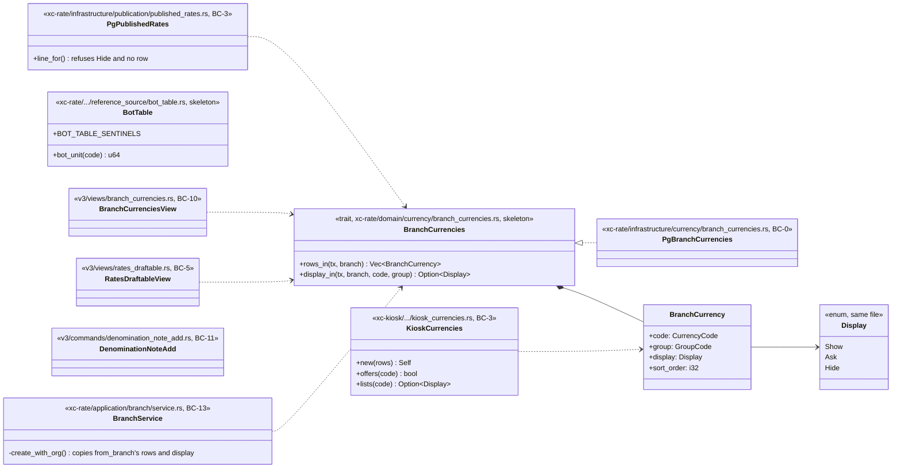

# The branch currency set: one table for every currency list

> designed-by: claude/94389a6b (sub-controller claude-19), 2026-11-04, on claude/608dff's orders · code read at main `67ca0b0e7`,
> `xc_v3` read-only the same day · survey with every row: #564 "SuperRich board currencies: survey"

## 0. Requirement

| When (ICT) | Owner's words | What it fixes |
|---|---|---|
| 2026-11-04 ~12:1x | *"ซื้อ ขาย ตามนี้"*, *"แยก คนไปทำ เพิ่ม ด้วย"* with a 43-row board screenshot | The desk buys and sells the board's list. Replaces #6072's Blueprint 9 |
| ~12:3x | the staff side will have many currencies: must they be linked? Controller's answer: yes, from one source | Feeds, quote, kiosk, staff count, transfer form and reports use one set. Stock held can always be counted out. A new currency gets its notes |
| 12:30 | *"มันต้อง link กัน โดยใช้ database ดิ"* | The set is a **table**, with FKs to `currencies` and `denominations`. It holds variant rows and the ASK flag. The hard-coded lists go |
| ~12:3x | *"มันต้องผูก จะให้คอนฟิกว่าจะแสดงหรือไม่แสดงได้"* | Each branch can set show or hide per currency in the admin UI, with no deploy and no SQL |
| ~13:0x | *"อนุมัติ (แนะนำ)"*, *"HIDE ขายไม่ได้ (แนะนำ)"*, *"จองไม่ได้ (แนะนำ)"*, *"ใช้ seed ตามดีไซน์ (แนะนำ)"*, the labels the owner chose ([owner answers](https://github.com/108-Plaza/xchange/pull/6073#issuecomment-6623877354)) | The §6 migration is approved. `HIDE` refuses the desk. `ASK` cannot be booked or quoted from the app. The §7 note seed is used |

The owner's orders were relayed by claude/608dff and then claude/022a7453. **The §6 migration is approved. Deploy is a separate owner order.**

The screenshot's figures are not targets: they match neither BOT nor SR, and only 9 of 29 priced rows equal TT (Q5 on #564).

## 1. Root cause

```
"the desk has only USD, EUR, JPY, CNY; staff count lists something else; the report shows six"
 ← each list decides for itself:
     desk, kiosk prices      published lines                       step.tsx:37, counter_view.rs:30
     kiosk default           literal 6                             kiosk_currencies.rs:8
     BOT feed                literal 6, three copies               bot_rows.rs:10, bot_api_rate_source.rs:18, bot_provider.rs:12
     report columns          literal 7                             staff_daily_report.rs:41
     staff count search      every code with notes                 CurrencyCount.tsx:35
     transfer form           every note row                        CashFlows.tsx:826
     board "more"            SR's list                             published_rates.rs:425
 ← there is no record of which currencies a branch handles
```

**The existing tables, checked (xc_v3, 2026-11-04):**

| Table | What it holds | Rows | Verdict |
|---|---|---|---|
| `kiosk_currencies` | `(branch_id, code, enabled)`, FKs to branches and currencies, plus `organization_id` | 0 | **This is the switch. Extend it** |
| `kiosk_settings` | one row per branch: `result_seconds` | 0 | no currency in it |
| `pricing_branch_policy` | `(branch_id, currency_code)` adjust points; `currency_code` may be `'*'`, no FK to currencies | 0 | pricing, keeps its own job |
| `pricing_modes` | per organisation, FOLLOW or MANUAL | 0 | not per branch |
| `denomination_group_sources` | group to provider row | 0 | a mapping, not a set |
| `rate_display_settings` | per branch: tiers, featured, order flags | 0 | board layout, not membership |

**The switch that exists today** (read at `67ca0b0e7`):
- **Screen:** `web/pages/kiosk-currencies.html`, `web/src/screens/kiosk-currencies/KioskCurrenciesScreen.tsx`, a per-currency checkbox.
- **Command:** `POST /api/kiosk` `configure` (`xc-kiosk/.../currencies.rs:29`), guarded by `RatesFirst`: a currency needs both sides published before it turns on.
- **Permission:** `Permission::RatesDraft` for `manage` and `configure` (`xc-auth/.../areas/kiosk.rs:28-29`).
- **Audit:** `KioskAudit::CurrencyConfigured` (`audit_line.rs:25`, written at `kiosk_ports.rs:88`).

**Not the switch:** `DisplaySettings` (PV-a3) orders the board, and `hidden` (PV-i) is computed from FOLLOW freshness (`published_rates.rs:220`). Nobody sets either per currency. PV-i keeps its job, and a FOLLOW line that is stale stays hidden on top of this setting.

## 2. Decisions

| # | Decision | Why |
|---|---|---|
| D-1 | **`kiosk_currencies` becomes `branch_currencies`**: one row per branch, currency and group, with `display` | Owner: a table, and extend rather than add. It has 0 rows, so the rename costs nothing in data |
| D-2 | **One setting, `display`, with three values: `SHOW`, `ASK`, `HIDE`.** It replaces `enabled` | ASK and show/hide are the same question: what does a customer see? Two columns would allow nonsense pairs such as hidden and ask |
| D-3 | **Rows are never deleted while stock exists.** Stopping a currency means `HIDE` | Stock must stay countable, and history keeps its row |
| D-4 | **`THB` has a row with `HIDE`** | THB is counted and reported but never quoted. No special list |
| D-5 | **Holdings always count.** Count and transfer lists read `branch_currencies` ∪ `inventory_positions` where `quantity <> 0` ∪ THB | Owner: stock can always be counted out, even with no row |
| D-6 | **Prices stay in publications.** The set says what the branch handles and shows; a publication says at what price | A `SHOW` row with no published line sells nothing (`rateUnavailable`), as today |
| D-7 | **`line_for` is the one gate for `HIDE`** (`published_rates.rs:135`), and refuses a missing row too | Desk, kiosk, booking, planner and alert all read through it (§4) |
| D-8 | **BOT stores every row it receives; what is used is chosen by the set** | See §5. The set selects, and a fetch cannot be chosen per branch: the batch is shared |
| D-9 | **Notes come from a seed and then from one admin command** (§7) | 33 of the 39 board currencies have no notes on xc_v3 |
| D-10 | **A variant is a group row.** `MYRS` = `(MYR, 'MYRS')`, `CNYS`, `KRWS`, `INRS`; `SCP` = `(GBP, 'SCP')`. `branch_currency_notes` says which notes it prices | Groups exist from F3; `quote.rs:201` and `line_for` already select by group |

## 3. The display setting

| `display` | Kiosk | Board and public feed | Customer app and booking | Desk quote | Count and transfer | Reports |
|---|---|---|---|---|---|---|
| `SHOW` | listed and priced | listed and priced | allowed | allowed | yes | yes |
| `ASK` | listed, `quoteEnabled:false`, "contact staff" | in `more`, "contact the counter", never a price | refused | **allowed** when a line is published | yes | yes |
| `HIDE` | not listed | not listed | refused | **refused** and not in the picker | **yes, for stock held** | yes |

**Hidden answers the controller's question:** hidden means no kiosk, board, app or booking shows it, and the desk cannot quote it. Count and transfer of held stock still work.

**Decided by the owner** ([owner answers](https://github.com/108-Plaza/xchange/pull/6073#issuecomment-6623877354)): the desk is refused on `HIDE`, and `ASK` cannot be booked or quoted from the app. A currency the desk should still sell while customers see nothing is `ASK`.

**Already issued:** a quote or booking made before a hide keeps its stored line (`line_by_id`), because the customer was told that price. `[proposed]`.

**Screen, permission and audit:**

| Item | What |
|---|---|
| Screen | the existing `web/pages/kiosk-currencies.html`. The checkbox becomes a three-way control, and the list comes from the branch's rows, with an add-currency control |
| Permission | the existing `Permission::RatesDraft`: `Kiosk/manage` and `Kiosk/configure`. No new permission |
| Command | the existing `configure`, with `{code, group, display}` in place of `enabled`. The add goes through the same command |
| Guards | `SHOW` needs both sides published (`RatesFirst`, kept). `SHOW` and `ASK` need at least one note (new, `NotesFirst`). THB stays `HIDE` |
| Audit | the existing row: action `KioskAudit::CurrencyConfigured`, `subject` = code, plus `{ "group", "display", "from" }`, written in the same transaction by `record_in`. Who and when as today |
| Effect | at once, on the next read. No deploy and no SQL |

## 4. Every list and what it reads

| List | Today | After | Ticket |
|---|---|---|---|
| Rate feed BOT | literal 6 | all rows; sentinels only judge whole table (§5) | BC-1, BC-2 |
| Add to a draft | `rates_reference` rows | `rates_draftable` view: rows with `SHOW` or `ASK` not in the draft, `unitSize` from `currencies`, `hasReference` from the newest BOT batch | BC-5, BC-6 |
| Publish | any known code | refuses a line with no row. `HIDE` lines may publish, so a re-shown currency has a fresh price | BC-7 |
| Market follow loop | every mode row | skips `HIDE` rows | BC-7 |
| Desk picker | published codes | published ∩ `display <> 'HIDE'` | BC-8 |
| Desk, booking and app quote | `line_for` | `line_for` refuses `HIDE`; `quote.rs` refuses `ASK` when the channel is not `Desk` | BC-3, BC-4 |
| Kiosk | literal 6 + switches | `KioskCurrencies` from rows: `SHOW` offers, `ASK` lists as contact staff, `HIDE` absent. `DEFAULT_CODES` goes | BC-3 |
| Board `more` | SR's list | `ASK` rows | BC-9 |
| Staff count | every note row | `branch_currencies` view (below) | BC-10 |
| Transfer, receive and handover forms | every note row | the same view, through #6074 re-cut (§10) | #6074 |
| Staff daily report | literal 7 | set ∪ holdings ∪ counted that day, by `sort_order` | BC-4 |
| Other money reports | no currency literal found | sweep at skeleton | — |

`[required]` A new v3 view `branch_currencies`, inheriting `cashCounts` as `denominations` does, returns the union of D-5:
`{code, group, display, sortOrder, held: bool}`. It says **which currencies** a staff form may list. The `denominations` view keeps saying **which notes** each has, so its readers and each form's submit code stay as they are.

`[required]` `CurrencyCount` gains an optional prop `countable?: string[]`: its search lists only those codes that also have notes. Left out, it behaves as today. A currency held with no notes is listed with the hint to add its notes (§7).

**`HomeScreen.tsx:204`** is a literal 9 used when a customer's branch has no lines. It goes in BC-9 and the existing `empty` state answers instead.

## 5. BOT

BOT is a shared source: one batch for all branches. So it keeps every row with a code in the register, and the set chooses what is used.

**Flag for review:** the 6-row sentinel below is a literal. It is not an offered list, but the order says remove the hard-coded lists, so I state the choice. `parse` has no transaction, so it cannot read the table. Without it a cut-off table is stored as `COMPLETE`, and all recorded v2 refusals (`no USD` … `no AUD`) would flip.

| Item | Rule |
|---|---|
| `BOT_TABLE_SENTINELS` | today's six, in `reference_source/bot_table.rs`, judging whether the table is whole. Used by `bot_rows`, the API source's period choice, and `complete` |
| Sentinel row with a bad side or date | refuses the table, as today |
| Other row with a non-positive or `"-"` side | that side is `null`; `original` keeps the text. BOT prints `"-"` on 29 of 48 rows |
| Other row with a bad date | dropped |
| Code not in the register | dropped |

**Units**, `bot_unit(code)`: BOT's table has no unit field, and `bot_rows.rs` assumes 1 except JPY.

| Code | BOT's name | Printed | Others, per 1 | Unit | Basis |
|---|---|---|---|---|---|
| JPY | `JAPAN : YEN (100 YEN)` | 21.08 | SR 0.213 | 100 | named |
| IDR | `INDONESIA : RUPIAH (1,000 RUPIAH)` | 1.7662 | SR 0.00186, TT 0.00177 | 1000 | named |
| VND | `VIET NAM : DONG(VND)` | 0.1303 | SR 0.0013, TT 0.00126 | 100 | **inferred**, two sources |
| LAK | `LAO … : KIP(LAK)` | 0.1491 | SR 0.0012–0.0016 | 100 | **inferred**, one source |
| KHR | `CAMBODIA : RIEL(KHR)` | 0.8219 | none measured | 100 | **inferred** from about 4,000 riel per USD. Not on the board |
| KRW | `SOUTH KOREA : WON (KRW)` | 0.0249 | SR 0.0251 | 1 | ratio 0.99 |

`rate_proposal.rs:53` already rescales `ref × unit_size ÷ ref.unit_size`, so no draft code changes.

**One recorded v2 behaviour is reversed on purpose.** The case `the six currencies, in the bank's order, the rest dropped` expects the rest dropped, and 52 of the fixture's 72 bodies hold other codes, which corrects the note on #6072 that they occur 0 times. The controller restates `every_recorded_case_is_answered_as_v2_answered_it` up front to compare the six and assert the others are kept. The fixture stays as recorded.

## 6. Migration and data migration

**Approved by the owner** ([owner answers](https://github.com/108-Plaza/xchange/pull/6073#issuecomment-6623877354)). Slot from `scripts/migration-slot.sh next`, `20261226200000` at 13:05 ICT; renumber before merge.

```sql
-- 1. Extend the switch. xc_v3 has 0 rows here.
ALTER TABLE kiosk_currencies RENAME TO branch_currencies;
ALTER TABLE branch_currencies RENAME COLUMN code TO currency_code;
ALTER TABLE branch_currencies
    ADD COLUMN group_code text NOT NULL DEFAULT 'ALL',
    ADD COLUMN display    text NOT NULL DEFAULT 'HIDE' CHECK (display IN ('SHOW','ASK','HIDE')),
    ADD COLUMN sort_order integer NOT NULL DEFAULT 1000,
    ADD COLUMN updated_by text,
    ADD COLUMN updated_at timestamptz;
UPDATE branch_currencies SET display = CASE WHEN enabled THEN 'SHOW' ELSE 'HIDE' END;
ALTER TABLE branch_currencies DROP COLUMN enabled;
ALTER TABLE branch_currencies DROP CONSTRAINT kiosk_currencies_pkey;
ALTER TABLE branch_currencies ADD PRIMARY KEY (branch_id, currency_code, group_code);
-- Constraint names read from xc_v3; the rest of the kiosk_currencies_* FKs keep working under their old names.

-- 2. Notes may be linked, and cannot repeat.
ALTER TABLE denominations ADD CONSTRAINT denominations_id_currency UNIQUE (id, currency_code);
CREATE UNIQUE INDEX denominations_note
    ON denominations (organization_id, currency_code, group_code, face_value) WHERE face_value IS NOT NULL;

CREATE TABLE branch_currency_notes (
    branch_id       text    NOT NULL,
    currency_code   char(3) NOT NULL,
    group_code      text    NOT NULL,
    denomination_id bigint  NOT NULL,
    PRIMARY KEY (branch_id, currency_code, group_code, denomination_id),
    FOREIGN KEY (branch_id, currency_code, group_code)
        REFERENCES branch_currencies (branch_id, currency_code, group_code),
    FOREIGN KEY (denomination_id, currency_code)
        REFERENCES denominations (id, currency_code)
);

-- 3. Seed: notes (§7), then MAIN's rows and links (below).
```

**Seed for MAIN, 45 rows:**

| `display` | Rows | Why |
|---|---|---|
| `SHOW` (4) | USD, EUR, JPY, CNY | publication v5's lines. No change at the counter |
| `ASK` (14) | NZD, SGD, VND, IDR, TRY, JOD, DKK, SEK, NOK, and groups MYRS, CNYS, KRWS, INRS, `(GBP,'SCP')` | the board marks them ASK |
| `HIDE` (27) | THB and the 26 priced board currencies with no line yet: GBP, AUD, CHF, BND, MYR, PHP, TWD, HKD, CAD, KRW, INR, AED, QAR, SAR, OMR, BHD, KWD, ZAR, MMK, LAK, PKR, NPR, BDT, ILS, MOP, RUB | they turn `SHOW` when priced, because `RatesFirst` refuses `SHOW` with no line |

`sort_order`: THB, USD, EUR, GBP, JPY, CNY, AUD first (v2's report look, B.1 row 13), then board order.

**Answers the four questions:**

1. **Existing rows after it:**
   - `kiosk_currencies`: 0 rows on xc_v3. Elsewhere `enabled` becomes `SHOW` or `HIDE`.
   - `denominations`: unchanged, 0 duplicates measured, so the index builds. New rows are added.
   - `published_rate_lines`, `inventory_positions`: unchanged. MAIN holds CNY, EUR, JPY, USD, all `SHOW`.
   - The other branch `B9082fb61-…` has no publication and no stock, so it gets no rows. Holdings and THB still let it count.
2. **Backfill:** the seed above is in the migration. Measure before deploy:
   `SELECT (SELECT count(*) FROM kiosk_currencies), (SELECT count(*) FROM inventory_positions WHERE quantity<>0), (SELECT count(*) FROM denominations WHERE face_value IS NOT NULL);` — 0, 4, 75 on 2026-11-04.
3. **Deploy order:** the migration runs at server start (`bootstrap/mod.rs:346`), so migration and binary change together. **The old binary does not work on the new schema**: it reads `kiosk_currencies`. A rollback must restore the database too. Deploy only on an owner order, outside the freeze.
4. **What `down` loses:** `branch_currency_notes`, every `ASK`, `sort_order` and group row, and the seeded notes unless no count used them. `HIDE` and `SHOW` map back to `enabled`.

**Effect at the counter after deploy:** the same four currencies sell. The board's `more` list changes from SR's list to the 14 `ASK` rows. **A kiosk with no rows now offers nothing**, where the literal offered six: MAIN has rows, and the other branch has no publication anyway.

**New branches:** `BranchService::create_with_org` (`xc-rate/src/application/branch/service.rs`, reached through `create` and `create_in`) copies the rows and note links of `cmd.from_branch`, the branch creating it, keeping each row's `display` (`SHOW`, `ASK` or `HIDE`) as it is, in the same transaction (BC-13; owner ruling 2026-11-05 10:38 ICT, *"แสดงให้หมด คือ default"*, #6266, reversing the initial all-`HIDE` rule). `SHOW` still requires a published rate at configure time and when quoting, so a copied `SHOW` row on a new branch with no prices yet quotes nothing until rates exist, and the kiosk shows contact-staff. Copying from `from_branch`, not MAIN, keeps it inside the organisation, which `create_with_org` already checks.

## 7. How a currency gets its notes

**Measured on xc_v3:** only CNY, EUR, GBP, JPY, KRW, THB and USD have notes, 75 rows from the seed at `20261012100000_cash.sql:227`. **33 of the 39 board currencies have none, and nothing in the app can add one**: `denominationGroupCreate` inserts a `NULL` face (`denomination_group_service.rs:74`), and no other production writer exists.

1. **Seed** in the migration: the table below.
2. **Add afterwards:** a new command `denominationNoteAdd {currency, group, faceValue}`, on the existing `denomination-groups` screen, with the same permission and audit as `denominationGroupCreate`. It is add-only, and repeats are idempotent. Notes referenced by counts, transfers or lots stay, by FK.
3. **Linked to a branch:** `configure` links a new row to all notes of that currency and group that no other group of the row's currency takes. **`SHOW` and `ASK` refuse a currency with no notes (`NotesFirst`)**, which tells staff why.

**Note seed, decided by the owner** ([owner answers](https://github.com/108-Plaza/xchange/pull/6073#issuecomment-6623877354)). These come from public note series, bounded by SR's bands where SR has them, not from a measured source. Further notes are added on the denomination-groups screen.

| Code | Notes | Code | Notes |
|---|---|---|---|
| AED | 5 10 20 50 100 200 500 1000 | MOP | 10 20 50 100 500 1000 |
| AUD | 5 10 20 50 100 | MYR | 1 5 10 20 50 100 |
| BDT | 10 20 50 100 500 1000 | NOK | 50 100 200 500 1000 |
| BHD | 0.5 1 5 10 20 | NPR | 50 100 500 1000 |
| BND | 1 5 10 20 50 100 500 1000 10000 | NZD | 5 10 20 50 100 |
| CAD | 5 10 20 50 100 | OMR | 1 5 10 20 50 |
| CHF | 10 20 50 100 200 1000 | PHP | 20 50 100 200 500 1000 |
| DKK | 50 100 200 500 | PKR | 50 100 500 1000 5000 |
| HKD | 10 20 50 100 500 1000 | QAR | 1 5 10 50 100 200 500 |
| IDR | 1000 2000 5000 10000 20000 50000 100000 | RUB | 10 50 100 200 500 1000 2000 5000 |
| ILS | 20 50 100 200 | SAR | 1 5 10 20 50 100 200 500 |
| INR | 10 20 50 100 200 500 | SEK | 20 50 100 200 500 1000 |
| JOD | 1 5 10 20 50 | SGD | 2 5 10 50 100 1000 |
| KWD | 0.25 0.5 1 5 10 20 | TRY | 5 10 20 50 100 200 |
| LAK | 5000 10000 20000 50000 100000 | TWD | 100 200 500 1000 2000 |
| MMK | 500 1000 5000 10000 | VND | 10000 20000 50000 100000 200000 500000 |
| | | ZAR | 10 20 50 100 200 |

**Variants, link only:**

| Row | Notes | Basis |
|---|---|---|
| `(MYR,'MYRS')` | 5 10 20 | the board. `ALL` keeps 1 50 100 |
| `(CNY,'CNYS')` | 5 10 20 | the board. `ALL` keeps the rest; existing rows stay |
| `(INR,'INRS')` | 100 200 | the board |
| `(KRW,'KRWS')` | **open**: the board gives no notes. SR's small band is 1000 | **owner**. The row is seeded with no links |
| `(GBP,'SCP')` | **open**, proposed 5 10 20 50 100 as new `denominations` rows with `group_code 'SCP'`, because Scottish notes are separate stock | **owner**. The row is seeded with no notes |

Neither open row blocks the migration. Both are seeded `ASK` per the approved 45 rows, and the seed bypasses `NotesFirst`, which guards `configure`. Their notes come later through `denominationNoteAdd`, with no further migration.

Variant rows share a note's stock: a 5-yuan note is one physical note whichever line prices it, so count lines are per note, and the screen shows each note once.

## 8. Class diagram



| Provider | Used by | If not landed |
|---|---|---|
| migration + `BranchCurrencies` trait + `Display` (BC-0) | every ticket but BC-1 and BC-2 | they wait for BC-0's skeleton on `feat/board-currencies` |
| `BotTable` (skeleton) | BC-1, BC-2 | nothing waits |
| `branch_currencies` view DTO (skeleton) | BC-10 | nothing waits |
| `branch_currencies` view and `countable` (BC-10) | #6074 re-cut | #6074 stays on hold until BC-10 is on the feature branch |

New v3 views, DTO modules and commands need no `mod.rs` edit (`api/build.rs:154,168`).

## 9. Behaviour

**Kept as today:** a table missing a sentinel is refused; `KRW` reference stays unit 1 and its draft proposes per 1000; the four published currencies sell unchanged; `RatesFirst` holds; PV-i's FOLLOW `hidden` still applies on top.

| Case | Required result | Ticket |
|---|---|---|
| BOT's real table of 2026-11-03 | 48 rows, each with §5's unit | BC-1 |
| `"-"` on KRW's sight; `"-"` on USD | row kept with `null`; table refused | BC-1 |
| bad date on a non-sentinel; unknown code | row dropped, table accepted | BC-1 |
| recorded v2 success and refusal cases | six rows equal v2's plus others; refused as recorded | BC-1 |
| newest API period missing EUR | older whole period chosen | BC-2 |
| `line_for`: `SHOW` / `ASK` with a line | the line | BC-3 |
| `line_for`: `HIDE`, or no row | `None`, so `rateUnavailable` | BC-3 |
| kiosk: `SHOW` / `ASK` / `HIDE` | priced / `quoteEnabled:false` / absent | BC-3 |
| quote, `Desk` on `ASK` with a line | quoted | BC-4 |
| quote, `Booking`, `App`, `Kiosk` on `ASK` | refused | BC-4 |
| report: no counts | the set, by `sort_order` | BC-4 |
| report: KWD held but `HIDE` | listed with real figures, 3 places intact | BC-4 |
| `rates_draftable`: KRW; TRY; `HIDE` row | `{KRW,1000,true}`; `{TRY,1,false}`; absent | BC-5 |
| card adds TRY; adds KRW | MANUAL/MANUAL; AUTO/AUTO, per 1000 | BC-6 |
| publish a line with no row | refused `validationFailed` | BC-7 |
| desk picker with a `HIDE` line | not listed | BC-8 |
| board `more` | exactly the `ASK` rows | BC-9 |
| count view: USD `HIDE`, stock held | listed, `held:true` | BC-10 |
| count view: currency held with no row | listed with all its notes | BC-10 |
| count view: AED `HIDE`, no stock | listed: every row of the branch can be chosen | BC-10 |
| transfer form | same list as count | BC-10 |
| `configure` `SHOW` with no line | refused `RatesFirst` | BC-12 |
| `configure` `ASK` with no notes | refused `NotesFirst` | BC-12 |
| `configure` THB | refused, as today | BC-12 |
| `configure` | one audit row with `from` and `display`, same transaction | BC-12 |
| user without `RatesDraft` | refused, as today | BC-12 |
| `denominationNoteAdd` twice | one row, idempotent | BC-11 |
| new branch from `B` | `B`'s rows (with their `display`) and note links; same transaction as the branch | BC-13, #6266 |
| new branch, `B` has no rows | created, no rows | BC-13 |
| `CurrencyCount` with `countable` | search lists only those codes with notes | BC-10 |
| `CurrencyCount` without `countable` | as today | BC-10 |

## 10. Tickets

BC-0 is the skeleton and the migration, on `feat/board-currencies`, once this doc merges. Then BC-1…BC-13 release together, with disjoint scopes.

| # | Outcome | Files | Class | Fits |
|---|---|---|---|---|
| BC-0 | migration, trait, `Display`, `BotTable`, DTOs, up-front tests | migration, skeleton files | controller | — |
| BC-1 | `bot_rows` per §5 | `bot_rows.rs` | logic | any |
| BC-2 | API source and provider read sentinels | `bot_api_rate_source.rs`, `bot_provider.rs` | mechanical | warut |
| BC-3 | `line_for`, kiosk from rows, repository | `published_rates.rs`, `kiosk_currencies.rs`, `kiosk_repository.rs` | logic | Studio |
| BC-4 | `ASK` refusal by channel, report columns | `quote.rs`, `staff_daily_report.rs` | logic | Studio |
| BC-5 | `rates_draftable` view | `views/rates_draftable.rs` | logic | any |
| BC-6 | draft card reads it | `draftable-currencies.ts`, `RatesDraftCard.tsx`, `Rates.tsx` | logic | any |
| BC-7 | publish refusal, follow loop skips `HIDE` | `publish_service.rs`, `market_pricing_loop.rs` | logic | any |
| BC-8 | desk picker | `published-rates.ts`, `steps/rate/step.tsx`, DTO field | logic | any |
| BC-9 | board `more`, `HomeScreen` fallback | `published_rates.rs` view, `HomeScreen.tsx` | logic | any |
| BC-10 | `branch_currencies` view; count form reads it | `views/branch_currencies.rs`, `CountForm.tsx`, `CurrencyCount.tsx` | logic | any |
| BC-11 | `denominationNoteAdd` and its screen | new command, `DenominationGroups.tsx` | logic | any |
| BC-12 | `configure` extended; three-way screen | `currencies.rs`, `audit_line.rs`, `kiosk_ports.rs`, `KioskCurrenciesScreen.tsx`, `kiosk-api.ts` | guarded | Studio |
| BC-13 | a new branch copies the set and display (#6266) | `xc-rate/src/application/branch/service.rs`, `xc-rate/src/domain/branch/repositories/branch_repository.rs`, `xc-rate/src/infrastructure/branch/branch_repository.rs` | logic | any |

**#6074 (`CurrencyCount` on the four cash forms) is re-cut against the view, not absorbed by BC-10.**
- **Why not absorb:** #6074 already has 14 files in scope, its own provided tests on `test/cc-cash-forms` and 36 pinned tests. BC-10 would stop being one reviewable outcome. The scopes are disjoint today: #6074 forbids touching `CurrencyCount.tsx` and `CountForm.tsx`, which BC-10 owns.
- **The re-cut, by its opener claude/01TxaRJG, after BC-10 is on `feat/board-currencies`:** base and PR target `feat/board-currencies`. Each of F1–F4 reads `branch_currencies` and passes `countable`. F1 reads it for the branch the form names. F3 (receive) also adds the transfer's line currencies, because a branch must be able to receive what another branch sends, even with no row. If the read fails, the form lists only its `locked` currencies, as #6074's F4 rule does. The provided tests gain the view's route.
- **Unchanged:** #6074's `locked` rules, form submit code, and `denominations` reads.

**Tests that pin today:** the kiosk tests (`kiosk_currencies_test.rs`, `kiosk_service_test.rs`, `kiosk_service_common/mod.rs`, `v3_kiosk_currencies_*`, `rate_feed_kiosk_tier_test.rs`, `v9_pricing_kiosk_test.rs`) and report tests. **Every test that publishes a line on its own branch and then quotes needs a row, because `line_for` refuses without one.** That is the biggest churn here. The exact list comes from a throwaway run of the touched crates before tickets are cut. A shared test helper seeds rows; it is in BC-0.

## 11. Open questions on #564

| Q | Status |
|---|---|
| Q1 price per new line | open; data entry, no code |
| Q2 ASK | **decided:** a flag in the table; `ASK` cannot be booked or quoted from the app ([owner answers](https://github.com/108-Plaza/xchange/pull/6073#issuecomment-6623877354)) |
| Q3 variants | **answered: in the table.** Open: the desk picker for groups stays a second wave, so variant rows are ASK-only until then |
| Q4 SCP | **open.** GBP group proposed, §7; the row is seeded and its notes wait for the owner |
| Q5 reading | open |
| Migration §6 | **approved** ([owner answers](https://github.com/108-Plaza/xchange/pull/6073#issuecomment-6623877354)) |
| Note seed §7 | **decided:** used as designed ([owner answers](https://github.com/108-Plaza/xchange/pull/6073#issuecomment-6623877354)) |
| `HIDE` refuses the desk | **decided** ([owner answers](https://github.com/108-Plaza/xchange/pull/6073#issuecomment-6623877354)) |
| KRWS notes | **open**, §7 |
| Issued quotes and bookings keep their line after a hide | `[proposed]` in §3; not asked yet |

## 12. Rollout

Deploy on an owner order only. After it the counter is unchanged, apart from the board's `more` list. To open a currency: an Executive adds its guard and line on #rates, publishes, then sets `SHOW` on kiosk-currencies. A line with no guard is out of bound (`rates-draftable-currencies.md` §1), so the guard numbers for up to 35 new currencies are part of Q1's work.

## 13. As built

Read on main at the merge `ba6ba7daa` (PR 6121). Where this differs from the sections above, this section is right.

| Topic | Design said | As built | Where |
|---|---|---|---|
| Saving a display | `configure` takes `{code, group, display}` in place of `enabled` (§3) | A second path, `configure_display`, sits beside `configure`. The old `configure` and `set_switch_in` remain | `api/crates/xc-kiosk/src/application/kiosk/currencies.rs:31`, `:78` |
| Board `more` | exactly the `ASK` rows (§4, §9) | The `ASK` rows with no shown line, and only when the branch lists the whole market (`allMarket`). Otherwise it is empty. Codes are bare and de-duplicated, so a variant row shows as its currency code | `api/src/presentation/http/v3/views/published_rates.rs:468` |
| Desk picker | ticket BC-8 of its own (§10) | One filter in BC-3: `PgPublishedRates::sellable` drops `HIDE` and no-row lines, and the picker reads it | `api/src/presentation/http/v3/desk/config.rs:61` |
| Admin screen | the display of a branch's rows is set here (§3) | The screen and the view handle group `ALL` only, so the five variant rows (`MYRS`, `CNYS`, `KRWS`, `INRS`, `SCP`) cannot be set from it | `web/src/screens/kiosk-currencies/KioskCurrenciesScreen.tsx` |
| `SHOW` on a variant | variants are `ASK` only for now | `published_both_sides_in` checks the `ALL` line whatever the group, so the API accepts `SHOW` on a variant with no line of its own. The screen cannot send it | `api/crates/xc-kiosk/src/application/kiosk/currencies.rs` |
| Screen wording | two languages | `SHOW`, `ASK` and `HIDE` are hard-coded English, and `displayOf` keeps a fallback to `enabled` that the server never triggers | `KioskCurrenciesScreen.tsx:30` |
