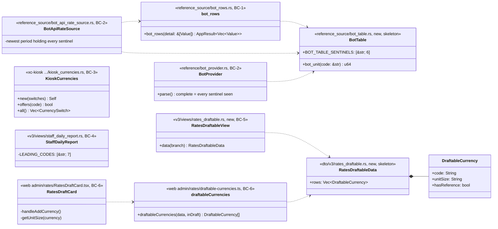

# The desk buys and sells the board's currencies

> designed-by: claude/94389a6b (sub-controller claude-19), 2026-11-04, on claude/608dff's order · code read at main `67ca0b0e7`,
> `xc_v3` read-only the same day · survey with every row: #564 "SuperRich board currencies: survey"

## 0. Requirement

The owner sent a rate-board screenshot of 43 rows on 2026-11-04 and wrote *"ซื้อ ขาย ตามนี้"* and *"แยก คนไปทำ เพิ่ม ด้วย"*. This widens
*"เอาตาม พิมพ์ เขียว"* (#6072, the Blueprint's 9), so #6072's scope is replaced by this design.

**Read as:** the desk can buy and sell every currency on the board. The screenshot's figures are not targets: they match neither BOT nor SR,
and only 9 of 29 priced rows equal TT. That reading is question Q5 on #564.

**This design covers the set and the feeds.** Which price each new line carries (Q1), what ASK means at the counter (Q2), and the variant rows
(Q3, Q4) are the owner's, and §7 says what each answer changes.

## 1. Root cause

The desk already takes its list from data. The picker is `publishedCodes(store.config()?.rates, …)`
(`web/src/screens/desk/steps/rate/step.tsx:37`), and no line means `rateUnavailable`. So **a branch offers what its current publication has**.
The symptom is that the owner cannot get a new currency into a publication, or the kiosk and report drop it afterwards:

```
"the desk has only USD, EUR, JPY, CNY"
 ← MAIN publication v5 has 4 lines                         (xc_v3: CNY,EUR,JPY,USD)
 ← the add-currency list offers only BOT's codes            draftable-currencies.ts → rates_reference.rows
 ← rates_reference reads state.rate_source, the BOT source  views/rates_reference.rs:232
 ← bot_rows keeps a literal 6                               reference_source/bot_rows.rs:10,38
```

The literal has copies: `bot_provider.rs:12` (`complete`), `bot_api_rate_source.rs:18,175,180` (which period is whole), `kiosk_currencies.rs:8`
(kiosk default), `staff_daily_report.rs:41` (report columns), and a literal 9 in `HomeScreen.tsx:204`.

**Not a cause:** `currencies` has all 39 codes on xc_v3, with `unit_size` JPY 100, KRW 1000, the rest 1. SR and TT feeds already keep what they
receive (SR 39 codes, TT 32).

## 2. Decisions

| # | Decision | Why |
|---|---|---|
| D-1 | **The publication is the one place that decides what a branch offers.** No new table and no offered-set constant | The desk and the kiosk's `view.offered` already read it, and publishing already has approval and audit. A second list could disagree with it. This also replaces #6072's `DESK_CURRENCIES` |
| D-2 | **BOT keeps every row it receives.** Unknown codes (`CurrencyCode::parse` fails) are dropped, as the market writer does | `rate_reference_lines.currency_code` references `currencies`. A new BOT code must not fail the batch |
| D-3 | **A short sentinel list judges whether BOT's table is whole**: `BOT_TABLE_SENTINELS`, today's six. It says "this table is not cut off", not "we sell these" | Removing the check entirely would accept a cut-off table as `COMPLETE`. Keeping today's six also keeps every recorded v2 *refusal* valid (`no USD` … `no AUD`, `the dollar twice`), which #6072's nine would have turned against the recorded tables |
| D-4 | **A sentinel row with a bad side or date refuses the table, as today. Any other row with a non-positive or `"-"` side keeps that side `null`, and any other row with a bad date is dropped** | BOT prints `"-"` on 29 of 48 rows. One exotic row must not stop USD. v2 already did not look at bad rows outside its six (recorded cases `a bad rate in a currency v2 does not keep…`, `a bad date…`) |
| D-5 | **BOT's unit comes from one table, `bot_unit(code)`**: JPY 100, IDR 1000, VND 100, LAK 100, KHR 100, else 1 | See §3 |
| D-6 | **The kiosk offers what is published unless the branch switched it off.** `DEFAULT_CODES` goes | `view.offered` already intersects with the publication. Measured: `kiosk_currencies` has 0 rows on xc_v3 |
| D-7 | **The staff report shows v2's seven first, then any other code counted that day, A to Z** | The literal hides a counted currency from a money report. The seven stay for B.1 row 13's look |
| D-8 | **The add list and the unit come from a new view, `rates_draftable`**: register codes in the newest BOT or SR batch, each with `unitSize` and `hasReference` | TRY and MOP have no BOT row. And `RatesDraftCard.tsx` `getUnitSize` falls back to the reference row's unit, which is wrong for a new KRW line (BOT 1, register 1000) and a new IDR line (BOT 1000, register 1) |
| D-9 | **A line with no BOT reference starts `MANUAL` / `MANUAL`.** Others start `AUTO` / `AUTO`, as today | An AUTO side with no reference has nothing to price from |

## 3. BOT's units

BOT's table has no unit field. Only two names state one.

| Code | Name in BOT's table | Printed | Others, per 1 | Unit | Basis |
|---|---|---|---|---|---|
| JPY | `JAPAN : YEN (100 YEN)` | 21.08 | SR 0.213 | 100 | named |
| IDR | `INDONESIA : RUPIAH (1,000 RUPIAH)` | 1.7662 | SR 0.00186, TT 0.00177 | 1000 | named |
| VND | `VIET NAM : DONG(VND)` | 0.1303 | SR 0.0013, TT 0.00126 | 100 | **inferred**: ratio 100, two sources |
| LAK | `LAO … : KIP(LAK)` | 0.1491 | SR 0.0012–0.0016 | 100 | **inferred**: ratio 93–124, one source |
| KHR | `CAMBODIA : RIEL(KHR)` | 0.8219 | none measured | 100 | **inferred** from about 4,000 riel per USD. Not on the board |
| KRW | `SOUTH KOREA : WON (KRW)` | 0.0249 | SR 0.0251 | 1 | ratio 0.99 |

`[required]` A one-day ratio is the basis for VND, LAK and KHR, so BC-1's test pins each against the recorded fixture, with this table cited. The other
board rows were compared with SR; none but these is near a power of ten away. Non-board rows other than KHR have no priced SR or TT row to compare.

`rate_proposal.rs:53` already rescales `ref × currency.unit_size ÷ ref.unit_size`, so no writer or draft code changes.

## 4. Class diagram



Paths are under `api/crates/xc-rate/src/infrastructure/` for the first four, and under `api/src/presentation/` for the view and DTO.
New v3 views and DTO modules need no `mod.rs` edit: `api/build.rs:154,168` generates both tables from the directories. `bot_table.rs` needs one
`pub mod` line in `reference_source/mod.rs`, in the skeleton.

| Provider | Used by | If not landed |
|---|---|---|
| `BotTable` (skeleton, complete there) | BC-1, BC-2 | nothing waits: it lands on `feat/board-currencies` first |
| `RatesDraftableData` + generated TS (skeleton) | BC-5, BC-6 | nothing waits: BC-6 tests against a fixture of the type |

## 5. Behaviour

**Kept as today:**
- A table missing any sentinel is refused by `bot_rows`, and `complete = false` for the provider.
- A sentinel row with a bad side refuses the table.
- A branch's publication does not change on deploy. `branch_refresh.rs` copies only the lines a published draft has, so **nothing new is sold until someone publishes it**.
- A switch stored as off keeps a currency off the kiosk.
- `KRW` reference stays unit 1. Its draft proposes 24.9 / 25.2 per 1000.

| Case | Required result | Ticket |
|---|---|---|
| BOT's real table of 2026-11-03 (48 rows) | 48 rows out, each with the unit of §3 | BC-1 |
| `buying_sight "-"` on KRW | row kept, `buyingSight: null`, `original.buyingSight: "-"` | BC-1 |
| `"-"` on `buying_transfer` of a non-sentinel | row kept, that side `null` | BC-1 |
| `"-"` on a side of USD | whole table refused, as today | BC-1 |
| a code not in the register | row dropped, table accepted | BC-1 |
| duplicate code in a table | refused, as today | BC-1 |
| a bad date on a non-sentinel | that row dropped, table accepted | BC-1 |
| recorded v2 success cases | the six rows equal v2's answer, in the bank's order, plus the table's other rows. Fixture untouched | BC-1 |
| recorded v2 refusal cases | refused, as recorded | BC-1 |
| API period holding the six plus others | that period is chosen, all its rows returned | BC-2 |
| newest API period missing EUR | the older whole period is chosen, as today | BC-2 |
| SGD missing from a batch | `complete = true`; SGD has no reference line | BC-2 |
| no switches at the branch | `offers(SGD) = true`, `offers(USD) = true` | BC-3 |
| switch `SGD` off | `offers(SGD) = false` | BC-3 |
| kiosk public rates, MAIN with 4 lines, no switches | exactly those 4 | BC-3 |
| report: no counts that day | the seven, in today's order | BC-4 |
| report: KWD counted | the seven, then KWD with its real figures, 3 places intact | BC-4 |
| `rates_draftable`: TRY in SR, not BOT | `{TRY, 1, hasReference:false}` | BC-5 |
| `rates_draftable`: KRW | `{KRW, 1000, hasReference:true}`, the register's unit | BC-5 |
| `rates_draftable`: THB | absent | BC-5 |
| a caller `rates_reference` refuses | refused the same way: the view inherits the same route entry (`rates_reference.rs:192`) | BC-5 |
| add TRY in the card | line starts MANUAL / MANUAL | BC-6 |
| add KRW in the card | line starts AUTO / AUTO; shows per 1000 | BC-6 |
| view unreadable | nothing to add, the existing hint | BC-6 |

## 6. Tickets

One skeleton commit on `feat/board-currencies`, then all six released together. Scopes do not intersect, so all six can lease at once.

| # | Outcome | Files | Class |
|---|---|---|---|
| skeleton | `BotTable` complete with its unit test, `RatesDraftableData`, generated TS, up-front tests | `bot_table.rs`, `reference_source/mod.rs`, `dto/v3/rates_draftable.rs` | controller |
| BC-1 | `bot_rows` keeps every registered row, per D-4 and D-5 | `bot_rows.rs` | logic |
| BC-2 | API source and provider read the sentinels | `bot_api_rate_source.rs`, `bot_provider.rs` | mechanical |
| BC-3 | kiosk per D-6 | `kiosk_currencies.rs`, kiosk tests | logic |
| BC-4 | report per D-7 | `staff_daily_report.rs`, its test | logic |
| BC-5 | `rates_draftable` view | `views/rates_draftable.rs` | logic |
| BC-6 | card and list read it, per D-8 and D-9 | `draftable-currencies.ts`, its test, `RatesDraftCard.tsx`, `Rates.tsx` | logic |

**Tests that pin today:** claude/b091f5e0's throwaway listed the kiosk pins (`kiosk_currencies_test.rs`, `kiosk_service_test.rs`,
`kiosk_service_common/mod.rs`, `v3_kiosk_currencies_view_test.rs`, `v9_pricing_kiosk_test.rs`, possibly `fixtures/v2_kiosk_service_cases.json`). Its
xc-rate pins came from nine required currencies, which D-3 avoids for refusals.

**One recorded v2 behaviour is reversed on purpose.** `every_recorded_case_is_answered_as_v2_answered_it` (`xc-rate/tests/bot_rate_source_test.rs`) expects the rest dropped: the case
`the six currencies, in the bank's order, the rest dropped`. 52 of the fixture's 72 bodies hold other codes (HKD, SGD, MMK), which corrects the note on #6072 that they occur 0 times. The
owner's order reverses this, so the controller restates that test up front to compare the six and assert the others are kept. The fixture stays as recorded.

The exact list comes from a throwaway run of the touched crates before the
tests are cut. BC-1 reuses `xc-rate/tests/fixtures/bot_live_2026_11_03_detail.json` from `test/6072-desk-nine`.

**`HomeScreen.tsx:204`** is a fallback when a customer's branch has no lines, not an offered set. It is left alone here.

## 7. Open questions on #564, and what each changes

| Q | Decides | Code change if answered differently |
|---|---|---|
| Q1 price source | what an Executive enters on #rates | none: AUTO, MANUAL and FOLLOW all exist |
| Q2 ASK | whether a published line can be hidden from the board and kiosk | **B needs a column, so a migration: a separate design and owner approval**. A needs no code |
| Q3 variants | a desk group picker and a draft group column | a second wave, FE. `denominationGroup` is on the wire already |
| Q4 SCP | a GBP group or a register code | group: none. Register code: a migration |
| Q5 reading | set only, or also the figures | none for the set |

## 8. Data migration

None. This design adds no table, column, constraint, default or status value.

1. **Existing rows:** unchanged. New BOT batches carry more `rate_reference_lines`, in the existing shape; old batches stay.
2. **Backfill:** none. The next BOT fetch writes the full set.
3. **Deploy order:** any. The old binary ignores what it does not read, and every new line is in an existing shape.
4. **`down`:** nothing to lose.

## 9. Rollout

Deploy on an owner order only. After it, nothing changes at the counter until an Executive adds lines and guards on #rates and publishes. A line with no
guard is out of bound (`rates-draftable-currencies.md` §1), so the owner's guard numbers for up to 35 new currencies are part of Q1's work.
