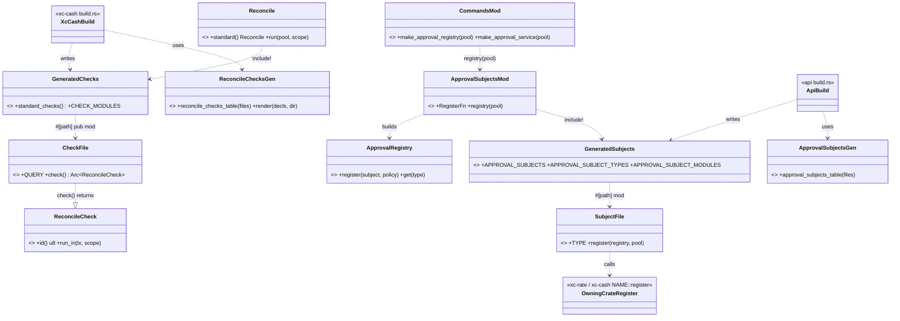

# Build-time registries: reconcile checks and approval subjects (#1146)

> designed-by: claude/5d45b017 · 2026-10-11 · on the xchange BE lane controller claude/ad05bf8d's order
> (#1146 issuecomment-6103046199) · measured on `origin/main` `4b60f190` · every `file:line` below is at that sha

## 0. Why

Two tickets that each add a *different* item to the same list still collide, because the list is a hand-edited file
both must touch (#1146 §1: PR 1117 vs PR 1119 twice on `reconcile/mod.rs`, PR 1123 vs PR 1120 on
`commands/mod.rs`). Each collision costs a merge, a CI run and a reviewer re-bind.

The repo already has the pattern that never collides: a directory with **one file per item**, read by `build.rs`,
which generates the `#[path] pub mod` lines and the table, `include!()`d by the module. Adding an item = adding one
file; no shared file changes.

| Precedent | Directory | Generator | Generated, included at |
|---|---|---|---|
| policy areas (PL-0b #1014) | `api/crates/xc-auth/src/domain/policy/areas/` | `api/crates/xc-auth/build.rs:6-43` + `build_support/area_rows.rs:32-56` (table) and `:61-78` (render) | `$OUT_DIR/area_rows.rs`, `areas/mod.rs:19` |
| outbox handlers (PL-0a #910) | `api/src/bootstrap/outbox_handlers/` | `api/build.rs:288-326` + `api/build_support/outbox_handlers.rs:47-78` | `$OUT_DIR/outbox_handlers.rs`, `bootstrap/outbox_handlers/mod.rs:18` |

This note applies the same pattern to the two lists of #1146. Both copy the precedents' rules exactly:
- the module name is the file stem and must pass `api/build_support/module_name.rs` (`is_valid_module_name`);
- `mod.rs` and non-`.rs` files are skipped;
- a file without the required export fails the **build**, naming the file;
- the table is sorted by module name, so the generated code is deterministic;
- `cargo:rerun-if-changed=<dir>` and one line per file, as `xc-auth/build.rs:39-42`.

## 1. Reconcile checks (`xc-cash`)

### 1.1 Today

`api/crates/xc-cash/src/application/reconcile/mod.rs` holds:

| Line | What | Hand-edited by every check ticket |
|---|---|---|
| `:5` | `pub mod balanced;` | yes |
| `:7` | `pub mod positions;` | yes |
| `:8` | `pub mod valuation;` | yes |
| `:70-77` | `Reconcile::standard()` with `Arc::new(balanced::BalancedCheck)` (`:73`), `Arc::new(positions::PositionsCheck)` (`:74`), `Arc::new(valuation::ValuationCheck)` (`:75`) | yes, one line each |

The three checks live beside it: `reconcile/balanced.rs` (`pub struct BalancedCheck` `:24`, id 1),
`reconcile/positions.rs` (`PositionsCheck` `:45`, id 2), `reconcile/valuation.rs` (`ValuationCheck` `:23`, id 5).
LG-7.3 #1057 and LG-7.4 #1058 would each add a fourth and fifth line.

**Callers reach the checks by module path**, and those paths must not change:
`xc_cash::application::reconcile::balanced::{BalancedCheck, QUERY}` (`xc-cash/tests/reconcile_balanced_test.rs:9`),
`…::positions::{PositionsCheck, QUERY}` (`reconcile_positions_test.rs:10`), `…::valuation::{QUERY, ValuationCheck}`
(`reconcile_valuation_test.rs:9`), and `Reconcile::standard()` (`reconcile_core_test.rs:333`, and the three files above
at `:190`/`:193`). The generated `#[path]` modules keep every one of those paths (§1.4).

### 1.2 The directory and the export

- **Directory:** `api/crates/xc-cash/src/application/reconcile/checks/` (new). One file per check, named by what it
  checks: `checks/balanced.rs`, `checks/positions.rs`, `checks/valuation.rs`, later `checks/<name>.rs`.
  `checks/` holds **only** checks, so a future helper beside `reconcile/mod.rs` is never mistaken for one.
- **Export [required]:** every check file has
  ```rust
  pub fn check() -> std::sync::Arc<dyn super::ReconcileCheck>
  ```
  (e.g. `{ std::sync::Arc::new(BalancedCheck) }`). Its struct and `QUERY` stay as they are. The generator requires
  the text `pub fn check() -> std::sync::Arc<dyn super::ReconcileCheck>`, as `outbox_handlers.rs:64` requires
  `pub fn handler(`. `super::` resolves to `reconcile`, because the generated `#[path]` module is declared inside
  `reconcile/mod.rs` (§1.4), exactly as the files resolve it today.

### 1.3 The generator

- **`api/crates/xc-cash/build.rs` (new).** The crate has no build script today (`git ls-tree 4b60f190
  api/crates/xc-cash` lists `Cargo.toml`, `src`, `tests`). It is `xc-auth/build.rs:1-43` with the directory
  `src/application/reconcile/checks` and the output `reconcile_checks.rs`. Cargo picks up a crate-root `build.rs`
  without a `Cargo.toml` change.
- **`api/crates/xc-cash/build_support/reconcile_checks.rs` (new):**
  - `pub struct CheckDecl { pub module: String, pub file: String }`;
  - `pub enum CheckTableError { NotAModuleName { file }, MissingCheckFn { file } }`, with `Display` as
    `outbox_handlers.rs:30-41`;
  - `pub fn reconcile_checks_table(files: &[(&str, &str)]) -> Result<Vec<CheckDecl>, CheckTableError>`, which is
    `outbox_handlers_table` (`:47-78`) with the required text of §1.2;
  - `pub fn render(decls: &[CheckDecl], dir: &str) -> String`, which is `area_rows.rs:61-78` with the table below;
  - `#[path = "../../../build_support/module_name.rs"] mod module_name;`, as `area_rows.rs:25`.

### 1.4 What is generated and where it goes

`$OUT_DIR/reconcile_checks.rs`, for today's three files:

```rust
#[path = "<abs>/src/application/reconcile/checks/balanced.rs"]
pub mod balanced;
#[path = "<abs>/src/application/reconcile/checks/positions.rs"]
pub mod positions;
#[path = "<abs>/src/application/reconcile/checks/valuation.rs"]
pub mod valuation;
pub fn standard_checks() -> Vec<std::sync::Arc<dyn ReconcileCheck>> {
    vec![balanced::check(), positions::check(), valuation::check()]
}
pub const CHECK_MODULES: &[&str] = &["balanced", "positions", "valuation"];
```

`reconcile/mod.rs` replaces `:5-8` with `include!(concat!(env!("OUT_DIR"), "/reconcile_checks.rs"));` (placed after
the `ReconcileCheck` trait so the generated `fn` sees it), and `standard()` (`:70-77`) becomes
`Self::new(standard_checks())`. Order does not matter: `run` sorts by `id()` (`:87-88`). The modules stay
`reconcile::balanced` etc., so every caller of §1.1 compiles unchanged.

### 1.5 Moving the existing entries (pure code moves, one commit each)

| # | From (main `4b60f190`) | To | Kind |
|---|---|---|---|
| R1 | `reconcile/balanced.rs` | `reconcile/checks/balanced.rs` | `git mv`, content byte-identical |
| R2 | `reconcile/positions.rs` | `reconcile/checks/positions.rs` | `git mv`, byte-identical |
| R3 | `reconcile/valuation.rs` | `reconcile/checks/valuation.rs` | `git mv`, byte-identical |
| R4 | — | each of the three files | adds only the 3-line `pub fn check()` of §1.2 |
| R5 | `reconcile/mod.rs:5`, `:7`, `:8` and `:73-75` | the generated file | the `pub mod` lines and the three `Arc::new` entries are deleted; `include!` and `standard_checks()` replace them |

A reviewer checks R1–R3 with `git diff -M100% --stat` (rename only), R4 as a +3-line diff per file, and R5 as
deletions plus two lines.

### 1.6 The test

`api/crates/xc-cash/tests/reconcile_checks_seam_test.rs` (new, no DB):
- **`the_generated_set_is_the_files`:** reads `src/application/reconcile/checks/` (skipping `mod.rs` and
  non-`.rs`), sorts the stems, and asserts they equal `CHECK_MODULES`, which needs `reconcile::CHECK_MODULES` to be
  `pub`. This is the "list the generated set against the files" of #1146 §4, by name and not only by count
  (the outbox test `the_table_has_one_entry_per_handler_file`, `api/tests/outbox_handlers_seam_test.rs:123-137`,
  compares counts only).
- **`standard_runs_one_check_per_file_with_distinct_ids`:** `standard_checks().len() == CHECK_MODULES.len()`, and
  the `id()`s are distinct and within 1..=5 (`mod.rs:49`). This catches a check file whose `check()` returns another
  file's check.
- **`today_s_three_checks_are_registered`:** the ids are `{1, 2, 5}` on this ticket's head. A later check ticket
  adds its id here in its own test file, not by editing this one.

The existing `Reconcile::standard()` assertions (`reconcile_*_test.rs:190`/`:193`, `reconcile_core_test.rs:333`)
stay green and unedited.

## 2. Approval subjects (`api`)

### 2.1 Today

`api/src/presentation/http/v3/commands/mod.rs` holds:

| Line | What | Hand-edited by every subject ticket |
|---|---|---|
| `:10` | `use xc_cash::application::ledger_approval::count_difference;` | yes |
| `:12` | `use xc_rate::application::approval::{rate_feed_publication, rate_publication};` | yes |
| `:18-24` | `make_approval_registry`: `rate_publication::register(&mut registry, pool.clone())` (`:20`), `rate_feed_publication::register(…)` (`:21`), `count_difference::register(&mut registry, pool)` (`:22`) | yes, one line each |
| `:26-31` | `make_approval_service` (wraps the registry) | no |

The `register` functions live in their own crates:
- `xc-rate/src/application/approval/rate_publication.rs:114` (type `"RATE_PUBLICATION"`, `:32`);
- `rate_feed_publication.rs:96` (`"RATE_FEED_PUBLICATION"`, `:29`);
- `xc-cash/src/application/ledger_approval/count_difference.rs:25` (`COUNT_DIFFERENCE`, `:22`).

LG-2 #924 will add `NEGATIVE_STOCK` (#925's ruling).

**Callers of the two functions keep their signatures:**
- `make_approval_service(PgPool) -> Arc<ApprovalService>` is used by `commands/approval_decide.rs:124`,
  `rate_draft_save.rs:187`, `rate_draft_simulate.rs:111` and `rate_draft_submit.rs:88`, and by four test files
  (`api/tests/rates_re4_common/mod.rs:35`, `rates_re4_desk_save_test.rs:100`, `rates_re4_kiosk_test.rs:63`,
  `rates_re4c_common/publish.rs:44`).
- `make_approval_registry(PgPool) -> ApprovalRegistry` is used by `views/approval_requests.rs:34`.

### 2.2 The directory and the export

- **Directory:** `api/src/presentation/http/v3/commands/approval_subjects/` (new).
  - **One file per subject,** named by the subject: `rate_publication.rs`, `rate_feed_publication.rs`,
    `count_difference.rs`, later `negative_stock.rs`.
  - **The commands table never sees these files:** its generator reads only files directly in `commands/`
    (`api/build.rs:246-248`, `path.is_file()`), so a subdirectory is never a command.
- **Exports [required]**, per file:
  ```rust
  pub const TYPE: &str = "<the subject's type_name()>";
  pub fn register(registry: &mut ApprovalRegistry, pool: PgPool)
  ```
  `register` calls the owning crate's `register` (one line). `TYPE` is the name that subject registers under.
  It lets the test compare the generated set with the registry, because `ApprovalRegistry` exposes only
  `register` and `get` (`xc-approval/src/application/registry.rs:27`, `:33`) and has no list. The generator requires
  both the text `pub const TYPE: &str` and `pub fn register(`.
- **`approval_subjects/mod.rs` (new)**, as `bootstrap/outbox_handlers/mod.rs:1-31`:
  - `pub type RegisterFn = fn(&mut ApprovalRegistry, PgPool);`
  - `include!(concat!(env!("OUT_DIR"), "/approval_subjects.rs"));`
  - `pub fn registry(pool: PgPool) -> ApprovalRegistry`, which calls every `APPROVAL_SUBJECTS` entry with
    `pool.clone()` on one new registry.

### 2.3 The generator

- **`api/build_support/approval_subjects.rs` (new):** `SubjectDecl`, `SubjectTableError { NotAModuleName,
  MissingType, MissingRegisterFn }` and `approval_subjects_table(files)`. It is a copy of
  `api/build_support/outbox_handlers.rs:1-78` with the required texts of §2.2.
- **`api/build.rs`:** one new block after `:288-326` (the outbox block), reading
  `src/presentation/http/v3/commands/approval_subjects`, plus `#[path = "build_support/approval_subjects.rs"] mod
  approval_subjects_gen;` beside `:75-76`. This is the only edit to `api/build.rs`, and later subjects never touch it.

### 2.4 What is generated and where it goes

`$OUT_DIR/approval_subjects.rs`:

```rust
#[path = "<abs>/src/presentation/http/v3/commands/approval_subjects/count_difference.rs"]
mod count_difference;
#[path = "<abs>/…/approval_subjects/rate_feed_publication.rs"]
mod rate_feed_publication;
#[path = "<abs>/…/approval_subjects/rate_publication.rs"]
mod rate_publication;
pub const APPROVAL_SUBJECTS: &[RegisterFn] =
    &[count_difference::register, rate_feed_publication::register, rate_publication::register];
pub const APPROVAL_SUBJECT_TYPES: &[&str] =
    &[count_difference::TYPE, rate_feed_publication::TYPE, rate_publication::TYPE];
```

It is included by `approval_subjects/mod.rs`. In `commands/mod.rs`, `:18-24` becomes:

```rust
pub fn make_approval_registry(pool: PgPool) -> ApprovalRegistry { approval_subjects::registry(pool) }
```

with `pub mod approval_subjects;`. The `use` lines `:10` and `:12` go away. Registration order does not matter:
the registry is a `HashMap` keyed by `type_name()` (`registry.rs:15`, `:29`).

### 2.5 Moving the existing entries (pure code moves, one commit each)

| # | From (main `4b60f190`) | To |
|---|---|---|
| A1 | `commands/mod.rs:20` + `:12` (`rate_publication`) | `approval_subjects/rate_publication.rs`: `TYPE = "RATE_PUBLICATION"`; `register` calls `xc_rate::application::approval::rate_publication::register(registry, pool)` |
| A2 | `commands/mod.rs:21` + `:12` (`rate_feed_publication`) | `approval_subjects/rate_feed_publication.rs`: `TYPE = "RATE_FEED_PUBLICATION"`; calls `…::rate_feed_publication::register` |
| A3 | `commands/mod.rs:22` + `:10` (`count_difference`) | `approval_subjects/count_difference.rs`: `TYPE = xc_cash::application::ledger_approval::count_difference::COUNT_DIFFERENCE`; calls `…::count_difference::register` |
| A4 | `commands/mod.rs:18-24` | the one-line `make_approval_registry` of §2.4 |

No owning crate changes. Each subject's `register` stays where it is (`xc-rate`, `xc-cash`); only the call to it moves.

### 2.6 The test

`api/tests/approval_subjects_seam_test.rs` (new, no DB; the registry needs a `PgPool` value only, so the test
uses an unconnected pool such as `PgPoolOptions::new().connect_lazy("postgres://…")`, as
`outbox_handlers_seam_test.rs:141` uses `common::unreachable_pool()`):
- **`the_generated_set_is_the_files`:** the stems of `commands/approval_subjects/*.rs` (no `mod.rs`), sorted, equal
  the modules behind `APPROVAL_SUBJECTS`. This needs a generated `pub const APPROVAL_SUBJECT_MODULES: &[&str]`,
  beside the two constants of §2.4.
- **`every_type_is_registered_once`:**
  - `APPROVAL_SUBJECT_TYPES` has no duplicate, because two files claiming one type would silently overwrite each
    other (`registry.rs:29`, `HashMap::insert`);
  - for each type, `make_approval_registry(pool).get(t).is_some()`, so a file whose `register` registers some other
    type is caught.
- **`today_s_three_subjects_are_registered`:** the type set contains `RATE_PUBLICATION`, `RATE_FEED_PUBLICATION`
  and `COUNT_DIFFERENCE` on this ticket's head.
- `views/approval_requests.rs` and the four `make_approval_service` test callers of §2.1 stay green and unedited.

## 3. Class diagram



### Who provides, who uses

| Provider | Used by | If it has not landed |
|---|---|---|
| `checks/<name>.rs` `check()` | the generated `standard_checks()` | n/a: ticket A moves all three existing checks itself |
| `standard_checks()`, `CHECK_MODULES` | `Reconcile::standard()`, `reconcile_checks_seam_test.rs` | — |
| `Reconcile::standard()` (signature unchanged) | `reconcile_core_test.rs:333`, `reconcile_*_test.rs:190/193`, LG-7.x | — |
| `approval_subjects/<name>.rs` `TYPE` + `register` | the generated `APPROVAL_SUBJECTS` | n/a: ticket B moves all three existing subjects itself |
| `approval_subjects::registry(pool)` | `make_approval_registry` | — |
| `make_approval_registry` / `make_approval_service` (signatures unchanged) | `views/approval_requests.rs:34`; `commands/approval_decide.rs:124`, `rate_draft_save.rs:187`, `rate_draft_simulate.rs:111`, `rate_draft_submit.rs:88`; four test files (§2.1) | — |
| each owning crate's `register` (unchanged) | its `approval_subjects/<name>.rs` | — |

**After this:**
- a reconcile check ticket (LG-7.3 #1057, LG-7.4 #1058) adds `reconcile/checks/<name>.rs` and nothing else;
- an approval subject ticket (#924's `NEGATIVE_STOCK`) adds its own crate's subject plus
  `commands/approval_subjects/negative_stock.rs`, and nothing shared.

## 4. Not covered: `Cargo.toml`

Workspace members and dependency lines in `api/Cargo.toml` stay hand-edited. #1146 §3 item 3: *"Out of scope here:
`Cargo.toml` workspace members and deps. Those are already mitigated by the merge batch's lock-only carry-over
rule."* `xc-cash/build.rs` needs no `Cargo.toml` change (Cargo finds a crate-root `build.rs`), and the generators use
only `std`.

Also not covered (named in #1146 §1 but not one of the two lists): `api/crates/xc-cash/src/application/mod.rs`'s
`pub mod` lines (#621 vs #925). A new **module** still needs one line there; that is not a list of registrations.

## 5. One ticket or two

**Two.** Their file sets are disjoint:

| | Ticket A: reconcile checks | Ticket B: approval subjects |
|---|---|---|
| crate | `xc-cash` | `api` |
| shared files edited | `xc-cash/src/application/reconcile/mod.rs` | `api/build.rs`, `api/src/presentation/http/v3/commands/mod.rs` |
| new | `xc-cash/build.rs`, `xc-cash/build_support/reconcile_checks.rs`, `reconcile/checks/`, one seam test | `api/build_support/approval_subjects.rs`, `commands/approval_subjects/`, one seam test |

No path is in both, so they can be dispatched in parallel and merged in either order.
- **Ticket A** should merge before LG-7.3 #1057 and LG-7.4 #1058 start, so that each of those adds one file
  (#1146 issuecomment-6103046199).
- **Ticket B** should merge before LG-2 #924 adds `NEGATIVE_STOCK`.

### File scope, ticket A (reconcile checks)

```
api/crates/xc-cash/build.rs
api/crates/xc-cash/build_support/reconcile_checks.rs
api/crates/xc-cash/src/application/reconcile/mod.rs
api/crates/xc-cash/src/application/reconcile/balanced.rs
api/crates/xc-cash/src/application/reconcile/positions.rs
api/crates/xc-cash/src/application/reconcile/valuation.rs
api/crates/xc-cash/src/application/reconcile/checks/
api/crates/xc-cash/tests/reconcile_checks_seam_test.rs
```

`api/crates/xc-cash/src/application/reconcile/checks/` is a **new directory this ticket owns outright**; it
intentionally reserves the whole subtree. The three `reconcile/<check>.rs` lines are listed because the moves delete
them.

### File scope, ticket B (approval subjects)

```
api/build.rs
api/build_support/approval_subjects.rs
api/src/presentation/http/v3/commands/mod.rs
api/src/presentation/http/v3/commands/approval_subjects/
api/tests/approval_subjects_seam_test.rs
```

`api/src/presentation/http/v3/commands/approval_subjects/` is a **new directory this ticket owns outright**; it
intentionally reserves the whole subtree. Every other line is one file.

## 6. Data migration

None. Neither ticket adds or changes a table, column, constraint, default or status value. Both are build-time code
generation and code moves.

## 7. Done criteria for both tickets (from #1146 §4, made concrete)

1. **The pure moves are pure.** `git diff -M100% --stat origin/main...HEAD` shows R1–R3 as renames; A1–A3 add files
   whose `register` is a one-line call to the owning crate.
2. **Adding an item touches no existing file.** The seam test of each ticket also ships a scratch check in its own
   commit message's "how to try": add `checks/zz_probe.rs` (or `approval_subjects/zz_probe.rs`), build, and the
   generated set grows by one. This is written down, not committed.
3. **Every existing item is still registered:** `the_generated_set_is_the_files` and the "today's" test of §1.6 and
   §2.6 pass, and the existing `Reconcile::standard()` and `make_approval_service` callers stay green unedited.
4. **A file without the required export fails the build, naming the file.** This is the generator's `Missing…`
   error, as the precedents do.
5. `cargo fmt --all --check`, `cargo clippy --workspace --all-targets -D warnings`, `cargo test --workspace` and
   `api.yml` are green.
