# Configurable shifts: as many named shifts per branch as the Owner sets

> designed-by: claude/35271802 (sub-controller "AG controller configurable shifts", under the xchange lane controller claude/022a7453), 2026-11-04 ICT.
> Notice issue: #564 issuecomment-6632472703. Measured on `origin/main` `6334e748`.
> Branch: `feat/configurable-shifts`.

## 0. What the owner asked for

Owner, 2026-11-04 (lane controller's session), verbatim: *"ระบบให้ รองรับ กะ สามารถ config ได้ ว่ามีกี่กะ"*, then the
defaults below and *"default ตามนี้"*.

| Shift | Working hours | Break |
|---|---|---|
| A | 10:00–19:00 | 15:00–16:00 |
| B | 15:00–00:00 | 18:00–19:00 |
| C | 19:00–04:00 next day | 23:00–00:00 |

A and B overlap 15:00–19:00; B and C overlap 19:00–00:00. These are **staff working shifts**: several tellers work at the
same time, each in one named shift.

**The defaults changed the same evening.** Owner, ~21:4x ICT (lane controller's comment on this PR), verbatim:
*"ปกติ 3 กะมันไม่พักนะ"* · *"มัน 24 ชม"* · *"มาตรฐานการทำงาน 24 ชม ไม่มีพัก"*, then he chose 3 × 8 h:

| Shift | Working hours | Break |
|---|---|---|
| A | 06:00–14:00 | none |
| B | 14:00–22:00 | none |
| C | 22:00–06:00 next day | none |

24-hour operation is the standard; the business day cuts over at 06:00, the end of C; a break stays optional per shift.
The model below handles both tables: the first one (overlaps, breaks, a 04:00–10:00 gap) is kept as the main test fixture.

**Owner decisions** (lane controller's comment on this PR, 2026-11-04 ~21:2x ICT, *"Approve all"*): Q1–Q6 = A (§7), and the
migration as first written. The seed and the triggers changed after that approval, so §5 goes back to the owner (§7 Q8).

Done line, restated for the new defaults (proposed to the lane controller). On MAIN with the defaults:
1. tellers can open A at 06:00, B at 14:00 and C at 22:00;
2. a 02:00 sale counts on the previous business date;
3. opening a shift that does not cover now is refused (A at 15:00);
4. service runs 24 hours with the business day cutting over at 06:00, with no daily pause (§2.7, Q7);
5. the reports group by A, B and C.

## 1. What exists today (survey)

| Topic | Where (`6334e748`) | What it does |
|---|---|---|
| One shift row per teller | `api/migrations/20261218110000_retire_custody_requests.sql:37` | `shifts_one_open_per_teller ON shifts (teller_id) WHERE status='OPEN'`. The per-branch index of `20261007110000_shifts.sql:16` was dropped (`:31-32`). **Several tellers already sell at once**, each in their own shift row. |
| `shifts` columns | `20261007110000_shifts.sql:1-16`, `20261012100000_cash.sql` (`teller_id`) | No name, no template, no time window, no date. |
| Opening a shift | `POST /api/cash-counts` (`commands/cash.rs:330`) → `submit_in` (`xc-cash/src/application/count/count_service.rs:829`); verify `POST /api/cash-counts/{id}/verify` (`cash.rs:390`) → `verify_count_in` (`count_service.rs:1156-1219`) → `ShiftService::open_on_verified` (`xc-shift/src/application/shift/service.rs:143-216`) | The shift row is created when someone else **verifies** the teller's OPEN count. |
| Closing a shift | CLOSE count verify (`count_service.rs:1222-1410`) → `close_on_verified` (`shift/service.rs:218-246`) → `close_day_if_last_in` (`count_service.rs:1401`) | Writes `cash_count_totals` per shift id. |
| Branch service window | `PgCustodyPorts::service_window` (`api/src/infrastructure/custody/custody_ports.rs:148-205`) reads `branches.opening_hours` through `BranchHours::window` (`xc-rate/src/domain/branch/branch_hours.rs:107-180`) | Per weekday, first window only (`:137`); `close <= open` rolls to the next day (`:160-173`). It already searches local today −2..+1, so a window crossing midnight works. |
| Gates on the window | `BranchDayService::start_service` (`xc-shift/src/application/branch_day/service.rs:168-187`) and `begin_draft` (`:556-566`) | Start needs `[open, close−10 min)`; begin needs the same; a save needs `[open, close)` (`service_window.rs:18-52`). Selling needs phase OPEN (`:556`). |
| Staff floor hours | `PgStaffFloorReader::read_hours` (`api/src/application/staff_floor/reader.rs:247-290`) | Reads **today's** window only, so at 02:00 it shows the wrong day. |
| Branch day | `ops_state` (`20261007140000_custody.sql:1`), one row per branch | CLOSED→READY on the first verified OPEN count, READY→OPEN by start, OPEN→CUT_OFF by cut-off; CLOSED is derived as CUT_OFF with no OPEN shift (`xc-shift/src/domain/custody/branch_day.rs:57-63`). No row per date. |
| Sale date | `transactions.value_date` (`20261007190000_transactions.sql:30`) | **The client sends it.** The desk fills it with `bangkokToday()` (`web/src/screens/desk/desk-store.ts:163,231`, sent at `save.ts:218`); the server only parses it (`commands/transactions.rs:360`). At 02:00 the desk sends the new calendar date. |
| Reports | `views/admin_reports.rs:191,225,250`, `admin_overview.rs:131`, `admin_transactions.rs:136`, `ledger_cash_facts.rs:255` filter on `value_date`; `views/staff_daily_report.rs:77-89,124-137` uses `[local 00:00, +1 day)` on `completed_at`, close counts by `s.opened_at` (`:179,250`) | Every report day is a calendar day. None groups by shift; the staff report is one branch-day aggregate. |
| Day close | `xc-shift/src/application/shift/service/day_close.rs:19-47` | Fires `on_day_closed` when the last shift closes after cut-off. It produces no report. |
| Opening hours editor | `POST /api/branches/profile` → `branch_save.rs:73` (`BranchesManage`, `xc-auth/.../areas/org_admin.rs:30`); web `admin/branches/BranchesScreen.tsx:206-219` | Also read by booking slots (`xc-booking/src/application/slot_service.rs:526`), the public branch API (`public/branches.rs:76,103`) and customer screens (`shared/ui/openingHours.ts`). |
| Branch creation | `adminCreateBranch` in `api/src/application/compat/rpc.rs:257-270` → `BranchService::create_in` (`xc-rate/src/application/branch/service.rs:65`) | |

Searched for an existing shift definition: `grep -rniE "shift_(template|definition|plan)|shifts_per_day"` over `api/`, `web/src`, `docs/` → nothing.

**Correction to the brief:** the brief said `shifts` allows one open shift per branch. That index was replaced; today it is one
open shift per **teller** (row 1 above). So overlapping shifts need no change to how a teller's drawer works. What is missing is
the name, the time window and the business date.

## 2. The model

### 2.1 Words

- **Shift template** (`ShiftTemplate`): one row the Owner configures: name, start, end, optional break. The number of shifts is the number of live templates.
- **Shift plan** (`ShiftPlan`): a branch's live templates, ordered. It answers every time question.
- **Shift instance** (`ShiftInstance`): one template on one business date, with real start, end and break instants.
- **Shift** (existing `shifts` row): one teller's drawer session. It now records the template it was opened under, the template's name at that moment, and the business date.

### 2.2 Time rules

All times are local wall-clock times in `branches.timezone` (Asia/Bangkok has no DST; `local_to_utc` in `branch_hours.rs:50-56` is reused for any zone that has).

| # | Rule |
|---|---|
| T1 | **Cutover.** Owner 2026-11-04: *"มาตรฐานการทำงาน 24 ชม ไม่มีพัก"*, *"ให้มัน คร 24"*: every plan covers all 24 hours (T5), so the cutover `S0` is the **earliest template start**: 06:00 with the defaults. It is derived, not a stored column; the settings screen shows it (§2.9). |
| T2 | **Offsets.** A template's start offset is `(start − S0) mod 24 h`; its duration is `end − start`, plus 24 h when `end <= start` (crosses midnight). End offset = start offset + duration. |
| T3 | **Business date.** The instance of template `t` on business date `d` runs from `d + S0 + startOffset(t)` to `d + S0 + endOffset(t)`. With the first table: A = d 10:00–19:00, B = d 15:00–d+1 00:00, C = d 19:00–d+1 04:00. With the defaults: A = d 06:00–14:00, B = d 14:00–22:00, C = d 22:00–d+1 06:00. This is rule 2 of the brief ("a shift that crosses midnight belongs to the business date it started on"), generalised so a template that starts after midnight inside the night (D 00:30–06:00 next to C 19–04) belongs to the date before. |
| T3b | **Daylight saving.** A boundary whose local time falls in a DST gap starts at the end of the gap; an ambiguous local time (the hour repeated in autumn) takes the earlier instant. So the shift ending in a gap ends exactly where the next one starts. Bangkok has no DST; this only keeps a custom plan in a DST zone from moving by hours (CS-1c). |
| T4 | **Business day.** Business date `d` is the 24 hours `[d + S0, d + S0 + 24 h)`. A shift straddling the cutover (C 22–07 with `S0` = 06:00) belongs to the day it started (T3), so its instance may end after the business day does. This span **replaces** `opening_hours` as the gate for start, begin and save. |
| T5 | **Plan validity.** Names are trimmed, non-empty, ≤ 40 characters and unique case-insensitively; `start != end`; a break, when set, lies strictly inside its shift (it may not start at the shift's start or end at its end: such a break is only a shorter shift, so the Owner sets the shift's hours instead; sub-controller's decision 2026-11-05 on the review of PR 6171); 1 to 12 templates; and **the plan covers all 24 hours**. The first uncovered window going forward from `S0` is refused as `PlanRefusal::Gap { from, to }` (wire `shiftPlanInvalid:gap:04:00-06:00`, message *"ช่วง 04:00–06:00 ไม่มีกะ"*). Overlaps are allowed. |
| T6 | **Covering now.** Template `t` covers `now` when `start(t, d) <= now < end(t, d)` for `d` = local today, yesterday or the day before (a long shift reaches two days). Each covering instance carries its own `d`. |
| T7 | **Business date of an instant.** The `d` (yesterday or today) whose business day holds it; always defined for a non-empty plan. |
| T8 | **Weekdays.** The plan applies every day. Per-weekday shifts are out of scope (Q4 = A). |
| T9 | **End of a business day.** `ShiftPlan::business_day_end(d)` = the end of `service_span(d)`: 06:00 on `d+1` with the defaults. Every deadline that today means "midnight after the sale's date" uses it (§2.10). |
| T10 | **Continuous spans.** When the span of `d+1` starts where the span of `d` ends (a 24-hour plan), `span_for` still answers one day's span; the custody window joins the two (§2.7), so no daily pause appears. |
| T11 | **The branch day is not the business date.** `ops_state` holds one undated phase per branch (§1). It keeps its own lifecycle (start, cut-off, day close); nothing in this design reads it to date a row. With 24-hour operation a day close may never fire (a shift is always open); that is unchanged behaviour of `day_close.rs:33-42`. |

### 2.3 Opening a shift (brief rule 3)

- `[required]` The OPEN count (`POST /api/cash-counts`, kind `OPEN`) carries `shiftTemplateId`. The server decides:
  - a template that does not cover `counted_at` (T6) or is not live: `409 outsideShiftWindow`;
  - nothing covers now at all: `409 outsideShiftWindow`;
  - `shiftTemplateId` missing and **exactly one** template covers now: that one (the server-side twin of the preselect);
  - `shiftTemplateId` missing and two or more cover now: `422 shiftNotChosen`.
- `[required]` Entry point: `CashCountService::submit_chosen_in(tx, actor, cmd, shift_template_id: Option<&str>, now)`;
  the existing `submit_in(tx, actor, cmd, now)` keeps its signature and calls it with `None`. The command handler
  (`commands/cash.rs`) passes the client's choice. Reason: 40 test files build `SubmitCount` and many open shifts; under
  the 24-hour defaults exactly one shift covers any moment, so they keep working unchanged.
- `[required]` The count stores `shift_template_id` and the instance's `business_date`. The verify (`verify_count_in`) copies
  both, plus the template's **name at that moment**, into the new `shifts` row. A verify later than the window's end still
  opens the shift: the teller's choice was checked when they counted.
- `[required]` **Every count carries a business date** (reconciliation dates counts by it, §2.11), written at submit:
  OPEN = the chosen instance's date; CLOSE and HANDOVER_OUT = their shift's `business_date`; SAFE and SAFE_OPEN =
  `ShiftPlan::business_date_of(counted_at)`, else the date of `span_for(counted_at)` (a count in a gap belongs to the next span).
- `[required]` **Every production writer that knows the shift names the date itself.** The `BEFORE INSERT` triggers (§5) exist
  for test fixtures and pre-feature rows; a production writer that omits the date silently gets the calendar date, which is
  wrong for a night shift. Until its writer ticket lands, a path may still rely on the trigger (the handover path did until
  CS-19); that is the gap each writer ticket closes. Each writer ticket (CS-7,
  CS-19) states this and has a test that would go red under the calendar rule (O1, K1).
  The writer is `PgCashCountRepository`'s insert (`xc-cash/src/infrastructure/repository.rs:160`) and `CashCount`
  (`xc-cash/src/domain/count/cash_count.rs:40`) gains `shift_template_id` and `business_date`: both in CS-7's File scope.
- `[required]` `GET /api/v3/views/open_shift_choices?branch=` returns the covering instances: `{templateId, name, businessDate, startsAt, endsAt, breakStartsAt?, breakEndsAt?}[]`, plus `preselect: templateId | null`, set when exactly one covers now. The count form shows a picker; one choice is preselected; none shows "outside shift hours" and disables Save.
- `[proposed]` No grace before the start (Q3).
- `[required]` **Handover.** Accepting a handover opens the receiver's drawer (`HandoverService::accept…`, `xc-cash/src/application/handover/handover_service.rs:738`), so it follows rule 3: the accept carries the **receiver's** `shiftTemplateId`, checked against the accept time (not the giver's template: a handover at 14:00 is A → B), with the same refusals; the receiver's shift gets that instance's name and business date. Until CS-19 lands, the skeleton passes `OpenedAs::untemplated()` there, so a handed-over drawer opens untemplated and dated by the trigger (O2); this is a temporary gap in the feat branch, closed before the feat→main merge. The three test files that call `open_on_verified` were updated by the skeleton.

### 2.4 Selling and the business date

- `[required]` A LIVE sale's `value_date` is **set by the server** to the business date of the keyer's open shift (`create.rs:349-362`, where the shift is already looked up). The client's `valueDate` is ignored for LIVE sales. This is the root-cause fix: the writer of the wrong date is the client, which uses the calendar date.
  - DEMO sales keep the client's date, as today.
  - The backdated path (`feat/backdated-keying`, `backdate.rs`) must follow the same rule, or a backdated 02:00 deal lands on
    the next date while the same live sale lands on the previous one. Today its design requires `value_date` = the calendar
    date of `paid_at` (`backdated-keying.md` §5 `ValueDateNotPaidDate`, B6). Proposed on #564 to claude/6bb512ce:
    `BackdateWindow` checks `value_date == ShiftPlan::business_date_of(paid_at)` (a `paid_at` in a gap is refused), and B6 is
    restated (`paidAt` 4 Nov 00:30 with `valueDate` 3 Nov is **accepted** under the defaults). That change is theirs to make.
- Every report that filters on `value_date` (§1 row "Reports") is then right with no change: a 02:00 sale in shift C of 4 Nov reads 4 Nov.
- `[proposed]` A teller may keep selling after their own shift's end, while the branch span is open. No per-shift sales gate (Q2 records the alternative).

### 2.5 Break (brief rule 3, owner question Q1)

`[proposed]` **Display only.** During a template's break window the staff floor marks the tellers whose open shift is that
template as `onBreak`; nothing is refused and the counter stays open. Reason: shifts overlap, so another shift covers the counter during every
break of the first table (A's 15–16 by B, B's 18–19 by A, C's 23–00 by B; the 24-hour defaults have no breaks), and a gate would block a teller who covers for a colleague. Alternatives in Q1.

### 2.6 Reports (brief rule 5)

| Report | Today | After |
|---|---|---|
| Shift close (`my_shift`, `admin_shifts`, `ShiftDetail`) | per shift id | each shift row also shows `shiftName` and `businessDate`. |
| Staff report / day close (`staff_daily_report`) | one aggregate per calendar day | `day` means business date: sales by `value_date`, close counts by `shifts.business_date`. New `byShift: ShiftReportRow[]`, one row per shift name used that day, in plan order, then `null` (shifts opened before this feature). Each row: `shiftName`, tellers, sales count and THB total, CLOSE counted/expected/difference per currency. Totals unchanged. |
| Admin reports (`admin_reports`) | per `staff_id` | `[proposed]` unchanged in this branch; per-shift columns are a follow-up if the owner wants them. |

Day close produces no report (`day_close.rs`); "the day close grouped by shift" is the staff report's `byShift` for that business date.

### 2.7 Service hours (brief rule 4)

- `[required]` `PgCustodyPorts::service_window` and `read_hours` compute the business day (T4) holding now from the plan; every plan covers 24 hours (T5), so there always is one. `opening_hours` no longer gates custody.
- `[required]` **No daily pause on a 24-hour plan (T10, Q7).** `ServiceWindow` refuses to begin a sale in the last 10 minutes
  (`service_window.rs:18-24`). On a 24-hour plan that would stop selling every day 05:50–06:00. When the next day's span starts
  exactly at this span's end, `service_window` answers `Open { this span's start, next span's end }`, so the cut-off falls a day
  later and keeps moving. Every plan covers 24 hours (T5), so the spans always join.
- **Fixtures.** About 25 api test files drive the custody window by writing `branches.opening_hours`
  (`grep -rln opening_hours api --include='*.rs' | grep tests` → 30 files at `6334e748`, a few of them booking-only). After CS-4
  they must seed a plan instead. Which ones go red is measured, not guessed: the full suite on the feat branch runs right
  after CS-4 merges into it, and each red file becomes a mechanical setup ticket (**CS-4s…**) in the next wave, using a shared
  helper that writes one template `[open, close)` for a branch and retires its others.
- `[proposed]` `opening_hours` stays as the **customer-facing** hours (booking slots, public branch API, customer screens) and is still edited in the branch profile. Whether it should follow the shifts is Q5.

### 2.8 Defaults

- `[required]` The migration inserts A, B, C (the second, 24-hour table in §0) for every existing branch.
- `[required]` A branch created afterwards gets the same three from an `AFTER INSERT ON branches` trigger in the migration, whichever path inserts the branch (`adminCreateBranch` in `compat/rpc.rs:257-270`, a test fixture). So no branch is ever without a plan, and every test branch has the 24-hour defaults. This replaces CS-13 (owner Q10). `ShiftPlanService::seed_defaults` stays for a later "reset to defaults" action; nothing calls it yet.
- The defaults live once, in `ShiftPlan::defaults()`; the migration's `INSERT` repeats them as data and a test compares the two.

### 2.9 Editing the plan

- `[required]` `POST /api/shift-templates` command `branchShiftsSave`, permission `BranchesManage` (the Owner standing holds it; same as `branchSave`). Body: `{branch, templates: [{id?, name, startsAt "HH:MM", endsAt, breakStartsAt?, breakEndsAt?}]}` in display order. It replaces the whole list: rows with an `id` are updated, rows without are inserted, live rows missing from the list are retired (`retired_at = now`), never deleted, because `shifts.template_id` points at them.
- Refusals: `422 shiftPlanInvalid` with `{reason: emptyName|nameTooLong|duplicateName|zeroLength|spanOver24h|breakOutsideShift|breakIncomplete|tooMany|none}` and `index`.
- `[required]` Editing does not touch open shifts: they keep the name and business date they opened with.
- `[required]` `GET /api/v3/views/branch_shifts?branch=` returns the live plan, the derived cutover (`cutover: "06:00"`) and `defaultShiftHours: 8`, for the screen.
- **The cutover is derived, not set (T1).** The Owner moves it by moving the earliest shift; 06/14/22 cuts over at 06:00,
  00/08/16 at midnight. No column is needed; if the owner later wants a cutover independent of the shifts, that is a column
  and a migration.
- **The Owner's settings screen** (owner, verbatim: *"ให้ ตั้งเวลา ของแต่ละกะได้ เอง"*). It lives on the admin branches
  screen as a "Shifts" section per branch (CS-14, Argon web ticket, wave 3 after CS-9). It:
  - lists the live shifts in order;
  - adds a shift. A new row's end is pre-filled as start + `DEFAULT_SHIFT_HOURS` (8; the screen reads it from the
    `branch_shifts` view's `defaultShiftHours`, so the 8 lives once, in `ShiftPlan::DEFAULT_SHIFT_HOURS`, the same constant
    the seed is checked against);
  - edits a shift's name, start, end and optional break, and retires a shift;
  - draws a 24-hour bar with each shift and marks any uncovered window in red as rows change, before Save, using the same
    rule as T5;
  - enables Save only when the bar is fully covered. The server refusal (`gap`, with the window) shows on the screen too;
  - shows the derived cutover ("วันทำการเริ่ม 06:00").

### 2.10 Deadlines that mean "the end of the sale's day"

- Today `branch_day_in` (`api/src/application/workflows/exchange/complete.rs:147-172`) sets `reversible_until` to local midnight
  after `value_date`; it goes to loyalty as `reversibleUntil` (`xc-loyalty/src/domain/wire_body.rs:67`,
  `api/src/infrastructure/loyalty/pg_facts_source.rs:95`, which computes it again with its own `end_of_business_day`). After CS-8 a 02:00 sale in C@4 Nov would get 5 Nov 00:00, before it completed.
- `ReversalWindow` (`xc-exchange/src/domain/reversal/window.rs:11-17`) dates the sale by the calendar date of `completed_at` and
  closes at local midnight; it is read by `reversal_request.rs:97`, `reversal_post.rs:286` and `dto/v3/reversal.rs:187`.
- `[required]` Both use T9: the deadline is `business_day_end(value_date)`. `ReversalWindow` takes the deadline instant instead of a
  timezone (`is_open(deadline, now) -> bool`; xc-exchange does not depend on xc-shift, so the caller computes it), and the
  reversal's `business_date` is the original's `value_date`. Ticket **CS-20** (guarded, Argon): `window.rs`,
  `reversal_request.rs`, `reversal_post.rs`, `dto/v3/reversal.rs`, `api/src/infrastructure/loyalty/pg_facts_source.rs`, and `branch_day_in` in `complete.rs`. `complete.rs` is held by
  `feat/backdated-keying` (BK-7), so CS-20 waits for that branch to land; order posted on #564.

### 2.11 The reconciliation sheet

- FINANCE's sheet dates counts, and who may certify, by the local calendar date of `counted_at`
  (`api/src/application/finance/reconciliation.rs:8` ruling Q3, `:344`; `sheet_parts.rs:66`), while its sales come from
  `value_date`. After CS-8 the 4 Nov sheet holds the 02:00 sales but C's 06:00 CLOSE lands on 5 Nov, so it no longer balances.
- `[required]` Both read `cash_counts.business_date` (§2.3) instead. Ticket **CS-21** (logic, Argon): `reconciliation.rs`, `sheet_parts.rs`.
  This restates ruling Q3 of #1068 ("a count's `counted_at` business date") with the plan's business date; recorded here.

### 2.12 Queue and kiosk day close at the cutover (owner Q9 = A, CS-22)

Owner, 2026-11-04 (lane controller's comment on #6149): *"Yes, at cutover"*.

- **Why.** `on_day_closed` runs only when the branch day is cut off and no shift is OPEN
  (`xc-shift/src/application/shift/service/day_close.rs:33-42`). On the 24-hour defaults a shift is always open, so the
  queue's WAITING/CALLED tickets and the kiosk's unfinished requests (`xc-queue/src/application/day/queue_day_hook.rs:46-60`,
  `xc-kiosk/src/application/kiosk/day_close.rs:47-80`) would never be ended.
- `[required]` **The cutover ends the previous business day's waiting work; work a teller holds gets one more day.** For each
  branch, the cutover is the start of the current business day: `ShiftPlan::span_for(now).0`. Every plan covers 24 hours (T5),
  so `now` is always inside a business day and there is no gap to fall into.
  - **At or after the cutover is the new day:** an item issued at exactly 06:00:00 is not swept (`issued_at < cutover` sweeps).
  - **Waiting work** issued before the cutover is ended with the same per-row effect the branch-day close uses today (same
    status, reason, event and booking notice): queue tickets in `WAITING` (`dayClosed`) and kiosk requests in `WAITING`
    (`DAY_CLOSED`). It is **not** the day close itself: the day close runs only with no shift open; this runs while tellers sell.
  - **Which instant counts for a kiosk request:** the moment it entered the queue, its ticket's `issued_at` (issued at
    confirm, `xc-kiosk/src/application/kiosk/customer.rs:284,404`), and `created_at` (the quote time) only for a request that
    has no ticket yet. So a quote at 05:58 confirmed at 06:02 belongs to the new day and is not swept.
  - **What survives the cutover:** `CALLED` and `SERVING` tickets, and `ACCEPTED`/`ID_CHECKED` kiosk requests (with their
    tickets). **Plain `SERVING` queue tickets are never ended by the sweep**, not even a day later: today's `on_day_closed`
    does not end them either (it selects `WAITING`/`CALLED` only, `queue_day_hook.rs:89`), and a ticket being served is
    finished by the teller. A kiosk request's own SERVING ticket ends with its request, as the kiosk day close does today. That is a teller serving a customer across the cutover (a C teller who called someone at 05:58). None of it is
    ended at that cutover; it is ended at the next one, i.e. only when it was issued before the **previous** cutover (more
    than one business day old). Normal service finishes it long before; the rule only clears what was abandoned.
  - Today's branch-day close knew no teller held anything (it runs after the last CLOSE is verified). The cutover has no
    such guarantee, hence the grace. This is the sub-controller's reading of *"Yes, at cutover"*, sent to the owner as
    information (he may object).
  - Work issued after the cutover is untouched.
- `[required]` **Stateless and idempotent, no migration.** The rule is "issued before the cutover", so running it again finds
  nothing. A sweeper runs it every 60 s, like `BookingSweeper` (`api/src/bootstrap/mod.rs:475-485`), one branch transaction per
  branch. A branch whose plan fails to load or whose sweep errors is logged and skipped; the round goes on.
- `[required]` **One instance sweeps a branch at a time.** Each branch's transaction first takes
  `pg_try_advisory_xact_lock(<hash of 'business-day-close:' || branch_id>)` and skips the branch when it is held (the
  per-tick lock pattern of `rate_feed/feed_loop.rs:113`). Row locks are taken `ORDER BY id`. No new index: the scan is per
  branch over the unfinished statuses, the same scan the branch-day close does today.
- **A plan edited during the day** takes effect at the next tick: the cutover is recomputed from the live plan each time, so
  moving the earliest shift moves the next cutover; nothing already ended is reopened.
- **Not changed here:** the queue's `service_date` and its display numbering still roll at local midnight
  (`xc-queue/.../ticket_issuer.rs:221`); see §9.
- `[required]` **A sweep that ends nothing changes nothing.** `on_day_closed` ends with `status.refresh_in`, which bumps
  `branch_service_status.queue_version` (`xc-queue/src/application/status/status_service.rs:141-200`). The cutover method calls
  `refresh_in` only when it ended at least one ticket or kiosk request; otherwise every polled queue client would refetch
  every minute (fleet rule: polled endpoints send only what changed).
- **Follow-up, not in this branch (needs the owner's approval: a migration):** the sweep runs every 60 s on every branch and
  `queue_tickets`'s indexes that lead with `branch_id` are the two `UNIQUE` constraints and two partial indexes
  (`20261101100000_queue.sql:23-24,30`, `20261219140000_queue_one_active_app_ticket.sql:5`); none covers `CALLED` with
  `issued_at`, so the `CALLED` arm reads all of the branch's rows and filters them. The index that fits is
  `(branch_id, issued_at) WHERE status IN ('WAITING','CALLED')`. Measure the table before deciding (review note on PR 6170).
- `[required]` The branch-day close keeps calling `on_day_closed` unchanged (it fires only after a cut-off with no shift open, as today).
- Files and tickets:
  - **CS-22a** (logic, Argon): `QueueDayHook::on_business_day_end(tx, branch, cutover, held_before, now) -> AppResult<usize>`
    in `xc-queue/src/application/day/queue_day_hook.rs` (`WAITING` tickets with `issued_at < cutover`, `CALLED` ones with
    `issued_at < held_before`), and
    `KioskDayClose::close_before_in(tx, branch, waiting_before, held_before, now)` in `xc-kernel/src/kiosk_day_close.rs` +
    its implementation in `xc-kiosk/src/application/kiosk/day_close.rs` (`WAITING` requests created before `waiting_before`;
    `ACCEPTED`/`ID_CHECKED` before `held_before`). They reuse the existing per-row cancel paths; the existing methods keep
    their behaviour. The test fake `api/crates/xc-queue/tests/queue_day_kiosk_test.rs:43` implements the trait, so it is in
    CS-22a's File scope (no default body: a silent no-op would hide a missing implementation).
  - **CS-22b** (logic, Argon): `BusinessDayCloser` in `api/src/application/workflows/business_day_close.rs` (new): lists
    branches, loads each plan (`ShiftPlanService::plan_in`), and runs CS-22a for the branch's current cutover; one `tokio::spawn`
    in `api/src/bootstrap/mod.rs`. Waits for CS-3 and CS-22a.

| # | Case | Required |
|---|---|---|
| Q1 | defaults; a WAITING ticket issued 4 Nov 23:00, sweep at 5 Nov 06:01 | CANCELLED `dayClosed` |
| Q2 | a WAITING ticket issued 5 Nov 06:00:30, same sweep | untouched |
| Q3 | sweep again at 06:02 | nothing changes, no new events, `queue_version` unchanged |
| Q4 | a WAITING kiosk request created 5 Nov 05:50 | cancelled `DAY_CLOSED` at the 06:01 sweep |
| Q4b | a CALLED ticket issued 5 Nov 05:58; an `ID_CHECKED` kiosk request created 5 Nov 05:50 | untouched at the 5 Nov 06:01 sweep; ended at the 6 Nov 06:01 sweep if still open |
| Q4c | a sweep where one branch's plan cannot load | that branch is logged and skipped; the others are swept |
| Q4d | a plain `SERVING` ticket issued 3 Nov 23:00, sweep at 5 Nov 06:01 | untouched |
| Q5 | a kiosk quote created 5 Nov 05:58, confirmed (ticket issued) 06:02; sweep at 06:03 | untouched |
| Q5b | a WAITING ticket issued at exactly 5 Nov 06:00:00; sweep at 06:01 | untouched (at the cutover is the new day) |
| Q5c | two sweepers on the same branch at once | one ends the rows; the other skips the branch (advisory lock), no second event |
| Q6 | branch-day close (cut-off, last shift closed) | unchanged: `on_day_closed` ends everything, as today |

## 3. Class diagram

```mermaid
classDiagram
    class ShiftTemplate {
        <<xc-shift/src/domain/shift_plan/shift_template.rs · skeleton>>
        +id: String
        +name: String
        +starts_at: NaiveTime
        +ends_at: NaiveTime
        +break_window: Option~(NaiveTime, NaiveTime)~
        +position: i16
    }
    class ShiftTemplateInput {
        <<same file · skeleton>>
        +id: Option~String~
        +name: String
        +starts_at: NaiveTime
        +ends_at: NaiveTime
        +break_window: Option~(NaiveTime, NaiveTime)~
    }
    class ShiftInstance {
        <<xc-shift/src/domain/shift_plan/shift_instance.rs · skeleton>>
        +template_id: String
        +name: String
        +business_date: NaiveDate
        +starts_at: DateTime~Utc~
        +ends_at: DateTime~Utc~
        +break_window: Option~(DateTime~Utc~, DateTime~Utc~)~
    }
    class PlanRefusal {
        <<xc-shift/src/domain/shift_plan/plan_refusal.rs · skeleton>>
        None | TooMany | EmptyName(i) | NameTooLong(i) | DuplicateName(i) | ZeroLength(i) | SpanOver24h | BreakIncomplete(i) | BreakOutsideShift(i)
    }
    class ShiftPlan {
        <<xc-shift/src/domain/shift_plan/shift_plan.rs · CS-1>>
        +validate(inputs) Result~Vec~ShiftTemplateInput~, PlanRefusal~
        +new(templates, tz) ShiftPlan
        +defaults() Vec~ShiftTemplateInput~
        +instance(template, date) ShiftInstance
        +covering(now) Vec~ShiftInstance~
        +business_date_of(now) Option~NaiveDate~
        +service_span(date) Option~(DateTime~Utc~, DateTime~Utc~)~
        +span_for(now) Option~(DateTime~Utc~, DateTime~Utc~)~
        +on_break(template_id, now) bool
    }
    class ShiftTemplateStore {
        <<trait xc-shift/src/domain/shift_plan/repository.rs · skeleton>>
        +live_in(tx, branch) Vec~ShiftTemplate~
        +replace_in(tx, branch, org, inputs, now) Vec~ShiftTemplate~
        +seed_defaults_in(tx, branch, org) bool
    }
    class PgShiftTemplateStore {
        <<xc-shift/src/infrastructure/shift_plan/pg_store.rs · CS-2>>
    }
    class ShiftPlanService {
        <<xc-shift/src/application/shift_plan/service.rs · CS-3>>
        +plan_in(tx, branch) ShiftPlan
        +save_in(tx, branch, org, inputs, now) Result~ShiftPlan~
        +choices_in(tx, branch, now) ShiftChoices
        +seed_defaults(branch, org) bool
    }
    class ShiftChoice {
        <<xc-shift/src/application/shift_plan/service.rs · skeleton>>
        ShiftChoices: choices Vec~ShiftInstance~, preselect Option~String~
    }
    class PgCustodyPorts {
        <<api/src/infrastructure/custody/custody_ports.rs · CS-4>>
        service_window(tx, branch, now)
    }
    class PgStaffFloorReader {
        <<api/src/application/staff_floor/reader.rs · CS-5>>
        read_hours(branch, now)
        onBreak per teller
    }
    class ShiftService {
        <<xc-shift/src/application/shift/service.rs · CS-6>>
        +open_on_verified(tx, branch, teller, count_id, opening, opened_as: &OpenedAs, now)
    }
    class OpenedAs {
        <<xc-shift/src/domain/shift/value_objects/opened_as.rs · skeleton>>
        +template_id: Option~String~
        +template_name: Option~String~
        +business_date: Option~NaiveDate~
    }
    class Shift {
        <<xc-shift/src/domain/shift/entities/shift.rs · skeleton adds fields; CS-6 reads them>>
        +template_name: Option~String~
        +business_date: NaiveDate
    }
    class CountService {
        <<xc-cash/src/application/count/count_service.rs · CS-7>>
        submit_in: OPEN needs a covering template
        verify_count_in: passes OpenedAs
    }
    class CreateTransaction {
        <<api/src/application/workflows/exchange/create.rs · CS-8>>
        LIVE value_date = shift.business_date
    }
    class BranchShiftsSaveCommand {
        <<api/src/presentation/http/v3/commands/branch_shifts_save.rs · CS-9>>
    }
    class BranchShiftsView {
        <<api/src/presentation/http/v3/views/branch_shifts.rs · CS-9>>
    }
    class OpenShiftChoicesView {
        <<api/src/presentation/http/v3/views/open_shift_choices.rs · CS-10>>
    }
    ShiftPlan --> ShiftTemplate
    ShiftPlan --> ShiftInstance : makes
    ShiftPlan ..> PlanRefusal
    PgShiftTemplateStore ..|> ShiftTemplateStore
    ShiftPlanService --> ShiftTemplateStore
    ShiftPlanService --> ShiftPlan
    PgCustodyPorts --> ShiftPlanService : span_for
    PgStaffFloorReader --> ShiftPlanService : span_for, on_break
    CountService --> ShiftPlanService : covering at counted_at
    CountService --> ShiftService : open_on_verified(OpenedAs)
    ShiftService --> OpenedAs
    CreateTransaction --> Shift : business_date
    BranchShiftsSaveCommand --> ShiftPlanService : save_in
    BranchShiftsView --> ShiftPlanService : plan_in
    OpenShiftChoicesView --> ShiftPlanService : choices_in
```



### 3.1 Who provides, who uses, and the file each lives in

Files under `xc-shift/` are `api/crates/xc-shift/`; `xc-cash/` is `api/crates/xc-cash/`.

| Item | File | Provided by | Used by |
|---|---|---|---|
| migration | `api/migrations/20261226220000_shift_templates.sql` | skeleton (owner approval before main) | everything |
| `ShiftTemplate`, `ShiftTemplateInput` | `xc-shift/src/domain/shift_plan/shift_template.rs` (new) | skeleton | all |
| `ShiftInstance` | `xc-shift/src/domain/shift_plan/shift_instance.rs` (new) | skeleton | all |
| `PlanRefusal` (+ `Display` = the wire `reason`) | `xc-shift/src/domain/shift_plan/plan_refusal.rs` (new) | skeleton | CS-1, CS-3, CS-9 |
| `ShiftPlan` | `xc-shift/src/domain/shift_plan/shift_plan.rs` (new) | signatures: skeleton · bodies: **CS-1** | CS-3 |
| `ShiftTemplateStore` | `xc-shift/src/domain/shift_plan/repository.rs` (new) | skeleton | CS-2, CS-3 |
| `PgShiftTemplateStore` | `xc-shift/src/infrastructure/shift_plan/pg_store.rs` (new) | **CS-2** | CS-3 |
| `ShiftPlanService`, `ShiftChoices` | `xc-shift/src/application/shift_plan/service.rs` (new) | signatures: skeleton · bodies: **CS-3** | CS-4, 5, 7, 9, 10, 13 |
| `OpenedAs` | `xc-shift/src/domain/shift/value_objects/opened_as.rs` (new) | skeleton | CS-6, CS-7 |
| `Shift.template_name`, `Shift.business_date` + reads in `shift_repository.rs` | `xc-shift/src/domain/shift/entities/shift.rs`, `xc-shift/src/infrastructure/shift/shift_repository.rs` | skeleton (fields + `SELECT` columns) | CS-8, CS-11, CS-12 |
| `ShiftError::{OutsideShiftWindow, ShiftNotChosen}` | `xc-shift/src/domain/shift/value_objects/shift_error.rs` | skeleton | CS-7 |
| span from the plan | `api/src/infrastructure/custody/custody_ports.rs` | **CS-4** | — |
| hours + `onBreak` on the floor | `api/src/application/staff_floor/reader.rs` (+ `StaffFloorTeller.onBreak` DTO field, skeleton) | **CS-5** | web |
| `open_on_verified(..., &OpenedAs, ..)` writing the three columns, `insert_shift` likewise | `xc-shift/src/application/shift/service.rs`, `shift_repository.rs` | **skeleton** (whole; it must write the columns for today's tests to stay green) | CS-7, CS-19 |
| handover accept carries the receiver's template | `xc-cash/src/application/handover/handover_service.rs` + `HandoverAccept`'s input in `api/src/presentation/http/v3/commands/cash/handovers.rs` (registered at `cash.rs:613`; not `cash.rs`, which is CS-7's) | **CS-19** | — |
| OPEN count carries the template | `xc-cash/src/application/count/count_service.rs` + input field in `api/src/presentation/http/v3/commands/cash.rs` | **CS-7** | — |
| LIVE `value_date` | `api/src/application/workflows/exchange/create.rs` | **CS-8** | reports |
| `branchShiftsSave` + `branch_shifts` view + DTO + policy rows | `commands/branch_shifts_save.rs`, `views/branch_shifts.rs`, `dto/v3/branch_shifts.rs` (new), `xc-auth/src/domain/policy/areas/branch_shifts.rs` (new) | DTO + policy: skeleton · handlers: **CS-9** | web CS-14 |
| `open_shift_choices` view | `views/open_shift_choices.rs` (new), DTO in `dto/v3/branch_shifts.rs` | **CS-10** | web CS-15 |
| defaults on branch create | the migration's `branches_default_shift_templates` trigger (Q10 = A; CS-13 dropped) | migration | — |
| `shiftName`, `businessDate` on shift views | `views/my_shift.rs`, `views/admin_shifts.rs` and their DTOs | **CS-11** | web CS-16 |
| `byShift` + business-date day | `views/staff_daily_report.rs`, `dto/v3/staff_daily_report.rs` | **CS-12** (after `feat/board-currencies` lands, §6) | web CS-17 |
| Owner's shift editor | `web/src/screens/admin/branches/ShiftsEditor.tsx` (new) + mount in `BranchesScreen.tsx` + i18n | **CS-14** | — |
| teller's shift picker | `web/src/screens/staff/shift/ShiftPicker.tsx` (new) + mount in `CountForm.tsx` | **CS-15** (mount after `feat/board-currencies`, §6) | `/staff`, `/desk` |
| shift name on admin cash screens | `web/src/screens/admin/cash/Cash.tsx`, `ShiftDetail.tsx` | **CS-16** | — |
| `byShift` on the staff report | `web/src/screens/staff-report/StaffReport.tsx` | **CS-17** | — |
| floor `onBreak` badge | `web/src/screens/staff/floor/FloorCard.tsx` | **CS-18** (after Q1) | — |

Fallback while a provider has not landed: a consumer ticket calls the skeleton signature, whose body is `todo!()`; its own
tests use a fake `ShiftTemplateStore` or a fixed `ShiftPlan` built with `ShiftPlan::new`. No ticket edits another ticket's file.

### 3.2 Signatures (`[required]`; tickets copy them)

```rust
// xc-shift/src/domain/shift_plan/shift_plan.rs
pub struct ShiftPlan { /* templates sorted by position; tz */ }
impl ShiftPlan {
    pub const MAX_TEMPLATES: usize = 12;
    pub const MAX_NAME_CHARS: usize = 40;
    /// T5. Trims names; returns the inputs in the given order.
    pub fn validate(inputs: Vec<ShiftTemplateInput>) -> Result<Vec<ShiftTemplateInput>, PlanRefusal>;
    pub fn new(templates: Vec<ShiftTemplate>, tz: chrono_tz::Tz) -> Self;
    /// A 06:00–14:00, B 14:00–22:00, C 22:00–06:00, no breaks, positions 0..=2 (owner, ~21:4x ICT).
    pub fn defaults() -> Vec<ShiftTemplateInput>;
    pub fn templates(&self) -> &[ShiftTemplate];
    pub fn instance(&self, template: &ShiftTemplate, date: NaiveDate) -> ShiftInstance;      // T3
    pub fn covering(&self, now: DateTime<Utc>) -> Vec<ShiftInstance>;                        // T6, plan order, then earlier date first
    pub fn business_date_of(&self, now: DateTime<Utc>) -> Option<NaiveDate>;                 // T7
    pub fn service_span(&self, date: NaiveDate) -> Option<(DateTime<Utc>, DateTime<Utc>)>;   // T4; None for an empty plan
    /// The span containing `now`, else the next span to start (today's or tomorrow's).
    pub fn span_for(&self, now: DateTime<Utc>) -> Option<(DateTime<Utc>, DateTime<Utc>)>;
    pub fn on_break(&self, template_id: &str, now: DateTime<Utc>) -> bool;
}

// xc-shift/src/domain/shift_plan/repository.rs
pub trait ShiftTemplateStore: Send + Sync + 'static {
    fn live_in<'a>(&'a self, tx: &'a mut Transaction<'_, Postgres>, branch: &'a BranchId)
        -> BoxFuture<'a, AppResult<Vec<ShiftTemplate>>>;
    /// Update rows with an id, insert rows without, retire live rows not listed. Positions = list order.
    fn replace_in<'a>(&'a self, tx: &'a mut Transaction<'_, Postgres>, branch: &'a BranchId, org: &'a str,
        inputs: &'a [ShiftTemplateInput], now: DateTime<Utc>) -> BoxFuture<'a, AppResult<Vec<ShiftTemplate>>>;
    /// Inserts `ShiftPlan::defaults()` when the branch has no live template; returns whether it inserted.
    fn seed_defaults_in<'a>(&'a self, tx: &'a mut Transaction<'_, Postgres>, branch: &'a BranchId, org: &'a str)
        -> BoxFuture<'a, AppResult<bool>>;
}

// xc-shift/src/application/shift_plan/service.rs
pub struct ShiftChoices { pub choices: Vec<ShiftInstance>, pub preselect: Option<String> }
impl ShiftPlanService {
    pub fn new(store: Arc<dyn ShiftTemplateStore>, branch_tx: BranchTx) -> Self;
    pub async fn plan_in(&self, tx: &mut Transaction<'_, Postgres>, branch: &BranchId) -> AppResult<ShiftPlan>; // reads branches.timezone
    pub async fn save_in(&self, tx: &mut Transaction<'_, Postgres>, branch: &BranchId, org: &str,
        inputs: Vec<ShiftTemplateInput>, now: DateTime<Utc>) -> AppResult<ShiftPlan>; // PlanRefusal → 422 shiftPlanInvalid
    pub async fn choices_in(&self, tx: &mut Transaction<'_, Postgres>, branch: &BranchId, now: DateTime<Utc>) -> AppResult<ShiftChoices>;
    pub async fn seed_defaults(&self, branch: &BranchId, org: &str) -> AppResult<bool>;
}

// xc-shift/src/domain/shift/value_objects/opened_as.rs
pub struct OpenedAs { pub template_id: Option<String>, pub template_name: Option<String>, pub business_date: Option<NaiveDate> }
impl OpenedAs { pub fn untemplated() -> Self; } // all None: the trigger dates the row (§5)
```

## 4. Behaviour tables (up-front tests)

### CS-1 / CS-1b `ShiftPlan` (tz Asia/Bangkok; "4 Nov" = 2026-11-04 local)

Fixture **overlap24**: A 06–15, B 14–23 (break 18–19), C 22–07; every hour covered, cutover 06:00. P13 and P18–P20 use
the defaults (A 06–14, B 14–22, C 22–06). Source of truth: `api/crates/xc-shift/tests/shift_plan_test.rs`.

| # | Case | Required |
|---|---|---|
| P1 | overlap24 `covering(4 Nov 06:30)` | `[A@4 Nov, C@3 Nov]` (last night's C still runs to 07:00) |
| P2 | `covering(4 Nov 14:30)` | `[A@4 Nov, B@4 Nov]` |
| P3 | `covering(4 Nov 22:30)` | `[B@4 Nov, C@4 Nov]` |
| P4 | `covering(5 Nov 02:00)` | `[C@4 Nov]` |
| P5 | `covering(4 Nov 15:00)` | `[B@4 Nov]` (A ends exclusive) |
| P6 | every 7th minute of 4 Nov | at least one shift covers |
| P7 | `business_date_of` 5 Nov 02:00 / 05:59 / 06:00 / 06:30 | 4 Nov / 4 Nov / 5 Nov / 5 Nov (C@4 Nov still covers 06:30, but the day has moved on) |
| P8 | `service_span(4 Nov)` | `(4 Nov 06:00, 5 Nov 06:00)` = (`2026-11-03T23:00Z`, `2026-11-04T23:00Z`) |
| P9 | `span_for` 5 Nov 02:00 / 06:00 | the 4 Nov span / the 5 Nov span |
| P10 | `on_break` B 18:30 / B 19:00 / A 14:30 / defaults C 02:00 | true / false / false (no break) / false (no breaks) |
| P11 | `instance(C, 4 Nov)` | 4 Nov 22:00 → 5 Nov 07:00, business date 4 Nov (straddles the cutover), no break |
| P12 | `validate`: empty / 13 rows / blank name / 41-char name / "A" and " a " / start = end / break 20–21 in A 06–18 | `None` / `TooMany` / `EmptyName(1)` / `NameTooLong(0)` / `DuplicateName(1)` / `ZeroLength(2)` / `BreakOutsideShift(0)` |
| P12b | A 06–14 + B 14–22; the owner's first table (10–19, 15–00, 19–04); A 06–10 + B 12–20 + C 22–04 | `Gap 22:00–06:00`; `Gap 04:00–10:00`; `Gap 10:00–12:00` (the first from the cutover); `detail()` = `"04:00-06:00"` |
| P12c | defaults; overlap24; 08–20 + 20–08; a 40-character name | accepted |
| P12d | names | trimmed, order kept |
| P13 | `DEFAULT_SHIFT_HOURS`, `defaults()` | 8; A 06–14, B 14–22, C 22–06, no breaks; valid |
| P14 | overlap24 in `Asia/Tokyo` | 08:00 Bangkok (10:00 Tokyo) → `[A]`; the cutover is 04:00 Bangkok |
| P15 | an empty plan | covers nothing, no span, no business date |
| P18 | defaults at 06:00, 14:00, 22:00 | A, B, C of that date |
| P19 | defaults at 5 Nov 02:00 / 05:59 / 06:00 | C@4 Nov; 4 Nov / 4 Nov / 5 Nov |
| P20 | defaults | `service_span(4 Nov)` = 4 Nov 06:00 – 5 Nov 06:00; `span_for(5 Nov 02:00)` the same |

### CS-2 `PgShiftTemplateStore` (DB test, `TEST_DATABASE_URL`)

| # | Case | Required |
|---|---|---|
| S1 | `seed_defaults_in` on a branch with no row | inserts A, B, C at positions 0–2, returns true; a second call returns false and inserts nothing |
| S2 | `replace_in` with `[A(id), D(new)]` over A, B, C | A updated, D inserted at position 1, B and C get `retired_at`; `live_in` returns `[A, D]` |
| S3 | `replace_in` renaming B to `A` while A stays | the unique index refuses; the service validates first, so this is a storage guard only |
| S4 | the migration's seeded rows equal `ShiftPlan::defaults()` | test reads MAIN's rows after migrating |

### CS-3 `ShiftPlanService` (overlap24 saved through the service)

| # | Case | Required |
|---|---|---|
| V1 | `save_in` with a blank second name / an empty list / A 06–14 + B 14–22 | `shiftPlanInvalid:emptyName:1` / `shiftPlanInvalid:none:` / `shiftPlanInvalid:gap:22:00-06:00`; nothing written |
| V2 | `choices_in` at 14:30 | A and B, `preselect = None` |
| V3 | `choices_in` at 10:00 | A only, preselected |
| V4 | `choices_in` at 5 Nov 02:00 | C of 4 Nov only, preselected |
| V5 | the branch in `Asia/Tokyo`, at 08:00 Bangkok | A only |
| V6 | `seed_defaults` on a trigger-seeded branch / after retiring its rows; then `save_in(overlap24)` | false / true; the saved plan starts 06, 14, 22 |

### CS-4 custody window · CS-5 floor (overlap24 stored by SQL; W6 the defaults)

| # | Case | Required |
|---|---|---|
| W1 | `service_window` at 4 Nov 11:00 | `Open { 4 Nov 06:00, 6 Nov 06:00 }` (the 4 Nov day joined with the 5 Nov day, T10) |
| W2 | at 5 Nov 02:00 | the same window |
| W4 | branch with no live template | `NotSet` |
| W5 | `opening_hours` set to 12:00–18:00, at 4 Nov 20:00 | the plan's joined window; `allows_begin` true |
| W6 | defaults, at 5 Nov 05:55 / 06:00 | `Open { 4 Nov 06:00, 6 Nov 06:00 }`, `allows_begin` true (no pause, Q7) / `Open { 5 Nov 06:00, 7 Nov 06:00 }` |
| F1 | `read_hours` at 5 Nov 02:00 | the 4 Nov business day |
| F2 | a teller in B at 18:30 (B has a break 18–19) | `onBreak = true`; a teller in A `false` |

### Skeleton `open_on_verified` · CS-7 counts · CS-19 handover · CS-8 sale date (overlap24 stored by SQL)

| # | Case | Required |
|---|---|---|
| O1 | `open_on_verified` with `OpenedAs{A, "A", Some(4 Nov)}` | the row has `template_id`, `template_name = 'A'`, `business_date = 2026-11-04` (skeleton) |
| O2 | `OpenedAs::untemplated()` at 5 Nov 02:00 Bangkok | the trigger dates the row 5 Nov (the calendar rule of the backfill) |
| C1 | OPEN count choosing B at 10:00, or C at 12:00 | `outsideShiftWindow`; no count row |
| C2 | OPEN count at 14:30 choosing B | stored with B and 4 Nov |
| C4 | OPEN count with no choice at 14:30 (A and B cover) / at 10:00 (only A) | `shiftNotChosen` / opens as A |
| C5 | verify C2's count at 15:30 (after A's end, inside B) | shift opens as B, 4 Nov |
| C6 | OPEN count for C at 4 Nov 23:50, verified 5 Nov 01:00 | shift opens as C, 4 Nov |
| C7 | HANDOVER_OUT, CLOSE, SAFE counts | no template needed |
| C8 | an OPEN count made before this feature (no template) is verified | the shift opens untemplated; the trigger dates it (migration §5 measures that none are pending) |
| H1 | accept a handover at 14:10 choosing B | the receiver's shift opens as B, 4 Nov; choosing C refuses `outsideShiftWindow` |
| D1 | LIVE sale at 5 Nov 02:00 in a C@4 Nov shift, client sends `valueDate 2026-11-05` | stored `value_date = 2026-11-04` |
| D2 | DEMO sale | client's `valueDate` kept |
| K1 | CLOSE count of the C@4 Nov shift at 5 Nov 07:10 (after C ended and after the 06:00 cutover) | count `business_date` = 4 Nov |
| K2 | SAFE count at 5 Nov 05:00 / 06:30 | `business_date` = 4 Nov / 5 Nov |

### CS-20 deadline · CS-21 sheet (defaults)

| # | Case | Required |
|---|---|---|
| X1 | sale in C@4 Nov completed 5 Nov 02:00 | `reversible_until` = 5 Nov 06:00 (the end of the 4 Nov business day); a reversal request at 05:59 is in the window, at 06:00 it is not |
| X2 | reversal of that sale | its `business_date` = 4 Nov |
| Y1 | CLOSE of C@4 Nov counted 5 Nov 07:10, `business_date` 4 Nov | on the 4 Nov sheet, not 5 Nov |
| Y2 | certifier verified only that count | may certify 4 Nov |

### CS-9 save command · CS-10 choices view · CS-11 shift views · CS-12 staff report

| # | Case | Required |
|---|---|---|
| E1 | `branchShiftsSave` by a holder of `BranchesManage` | 200, the stored plan |
| E2 | by a teller | 403 |
| E3 | invalid plan | 422 `shiftPlanInvalid` `{reason, index}` |
| E4 | `branch_shifts` view | live templates in order + `span {startsAt, endsAt}` as `HH:MM` |
| E5 | `open_shift_choices` at 15:30 | A and B with `businessDate`, `preselect: null` |
| R1 | `my_shift` / `admin_shifts` row | `shiftName`, `businessDate` |
| R2 | `staff_daily_report?day=2026-11-04` | sales with `value_date = 4 Nov` (including 5 Nov 02:00) and close counts of shifts with `business_date = 4 Nov` |
| R3 | `byShift` | rows `A`, `B`, `C` in plan order, then `null` for pre-feature shifts; per-row sums add up to the existing totals |

### Web (CS-14 … CS-18)

| # | Case | Required |
|---|---|---|
| U1 | editor | rows with name / start / end / break; add, remove, reorder; Save sends the whole list; the refusal reason shows on its row |
| U2 | picker, one choice | preselected, Save enabled |
| U3 | picker, two choices | none selected, Save disabled until one is picked |
| U4 | picker, none | "นอกเวลากะ / Outside shift hours", Save disabled |
| U5 | staff report | one section per `byShift` row |
| U6 | admin cash / shift detail | the shift name next to the teller |

## 5. Data migration

`api/migrations/20261226220000_shift_templates.sql`. Slot: `scripts/migration-slot.sh next --name shift_templates` printed
`20261226210000` at 2026-11-04 21:00 ICT, but `feat/backdated-keying` reserved that number for
`20261226210000_transactions_backdated.sql` (`docs/design/backdated-keying.md` §10) and has no PR yet, so this takes the next
hour. It is renumbered with `scripts/migration-slot.sh renumber` right before the feat → main merge.

```sql
-- Configurable shifts (docs/design/configurable-shifts.md §5).
-- Owner 2026-11-04: "ระบบให้ รองรับ กะ สามารถ config ได้ ว่ามีกี่กะ"; defaults "มาตรฐานการทำงาน 24 ชม ไม่มีพัก".

CREATE TABLE shift_templates (
    id              uuid        PRIMARY KEY DEFAULT gen_random_uuid(),
    organization_id uuid        NOT NULL,
    branch_id       text        NOT NULL,
    name            text        NOT NULL CHECK (btrim(name) <> '' AND char_length(name) <= 40),
    starts_at       time        NOT NULL,
    ends_at         time        NOT NULL,
    break_starts_at time,
    break_ends_at   time,
    position        smallint    NOT NULL CHECK (position >= 0),
    retired_at      timestamptz,
    created_at      timestamptz NOT NULL DEFAULT now(),
    updated_at      timestamptz NOT NULL DEFAULT now(),
    FOREIGN KEY (organization_id, branch_id) REFERENCES branches (organization_id, id),
    CHECK (starts_at <> ends_at),
    CHECK ((break_starts_at IS NULL) = (break_ends_at IS NULL))
);
CREATE UNIQUE INDEX shift_templates_live_name
    ON shift_templates (branch_id, lower(btrim(name))) WHERE retired_at IS NULL;
CREATE INDEX shift_templates_live_branch
    ON shift_templates (branch_id, position) WHERE retired_at IS NULL;

-- The owner's defaults for every branch (2026-11-04 ~21:4x ICT: 3 x 8 h, 24-hour operation, no breaks, cutover 06:00).
-- ShiftPlan::defaults() holds the same rows (test S4).
INSERT INTO shift_templates (organization_id, branch_id, name, starts_at, ends_at, position)
SELECT b.organization_id, b.id, d.name, d.starts_at, d.ends_at, d.position
  FROM branches b
 CROSS JOIN (VALUES
       ('A', time '06:00', time '14:00', 0),
       ('B', time '14:00', time '22:00', 1),
       ('C', time '22:00', time '06:00', 2)
     ) AS d (name, starts_at, ends_at, position);

-- Every branch created later gets the same defaults, whichever path inserts it (the admin command, a test fixture).
-- The Owner edits the list afterwards; a branch never starts without a plan.
CREATE FUNCTION branches_default_shift_templates() RETURNS trigger LANGUAGE plpgsql AS $$
BEGIN
    INSERT INTO shift_templates (organization_id, branch_id, name, starts_at, ends_at, position)
    VALUES (NEW.organization_id, NEW.id, 'A', time '06:00', time '14:00', 0),
           (NEW.organization_id, NEW.id, 'B', time '14:00', time '22:00', 1),
           (NEW.organization_id, NEW.id, 'C', time '22:00', time '06:00', 2);
    RETURN NEW;
END $$;
CREATE TRIGGER branches_default_shift_templates
    AFTER INSERT ON branches
    FOR EACH ROW EXECUTE FUNCTION branches_default_shift_templates();

-- A teller's shift records the template, its name at opening, and the business date.
ALTER TABLE shifts
    ADD COLUMN template_id   uuid REFERENCES shift_templates (id),
    ADD COLUMN template_name text,
    ADD COLUMN business_date date;
ALTER TABLE shifts
    ADD CONSTRAINT shifts_template_named CHECK ((template_id IS NULL) = (template_name IS NULL));

-- A shift written without a business date (one opened with no template) is dated by the local day it opened on,
-- the same rule as the backfill below. Templated shifts always write it (ShiftService::open_on_verified).
CREATE FUNCTION shifts_business_date_default() RETURNS trigger LANGUAGE plpgsql AS $$
BEGIN
    IF NEW.business_date IS NULL THEN
        SELECT (NEW.opened_at AT TIME ZONE b.timezone)::date
          INTO NEW.business_date
          FROM branches b
         WHERE b.id = NEW.branch_id;
    END IF;
    RETURN NEW;
END $$;
CREATE TRIGGER shifts_business_date_default
    BEFORE INSERT ON shifts
    FOR EACH ROW EXECUTE FUNCTION shifts_business_date_default();

-- Shifts opened before this feature: the local calendar date they opened on. A pre-feature shift opened at 00:30
-- therefore keeps the calendar date, matching the calendar value_date its sales kept (owner Q6 = A: no re-dating).
UPDATE shifts s
   SET business_date = (s.opened_at AT TIME ZONE b.timezone)::date
  FROM branches b
 WHERE b.id = s.branch_id;
ALTER TABLE shifts ALTER COLUMN business_date SET NOT NULL;

-- The teller's choice is made on the OPEN count and copied to the shift on verify. Every count carries a business date
-- (design §2.3); a count written without one is dated by the local day it was counted, like the backfill.
ALTER TABLE cash_counts
    ADD COLUMN shift_template_id uuid REFERENCES shift_templates (id),
    ADD COLUMN business_date     date;
ALTER TABLE cash_counts
    ADD CONSTRAINT cash_counts_template_only_open CHECK (shift_template_id IS NULL OR kind = 'OPEN');
CREATE FUNCTION cash_counts_business_date_default() RETURNS trigger LANGUAGE plpgsql AS $$
BEGIN
    IF NEW.business_date IS NULL THEN
        SELECT (NEW.counted_at AT TIME ZONE b.timezone)::date
          INTO NEW.business_date
          FROM branches b
         WHERE b.id = NEW.branch_id;
    END IF;
    RETURN NEW;
END $$;
CREATE TRIGGER cash_counts_business_date_default
    BEFORE INSERT ON cash_counts
    FOR EACH ROW EXECUTE FUNCTION cash_counts_business_date_default();
UPDATE cash_counts c
   SET business_date = (c.counted_at AT TIME ZONE b.timezone)::date
  FROM branches b
 WHERE b.id = c.branch_id;
ALTER TABLE cash_counts ALTER COLUMN business_date SET NOT NULL;
```

**(1) Existing rows after the migration**
- `branches`: every branch gets A, B, C (`branches.organization_id` is `NOT NULL` with a default, `20261011100000_organizations.sql:13`). MAIN's selling hours move from its `opening_hours` (12:00–18:00) to 24 hours; `opening_hours` stays as the customer-facing hours (Q5 = A).
- `shifts`: every row gets `business_date` = its local opening date; `template_id`/`template_name` stay NULL and report as the `null` group ("before shifts"). OPEN shifts at deploy keep working: closing never reads the template.
- `cash_counts`: `shift_template_id` stays NULL; `business_date` is backfilled from the local date of `counted_at` (the rule reconciliation used until now, so old sheets do not move). An **unverified OPEN** count made before deploy opens an untemplated shift at verify (C8); measured below so it is zero at deploy.
- **Why the backfill uses the calendar date.** A pre-feature shift or count at 00:30 keeps its calendar date, matching the calendar `value_date` its sales kept (Q6 = A). Re-dating them alone would split old days; leave it.
- `transactions`: unchanged. Past sales made between midnight and the cutover keep the calendar date the client sent (no backfill, Q6).

**(2) Backfill:** two, `shifts.business_date` and `cash_counts.business_date`, inside the migration (they must exist before `SET NOT NULL`). Not lazy, because the staff report and the reconciliation sheet group by them. Measure before deploy (on do-sgp1, read-only):
```sql
SELECT count(*) AS shifts_to_date FROM shifts;
SELECT count(*) AS shifts_without_branch FROM shifts s LEFT JOIN branches b ON b.id = s.branch_id WHERE b.id IS NULL;  -- must be 0, else SET NOT NULL fails
SELECT count(*) AS counts_to_date FROM cash_counts;
SELECT count(*) AS open_counts_pending FROM cash_counts WHERE kind = 'OPEN' AND verified_at IS NULL AND rejected_at IS NULL;  -- should be 0 at deploy
```

**Why the branch trigger (Q10).** Test fixtures create branches with plain `INSERT INTO branches` (`TestDb::branch`,
`Db::branch`, `seed_branch`, …). Without a plan such a branch could not open a shift or sell once CS-4/CS-7 land. The trigger
gives every new branch the defaults, so the fixture change is limited to tests that set `opening_hours` to shape a window.

**Why the date triggers.** 115 files insert into `shifts` directly (`grep -rln "INSERT INTO shifts" api` at `6334e748`, nearly all test
fixtures; the review on this PR counted 110 under `tests/` plus four in-crate writers), and `cash_counts` likewise. A bare
`NOT NULL` would break every one of them. Each trigger applies the backfill's own rule to an insert that does not name a date,
so the column stays `NOT NULL` and no reader falls back. Every production writer that knows the shift writes the date itself:
`open_on_verified` and `insert_shift` (skeleton), the count insert (CS-7). The owner approved the migration before the triggers
existed, so this goes back to him (Q8); the alternative is a 110-file fixture sweep plus four production writers.

**(3) Deploy order:** migrations run at boot with the new binary (`sqlx::migrate!`). The old binary on the new schema still
works: its `INSERT INTO shifts` gets its date from the trigger, and it ignores the new table and columns. A rollback needs no SQL.

**(4) What `down` loses:** dropping the table and columns loses the configured plans, each shift's name and business date, and
each pending count's choice. Shifts and counts themselves survive.

```sql
-- down (by hand, not shipped)
ALTER TABLE cash_counts DROP CONSTRAINT cash_counts_template_only_open,
    DROP COLUMN business_date, DROP COLUMN shift_template_id;
DROP TRIGGER cash_counts_business_date_default ON cash_counts;
DROP FUNCTION cash_counts_business_date_default();
DROP TRIGGER shifts_business_date_default ON shifts;
DROP FUNCTION shifts_business_date_default();
DROP TRIGGER branches_default_shift_templates ON branches;   -- before the table it writes to (Q10)
DROP FUNCTION branches_default_shift_templates();
ALTER TABLE shifts DROP CONSTRAINT shifts_template_named,
    DROP COLUMN business_date, DROP COLUMN template_name, DROP COLUMN template_id;
DROP TABLE shift_templates;
```

## 6. Order with the other feature branches

- `feat/board-currencies` (claude/94389a6b) holds `views/staff_daily_report.rs` and `web/src/screens/staff/shift/CountForm.tsx` (`docs/design/board-currencies.md`). CS-12 and CS-15's mount line wait until that branch is on main; CS-15's `ShiftPicker.tsx` is written first in its own file. Agreed on #564.
- `feat/backdated-keying` (claude/6bb512ce) holds `complete.rs`, `admin_transactions.rs`, `dto/v3/transaction.rs`, `views/transaction.rs`, `role_grants.rs`. This branch touches none of them. It does touch `create.rs` (CS-8), which backdated keying does not list. Migration numbers: §5.

## 7. Owner questions

Decided (lane controller's messages and comments on #6149/#6170, 2026-11-04 21:10–22:05 ICT): **Q1–Q10 = A**. No question is open.

| # | Question | Decided |
|---|---|---|
| Q1 | What does a break do? | **A**: display only; the floor shows "on break"; nothing is refused. Breaks are optional per shift; the defaults have none. |
| Q2 | May a teller sell after their own shift ends while the branch is open? | **A**: yes. |
| Q3 | May a teller open before the shift starts? | **A**: no, exact. |
| Q4 | Different shifts per weekday? | **A**: no, one plan every day. |
| Q5 | Do customer-facing hours follow the shifts? | **A**: no; `opening_hours` stays customer hours; selling follows the shifts. |
| Q6 | Re-date past night sales? | **A**: no backfill of `value_date`. |
| Q7 | Keep the 10-minute pause before the cutover on a 24-hour plan? | **A**: no pause; consecutive spans join (T10). |
| Q8 | Re-approve the migration with the 06/14/22 seed and the two triggers? | **A**: approved at `b661f613`. |
| Q9 | Run the queue/kiosk day close at the cutover on a 24-hour branch? | **A**: *"Yes, at cutover"* (§2.12). |
| Q10 | Seed the defaults on every new branch with a migration trigger (replacing the code call in `adminCreateBranch`)? | **A**: *"Yes, add trigger"* (~22:0x ICT). CS-13 is dropped. |
| — | 24-hour coverage, 8 h default, the Owner's settings screen | Owner, ~21:3x–21:5x ICT: *"มาตรฐานการทำงาน 24 ชม ไม่มีพัก"*, *"ให้มัน คร 24"*, *"ให้ ตั้งเวลา ของแต่ละกะได้ เอง"*, *"โดยจะมี default 8ชม ต่อกะ"* (T1, T4, T5, §2.9). |

## 8. Tickets and waves

| Ticket | Class | Model | Files (File scope) | Wave |
|---|---|---|---|---|
| CS-1 `ShiftPlan` | logic | Argon | `xc-shift/src/domain/shift_plan/shift_plan.rs` | 1 (merged, #6171) |
| CS-1b `ShiftPlan` 24-hour rule (coverage, 24 h day) | logic | Argon | `xc-shift/src/domain/shift_plan/shift_plan.rs` | 1b (#6178) |
| CS-2 `PgShiftTemplateStore` | mechanical | Flash | `xc-shift/src/infrastructure/shift_plan/pg_store.rs` + its test | 1 |
| CS-3 `ShiftPlanService` | logic | Argon | `xc-shift/src/application/shift_plan/service.rs` | 1 |
| CS-4 custody window from the plan | logic | Argon | `api/src/infrastructure/custody/custody_ports.rs` | 2 (after CS-1, CS-3); the full suite right after it finds the fixture reds (CS-4s…, mechanical, Flash) |
| CS-5 floor hours + `onBreak` | logic | Argon | `api/src/application/staff_floor/reader.rs`, `dto/v3/staff_floor.rs` | 2 (after CS-1, CS-3) |
| CS-7 counts carry template and business date | guarded | Argon | `xc-cash/src/application/count/count_service.rs`, `xc-cash/src/infrastructure/repository.rs`, `xc-cash/src/domain/count/cash_count.rs`, `commands/cash.rs` | 2 (after CS-3) |
| CS-8 LIVE `value_date` from the shift | guarded | Argon | `api/src/application/workflows/exchange/create.rs` | 1 |
| CS-9 save command + view | mechanical | Flash | `commands/branch_shifts_save.rs`, `views/branch_shifts.rs`, `dto/v3/branch_shifts.rs`, `xc-auth/.../areas/branch_shifts.rs` | 2 (after CS-3) |
| CS-10 choices view | mechanical | Flash | `views/open_shift_choices.rs`, `dto/v3/open_shift_choices.rs`, `xc-auth/.../areas/open_shift_choices.rs` | 2 (after CS-3) |
| CS-11 shift views | mechanical | Flash | `views/my_shift.rs`, `views/admin_shifts.rs` + their DTOs | 1 |
| CS-19 handover accept | guarded | Argon | `xc-cash/src/application/handover/handover_service.rs`, `api/src/presentation/http/v3/commands/cash/handovers.rs` | 2 (after CS-3) |
| CS-21 reconciliation by business date | logic | Argon | `api/src/application/finance/reconciliation.rs`, `api/src/application/finance/sheet_parts.rs` | 1 |
| CS-14 the Owner's settings screen (§2.9) | logic | Argon | `ShiftsEditor.tsx`, `BranchesScreen.tsx`, admin branches i18n | 3 (after CS-9) |
| CS-15 picker UI | logic | Argon | `ShiftPicker.tsx` (+ `CountForm.tsx` mount after board-currencies) | 3 (after CS-10) |
| CS-16 admin cash UI | mechanical | Flash | `Cash.tsx`, `ShiftDetail.tsx` | 3 (after CS-11) |
| CS-18 floor `onBreak` UI | mechanical | Flash | `FloorCard.tsx` | 3 (after CS-5) |
| CS-12 staff report BE | logic | Argon | `staff_daily_report.rs` + DTO | after `feat/board-currencies` lands |
| CS-17 staff report UI | mechanical | Flash | `StaffReport.tsx` | after CS-12 |
| CS-22a queue + kiosk end before the cutover | logic | Argon | `xc-queue/src/application/day/queue_day_hook.rs`, `xc-kernel/src/kiosk_day_close.rs`, `xc-kiosk/src/application/kiosk/day_close.rs`, `xc-queue/tests/queue_day_kiosk_test.rs` | 2 |
| CS-22b business-day closer | logic | Argon | `api/src/application/workflows/business_day_close.rs`, `api/src/bootstrap/mod.rs` | 3 (after CS-3, CS-22a) |
| CS-20 reversal and loyalty deadline | guarded | Argon | `xc-exchange/src/domain/reversal/window.rs`, `reversal_request.rs`, `reversal_post.rs`, `dto/v3/reversal.rs`, `api/src/infrastructure/loyalty/pg_facts_source.rs`, `complete.rs` (`branch_day_in` only) | after `feat/backdated-keying` lands |

CS-6 is folded into the skeleton (it had to write the new columns for today's tests to stay green). Waves follow the
providers: a consumer whose provider is a `todo!()` cannot pass its tests, so it is released when the provider merges into
the feat branch. Wave 1 was five disjoint File scopes released together (CS-1, CS-2, CS-8, CS-11, CS-21). Up-front tests for every `logic`/`guarded` ticket are
on the feat branch before release; `mechanical` tickets carry the behaviour table and the reviewer checks each row has a test
that fails when reverted.

## 9. Out of scope (found, not fixed here)

- The receipt number's date is the Bangkok date of `now` (`document_ref.rs:12-30`), so a 02:00 receipt carries the next day's date.
- The queue's `service_date` (`xc-queue/.../ticket_issuer.rs:221`) and booking check-in (`bookings/check_in.rs:140`) use the calendar date.
- (moved into scope: the reversal and loyalty deadline is §2.10, CS-20.)
